# 高级Web应用：第5讲：JavaScript面向对象编程 part1


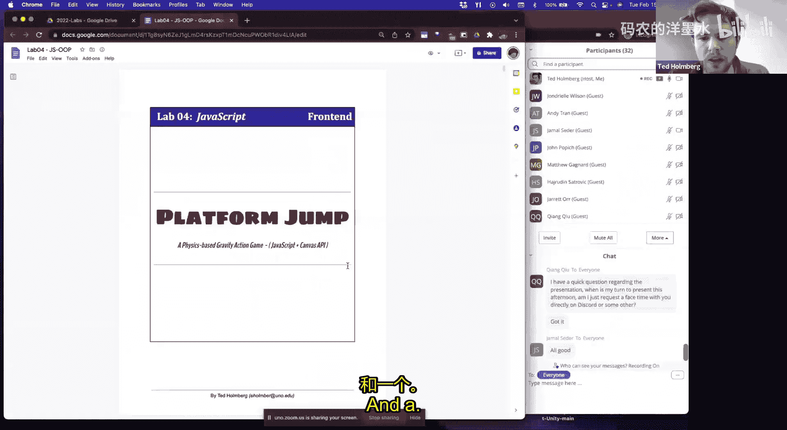

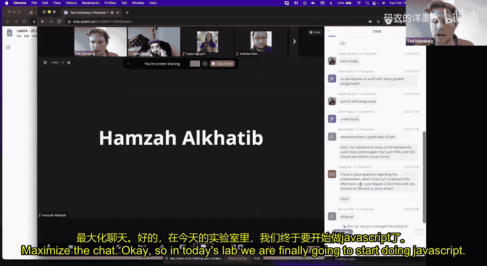

在本节课中，我们将开始学习JavaScript，并着手构建一个基于浏览器的平台游戏。我们将采用面向对象的设计方法，从零开始逐步实现游戏的核心功能。本节课是系列课程的第一部分，我们将完成项目的初始设置和基础架构搭建。

---

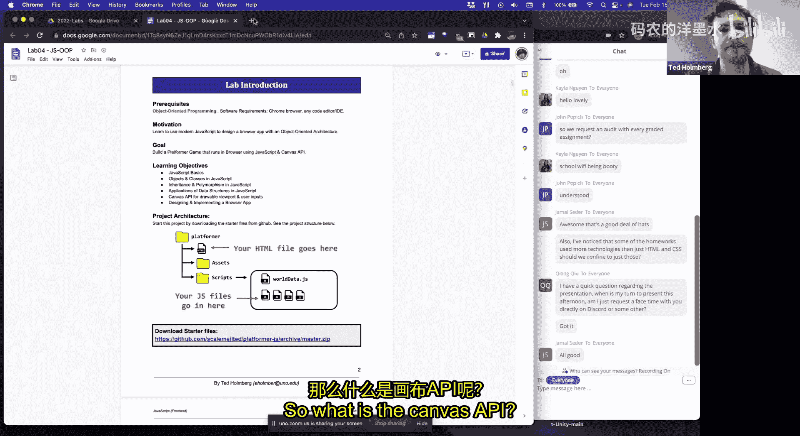

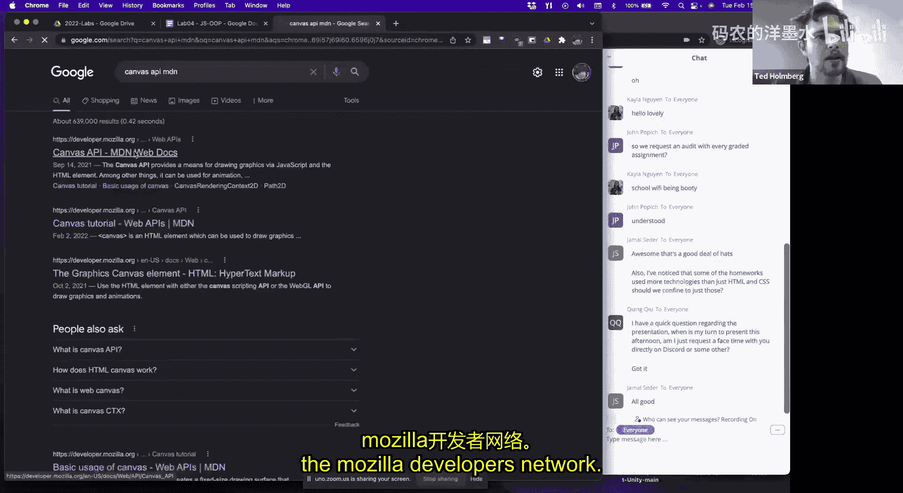

## 课程概述与目标

本节课的目标是开始一个JavaScript项目，并采用面向对象的设计方法。我们将构建一个平台游戏，玩家需要跳跃方块、躲避危险并找到出口。我们将学习JavaScript的基础知识、类和对象、继承与多态，以及如何使用Canvas API进行绘图。

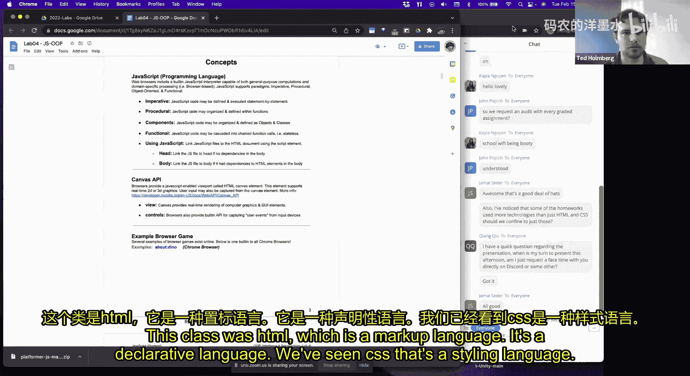

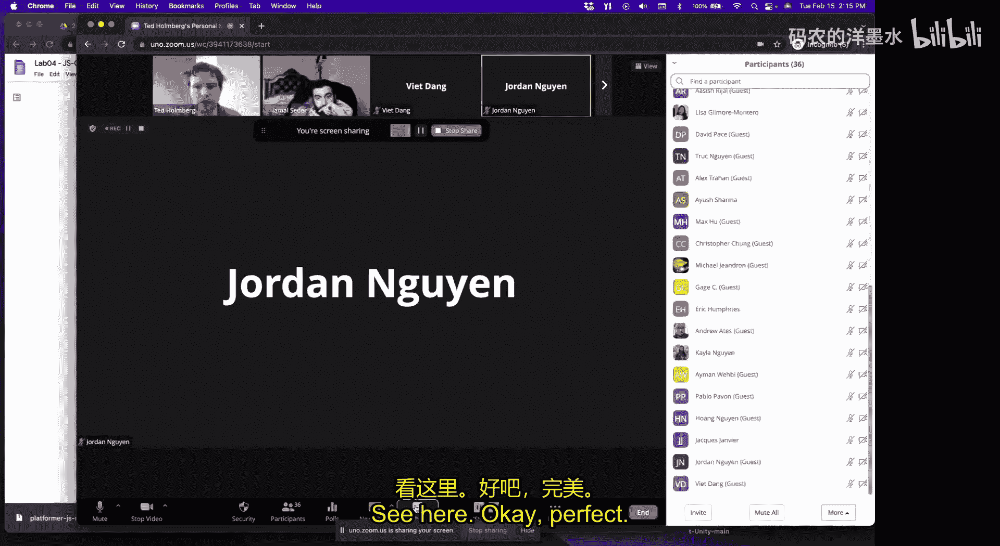

## 项目架构与设计

我们将采用迭代开发的方式，将项目分解为多个小目标。项目目录结构如下：
*   `platformer.html`：应用的HTML入口文件。
*   `assets/`：存放所有图像和资源文件。
*   `scripts/`：存放所有JavaScript文件。

我们的游戏将遵循模型-视图-控制器（MVC）设计模式：
*   **模型**：管理游戏数据和逻辑（如`Game`、`World`、`Scene`类）。
*   **视图**：负责渲染图形到Canvas（`View`类）。
*   **控制器**：处理用户输入（如键盘事件）。

以下是计划创建的核心类：
*   `Game`：管理游戏主循环和规则。
*   `World`：加载和管理关卡数据。
*   `Scene`：管理场景中的游戏对象。
*   `GameObject`：所有游戏实体的基类。
*   `Block`：继承自`GameObject`，代表可碰撞的方块。
*   `Player`：继承自`GameObject`，代表玩家角色。
*   `Physics`：管理重力、摩擦力和碰撞检测。
*   `Controller`：管理玩家控制输入。
*   `Animation`：管理角色动画。

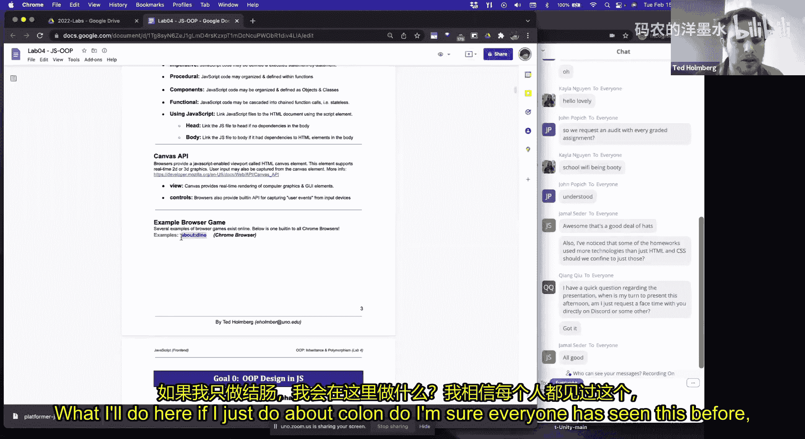

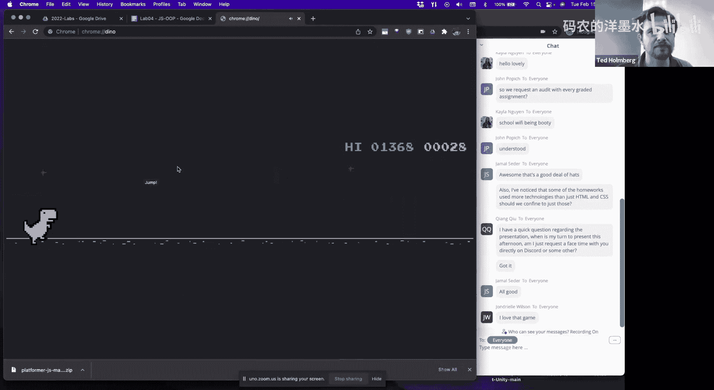

---

## 目标1：创建HTML页面

首先，我们需要创建一个HTML文件作为JavaScript应用的启动点。该文件将包含Canvas元素，并导入后续的JavaScript文件。

### 实施步骤

1.  创建名为`platformer.html`的文件。
2.  在文件中添加基本的HTML结构，包括`<head>`和`<body>`。
3.  在`<body>`中创建一个`<canvas>`元素，为其设置ID、尺寸和边框样式，以便在浏览器中可见。

以下是`platformer.html`的初始代码：
```html
<!DOCTYPE html>
<html lang="en">
<head>
    <meta charset="UTF-8">
    <title>Platformer</title>
</head>
<body>
    <canvas id="viewport" width="500" height="500" style="border: 1px solid black;"></canvas>
</body>
</html>
```

### 测试

在浏览器中打开`platformer.html`文件，应能看到一个带有黑色边框的500x500像素画布。

---

## 目标2：创建视图（View）类

上一节我们创建了HTML页面，本节中我们来看看如何创建负责图形渲染的`View`类。这个类将封装Canvas API，提供绘制图像的方法。

### 实施步骤

1.  在`scripts/`目录下创建`View.js`文件。
2.  在文件中定义一个名为`View`的类。
3.  在类中定义私有实例变量`#canvas`和`#context`，分别用于存储Canvas元素及其绘图上下文。
4.  创建一个构造函数，用于初始化这些实例变量。
5.  添加一个`picture(image, x, y, width, height)`方法，用于将图像绘制到Canvas的指定位置。
6.  在类外部创建一个全局常量`view`，并实例化`View`类，使其在应用中像单例一样使用。
7.  在`platformer.html`的`<body>`末尾导入`View.js`文件。

以下是`View.js`的代码：
```javascript
class View {
    #canvas;
    #context;

    constructor() {
        this.#canvas = document.getElementById('viewport');
        this.#context = this.#canvas.getContext('2d');
    }

    picture(image, x, y, width, height) {
        this.#context.drawImage(image, x, y, width, height);
    }
}

const view = new View();
```

在`platformer.html`中导入：
```html
<script src="scripts/View.js"></script>
```

### 测试

在浏览器中打开开发者工具的控制台，可以手动测试`View`类：
```javascript
// 创建一个图像对象
let bg = new Image();
bg.src = 'assets/background.png';
// 使用view单例绘制背景
view.picture(bg, 0, 0, 500, 500);
```
如果背景图像被成功绘制到画布上，则说明`View`类工作正常。

---

## 目标3：创建游戏（Game）类

现在我们已经有了视图，接下来需要创建管理游戏核心逻辑的`Game`类。这个类将负责游戏的主循环、状态更新和渲染调度。

### 实施步骤

1.  在`scripts/`目录下创建`Game.js`文件。
2.  定义一个名为`Game`的类。
3.  添加私有实例变量`#isOver`，表示游戏是否结束。
4.  创建构造函数，将`#isOver`初始化为`false`。
5.  创建`update()`和`render()`方法作为存根，目前仅在控制台输出日志。
6.  创建一个静态方法`main()`，作为游戏的主循环。在此方法中，检查游戏是否结束，如果未结束，则调用`update()`和`render()`方法，并利用`window.requestAnimationFrame()`递归调用`main()`自身以实现循环。
7.  在类外部创建一个全局常量`game`，并实例化`Game`类。
8.  在`platformer.html`中导入`Game.js`文件。
9.  添加一个脚本，在文档加载完成后，调用`Game.main()`启动游戏循环。

以下是`Game.js`的代码：
```javascript
class Game {
    #isOver;

    constructor() {
        this.#isOver = false;
    }

    update() {
        console.log('game update');
    }

    render() {
        console.log('game render');
    }

    static main() {
        if (!game.#isOver) {
            game.update();
            game.render();
            window.requestAnimationFrame(Game.main);
        } else {
            console.log('game over');
        }
    }
}

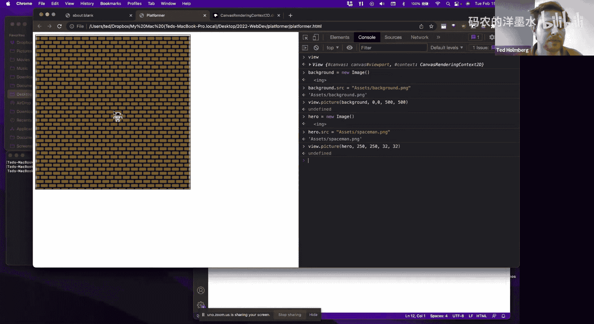

const game = new Game();
```

在`platformer.html`中导入并启动游戏：
```html
<script src="scripts/View.js"></script>
<script src="scripts/Game.js"></script>
<script>
    window.addEventListener('load', Game.main);
</script>
```

### 测试

刷新浏览器页面，打开开发者控制台。应该会看到“game update”和“game render”信息在持续不断地滚动输出，这表明游戏主循环已成功运行。

**注意**：测试完成后，请删除`update()`和`render()`方法中的`console.log`语句，以免干扰后续开发。

---

## 目标4：创建世界（World）类并解析数据

上一节我们建立了游戏循环，本节中我们来看看如何创建`World`类来管理关卡数据。我们将使用预先提供的关卡数据文件。

### 实施步骤

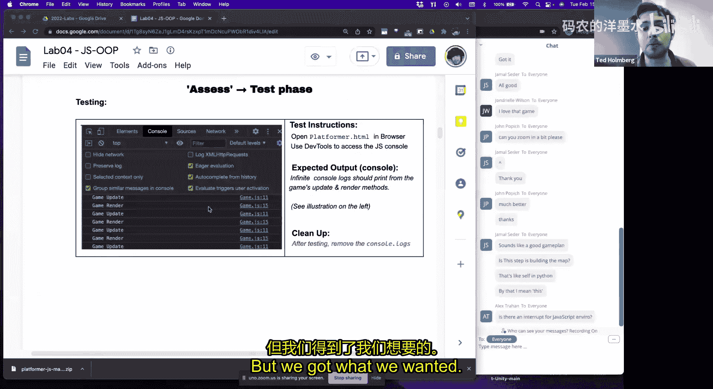

1.  项目已提供`world-data.js`文件，其中定义了一个全局数组`world`，包含三个字符串，每个字符串代表一个关卡的地图。字符含义如下：
    *   `#`：标准方块
    *   `V`：天花板危险
    *   `A`：地板危险
    *   `@`：玩家起始位置
    *   `!`：出口
2.  在`scripts/`目录下创建`World.js`文件。
3.  定义一个名为`World`的类。
4.  添加私有实例变量`#levels`，用于存储解析后的关卡数据（二维数组）。
5.  创建构造函数，使用数组的`map()`和`split()`等高阶函数方法，将`world-data.js`中的字符串数据解析为二维字符数组。
6.  在`Game`类中添加一个`#world`实例变量，并在其构造函数中实例化`World`类，以便游戏可以访问关卡数据。暂时使用`console.log`输出`world`实例以进行验证。
7.  在`platformer.html`中按正确顺序导入`world-data.js`和`World.js`文件（`world-data.js`需在`World.js`之前导入）。

以下是`World.js`的代码：
```javascript
class World {
    #levels;

    constructor() {
        this.#levels = world.map(level => level.split('\n').map(row => row.split('')));
    }
}
```

更新`Game.js`的构造函数以包含`World`：
```javascript
class Game {
    #isOver;
    #world;

    constructor() {
        this.#isOver = false;
        this.#world = new World();
        console.log(this.#world); // 用于测试，后续删除
    }
    // ... 其他方法不变
}
```

在`platformer.html`中按顺序导入：
```html
<script src="scripts/world-data.js"></script>
<script src="scripts/World.js"></script>
<script src="scripts/View.js"></script>
<script src="scripts/Game.js"></script>
```

### 测试

刷新浏览器页面，打开开发者控制台。现在除了游戏循环日志，还应该能看到一个`World`对象的输出。展开该对象，可以看到`#levels`属性是一个三维数组，准确地表示了三个关卡的字符布局。这证明我们成功解析了关卡数据。

---

## 本节课总结

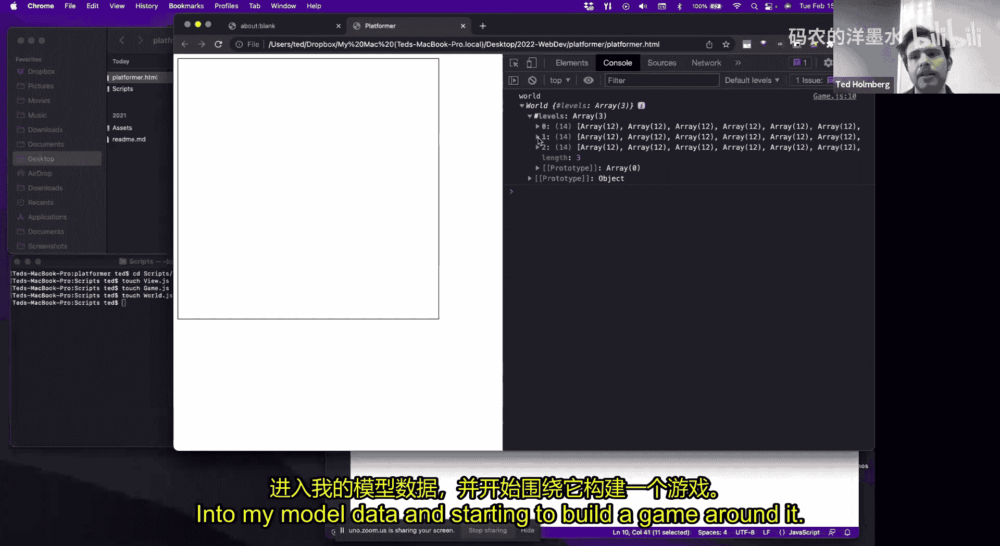

在本节课中，我们一起学习了JavaScript面向对象编程的初步实践。我们完成了以下工作：
1.  创建了项目的HTML入口文件并设置了Canvas画布。
2.  构建了`View`类，它封装了Canvas API，负责游戏的图形渲染。
3.  构建了`Game`类，它建立了游戏的主循环，管理更新与渲染流程。
4.  构建了`World`类，它成功加载并解析了外部的关卡数据，为后续创建游戏对象奠定了基础。

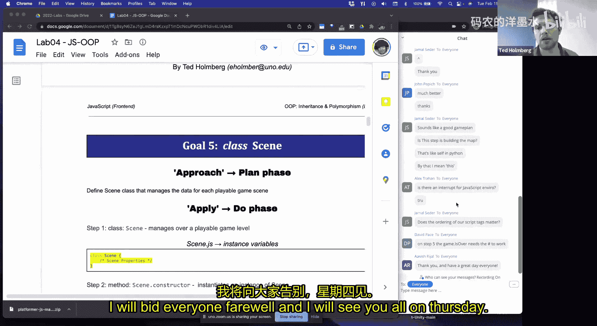

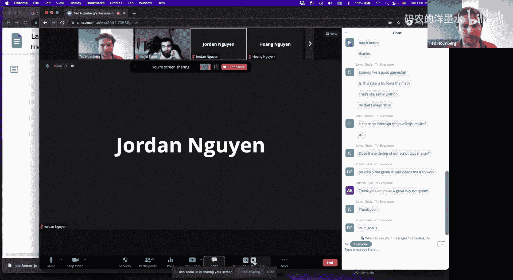

我们已经搭建起一个基本的、可运行的游戏框架。在接下来的课程中，我们将继续迭代开发，创建`Scene`、`GameObject`、`Player`等类，并逐步添加物理、控制、碰撞检测等功能，最终完成整个平台游戏。