# 【全集】加州理工学院 高级Web应用 中英字幕 1080P p06 Lecture 6 - JavaScript 面向对象编程 part2 -BV192zTBrEmu_p6-

So。诶。Okay there we go， I recording at this point， yeah， it looks like it okay。So。

In today's video lab， I want to pick up exactly where we left off from the last video。

 so in the last video we started working on a pretty comprehensive JavaScript application that's going to take full advantage of objects oriented principles and so we got to go three which was to be able to parse。

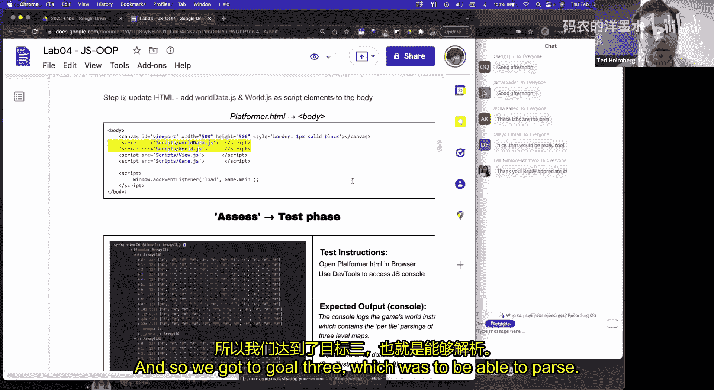

The data。From this JS file that we were given as a part of this lab assignment。We had this array。

 it's a multidimensional， well， it's a not a multidimensional array。

 but it's a array that contains strings， but then we're going to parse these strings so that we can go ahead and treat them as a two dimensional array of tiles。

 of characters that represent each tile。So again， right here what？What I have here was the level one。

 level two or level three， or if we want to be consistent with indexing level zero。

 level one and level two。And so probably the strangest thing we did last last lab was this。🤢。

Was this map operation and you do this map operation on a array and you can pass in a function。

So this is what's called a high order function because it's a function that takes in another function。

And so this is a anonymous function， it's a fat arrow function。That it will iterate over each level。

 And so this is just a label we give。 So when it maps over every element in the array。

 we're going to reference each element as level。 And for each level。

 it's going to split the string by all of its new line characters。

 Will this split operation in and of itself returns， an array of string。Right， so let's say。

 let's actually， let's actually see if we can't see what this does。

 let me grab this line just to make sure everyone。If you have any questions about what's happening here。

So what was the name of world， Okay， so if I have world， right？So I have world。

 if I go into world at index zero， right， that is my。String。

That has all of this a that has all of the new line characters it has all the spacing right。

 so if I then go ahead and say if I take the zero index and I decide to split based off of a new line character。

What I'm going to get back is an array。Where the delimiter is a new line character。

 and I get a string。Of each of the rows。 So this represents the 14 rows of a level。

 and then if I go and split that resulting array based off of just an empty string。Let me see here。

 let me bind this actually， let's take this and bind it to， let's call this our rows。Rvel rose。Okay。

 so if we take the level rows。And since this is a。嗯。There we go， since this is an array itself。

 let's just take a sample one， so if I were to take this zero row and then split that again。

Which is a call we can do on a string， on an empty string that it's going to split each individual character。

Effectively， what we're doing that is we're going through each index of world。

To get the entire level data， then we're splitting on new and all the rows。

 and then we're taking all the individual rows and we're splitting the characters。

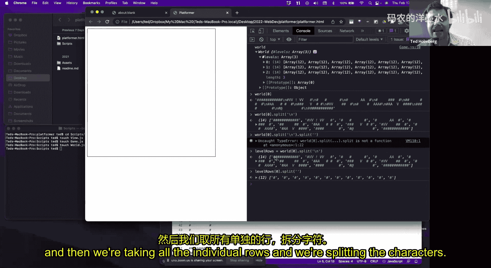

Okay， so just I just， I kind of glossed over this very quickly。

 but when I reexamined this after we had talked about it last in the last video。

 I thought it was worth kind of investigating what was happening to be able to parse that data in one line of code。

And these are the kinds of operations that you can learn to do from the JavaScript data structures video。

 and I think the quiz will go ahead and kind of question you about some of those things。Okay。

 did that explanation help， does anyone have any questions about how this works or did like illustrating the step by steps on just a row at a time and a level at a time help。

I guess break down the logic of what's happening here。

That's a good explanation thing is the level in row。

Like one of it says level and one of it says row can we just put like any that any key there yes yes so here going back to this and let me just run this code just like this so here when I run this you'll notice it。

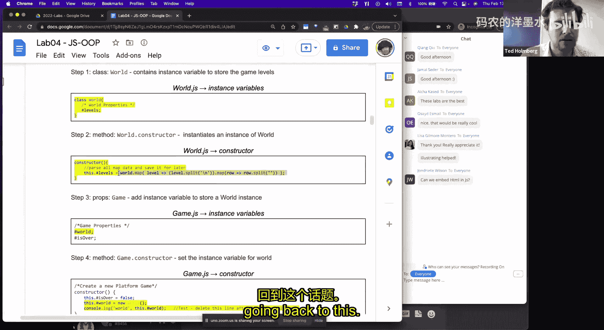

Breaks each of these down so I can break， I can run this code independently right in the JavaScript so the question is。

 can we call。Okay， can we call these anything， Yeah， these fat arrow functions this is the。

That fat arrow functions are no different than any other functions。

 so what we're doing here is I could have called this X if I wanted to right I just have to be consistent because when I call X here what's happening is I'm mapping over each element in world and I'm going to give it an identifier of X so I can reference it inside of this function。

 this anonymous function， so if I'm going to call each element。That gets iterated through world X。

 I got to call it X oh no， don't autocomp on me， I'd have to call it X here， no， stop。ok。

And so on X then， we know that each。Each level is all the level data。

As a string that has new line character。 So if I want to find the rows。

 I can separate the string by new lines， and that's going to create a new array where each element in the array is a row a row。

It's a string that represents an individual row for all the rows inside of our grid effectively。

 So then since this returns back an array， I can always call the map function on an array。

 So this is called cascading function calls this this style of programming， by the way。

 is what's called functional programming so you've learned methodologies and object oriented programming。

 but when we start moving into a functional paradigm， the idea is that we can do a series of。Calls。

Where we pass data from one function directly into another function directly into another function。

 another term for this is cascading calls and what this allows us to do is not have to maintain any state between function calls。

 we're just passing the output of one function directly as input to the other function。

And so remember world is an array， we're going to call the map function that allows us to pass a function into this and it's what map is going to do is it's going to iterate over every item in the array。

And apply this function to it。 So X will represent an item， all the items in the array one at a time。

 and then for each item will split on a new line character but that itself is gonna return an array of all the rows and since that's an array itself。

 we can then map another function on top of that return array and that return array。

 I would want to take each row because that's what that represents now it doesn't mean anything it's just like a variable label So if I wanted to call this Y I could do it although I don't like X and y because it's not very descriptive of what I'm representing right' not self what I would call self documenting code but this would work So for each row string。

 I could then split that。😡，Into a base off of the characters， but by doing it on the empty string。

 And so then that itself is going to return an array。 So if I hit enter or you see。

I changed the labels that didn't matter the keywords here were map and split split is done on strings map which converts into it converts a string into an array and maps are called on arrays to be able to iterate through and make decisions produce a new array based off of some kind of decision making on the old array and again if we run that you'll see the results going to be three arrays and each the elements of this three element array is a 14 element array well if I unpack that I can see that the elements a 14 elements of those arrays are going to be the individual characters 12 elements in each of those that represents the tile in our levels。

😡，Did that better kind of explain that yes， I also did notice。

 I also did notice that x dot split those parentheses around it。

 it's not really necessary because we don't have it around the Y dot split。So like the consistency。是。

Oh yeah， where are you talking about if we did something like。Here， for instance。So we move it there。

 then we'd have to move it here。 and there we go， yes。very good call。

 I might remove that from the a if that makes it doesn't make it read more readable for everybody removing that Yeah because I thought they were two different functions。

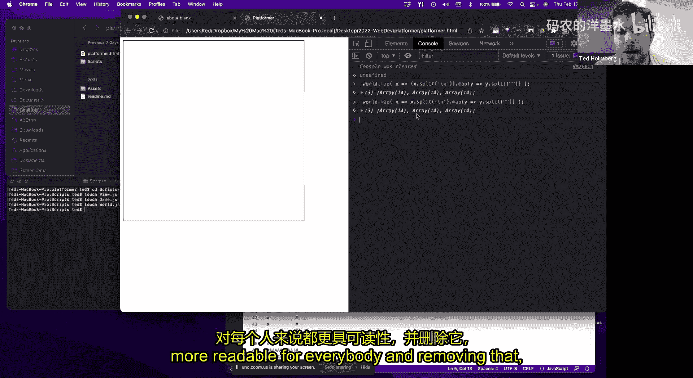

I got you， okay， so so let's go here then oh I'll do that。

After this video because I have it in a view mode right now and not in edit mode。

 but let me actually， let me go to。you。I'll do that later。But I'll make a note about that right now。

 I'll send it in with the with the quiz information。Excellent， thank you okay。

So now I want to move so if everyone is good with what we did in goal4。

 let's move to goal5 because now what we can do is we can parse the level data that was outside of our application such that we can treat it as data that is inside of our application and let's start defining a scene from this from this data so here to define a scene class。

 we should understand that the scene will manage all the data for each playable game scene so we might have multiple scenes in our game。

 but the scene would contain things like all of our game objects like the player and the tiles and the hazards and the exit。

So to start。Let's define this created scene。js file and then start to define our classco on it。

 so I'm going to come over here and I'm going to make a new Js file。😡。

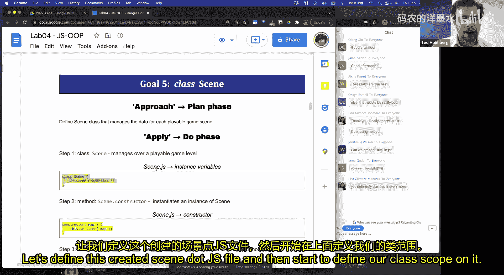

See do Js。Perfect， now let me go over here and I'm going to go into my scripts director I'm going to grab that。

I'm going to grab that here into my IDE and we will start by the。

Focus that and we're going to start by defining the scope of our scene class so again classword uses keyword class then seen and then we're going to open a closed scope so far this looks very similar to Java just like the other classes we defined。

Then I'm going to define a constructor which will allow us to create instances of our class so right now we don't have any scene properties。

 but I'm going to put a comment where they would go if we decide to add any in we will add some in eventually but right now we're just stubing out our implementation so here we're going to assume that what a scene needs to be constructed we're going to actually have a parameter now we're going to need some form of a map。

So so that we can use the map as a basis to build out our scene and then what our constructor is going to do so we don't litter the logic of setting the scene up inside of our constructor。

 we're going to call a helper function that we're going to call set scene that's going to exist inside of our class so this doesn't exist yet。

 we haven't to find it yet， but again， in order to access other functions defined in a class。

 we use that this keyword very similar to what we do in Java。

And then what we're going to do is we're going to pass this map。

Value that got passed into the constructor to the set scene method so that it can go and parse the scene and actually build it as a data model inside of our application。

Okay， so what is set scene going to do of this is that helper method that's going to parse each tile。

In in the 2D grid model， the one that we were able to produce from the last goal。

 so let's walk through and see what this is going to do。There we go。

 so we're going to have a method set seen it's going to we're going to for for。

All intents and purposes we're going to label this argument that gets passed into here this parameter will be referenced as world data。

 so even though it's called map here， the map could also be considered the world data for the scene again these are just aliaes or IDs。

 right？And so here。When I look at my world data it's a 2D array right like let's go back over here and just take an examination so each scene would be an index inside of here so here would represent one scene well this scene is effectively a 2D array。

😡，That's 14 rows or 14 items in the outer array and each inner array is 12 elements。

So if I go ahead and access the first row and ask for the length of it。

 that's going to be the number of columns so let's see what that looks like so if I have let me bind this。

😡，A variable。 So let me call this something like。World data。Okay。

 let's clear this because this is getting messy。Okay， so let's go to world data here now if I。

If I index， okay， so let's get the first one now imagine if this is the level。

 so here let's call this my level data。Okay， so this is what we plan to have passed into a scene constructor。

😡，A 2D array of each of the individual characters that kind of defined the grid of our scene。Okay。

 so if I go into level data。At index zero， that'll be the zeroth row。😡。

Notice it gives me all of the tiles across one row， so if I do dot Li。😡。

That tells me I have 12 columns， right？😡，And then if I wanted to find out how many rows I have well。

If I dot dot length on the outer array。That's the number of elements that'll tell me how many rows。

So I can index into the zeroth element to find the number of columns and we know that since this is a tabular data。

 all of my rows have the same number of columns， then I can make a default value that says， oh。

 not what I want it。

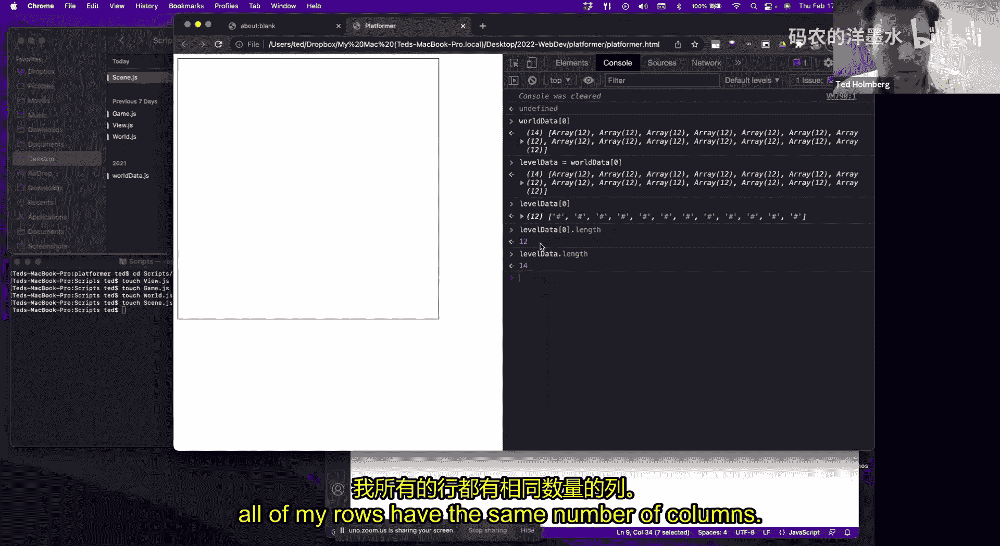

That's going to say this is the number of columns I have and this is the number of rows I have。

As a basic software engineering principle， if you haven't covered this before。

 you try to give as little privilege to a memory address as possible。

 So when I go and declare a variable instead of using the variable that gives me the most amount of right access。

 I preference using the least amount of access unless it's necessary。 So you're gonna to see。

 I like to use cons a lot to refer to data that I intend to be read only and this is a this is。

Secure programming practices to ensure data that is supposed to only be referenced for later use never changes state accidentally。

You can guarantee that by declaring a constant so I mean the same can be true in Java and the same should be true when you build up your applications。

 always make a decision， is this data something I want to reference to and write to or just reference to。

So this gives me the number of rows and the number of columns then i'm going to create a double loop right so for each y across my rows and then for each X value across my column so this is my XY coordinate space。

 I'm going to go ahead and read each tile inside of the level data。

And so recall that the outermost array represents the rows and so if we want to think of why is moving up or down。

😡，On a Cartesian plane， then I'm going to put my Y index on the leftmost in index reference。

 and then if you recall the innermost arrays represent the number of columns that would be equivalent to moving across the X access in a Cartesian plane。

 so the outermost index， the rightmost index is where I'm going to put my X。😡。

So this will iterate through the 2D array and get me every individual tile and then what I'm going to do when I grab that each of those tiles is I'm just going to console log them to ensure that I've parsed my level correctly my level data correctly and again this console log is designed to be a test。

😡，For this goal， so we will delete it after finishing this goal just to ensure that what we built here is working the way we expected it to。

Okay， so now after I've created this set scene method。

 the next thing I'm going to do is I'm going to go into my world class and I'm going to add a new method that isn't in there I'm going to add the gi level method and what the role of this method that's going to do is it's going to return the level from the levels array given a level number。

So， let's go at。Let me save this， I see this is unsafe so let me save this now I'm going to go to my world scene and right now it doesn't have any methods so I'm going to add some new functionality now that we're going to need it。

And so one of the things my world class is going to have to do is be able to have an integer number pass to it。

 and it's going to give back the 2D array that represents that level。

So here the way I'm going to do that is I'm going to do a return statement and I'm going to access the one property。

 the instance property that is private that's what the hashtag represents a that represents levels now levels is going to be effectively what I have in here。

As my world data so this is this is what's essentially that's going to be so if I pass say the value of zero I'm going to return back this array。

 the 2D array or if I return back the the index of one， I would return back essentially level two。

Or if we want to be consistent with our numbering， this would return level zero， level one。

 and level two。Excellent。Okay， so now that I can get levels from my or get a level from my world instance。

Let's go into our game class and we're going to have to add some properties。

 we're going to want to update our game class so that we can go ahead and have a current level number and a scene object。

That we're currently on。And again， when you're walking through this。

 highlighted values represent new code in pre existingist code。😡。

So now I'm going to go to the game class and here I'm going to add two new instance variables。

 private instance variables。There we go。A level and a scene。

And now I'm going to go into the constructor and actually set those up because the purpose of any constructor。

呃。I haven't tested that out yet。So do I need to， Oh yeah。

 so I need to delete this goal from last time。So that was a cleanup work that I missed from goal4。

 so here in my constructor I'm going to initialize my level property as zero。

Then I'm going to create a constant just to be able to locally hold my level data。

And from the world right， which was instantiated here， so from my world property。

 I'm now going to invoke that get level method。And I'm going to pass it in the level that we just started at so that would be zero。

And then once I have this level data， I'm going to pass that to my scene constructor。

 which will then。😡，Pass that to the set scene method， which will then take that。

Get the number of columns， get the number of rows， parse it， and actually print each of those tiles。

Excellent， and then I'm going to then take that scene instance and I'm going to then set that into my scene property。

And then the next step I'm going to do after that is I need to add this new scene dojs。Into my。

Htm document because effectively my HTML document is serving as my dependency manager。

 so all of my JavaScript dependencies are being archived in this XM'm sorry this HTML document。😡。

And so I know that a scene。Is gonna to。Let's say a scene is autonomous。

 I'm going to put it towards the top。 The ordering doesn't really matter as long as there's nothing that depends on scene。

 as long as things like。The dependencies that matter here in this arrangement。

 I need to put game at the bottom because game depends on things like view and scene and world I could switch scene and world if I wanted to because they're not。

😡，Are they interdependent， let me say。Yeah， see they're not they're not the scene class isn't making any calls to world。

 so that is arbitrary， but there are instances where our ordering for scripts does matter and it's going to matter based off of if one class relies on another。

Okay， so with that said， let's jump back on over to here。And let's go to the next step。

 well that's going to be the final step in this goal。

 so at this point if I open up my platform HTML file。My platform file。

 I should get this expected output where the console logs each tile from the first level map and we'll see when there's duplicated strings here。

And again， after we're done testing， weve got to remove those console。 logg。

 so let me clear my console here and let me do a refresh of this page。

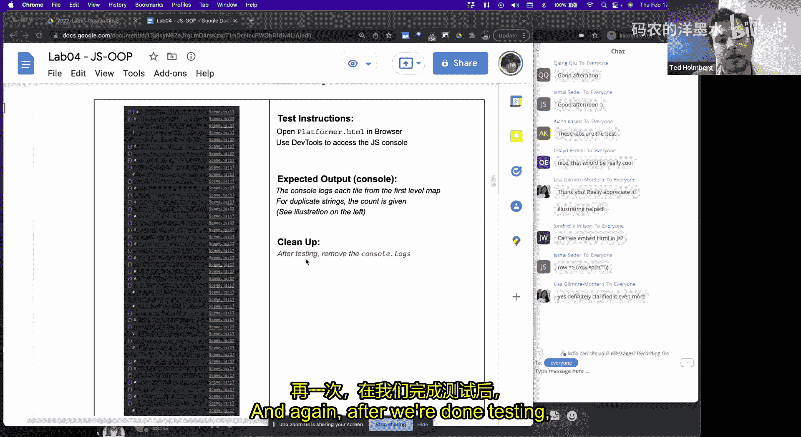

I guess。I refresh okay， so what I have if I scroll up is I have 13 instances of a hashtag。

And then I have two instances of AV and then an empty space and then an exclamation mark so then if I go back and actually look at the world data。

 I'll see yeah， one， two， three， four， plus six， 12 and then 13 then two instances of these。

And then I have a empty space and then I have an exclamation mark and then I have an empty space and then two theses and then probably what three empty spaces。

 you three empty spaces， then another hashtag represents the wall。

Then six empty spaces and then another two hashtags that represent a platform。

 so what I'm seeing here is I'm actually successfully parsing the tiles individually。

That's what this output represents for each and all of the rows。

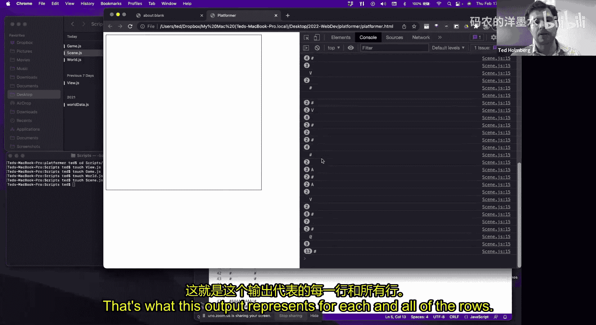

So this is great， we've successfully been able to get our scene data。

Our level data into our scene class， so let's move on to the next goal where we are actually going to start defining game objects that we can build into our scene。

So our general approach is first， let's talk about what a game object models so the and what the responsibilities of it is the game object is going to manage。

All of the data that a game objects share， so again we're thinking with inheritance in mind。

 so we're going to presume that our player and our block and our hazards all have shared qualities that make them game objects and these shared qualities are going to be defined inside of our game object class。

😡，So now let's start building a game object class， the first thing i'm going to do is create a JS file that's going to be called game object and I'm going to use uppercase letters because this is going to be。

Represented as a class file， so we use a lot of the same notation that we would use in Java。

And let's go over here and let's get the ID here。 Okay， so let me click on my game object going。

's right。诶即。Ihys dragging so problematic for me sometimes？Oh， there we go。There we go。

So I have game object loaded into my editor and so the first thing we're going to do is create our class and define the properties that a game object models the shared properties that every game object will have so I have my class game object open and close scope and then I'm going to list all of my variables here。

And I'm going to prepen them with a hashtag because that declares them as private so every game object should have an X coordinate。

 every game object should have a Y coordinate， every game object should have some type of width。

Every game object should have some type of height and every game object should have an image associated with it so we can render it。

So regardless of whether it's a fire or a floor hazard or an exit tile or whatever。

 all of these are characteristics that they all share。

And because we'll need all that data to be able to even draw an image onto our canvas so presumably all game objects are something we can draw so after we've defined the properties the next thing we want to do when we design a class is to go ahead and create our constructor。

Oh yes， we should clean up， thank you for reminding me if I haven't cleaned up from my last step。

Let's go and I believe the cleanup work I have to do is inside of scene where I can go ahead and get rid of this console log。

Excellent。Okay， so now that I've cleaned up in the previous step。

 let me go back to my game object and I actually create my constructor so here。I have my constructor。

 let's see let's actually tab that over。 Okay， perfect so what my constructor is going to require in order to build a game object。

 I'm going to need an X and Y coordinate passed in。

 I'm going to need a width and height to be passed in and I'm going to need a pathway to an image that I want to be able to use to draw this particular game object and then I'm just going to take the values that are passed into the constructor and I'm going to bind them to my instance variables。

Excellent， and so notice one one thing to look at so here I'm just doing x and y binding de I'm doing with and height binding I'm doing one additional thing though for my image I'm actually creating an image here。

 I'm creating a new image so this is part of the JavaScript API where I can create HTML element so this is going to create an image element and by default the image element source is empty so then we're going to access the source。

And we're going to pass that， which is going to be the image file pass so that we can actually treat this as an image。

 an HTML image。That we can then render into our canvas。Okay， now that we do that。

 all game objects are going to have the expectation that they can be drawn into our canvas into our view。

 so we're going to use our instance variables to draw the image into the canvas so we're going to create a draw method。

And our draw method will go ahead and access view， well recall that view is a constant variable that's in our global scope。

So we declare this outside of the classco， which means that this is now registered as a global variable inside of our application。

😡，And we're going to treat that as a single tin， so any the time we want to manipulate something that's managed by our view。

 we can access the view variable and call a method inside of there so this this view。😡。

Instance has one method， the picture method， so I'm going to tell the view to go ahead and use its picture method and I'm going to pass it what it requires。

 which is going to be eight image。The X and Y coordinate that we want that image to be loaded into in our canvas and then the width and height that we want the image to be drawn within our canvas element。

Excellent， so now that now that we've created a game object class。

 let's go ahead and start using it within our scene class。

So that we can test it out to make sure it works the way we expect it to so now we're going to add a new property to our scene。

 which is going to represent our the background game object。So。

Let's go to our scene class and unders properties currently there's none we're going to add a background property and again we're going to preface it with a hashtag because we want it to be private to the class itself to。

To the instance。And now the next thing I'm going to do is inside of my scene class。

 I want to set a new helper method that's going to set the background。Property of our scene。

And so this is going to create a new game object based off of the rows and columns。

The number of rows and columns。So let's go over here。

 let's go into scene to underset scene I'm going to create this new map。

And what this map is going to require is the number of rows， the number of columns， it's going to。

Have a default。Ands going to have a default。Parameter， so what this is is a parameter。

 but I can assign it and if I assign it， then if I don't。Provide a value here。

When I invoke this method， then it's going to assume this is the value it should have。

So this is one of the first instances where we're a little bit different from Java but this is exactly works the way that it doest Python。

 so this is more pythonic than it is Java so in Java you have a concept of method overloading where you can create multiple method of the same name but different parameters it and then the system will determine which method gets invoked based off of the number of parameters。

 the parameter data types and the name of the method。

In in loosely typed languages like JavaScript and like Python you don't have method overloading you have instead of that the ability to have default values bound to your arguments so instead of having multiple methods one that would have just rows and columns and another that would have rows columns and images。

 I can say all this one method has all four of these parameters。

 but if this one's ignored then it starts with this default value of assets background P andG same with tile size if this one is ignored if it's not given。

 then it's going to be assigned the value of 32 now the only thing you should know about default parameters is that your default parameters have to come last because that way it knows what values to assign and the ones that don't have default values and ones that are required to be given。

😡，By the client code are the ones that you lead with。Okay， so with that said。

 I'm going to compute the width of my background。😡。

Based off of the number of columns multiplied by the size of each of my tiles。

 and I'm going to compute the height of my background based off the number of rows multiplied by the size of each tile。

Now that I know what the width and height are， I can instantiate a new game object。

 I start my drawing from the top left coordinate so we want our background image to cover the entire background。

 I'm going to use a coordinate of zero zero and then I want to cover the entire background so we'll draw the essentially bottom right to be the width and the height。

So it'll draw our image all the way across。😡，And all the way down。

And then we're going to pass it the image。😡，The HTML image object to actually get rendered。😡。

So that and then this will return a game object。That we will then bind as our background。

Now the next thing we want to do is since we have that helper method。

 it actually has to be invoked somewhere right so when we go to set the scene。🤧Okay。

After we get the rows and columns， let's go ahead and set this helper method。

 this do background with rows and columns as soon as we do that。As that way。

 it's part of our chain of construction。And now let's go and add a new method in our scene now that we have a game object we can draw。

😡，Let's create a draw method。That's going to manage the drawing of all drawable objects in our game scene。

So here let's go and create a draw method。And so we only have one game object to draw this point。

 so what we're going to do is we're going to access our background property and since it's a game object。

 it has that draw method so we're going to tell it to draw itself。And now that we have a draw method。

 we're going to have to next move into our game class and add a render method and what the render method' is going to be responsible for doing is it's going to manage the drawing of all renderable data inside of the game。

And so for instance， that might be the hD。You see I have the render method here。

 we already defined it， so this is the first thing we can actually add into the render method notice I'm only highlighting。

 I'm not highlighting this because it already exists so I'm actually going to finally add something into the body of this method。

So at this point we have a scene in the game and the scene now has a draw method so every time we render we'll tell the scene to draw and now if I add a h later on and my game manages a h separate from the scene。

 I might also tell my hD to draw as well and I could determine the order by the order of draw commands or statements。

Excellent so now the last thing I need to do before I contest test this is now we have to add the game object into the set of scripts that we're importing from our HTML document again this kind of serves as a as a crude dependency manager of sorts。

which will expose the visibility of our JavaScript to all of our other JavaScript files。

 or more realistically， it's inserting the JavaScript into our JavaScript runtime environment。

So let me go here。And。Let's go。I'll put the game object there because I know that there's no dependencies。

 so I'll put it towards the top。And now the next thing I'm going to do is do my assessment I'm going to see is it doing the game object that I want so presumably if I open my platform or do htm when it instantiates the scene it should it should produce a game object that is my background damage and actually render that。

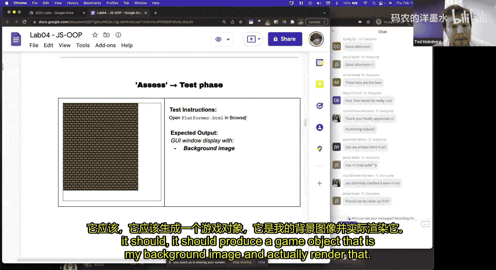

So let's test this and make sure we're getting that， we'll test this and there we go。Excellent。Now。

 notice。That my background image might not fill the entire canvas because we defined our canvas as 500 by 500。

 but if you do the computations， my game level，😡，Is 13， I mean，  12 columns multiplied by 32 pixels。

And 14 rows multiplied by 32 and so that mathematically is going to be smaller than 500 pixels by 500 pixels。

 so even so even though this canvas even though we're drawing the background。

 we're doing it in such a way that this represents the entire level。

 the level just doesn't fill our entire drawable space and that's fine that's you know that's just。

How this is going to work so there's no。

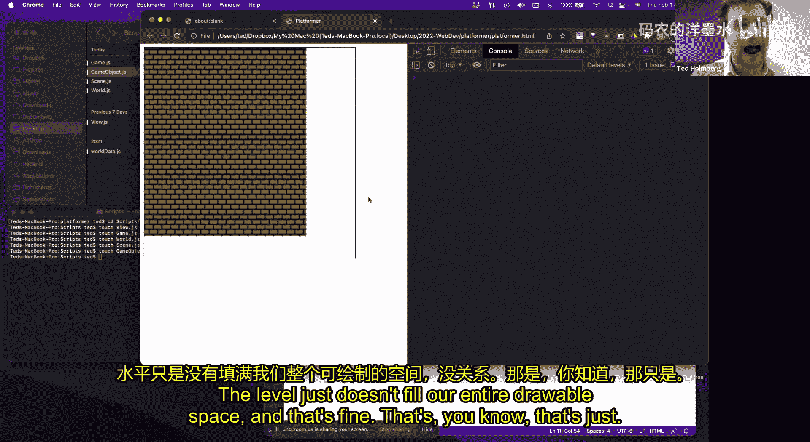

There's no issue there Okay， so now that we can draw now that we can build game objects。

Let's start doing something a little bit more interesting， we can parse the level data。

 we can create game objects， let's create a class next that can model all the blocks that make up a particular level。

Now in the approach phase when we start talking about how we're going to model a block and what's its responsibilities is going to be and what properties doest have and what should it inherit from if anything。

 well， when we model a basic type of brick block， effectively what we should think of it as is an extension of the game object class。

 that way we don't have to reproduce the same properties in a game object inside of our block。

And effectively when we go to apply that concept when we start to implement this。

 we're going to do this very similar to the way we do this in Java so first we need to create a blog class。

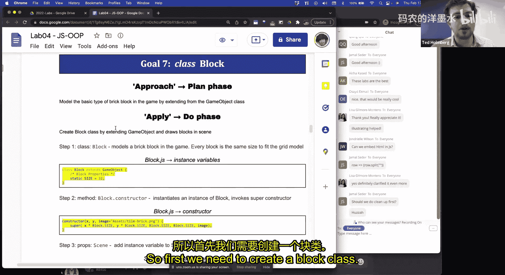

And to do that， we need to create a JS file。So block。ks。Perfect， okay， let me come over here。

And the most difficult thing I can do is drag， y， for some reason， I have so many issues dragging。

Okay， there we go。let's start propping things up here where it's a little bit easier and i'm going to close the world data here start to minimize some of this stuff Okay。

 so I have blocklock。js so let's define the class and some properties of our class。Okay。

 so we're going to create the block class， like we said。

 it's going to model a brick block in the game and every block is going to be the same size so it fits into our grid model。

So。Since this extends or inherits from another class， we're going to use the keyword extends。😡。

Followed by the class we're extending from。And so JavaScript， just like Java。

 uses single class inheritant。And then。If we want a property， that is。

Part of the class and not an instance of the class， we can label that property as static。

So here we will have the static size。😡，And we'll assign that to be 32。

 so this is equivalent of building like a class variable in Java。So very same keywords。

 all the keywords you spent multiple semesters learning， you'll be able to reuse in your JavaScript。

Okay， the next step we should do is going， we need to add a constructor that allows us to instantiate an instance of a block。

So I'm going to go into here into my class and here my constructor。

 so each block when I go to create a block， I'm going to need to know the X and y coordinate that this block is going to exist in within the game level。

 but I'm going to。For the image property of a block。Now we might have multiple blocks in the game。

 we might think of a hazard tile， or we might think of the exit tile as a block。

 but the default value of a block should just be a brick。So I'm going to create a third parameter。

That I'll call NH and in the future I might want to pass it a value。

 but for now I'm going to have the default value go to my tile brick dot PNG inside my assets directory。

😡，Okay， so once I get this data passed into my constructor， I'm going to invoke the parent classes。

 the super classes constructor using the super key。

 again exactly the same way we would do this in Java。

 and then recall that the game objects constructor required five arguments， the X coordinate。

 the Y coordinate， the width the height and the image object。Which is not the image object。

 but the image pathway because the game object will build a image object and then set the source。

Based off of this string that gets past the file path string。

So I need to do a little computation here。😡，When I index into my array。

 I'm going to use indexers right so my numbers are going to be between 0 and 12 for my x value and my numbers will be be between zero and 14 for my Y value for my rows as a number of rows and the number of of columns。

 However， when we start talking about。😡，Coordinates inside of a two dimensional drawable space。

 let's call this the canvas space， the concept of width and height actually matters in terms of the coordinate。

 the XY coordinate so what we're doing here is we're converting from index space from the array indexing space into our drawable coordinate space in our canvas。

 so to do that I have to multiply the width。😡，Of each tile。

 I am going to multiply the height of each tile to its position in the array to actually find out what its coordinate is。

😡，And that's effectively what's happening inside of this logic。Okay。

 so after I go ahead and define my constructor， let's go ahead and move into our scene class and actually add a new property。

😡，Called blocks。Which is going to hold all of the blocks in a given scene。So let's go here。

 let's save this， let's go to scene。Go into this property and I'm going to create a blocks。

Instance variable and now in my constructor， the first thing I'm going to do when I instantiate a scene is I'm going to。

Create an empty array to manage and hold all of the blocks。

And then next thing I'm going to do is inside of my set seeing method。

 after I grab each tile from the level data that got passed in。

 I'm going to send that tile along with the X and Y coordinate。

To this helper method that we haven't created yet， but it's going to essentially have the logic for setting that tile。

In the scene。So here inside of the set scene， right after I grab the tile。

 I'm going to call this helper method with the X and the y that comes from this double four loop because that's going to represent my coordinate space and then I'm going to pass it to character。

That represents a particular type of tile and then set tile will instantiate the type of tile that is and set in the scene at that coordinate space。

So here， let's actually create this helper method。And so this uses what's called what we're going to use here is。

😡，A factory pattern and so the factory pattern is instead of directly instantiating things。

 we're going to have a method that's based off of some key we'll decide which game object to produce for us。

So this is a very common metaphor in a lot of。In a lot of applications and a lot of。

And a lot of frameworks。You don't typically directly access the constructor。

 you use configuration data and it instantiates your game objects or your whatever objects for you。

So on the case of a hashtag， we want to create a block object at that coordinate。

Because recall inside of our level data， the hashtag represents a block， so let's go here。

And I can put this anywhere， I might put it here， so I have all my setters kind of towards the top so make it a little bit more readable for when I go back to edit this or or read over this。

 so I have a set tile method it requires an X Y coordinate that requires a tile which is going to be a singular character。

 then I'm going to create a switch statement。Where it's going to switch off of a character on the case of a。

😡，Hashtag， I'm going to go into my blocks array and I'm going to push into it so this allows me to do an insert into an array and I'm going to push into it a new instance of a block so inside of the push method I'm instantiating a block object at the X and Y that got passed into the subile。

😡，And then after that， i'm going to add a break statement so I don't fall into any additional cases now I could have as easily used。

😡，A nested if else， so if the tile was equal to this， then do this， but again。

 the entire point of this lab is to show you all the different keyword that exist inside a JavaScript and just like switch statements exist in Java。

 so do they exist exactly the same in JavaScript。Okay。

 so now that we have the ability to create a new block and push into our blocks array。

 the next thing we should do is update our draw method in our scene so it can iterate over each of the blocks in our blocks array and tell those blocks to draw。

So setile is going to be the logic that's going to determine what。What？

Character represents a game object in our game model。 so for instance。

 if we go back to our world data。😡，Which actually， unfortunately I。

Took away so let me reopen that up so if I look at my initial world data my world data is being represented as a character so the hashtag would represent a block and a V would represent a a ceiling hazard and exclamation mark would represent a exit right so this is this is a way of essentially serializing our data of expressing the level layout of our scene as a collection of characters Now one thing that we have to do in our scene class is we have to be able to translate these characters into actual game objects so that we can apply our game logic to it so the setile methods going contain the logic that given a character as string it's then going to build the corresponding game objects so we have access to them so we can start building processing operations and having our game logic play a platform or game。

Did that explain your logic？I mean， did that answer your question？Okay。

 so now what I was doing here was I was going to go into the draw method of our scene and I was going to。

Go ahead and。Called this for each method， so for each is a method。

 it's a high order method which means we pass it a function in of itself to operate on for each can be called on a raise。

😡，And what it does is it'll go over each element of the array and。😡。

Pass it as a value into the function that we supply so I。

I don't need to so when I create these anonymous badarrow functions I could represent the input with parentheses if it's just one value though I don't have to put the parentheses。

 but sake for the sake of good coding notations I'll keep that there so here for East block in the blocks array we will tell that block to draw。

And so just just just this gets covered in the lecture， but just to cover it here too。

 one way I can create a function is like this， I could do a function declaration which might be something like function food。

And then food might be like block。And then blocks。Block do draw， right？

So I could have instead of doing an anonymous function effectively what this logic is doing is I could have just passed it F right so I would pass a function to this high order function where it would pass in a block and tell that block to draw so this logic here is comparable to what I'm doing here in fact another way I could have doneF if I could have said oh I want to create a variableF and what F is going to be is using that arrow notation for function declarations given a block is input so that's like that's like this right here I'm going to do。

Wlock do draw。There we go so and then here if I didn't want to be anonymous I could have made a name function and then passed in fo just like that so first of all。

 this is a function declaration this is a function assignment because i'm assigning a function。

To a variable， in fact， I could have also done a function。Exclaration like this as well。Yes。😊。

There's many ways to make a function in JavaScript this is also acceptable where I create a variable called Fu and then I'll create essentially a function that then binds to that name the difference between a function declaration is that it gets hoisted versus a function assignment which does not。

And if you need to know what hoisting is as covered in the lecture。

 it's definitely outside the scope of this lab。But here let me pass back in my anonymous function now the reason why I'm using an anonymous bad arrow function is the only time this function ever gets used is inside of this line of code so it's not worth creating a named to function for that。

So we're just past this for each the ability to have to go over each block and tell that block to draw again these practices are designed practices that are used in a functional programming paradigm so notice we're doing a little of mixing and matchinging the paradigms which is completely okay we can have functional programming principles mixed in with our object oriented principles。

Okay， now that we've essentially updated the draw method so that we go through each block in our blockss array and tell that block to draw when the draw method gets called。

 well， we have to go into our HTML file and add in the block JS file so that it gets imported。

So again， we're thinking of our HTMLL file it kind of。As kind of a。

Depenency manager and here i'm definitely going to make sure that my block Js file is underneath my game object because it inherits from that so I need to know my JavaScriptva runtime environment needs to know what a game object is before it can build out a block。

Then scenes use blocks， so I need to make sure that the scene is below the block。Okay， perfect。

With that said。I should be done this goal and now I should be at the assessment phase。

 so for this assessment I should be able to render all my blocks in their positions。

So I will go over here and I will do a refresh。And there we go。

 I have now successfully drawing all the blocks。Inside of my first level。

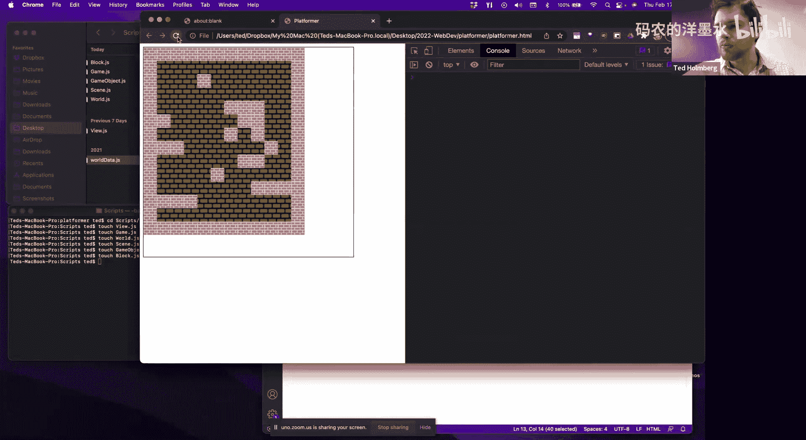

So let's move on to the next goal towards building our platformer now that we have a scene and our scene has a background game object and our scene has a collection of blocks。

That we can successfully render， let's talk about。Building a player class。That will model。

The player data。And player behaviors inside of our game。

And so our approach is to use the game object class and inherit attributes from that to be able to build out our player more easily。

 so before we can start implementing our player， we need to go ahead and create a new。

JS file player JS and again I'm using all upper cases because everything I've been modeling has been represented as class data so here i'll go into my player。

And I will drag this right up here， okay。So I'm going to start by defining my player class and whatever properties it might initially need。

 so most of the properties that I need are already defining game object so when I declare the class I'll make sure to also inherit all of the properties from game object so player is a type of game object。

And the next thing I need to do is define a constructor。

 which will be responsible for instantiating a player instance。

There we go so here we're going to expect the constructor need an X and Y coordinate now we won't expect that there's multiple versions of players like there's blocks right so when we started to create a block where did my block go。

There it is so when we did block we created a third parameter with a default value that used tile bricks with the understanding that well we might reuse this class later on for other game objects but our player object will only be used for players so we only need to know the X and Y coordinate where it starts at and so when we call our super class constructor where we'll do the same computation we'll take the X that's passed in and we'll compute what the coordinate space is on the canvas we'll take our y value based off of the index and compute our coordinate y value we'll take block size which comes from the block class right but that's a static class variable。

 so notice we don't need an instance for that we can get that value from the class itself that's why we made it static。

And that's going to be the width and the height of our player and then the third。

 I mean the fifth final parameter was the source file path of the image we're going to use and we're using Li down I guess we can use Li down that's fine and we'll use the link down PG。

And we'll pass that to our game object。Now that we have defined a constructor。

 let's go and get the player added into our scene the same way we added our blocks。

 so if our scenes going to manage a player we need a we need to have a property to hold our player instance。

 so let's go to our scene。😡，And at the very top where we have our properties。

 we're going to add a player instance variable。And then we're going to go into our set tile method and add in new logic on the occasion that the tile that gets passed in is the case of a at symbol。

 Then we're going to then。Access this player instance variableable and assign it a new player instance at that XY coordinate。

So you can use super keyword the exact same way， you can use it in Java。

 so when you use a super keyword by itself， it's the same as using the this keyword by itself in Java。

😡，嗯。So that's going to refer to the instance itself and so when since a game since a player object inherits from a game object before the player object can be instantiated。

 it instantiates a instance of game object and holds it in itself under the super key word so I can always reference the super constructor。

😡，Using just the super key word， I can also access。

Properties like behaviors that might exist in the super method that might be defined differently in the player class using the super keyword so super so say for instance since I had a two string method inside of my player and I had a different two string method inside of my game object and I wanted to use the game objects two string method inside of the player two string method I could do super do two string inside a player to get the parent classes implementation of a method that I've overridden inside of my child class does that make sense。

Yeah， that sounds good。I just wanted a little bit of clarification on it thank you and and again。

 the same strategies of inheritance that you can use in Java or utilize in JavaScript。

So it should be a seamless transition for designing object oriented applications。And again。

 what's nice about JavaScript though is you're not constrained to one a design metaphor。

 like we're building an object oriented application here。

 but we could just as easily just build an application that uses functional paradigms or uses procedural paradigms or uses imperative paradigms or uses a mix of all of them。

In what makes sense so you're not tethered to any one way of building an application app or building logic for your application Okay。

 so now on the my set tile and on the case of an a symbol as we iterate through every tile we'll go ahead and set the player instance perfect。

So now that we've able to set our tile。I now need to update my draw method of my scene。

 so every time that the scene draws， I'll draw the background， then I'll draw the blocks。

 and then I'll tell the player to go ahead and draw itself to。😡。

So let me go to my draw method and we will add in here this dot player doc draw。Excellent。

So now after I'm done that， I have to go into my HTML file and add this new dependency of the player JS file。

So that it'll actually go ahead and open and so here just like I have the block above the scene。

 I'm going to add the script for my player above scene since the player is going to depend on those classes。

Both instances from。And then after I've done that that's the rest of my implementation。

 so I've now moved to the test phase where I assess this goal and make sure it actually works。

 so I'm going to refresh my page for platform。html and I'm going to check to see if my player also draws。

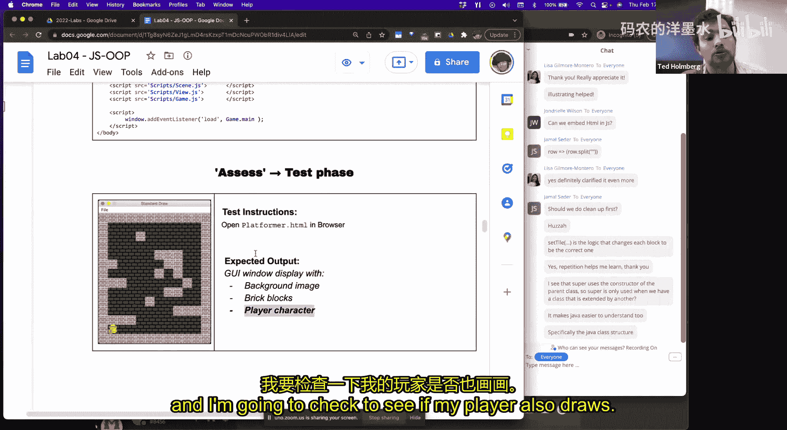

So let's go over here and let's do a refresh and there we go and our playerer draws right where our player is supposed to start at。

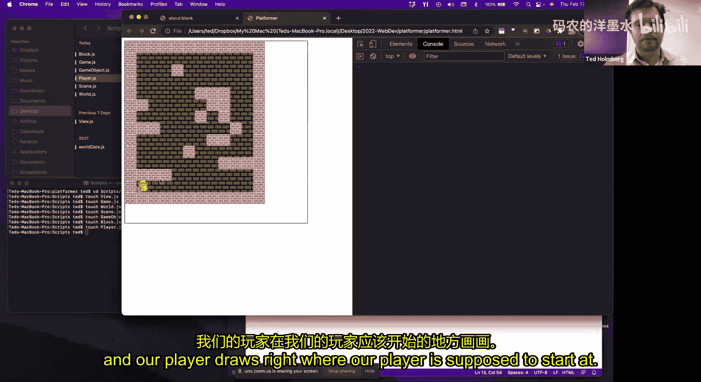

嗯。Excellent。And so for the next goal。I'm going to want to start to implement some physics into my game。

So here the approach for designing our physics is we'll design a physics system for a platform game。

 the gameplay for platformers relies on the idea of pushing the character around with velocities in both the X axis and Y access。

And you might have different forces that influence the player's velocity， such as gravity。

 which constantly pulls the player downward， but you might also have velocities that affect the player's position the world that represents its momentum。

That give movement， so for instance， when you jump that's going to give you a velocity upward or if you go left or right。

 it's going to give you a velocity across the X axis。😡，And of course。

 then friction on your velocity on the X axis will represent you coming to a stop at some point。

So if you're familiar with physics at all， a velocity of zero would represent no motion and a velocity。

 a nonzero value would represent a motion in some direction， so if it's an X velocity。

 a positive velocity would represent a motion towards the towards the right。

 a negative velocity would represent a motion towards the left。

A negative velocity will represent a motion upward and a positive velocity will represent a motion downward now the orientation of up down left and right is based off of our coordinate system the idea of a velocity moving you down means that your coordinate would be increasing。

If we're rendering from our origin point from the top left hand corner。

 right that means moving right is where we're increasing across x and moving down means we're increasing across y。

Excellent， so the first thing I'm going to do in order to model physics in my game is to create a physics class。

And so we need to create a new。The house file。And let me get to my IDE here and。Excellent。

 so now that I have my physics。File made。 Let's go ahead， and。Define the class。

Now I'm going to have to have several properties that my physics class will go ahead and model。

And manage over the speed。Gravity， terminal velocity， and the current velocity X and Y。

And the next thing we need to do whenever we create a new class is to find a constructor that's going to go ahead and there we go。

will instantiate an instance of our physics object and so here。

Our construct is going to require a speed to be passed in and it's going to set that speed as the speed here and then we'll set some values。

😡，To our gravity and you can play around with it when you implement this yourself you can play around with these values to see how it affects how quickly your your character falls so 0。

3 is what will initially default that and this is just from playing around right it's not necessarily based on anything beyond that。

😡，The terminal velocity will be a maximum of eight， again， this is just from experimentation。

And the initial velocity of x and y will be zero。Which will be a standing it'll be a velocity of not moving around at all so now that we have a constructor where we' creating an instance of physics let's actually create some methods inside of there let's create an apply gravity method and so if a downward velocity isn't terminal then we'll increase it that's effectively what applying gravity in our our physics world will be。

So when we apply gravity to a game object， what we're going to see is is the velocity of the current velocity less than the terminal velocity that you can fall at and if it's not。

 then we will add to our Y velocity。The value of gravity。

 would be value that gravity pulls you one down。Now we'll also have to have an update method so for each iteration of our game loop we want the physics to update the state of the position of the game object。

 so we're not going to directly manipulate the game object。

 we're going to use our physics system to tell the game object how it's kind of pushed around inside of our world。

😡，So here， each update of physics for the game loop will apply gravity。Okay。

 so now the next thing we need to do is we need to create some giter methods to provide access to the velocity values from outside the class because remember we've created these class attributes。

 but our but the I mean these instance variables， but they're all private so if we want to give access to these values to other classes。

To other instances， we need to create giner math that's the same as Java so we'll create a gi velocity X and just return the value of our velocity X and we'll create a gi velocity Y and then we'll just return the velocity of y。

From inside of this instance。And then what I'm going to do is I'm going to do the same thing inside of my game object because it's going to be important for the game objects to be able to share their X and Y coordinates。

So that it can be updated。So it could be evaluated。

So I'm going to go back to game object and I'm going to do the same thing because X and Y are private in order to gain access to them from other classes。

 I need to create some getter methods。Excellent。And so now I'm also going to create a method now that we're talking about having a physics system that will be able to move characters around。

Every character， every game object can potentially move around。

 so I'm going to create a move method inside of my game object that given an X and Y coordinate。

 we will move the game object to that position。😡，And now what I'm going to do is I want my player。

Character and I scene to be affected by physics。 So I'm going to go into my player property。

 and I'm going to add a physics instance to it。 So let me go to my player。

Here and under player properties， I'm going to say that the player can have。

Physics apply to it so now what i'm going to do inside of my constructor of my players I'm actually going to instantiate an instance of physics so in my constructor here I'm going to say this physics which is this instance variable I'm going to create a new physics i'm going to pass at the value of four what four represents as the speed if you remember of the parameter that gets passed to the physics constructor。

😡，And now I'm going to define inside of my player a move method that's going to say how my player can use the physics velocities to move itself around。

 so inside of my player。😡，Where's my player I'm then I'm now going to create a new method called move and what move is going to do is it's going to get its X。

 which is calling the get X from the game object and then it's going to use the physics system to get its current X velocity and it's going to add the X velocity to its current position to find its new delta position new position。

And then it's going to do the same thing for Y it's going to get its current Y coordinate。

 and then it's going to ask the physics system to get its velocity across the Y access。

It's going to add those together to find the change in why。

 and then it's going to use that super keyword like what we talked about before to access the move method。

😡，Now I could have done。Go ahead and move it into this X and Y and so remember how I said in Java we can use super and this to determine when I want to call a method that's been defined in the parent class versus one in a child class while there was an example of that in the lab today the move method in player is different than the move method and game object and my move method in player is going to compute the change in position and then tell the game object where to essentially teleported where to actually move it in the coordinates in the canvas space and the X and Y space。

😡，So that's an instance of where I can use a super keyword to access。This method。

As opposed to this one。Excellent。Then the next thing I'm going to do is I'm going to define an update method。

Inside of my player， which will get invoked。Each iteration， each pass of my game loop。

 the player should update its state。😡，So here I'm going to create an update。

 So every game object well。At least。My players should， for every game instance。

Tell the physics system to update， remember I had that update method in physics。

Which if we go back and look at that， what that is doing right now is just applying gravity。

And then we'll tell the player to move， which will then take whatever the velocities are。

 set the delta changes and tell it to move itself by the game objects move method。Okay。

 the next thing we're going to do。Is we're going to tell the scene to have an update method。

Because now we're actually starting to do changes， this change has to propagate across all of the containing objects right so my physics has an update which is then managed by the player which is then managed by my scene so let me go to my scene class and say well the scene has to be able to update things and what my scene has to update at least for now is my player so for each iteration of the game loop。

 the scene should tell the player to update the player will tell the physics system to update and then it will tell itself to move。

And then well in order to invoke the scenes update method， which updates the player。

 we need to go into our game class， which has an update method and it should invoke the scenes update method so let me just copy this and let me go into here and paste that so now each game loop。

😡，Which。Is here， right。So if the game is not over， we tell the game to update。

 which will now tell the scene to update， and then we'll tell the game to render。

 which will then tell the scene to draw and then we'll keep repeating that process until the game is over。

Excellent， so once we've done this， let's go ahead and add this physics JS file into our HC so let me jump over here and since there's no real dependencies well。

Player depends on the physics system， so we need to make sure that we define our physics JS file before we define our player。

And then after that， what we can do is。We should assess we're done implementing this step let's go ahead and go into our test phase where we open the browser and we see if gravity is applied to our character and it falls down through the floor and off the screen so i'm going to jump over here I'm going to refresh and there it is we we see as our character。

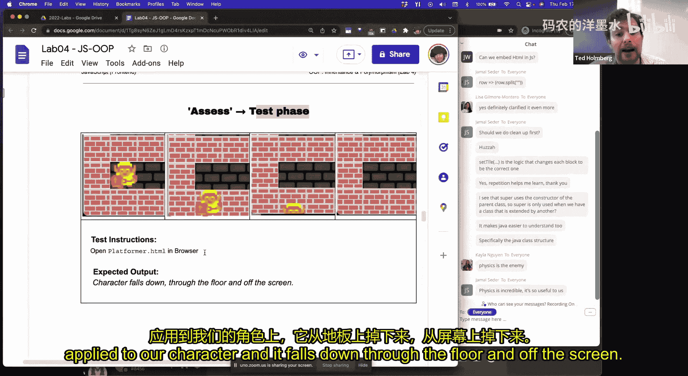

Falls down and if I refresh I can watch that again and again。

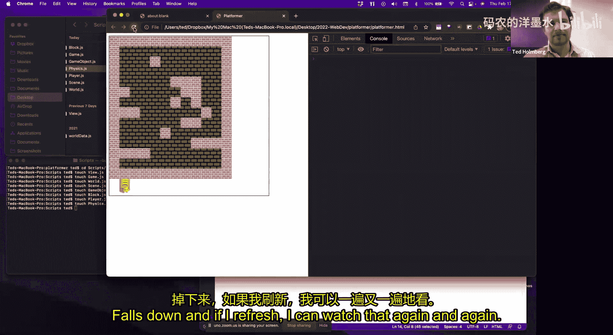

Excellent。We've made a lot of good progress。 So we are now done with that goal。In the next video。

 we willll continue with this lab at goal10。Where we'll talk about creating a controller class。

So I guess。For today's video lab， is there any questions about what we've done today？If not。

 I will stop the recording and I will wish everyone a good week。Excellent。

