# 高级Web应用：第6讲：JavaScript面向对象编程 part2


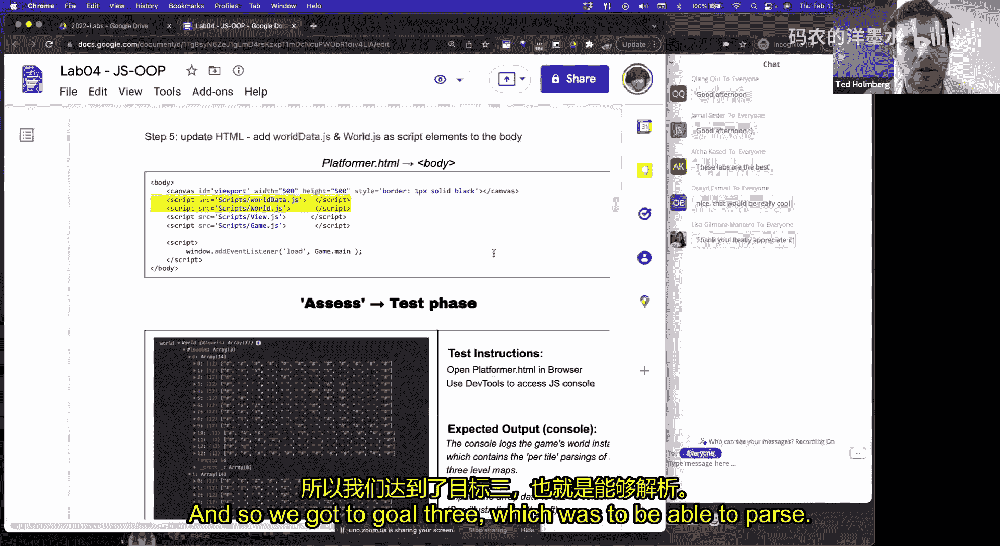

在本节课中，我们将继续构建一个全面的JavaScript应用程序，充分利用面向对象编程原则。我们将从上次视频结束的地方开始，解析游戏关卡数据，并逐步创建场景、游戏对象、方块、玩家角色以及物理系统。

## 概述

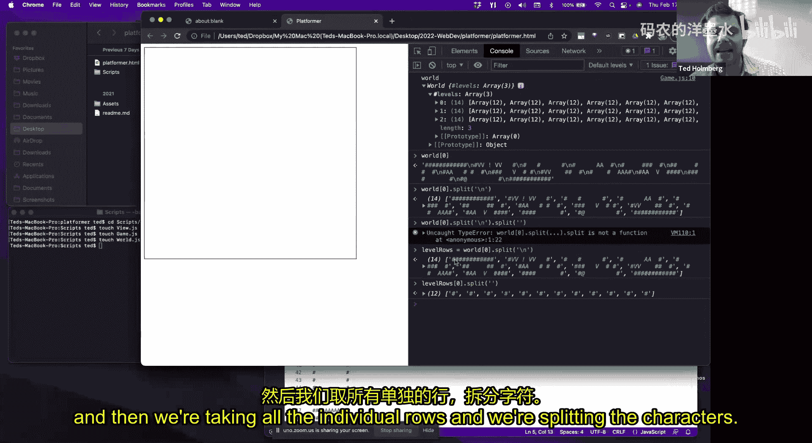

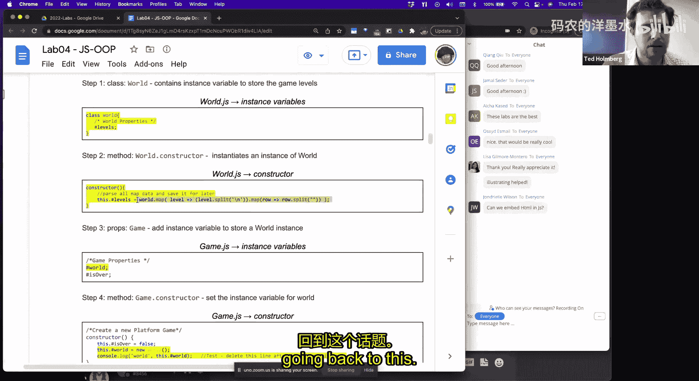

本节课我们将学习如何将外部数据解析为应用程序内部可用的数据结构，并基于此创建游戏场景。我们将定义`Scene`类来管理游戏场景，`GameObject`类作为所有游戏对象的基类，并创建`Block`和`Player`等具体类。最后，我们将实现一个简单的物理系统，让玩家角色受重力影响下落。

---

## 解析关卡数据

上一节我们开始处理一个JavaScript应用程序，目标是解析作为实验作业一部分提供的JS文件中的数据。我们有一个包含字符串的数组，需要解析这些字符串，以便将其视为代表每个图块的字符的二维数组。

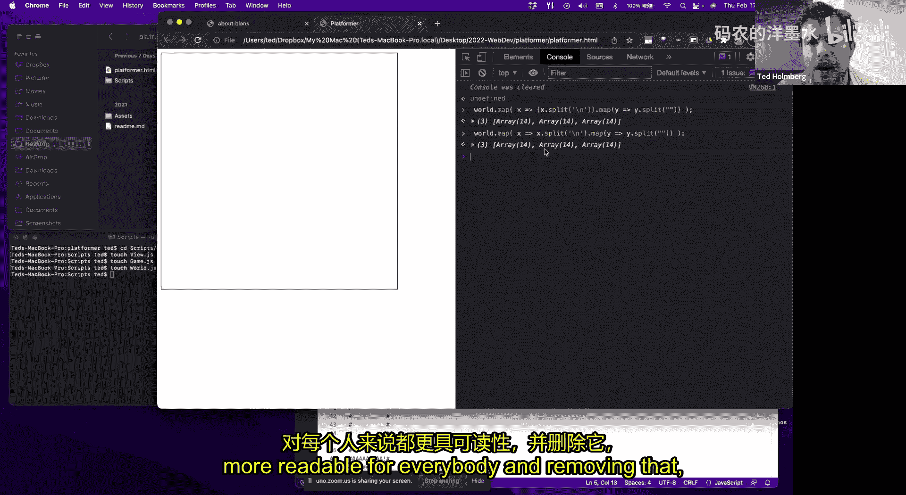

以下是解析数据的核心代码：

```javascript
world.map(level => level.split('\n').map(row => row.split('')))
```

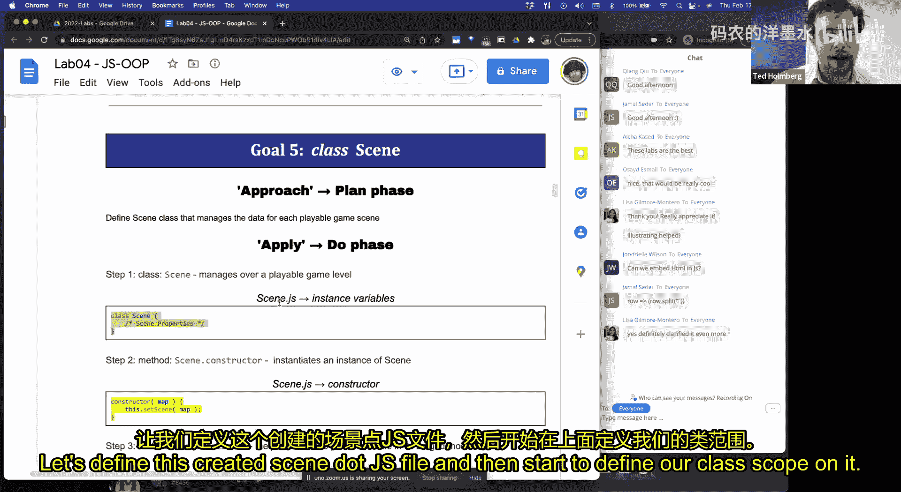

这段代码使用了高阶函数`map`和一个匿名箭头函数。它遍历`world`数组中的每个元素（每个关卡字符串），首先按换行符`\n`分割成行数组，然后对每一行按空字符`''`分割，最终得到一个二维字符数组，代表关卡的网格布局。

**工作原理**：
1.  `world.map(...)`：遍历`world`数组中的每个关卡字符串。
2.  `level.split('\n')`：将每个关卡字符串按换行符分割，得到一个行数组。
3.  `.map(row => row.split(''))`：对上一步得到的行数组再次使用`map`，将每一行字符串分割成单个字符的数组。

这种编程风格称为**函数式编程**，它允许我们将一个函数的输出直接作为另一个函数的输入，形成链式调用，无需在函数调用之间维护状态。

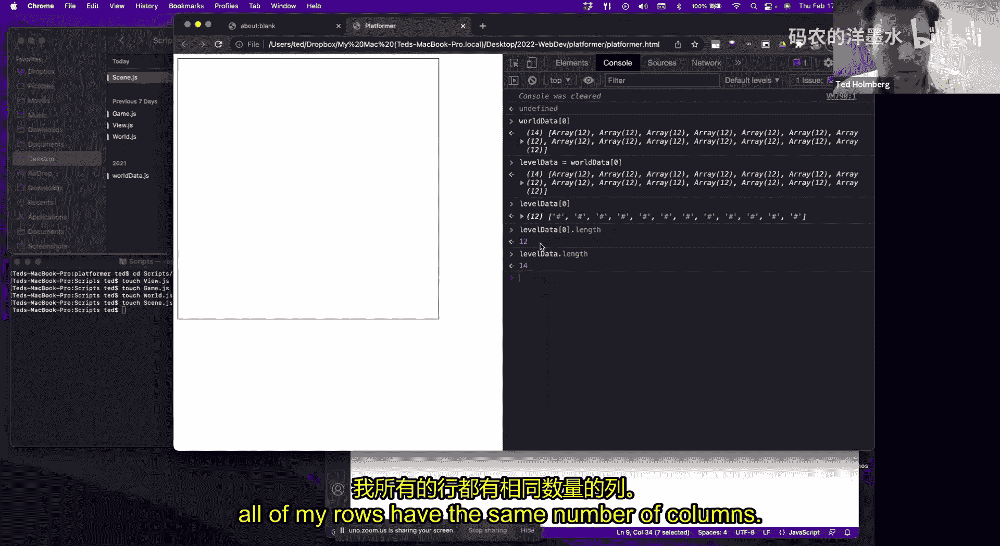

---

## 定义场景类

现在我们已经可以解析关卡数据，接下来开始定义`Scene`类。场景类将管理每个可玩游戏场景的所有数据，例如玩家、方块、危险物和出口等游戏对象。

首先，我们创建`scene.js`文件并定义类的基本结构：

```javascript
class Scene {
    constructor(map) {
        this.#setScene(map);
    }

    #setScene(worldData) {
        const rows = worldData.length;
        const cols = worldData[0].length;

        for (let y = 0; y < rows; y++) {
            for (let x = 0; x < cols; x++) {
                const tile = worldData[y][x];
                console.log(tile); // 测试用，解析后删除
            }
        }
    }
}
```

**代码解释**：
*   `constructor(map)`：构造函数接收一个地图数据参数，并调用`#setScene`方法来构建场景。
*   `#setScene(worldData)`：这是一个私有方法，用于解析传入的二维数组`worldData`。它首先获取行数和列数，然后通过双层循环遍历每个图块字符。目前，我们只是将每个字符打印到控制台进行测试。

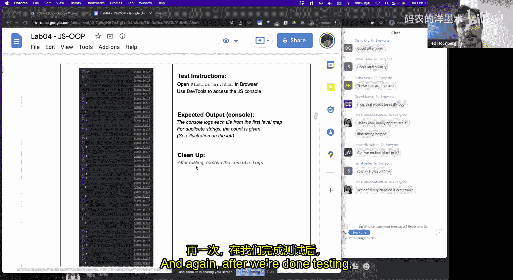

接下来，我们需要更新`World`类，使其能够根据关卡编号返回对应的二维数组数据。然后，在`Game`类中初始化当前关卡编号和场景对象，并将场景脚本添加到HTML文档中。

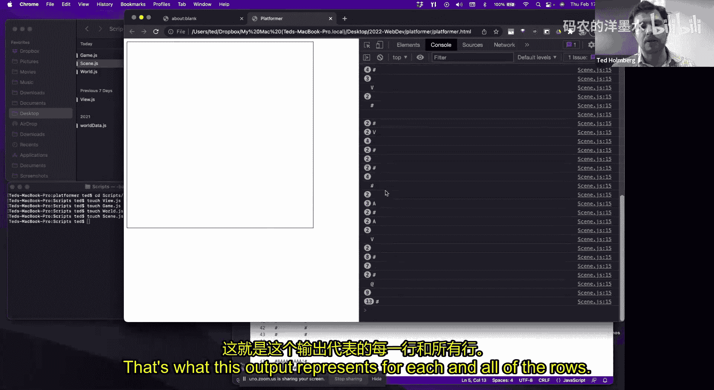

完成这些步骤后，刷新页面，控制台将成功输出第一个关卡的所有图块字符，表明数据解析正确。

---

## 创建游戏对象基类

我们的通用方法是先讨论游戏对象模型及其职责。`GameObject`类将管理所有游戏对象共享的数据。我们假设玩家、方块、危险物等都具有共同的特性，这些特性将在`GameObject`类中定义。

首先，创建`game-object.js`文件：

```javascript
class GameObject {
    #x;
    #y;
    #width;
    #height;
    #image;

    constructor(x, y, width, height, imagePath) {
        this.#x = x;
        this.#y = y;
        this.#width = width;
        this.#height = height;
        this.#image = new Image();
        this.#image.src = imagePath;
    }

    draw() {
        view.drawImage(this.#image, this.#x, this.#y, this.#width, this.#height);
    }

    getX() { return this.#x; }
    getY() { return this.#y; }

    move(x, y) {
        this.#x = x;
        this.#y = y;
    }
}
```

**代码解释**：
*   **属性**：使用`#`前缀定义私有属性，包括坐标`x`、`y`，尺寸`width`、`height`和图像`image`。
*   **构造函数**：接收位置、尺寸和图片路径参数，并初始化对象。对于图像，它创建一个新的HTML `Image`对象并设置其源路径。
*   **draw方法**：调用全局`view`对象（画布视图管理器）的`drawImage`方法，将游戏对象绘制到画布上。
*   **访问器方法**：提供了`getX`和`getY`方法，以便其他类（如物理系统）能够获取对象的位置。
*   **move方法**：用于更新游戏对象的位置。

现在，我们可以在`Scene`类中使用`GameObject`。我们在`Scene`中添加一个`#background`属性，并创建一个`#setBackground`辅助方法来创建背景游戏对象。然后，在`Scene`的`draw`方法中调用背景对象的`draw`方法。最后，在`Game`类的`render`方法中调用场景的`draw`方法，并将`game-object.js`脚本添加到HTML中。

完成这些步骤后，刷新页面，可以看到背景图片已成功绘制到画布上。

---

## 创建方块类

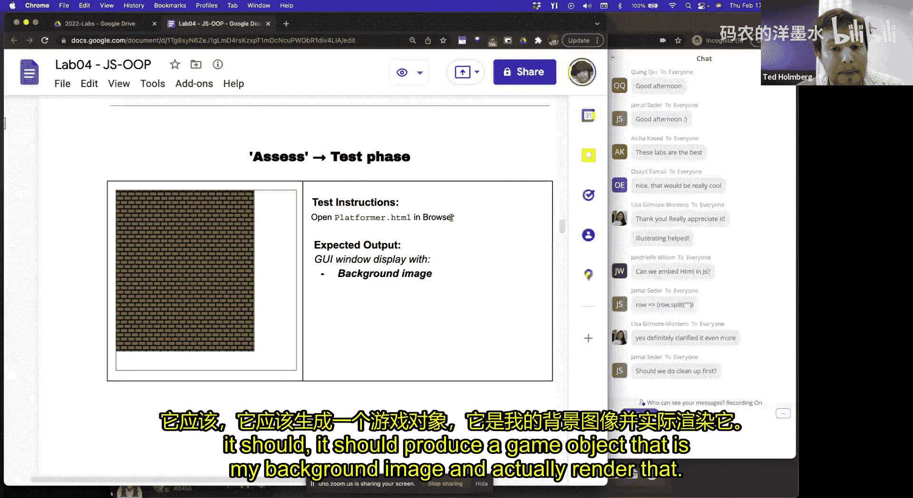

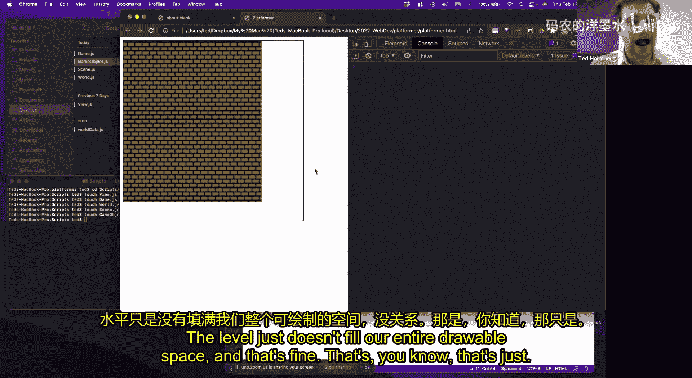

接下来，我们创建一个`Block`类来建模游戏中的砖块。方块是构成关卡的基本元素，我们将使用继承来复用`GameObject`的功能。

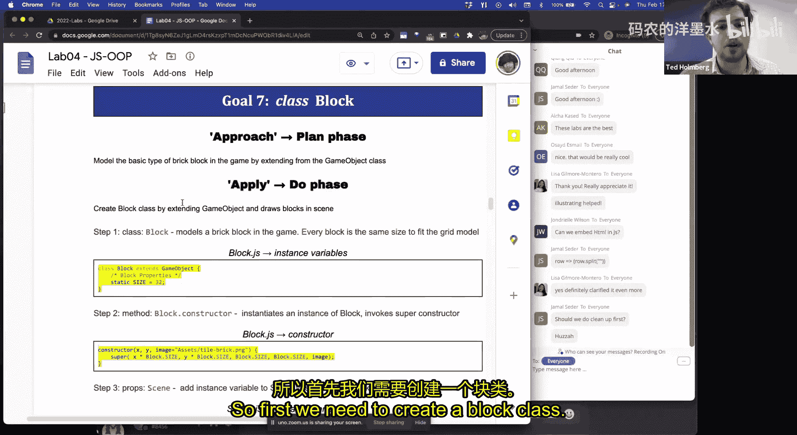

首先，创建`block.js`文件：

```javascript
class Block extends GameObject {
    static size = 32;

    constructor(x, y, imagePath = 'assets/tile-brick.png') {
        super(x * Block.size, y * Block.size, Block.size, Block.size, imagePath);
    }
}
```

**代码解释**：
*   `extends GameObject`：`Block`类继承自`GameObject`类。
*   `static size = 32`：定义了一个静态属性`size`，表示每个方块的尺寸（32像素）。静态属性属于类本身，而不是类的实例。
*   **构造函数**：接收网格坐标`x`、`y`和可选的图片路径。它调用父类`GameObject`的构造函数，将网格坐标乘以方块尺寸转换为画布坐标，并传递尺寸和图片路径。

现在，我们需要在`Scene`类中管理方块。我们在`Scene`中添加一个`#blocks`数组属性。然后，在`#setScene`方法解析每个图块时，调用一个辅助方法`#setTile`。`#setTile`方法根据字符类型（例如，`#`代表方块）创建相应的游戏对象并添加到`#blocks`数组中。我们使用`switch`语句来实现这个逻辑，这是一种**工厂模式**的简单应用，根据配置数据（字符）来实例化对象。

最后，更新`Scene`的`draw`方法，遍历`#blocks`数组并调用每个方块的`draw`方法。将`block.js`脚本添加到HTML中（注意顺序，`Block`依赖于`GameObject`，所以`block.js`必须在`game-object.js`之后）。

完成这些步骤后，刷新页面，可以看到所有砖块方块都已正确绘制在它们的位置上。

---

## 创建玩家类

现在，我们来创建`Player`类，建模游戏中的玩家角色及其行为。同样，我们将继承`GameObject`类。

首先，创建`player.js`文件：

```javascript
class Player extends GameObject {
    #physics;

    constructor(x, y) {
        super(x * Block.size, y * Block.size, Block.size, Block.size, 'assets/link-down.png');
        this.#physics = new Physics(4);
    }

    move() {
        const newX = this.getX() + this.#physics.getVelocityX();
        const newY = this.getY() + this.#physics.getVelocityY();
        super.move(newX, newY);
    }

    update() {
        this.#physics.update();
        this.move();
    }
}
```

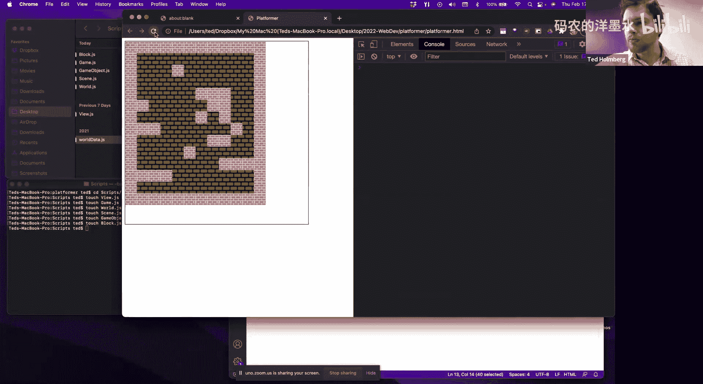

**代码解释**：
*   **属性**：除了继承的属性，玩家还有一个私有的`#physics`属性，用于关联物理系统。
*   **构造函数**：接收起始网格坐标`x`、`y`。它调用父类构造函数，传递转换后的画布坐标、尺寸（使用`Block.size`）和玩家图片路径。同时，它初始化一个`Physics`实例。
*   **move方法**：根据物理系统提供的X和Y方向速度，计算新的位置，并调用父类`GameObject`的`move`方法来更新位置。这里使用了`super`关键字来调用被重写的父类方法。
*   **update方法**：在游戏循环的每一帧中调用。它先更新物理状态，然后根据新的速度移动玩家。

接下来，在`Scene`类中添加`#player`属性，并在`#setTile`方法中，当遇到代表玩家的字符（例如`@`）时，实例化`Player`对象并赋值给`#player`。然后，更新`Scene`的`draw`方法，绘制玩家。最后，将`player.js`脚本添加到HTML中（确保在`physics.js`之后，因为`Player`依赖`Physics`）。

完成这些步骤后，刷新页面，可以看到玩家角色被绘制在起始位置上。

---

## 实现物理系统

为了给游戏增加真实感，我们需要实现一个简单的物理系统。平台游戏的核心物理概念是使用速度来推动角色在X轴和Y轴上移动，并受到重力等力的影响。

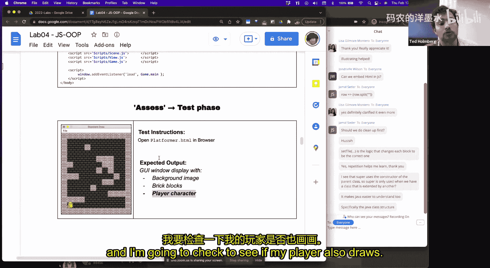

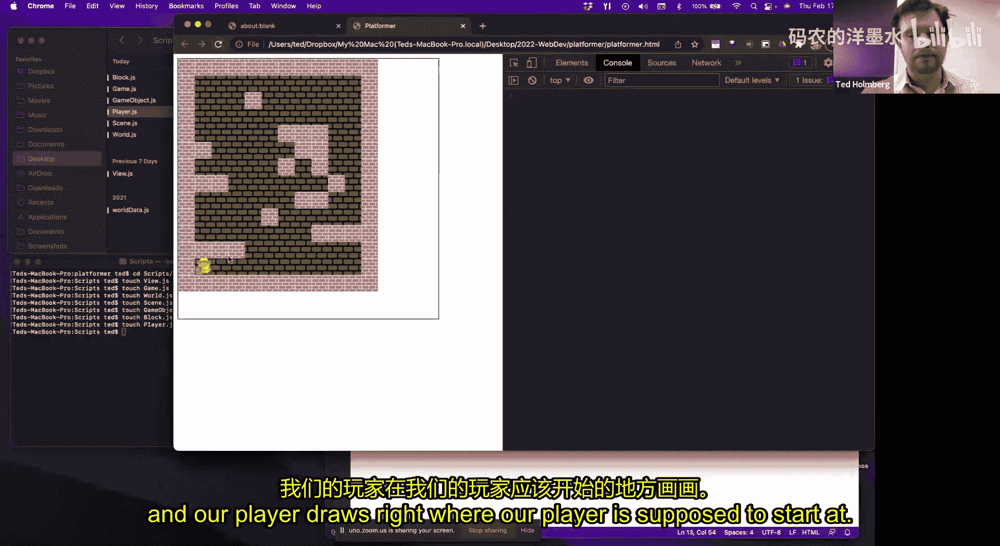

首先，创建`physics.js`文件：

```javascript
class Physics {
    #speed;
    #gravity = 0.3;
    #terminalVelocity = 8;
    #velocityX = 0;
    #velocityY = 0;

    constructor(speed) {
        this.#speed = speed;
    }

    applyGravity() {
        if (this.#velocityY < this.#terminalVelocity) {
            this.#velocityY += this.#gravity;
        }
    }

    update() {
        this.applyGravity();
    }

    getVelocityX() { return this.#velocityX; }
    getVelocityY() { return this.#velocityY; }
}
```

**代码解释**：
*   **属性**：包括速度`#speed`、重力加速度`#gravity`、终端速度`#terminalVelocity`（最大下落速度）以及当前在X和Y方向上的速度`#velocityX`、`#velocityY`。
*   **构造函数**：接收一个`speed`参数并初始化。
*   **applyGravity方法**：如果当前Y方向速度小于终端速度，则增加重力加速度。这模拟了物体持续受到向下的力。
*   **update方法**：在游戏循环的每一帧中调用，目前只应用重力。
*   **访问器方法**：提供获取当前速度的方法。

为了让物理系统生效，我们需要在游戏循环中更新状态。我们在`Game`类中已有的`update`方法里调用`Scene`的`update`方法。`Scene`的`update`方法则调用其`Player`的`update`方法。`Player`的`update`方法再调用其`Physics`实例的`update`方法，并随后移动玩家。

将`physics.js`脚本添加到HTML中（在`player.js`之前）。现在，刷新页面，你会看到玩家角色在重力作用下开始下落，并最终掉出屏幕。

---

## 总结

本节课中我们一起学习了如何构建一个面向对象的JavaScript游戏框架。我们从解析原始的关卡字符串数据开始，将其转换为可操作的二维数组。接着，我们定义了`Scene`类作为场景管理器，`GameObject`类作为所有游戏对象的基类。通过继承，我们创建了具体的`Block`（方块）和`Player`（玩家）类。最后，我们实现了一个简单的`Physics`（物理）系统，为玩家角色添加了重力效果，使其能够下落。

我们混合使用了面向对象和函数式编程范式，例如在解析数据时使用`map`和箭头函数，在管理对象集合时使用`forEach`。这种灵活性是JavaScript的强大之处。在下一节课中，我们将继续完善这个游戏，例如添加控制器类来处理用户输入。

---

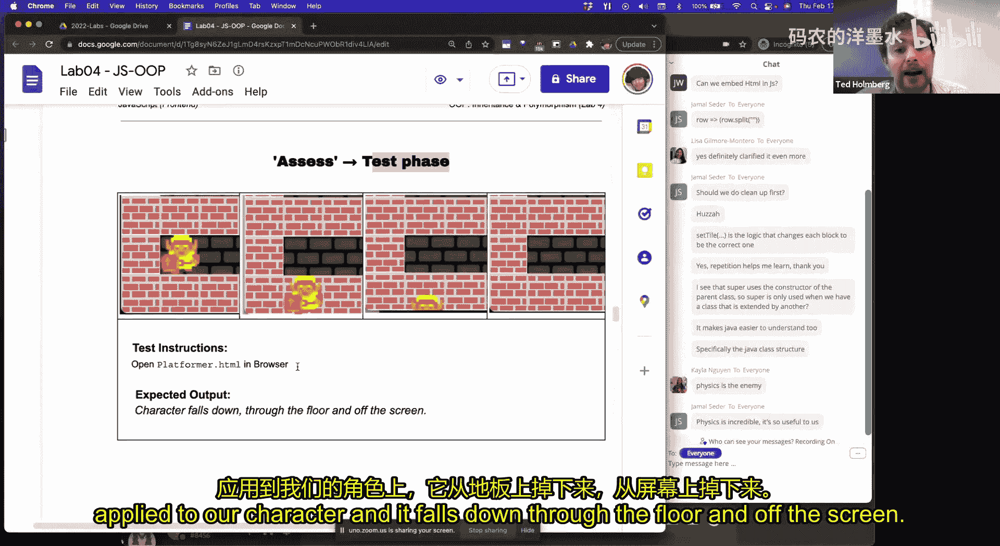

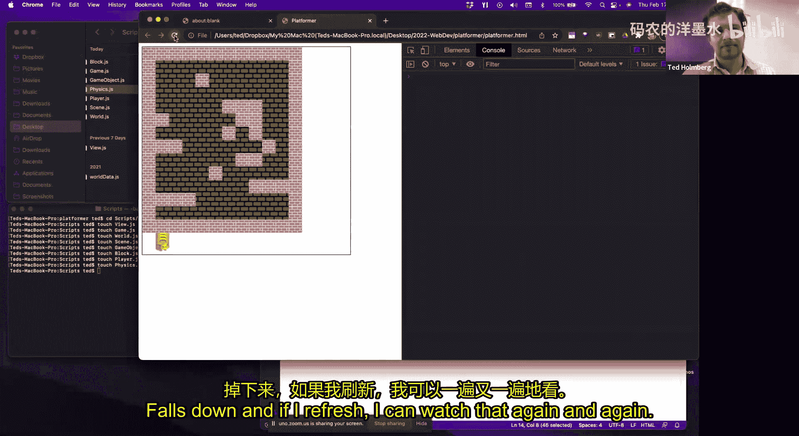


**注意**：本教程根据提供的视频字幕内容整理，已删除语气词，并按照要求进行了结构化、简化表述和格式调整。核心概念已用代码块突出显示。