# 【全集】加州理工学院 高级Web应用 中英字幕 1080P p07 Lecture 7 - JavaScript 面向对象编程 part3 -BV192zTBrEmu_p7-

Excellent， okay。So in today's video lab， I want to pick up where we last left off。

So last time we had implemented。

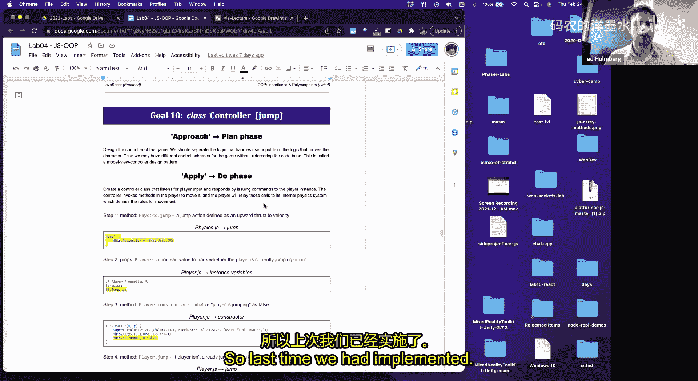

Gravity such that our character falls down just like that。

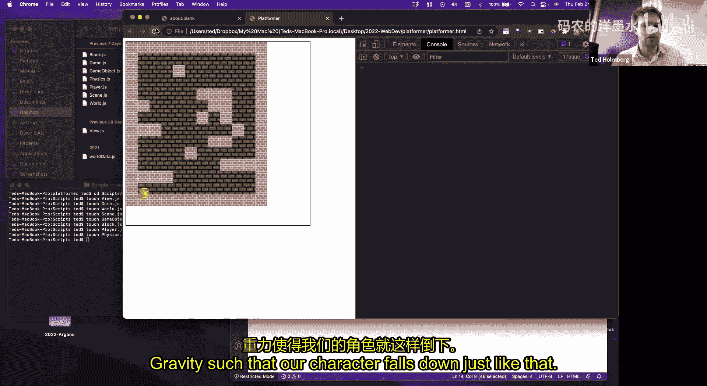

是。So now the next goal we would like to do is go ahead and get。

A controller class implemented into our game system so that we can cause the player to jump。So again。

 every time we go to give ourselves another goal and incrementally and iteratively build out our application。

 we take a approach， apply and assess。So in our approach for this goal 10。

The idea of what we want to do is design a controller for the game。

And so we should separate the logic that handles the user's input from the logic that actually moves the character。

Again， because we want to abide by the design pattern that's most commonly referred to as model view controller。

Thus， we will have a different control so the motivation here is that if we wanted to have different control schemes for our game。

 we wouldn't have to refactor our code base， we can just implement that into our controller class。

Okay， so now that we have an idea of how we're going to want to implement our controls into our game。

 the idea that we're going to have a controller class that's responsible for capturing user input and then the controller class we can effectively register a game character。

 our player character into the controller class and as we watch for events to happen on the keyboard or the mouse or wherever we're getting controls from。

 we're going to activate actions inside the player character。

So that's going to be the general motif of how we're going to design a controller class so here in order to actually do this we're going to create a controller class that listens for the player input and responds by issuing commands to the player instance the controller invokes methods in the player to move it and the player will relay those calls to its internal physics system which defines the rules for movement in our game world so before we can do anything let's first。

Define。Inside of our physics class， what it means to jump。😡。

So and so our jump action will be effectively defined as just an upward thrust in velocity。

 So now that we have the physics system， we know that the gravity is this downward pole。

A jump with the inverse of that， so let's go into our physics。W is this， what is this？I like this。

I guess that will just be part of the video。Not the biggest fan out here。Go away。Okay。

So here I'll go into my physics。And I'm going to add a new method in here。😡。

That's going to be called jump and so what jump is going to do is it's going to access。

The instance variable， that is the velocity on the Y axis。

 and it's going to set it to be the negative value of speed。Multiplily by two。

And so that should give us a thrust upward。Okay， so the next thing we want to do if we want to go ahead and allow for our player to jump is we need to go into the player class and we're going to have to add a new property。

 it's going to be a booleing value to track whether the player is currently jumping or not otherwise if we don't track whether the player jump or not we'll get more like a flappy bird style where you don't have to hit the the ground and you can keep indefinitely jumping up。

So let's go to our player， to make sure that's saved。

Now let me go to my player class here and I'm going to add a new instance variable is jumping。

And so whenever we add a new instance variable， recall it is the role of a constructor to go ahead and establish。

Those values。When this instance is created， so here we're going to set initially is jumping to false。

And now what we're going to do is we're going to define a jump method inside the player。

Such that if the player isn't already jumping， then we will apply the physics for a jump。

So let's go and define a new method in here。So here I have a jump method and I'm going to check if。

Is jumping as false， then use the internal physics system to cause a upward velocity to be applied towards the player character and then set is jumping to true。

And now the next thing we're going to do now that we have the actual。

Model controls for jumping defined in both the physics and but inside of the player characters we can now start to scaffold out our controller class。

 which will'll be looking for a user event so that we can actually issue that jump command to the player so again this is going model the user's inputs and will register the player with this class。

 the player will hold a the controller will hold a reference to a player so that it can issue a command throughout the game loop。

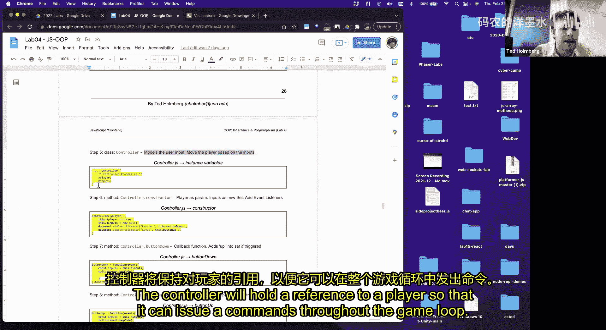

So the first thing we can do here is we actually have to create a new class。And to do that。

 I need a new JS file， a controller。js。Okay， excellent。

 now I'm going to go comment take controller JS。Im to pull it in here and I'm going to define it just like I've defined everything else so class controller open close scope。

 and then I'm going to add two instance variables， one is going to be the instance variables to hold a reference of a player character and the other is going to be for inputs。

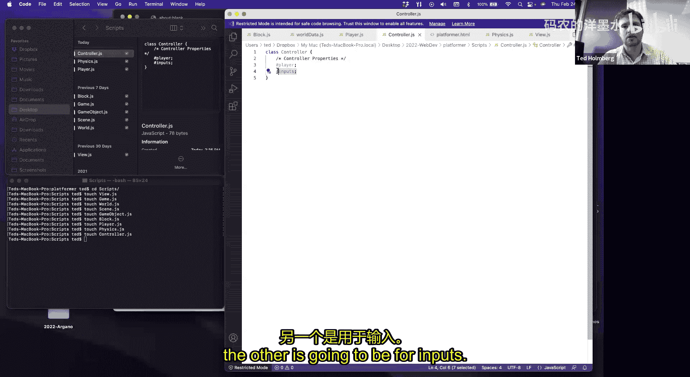

Okay， so the next thing I want to do is I want to add a constructor into my controller class that's going to instantiate that's going to essentially initialize all of our instance variables。

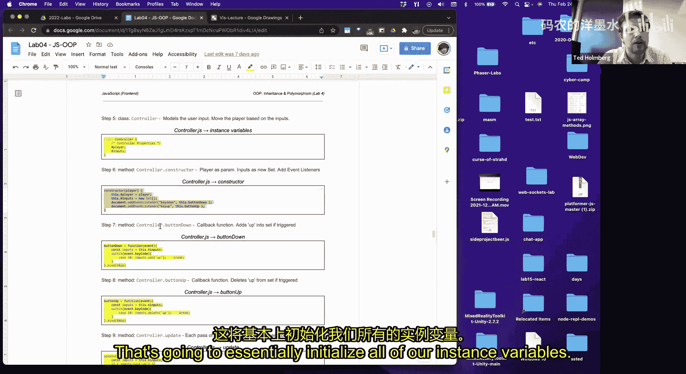

So here inside my constructor it's going to require one parameter。

 which is going to be a player instance， it will bind the player instance that's passed to it to be the value of its local of its instance variable and then what we're going to do here is we're going to create a new set which is a data structure right that can only have a single value and we'll set that as our inputs。

And then what we're going to do is we're going to add to our document an event listener。

So the browser has an API， so the document object can listen for events that occur from the end user。

The inside the parameter， when we add an event listener， the first parameter is the event。

We want to listen for and the second parameter is going to be a callback function that fires off if this event were to occur。

 so I'm going to set an event listener on the instance of whenever a key down event occurs。

 then we're going to go ahead and have a buttoned down。😡。

Method that will invoke in response to that and I'll notice this isn't in we're not invoking this method。

 we're passing a reference of this method or of this method。😡，To the event handler。😡。

So that when this action occurs， it will then go ahead and evoke that method and it's going to be the same thing with a key up event on the instance of a key up。

😡，Event occurring then we'll pass a reference to this method now those don't exist yet。

 but we're going to create those next and if you wanted to know what events are available。Again。

 what you can always do is go to MDN。The Missoilla Develop network and look up the method here add event listener。

And you should be able to see a listing of all the different events that you could potentially。

There you go。Let's see if they have a listing of all the various events。s。就。

So let's see it's going to be linked somewhere then。Let's see here。Event target event Okay。

 so here we would have the type oh yeah here we go。 So if I click here on event dot type。

This should be a big listing of all the different types of events you can go ahead and listen for and there's you know pointer ups and there's pace events and drop events and cut events and all these are predefined and you can listen when you go to listen for them。

They're issued into the event listener by just a string。Okay， perfect。

So the next thing we need to do is we need to create those methods。That。That this。

Even that that'll be registered with the event lessoner or the event dispatcher so notice we're going to do something a little bit interesting here i'm going to create a。

Bun down。Event and instead of calling it， like I typically would。Excuse me。Where I。

Where I just create the method where I do a method declaration。

 I'm instead going to do a method assignment。And one reason why excuse I have a question can you explain the ABC get out of here。

 get out of here？Okay。Yes。So。Here， this is the method declaration。

Where I'm simply declaring a method here I'm assigning a method to the value button down see I have an assignment and here I have effectively a anonymous function that will now be bound to this label of button downs this is just an alternate way that we can define methods inside of our class and the only reason why I did this way was to show you an alternate way inside the lab that we could do this Okay now with that said。

There's some other interesting things that are happening here。

 so our button down method is going to take an event。😡。

And so the event is going to be the thing that whenever we register any function or method to a event handler。

 the function will get called when this event happens and the event handler will always give us a reference to the event。

😡，To our callback function that caused it to fire so we're going to pass in a parameter here so that we can actually look at this event。

😡，That actually occurred。So。What we're going to do here is we're going to take our instance variable inside of this function and we're going to actually bind it to a local。

Variable， and then i'm going to create a switch statement that on the event that gets passed in。

 I'm going to look at the key code。And on the case of 38， which is essentially the。

I't remember that might be the up arrow on your keyboard then we're going to go into our set right and our inputs we're going to go into this set and we're going to add。

😡，They string up into it。And then we're going to break out of that now this is probably the most interesting thing。

 this is where we become a little less Java like。With what's happening here so here notice I am binding this to this function and the reason why I'm doing that is when I pass a callback function to the event listener。

 the event listener itself is a object， which means that it has its own this pointer that reference itself。

😡，And when I go to pass a callback function that's using the this keyword inside of it。

 if I don't bind what this is。😡，So when I'm talking about this for button down。

 I mean to refer an instance of controller。😡，If I don't explicitly state what the reference of this is。

 then the event handler will treat that as this inside of the event handler or I'm sorry the event listener and it's going to look inside itself for this inputs variable。

 and it's not going to find it because that's defined find inside of controller。

 not the event listener。😡，So this is this is one of those strange nuanced things that you might hear about with JavaScript that can be kind of strange with the this keyword and so one thing you should always remember is that this keyword is just a reference word to talk about the memory address for the instance that's currently in memory。

😡，And so when we start talking about passing functions to other instances。

 if we rely on this key word， then we have to make sure we bind this to the particular instance we want to have reference to。

😡，It's a。It takes a little bit of getting used to， but it is something that you should say is there any questions I have a question about this one。

In front of button up， are we able to put that that hashtag that， that symbol。

 and it will be like a dot bind this， Is that what that is。So wait， what what was the question again。

 so you see how on line three we have hashtag player， yes， all right。On button down。

 are we able to do hashtag button down and then remove dot bind this？Essentially。

 giving it that this。Implementation well so if if we want so if we want button down to access the instance variable inside a controller。

 then we have to bind this if I were to pull this out if I were to put inputs at in the global namespace like here I wouldn't need to bind this anymore because then I wouldn't be relying on the this keyword right so I could do something like this。

Here， and this would be fine， but then this is actually much worse because now I'm starting to pollute my global namespace with the variables。

Where arguably inputs this this set， this is a set here should belong inside the controller class。

 so I want to avoid putting it outside of the class what I want to try to do is keep it inside of the class。

😡，But since I need to register this button down event with the event listener。

To delegate the callback function， before I pass this function off since it's an instance method。

 since it's not a free floating function， since it's an instance method that has special meaning of the word this。

 we have to bind when we pass it what it means for this。😡，In reference to line 15。So really。

 the reason why we're doing this on line 19 is because we're actually using this keyword in line 15 and we're passing this function to something outside of the class itself that has its own interpretation of what this means for it。

😡，This means when we register this function of this method with the event listener。

 the event listener is an object that has its own this keyword and its version of this keyword references the event listener and when it calls the callback function inside of its scope if we don't bind this。

 the reference of this being the control the instance controller。

 then it will accidentally think of it as this being for itself that does that explain it？😡。

That that actually it does。 It does。 It helps。It helps explain that the dot bind this。

Is trying to reinforce the scope。Of this exactly what's happening and in fact。

 we can play around with this a little bit actually I don't know one of the things I like to do here is be able to actually go ahead and。

Run code so that you could see this is the advantage of doing this in in person as opposed to just giving you the document so let me remove the dot find this So let's say we just did this Okay where we just reference to this。

 but we don't bind what this means and let's see what happens if I try to print out that this keyword so let me open that's already there let me oh wait if i'm going to do this though。

We have to import it into the H import right so we have to skip some steps so remember that i'm on step8 right now。

 but what i'm going to have to do here is。Let's go to。

I'm going to play around with this let me finish these steps so I don't confuse anything if you're talking this and then remind me to play around with this we'll actually see what happens so we can look at the nuance here。

Okay so we have the button down that's one callback function。

 Let's grab the other callback function as well， So here I'm going to do something very similar。

 So on a button down event so when I hit say for instance。

 the up arrow what I'm going to effectively be doing is I'm going to take the key code so every time you hit a event and so we'll print that out too it has it can have data attribute so like it was a mouse event like a click then it might have like a mouse X and mouse y coordinate if it was a key you hit one of the pieces of data that's embedded is the key code and then we could use that key code to identify what key was depressed on the instance of the key code 38 we know that that's the up arrow so we're going to go ahead and register inside of our set here the up。

And so the reason why we want to use a set and not an array is that we only want to have one unique value of up while it's being pressed recall that everything is happening inside of a game loop and a game loop is firing like 60 times a second so when I'm heading up I don't want to have like 60 ups every second added into an array so to prevent that I can go ahead and use a set when I insert up once that's as many times as it can be inserted I can't have repeated values there Now when I lift my finger off of the button it's going to create another event the key up event in which case I want to invoke the button up method the button up method will again use our input sets and it's also going to operate on a switch event being the key code and if the key that was lifted up was 38 that's the up key then what we're going to do is delete that up value from inside of this。

From inside of the input set。So essentially what we're doing here is every time we get an event that happens on the keyboard。

 we're just registering it into the input section， we're not directly mutating or manipulating the player in any kind of way we're just kind of staging it in here and then effectively what we'll do is we'll look at inputs to see what inputs we have and then control the player that way and the nice reason why we want to use this approach is that if I want to then have inputs come from some alternate source like a controller or like a mouse I can also add those inputs into the inputs and I won't have to refactor my game code at all I would just have to refactor the way that these these control words like up or down or left or right get imputed into my input set。

😡，Okay， so now the next thing I want to do now that I have my callback functions defined find is I want to create an update method inside my controller。

That will get invoked each update of the game loop。😡，So inside of here。

 what I'm going to do again is I'm going to go ahead and make sure that I have my inputs。

And I'm going to check if input。Has up and the only reason why I'm doing this here is it has nothing to do with binding。

Here or here， like in the callback function， i'm doing that here just to to make it a little bit more readable on this slide。

 so i'm just creating a local variable by dereferencing this dot inputs so that instead of having this dot hashtag inputs dot has up it's just inputs dot has up so this is just for readability in the code moving forward。

😡，Anyway， I'm going to do a selection statement， if inputs contained up。

 then I'm going to cause the player。😡，To jump， I'm going to issue the jump method inside the player。

😡，And now。What I'm going to do is inside scenes since we have a reference of player and since it's private。

 in case we need to go ahead and share that with any external classes。

 let's create a Giter method so that we can return the state of our player。

To an external instance sensor class。So the reason why we're。So let's see the question is。

Could you explain why we were binding？Bed down to key up so that's so what's actually happening here is。

You want to think of buttoned down as an action that occurs when I push a button down。😡，So anything。

Any action that I want my player to respond to on a button press event。

 whether it's jump or move left or move right is going to go into that button down method。

 that button down method is going to effectively add to our input set keywords like up left or right those are going to be the three movements that my character in this game is going to be able to do and I'm sorry here I'm gonna to add those events I'm only adding up now but next I'll add left and right so and then when I take my finger off of the button I will then remove that from the set so the idea is that in the update here。

 I'm looking at the input set and I'm going to see if it has up then I'm going tell the player jump if it has left then I'll like tell the player to move left if it has right then I'll tell the player to move right so effectively every update of the game loop if one of those values。

😡，is in the set， then we're going to cause the player to move in response to that and at any time when it gets removed out of the set。

 well then we would do nothing right we would we would stop issuing that command to a player。😡。

So button down is just the kind of name we give to the callback method for pushing a button down and the button up is the name we're going to give the callback function for taking your fingernger off of a button。

Can we change the names of those。Yeah， yeah， you could change those to button press and button unpress。

Okay， so it's all approved however we sure yeah this isn't this is just the label that I created and if you find it more expressive to do button press and button unpress and then we just have to change it in the callback function as well so button press。

And button。Unpresssed， okay， perfect and then it's that it's as easy as that's reffactoring。

Because the only the only。The only places that these methods are getting to invoke from are from the event delegator here。

 the event manager that we're registering it with。So as long as this these names match these。

 then you're good they could be anything right， but we can't change key down or key up because those are the actual。

 no， you can't change that because what happens is when the event delegator broadcast that an event has occurred。

 it broadcast it to all the event listeners as this string。

And so we're registering as the string representation， this key down event。Right。Thank you。

So this we cant change， right？Let's see what time complexity is the has function。Yeah， I mean， well。

Well。是。Let's see it's a set。I guess arguably since it's not a。It's not an index set though。

 right like an array is， so potentially it would have to go through and check each value within of the data structure。

Unless it's implemented like a dictionary。But honestly。

 I don't know the underlyinglin implementation for that。Okay， let's see here。Where did I leave off？

All right here， we created a getter for our to return a state of the player and then now now that we have a controller。

Class has going to our game class， which manages all of the game objects and add an instance variable for our controller。

So let's go to the top here。There we go。Okay， so we now have a new instance variable and whenever we add a new instance variable。

 what we usually want to do is go into the constructor。

And set that value so I'm going to go here and I'm going to do two things actually I'm going to go to my scene class and I'm going to get a reference of the player because our player is instantiated in the scene so I'm going to create just this local variable it's actually a constant because I'm only going to need it temporarily and I'm going to ask the scene for its reference to a player and then when I instantiate my controller I'm going to pass it that reference。

And then I'm going to bind the game， the controller instance。😡。

And so we have one player for that both the controller and the scene have references to the same player instance。

Now I'm going to go into my update method inside'm my game class and I'm going to go ahead and。

For each invocation of the update method， I'm going to tell the controller to update and recall what the controller is doing when it updates is it is。

Here it's checking it set of it set and it's seen if the upward is in there and if it is then it's going to tell the player to jump so it's going to constantly be checking that 60 times the second。

😡，And then we'll tell the scene to update however it needs to do。😡，Excellent。

 and so the last thing we're going to do here is we're going to go ahead and。Add into our HTML。

That dependency and notice since the game is going to deliver on the controller。

 I'm going to put that。Up here。Excellent。Okay， let's test this out and then we're going to break it apart and examine some functionality from this so let me。

See if I jump what what happened here uncon cannot get player is not a function at new game let's go to game 17 so let's save this let's get a。

So let's see here。Line 17 this thoughts scene do I have so the question is do I have a get player oh。

 you know what？I bet you， did I read that wrong？Oh look。

 the get player method is supposed to go inside scene。

I'm going to leave it in a controller I probably don't need it a controller but not a bad idea just to have it in there and so let me copy this and so clearly can I can't access the player from the scene to give it to the controller without having a getter method。

So let me save that。And let's go ahead and refresh。 And there we go。 Okay。

 so now let's when I refresh， let's see if I can actually jump up。Oh yeah there we go。

 I was able to jump Bob。And if you look。Let's go back to my controller。If you look。

 I saw that console login there， so i'm doing this notice every time I hit up it's printing。

That this reference refers to the controller， right？

And the reason why it's doing that which has the button press， the button un presss。

 which has the input， which is a set。And which has the player instance and the reason why this key word is dereencing a controller instance is because we bound it。

With before we pass it to the event listener so that the event listener knows that this refers to the controller instance and not its own instance。

 if I if I remove those。Let's go ahead and remove those。Save that。First of all。

 I was going to say uncutaught type reference because hashtag input。😡，From。

Bton press it doesn't know where to find that at， so what I should do here actually is do my console log above me trying to dereference something that doesn't exist。

😡，Okay， so here， oh you see now notice what it is that this key word here。😡。

Belongs to the thing that actually triggered the event， which is the document。

And so if I don't want that to happen。Then I will bind that。

And that's what solves the problem so you can you can visually see when you when you get these bugs。

 you can kind of player around with it to see。S bind and up bind perfect okay you could you could you could test it and play around with it in the console to see what is being referenced at any given time so if you're getting kind of a erroneous mistake while using the this key word my recommendation is to do some console walking and see what this is actually referring to it at any given time。

Let's see， is there anything else， Okay， what happens？Okay。And so。

And notice I can only jump up that once because。Once said well I think I get a free jump。

 but then I fall because that true value is going to go Okay， so we got jumping to work。Excellent。

 that's a start。

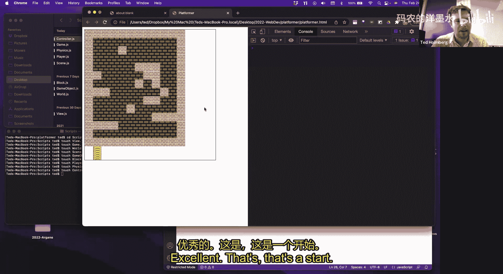

Let's see here for our test instructions we want to open up our platform or do hml and when the player presses up arrow。

 then the character jumps up then falls back down to the floor and off the screen so we get essentially one jump and then we follow again so the next thing we want to do though is let's。

Continue to work on our controller make it a little bit more feature rich and have it also control the player in such a way that they can move left or right so again let's start with this approach apply assess model that we've been following for each iterative design so for our approach what we want to do is we want to design the horizontal movement of our player。

So what this is going to require is updating the velocity X of our character so right now we can jump up by by giving a negative velocity and we fall down by having a positive velocity so to move left or right we're going to have either negative or positive velocity if we add a positive number to the velocity then we go right and if we add a negative number to the velocity then it will go left and remember a zero velocity is no motion at all。

😡，The more you press in a direction， the more the  velocity should increase over time。

 moving the character faster in that direction。Okay。

 so now that we have a basic idea of what we want to get done for this goal let's talk about how we're going to do it so we're going to have to add some methods that are defined leftward and white whiteward movement of our character inside the physics class and then we're going to have to make calls to them and the player so that the controller can then invoke them so inside of our physics method we're going to add an action defined as move left to thrust a leftward velocity but limited by the speed so let's go to physics here。

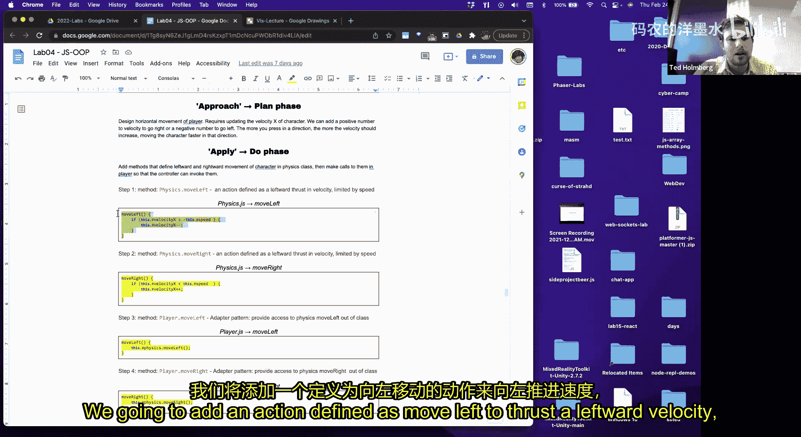

And so here it's going to be called move left， and I'm going to check as so long as my velocity in X。

Is greater than。The negative value of speed so recall that in order to move left its got to be a negative value so the fastest you can move left should be the negative value of speed so if velocity x is higher than the negative velocity of speed then we can still keep moving left and so that means we're going to decrement the current value of x by one now the moment that our speed is equal to or greater than I'm sorry our velocity is equal to our greater than the agg of value of speed then we're going to ignore that and that'll be like our terminal horizontal velocity you can't go any faster than that。

And now the next thing that we want to do is also do something that's going to define a right word。

Throruss and velocity again limited by speed So here let's do move right in our physics and here I'm going to check so long as our velocity X is less than the speed of the character then we can continually increase the value and velocity。

 and so what this allows us to do is throttle our velocity on x and on x negative x or positive x。

Basedase off of this speed value。So we can't just shoot off the screen if you hold the button too long Okay。

 now that we've done that。Let's go into the player class and what we're going to do is take advantage of another design pattern you might have heard of this is going to be called the adapter pattern where we go ahead and we pass。

We essentially wrap。One method call internal to an instance variable onto a method on this class itself。

 so essentially we're just going to provide access to the physics move left outside of the class since it's private。

So there we go move left and all it does is is accesses the instance variable physics and it invokes its move left let me make sure I did that right no i'm still in physics。

Make sure you're in the same the appropriate class so right now I'm in physics I want to go into player and so inside my player class I want to go ahead and have move left and so here I have this instance variable and this is just like an adapter method that I'm going to issue the move left to the physics to tell the physics system to move me left。

And then I'm going to do the same thing here for move right。

So notice the commands to move the character are pretty generic。

 they're not hard coded to anything on the keyboard because all of that has happened by the controller class。

 so we stay agnostic in terms of our implementation details for movement。

 it makes sense in the logic of the game but it's not tethered it's not hard coded to any kind of control scheme on its own。

😡，So with that said， let let's actually invoke those move methods from our controller。

 so let's go to our button down method in our controller so here we're going to go inside that switch statement on the button down or button press。

And here if the key code is 37， oh and I didn't do a console log of the event。

 let me do that too so we can see this so console log events， so when we do this。

 we can see what this event actually looks like。Okay， so if the event has a key code of 37。

 then that is the key code for pressing leftft and just if you ever wanted to know。

 there's some cool things here。Shova script。Teacher。They have keycode。

info if you ever want to see it and when you hit a key。

 it shows you what the key code is on the keyboard。Really cool tools， right？

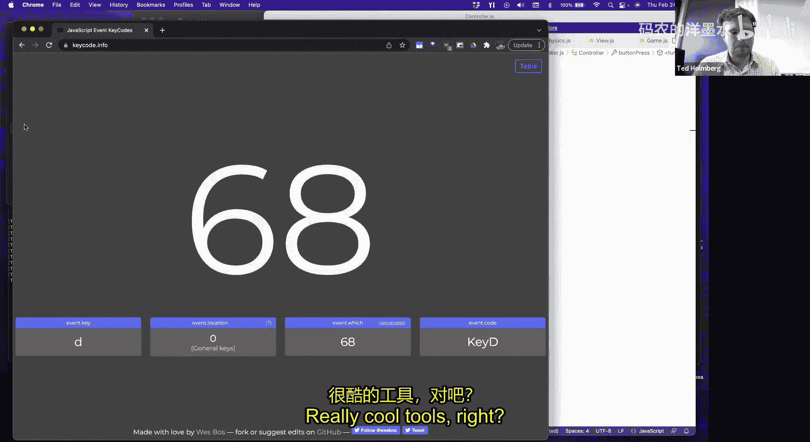

是。Okay， if the key code is 39， then we're going to add right to the set so again we're just kind of what button what the what the button press and the button unpresss does is doesn't directly manipulate the characters just it's just adding up left or right into this set and we use the set and the update method to issue commands to our player。

So you can imagine if we go ahead and add left and right on a button press。

 then we have to go ahead and delete them on a button un press so let's go ahead and do that update our switch statement。

是。And now what we want to do is inside of the controller's update method we want to we want to also check if the input has left or right and if they have left or right then we're going to go ahead and tell the player to move left or right so here inside the update what we do now is if input has left then we tell the player to move left if input has right then we tell the player to move right and if input has up then we tell the player to jump。

是。Okay， so now that we have that implemented， why don't we test this out。

 let's go ahead save this and we haven't added any new classes so I should just be able to refresh and see if yeah。

There we go， I could jump。Right and I can jump left and here i'm console logging that event because I want to show you what was inside of it and again if we're at any time something seems like magic to you。

The console is a very powerful tool in this runtime environment and it actually will print out these references。

 these object references， and they're actually interactive like you could see I can click on this arrow and I can then see everything that's located inside this keyboard event they got passed into my method and youd see it actually has the key arrow left so if I didn't want to use the key code right here 37 if I didn't want to use the key code。

 I could have just done key and arrow left。But the reason why it did use the key code and not this more kind of descriptive arrow left。

 arrow， right， arrow， up and arrow down is I want you to also be familiar that key codes are a thing。

😡，look at all this detail that occurs with this event。You can even see the path of the event so。

So from the body to the HTML to the document to the window。Excellent。Okay。

 let me take that out now so that I don't。Log that each time， but now you can see。

What's getting passed in each time the event triggerers and the callback function。是。是。Okay。Well。

 we now have a controller that allows us to move left， move right and move off。

 so I think we're done with our controller for the most part。

 let's set a new goal that defines floor collisions so that we don't just fall right off this stage as soon as we start playing the game so just like every other goal I like to preface with an approach。

 apply assess so the approach here that we should take is to design collisions for the game。

 there are two concepts。The concepts are our two game objects touching yes or no。

Then the second is then if they are touching， what sides are they touching on？😡。

So if it's true that they're touching， is it a top touch， is it a left touch。

 is it right touch or is it a bottom touch？So there will be four discrete points of collision。

 it's possible to have multiple sides colliding between two objects。Such as when corners touch。

That counts as both a vertical touch and a horizontal touch so touching a wall and a floor。

 for instance， or touching a wall and a ceiling， for instance。Okay， so。

Now that we talked a little bit about what we have to manage for collisions being able to resolve those two questions。

 are we touching another game object and what side are we touching let's try to think about how we might start implementing that so the physics class should be the entity in our game system that detects collisions between players and then blocks the player from moving by adjusting the velocity because effectively inside of a platform or game it's essentially gravity it's a physics puzzled game。

So you want to think of not teleporting the player by just adjusting the X and Y coordinates directly。

 but they're rather being pushed and pulled by the forces of the physics system。

So the first thing we need is inside of game object， if we haven't done so already。

 we're going to have to create some gettter methods so we can get the values of get with and Git height。

So let me go into my game object class here， and I'm going to go ahead and define a get with and a get height and I'm going to go ahead and return the values。

Of width and height。Which we're going to need for collision detection。

And then the next thing I'm going to do is I'm going to go into our。Block class。

 and we're going to create a new method is touching X。😡。

And then we're going to create one that is touching y so let's take a look at this let's。

And this is going to determine this first one is going to determine if the block and some other game object overlaps on X by some ratio。

So let's see here， wheres my block？Here it is so inside of my block I don't have anything yet。

 so i'm going to give it as first map that is touching X And so here i'm taking in two parameters。

 some game object and a ratio and the idea behind an overlap is I will take。

I want to get this with and I'll multiply it by the amount of width that's going to constitute a touch。

And then I'm going to check the following， I'm going to subtract。😡。

My exposition from the game objects position I'm going to find the absolute value of that and I'm going to check to see if it's the overlap if it's less than the overlap value and it's going to return either true or false so let's think about this。

嗯。Let's think about this， imagine if I had。Two objects， one。In two， right， okay。

 let's make one of these a different color。Is that this thing Yes， Okay。

 that's really bright Is there a okay perfect Okay。

 and now can I make this transparent I there an easy way to adjust transparency Is it the color transparent Oh。

 that's too transparent。嗯。Well， I don't want to spend too much time playing around。

Draw position size reflection， I just want to transparency， okay， that's fine。Okay。

 so let's go back to this here。 So we're going to say I have a game object and I have a block So why don't we define these let's say that this is。

The block， let's say that this is the other game option。Okay。

So clearly this is not touching now the question is should this be touching。

 should this be touching at what point do we want touching to occur on just X？So if I take。

If I take this with so let's say my width is 32 and let's say I take my other width so all my objects are so here i'm taking sorry。

We're going to the overlap is going to be what the width is times the ratio。

 so suppose that my ratio is0 point5 so half so if my if my width is 32。

And if the ratio that I qualify as touching is half， then that means 16。

 I have to have an overlap of 16 pixels。So then what I'm going to do is I'm going to take my X position and I'm going to subtract it from the other X position so let's start basically let's say that the Xposition are the same the Y of positions don't matter right the X positions would be the say Okay so in this instance。

They're the same， so if I subtract。The blocked from the game object or the game object from the block since I'm taking the absolute value。

 it's the same， right？Well， that would be zero。And so here。

 if I have zero is less than the overlap that's going to be 16 pixels that would qualify as a touch。

 okay， let's do this。Let's do halfway now。On x so here let's say that this is zero and let's say that this is 16 because it's halfway across and this is 32 pixels big say for instance。

So I would take the Xposition here zero， I would subtract it from this position but take the absolute values that would be 16 and then I'm going to say is the difference between those less than our overlap value which I said a 16 because it's going to be 32 times 0。

5 So this would qualify as a touch as well if I'm on that 50% overlap but let's say I go here let's say that this is 24 if I have  zero minus 24 then that's going to be 24 well 24 absolute valued that is not going to be less than our overlap of 16 so that's not going to constitute a touch so by having the overlap it allows us to essentially define a bounding box that allows us to have a little bit of li room and decide what constitutes a touch or not a touch does that make sense does this concept to collision detection make sense。

And of course， this check is just happening on the X axis， so if I'm a two dimensional game。

 I not only have to check this concept for moving X because as of now this would still be a collision right this would be a collision across X。

😡，Even though we're not touch because we're not touching y yet。

 so if I wanted to do two dimensional collisions， I then have to check the same thing for height right I find out what my overlap for height is and then I make a decision based off of Y subtracted from the other y if it's within that radius。

😡，Okay， and so that' that's effectively conceptually what's happening with this logic。And of course。

 if it doesn't make sense， you feel free to ask。So here this method's going to check to see if I'm touching on the X axis by some amount。

 and this is going to see if I'm touching the game object by some amount on the Y axis。And then。

To actually check for two dimensional touch， I'm going to make one last method called is Toing where we just go ahead and pass in the game object。

And here we're going to do a combination of is touching on both。 why and on act。

So it's going to be the combination of those two and in fact notice。

I'm going to be more stringent on touching on why。 so the overlap is going to be。😡。

The full 32 pixels， whereas it's going to be a little bit more forgiving on my X access。

That way I can kind of run into the wall a little bit before it registers as a collision。

 but the the ground and the ceiling are going to be hard。

Very hard implementations of the collisionition。是。Excellent。

 so now the next thing now that I have defined is touching。

 at least the ability to determine if something is touching or not a block。

 let's go into our physics class and actually check a collision between the block and the player。😡。

So let's go to our physics and inside of our physics here。

 I'm going to go ahead and create a method check collisions and what that collisions is going to do is it's going to have the all of the blocks remember the blocks are in a list and the player instance and so we're going to do a for loop for each block inside of that blocks list we're going to then query that block is that block touching the player。

And if the box is touching the player， then where you have to decide， is it off？😡。

is it a ceiling touch is it a left wall touch or is it a right wall touch what direction is the touch coming from because remember for collision detection those are the two things we need to know first of all。

 is there a touch happening and second of all where is the touch happening？Okay。

 so the next thing we want to do is we want to go ahead and implement this check collision floor。

So again， I like to whenever I implement code I like to break all my logic down across a multitude of methods that are very small and that are very descriptive in terms of what their actions are so instead of putting the logic for checking the floor collision here I call some other helper method so that it's very clear and evident what I want to happen online line 54 and then I define the logic in its own space so when I check for a floor collision I'm just going to go ahead and pass the block and the player that are touching and then I'm going to check if the player y is greater than is less than the blocks Y and the velocity is greater than zero。

So what this is doing is it' it's checking to see if I'm moving into the floor space， right？

And if that's true then I'm going to check to see， well， is the player touching on X？😡，By 0。

5 and so here you can see what's happening here。The player is higher than the block and falling。

And then here this other check is I don't I want to prevent wall jumps。

 so in order to prevent wall jumps， I want to make sure that the player in the block is on the same column and that's why I'm checking to see if this X is happening because I don't want to reset a jump if the player simply interacting with a wall because then they could jump off of it。

And so if both these things are true， if both the player is higher than the block and is currently falling and if the player and block are in the same column。

 then I want to change the velocity value to zero want to stop the velocity on Y so the player stops moving and I'm also going to tell the players is jumping。

To go false so i'm going to have to create that method inside the player to ensure that I don't know if I have that method we're going have to create that Okay now the next thing we have to do is let's go into our update method and and refactor that inside of physics so right now this is my physics update method but now we need to start taking in data we need to take in the blocks list and the player。

Ha to pass a reference to itself because we're not just going to apply the gravity to the player。

 but now we're going to also on each update of our game loop。

 check collisions between the blocks and the player。

And now this is going to have to prop gate up because now once this block once the update method for the physics class requires these parameters everything that was invoking it within that chain might have to be refactored so for instance the player' update method is now going to require for the collection of blocks to be passed into it so let me go into the player and here we're going to refactor this。

Such that blocks get passed in so that when we call the physics update map that we can pass the blocks list and then we're going to pass it a reference to this。

To itself。And then finally， let's go ahead and。Inside this previous method in the physics class recall that we tell the players is jumping to set to false so that they can reactivate the jump so let's actually go into the player and actually create that method is jumping and then we're going to pass in value here and set that。

To whatever gets passed then。是。And then inside scenes。

 since the player requires those blocks to get passed to the physics。

 we happen to now go into scene and update the scenes update method so it passes the player its collection of blocks。

 so let's go to scene here into the update method here and we will update that excellent。

And so now once we do that， we can go ahead and reload our game and our expected output should be when the player presses upper space the character jumps up and the player presses left or right they should move in that direction when the player lands on top of blocks though they should actually land on the block now note there's no collisions on the blocks left or right yet so we can go through walls and there's no friction applied to the player yet who will continue moving and will never stop。

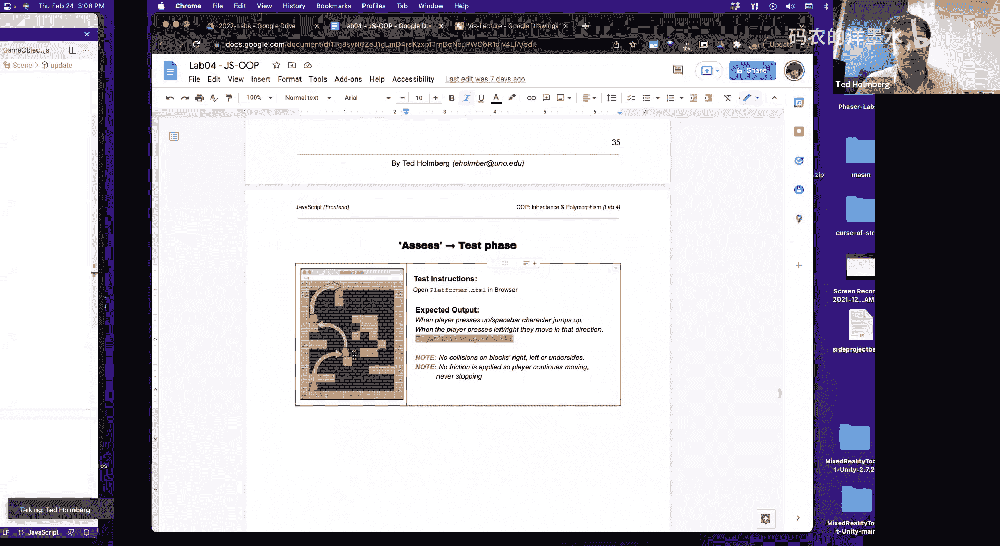

Okay， so here up， look， we don't fall off and here I can move left or right。

I can jump up and now I should be able to yep， land on walks。Yeah， perfect。Okay， we're getting there。

I have up， I fell off， let's see if I can't just okay。Excellent。Okay。

 so let's see what the next goal is going to be， the next goal is going to be to implement seal collisions。

Now that we have four collisions let's start implementing out all of our collisions。

 so our approach for ceiling collisions a ceiling collision is when the player and a blocker touching and the player is lower than the block the player y access is larger is a bigger number than the block y axis or coordinate and then the players y velocity is moving the player upward that means the velocity Y is a negative number。

So in response to those conditions， what we want to do is reduce the velocity and push the player in the opposite direction by multiplying the current velocity by a fractional negative number。

And this will kind of give them a rebound， like a push off effect。Okay。

 so now that we've talked about the strategy on how we're going to implement a our ceiling collision let's actually do it so the first step we want to do is we want to go into our physics class and we want to create a method that's going to be called check collision on ceilings。

And so effectively， what this is going to do is the ceiling collisions reflect the velocity downward。

 so let's go into our physics class here。And let's go ahead and make this method check collision ceiling where we we're going to pass in a block and a player and if the player y is greater than the the block Y and the velocity y is less than zero now that defines as two conditions right so we said that this occurs when the player。

Is lower than the block and the player is moving up。So we're going to check those two conditions。

Then in response to that we're going to take the velocity on y and we're going to multiply it by 0。

5 so what's that going to do first of all it's going to flip its sign which is going to move in the opposite direction。

 but it's not going to flip it with the same amount of trajectory。

 the same amount of velocity it's going to have the velocity from what it was before。😡，Excellent。

 so now what we want to do is inside of our physics check collision method。

 we want to go ahead and check that on each。😊，Update so remember this check collisions gets called on every game loop from this update method。

 so we want to check if at any time there was a block that's touching the player。

 we don't want to just check to see if it's a collision on the floor。

 we also now want to check to see if it's a collision on the ceiling。

And that's it for that let's just check and we should be able to get under a block and jump and it should reflect us back now recall that there's still no collections left or right and there's still no friction so the player will still continue to move left or right。

 but now at least we should be able to jump through block so let's go ahead and refresh。

And now let me try to jump， oh yeah， look at that see and。There we go， yeah that's perfect。Oh yeah。

 we're getting there。

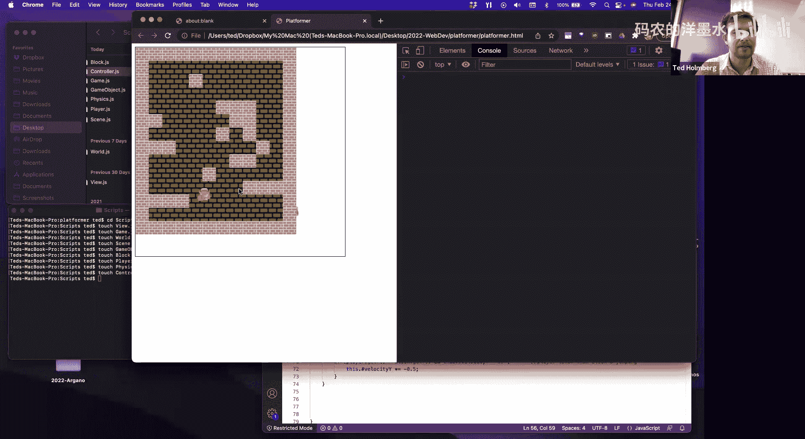

嗯。Excellent， excellent， Okay， well， let's just kind of finish this all So we have all。

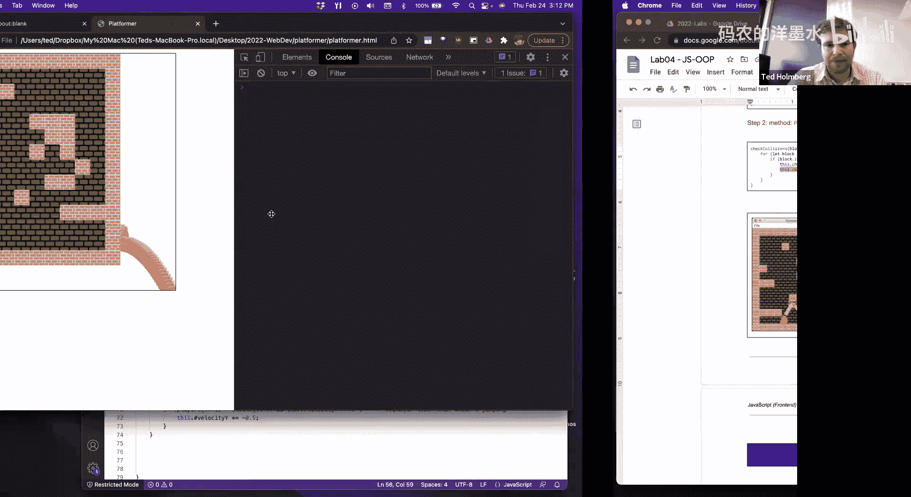

AF collisions we have ceiling collisions so let's just go ahead and define what it means to have left or right collisions so we'll define a left or right collision on left or right sides with three checks three checks are necessary here first。

A two blocks touching， then if so you have to see if the players X is left of the block X and the velocity is positive。

 that means that the player moving rightward， then a right collision is occurring however we want to avoid corner touches that's when you're touching a block or another row then the one that the players actually on so we also have to check the wide position of both blocks just to make sure that they're not on the same row。

 just like what we did previous to make sure that they weren't on the same column to ensure floor jumps。

😡，Okay， so now that we have this idea of how we're going to go ahead and check let's go ahead and apply these concepts so in order to do this we're going to go into the physics class and the physics class should detect collisions between the player and blocks before moving the player left or right。

😡，So we want to implement a horizontal check by decreasing the touch zone between two objects at 50% on Y。

Only on objects in the same row， so it will trigger touch detection。

So here we'll step through this in a moment， let's go into our physics and check。

And implement this new method。So here I'm going to check for collisions on the right where i'm going to pass in a block that's touching and a player I'm going to see if the player's X is less than the block X and the players X is greater than zero。

 this means that the player is left of the block and that the player is currently moving right then I also want to check to make sure that the player isn't touching。

Any other block。😡，By by half so I want to make sure that the block that the players touching is on the same row that the player is on and it's not a row higher or lower so to ensure the player and the block on the same row and if both these conditions are true then I'm going to go ahead and i'm going to rebound the player off with the same amount of force that they ran into the wall with so i'm just going reflect the player are going to multiply it by minus one so the velocity if it were three goes to negative through。

And then I'm going to do a very similar check。For a checkze collision on the left。

Here I'm going to take the block and the player I'm going to see if the player act is greater than the block acts which means that the players on the right side of the block。

 but then i'm going to see if the player'  velocity is less than zero which means that they're moving leftward if that's the case that I want to make sure the player isn't touching a block that's on a different road than them higher or lower so I'm going to make sure that that the amount of overlap is more than 50% and if that's the case then that means that they're touching a wall that's to the left of them so then I will again reflect them。

And so now that we have these two checks for left and right collisions。

 let's go ahead and put that in our check collisions method that gets invoked every update so here。

I now so in check collisions for every block in blocks， if a block is touching the player。

 I will check to see if it's a floor collision， a ceiling collision。

 a right collision or a left collision。And with that said。

 we should now have the player bouncing left and right off of the blocks。

So let's check this out here。If I go left， yep， I can't go anymore right I get rebound the back and I can't go anymore and okay。

 we're getting something that's very much like a platform or game。Yeah。And again。

 we haven't implemented friction， so notice we're just going to go ahead and constantly bounce back and forth and back and forth。

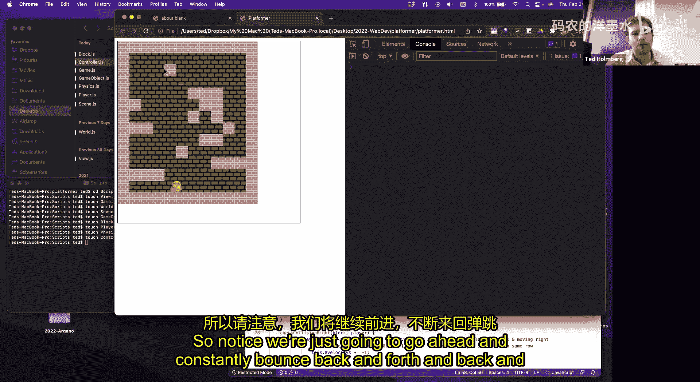

So。Yes。不是。Okay， so the last thing that we'll do here。

I kind of want to finish up physics in this class I know we're a little over but let me just do this one last goal and then we'll call it quits because then we'll be dealing with physics entirely。

 I just want to act friction and what friction is in our physics world is well without fit friction the player continues its horizontal motionde right friction is that force that should be applied to a player's horizontal movement to slow them down to a stop over time and so this can be accomplished by multiplying the velocity X by value smaller than one and each time the friction is applied to the velocity X it reduces it to a smaller value meaning the player is moving slower with each previous update until they finally stop and so physics the physics class should be able to apply this friction to the player。

When moving horizontally， so it should be an attribute that we have let me go into my physics class here。

And just define it。And also let me go here and set my friction to it could be any number it's one that you discover by trial and error I think a 0。

8 friction is fine but by all means while you go to implement this play around with these numbers and see what happens as you adjust them but I'm going to default friction to be remember it has to be less than one though so it diminishes the speed of the character then what we're going to do is we're going to create this helper method。

That applies friction just like we had an applied gravity and all applied friction does is it's going to take the value of the velocity action just multiply it by the friction since it's 0。

8 it's going to reduce the character speed a little bit each time you're not hitting the left or right arrows and then the last thing we're going to do is inside that update method we're going to invoke apply friction。

So let's go to that update method and here each update of the game loop， I'm going to apply gravity。

 I'm going to apply friction， and then I'm going to check for collisions。

And that's it when I go to test this， friction should be applied and the character's horizontal movement should slow to a resting position when I release off the left or right key。

 so let's see if that's the case。

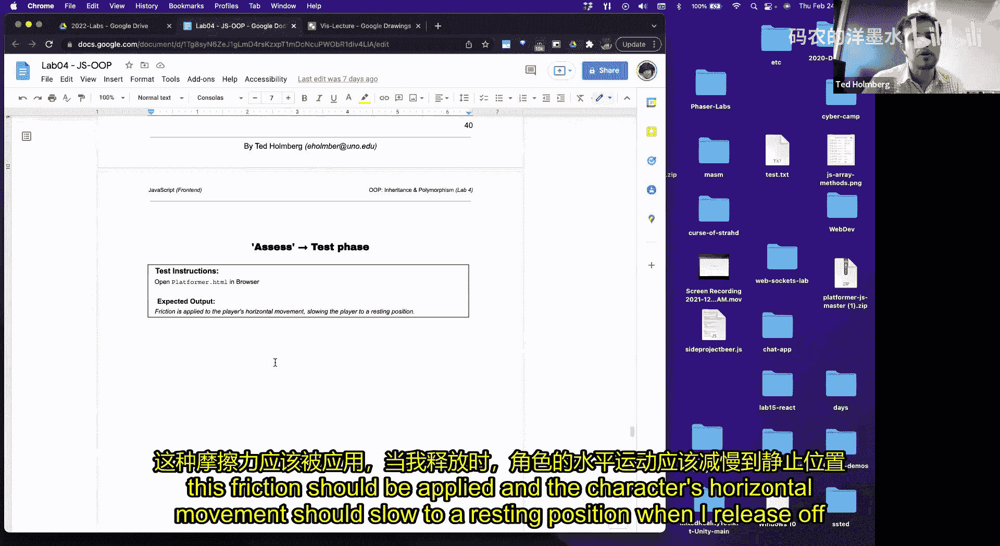

And yep， you see how it's as I pick my finger off， it's slipped。It stops moving。

So now we have completed our physics building physics from scratch。

For our platform or game and actually applying it along with the controls to the player so this seems like a good stopping point what we'll do is next time we're going to finish this lab off and we'll do the final five goals。

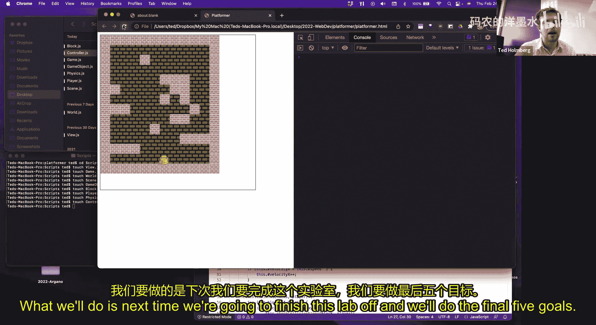

Excellent。And that'll be to implement all the hazards and exits and the other interesting kind of tiles that will allow us to do different things so with that said I will go ahead and end this recording so you now have to find where the recording is at since it's not in the browser。

Here we go。Thank you， Prossor。Okay， I'll just end meeting that'll。

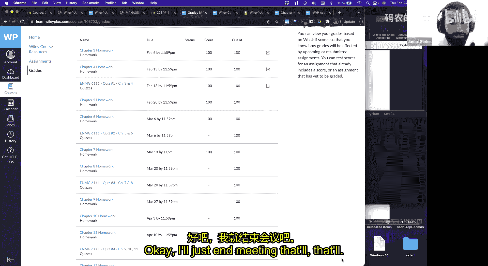

Okay， here， stop recording， perfect。