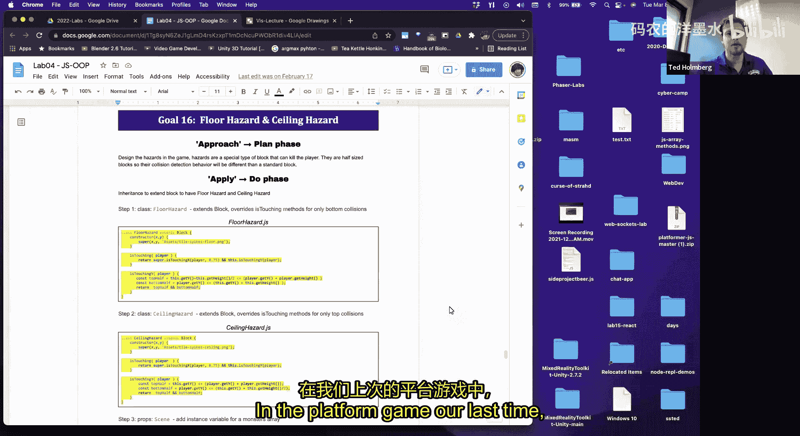
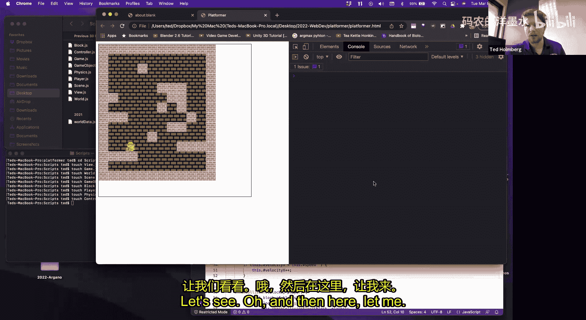
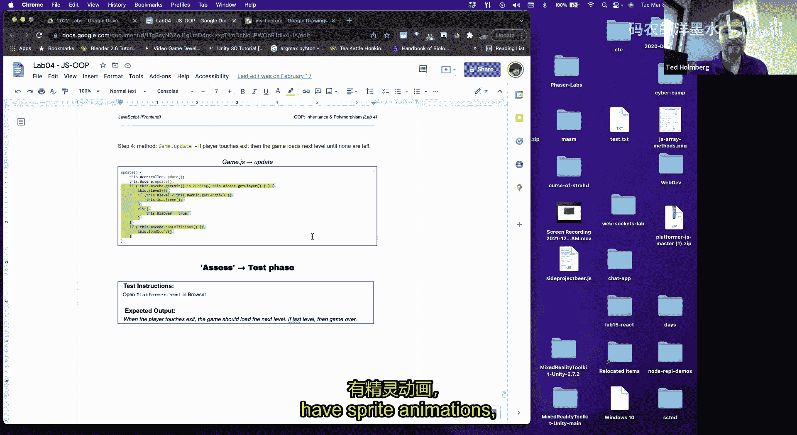
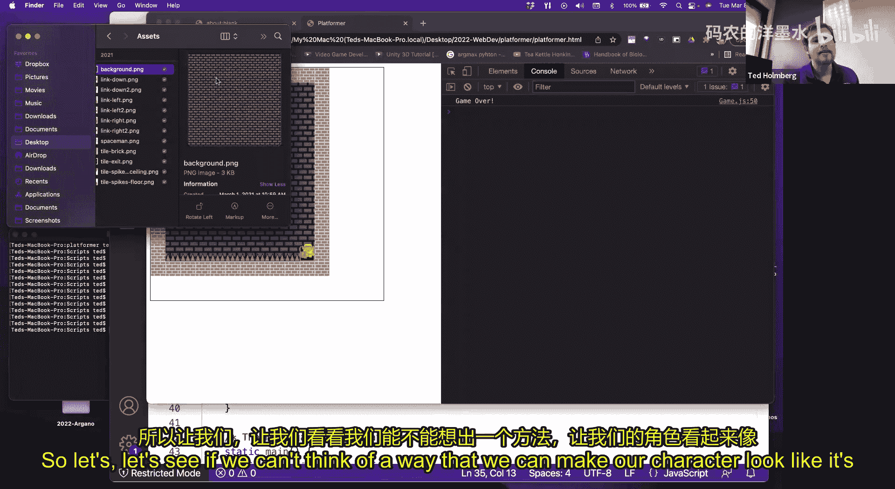
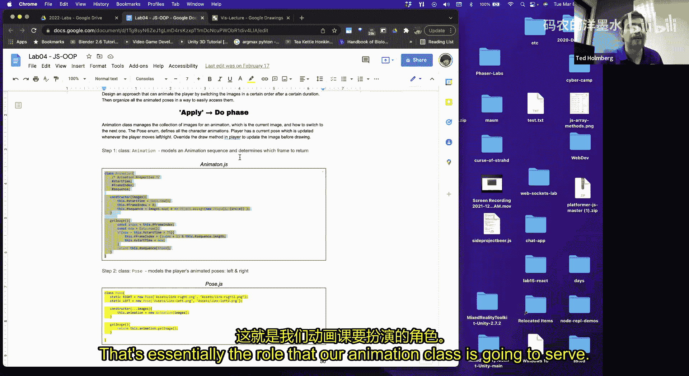
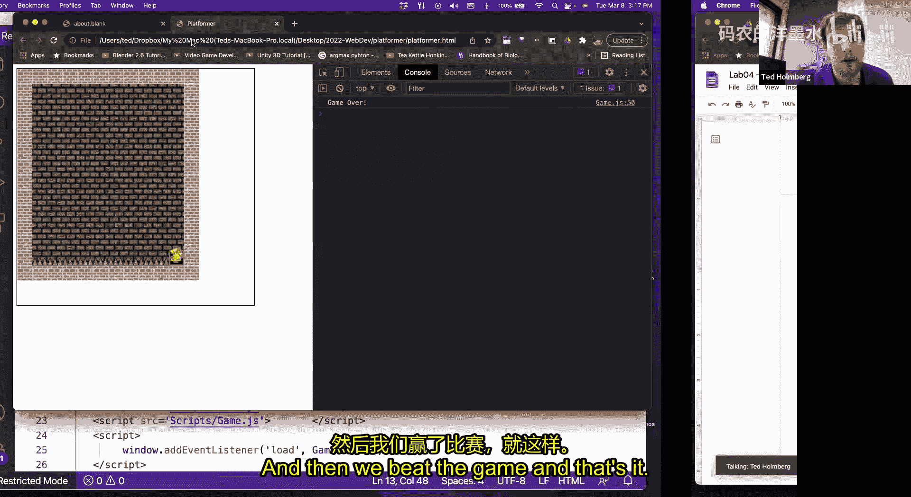
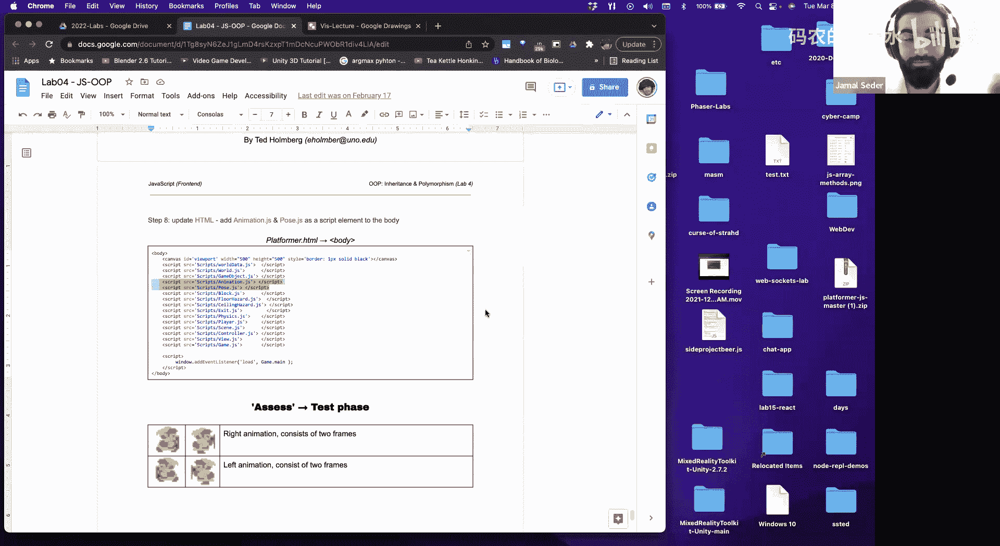

# 【全集】加州理工学院 高级Web应用 中英字幕 1080P p08 Lecture 8 - JavaScript 面向对象编程 part4 -BV192zTBrEmu_p8-

Excellent， so for today's lab session， what I intend to do is pick up on the lab that we last left off on and that was our JavaScript lab where we're implementing object oriented application。

In the platform game last time we laughed off with implementing frictions so our physics should be done in this game。

 so at this point the save of our game should have a character that can move around。

And。When I stop hitting the arrow keys。I should come to a standstill right so I'm a Hawaii friction if I try to jump。

Below a platform， I'll rebound off of it as such， right？

If I try to move left to a platform i'll rebound， if I try to move right to a platform i'll rebound that if I jump on top of a platform I should stop so at this point the mechanics。

 the interactions between blocks and my character my player character should now be done this is effectively a platformer right。

😡，But there's no winning condition there's no losing condition there's no way for my character to die there's no way for my character to progress so it's not a very interesting game yet。

 but the underlying concept behind what drives a platformers now implement the base component for what defines a platformer is now there so what we're going to do for this lab session is to implement some additional tiles that could potentially kill the player right like hazard tiles in the form of spikes for spikes and ceiling spikes and that'll provide a losing condition and then I also want to be able to implement。

Some a。Some winning conditions where I can progress potentially to the next level。Let's see， oh。

 and then here， let me。

With that said， let me minimize this， okay perfect， yeah， I don't want this。

Crowing up my view excellent Okay， so that said。Let's move on to introducing the concept of hazard tiles。

 so for goal 16。Because I believe the last one we did was goal 15 for friction yep， so for goal 16。

We want to be able to kill the player so we can kill the player with one of two ways a floor hazard or ceiling hazard so again for every goal since this is an iterative approach to design in our software system we have our planning phase where we kind of decide what we're going to do。

So here， in order to have hazards， we want to design the hazards in the game such that there are a special type of block。

And so the difference between this block and the prior blocks which are ones we can interact with right the blocks as they traditionally are we can jump on top of them and we land on them if we jump below them will recoil off and if we go to the left or right of them will recoil off so that's the traditional behavior of a block a hazard block though if we jump on it in a particular way it'll kill us so they're going to be half- sizeized blocks so their collision detection behavior will be different from the standard block and when we interact with them we want to cause a game overcond to occur so that's the general idea of how we're going to treat our hazards separately from the traditional blocks。

So now that we have an idea， a notional idea of how our hazards behave。

 the next thing we're going to want to do is start our do phase we're going to start applying these concepts so again we're building this with an object oriented design principles so we're going to try to use classes that already exist。

To implement our hazard tiles， so we're going to use inheritance to extend a block。

And so we're going to create two new classes， a floor hazard， and a ceiling hazard。

 and both those will extend from the block。So before I do anything。

 let's actually so here on step one， we're going to design the floor hazard class and again it's going to extend block and override the is hing method for bottom collision。

So we'll take a look at what this source code does in just a moment。

 but let me go over here and actually create。What we're going to call the first thing we're going to create here's a floor hazard。

 so let me create a floor hazard。Bob JS file， oh let's make sure that's spelled correctly。Okay。

 floor hazard and so the next thing'm going to do let's go to the source code and let's go to this new。

Class file that I created and let's go ahead and implement this class。

So what's going on here so i've created let me save that i've created a class I'm going to call it floor hazard and this class is going to extend the bo class so。

As a reminder here。Let's take a look at this block class， where's block。Here it is。

 so the block construct requires an X coordinate， it requires a Y coordinate and it requires an image and the image has a default parameter so if we just provide an X and Y then the default image for the block is going to be tiled dashboard do P andG inside of our assets and then that gets sent to the game object right because a block extends a game object so we call the instructor of a block it's going to take the X and Y coordinate。

And it's going to map it to the canvasva coordinate right so our XY coordinate is based off of indices in an array。

 but since we're actually drawing in twodisal space。

 we have to have an offset of whatever the width and the height of each of each tile is so our game object takes in the X coordinate multiplied by the block size and the Y coordinate multiplied by the block size and then the width and the height and then the pathway to the image。

So with that said， our floor hazard is going to extend blocks so when we call super inside of our constructor is' actually going to pass this data to the block constructor and so what we're going to do here is we're going to pass in the X and the Y。

 the X coordinate and the Y coordinate。And then。TheWe're actually going to give it a different。

Image pathway， so this is the third parameter， so when we when we give it a third parameter。

 it'll use this instead of the default value that we have been using。

 which is the tile image and said we're going to use the tiles dash spikes dash4 do PG。😡，Okay。

 so we have a constructor defined and then what we're going to do is we haven an is touching and it is touching why now recall we're extending from block so this is an example of method overriding the same as what happens in Java so going back to block。

😡，I have。Is touching， is touching Y and is touching X。So here is touching Y is defined by。😡。

Is touch I'm sorry， is touching is defined by invoking both is touching Y and is touching X。

And recall that this is checking an overlap across the Y access and the X axis and' determined an overlap based off another game object and an amount of overlapping that must occur before it counts as a collision so for is touching X。

 it has to be if there's 75% overlap， then that that counts as a touch。

Here we're checking the overlap here， so here we have a little bit of wiggle room before it's considered a toch where its here it's going to check as soon as they start touching it's going to count so this is has to do the second parameter has to do with what effectively is our collision box。

So touching Y is more stringent than than touching X。

 this is like the tolerance level so if there's any touching that happens on y we count that as a collision whereas we leave up to 25% flexibility before we count that as a collision and we can actually see that notice when I go to play the game I can kind of overlap a little bit here see I'm overlapping a little bit with my character before I recoil off and this makes it feel a little bit more tolerant when I'm playing the game。

As opposed to if a single pixel touches the wall， all of a sudden I can't go anymore。Okay。

 so here we already have these methods in blocks so what we're going to do insider floor hazard is we're going to go and by defining methods with the same name。

We're going to actually change the behavior， so we're going to keep is touching X as it were。

 but we're going to change the behavior of is touching Y。😡。

And because we're changing the behavior of is touching why we're going to change the behavior of is touching so how are we changing is touching why in this case。

 well we're expecting to have a game object in particular the player object to be passed in to the floor hazard。

😡，And so the next thing I'm going to do is I'm going to go ahead and define。

A variable that I'm going to call the top half and so what the top half is going to be is I'm going to get the y value。

 the y position of the four hazard。And then I'm going to add to it。Now remember。

 we are drawing from the top down so to figure out where the top half is。😡。

I'm going to add to it or where it ends actually， where the top end coordinate ends。

 I'm going to add to it the height of a block and I'm going to divide it by half。😡，So again。

 a floor hazard isn't going to be。Produce a collision for the entire tile just the top half of the tile。

 which means the bottom of the half of the tile is going to be clear for us to actually be able to maneuver through so i'll find the halfway point of a block of a tile size right so i'm going to get the height and i'm going to divide that by half and i'm going to say if that is if that is less than or equal to the。

Bottom of a player so I'm going to get the players Y position and I'm going to add to that the players height So this is going to allow me to check the halfway point of a hazard tile to the bottom of a player tile。

 And so if this were the case。I also go ahead and define the same thing for the bottom half so here I will get the position of the player and then I'll check to see if the player is less than or equal to the position of the tile plus the tiles height so effectively what i've done is i've broken this down and computing the top half of the tile and the bottom half of the tile and i'm going to return whether this is true i'm touching on the top half and the bottom half of a tile。

So this allows me to know if I'm jumping。On top of a floor hazard or jumping。Above a floor hazard。

And then with my is touchuching method I'm still going to invoke is touchuching next。

 but then what I'm also going to do is I am then going to use the new is Touching Y method and notice the is touching Y method actually uses a different set of parameters。

 there's no tolerance level anymore right so just needs the player object and so that's why I'm overriding this method because the other one required two parameters and this newer updated one only requires one。

And again， the the notional idea that you want to take away here is that a hazardile。

In this instance， let me create another block。So this is a normal block， a hazard tile。

In terms of collision。For a ceiling hazard we'd only take up this amount of space in terms of collable space so our update to our code is。

Checking the halfway point on traditional tile and only determining a collision if we're touching between this point here and this point here now notice that doesn't affect X right the width of a tile is still the same for collision purposes but now we are ignore this bottom half so that's really what the update has done。

Oh， yeah。I can zoom in on the code if that helps， let's say here。

 does that help with the readability of the code。Yeah。Yes。Excellent。Okay。

 so now that we have our floor hazard made。Yes。The next thing we want to do is we want to do the same thing。

 but we're going to implement also a ceiling hazard so the floor hazard again represents something that's going to be。

😡，Hang on let me go back so here this represents the ceiling， this would represent the floor。

So actually。So let me make this。啊。Floor。Hazard。Visually would look like this and if the player touches there。

 that then the player would dieine。Can I change？Can I change a range order bring to front okay。

 so if the player touches here that would be a collision。

 but if a player is here that wouldn't be a collision and then on a ceilingline hazard。

That would relationally render like here and actually let me do a different color just。

proerity's sake， let's do green， Okay， so here if a player interacts here。

 this would be a collision where this wouldn't be。Excellent， so now let's get our ceiling hazard。

And we'll just kind of walk through that it's actually going to be very similar to what we just did we're just going to change the is touching on why。

So， let's do a。Seealing hazard do chaosos。Okay， so let's grab this and let's put that in there and I will paste the new code so ceiling hazard。

Is also going to extend off of the concept of a block which means when we invoke the constructor we're going to take in an X Y coordinate and when we go ahead and invoke the superconstructor it's actually going to invoke the constructor on our block class I think on hurricane from which requires up to three parameters and X Y coordinate and then we're going to send a new image path over to replace the default image path and this is going to be the tile spikes on the ceiling image and again we're going to redefine what it means to be touching on y because we need to compute the top half and the bottom half of a hazard tile as being the halfway point starting from the midway point and going down to the bottom of a tile I'm sorry for a ceiling tile is going to be at the very top of the tile to the midway point whereas the hazard tile was starting at the midway point and then going to the bottom that's why in our computation for the top half on the floor hazard we were starting with。

Halfway point right so we're getting the wide position and we're automatically adding to it halfway of this tile so the topmost position is the halfway point and then we're checking that towards the players coordinates。

For the player tile and then we were computing the bottom half of the tile like normal so in relation to that the ceiling hazard will do the top half like normal where it just uses the coordinate of the tile and compares it towards the bottom of the player tile but then the bottom half is going to be a little bit different here it's going to stop at the halfway point so instead of so we'll use the Y position but we only had half of the tile's height as opposed to the full height。

So notice both of these are very similar it's just one is evaluating the top half a tile where the other is doing the bottom half and then again since we're redefining how touching Y works and we don't have a tolerance level anymore as a second parameter we just have the singular parameter we're going to redefine is touching to be the original is touching X on the parent class that's why i'm using super here I did the same thing on floor tile but then I'm going to use the new method。

That's defined inside of this class the override method for ising one so now whenever I call is touching on a ceiling hazard or on a floor hazard。

 these methods will get invoked instead again， these are just basic kind of polymorphic inheritance style behaviors you'd expect in object oriented software system。

And that we can take advantage of。Okay， so now that we have a ceiling hazard and we have a floor hazard。

The next step will be to go into the properties of our scene and create a new instance variable so that we can start tracking our quote unquote monsters I could also call this hazards but you know。

I'll be consistent with the literature here， so let me go to my scene。And so at the top。

 in my instance variables， I'm going to go ahead and add a new instance variable that will represent the things that can kill us。

 which I will notionally call monsters。And so now I'll go into the constructor and I will actually initialize the state of my monsters instance variable。

 but will be the next thing I do。So let me go into my constructor here。And I will set。

 so just like my blocks start to be an empty list， my collection of monsters will also start to be an empty list。

Yeah， effectively well that's a good notionional view that's why it's a good idea or that's one motivating reason why I use the concept of monsters is yeah gos or any other kind of hazard and a platform or could think of or any other kind of monster in a platform or could be thought of as a hazard but one that has rules that dictate it being able to move around in the world it can interface and kind of have its own set of physics that it applies to so for the purpose of this lab I restrict all of our hazards to be stationary but it wouldn't be difficult for me to add in a new hazard that can move around。

And so a guumbba might be one that just moves across x and y， and then if it steps off a platform。

 it can just drop out of the stage and then I can have other hazards that could kind of bounce around or some that can move vertically around。

And then I might put them in a different collection if it has different behaviors。

 for instance or I could keep in the same collection。

 but when I interact with it it would be different like is touching the result of it is touching on a Gumba is that I could jump on top and then it would actually remove that hazard from the stage right I wouldn't I wouldn't die from it I would actually kill the hazard。

But those are just additional specifications that we could add to the logic wouldn't be that hard for me to create a Gumbba class。

 extend the blog class and add all those new additional concepts。Okay， now with that said。

 let me go back into the scene and so I've created this instance variable to track my monsters。

 I created an empty list， so the next thing I need to do is when I go to set a tile from reading the map data。

 I need to check the cases for when I have a A an uppercase A or uppercase V to determine when to create a new floor hazard or a new ceiling hazard。

So let me go ahead and grab these two lines here and I'm going to go into my set tile。

Let's see set set tile here right now on the case of a hashtag， I'm creating a new block。

 on the case of an at symbol， I'm creating a new player。

 well now I have two new tiles that I want to define。So that on the instance of a A。

 what I'm going to do is create a new floor instance at X and Y。

 and I'm going to then take that instance that I'm going to push it into my monsters list and on the instance of a V inside of my map data。

 I'm going to create a new ceiling hazard instance of that X and Y。

 and I'm going to push that into my monsters list。And again， do I have my。

World data yeah so here would be any so here would be two instances of where all the ceiling hazards should go ahead and implement and here would be two instances of where the。

Where the flora hazards should implement。So we could kind of visually reference our world data to what we're about to render。

Okay， so let me go back to my scene。There we go。Okay。

 so now I have the ability to determine when and where to go ahead and create my four hazards and stateline hazards。

 so the next thing I need to do isn't on my draw method。

 I actually have to tell the scene to draw those。Those hazardiles。

So let's go into the scenes draw method and right here I'm drawing the background image and then I'm going to iterate for each block in my block。

 I'm going to tell that block to draw and so underneath that for each monster in my monsters collection I'm going to pass this anonymous function that the monster item will invoke the monster draw method。

And then I'll tell the player to draw this should now draw my tiles。

 my ceiling and floor hazards and last thing I need to do before I can test this out is to go ahead and insert these scripts into my HTML document because that acts kind of as my dependency manager of sorts。

For all of my JavaScript files， so I'm going to place these right under my block JS file because they rely on block right a floor hazard a ceiling hazard since they extend the block class a block must exist in order for those to make sense so in terms of ordering my scripts and naturally feels just to go ahead and put those directly under the thing that that it inherits from。

😡，So let me go to my HTML document here。And underneath block， no， it's stop bad。

I will now add these script tags。There we go。And at this point I should now be able to test right so now we're done the implementation I can now do an assessment and I should now start to see ceiling hazards and four hazards。

displayplay inside of the platform now a special note here we haven't defined collisions on our hazards yet all we're doing is we're parsing their locations where we're storing them inside the scene and then we're also rendering them inside of our scene but we haven't done anything in terms of defined any interactions between the player and the hazards yet so now if I refresh the page there they are but again if I jump on them you'll see I could just jump right on top of them right。

They don't do anything quite yet。But we can draw them。

 we see and we can actually match this up with the the world data and we see that yeah。

 we got the locations where they should be。Excellent。Okay， so it looks pretty cool。

So our next goal is to actually define our first condition our game over condition which will be the Lewis condition so let's define the approach of what it means for our player to be able to lose in our platform or game our lose condition is when the player touches any hazard then the game should end。

So。For each game update in order to do this， the game should ask the scene if the player is dead or not and the scene and sets a game over variable based on that。

😡，So the scene will iterate through each hazard and determine if the player is touching it。😡。

And if the player is touching it， then the player will be dead。

 otherwise the player is considered alive and the game oversstate will be based off of whether the player is dead or not。

 so that's the notional concept that we're going to be dealing here。😡。

And in fact what I think I'm going to do is let's start with effort in order to implement this。

 let's start doing something things， so the first step step is we're going to create a method inside of scene that's going to define whether it has collisions or not and effectively what that method's going to do is return if a player is touching a hazard。

So we're going to add this new method， let's go to our scene class here。

So we're going to go into our scene and we're going to create this new method。

Has collisions and effectively what we're going to do is in our monsters collection we're going to use this sum method so the sum method is a higher order method。

 which means we pass it a method and it's going to iterate through every item inside of our monsters collection inside of our monsters list and and pass as a parameter each item inside of it so for each monster iss going to invoke the monster is touching method。

And passing the player character。So recall that this returns back a true false value。

And what some is going to do is if for any。😡，Instance that this is true。😡，Then some will。

Then some will return a true value so you can think of it as an existential value right so if at least one is true it's true for at least one thing inside of the collection then this will turn a true or false value now there's an alternative to this I think I cover inside of the lecture called all where everything would have to be true to return a Tru value so this is almost a way of getting an or or and type of logical operators defined on top of a collection of things so very powerful method we have here so this will allow us to in one line be able to iterate through and determine if our players touching any of the monsters。

Let me save that。Then the next thing I'm going to do is inside of my gamess update method。

 I need to go ahead and set a game overvalue based off of whether the collision has occurred with our hazards。

😡，So what I'm going to do here is。Let me go to my game。So inside of my games update method。

After I'm done updating my scene， updating the the controller。

 I'm going to have this is over variable so let's actually。Which I already had defined here， right。

 which I'm already evaluating here， right？😡，So here this is the first time I'm actually mutating the state of I over we have it defined since the beginning。

😡，We initialize it to false and we've never set it again。

 so now we finally have an opportunity where we can set is over and so we're going to set it each time on the game update on whether the scene has a collision or not and again the scene's collision is based off of iterating over all the hazards and determining if the players ever touching one。

😡，Okay。So now at this point， since we're updating the loop control variable that we've already defined inside of remain main method we should be able to test at this point that should be able to create the game to stop looping if at any time is over becomes true or the player is touching a hazard so let's say let's try to touch a hazard and see if the game stops so'm I'm going refresh my page here and I'm going to jump on this tile and yep and notice inside here I get my game over message。

Right from my console log here。Don lets me know。Which again， was already in there。

 but we had never had a chance to really see really because we never toggle that is over。Variable。

And then let's check on a。Yep， and so it works for both ceiling and floor hazards perfect。

 so now we have our lose condition and this seems to be working correctly。

So next thing we want to do now is start to consider， well。

 how can we create a win condition for our game？So for our game， if you get through all the stages。

 just like in Mario then you will have effectivelyly won the game。

 but since this game is going to have more than one stage。

 we're going to have an exit tile and the exit tile is going to be a special type of block just like the ceiling and the floor hazards or special types of blocks that will allow the player to advance the next stage so they're effectively doorway blocks so their collision detection behavior will be a little bit different than a standard block as well we won't want to like recoil off of them right we won't so when we collide with them we don't want to bounce off of them we want to be able to do something else。

 we want to progress in a new stage when we interact with exit tile。So let's go to the do phase。

 so now that we kind of have an idea of what we're going to implement for this goal。

We want to consider how we're actually going to do it so we're going to create an exit class by extending the block class and then we're going to draw the exit into the scene so notice we're going to start the same way we did with a floor and a ceiling hazard we're going to start by defining a class and just making it draw then we're going to worry about defining the interactions between a game object or player object and the new tile afterwards。

 but we want to do the simplest thing of just getting it to render。嗯。

So let's go and create an exit tile。Excellent and so let me get to my here and exit here perfect Okay。

 so let's open up this new Js file exit。 Js and let's define a new class so this new class is going to be the exit class is going to extend off of the block class we're going to have a constructor for this class which is going to take an X and Y coordinate we're going to pass this data on the super the parent constructor and again we're going to pass three parameter。

 the X and Y coordinate and we're going to over we're going to provide a new value to replace the default value of the third parameter to be the pathway of the image for tile exit and exit tile。

And then here i'm going to redefine is touching with new tolerances。

 so recall the original tolerances for a block， let's take a look at it is going to be。😡。

Is touching is here， so is going to be a tolerance where there's no tolerance on y and there was a 25% tolerance on X。

So we're going to fiddle around with that a little bit and for an exit。We'll have。

The tolerance of very little overlapping， at least like if at least a quarter of the player is touching on both the X and the Y。

 then we'll consider that a touching on our exits and consider that a touch。And again。

 these are things that could be defined the tolerances your head zones or things you would can discover and play around with while you're playassing the game So by all means while you're implementing this on your own play around with these tolerances and see how the game feels if you were to use a  point5 a 50% tolerance or a 。

75 a 75%。A requirement for overlapping or even a 1。

0 where you needed 100% overlapping before it considered you touching the exit。Okay。

 so now that we've defined our class， let's go ahead and we have to go into our scene and create a new instance variable to hold a reference of that exit tile and there's only going to be one exit。

Per scene that's going to be a rule we're going to set， so each scene has one exit。

 whereas it could have multiple blocks and multiple monsters， but it can only have one player。

So now let's go into the constructor。I guess wet have to go into the constructor because we actually go into the helper method of set tile because we don't have to initialize unless there's only one exit。

 we don't have to create a list。So we'll just go into the set tile here and we're going to create the new condition so on the instance of an exclamation mark here we're going to go ahead and just create a new instance well instantiate an instance of exit at that X and y and then we'll just store that inside that instance variable of this dot exit similar to what we do with player。

Okay so that allows us to actually go ahead and set the tile so the last thing we'll really have to do inside of our code is to go ahead and inside of the scene draw method tell the exit to draw otherwise we won't see it so what we'll do is we'll set we'll draw the exit right before we draw the player so the draw ordering is going to be draw the background then draw all the blocks then draw all the monsters then draw the exit and then draw the player。

And then once we do that well we've created a new class so we have to go ahead and add that into our HTML document since the exit is a special type of block we will add it into our HTML after the block class so that we know that it exists so let me find my HTML here here it is platformer so i'm going to go right under ceiling hazard right and we will add our exit do js there。

So that we know that block exists before exit。Okay and once we've done that well that should at least at least render an exit tile for us so again we don't have collisions for the exit so we don't have any defined behaviors。

 but we should at least see it now so if I refresh my game I now have an exit so let's see if I can get to the exit。

So there's a special thing I can do here where if I don't if I run off of an edge but I don't use my jump I can do a midair jump that's kind of one of the novelty features in this game just like that and then we'll jump up here on here you see I can I'm on the same location as the exit but it's not doing anything because I haven't implemented that but I can see it so that's perfect and since the draw ordering is I draw the exit of the playerer I appear to draw on top of it。

Excellent。So now the next thing I want to do is well I want to create a game over wing condition so I already have my loss condition so let's talk about an approach for how we might define a wing condition for this goal we might define a wing condition as when a player touches the exit tile to advance the next scene and if the player is on the last level if there's no levels to advance to then that should be our wing condition and we' won the game。

We've got we've we've beaten all the levels so in terms of applying this concept。

 the way we might want to approach this is we want to check if the player is touching the exit during each update and if the player is touching the exit。

 then we want to increment。😡，All level variable that for our game to load to the next scene effectively and check to see if it's the last level。

😡，So before we load to the next level， we want to check what the level is if if it's the last level。

 then it's a game over right but if it isn't the last level。

 then we would update the scene to that level by getting the level map from the world class and constructing a new scene in the game and then we would register our player object to the controller of the new scene that we've loaded it。

So we we have to define two different instances each time we touch the exit we have to determine if it's the last level。

 if it is that's easy we just set game over to true and we've won the game。

 but if it isn't then we increment level and then we'll load the next level so let's see how we can actually do that step by step so the first thing we're going to do is we're going to go into scene and define a get exit method。

And that's just going to provide access to the scenes exit from other classes because remember。

 all of these instance variables are private。So that each class is responsible for。

Maintaining its own state。So inside a scene， I'm going to create a giter。

That's going to allow me to get the exit。Okay， so now that I've done that。

 what I want to do is I want to go into my world class and create a get length method and what that's going to do is provide access to the world's levels array length from any class。

So again， this is data that's going to be needed external from the class and now I'm going to create a getter method so let's go to world。

And here I'm going to get get length that all I'm going to do this is going to act almost using like the kind of a wrapper method where I will。

Ask levels what its length is and just return that value so that we can know how many levels exist inside of our world。

Then our third step is we're going to define a inside of our game scene。

 I'm sorry inside of our game class， a load scene method and what this method is going to do is it's going to load a new scene within the game and bind our player instance to a new controller so every time we load a new scene we're going to want to create a new controller for that player because we're generating a new player each time。

We're not reusing the player between scenes and if you wanted to do that。

 then you'd have to modify the logic of this game slightly to be able to use the same player across levels。

 but as it or now we're essentially removing the previous player instance and replacing it with this newer one that we can construct for each scene。

So let me go into my gain。Here。Class and i'm going to create a load scene method and so what load scene is going to do is i'm going to make it a call to my world instance to get a level so again what this does the get level is giving a number right which is energyger value i'm going to index into the levels collection and that's going to return。

Let's see what is inside of our let's go back to world data so recall that our world data it has index so01 and two in this example。

 and it's essentially a string here， but it' when it gets parsed it's a 2D array it's a 2D where we can give indexes in。

So this so if we use level zero， we get this， if we use level one。

 we would get this level and if we use an indexer two， we would get this level。

So let's go back to game here， Okay， so we're going to get the level data and that that will represent a map。

And then I will pass that map to the scene and we're going create a new scene instance and so remember the scene constructor will parse the level data that we give to it and build the new scene with all of the blocks with all of the exit tiles or the one exit with the player tile and with all the monsters along along with the background image and so now we will overrite the old scene with this new scene instance。

😡，And then we'll create a new controller instance and we'll pass to the controller。

 the player instance from this new scene， and then we'll overwrite the old controller with this new controller instance。

 so when we loading we're changing the value of scene and controller instances to be reflective of this new scene。

😡，And now the next thing we're going to do is inside the update method。

 we have to do some evaluations， so let me go ahead and grab this and we will step through this code。

Okay， so inside of our gain here。Let's see inside of our update method， perfect。是。

So inside of our update， we're going to do the following， we're going to check if。The scenes exit。

Is touching。The player， so we're going to check to see if the playerer is touching the exit from the scenem。

 then we will increment our level instance variable so it starts at zero so it would increment to one。

If we're on the starting scene and then we're going to check inside of this if statement。

 we will after we increment the level， we'll check if the level is still less than the number of levels in the world so the length of the world's collection。

 then we will invoke that load scene method that we just define so we'll overwrite the scene instance variable and the controller instance variable with the new data。

Otherwise， we will set is over to true because that means that the level is the same as the number of levels that we had。

 so there's no more levels to load so we had won the game。😡，And here what I'm going to do is。

Let's remove this。Save that。Okay， so that's the logic。

 we don't need that other if check we'll talk about what that other F check does in just a moment。嗯。

So let's save that so yeah so we're just going to check if the players touching the exit we have one or two choices will increment the level if the level is less than the length of the world will load to the next scene。

 otherwise we'll set the game over to tro let's test that。Refresh。And。Let's see if I can get to oh。

 no。W。See if I can beat this， man。Okay。A， I did notice as soon as I touched the exit。

 it then float to the new scene。Level two， let's see if I can beat level two。Okay， when I touch that。

 it loads to the third scene and this is the final scene since this is the last level when I touch that one it now size game over。

 I've won the game。Perfect。Perfect， perfect， perfect Now。

 suppose that I want to make my game feel a little bit more modern。

 Suppose I want to make it like a super。😊，Meat boy or whatnot is it the。Yeah。

 no suppose I don't want the game just to freeze up。When I die right I want to let's say。

 respond the player or respond the level， we start a level whenever the player dies that makes the game feel a little bit more moderate instead of doing this condition here where I just say hey is over is set whenever there's a collision I could do something else now that I have the ability to reload a scene I can update the loose condition such as this if the scene has collisions then I can also load the scene but since I have an increment at the scene it'll reload to the current scene。

So it' restart me in the position and it'll respond instead of just freezing my game。So now if I。

Refresh， I can whenever I die， I just restart instead of just。Having the game free。

And so now the only real condition to get to a game overstate。Is to win the game and if I die。

 then I just have to start over at that level， let' see and I'm a level two。But each time I die。

I'll instantly restart and that makes the game a little less frustrating。Oh， no。There we go。

There we go。Okay excellent so now we have winning conditions we have losing conditions we can advance to new levels the last thing we want to do inside of this platform is suppose we want to make it look a little bit more modern have sprite animations so inside of my art here。

Let's go to the assets so we can take a look at this。We actually have more than just this one。

This one figure we actually have。2。Frames that represent walking forward。

 we have two frames that represent。Moving to the left and two frames that represent moving to the right。

So let let's see if we can't think of a way that we can make our character look like it's moving around inside of the world instead of just a static thing that slides。

😡。

So we're going to talk about sprite animation so for the general approach here we want to design an approach that can animate the player by switching the image in a certain order after a certain duration。

 then we will organize all of the animated poses in a way that we can easily access them so in order to do this we'll create an animation class that manages the collection of images for an animation which is the current image that we're using and how to switch to the next image to be the next current one will actually use op posese。

Enumerated type， well kind of well actually probably use a class for that to define all the character animations。

And the player will have a current pose， which is updated whenever the player moves left or right and will override the draw method and player to update the image before drawing it。

 so we'll make a decision on what image we want effectively the game object to draw。😡，Okay。

 so let's start this。It's like fire oh yeah I guess that's true or and actually this would be the process that you would typically consider for any animated sprite so right now we're just going to try to figure out well how can we cause animation to occur in between our game update steps so recall that our game update is firing off like every。

😡，Like 60 times a second。So we can take advantage of that。

 we can change what image we're going to use for the player at any time during the game update phase and if we update the image we use。

 then when the game draws it'll use a different image and it'll give you the impression of anime。😡。

So let's define， so the first step is， well let's create a class where its responsibility is to manage the animation and by managing the animation what we're modeling here is a sequence。

 the animation sequence and determine which frame we're currently on in the sequence that's essentially the role that our animation class is going to serve。

So let's create and again， the reason why I added this in there was to illustrate all the other game objects we had were like these physical concepts。

 but recall in an object oriented system， we can have classes that represent other roles or responsibilities that aren't necessarily a like a visual thing or like a physical component in our game world。

 it can help manage the rules for a process such as determining。The animation rates。Okay。

 so let's go back to my source code。Here we go scripts， Okay， so I just created an animation class。

 let's open up my IDE。And open this up。And inside of here， let's define the class。

 so let's actually step through what's happening here because this is a relatively big class at this point。

As I get further along I stopped doing the smaller steps because at this point you should understand what's happening in a lot of this code but i'll step through it the same we're defining a new class that we'll call animation we're going to open and close scope here to here our class has a couple of animation properties so these are instance variables we're going to have a start time。

We're going to have an index into which frame we're currently on and then we'll have a sequence。

 which will be a list of frames。And so when we。Define our constructor to initialize these three properties for any animation our construct is going to require images so for our start time just like what Java has we can go ahead and do date do now so what is date do now let's take a look let's let's play around with this so date is。

Notice date is something that's built in to the API so I can use I can invoke on date it's an object and if I do now。

😡，This's a method that's going to return the number of milliseconds that have occurred since like January 1st of 197。

 which means that this is a number that is always increasing。

Right so between these two successive calls， you can see that there's a difference in time between here to here and if I do it again。

 it will be in fact you could see。Each time it tries to go and display。

 it increases a little bit more。So I can use this as for measure of time as a timestamp of sorts。

Okay， so。So I'm going to go ahead and。Get my start time here and then the index。😡。

Fra the the frame index， I'm going to start at zero。

 so I'm going to start at with the first image inside of my collection of images。

And then the next thing I'm going to do is i'm going to go ahead and define my sequence and so what i'm going to do on my sequence is images is going to be an array of images is' going to be a collection of images of and what an image is effectively going to be is just a set of file pathways right so images in this case would be。

😡，Let me go back to my asset， so it might be like link down PNG link down to PG or it might be link left link left to this would be the collection of images that make up one animation。

So what I'm going to do is I'm going to map across this collection of images。

And for each image in my collection。I'm going to。Merge two objects together。

 so object assign allows me to take and merge into the leftmost JavaScript object。😡。

Whatever is on the right most object object so here I have an anonymous object it an empty object that has the key of source SRC to remember every source needs to have every image needs to have a source property and the source property is the pathway the file pathway for that image so on the so。

😡，The leftmost object is going to be a new image instant and I'm going to merge into it a object that has a source property that will be this path so let's actually see what this does actually let's let's again at any time if you have code that's confusing。

😡，You can play around with it， that's what I love about the interpreter here。

 so imagine that I had a object that I'll call food。No， fool。 Don't auto。Stop that okay。

 suppose F has a a property or let's say a yeah， an a property that's。How啊。

And suppose that we have a bar property here that is going to be B。

 and we will call this just I don't know 10。Okay， so now I have an A and a B。

 if I go to the object class and use the assigned method， I can take F。😡。

N bar to objects and it merges them together right so now I have this new object that has an A and a B property。

😡，And actually， the merge saves the new。😡，this assign saves the new property into the fo right so notice fo is actually mutated what was originally a object that just had a key of a and the value of hello after this assignment it now has also this B property of 10 and again bar is unaffected with this。

😡，Okay， let me clear this。Okay， so what would happen if I do this with an image。

 well let's let's take a look， so imagine if I had。😡，For fo。诶。New image。Here， okay， and for bar。

 suppose I had that。Object that had a source property that had an image pathway。

 let's say it's assets slash like Li。pG。Okay， so when I do object dot assign and I assign。

The image right that I'm creating here with。The object that has a source property then suddenly I'm creating an image that has a source tag and that a notice。

 as soon as I did that， it actually looked for this linked do P&G and that didn't exist I didn't use the appropriate name but notice my browser tried to fetch it。

 it tried to create this image element。😡，So that's what's happening there。

So that's what's happening inside of here so for each image in my sequence I'm going to create a new image element and I'm going to merge into it as it source the file path。

😡，And then I'm going to save that collection of images， image elements now as my sequence。

 so now I can start using those to render with。😡，Okay。

 so after I constructed an instance of animation， I'm going to have a get image method what the get image method is going to do is is's going to save as a local。

Constant the current index， so I'm going to grab the frame index and use that as indexed。And again。

 I'm just doing that so I can use index as opposed to this big long dereencer here。

Then I'm going to grab the now time， so remember every time I call date。 now。

 it's constantly increasing。😡，So I'm gonna grab that time and then I'm going to check the difference between the now time and the start time so if the difference between the now time and the start time。

 which when I originally created this animation is greater than 75 so this is a milliseconds so if it's greater than 75 milliseconds then I'm going to do the following I'm going to increment the index by one but I'm also going to take the modulus based off of the length of my sequence so if my index exceeds the number of images I have then I'm going to roll back over to0 and I'm going to overwrite my frame index with that new value so I'll go 012 and let's say I have four images then I would go0123 and then four modulus4 we go back to0 so I would go 0123。

012301，23 Now for this game we only ever have two frame so it would go 01010101 for my frame index so again this is the frame current。

And then I'm going to override I'm going to overwrite。

 not override overwrite my start time with the new now time so that I pause and wait for 75 milliseconds to overlap before I change out to the next image。

😡，So again， this is a logic that's managing what image I should currently be using to draw。

And then after making this selection here， I will then return from my sequence of image HTML images。

 whatever index I'm currently on。😡，Okay。Okay， so。Now that we've implemented an animation class。

 let's go ahead and define pose a pose class that will then use the animation to create all of the particular animations that I have for moving left or right。

So the the pose class will model the players animated poses。

 so the animation class can manage any animation， so if I wanted to create like floor animations where the the spikes are moving up and down。

😡，I could do that or the ceiling hazards or moving up and down I could do that as well as as well as the player motions so so this is the more general approach。

 but the pose will actually define our actual collection of animations that。

Or the poses that the player can have。So we'll actually start using that so let's go to。

Let's create a Po thatjs file。So again， this will use。I guess the composition。Approach of。

Weusing classes inside of other classes。But we've been using that this entire time。

So here we have a pose class inside the pose class， notice we're actually going to have two static。

Properties。So these are not instance variables notice we are not using the keyword this。😡。

We are not using hashtags because these are designed to be public as well。

 so because these are designed to be effectively mutable I'm going to use all uppercase letters similar to what I do in Java and so since these are properties of the class itself since they're staticatic I can instantiate them outside of a constructor。

😡，But notice they are themselves holding references to instances of the class。

 so this is defined very much as a enumerated data type is in Java this is the paradigm we're using so we have two enumerated data types post dot right and post dot left and post dot right will have an instance a pose that has a。

😡，Two different images link right and link right to so those are going to be the two image assets we're going to have for our right pose and for our left pose we're going to create a new pose that's going to use two different images。

😡，A left link and a right link， so notice we're having a parameter list。Of images。

 but notice we're doing this as a set of values right i'm passing two parameters for each of these in order for my constructor to have a variable length parameters we can do this the same way we do this in Java。

We can have a parameter that's prefaced with dot dot dot and so dot dot dot allows me to effectively pass multiple things。

😡，Multiple values and it will combine them together and store them in a list again Java does the same thing if and it should have been covered in Java one and so the big thing about the burial length parameter it has to be you can only have one per method and it has to be the last parameter inside of your parameter list because everything thereafter will be combined into that parameter so what images effectively going to be is an array but instead of having to defining things inside of a curly instead of defining things inside a square brackets can just I can just label them as a collection here and it will do the list definition for me。

😡，So what's great about that is then I can take this images array and pass this to my animation class is' going to create an animation instant and it will go ahead and define that as my animation。

😡，Very good。And then whenever I go and get an image from op pose， I just go。

 and effectively I'm using the adapter design strategy here where I will use my inner animation reference and I will ask it to get the image。

 and remember that does the logic on based off of what time it is which of the images to return back to me。

😡，So。Excellent。So now that I have my pose class made。

 I can go and update my game object really quick where I'm gonna to have to be able to get a reference to be able to set an image inside of my game object up to this point I hadn't had to mutate the images but keep in mind that it's the game object that's responsible for maintaining the image so now that I want to animate the player I need to change that image over time。

 so I'm going to create a center method that allows me to take an image element and。

Set the image property inside of the game object。😡，Okay， so now that I can do that。

 let me go into my player。And add some a new instance variable into my player so now my player at any time is going to have a current pose。

Let me find my player class here。So inside of my properties。

 I will now have a new instance variable that represents my current pose。

And then inside my constructor， I need to actually set that current pose。

So let's sit go into my constructor here so what I'm going to do is。I'm going to。Access the pose。

Class now when the post class is originally created I want you to see something let me cover this when the post class is first read in notice iss actually creating these instances so when when JavaScriptscript parsees this class I'm instantiating these instances。

😡，When this code is loaded into the JavaScript runtime environment so right and left now exists from the Gi go I don't have to instantiate it anything it starts pre instantsiateated with these poses so inside of player。

😡，I can request from impose the right。😡，Animation effectively or collect sequence the animation instance。

 and I'm going to set that to my current post。And then I'm going to tell the parent class。

 the game object to invoke that set image。😡，Method that we just made and I'm going into to replace the image that was provided with the image that gets that gets returned from my current pose so that's going to update my image as my starting image。

😡，And then when I go to move left。Each time I move left。

I also want to tell my current pose to use the left pose， the left animation sequence。😡。

And each time I move right， I want to replace my current pose with the animation sequence。That uses。

The right facing images。And then in my draw method。I'm going to update my draw method。😡。

Inside my player。Oh I don't have one because I've been relying on game objects so I'm going to over I'm going to over load I'm sorry overwrite my my draw method so before I was relying on the game objects of draw method but now I'm actually going to define one myself what I'm going to do is I'm going to tell the game object to set a new image which is going to be whatever the current poses get image and remember based off of time that's going to oscillate between index zero index one index zero index one index zero index1 so this is actually for each iteration of my draw method going to change over time I'm going to replace the image in my game underlining game object and then then I'm going to invoke the game object draw method。

😡，And so once I do that， I have。Deefying two new classes in this iteration。

 so let's go ahead and add that to my HTML document here。And I will。

I think I could probably do that here， I'm going to do it under game object。

But I don't think it matters， I don't think game object and animation relying on anything so I could put it anywhere in the sequence。

Above at least I think the thing that that requires it is player so as long as it's above player I should be falling because the player needs a reference to animation and pose to be able to build itself so as long as I put it above player I should be okay okay with that said let's see if when I refresh if。

I have up and there you go。 you see， I have。My player now with this new adjusted logic。

 it keeps replacing the image based off of time with the since I start facing right its right that's index0。

 index one， index0， index1 now when I hit left it's going to replace it with the left pose。

 which is the leftmost images and it's going to oscilllate image left， I mean index zero index one。

 index0 index one， index zero and it's going to keep changing it based off of the response to when I move left or move right。

😡，And so here I'm going to get something that looks like an animated sprite， I mean。

 it is an animated sprite。That gives me a lot more。And it gives a lot more。

Polish to the game having it be animated Okay and then there we go and then we beat the game and that's it I think that's our last step we've implemented I think a pretty full featured application a multi level。

Platform or game that has floor hazards and ceiling hazards that has exit tiles that allows us to advance。

 that allows us to win at the end and that even animates the sprite。Excellent。

So is there any questions we are now done with this lab so we use JavaScript in a very deep way。

 we learned how to use all of the kind of JavaScript basics the JavaScript data structures and objectoriented definitions inside of JavaScript so at this point everyone should be primed and prepared to be able to do homework the next homework。

 which is gonna to be the JavaScript homework and I'll leave it to you whether you want to use Can or whether you want to go ahead and use phaseer I can produce a lab if you want to use phase or phaseer a cool free 2D JavaScript game engine that allows you to do that does all the background game management stuff that we're doing on its own or you can build any kind of JavaScript object you don't have to build the game if you don't want to but now you should know enough about JavaScript to start working on the next assignment is there any questions about what we did today。

That sounds great excellent well all will end the the recording here and we will end the lecture and we will talk about we'll talk about what to do oh where's this I keep forgetting i might just have to。

There， that's what I'm looking for。Stop。There we go， I will stop the recording。

