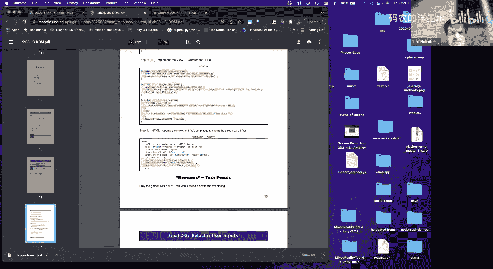
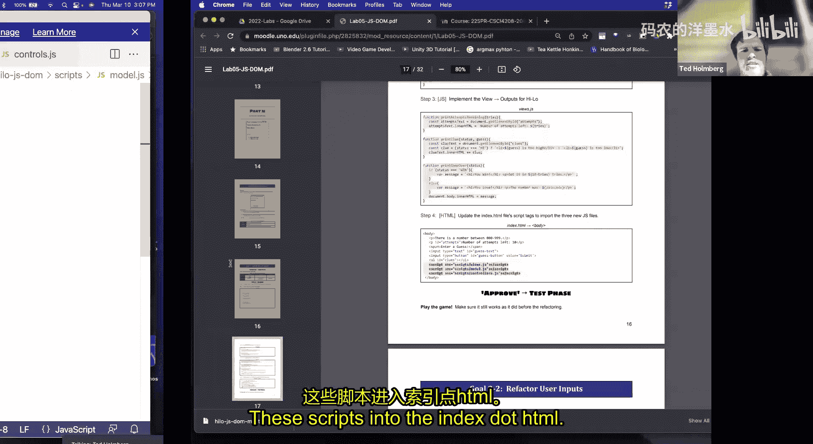
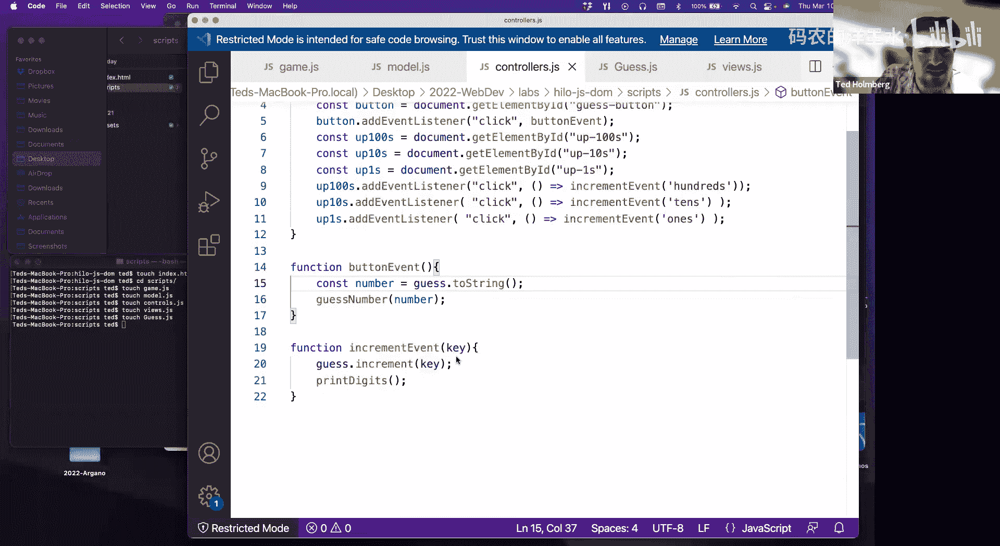
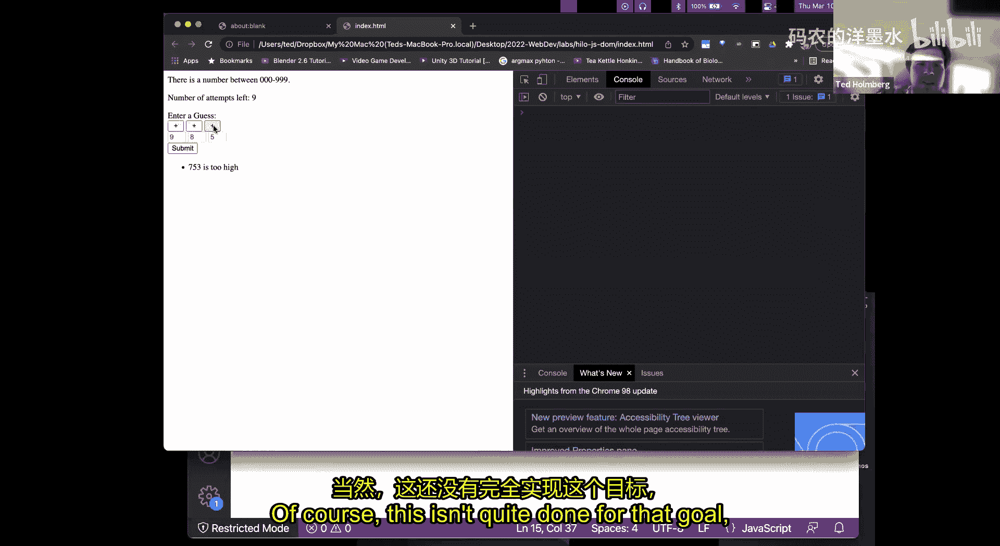
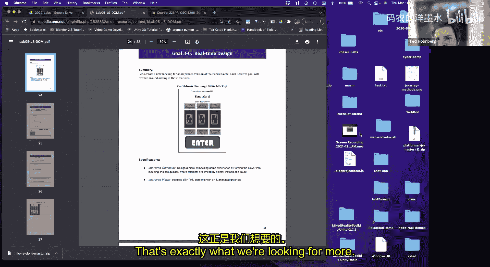

# 【全集】加州理工学院 高级Web应用 中英字幕 1080P p09 Lecture 9 - 文档对象模型、事件 part1 -BV192zTBrEmu_p9-

And I should not be recording。 Yep， you see it on screen excellent。 So in today's video lab。

 I want to move on to。Our highlo guest game， so in this lab really the learn objectives are going to be to learn about the document object model and event handling。

So let's take a quick look at our table contents here。

So we're going to break this lab into three different parts。

And before we get to any of these parts we're going to first go into the introduction of the lab where we'll discuss what the learning concepts are and the concept of what a single page app is now this won't be necessarily super unfamiliar to you because in the previous lab we built effectively a single page app。

 however we were drawing everything into the Can whereas with this app we're actually also going to render HTML elements so here you'll get a chance to see how we can partner JavaScript and HTML together to make an interactive experience。

Yeah。In terms of updating our HTML。Or our dom， and so the first part would be to build a basic high low game。

And we'll talk more about what that is butll the first one will be effectively just termb and text based and the second one will be term based and text based。

 but it will use an MC design as opposed to a MBP design and then lastly we will build the same thing but it will be time based and graphic space using an MC design and of course we'll break down those concepts as we get to those sections and then each one of these parts has a couple different goals that builds us out to a complete project and then we'll refactor。

 build that out and then refactor and build that out。Okay。

 so let's introduce the concept the first thing is the preres for every lab so this is our DoM and Even lab so it's partners with the lectures for the DOm and events and so you don't really need any critical software outside of just having your Chrome browser and a code so pretty much everything we've had up to this point the motivation behind this lab is we want to learn about the document object model API and JavaScript to make some interactive HTML based apps。

Now we already know a lot about JavaScript so we'll really be highlighting or focusing more on the DOM components here the goal for this particular lab is to build a compelling fun version of the high low game that runs in a browser using JavaScript and Dom API now when I I keep saying high low game is everyone familiar with the concept for this game I'm pretty sure this is like a game that you build in 1583。

but if not， let me just give the basic rules and it might be given later on。

 but then we'll just go over it again the idea behind this is。

You might have a certain number of gases， let's say 10 gases to guess the number。

Across maybe  a thousand， you know， from one to 1 thousand0。And then whatever your guess is。

 you're told whether the number is too high or too low and that gives you a clue on how to narrow down to guests more strategically or intelligently next time so that you can try to isolate down to that number。

So it's a pretty good common kind of programming， a game to program because it hits up all the different components inside of a coding language where you have to store data。

 you have to do selection statements and repetition statements。

 you have to do some processing on your data some data processing and you have to display results。

Okay， so the learning objectives here is we want to learn about the document object model API and access and update the HTML document from the browser from our JavaScriptco runtime environment。

We're going to learn a little bit about invent driven system design。

We're going to learn a little bit about agile practices when I was stating MVP earlier that's what we will call the minimal viable product thatll be our initial focus when we go to build out but then when we refactor our code base we're going to move to an MVC which is our model view controller design pattern so our first build we're not going to care about necessarily adhering to proper design patterns we care about just building something that works and then when once we get something that works we'll refactor it it's something that's better。

We also are going to talk about some UI UX considerations and improvements that we can make as we keep implementing our game。

 and then we'll talk about setting up some timed events and date objects。Wecome。

Now the project architecture is we're going to start the project by downloading the start a files from GitHub just like we have been。

 and then we will see that the project structure below so we'll have our high low game then we'll have our HTML file。

Rightrite in the root project directory and then subdirectors would be an assets directory that should contain all like the artwork we might need for this lab and then a script directory where we're going to put all of our JavaScript code Okay and then we have this link here let's go ahead and grab that。

冇系。Well， just let me。Yeah， that's fine。And let's get that set up， let's go over here。没。Take this。

Let's hide this and don'll need this here。😔，Or something。Okay， here we go。

And I'll just go ahead and rename this。So just what。

Hlo Js dash perfect okay so initially I have an assets directory and my assets directory has things that well use in part three when we talk about having something that's graphic based。

Okay let me create let me get this set up to be similar to it at once though I will have a scripts directory Okay so I just made that just now so nothing's in there yet because I haven't run any scripts don't have an ACL page so all we have is assets so i'm going to start by just making that scripts folder now。

So that。I now。Eulate this for the most part。我 go。So let's talk a little bit about the document object model so the DOm or what I'll start just calling the DOm from El the DOm gives JavaScript access to the HTML document。

 the DOm is a built in object which has functions and properties purposely designed for manipulating the HTML。

 the DOm converts HTML elements into JavaScript objects。

And the lecture will discuss exactly how those get modeled into node objects and what the hierarchy on that is so a document object is a global object that is the entry point into the DOm API it itself is a property of the window object。

 which is the global object for everything。Inside of our browser。

But we have an alias to the document object that is just document so again if we were to go let me go to the browser here。

 if I was to just type in document right inside of there you could say it's something that exists。

And it actually represents the HTML that's in this blank page right here。Yeah。

Okay and then we also have element objects so so the document object accesses our element objects via a get element by ID call and then we could pass it the ID that that HTML has these element objects are the JavaScript models of the HTML elements for the web page now we could also access our HTML elements with just the ID names themselves like what we did in the very beginning of the course in the first lab however。

 it's preference that we use a call to the document object and i'll highlight why that's the case little when we actually start the lab I'll actually give you an example of that。

And then one other thing that was talk about that's going to be relevant for the DOM for this lab is the inner HTML which we've already seen before again we've seen this in lab one so that's going to take away some of the surprises from this lab since I had reauthored that one but inter HTML as you might already know it's a property of an element of an element object that maintains its HTML and mark up notation strength so by changing the value of an inner HTML the element may add change delete HTML from our DOm which then will cause our viewport to rerender with the new contents now you don't ever want to use outer HTML because that'll actually change the HTML element itself that you're operating on or to not even exist anymore and actually pull it out of the out of the tree if you modify that so we strictly usually stick to the innerH。

Okay。Let's talk a little bit about events now we in particular browser events so web browsers are event drivenriven systems right they're graphics based and they have all sorts of mouse inputs and click events or keyboard events that kind of trigger it so a browser generates and manages events based on certain actions or triggers those events may be used by Javascript apps to trigger actions or behaviors so some things you should know about using events in an event drivenriven system we need an event listener so an event listener effectively registers an element object to listen to the event queue for a specific type of event and when the event occurs it invokeked a callback function。

So when we after we registered an event listener to the event delegator when that happens。

 this is what triggers the callback function so a callback function is simply just a function within our JavaScript application that is passed as a reference to the event system when an event occurs the event system invokes that callback function and then what happens is we're given an event object when to this callback function so whenever callback function is invoked the browser passes an event object as a parameter this event object has properties specific to that event I think we've seen this before I think I had when we were doing the platform or game I illustrated what an event object looked like because a console walked it。

And then just note you have different types of events again。

 we've kind of seen this already because of the platform or game every event object has a type the event listener matches the event object type to a callback function。

 This is similar to like a key value pair and so event types。

Are representative strings in terms of this lookup and they might appear as like click or load or key down or key up or things along those lines。

好的。Now let's talk about a little bit of architectural concepts。

 so I'm sure everyone should be familiar with the idea of model view controller or what's commonly referred to of NBC。

So MVC is just a design pattern where an app's responsibilities are divided into three different partitions。

 whether it's a part of the model of the app， whether it's part of the controls of the app or whether it's part of the view from the app and so the model effectively manage all of the app's core logic with concerns for handling without concerns right so it's all about modeling the core logic and so we will disentangle any concept of input and output from the model and then the controller handles the user input to send data and evoke actions within our model and then our view will manage outputting the data from the model and presenting it to the user。

And so this will be a common theme of trying to organize our apps all throughout we'll find that it's a very powerful approach to building out web applications。

 being able to identify these three different parts of your application and keeping them kind of discrete。

So far goal zero， so before we start let's let's talk a little bit about a single page app so a single page app。

And and iterative bill， so let me start with the concept of SP。Modern web applications minimize。

The number of HTML pages you get。Sent to down to one and the reason why is it's now typically more important to preserve the JavaScript runtime data as opposed to separating a website or web portal across multiple HTML documents like one bad thing about multiple HTML documents like what we had in the first couple of labs is that every time you you。

Link from one。Ht page to another， anything that was stored in your JavaScript runtime environment you lose。

And since so much about what we do now is based off of computations happening in the background on JavaScript。

 we want to preserve that and since in fact the browser maintains all the HTML elements that's being presented to you in memory as a collection of JavaScript objects in the form of a tree。

 we can modify the HTML in real time and rerender all new content。

And so instead of focusing on building new HTML documents that have HTML pages spread across like different HTML content spread across it。

 what's preference is you just update the HTML in this current page based off of whatever the state of your application is。

Yeah， that bird is really chirpy。It's a nice day outside。

Okay so with that said so the motivation moving forward is all of our web apps on our client side。

 we want to start focusing this with this kind of design metaphor of having it be a single page app so we have one ACL page and then all the content that's going to get displayed to the end user will be updated via the JavaScript iterative builds we're very we're very familiar with this concept this means we're going to start by building something simple and then we're iteratively going to add complexity to this and this is a great strategy to go ahead and build out and any kind of application you start by identifying what is the core feature set and can I get just that built and then you can go back and do a refactor of it and then plan out how to add each new feature thereafter and you can create set of milestones for yourself like what I'm about to do so that I'll get to a final app so here。

My part one， I'm going to focus strictly on this idea of a minimal viable product。

 so I'm going to focus on the just getting what the apps necessities are。Then once I have that belt。

 I'm going to refactor my app with the Model view controller pattern and improve the user interface on it。

And so that version will refactor the code base into effectively three parts where we have a model that matches the logic。

 we have a view that's going to manage the output and will have a control load that manages the input。

And then our final version， we will go ahead and improve the UX even further。

 make it more attractive， start using graphics to display our output and instead of being a turn based game。

 we will make it a time based game to make it more compelling to make it more fun。Okay。

 so now that we have our goals， let's actually move to part one。

 building a turn based text based high low gain using the MVP design。

And so here you can see a mockup that I make and it's always good to have mockups I think you'll have to make some mockups for your final project's one of the it's one of the tasks you'll be assigned to do so you could use this conceptually of how you might have to explore what a mockup might get rendered as。

So here we'll have our index on HTML and we'll see we have guess and number we'll have an input field we'll have a submit button and then when we submit essentially our game will listen for that submit to occur and then it will take in and。

Define whether it was too high or whether it was too low as a response。

Okay and I think we covered a lot of these concepts up out this point so we're using a minimal viable product so this lab used is an agile approach for developing the high low game so if you've heard of the concept of agile design this is effectively what it means it means instead of planning everything all at once and then starting your implementation phase you do a little bit of planning and a little bit of implementation then go back to planning and implementation you test in between right so the exact same way we've been building software in all of our labs is using an agile approach to software development。

Yeah we focus on the initial bill to delivering an mVP and mVP is a version of our app with just enough features to be usable by early users who can then evaluate it for future development so that's what our goal we have this proof of concept can we get something just to play around with it and say okay what do we need to add on to it to make it a more feature rich and something that we can potentially deploy or release in the future to the general public。

So an in terms of MVP specifications， the specification defines the necessary features for this version of the application。

 so we need to so our goal here what what we need to have is be able to capture input from the user through the browser's viewport update the browsers viewport with the player' results and implement the core game logic for executing the high logo so this is what we would consider a success for our MVP build。

Okay so now let's move on to our goal for our mVP built so goal one we need the HTML for a high low game so here we're going to break every one of our goals into the same thing we've been doing and approach and apply and improve or a planning phase a do phase and testing phase so in our planning phase we need to make an HTML document that gives the games instructions and it user inputs so we will need to create。

And actually to do that， we'll have to create an index。

 HTML file and implement it with the base HTML content。Now here。

 I'm not going to cover too much about what's going on in here because we should know。Okay。

 let's see here。Let's do this， where am I Ls？Now， let's go back。Let's go back。嗯。LetsGo back。Yeah。

There。Okay， let's go until。And where am I now。 And let's go into。没有。There we go。Perfect。O。So let us。

Make an HTML page。There we go， let me get that into my editor here。And。In the moment。

 I'm going to get everything formatted appropriately。

Okay perfect so what we have here we have an amL document we have a head and on this first phase we we're just going to mock up the first goal is we're going to try to create this mock up on our index at ACmL right so that's pretty simple。

We're just going to implement some things in the body。

 a paragraph that says this is a number between zero to 999。

 you have 10 gases enter a gas and then we'll have an input to try to capture a tax and then we'll have an input that will be a button that we can go ahead and we'll say to submit。

So let me save that and actually let's go over here。Open here and here yeah。 you can see bam。

 there we go。 And actually， let me just go to developer tools here。 nothing's there no jascript。

 but I'll have that open。 Okay， so that's a good mock up of what we're initially going for。

 So when we open that。We have the initial interface that we need for this game。

 so again for high low。The rules are going to be， you have guesses。Well， you have 10 guesses。

 but you have to guess between  zero to 999 and you can enter your guest here and then we'll get feedback eventually。

So we got the initial state going so let's move on to the next goal， so here。

We'll have our Dom for the ja controller So we're going set up our event listener right so here the basic approaches in this iteration the HTML inputs are accessed from jascript which listens for button click and triggers the callback function in response So how can we go ahead and do this well in our apply phase we're gonna to have to modify something in our index on HTML we're have to link the game Js file to index HTMLm and give it input ID attribute to access it So right here we're gonna to have to do a couple of things and we'll have our input type and ID here and ID here and then we got to link the script。

So let's go and do that。So we'll go here let's get to our source code so if I want to access this in the ja in our JavaScriptscript right we're going to have to give each of our e elements and ID so this is going to represent the gas text。

Line seven there and then the other the button is going to represent the button we select for guessing。

 so let me go over here and add that。Okay， and now the next thing I'm going to do is I'm going to link at the very bottom。

Our script。嗯再这块。Okay。Here okay so now we have a script tag that's going to link into our scripts section a game。

js doesn't exist yet let me actually go into my script section now and actually make that knowing that that's going to be the next thing i'm going to likely have to do so let's go and make a game Js okay scripts or you'll open that up now。

Okay perfect， Okay， so now now we're importing game。

js and we'll put all of our logic in here and since these have IDs。

 we'll be able to access them from our JavaScript environment， excellent。

And now so now the next step is we're going to go ahead and use the document object to get HC by ID and add an event listener to the button with a callback function。

 so let me just grab this and then we'll walk through this code。Okay， this is。stop得。

Let's make this look a little bit nicer， that goes there， that goes there。

So okay let's okay so the first thing we're going to do is we're going to get the HTML element as JavaScript objects and so I'm going to grab the button and I'm going to grab the number and to grab those I'm going to do document so this is a document object the document object has a method that's called get element by ID and so what it's going to do is it's going to search the entirety of our HTML contents in the tree of the HTML and it's going to navigate until finds a element with whatever the appropriate ID is the ID that is looking for is guest text then or guess button so this time it' guess button so if it's guest button that it's looking for it's going to return this element and then we can save that element as a variable in here。

是。And so since I don't intend yet to mutate the state of button or number。

 I'm going to declare these with the least amount of wriable privileges possible it's constant I typically try to always keep everything a constant if possible and if I determine later that I have to make it wriable then I'll change it to a lit。

Okay， so。Now I could have easily， I could have easily also done this， well， I couldn't actually。

These have underscores， so I guess button does't， but if I change if I would have named the variable something that used underscores instead of slashes or dashes。

 I could have done this right but this is dangerous。

 we want to avoid how we did this in the first lab and I'll show you why I'll show you why that's the case。

嗯。Actually， let's do that。Let me make。Well， after after this， more in the test phase I'll show。

SShow you why we shouldn't do that。 Okay， what did I do Oh here。I that Okay。

 so the this is so we grab these two HTML elements， the button and the number。

 then what we're going to do is we're going to add an event listener to the button with a callback function。

 so the button element itself。Because of inheritance。

 a button element is a type of node and at the very root node that every HTML element that's modeled in the dom has it has a membership to the。

Essentially， it is an event target object。So， because。

The event target is like the parent node to all the nodes that make up our HTML tree。

 they can all be have this method that's called add event listener。

 this add event listener allows a event target object。

 which button is a member of to be able to register itself to register itself with the event delegator that's built into the browser and so then add event listener allows us to say。

 okay， here's a type of event that we're going to listen for whenever this event occurs。

Trigger this callback function on on this element。 and so the cool thing about this is since each element。

Can be an event target， you can actually have multiple elements registered for the same event。

With different callback functions。So we're not going to do that here。

 but just understand like when a click event occurs。

 you don't necessarily are limited to buying just one callback function to it。

 you can bind any number of callback functions and the event handler will essentially just go through everything that was registered with it and do the callbacks on each of the individual elements that it now has a reference to。

Okay， so this is how easy it is to add an event listener so that we can go ahead and start listening for a click event and then we have to give it a reference to a function notice this isn't a function in vocation functions in JavaScript are objects in of themselves。

 So we're assigning this。This we're giving a reference to the function when we register the event listener that will later invoke it when the click event occurs and so when this when the click event does occur。

 we're going to invoke this guest number and the guest number is going to pull the value from this other。

Htl element that we grab so we grab the text fields here。

 so one of the things inside of the text fields are for inputs is an attribute called value so we'll grab that value we'll assign that to a local constant just a guess and we'll print that into our console so let's actually test this up。

Okay。So if I put， let me refresh my page。Let me type in 100 into the text field。

 I hit the submit and there we go and that's going to print console log 100， excellent。嗯。

So now we we're less for an event and now we're actually doing something in response to that now I had claimed earlier。

And I want to prove this， I could do something like this so to suppose that I had an ID of。

let's call this fo Okay， so suppose I have fo here。

 right now what we've learned up to this point is that and let me refresh my page。

I could access food if I wanted to just buy the I from the HTMLl page right I don't have to do this big long thing document do get。

啊。Element by ID and then passing F this is the other way that i'm advocating that you you do so notice I get fo either way。

 whether I just use the idea of fo or if I go to the document object and say hey get the element by ID with fo so I'm telling you to do this big much longer way instead of this much simpler easier way。

 but I'm going to justify it I'm going give you a rationale why you should do it away than i'm presenting it now。

It's because in JavaScript this IDs it's mutable right it's not constant there's no way to make that constant and so so say for instance then I decide to overwrite it let's say。

 hey foo， now you are have the value of bar。😡，Right so now whenever I referenceence food it now has bar right I'm no longer dereferencing my HTML element and so with IDs in HTML it could be very common that you have variables in JavaScript that are similar and name than the ID attributes labeled to in your HTML element and if at any time you accidentally overrite it then you lose reference the HTML element and you know that's an easy mistake to make that's hard to catch and so one way to make sure you always are grabbing references to that document。

Object is， well even though I don't have access to it through the ID anymore， right。

 because I've absentency or purposely in this case assigned it a new value。

 I can still grab it using the document object， get element by ID type in fo and look there it is。

So but even though this one， the actual ID itself no longer works。

 so you can see this is a much safer way to ensure that the the what I'm getting back。

 what I'm dereferencing is the thing I expected to be。So just， you know， something to be aware of。

Well。Yes。Okay， and we tested out that out and that's looking great to me。

 so then the next thing we're going to do here in our high low gain is we want to add some game logic to it。

😊，So in terms of our approach for adding our game logic。

 well we want to implement the basic algorithm for the high low game and so effectively the game's output will display to the console so that we don't have to worry about updating to our viewport yet we're going to make that a different consideration in the future we're just focusing on an MVP built here。

So in terms of doing this， well， first， let's go ahead and create some variables for the random passcode。

And the number of tries。Remaining。Okay， let's see。 So let's go here。嗯。

So this will represent my high low game data so I always try to put my data towards the top whenever I develop that way it's easy to read for myself and for future developers who come back to read my code and I always try to comment out each of these lines too as you might notice so here this is going to represent my high low game data and so I need a passcode the thing that we're trying to guess and the stipulation for a winner loss condition is you have to do it in a limited number of tries or attempts。

So here you will be giving 10 tries。And so notice the passcode won't change。

 but the number of tries will， so that's going to have me determined to use a lit to define my tries versus a constant for my passcode now we have。

A math class built into to or math object built into our JavaScript it's part of the API so here and I actually have a lecture on that on on the math class and the local storage class and a couple of other built in classes that day class here at any time when one great thing about JavaScript is。

The dev To is a pretty full featured like。It offers a lot of the tooling you'd expect a full- featuredature IDE to have so when I type in math and if I type in dot it's going to sort of autocomplete for me and so if you wanted to survey what kind of math functions you could call what methods you can call in the math object you can just kind of scroll through and see all of them you see the math functions pretty well defined in fact it probably has all the same methods if not more than the math class that Java has。

And of course， one of those is going to be the ability to produce random numbers， right？

And when we do that， notice the behavior of our random number is going to be a random number between zero and one。

Which is exactly the same as what Java's map random function is。Yeahep。

So we're what we're going to only gets my source code here。

 so what we're going to do is we're going to。Called mathOt random。

And since it's going to be a number， a random number between zero to1 will multiply it by 1 thousand00。

 so now I'll get a random number between  zero and 999 now because one is not inclusive so I can never get one from mathOt random I can get 0。

9999999， but never actually one。And then once I do that。

 I'm going to F so I don't have a fractional number anymore that way I have an integer number and that I'll represent my passcode。

Excellent， so now that we have that， let's move on to step two。

 where we're going to implement the logic for evaluating a gas to determine if the user had won lost or gets a clue。

So I'm going to grab this。I'm going to add this function in here and actually this is our guest number function I'm going to get rid of my old one so。

Because I'm just going to replace it out with this new one， that old one was the test one。

 typically you'd want to just go ahead and refactor， but I'm just going to for brevity's sake。

 replace it。Okay， so now I have a guess number function。

 but instead of just passing off the just instead of just console logging out the value。

 I'm going to grab the guess from the text field， I'm going to decrement tries on each time we guess a number。

 I'm going to console log the number of attempts left is and then the value of tries and then I'm going to check if guess is equal to passcode then we won the game and we got it in whatever the number of tries 10 minus whatever the number of Tes。

And then otherwise， else if tries as less than zero， then we lost the game。

Because we didn't get in the number of attempts we get so this is our winning condition。

 this is our losing condition and if we didn't win and if we didn't lose。

 then we're going to call this other method， this other function that's going to be called give clue and we're going to pass give clue the guess that the user had had supplied。

So this simple selection statement that checks to the win do we lose otherwise given a quote？

So then we have to define that helper method， so we're going to find a function that gives a clue whether the gas was too low or whether it was too high。

嗯。Okay， let's pretty this up。是。Can't have things not formatted right Okay。

 so this is the function responsible for giving us a clue it will take in guess as a parameter we're going to check if guess is higher than the passcode then we'll let the user know your guess is too high otherwise we're going to let them know it was too low we know we know it either has to be too high or too low because if it was just right then they would have won and we would have never given a clue。

And if it's not too high， then it's you a little clearer。Excellent。

 okay so now the next thing we're going to do is we're going to actually test this logic and see if it doesn't work so now we'll play the game we're going to submit some guesses using the button and read the results and again this is just a flow chart of how from the index at HTML we have these two input fields right a text field and a button the logic of our game is going to listen for this button。

And invoke the guess action right with the callback function。

 which will then have our game JS file output to our console so the purpose of this breakdown is to illustrate this connection that's kind of defining our model view controller or I should say like our kind of scheme and how we're starting to see the relationship between our game logic and how it starts mutating its state over the run of its application。

Of the the cycle of the application running。Okay， so let's actually test this out。Yes。

So they go over here， let me。Refresh and now if I type in。

 let's say 500 it's going to say number of attempts left is nine 500 is too high that means I got to go lower right so let me do 250 number of attempts left is8250 is too low okay so now we have to go in between so let's do like 375。

Number of attempts left down is7 and 375 is too high so we got to go lower let's say let's do。

Let's say 325。The number of last attempts is6， 325 is still too high。

 so my highest that I should do is 325 low it should be 250， so let's say let's2。Let's see here，675。

😔，Okay， number of left temp is5275 is too low， Okay， so we're be choose that， so let's try 300。

Number of attempts left is4300 is too low oh my， okay， so let's do like 312。

So2 is too low and we only have three attempts left。Let's do like 318。We only have two attempts left。

 but we win， we got in in eight attempts， the number was 318 excellent。

So we can win the game that's clearly working for our MVP let me refresh and see what happens if we just submit。

 submit， submit， submit， submit， submit submit， submit and okay we lose and the passcode was 854 perfect so we have a loss and we have a one and our clues work。

So I feel good about this， in fact。Let's see what else do we need to do here。

 so for our goal for here on this first build is we're now actually going to move away from the using our our console and we're going to use the interACL instead。

Yes。So the general approach we want to do here is we're going to use the DOm API to update the ACL elements from our JavaScript so let's see what are we going to do we're first。

In our step in order to accomplish this is we're going to add an empty list for clues with an ID and also add an I to the paragraph for attempts so in our H we are going to want to。

Update this。The number of guesses we have as the game progresses and we're going to create a unordered list that we're going to mutate into that we're going to go ahead and keep appending into so let me grab this attribute this ID here。

And let's go into here。And inside of here， so this is going to have to mutate after we get each time we make a gas。

 so that means if I want to access this inside of my JavaScript， I'll give it an ID of attempts。

And then the other thing I want to do is i'm going to create a whole not HTML element that's going to be designed to capture or to go ahead and present these clues to us and I think we'll just represent that as an unordered list and each time we make a guess will append to this clues unordered glass excellent so the next thing we want to do is we want to grab these these two elements HTML elements into our JavaScript。

So let's go ahead and do the same thing we did to grab those input fields undergoes the top here。

And I'm going to grab my attempt view here， which I'm going to use document。

get elements by ID attempts and then my close view which is I'm to just to grab using document object again with the get element by ID and the clues so there's HTMLL elements that I just made I'm going to grab and I'm going to store them into these constant variables to ensure that they are well protected and can't be over over wrotete。

We don't overwrite them。Okay， then now that we've done that， let's refactor our code a little bit。

 so instead of using console logs， let's take those messages and actually use the inner HTML property of these element objects to redefine what they're going to display so I'm going to go to the tries under replace my tries here where I'm updating the number of attempts left and I'm going to instead tell hey。

 attempts view from your inner HTML use this text instead。

And then I'm going to do the same thing here。With if we win。So on the instance of if we win。

 I'm going to instead of using a console log， I'm going to。From the document object。

 the document object has actual references to the two primary root children of the HTMLL document so from document I can access what the body and the head I'll show you that right here so from document and if you ever want to see what's the document again I could just hit dot here and I can scroll down and see every single function and property that document has available so if you ever wanted to kind of survey and kind of discover what you could do with some of these built in objects in the browser it's very easy to see what's available well some of the ones that we're going to care about is being able to actually access the head and the body elements just like so。

So even without ID tabs we always have access to like these root children。

 the primary children of an HTML document and what we're actually going to do here is we're going access the Nh and we're going to overwrite everything in our document in our HTML document so that it will have a heading element so I have a heading element that's going to say you win and I' going to have a paragraph that says got it in and then I'm going to do that computation so this is a string template so again I can pass a value using a dollar signed and curly braces and do a computation inside and only be 10 minus triess the same way we were doing before perfect。

Okay。And then I'm also going to do that on the instance that we lose。Yeah。And so here。

There we go so we're going do document。body。nhtl we'll do an assignment here and the same thing that we do with when but with different message you lose the password was and then we'll say what the passwordcode was well you reference that。

Excellent and then the next thing we need to do is inside of our give clue function because now inside our guest number function we've updated the number of attempts and a win and loss message on the instances that those conditions occur。

 but we also have to update the give clue to actually give the clue inside of that unordered blis as opposed to the console so here we're going to update these console messages for when it's too high。

Again we'll access clues view here we'll access the NH but as opposed to overriding it which is what we've done and all the other attempts where we've just removed what was there before instead what we're going to do here is we're going to concatenate to it so we're going to add to we're going to maintain what was already there and add to it this string a string literal template that's going to be a list item that's going to give the gas and put it's too high if the gas is greater than the passcode and then we'll do the same thing but with the message that's too low on the instance that on the other side of that selection statement。

And then once we do this， we should have been refactored our code such that instead of doing console logs with all of our data。

 we're now going to display it into our viewport so let's test this out and see if it's actually working。

Okay so let's do this again so 500 submit and bas and nothing nothing in the console log anymore and notice now I'm updating this to say number of attempts left is now nine and it gives me this clue 500 to too high and then I'll do do 502 low then let's do 750 is too low let's do 800 we'll just keep doing this too low 900 too high850 if we just want an employee any strategy well randomly guess。

875 is too high。And I guess if 850 is too high。Ive already done， okay，750。

 I guess I should pay attention to the clues，7 50， let's turn 300。Let's do 125 or 120。

 whatever I end up just putting into my like my code， let's see I have okay。And there other go。

 so that'll overwrite。是。What we have though。So we and this represents what happens when we overwrite the body。

 we've lost everything there， we're totally lost the only way we can get back to the games if we do a refresh excellent Okay so that seems to be working and we know that the wind message will likely work too。

So that's it that's done for part one， we have our minimal viable build right we have a version of the game that works in the browser where the end user can easily play and experience the game so now let's move on to part two lets let's turn let's convert this into still being term based still effectively meeting text based but let's start to subdivide our logic using this concept of an NBC pattern so now that we've gone some that works we're going to retool it so that it scales a little bit better so we can continue to add features and complexity to it。

So this is going to be a sample of what the finished project is going to look like where we're giving the same amount of rules we are going to have the number of attempts left。

 but instead of。But instead of but we want to。We're going to be motivated to kind of make things a little bit safer。

 so instead of having。Just this like what are issues we might have here by typing in well what if I type in letters right like well that's too low well that doesn't even make sense right so this is this works minimal viable product but there's you know there's some there's definitely it's not very full tolerant right it's not we haven't defended against improper input into our game system so we want to start having additional considerations as we start to refactor this and improve the functionality right this would be really frustrating if you're playing the game and or what if I put in like a negative number right like。

Or what if I put in a number that's too big right like I can do all these things or it's not even a number there's why in there I can do all these things and you know it's outside the scope the number that's gasing it's not even numbers it's you know we could do a lot of things to kind of break the experience so in part two we're going to try to address some of those things while we also separate our code base。

So here our summary， let's create a new mockup for an improved version of the puzzle game each iterative goal will revolve around adding in these new features。

 so the specifications。The thing that motivates why we need to continue working on this project。

 the reason why it's not done， even though we have an MBVP build of it is that we want to improve code maintainability so we're going to adopt better software engineering principles and we factor the code into three responsibilities a model of view and a controller we want to improve our controls。

 we will make them more full tolerant for the user inputs and prevent any kind of invalid values so that we can ensure that the inputs do not require even a keyboard but also support mobile use right so if we do buttons we could do it using either like a mouse or touch controls so we're gonna to improve our controls we're going improve the code maintainability and we're also going to improve the view we're gonna have a better user interface user experience that's going to have more styling maybe graphics isn't the right word yet but styling is certainly going to be something that is going be consideration。

So our responsibilities across our MVP is， well again。

 our view is going to manage the output from the model to the user。

 the controller will manage the input from the user to the model and the model itself well that's going to be the program's logic so that's going to be the thing where that has all of our game rules in it no but with no input or output concerns。

Okay， so that's our guide。 that's that's how you decide whether something goes in model view controller。

 So let's take a look at this， let's take this approach and start breaking it down across an NBC architecture based off of what we already have So if we have a model do js if we have a view do js and we have a controller js the variables that we currently have or a passcode and tries without those belong to our model the functions we have is guess number and give clue that belongs to the model we also have print attempts remaining print clue and print game over well that's an updating the view so we would move those into the view do js category and then for controller we have。

We'll create a function that'll initialize the controls and go ahead and set up for the button so all of the things that we're doing to start setting up our event listeners we will go do inside of a controller Js so the first thing we do in our approach is break down the features we already have all of our implementation so that we can decide how where it goes inside of this separate Js files so next thing we need to do is actually create a model Js controllers Js and views Js let me do that。

Let's see。J and it just out of curiosity did I yeah。That is。Okay。Oh， yeah。Controls JS。

And then I want to say I called it views。J ask。Perfect。Okay， so let's go over here。

 let's go over here。And let me get these into。马骝。Use。And control is perfect。Okay。

 so now I have these made。嗯。So inside of my model， let me grab this。Yes。Oh， lo。

Does a good job of uglyifying my code。time it' just。你家。G， there we go。回たね。我 stop that。Okay。

This also has to be。嗯。There we go。Okay， so that is there。That's the same thing here。Yeah。

 then that goes there and that goes there so let's take a look at what's happening here。

Inside of our model。 So we are going to go ahead and create the passcode the same way we did before that data goes in here。

 the tri goes in here as well。 we have our function。

This gas number where we decrement the tries and then we check if the gas is equal to the passcode。

 then we're going to invoke this function to print a game over so notice this is a method call and this method call will essentially be accessed and it'll send a message to our controller script that will manage the logic for printing a game over message of when So now that responsibilities outside of our model and then we'll also check to see if tries is less than or equal to zero and if that's the case。

 then we'll go ahead and print a game over message to lose and again we're not handling the logic here we're going to send that to a method call that will then exist inside of probably views。

Its same here， but we're sending the message Then we're going to print attempt remaining tries。

 and again， that'll probably go into our views right based off of our separation of responsibilities and then we'll invoke the give clue message。

And then I'll have this function that's called I'll have this function called give clue。

 which I had before， but notice instead of actually updating the HTML documents， I'm sending again。

 these messages high low and the gas to these print clue methods and again。

 because we don't want to have that logic inside of our model that's going to be logic that has to be handled inside of a view to have the appropriate separational responsibility。

So now let's go into our control。Scrt， and let's update that so that we can。Hi。

Do the same thing and give me a moment while I get this code to be a little nice。Okay， there we go。

 so inside of here I'm going to actually invoke a function。

When so when controllers are initially imported in it will initialize the controls method so that's this function here and so what initialize controls does is it's going to grab a reference of a button and then the guest button from the HTML document and it's going to set up the event listener so on a click event it's going to invoke a button event。

It is callback function so on the event that a button gates clicked this will happen so what happens here is we're going to grab from our document the guest text text field we're going to sign that to this number variable and then we're going to invoke the guest number function from our model right our controller is going to now send this number to the model where the model is going to process it。

I then send out methods， invoke methods to our view so that we can see how it got processed out。

 excellent。So all of the management of inputs is handleds and controls。

 all the management of the game logic is now in models， so now let's update our views。She可啊。Okay。

 let me copy that。And let me go into my views here and okay， that looks great。And that looks great。こ。

And oh my， that's all over the place the it goes there， Okay， now let's see here this goes there。

This goes there yep yep okay that goes there okay so now let's take a look at what's happening now only the map the only thing that's going to exist in terms of my views do Js file going to be those functions that actually do mutations or updates or write to the HTML elements so I have a print attempts remaining that given some number of tries will go ahead and grab that HTML element that manages the attempts text and it will update it with the new number of tries the inner HTML of it。

I'll have a function print clues that given the status of the game。And the current gas。

 it will grab the gas。And then。We're going to do this trinry this like conditional operation so we'll say if the status of the game if the status of the guest was high right because that's what gets determined here for print clue if the guess is high then it's going to print H otherwise it's going to it's going to give it L so we're using that as to manage state。

Inside of our game system。 So if the state is， it was a high gas， then I will return back a message。

 I will over。To clue right we're creating a variable that's going to have one of two messages。

 So if the state of the guess was high， then I'm going to send this list item that says， oh。

 the guess is too high and if it's not this， then that means the status is low then I would set to clue a list item where the guess is too low and then whatever this is it's either going to be one or the other I will append this clue into the clue text inner HML and for the print game over status I'm going to get again a status that's represented S text is either list look at the model。

As either when or lose so based off of these two states I'm have to decide what the output's going to be so if the status is when then i'm going to create a message that's going to be this heading message and this paragraph right you when you got it in this amount of attempts otherwise i'm going to create this other message you lose the number was this passcode and message is going to have a value either from this if or else right I can see they're going to be this or that so then what we're going to do is go into our document bodies inner HTML and then just overwrite the current value of the HTML with this new message。

So this is the exact same code， but arguably it's much more readable， it's it's much easier to。

To have an expectation of where inside of our code base。

 these actions are happening that in order to be able to refactor it later and add complexity。

Excellent， so then now the next thing the last thing we have to do here is we're going to have to go ahead and。

Add in these。

。These scripts into the index at HTML so let me get to index so I don't need game anymore right we've completely replaced game。

With this model view controller。So there we go， so we have view model controller perfect。

let's go back。Okay so now let's actually test it out let's play the game and see if it works exactly as it was working before。

 so I'll go here I'll refresh and look it's was the scripts controllerer such yes is not found let's make sure I named that the appropriate thing controls。

Thanks's always。There we go， got to make sure things are named appropriately。And this is why we test。

Excellent， just test this out， 500。yeah， that looks good， perfect， okay， and let's test the win。Well。

 I can access passcode from here， why is it 649？Yeah， okay， yeah， we would Okay， so our win works。

 our loss works and our clue works。Just make sure it works let's  zero0 zero numbers to the raw let's make sure this works yeah。

 okay perfect so we get it too low and too hot。嗯。So the next thing we want to do then now that we have refactored our codeb where all of the instructions are on one script so that is now managed between a model view controller build。

 let's move on to refactor our user inputs because recall another purpose of this build is to make our inputs more full tolerant so the new UI improves the precision and ensures valid input so the scheme that we're going to use is based off of a combination log to think of a combination log where you can rotate a digit from zero to9 and you're giving a set number of digits you can rotate so you're restricted to a000 all the way to a 9999 so we're going to use that same kind of metaphor which means that instead of instead of having one number we're looking at we'll essentially have to build our guest number from the kind of concatednation of the individual numbers the hundreds the tins and the singles digit。

So in order to do this， we'll have to refactor the text input tags。

Of our H so that that is updated appropriately， so let me go over here。Into my HTML perfect。

 So where I was just giving this one text here where you could put it in a number， I'm instead。

I'm going to define a div。That's going to be three。Text。

 I mean three input fields of the type number where I'm going to assign a minimal value of zero。

 a maxim value of9 and the initial value of zero and then I'm going to give these ideas because I'm going to have to be able to grab each of these individual values。

Inside of my JavaScript， so I'm going to say that this is digit 100s。

 this is the Ts digit and this is the ones digit that this represents。Okay。

So then the next thing I'm going to do is I then have to go refactor my code inside of my button event because my button event is the thing that's responsible。

For grabbing that。Okay， so let me go。Actually。I'll just grab this entire function。

Since this is being weird。Okay， so let me go into my controllers， okay。

 let's that doesn't exist anymore because it's this。Okay， let's go here perfect and close this Okay。

 so let's go into control note button vent yeah it was this button event we wanted to yeah modify so。

So I'm going to， so the new version about the event is I'm going to grab the hundreds。

Input fields I'm going to grab the tens i'm going to grab the ones and then i'm going to concatenate that so i'm going to build my number by taking effectively a string and concatenate it with whatever values from the hundreds plus whatever values from the1s plus whatever value is from the ones and then i'm going to pass that newly assembled number into guest number。

Now what's nice about this is because we separated this into the model view controller scheme。

All we have to do is modify our controller for this to work we don't have to change any logic inside of our model or our view so to get that refactory we just have to make those two changes the the changes to the actual index on HTML and then the logic for how we piece that guest together so if I refresh here now I have this whole new input scheme notice now I can。

Okay， so I could do five I could do seven， I can do four right but now I can' ever go more than three digits I can never do negative digits and i'm not allowed to put in any letters so now I have this full torant software scheme where it has to be a valid choice based off of the rules so this has improved the usability and the the full tolerance of our software。

Excellent。So now the next thing we want to do for this goal is we want to define a class called guess。

 and so the approach for this is we want to model a guess as a class maintained by the model theer that the view controller can reference。

对。And so here， let's take a look at this。And so the idea behind this is we want to be able to update。

Okay。We grabbed this so let us go to our source code。Let's go into our R。Index study CML。

 here we go so above。Okay， so above。The the input fields here。

 I'm going to create these plus buttons， so I'm going to create three buttons。

That I'm going give the IDs up 100s， up tens and up ones because I want to instead instead of having to put in those numbers with the keyboard。

 right， remember the other specification that we were going to do in this improvement was to add buttons that allow us to increment or decrement each of the individual values just like you can do in a combination lock so that we can play this on using a mouse or using a mobile phone so I'm going to create a div to nest three buttons together and one is to represent the hundreds field。

 one is the Ts field and one is the ones field。是。And then what we're going to do is we're going to disable our text the actual input fields that we're displaying in so that you can't。

Use those as inputs where we're going to we're going to set it to that one。

 these are just for our view。And that no no not these these are the buttons we want these the things that are that are showing off the number we're going to change to just be view items effectively and all of our controls into our model are going to come from the buttons so i'm going to disable。

😡，I'm going to disable these text fields or these number of fields so that we can only mutate them from our JavaScript codes that the user can't mutate the state of them。

And then i'm going to i'm going to update and add this gas Js we haven't made it yet。

 but we're about to so in order to get that into imported into our JavaScript run time i'm going to have to do that and the next thing we're going to do is we're going to go ahead and we're going to。

Create our guest。js。嗯。And that should be in here。😔，Let us get that there， excellent。

And then for guest Js， what I'm going to do is let's read through what it's going to。

How it's going to manage？That's very true。Okay， let's see here， yeah。

 the sun has gone into it in not an advantageous position for me。Okay。And I guess I need so。

What is happening inside of gas， let's take a look at it。

So inside of my gas class I'm going to have a constructor and my constructor will allow me to go ahead and construct an instance of gas it's going to start at with the hundreds place of zero。

 a tens place of zero and a one's place of zero so we're actually going to create something that can track the individual values of hundreds tens and ones a two string method will do effectively what we were doing before where we'll take an empty string and then we'll concatenate to it。

 the hundreds place， the tens place in the one's place so I can build the unified number and thenll return that and then I'm going create an increment method that will go ahead and I really like this implementation I think this is a clever way of showing you how you can use the box notation by kind of array notation or dictionary notation inside of an object to do interesting things so for increment we're going to take a key。

And we're going to increment into our keys， whatever this is。

 we'll be able to go so if this is like our hundreds or tens or ones。

 right we'll be able to go ahead and access that value and we'll read whatever that value is currently。

 we will add one to it， but then we'll also modulus by 10 so if it goes from9 to 10 that will mod it back to a zero。

So this will be a simple function that we can define that lets me increment the value。And I see。

 its let's see it's 318 for so if for any reason you can't stay any longer for me to complete out this goal。

 then I will make this video available so if you have to leave obviously that's okay。

 but I'm going to continue this out just so that's all in one video to make it easier for those who are watching these afterwards。

Anyway， so I have my guests here my class gas I have the ability to construct it and again that guess just manages the data that we're going to be comparing to our passcode and so we're going to find a method by which we can。

Change or mutate the state of our gas。Okay， so now that we have that defined。

 let's actually go ahead and use it， so let's go into our model。An instantiated instance of a gas。

 so we'll go into the model here and here。We will instantiate。An instance of gas。

And then the next thing I'm going to do is I'm going to refactor then inside of my view JS。

 the print digits。I don't know if I actually have that though， maybe it's。

 is it a refactor if it doesn't exist like it's all add？

Let's go into views here print digits no I have print attempting remaining print clue and print game over so i'm going to add a new function that's going to be called print digits。

And what print ines is going to do is it's going to access each of those values from the input fields from the number of fields that we made and it will overwrite the value with the value from the gas which is the hundreds the value from the gas which is the tens and the value from the gas which is the ones now notice for this particular application I didn't leave these to be private right so I allowed these to be public which means I can easily just de referenceference them now if you want to use encapsulation I would use gi methods here if it were private just but I didn't bother doing that with this lab。

Okay， so now we can print the digits。Into our HTML page。

 so next thing we want to do is we want to add a callback function。

To increment the gas and print to the view so here we go so。We'll call this an increment event。

 so this is going to go into my controllers。So inside of my controllers。

 I will set up this increment event， which will be given a key。

And that key will be passed to my guess instance， right that exists inside of my model to go ahead and increment it so remember that mutates the state of one of its variables。

 hundreds， tens or ones， and then it's going to tell it to print those digits and we just implemented thes method that's inside of the view。

So now I'm going to update inside my controllers this。In it controller's function。So let's go here。

Let's go to my。This function here that's responsible for initializing all the controllers。

 so here I'm going to grab a reference of the guest button。

And I'm going register that with my event listener for the click event like we're doing before。

 but then afterwards I'm going to go ahead and I'm going grab references of the up buttons right the up hundreds。

 the up1s and the up ones and I'm going to add click event listeners for those too see a multiple click events but all registered on different HTML elements on a click event here if a click event occurred on this particular HTML element then we're going to create an anonymous function that we're going pass our callback function the reason why we're doing that is when we register callback function remember we have to do a function object and not an invocation of a function。

 but on this instance we want to register different behavior so the callback function we're going to do here is there's no parameter but it's going to invoke the increment event this one with with the term hundreds now remember hundreds is the instance variable name of this so when this gets past in。

The key， I would dereence the hundreds。Value here right I can access and overwrite to this variable by accessing this instance using the this key word。

 and then I can actually access its instance variables using the block notation using the square brackets。

😡，And then passing in a variable name here as a string right so this is an interesting way of me creating instead of having an increment hundreds increment tins and increment ones method。

 I can compress that to be one method and accessing it instead of using dot notation bracket notation。

😊，Anyway， so what I'm going to do here is I will pass hundreds in here and that will get passes the key so that would increment the hundreds value。

 this would increment the1s value， this would increment the one's value。Excellent。

So now let's go into lastly my controllers and my number instead is going to always come from our guest instance called。

Willm the two string or button event， so let me get to my button event。Yes， so here。

 it's just going to be gas dot。呃嗯。Two string。Excellent。嗯。Let's see here。Let's test that out。

。And now notice I now have the ability to see these buttons if I click， yeah， look。

I can now increment。This and then it goes back to zero， perfect， and I can increment this one。

And I can increment this one。And if I submit it's actually going to read that as 753。

 so now the implementation still works just like normal。However。However， now。

These are disabled so all I can use these is viewing right and the inputs actually entirely rely on these button presses。

Of course， this isn't quite done for that goal， the last thing we would want to do for goal number two。

Would be to do effectively the same thing， but also add some decrement buttons。

And so I'm just going to quickly do that just to finish out here。So let me go to my index on HTML。

 so just like I have these increment buttons underneath。My disabled display of numbers。

 I'm going to add in another sit div that's going to have three different buttons that are going to have the value of minus sign。

 and I'll give those IDs of down 100s， down1s and down ones to represent these are my decrement buttons for the hundred0s place。

 the tins place in the one's place。And I guess let me。Save this out here。

And then inside of my guest class， I will also add in a decrement。对。

Method so here which will look not too dissimilar I will take in a key of either hundreds tens or ones ill use that to dereence the instance variable and then what i'm going to do to assign it is i'm going to look if the value of that key is great。

Rer than zero tonight nine right and this allows me to rotate it down so I'll go from nine to eight。

Like three to two， two to one， one to zero， but then zero to nine。Excellent， so now that I have that。

Let's go ahead and wire that up into our system， so in order to do this。

 let me go ahead and create a decrement event。As a callback function inside of my controllers。

 just like I have an increment。Event are' going to create a decrement event。

Perfect and all that does is it's going to grab a key and that key will tell the instance our guest instance to decrement based off of that key。

 and then it's going to print the new set of digits after that。Okay。

 and then what I want to do here is。I want to go ahead into my controllers and into my in controls and actually initialize those new event listeners for those buttons that we set up so here。

Let me have this all over。😔，So here I'm going to grab the references of those three buttons。

 the down 100s， the down1s， the down ones。I'm going actively the reason why I'm doing this I want to be invoking this decor event using a very specific check it's passed in based off of what it is so if it is the inance button then I want the key to be a hunt if it's the tins button I want to be the tins but since I can't do an invocation now I want this invocation to happen when the click event occurs then I'm going to pass this anonymous function。

 this anonymous fat arrow function that when it gets invoked it just does the decrement using the parameters I want that's what's happening there just like on the increment。

Okay， and then let's test it out。Okay， let me refresh and now I have a new set of buttons。

 I have the post buttons now I have the minus buttons so now I can not only go up but I can easily decrement it down and if I go from mine and this gives me the same kind of behavior you would have on like accommodation lock and now this is a much better implementation right so we start it with an emptyp build and then we refactored to have a similar gameplay experience but we divided our code into a model view controller and you saw how much easier it was to start mutating it and making it better we identified that it wasnt full tolerant that we could put faulty data in there so we lock that out you can't no longer mutate the actual number here you can only control it from these buttons which means that this is a universal type of input scheme that would work well for computers or mobile phones and you will always have a valid state for our guests so this is this is looking。

This is we hit all of our specifications for this build。

We hit all of the specifications we want from this build。Trying to wrap this on a little bit。嗯。Okay。

 so let me see here。And I think that that is the end of part two。

 so the last thing we would do for this and actually let's just see。

I think we have a couple more so what we'll do is we're going to finish this lab off at the on goal three on Tuesday。

And so i'll cut off the goal one and goal two though for today and make this available so thank you for。

For staying and watching and we'll complete this lab at the beginning of next week。Thank you。

 have a good day。I'm sorry。I'm fine with my。😔，Okay， there is。Oh my god。Is it。I don't have it。Yeah。

 that's exactly what I're looking for more。

Stop you。