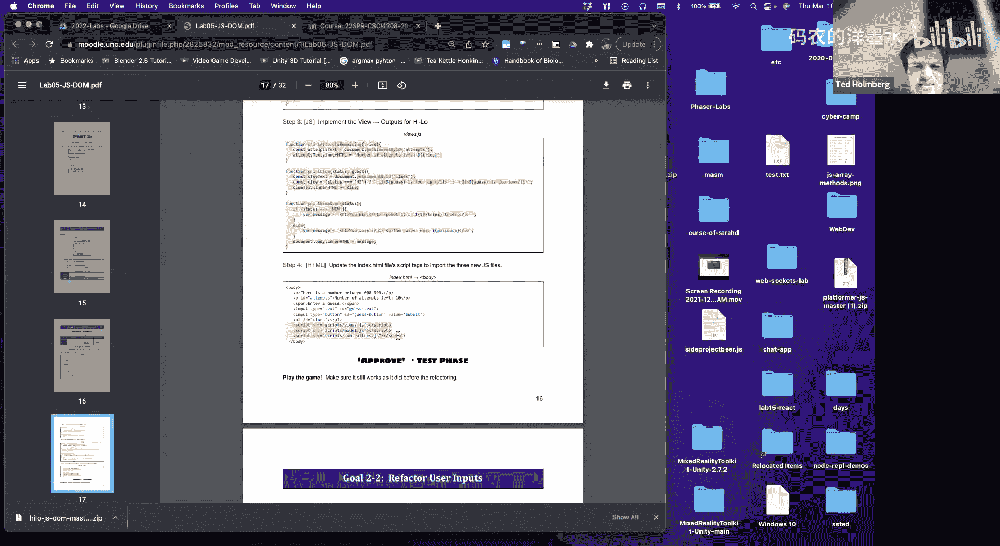
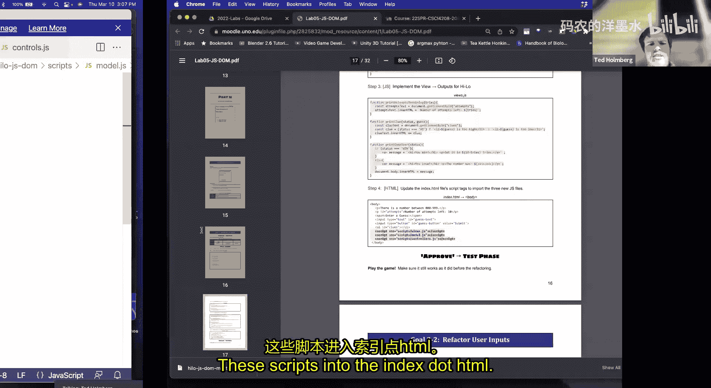
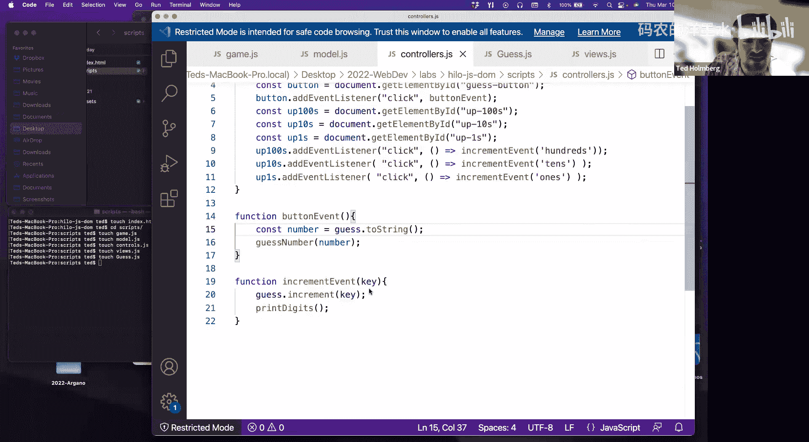
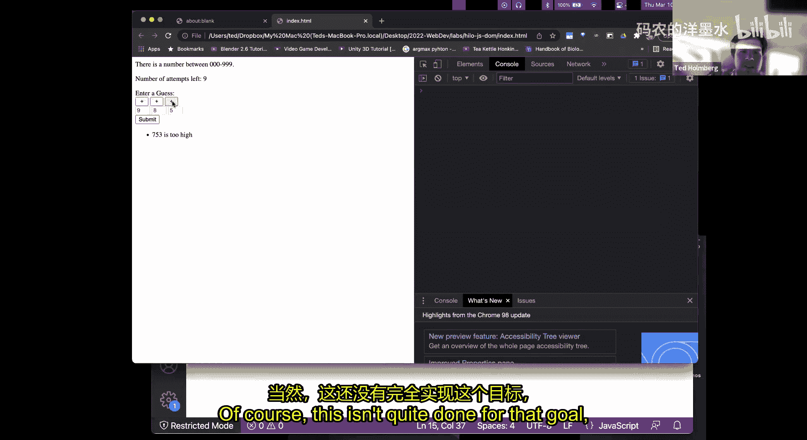
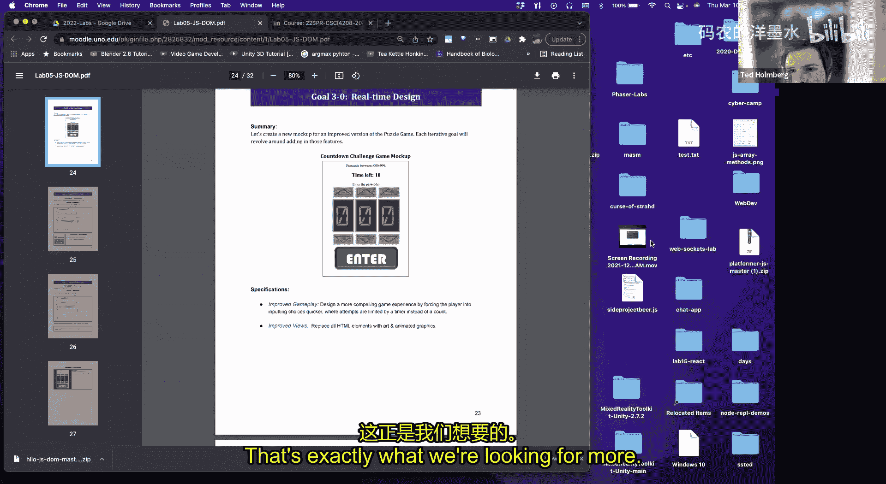

# 高级Web应用：第9讲：文档对象模型与事件处理（第一部分）


## 概述

在本节课中，我们将学习文档对象模型和事件处理。我们将通过构建一个“猜数字”游戏来实践这些概念。课程将分为三个部分：首先构建一个最小可行产品，然后重构代码以采用模型-视图-控制器设计模式，最后改进用户界面和体验。

## 文档对象模型与事件简介

上一节我们概述了课程目标，本节中我们来看看文档对象模型和事件的基本概念。

### 文档对象模型

文档对象模型为JavaScript提供了访问HTML文档的能力。DOM是一个内置对象，包含专门用于操作HTML的函数和属性。它将HTML元素转换为JavaScript对象。

`document`对象是访问DOM API的入口点，它本身是`window`对象的一个属性。我们可以通过`document.getElementById()`方法访问元素对象。

**代码示例：**
```javascript
const buttonElement = document.getElementById('guessButton');
```

元素对象的`innerHTML`属性维护其HTML标记字符串。通过更改`innerHTML`的值，我们可以添加、更改或删除DOM中的HTML。

### 浏览器事件

Web浏览器是基于事件的系统。浏览器根据特定操作或触发器生成和管理事件。JavaScript应用程序可以使用这些事件来触发操作或行为。

使用事件驱动系统需要事件监听器。事件监听器将元素对象注册到事件队列，以监听特定类型的事件。当事件发生时，它会调用回调函数。

**代码示例：**
```javascript
buttonElement.addEventListener('click', guessNumber);
```

回调函数是JavaScript应用程序中的一个函数，作为引用传递给事件系统。当事件发生时，事件系统会调用该回调函数，并传递一个事件对象作为参数。

## 项目架构与单页应用

在开始构建游戏之前，我们先了解一些架构概念。

### 模型-视图-控制器

MVC是一种设计模式，将应用程序的职责分为三个部分：
*   **模型**：管理应用程序的核心逻辑，不关心输入和输出。
*   **控制器**：处理用户输入，向模型发送数据并调用操作。
*   **视图**：管理从模型输出的数据，并将其呈现给用户。

### 单页应用

现代Web应用程序将HTML页面数量最小化为一个。这样可以保留JavaScript运行时数据。由于浏览器将所有HTML元素以JavaScript对象树的形式保存在内存中，我们可以实时修改HTML并重新渲染新内容。

## 第一部分：构建基于MVP的猜数字游戏

现在我们已经介绍了核心概念，本节中我们将开始构建游戏的第一部分。

### 目标与规划

第一部分的目标是使用最小可行产品设计，构建一个基于回合制和文本的猜数字游戏。

我们需要创建一个HTML文档，提供游戏说明和用户输入。以下是实现步骤：

1.  创建`index.html`文件并实现基本的HTML内容。
2.  为输入字段和按钮添加ID属性，以便在JavaScript中访问。
3.  将游戏逻辑链接到HTML文件。

### 实现游戏逻辑

接下来，我们需要实现猜数字游戏的基本算法。游戏输出将显示在控制台中。

首先，创建变量来存储随机密码和剩余尝试次数。

**代码示例：**
```javascript
const passcode = Math.floor(Math.random() * 1000);
let tries = 10;
```

然后，实现评估猜测的逻辑，以确定用户是赢、输还是获得提示。

**代码示例：**
```javascript
function guessNumber() {
    const guess = parseInt(number.value);
    tries--;
    console.log(`Number of attempts left: ${tries}`);

    if (guess === passcode) {
        console.log(`You win! Got it in ${10 - tries} attempts.`);
    } else if (tries <= 0) {
        console.log(`You lose! The number was ${passcode}.`);
    } else {
        giveClue(guess);
    }
}

function giveClue(guess) {
    if (guess > passcode) {
        console.log(`${guess} is too high.`);
    } else {
        console.log(`${guess} is too low.`);
    }
}
```

### 更新视图

现在，我们将使用DOM API从JavaScript更新HTML元素，而不是使用控制台。

首先，在HTML中添加一个用于显示尝试次数的段落和一个用于显示提示的无序列表，并为它们分配ID。

然后，在JavaScript中获取这些元素，并修改`guessNumber`和`giveClue`函数，使用`innerHTML`属性更新视图。

**代码示例：**
```javascript
const attemptsView = document.getElementById('attempts');
const cluesView = document.getElementById('clues');

// 在 guessNumber 函数中更新尝试次数
attemptsView.innerHTML = `Number of attempts left: ${tries}`;





// 在 giveClue 函数中添加提示
cluesView.innerHTML += `<li>${guess} is too high.</li>`;
```

## 第二部分：重构为MVC模式

我们已经完成了MVP构建，本节中我们将重构代码以采用模型-视图-控制器模式。

### 代码分离

首先，将现有代码分离到三个不同的JavaScript文件中：`model.js`、`view.js`和`controller.js`。

*   **模型**：包含游戏逻辑、密码和尝试次数。
*   **视图**：包含更新HTML元素的函数。
*   **控制器**：包含设置事件监听器和处理用户输入的代码。

### 改进用户输入

为了提高输入的容错性，我们将重构用户输入方式。使用类似密码锁的界面，用户可以通过按钮调整百位、十位和个位数字。

首先，修改HTML，将单个文本输入替换为三个数字输入字段和对应的增减按钮。

然后，创建一个`Guess`类来管理猜测的数字。





**代码示例：**
```javascript
class Guess {
    constructor() {
        this.hundreds = 0;
        this.tens = 0;
        this.ones = 0;
    }

    toString() {
        return '' + this.hundreds + this.tens + this.ones;
    }

    increment(key) {
        this[key] = (this[key] + 1) % 10;
    }

    decrement(key) {
        this[key] = (this[key] - 1 + 10) % 10;
    }
}
```

在控制器中，为增减按钮设置事件监听器，调用`Guess`实例的相应方法，并更新视图。

## 总结



本节课中，我们一起学习了文档对象模型和事件处理。我们通过构建一个猜数字游戏，实践了如何将JavaScript与HTML结合创建交互式体验。我们从最小可行产品开始，然后重构代码以采用模型-视图-控制器设计模式，并改进了用户输入的容错性。在下一节课中，我们将继续完善游戏，增加图形界面和计时功能。