# 【全集】加州理工学院 高级Web应用 中英字幕 1080P p10 Lecture 10 - 文档对象模型、事件 part2 -BV192zTBrEmu_p10-

Okay， we're going to pick up where we last left off in this video lab。

Whi is going to be the here we go， this is going to be the high low guest game we've been working on and in the first part of the lab we did parts one。

Where we built a minimal viable product。And it was the simplest version of the game that we could make。

 and then after that we moved to part two where we refactored our code base and into an MVC until a model view controller architecture。

 and then we looked at some additional features we could add into it like making our input field more robust and full tolerant to ensure that there could be no invalid values passed into our game model。

And we kind of changed the metaphor of how we're inputting to be more like a combination log where you can cycle each digit up or down。

So then after completing that， we were about to move on to the third and final part。

 which is this updating our game to be a little bit more interesting。

 a little bit more fun right now it's turn based we're going to consider making a time based right now it's all textbased input we're going to make graphics space and we're going to continue to use the MC pattern one motivation behind this part is to illustrate how using the NC pattern。

 we can easily update our game code base in terms of the view or the controller and how little refactoring that's going to cause us to have to do how little changes in our code base we're going to have to adjust to refactor to have a whole new different type of display type moving from text to graphics or from moving from say for instance。

 in our keyboard like we did before to our buttons。

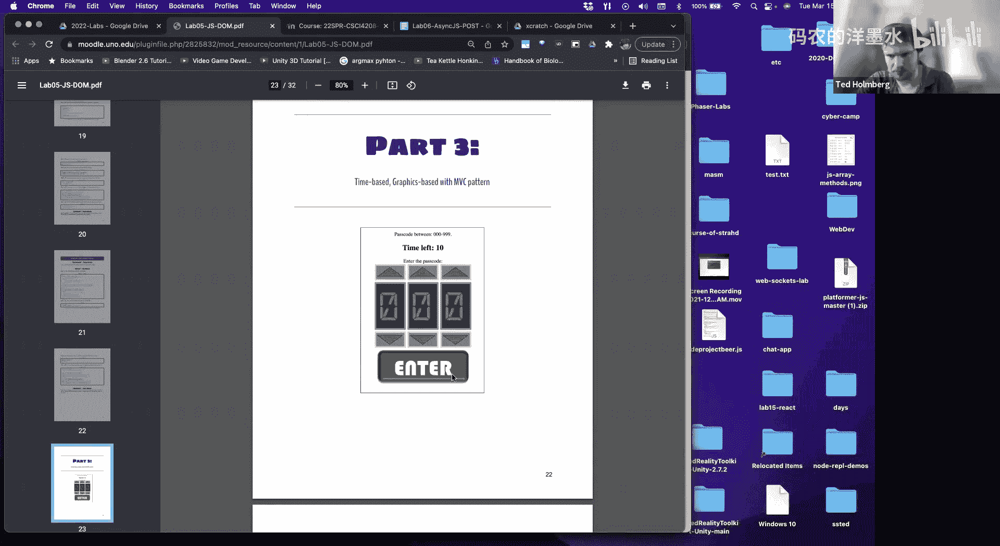

So before I get into part three， I just I do want to go over one thing that I kind of maybe gone I have gone over quickly in the last lab and this was this guest class and I just want to make sure everyone kind of understands what's happening with this guest class because I know that。

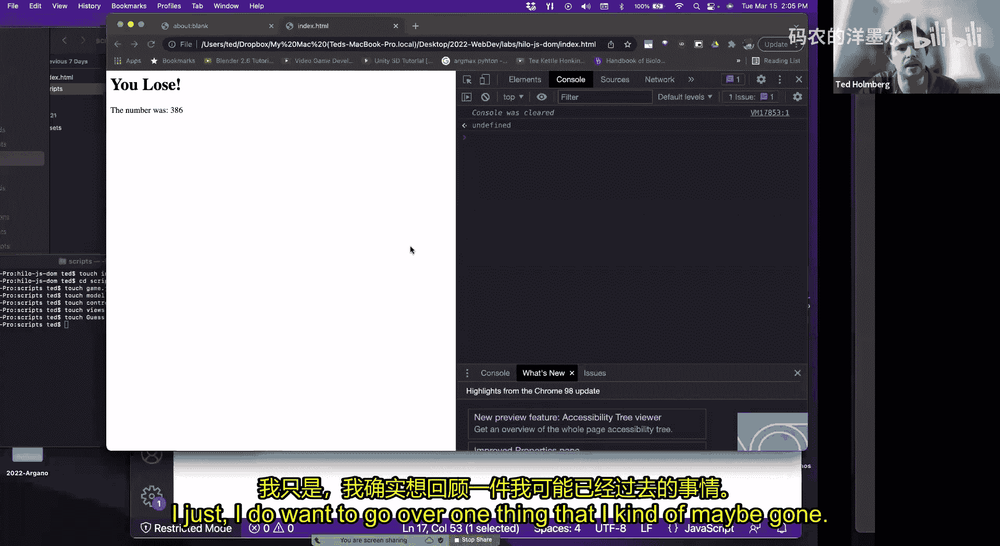

Accessing attributes using box notation might look a little bit weird。

 but let's let's see what's actually happening here so if I let me go here。

 so let me minimize this so okay， so I have the guest class here so I have a construct so i'm actually just going access that from my console so let's create。

Let's say a variable that we'll call G and we will make it a new gas so when I create a new gas here and I'm going to expand this back out okay so that this and then let me make this bigger。

 is that better。Okay perfect so now you'll see whenever I instantiate a new gas it's going to create these instance variables hundreds。

 tens and ones and since I didn't preface them with hashtags， they are available。Right publicly。

 so I can access them from the console， so I have a ten。100s attends and a one。

That are all available to me。And so as you might recall。

 let's take a look here at some of these methods。So I have a two string method。

I have an increment method and I have a decrement method。 Well， my twotoring method will。

Go ahead and just concatenate all the current digits together so it appears as。

The hundred Ss and ones and of course that gets invoked automatically whenever it needs to be set。

 well I forget that the console doesn't do that since it allows us to do debugging。

 but if we were to print this out as a string the two string does like in Java get implicitly called let me go ahead and clear this state really quick。

Oh there we go okay， so let's take a look at the increment and decrement so the way that this works is we're passing in a parameter。

 which will be a string and the string will use either hundreds tins or ones to decide which of the attributes to access from this instance。

And then it's going to overwrite using whatever the current version is add one and mod 10。

 So let's see what that looks like。 So on G， if I want to increment。

 I have to say what I want to increment。 And so I have hundreds tens or ones so I could pass in。

Hundreds。And so now I could say my hundreds has been incremented by one right each time I call that。

It will increment it again and so then if I do1s。And I go。

And then the same would be said if I did the decrement。Oh。

I don't know I did decrement incrment autocomplete Okay， and so let's take a look at that。

And yeah and then our tend is back to zero so I just want to do a quick overview of what was happening in this class and how it's managing the state of our game and all of the mutations to the state of our gas all built into this class so again one interesting thing about how this project has developed thus far is notice we're using collection of。

Procedural programming paradigms where we're breaking our code base into a collection of functions。

 but on top of that we can then build an object because it makes sense to have an object to represent our guesses and then we can have an object that's then managed by our procedural code base so this is one of the flexibilities with a language like JavaScript which allows us to mix and match paradigms at any time we can decide whether we want to take a functional approach to solve a problem。

 a object oriented approach， a procedural approach or an imperative approach since it natively supports all four of the dominant paradigms that we use to encode algorithms。

好。Excellent。Okay， so I just wanted to spend a little time just to highlight that because I don't think I had spent the time to kind of clearly show exactly what was happening inside of ourRA our guest class。

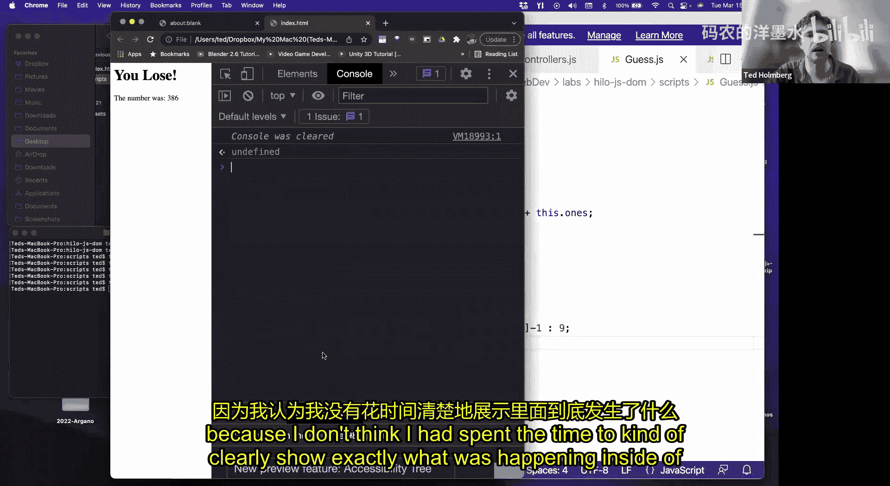

So now that we have a strong understanding of that， let's take a look at。Part three。

 where we're now going to modify the code that we build from the last video into this mock up here。

So。So part zero of our goal rate we're going to talk a little bit about realtime design so a quick summary here is we want to create a new mockup for an improved version of our puzzle game each iterative goal will revolve around adding in the features that fully realizes this mockup so this is the end product that we're going for and so here our specifications or our motivations you can think of it as one of two ways where we have a motivation whenever we're。

Building out an application and base off the motivations we define specifications。

 so those are like the line by line sets of features that we want to add on that don't currently exist inside of our app。

So we want improved gameplay and we want improved views inside of this application So what do we mean by improved gameplay but we want to design a more compelling gameplay experience by forcing the player into inputting choices quicker where attempts are limited by a timer instead of account so right now recall that we're living in the player to 10 tries after 10 tries they lose but they have any number they have any amount of time to go ahead and input a try and so so this game isn't so exciting since you know that the best strategy since we're using。

Since the game's contingent on a couple of things like we know we could always take the halfway point and by taking the halfway point in the high low game we diminished half of our potential solutions so if I say for instance on my first try I pick the value 500 and it says it's too high then I don't have to pick any value higher than 500 that means out of the before I made one guess there was a00 possibilities I could have selected after just one guess I've narrowed that down to just 500 and then if I keep continuing this practice of always taking the midway point each time I diminished the possible set of solutions by half so I go from 500 possible solutions to 50 to 125 and so forth and so that is a logarithic behavior and so you can find out。

The maximum number of guesses by taking the number of possible values and taking the log two value of that so you've probably learned about the algorithm efficiency of a log two from data structures I'm sure let's see here I should have math log I actually have a log two function built into the math class here and if I pass in 100 you'll see that。

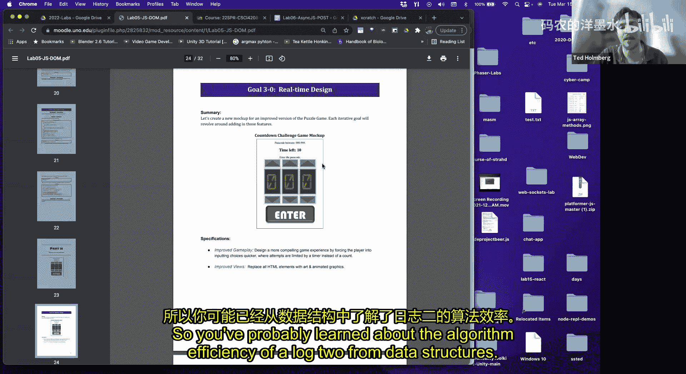

ALogged to on 1000 is 9。9 sets， so if you if you if you always round this up because you can't have a fractional gas that lets you know you're guaranteed to get a result if you're collapsing your solution space and half each time。

😡，In 10 guesses， so there's no possible way you should be able to lose the game as it's implemented if you always take the halfway point。

And so if I wanted to make this game interesting and say oh。

 I can always figure out what the maximum number of guesses is to give to the player if I want to randomize the number like of value。

 so let's say instead of four digits I wanted to have five digits right so that would actually take 14 guesses right 13。

28 I can't have 0。28 of a guess so I just have to run that up to 14 and if there were six digits it would be 17 guesses I'd have to give and if it was 100 if it was just a two digit number it would be 7 guesses。

And if it was 10， it would be four。Okay， either way， it's not a very fun game。

Ma can guarantee based off of this map that the user can always win， however。

 as long as they know the trick， they'll never lose。

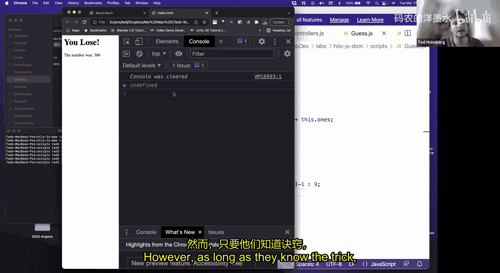

So maybe by making a time based it can alter the strategy one might use and we'll see that as we implement this the second specification here is improved views what does that mean well we want to kind of replace all of our HTML elements with some art and animated graphics and just make it make it a little bit more compelling in terms of its visuals maybe it's going to look like you're trying to like。

Like disarm a a time bomb and like a Hollywood movie or try to break into a the pin code of like a ATM machine or a or a cell phone or something。

 you know， you kind of disguise it to feel like you're doing something more novel and guessing a random number。

Okay so now that we kind of have an idea of what it is what our motivations are let's move to our first goal let's talk about having graphical controllers so in this approach again we've break every iteration down to an approach apply and approve for a plan phase a do phase and a test phase so our plan for this iteration is to replace all of our HTML button elements with rendered graphics as our controller remember we've broken our code into a controller a model and a view。

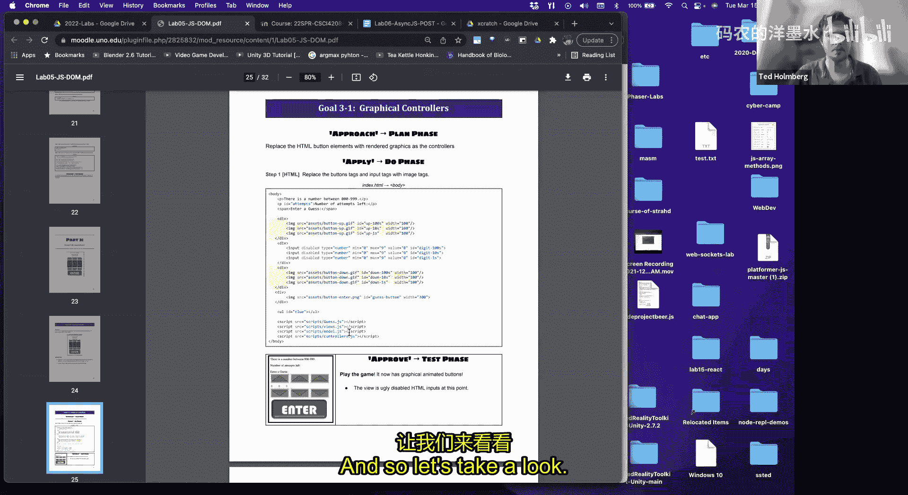

And so let's take a look So we're going to want to use these button up and button down。

 let's go into our assets just to see what we're going to be doing here。 So here inside of assets。

 I have a button down。Which is an animated g and a button up so instead of the traditional buttons we're going to use those so let's go into our HTML code in order to do this oh my I forgot that's a ahead。

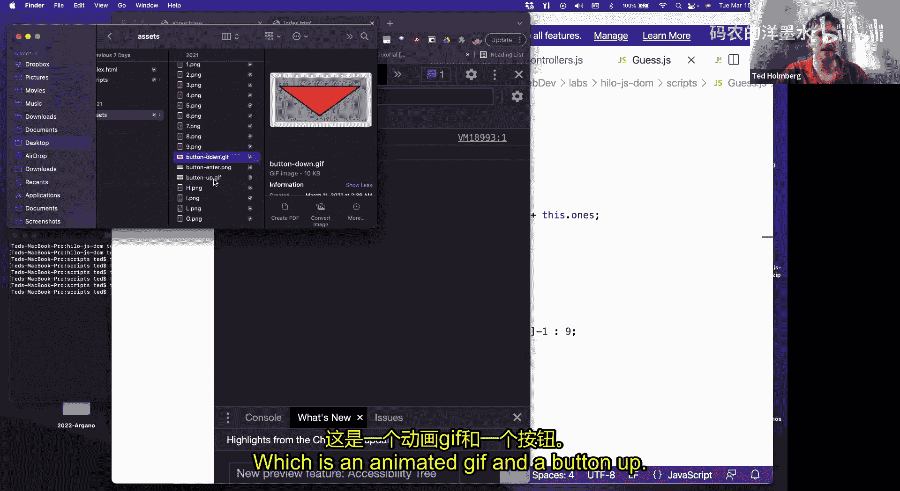

Okay， so and we're going to modify the the buttons to instead use images。 So let me go here。

 where's my HTML here it is。 So right now we have this div tag。

For our up buttons that have an input type of button and then the IDs of up hundreds up tens and up ones and then we give the default value of the plus on each of those buttons so I'm going to replace this。

With a different with instead of let me get rid of that instead of input fields I'm going to use images。

 the source of the image is going to be the same for all of them right it's going to be the button up thatt G I'm going to give each one of them the same ID that the button had so I don't have to make any changes inside of my inside of the rest of my source code right inside of any of my JavaScript this should all be the same。

In terms of how I'm going to be able to modify this because I'm accessing those elements based off a DID and since all of the HTML elements are eligible to be targets for events。

 event targets， it doesn't matter if it's a button or an image that I create an event listener on。

Okay， and so I'll have three of the same image， but with different ID tags and we'll set the width to be 100 pixels and'm going to do the same thing。

嗯。What is it buttoned down？I'm going to do the same thing with my button down。As well。

 so I'm going to replace those。Right here， these buttons。With some images okay。

 let's say and so now that we've done that that's all the code does we're only going to touch the HTML for this so now let's play the game and see if our game plays the same。

 but now instead of those buttons and it close us out。I now have， yeah， and now if I click them。

 it works just like it did before。Perfect。嗯。Okay， so now we've updated the buttons。

 let's move on to our next goal， let's update our view so that our view is also graphical as well。

So I want to do something very similar to what I did with the buttons。

 I want to replace those input fields with instead of using the number fields I want to use the images that I have let's see what images I'll have access to so inside of my assets look at what I have here I have like these LED displays and you'll notice that the images are named in a very specific way where I have like if it's dash do PG it's a dash character if it's a0 dotG it's a0 a1 dot PGs the one and the two and the three and the four and the5 and the6 and a 78 and the nine so it's very important to see that these image assets the names of them correspond to the value that this image is supposed to represent and it's going be also true for what will eventually be my clue so H for high and L for low。

Yeah。Excellent， so now let me go into here。And in my HTML， I'm going to replace。

 let's get rid of that。Wai a second。Let's kind of mess some things up here so that's problem with copy pasta let's make sure that div tag closes there and let's make sure that this div tag closes here Okay perfect Okay so inside here and let me actually。

Get that okay， perfect， just making sure everything's ordered correctly。

In terms of formatting okay so now inside this div instead of these input fields notice I'm instead going to use images and the default set of images I'm going to use from assets is going to be 000 so before the player puts in any guess we're going to assume that the initial set of the display should be zero it out now notice my digit hundreds my digit1s and my digit ones my ID should be the same and then we'll just make everything render with100 pixels wide so that we get this nice kind of row column look and。

Now we have to do a little bit more in order for the view to actually work in collaboration with our model。

 so we were we didn't have to do much changes to set event handlers on the images but now we actually have to refer to the which PG we want to update。

From the collection of PGs each time we need to update the digits each time we go to print digits so remember in step two here where we're going to refactor that print display function to update the source attribute for the images we're going to get this is going to be inside our fuse JS。

And that makes sense because that's what we're updating so let me grab these and then we'll talk about what's happening so let me go to print digits inside a view so let me find my view Okay here we go inside print digits what we're doing currently is we're accessing from the dom the digit hundreds tens and ones and we're updating the value well that's no longer that's no longer the correct way because we've updated from input fields to images but we're going to do something very similar。

What we're going to do here is we're going so use the document object we're going to get the element by ID。

 we're going to get those elements by the same ID， but instead of by a value property we're going to use the source property because that's what how images are going to set that file pathway to display and then the source is going to be in assets and effectively we're doing the same thing we were doing before but we're going to use the string template we're going to dereference the hundreds value the tens value and the ones value but we're going to embed that in a string that's going to treat it as a pathway to the P so again the hundreds would be let's say that the hundreds was0 then this would be assetslash0 dopg let's say the guess was nine then that would be assetslash9 p let's say guess on ones with seven then that would be assets7 pg so whatever the value currently maintained in our guest instance。

We'll appropriately then map out to this print digits method。As the state mutates， okay？

So once we do that that's all we have to do， all we did was modify the view and all we did was modify the controls。

 we didn't do touch the model at all， again the power of model view controller design and we've completely replaced out from text to graphics。

😡，And so now if I click up， it should update each one of these。And yeah。

 and we can actually test this， let's actually see。If I submit yep， six43 is too low。

So we can see that this actually allows us and actually let me do this and of course that works following。

And let's go and see what the passcode is， we'll do it oops obviously。and the passcodes 1，5，2。

 so let's test that out one。5ive， two， yeah， and that perfect so we can see our game plays just like it did before。

But in my opinion， it looks a lot nicer， a lot more like a game at least。Okay， let's see。

So after we've tested that out let's move on to our next thing so right now notice this is still kind of an inconsistent playing experience every time I go to input a gas it's still giving me my clue down here right so what I want to do is I want to default to this LED panel to give me all of my all of the data to the user so I want to stop using this unordered list to provide clues。

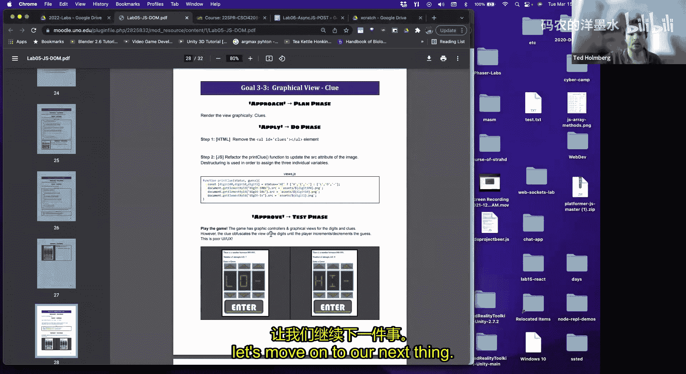

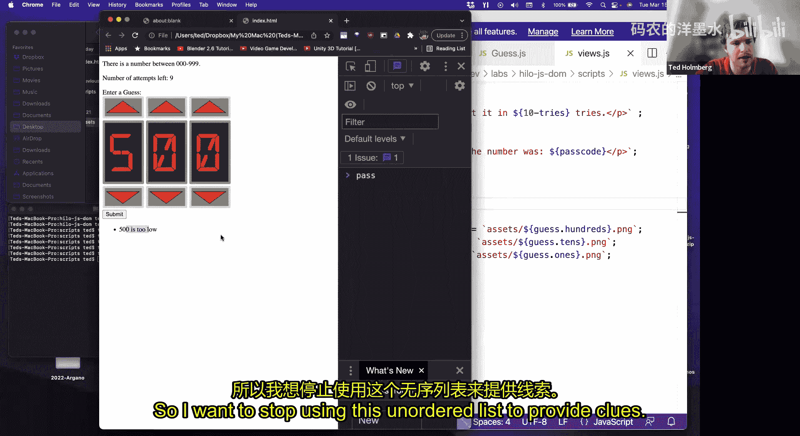

嗯。So in order to do this， our first step is to go ahead and remove actually the unordered list that will be the clues we don't need that anymore so let's go into our HTMLM element。

Here。And let's find that unordered less and we're just going to remove it out we don't need that anymore。

 we're not going to use that anymore。Okay， then the next thing we want to do is we want to go into our into our views and we want to refactor the print clue function to update the source attribute of the images with either high or low whenever clue has to get printed out and so we're going to do that with a little bit of destruction that we learned。

There's lots of ways we could have done this， but I want to use a deuring call so you could see how we could do this in just one line of code how we can kind of compact some of our logic so let's go to views print digits。

 print game over printclusive we're going update print clue here sore the old functionality we're going get rid of and we're going to replace it with some new functionality and so let's actually step through these lines and figure out what's happening here so we're not changing the parameters at all remember every time we print clue we're taken a status。

 the status is either high or low H or L remember when we get that from here So whenever we print a clue we're either passing it in high or low and then whatever the guess was so let's go back to the view so so then what we're going to do here is I'm going to create。

A set of variables three variables constants actually because they don't have to change that's going to be called digit 100 digit 10 and digit one and i'm going to assign all three of these at once by doing a destructuring so since these variables are declared inside of the inside of an array I can actually go ahead and unstructure an array that would be on the right hand side of this assignment and each of these individual values will go ahead and have a value of whatever the index0 is whatever the index one is and whatever the index two is and then on the。

Right hand side of this assignment i'm going to use a logical operator。

 so this is a tri operator this operator does also exist inside of Java so。😡。

Tary operator has three offerings it has something that has to resolve to be true or false on the instance that something is true it will return this on the instance that something is false it returns this so we check is the status equal to high。

If it is， we're going to return back an array with three elements and H and I and dash。

 the H would then get assigned to digit 100， the I would then get assigned to digit 10 and the dash would then get assigned to digit1 if it's not true that statuses equal to high then instead we would return this array containing the values of L O and dash so the L in this instance would then go ahead and get stored into digit 100。

 the O would then get destructured and stored into digit 10 and the dash would then get restructured destructured and stored into digit1 so I could have just as easily done and if L statement and done a line of code that just assigned digit 100 to H and I and dash and make something that was about six or seven lines of code if each thing was on if each statement was on its own line of code but again just illustrating how I could do all that logic。

Compact it with one using some of the data structures and destruct operators that we have available to us in JavaScript。

So once we have values in Diit 100 digit 10 and Diit 1。

 I will now use the document object to go ahead and grab those images with those IDs on going to access their source。

Just like I did in print digit and then I'm going to set the asset to either be high or low。So。

 so essentially our print clue is not dissilar from print digits， but instead of using the guess。

To go ahead and print it， we're going to go ahead and use our own logic to determine what is going to get printed into that field into our three digit panel。

Okay， so once I do that， I should be able to just test it so let's play the game and let's see if we get a low or high。

 so let's refresh。

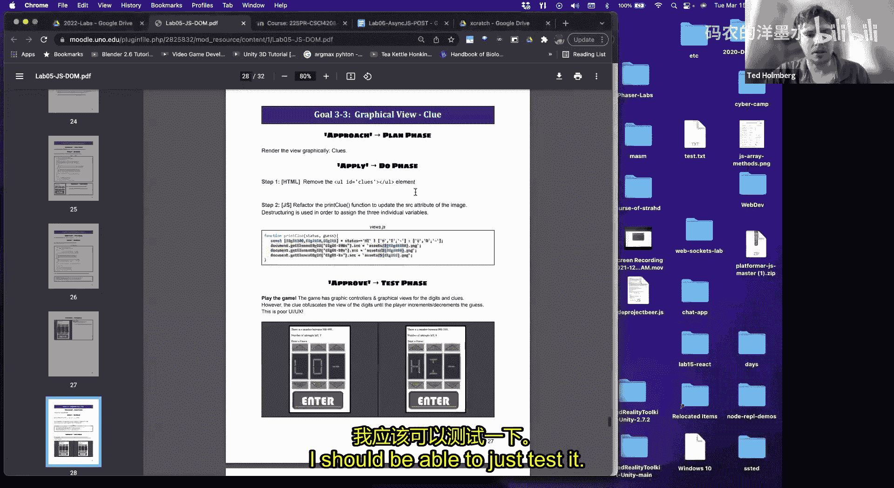

So let's do 500。And let's submit and there we go。 We now get our clue built into there as low。 Okay。

 let's also do this again， So let's see if we can't get submit。 Okay， yeah。

 that's too low and let's do 9，9，9 and that's too high perfect。是。

So now the next thing I want to do though， is notice a deficiency with this is when I do that。

It just stays there right I have to it won't update until I start clicking on digits again。😡。

So this is kind of like a user experience deficiency it actually impacts the user experience a little bit where it doesn't return until I have to trigger some kind of event again to update the。

To update the view so here what I want to do instead as my next goal is to have some kind of timend based event that will automatically overwrite my view for me。

So what I'll do is I'll create a timer that can overwrite the clue。

 the clues view back into the digit view after let's say a second。

 so in order to measure an eappsse in time， we can continually invoke a method and check the difference between the now time and the start time or we'll call in our implementation here。

 the then time and if some duration is met， then we can perform the action and then we reset our now time our start time to be to be congruent with what the now time is。

Okay， so now that we have an idea of how we could kind of。Define a time based event。

 let's go ahead and do that the first thing we need to do。

Is we will use the day class to get the current time in epoC time and epoO time is just the term that we use it's the name we give to the number of milliseconds that have passed since 1970。

So let's go here and。Into our model， into our global variables of our model。

 So let's go here to the top。And oh let's get rid of this Okay。

 so now we'll grab so when we first go ahead and import and load our script we'll have a then time which will be the time in which the script was loaded date dot now and again just to see what this looks like。

I think we've saw this in the previous with when we did the sprites right so this should be something you've seen before oh nope not no now perfect yeah and you can just see how it keeps updating。

There we go。Okay， then the next thing I want to do is I want to go into my model and I want to define a main looping function that will print the digits after a second has passed。

And so this loop will recursively occur via the request animation frame function。

 let's take a look at that， this is the function we want to use every time we want to redraw the viewport。

In like a loop to matter so here I'm going to go into my model and I'm going to create a main function。

And actually， let's step through this。So I will have Maine。

 what Ma will do each time it's invoked is it will query the date。

Object to find out what the current time is， what the now time is and it will save that then it will subtract the now time from the then time to find the difference if the difference between the now time and effectively the start time the then time is greater than 1 thousand0 This is milliseconds then that means a second has passed if that's the case then I want to go ahead and I want to print I want to invoke print digits again so it update so again let me get a clue so when I would normally get access to print digits right every time I invoke print digits it updates with the digits。

So when I do it manually saw how without guessing or without having to input a number it was able to bring me back to my digits well in this instance the main function will invoke that method after a second has passed and then what I'm going to do is the window object has this request animation frame method built into it and you can register a function and so what this function does is it invoke。

The this method。60 times a second effectively so every time the viewport has finished updating。

 the browser will invoke request animation frame。To see if a reraw has to occur so by registering this method with the window object with a request animation frame。

 the browser will now invoke this for us indefinitely and each time it invokes it we're then handling the logic of determining whether a second has passed or not。

😡，And then。In order for this function to actually launch initially since it's register in itself right here。

We will go ahead and invoke it right underneath。So after defining it。

 we will invoke it and that'll start the process of having it get called again and again and again。

And again， if you ever wanted to see what this request animation fming。

 if you want to read the API on it for yourself， you can always open up a browser tab and check out the MDN。

 the Mozilla Develop network right up on it I'll see as part of the global window object and they'll give you a summary and the syntax and the parameters and examples and everything like that。

Excellent okay so now that we've done that let's move on to the next step。

 we also want to go ahead and update the then time every time the clue is displayed so that we can start that 1000 millisecond countdown again。

 so here。ThatI believe this is inside of our views we have to go into our views inside of our print clue。

 so let's go into our。Views and inside of our print clue。

 we will actually go ahead and update our then。Variable。With the new time。And so once we do that。

 we can now test， we could test to see if。

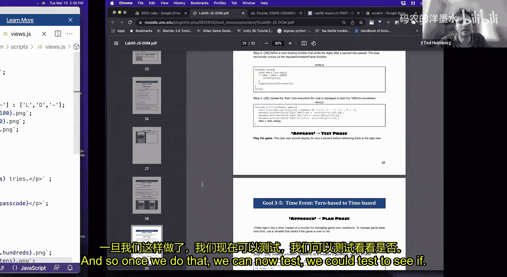

Every time I make a gas after a second， yep。It goes and displays back。

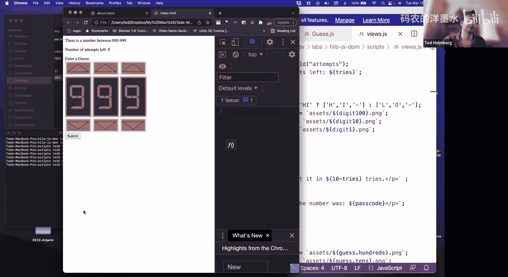

Perfect。And that just gives a little bit more fluid ease interface。

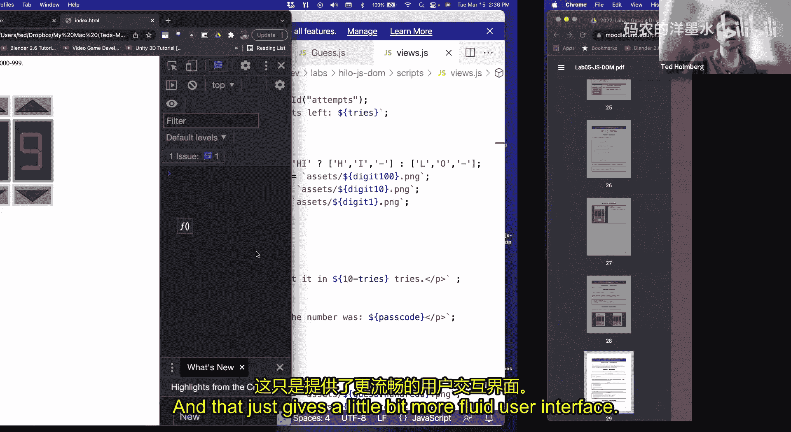

Or user experience， okay， for our fifth goal， we're finally prepared， I think。

 where we can start to pivot away from our turn based input scheme to a time paced input scheme。

So I think we're primed for that because we actually played around a little bit with doing time based events。

In just the previous step。So here our approach for a timer logic is we well use a timer instead of a counter for managing our game over conditiondition to manage the game state over time。

 we'll use a variable that tracks if the game is over or not so we're going to create two new global variables inside of our model。

One that will represent time left and one that represents whether the game is over or not so let's go to our model。

 let's go to the top here and i'm going to go ahead and define。A time left and a game over。

 so just keep in mind while I'm doing this。These things mutate over time， so I'm using the lift。

Keyword to declare these， whereas the gas。And the passcode are going to be the same well the passcode doesn't change over time that's why it's constant and guess the object itself won't change over time。

 just the properties inside the object so't we don't ever create new gas instances。

 we just use the one preexisting guess instance and we change its hundreds tins and ones values so we can go ahead and declare that to constant so just keep in mind when I'm using constant lits and like what's motivating my decision between those two so whether I have to write into it or not at any time。

Okay， so my next step that I want to do is I want to update update my game over variable in my win condition because now we have a new win condition。

 so let's go into our model what that has our guest number and let's update the logic for that。

So let's go here。😔，So let's update this， I think I can update it all actually。

 I don't think I need any of that。I could probably even omit this tries。

 we won't need tries anymore either。Okay， let's say。

 let's make sure that everything is formatted the way I want， this can come there okay。So the new。

 the new。Gas number method， the implementation should be if。Gas is equal to passcode。

 so that's the same then we will set our game over to true and we will invoke our print game over method inside of our views with the win sending it the win message so it knows what to display out。

And if the gas isn't equal to the passcode， then we will give a clue and we'll pass gas to that clue。

Excellent， so here we're just oscillating the game over。

Now the next thing we need to do is we need to update the view to report the time left instead of the T remaining because the T remaining isn't doesn't I just deleted it in fact doesn't even exist anymore。

 so let's go into our views and update the NHL that we are printing to our attempts text。

So let's go to。And actually I think I guess we'll keep it the same methods。Change my code too much。

 but let's go to print attempts。 Okay， so instead of。

The number of attempts left here in the NHt I'm going to print time left oh let's get rid of that assignment Okay so here I'll do time left and I'll actually dress it up a little nicer too I'll do a heading to element that's time left and then pass in that global time left value。

Yeah。And if that's the case， I don't even need tries here anymore。

And you know what let me go into since i'm going off script here。

 but i'm removing things that aren't there that don't have to be any there let me see here let's make sure I got everything so give clue。

Yeah， this all looks good， good clue， main method， like all this。

And then viewss has print attempts remaining。Okay， so far so good。Okay。

 then the next thing I want to do is I want to go to step four I want to update the view to report game over with the time left instead of the tries left so this is going to be in our print game over again this is just going to illustrate if we won how much time we got it in instead of how many guesses we got it。

I'll just do this entire thing。So let's go to our views to print game over right here。

 we're doing tries， tries are no longer a thing though。

So let's instead do something that's pretty much the same it's just we will do time left and we'll subtract it from 30 ideally you probably want to store this in a variable as well but for brevity's sake we'll just do a hard subtraction so 30 will be our starting time and whatever time left the difference between that is how fast we were able to guess it。

And then the last step here it looks like is we'll update the main method to refresh the time left after every second。

So that method we just made， we are now going to update。

 I'm just going to grab this entire method and the step throw。So let's go back to our main method。

Here in our model。And we're going to add a lot more logic into it。Let's。There there。There okay， so。

Yes。We're going to in the main method， we're still going to each time the main method is called we're still going to grab the now time。

 but then we're going to check if it's true that the game is over we're just going to return out we don't have to we don't have to update the game state anymore。

😡，I'll show you what happens if we don't include this， this is something if we won the game。

 we'll want to go ahead and have this kind of implemented in there for us。😡，嗯。Otherwise。Yes。😊。

The time left is less than or equal to zero then that's our lose condition。Again。

 before we were doing loose conditions based off of the number of tries was zero or whatnot。

Or but now， but now we'll check to see if the time over is is equal to zero or less than zero。

 so that'll trigger our print game over message。And if the game isn't over。

 which means to be won or the time left isn't zero， which means to be lost。

 then we're going to check the difference between the now and then time right and if it's greater than1 thousand00 milliseconds。

 then we will decrement time left by one that means one second has passed。

Then we will print digits just like we have been and we will print attempts remaining。

Which as you might recall is how we're updating our time our seconds and then we will update the start time。

 the then time with the new time since we just since we just did all the actions that are supposed to occur after 1000 milliseconds we will restart the 1000 millisecond timeware effectively and again we registered this with the request animation frame the window with the request animation frame this method right we're passing a reference to the method itself and then we're still invoking it so we're just adding all of the logic we need to be able to control our game over condition。

And then after that and I think that's all we need to do for this build I think I think at this point we now have a term based a time based game instead of a term based game。

 so let's take yep you have so time left 29 28， 26 25 Okay so now notice this is more challenging even if I restart here。

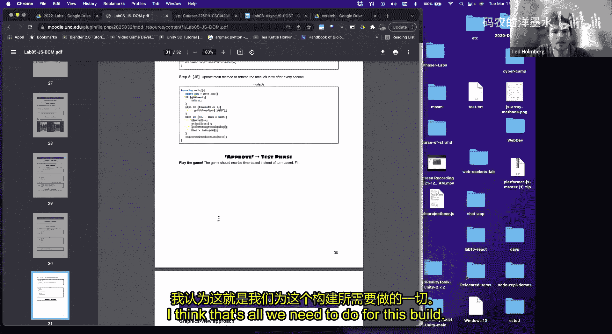

And if I start at 500 and I'm like， oh， this' is so high， so let's go to 250。Trying to。

Okay that's going to be too low So now let me do like 375 like the traditional input scheme of taking the middle point is that's going be too high so now i'm running out of time each time i'm doing the analytical approach so the actual this is an interesting thing about when we pivot this game now that it's not based off of the number of guesses but rather the amount of time you have to use a different strategy to beat the game I don't think you'd have enough time to reliably beat the game by taking the analytical approach so here I think you probably always do it by focusing on one digit 500 it' too high。

小海。冇。Well， okay。hi。系。Lello。W。And doing it the hundreds。

The tens and then the ones and I think that I got that in 27 seconds and I think I probably went every time by working on just a0s digit the1s digits and the ones digit so it's interesting how when you change the rules how you have to develop a new strategy to try to win the game。

But it's much more exciting feeling playing a time based version than a turn base version。

 in my opinion， I'd like to actually I'd be interested to get everyone's opinion in discord after you start implementing this。

 playing it and seeing， first of all， if you can win and second of all。

 if you can whether you think it's you know， more fun than the prior versions of the game。

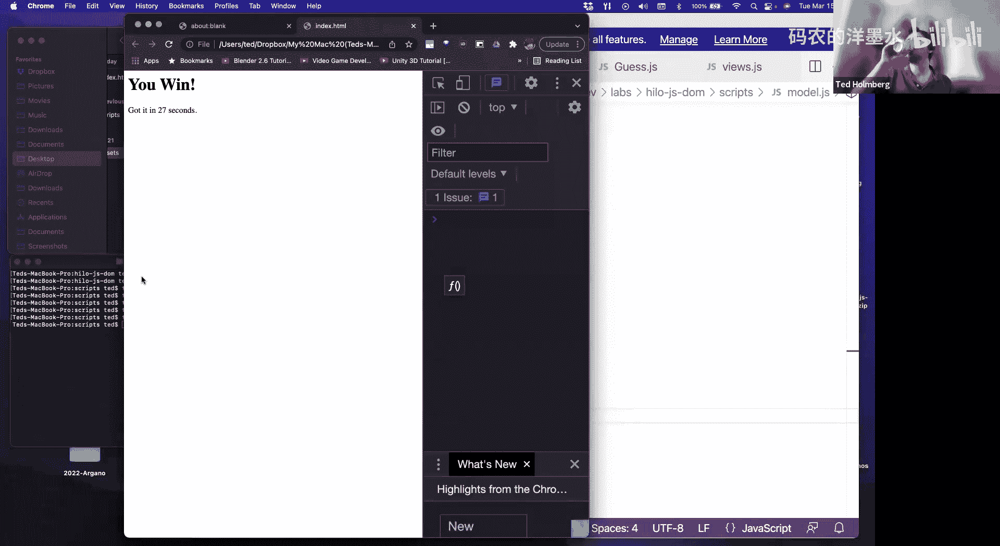

Okay， so now that we've done that， just some concluding notes for this lab。

So our graphics view approach， I want to illustrate that since the app was divided into an NBC architecture converting to a graphics view from the text view was rather trivial right we did that without having to make any adjustment into our model。

 note that the strategy was employed to programmatically manage which to which image assets to load and we did that based off of the naming that we did。

And if you wanted to improve this game for any reasons。

 if you want future improvements that I gave to myself at least to make the game more interesting would be to obviously improve the style of the game with CSS such as background colors and centering other things I might do if I wanted to make this game even more feature rich would maybe store the fastest time in a leader board and save that in local storage so I could see what my fastest time was between plays local storage is a mechanism that allows us to store data your your JavaScript app will have to use local storage。

 I cover that in the lectures I don't cover that I'll cover that probably not in next lab but the lab after next so it does get covered in a lab but when we haven't used yet so would implore you to look at the lectures for that other things I might do would be maybe add a difficulty mode that supports either a larger passcodes or a larger set of numbers or a different number of base like maybe you have the gas base。

of of hexademal numbers instead so that would have the inclusion of characters like ABC D E and F that could be a lot of fun having to guess the hexadademal value and if you wanted to know the number of guesses to solve using such a value if it's not timebased but if you want to do term base for any of those just remember you can use the log2 and whatever the max value of guesses is and thatll give you the number whatever the max value that you can guess is and then you'll get the number of guesses it would take starting at zero so it's the number of possibilitiess not the max value but that's on the assumption that the min value is zero so really it's the maximum number of combinations you would put into your log2 method and it'll give you the number of evaluations you'd have to do using a strategy that is logarithmic excellent so is there any questions about this lab。

是。If not we are done this lab we'll move on to the next lab tomorrow I do want to talk about some things here but I want to end this lecture I want to end this this video so I can post it in isolation to other things I want to talk about and so to ensure that I do that what i'm going to do is i'm going to end the recording let me do that let's stop the recording。

😡。

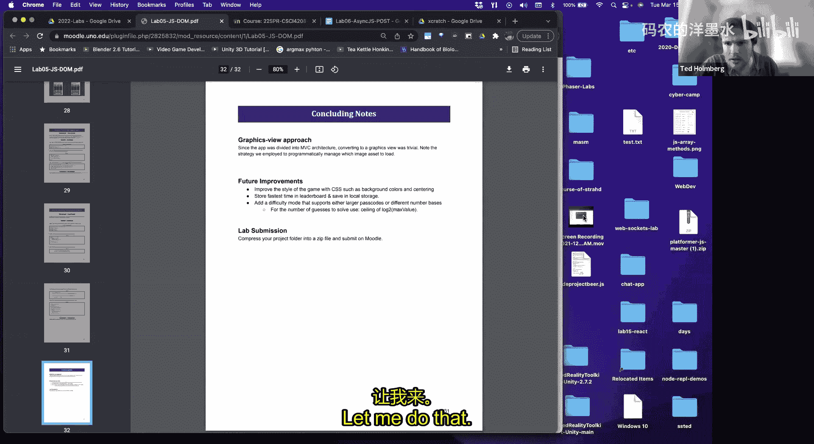