# 高级Web应用：第10讲：文档对象模型、事件 part2


在本节课中，我们将继续完善“高低猜测”游戏。我们将把游戏从基于回合的文本界面，改造为基于时间的图形化界面，并在这个过程中深入理解MVC架构的优势。

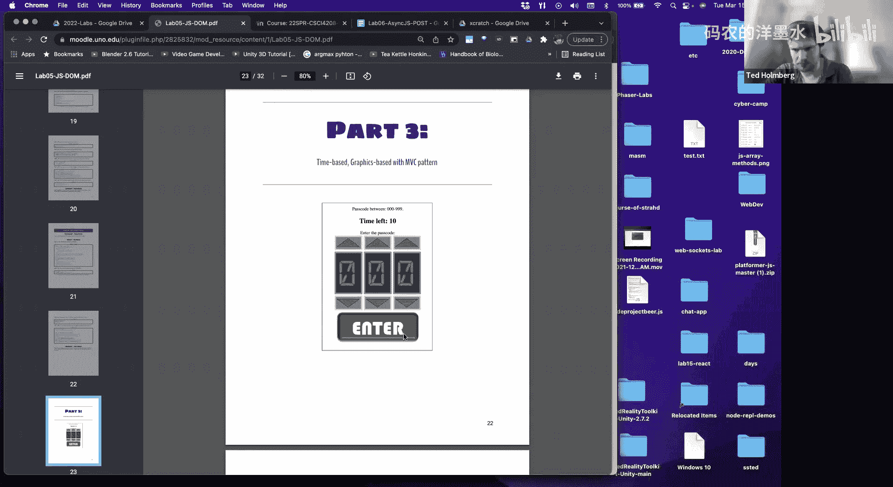

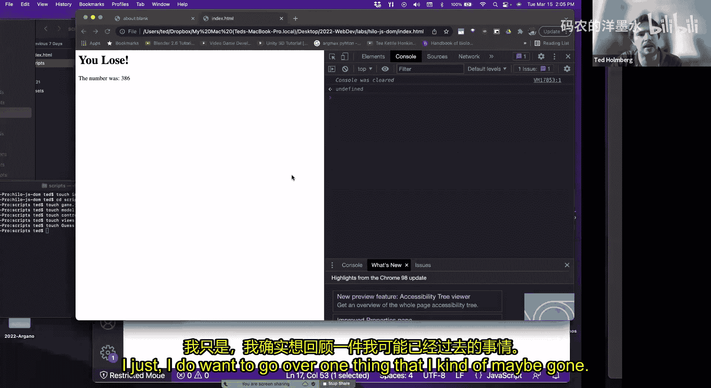

## 概述

上一节我们完成了游戏MVC架构的重构。本节中，我们将为游戏添加图形化界面和基于时间的游戏机制。我们将替换所有HTML按钮和输入框为图像，并引入计时器来限制玩家的猜测时间，从而提升游戏的趣味性和挑战性。

## 回顾：Guest类的工作原理

在开始新内容之前，我们先回顾一下上一节中使用的`Guest`类，以确保理解其状态管理机制。

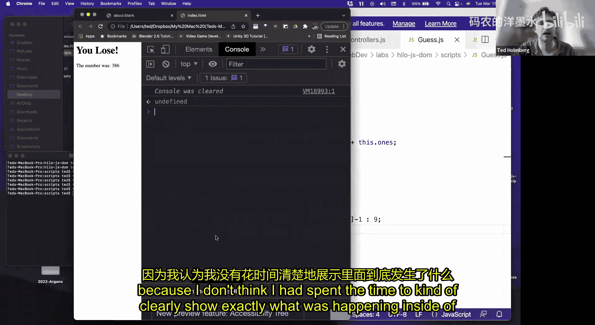

`Guest`类用于管理玩家当前猜测的三位数（百位、十位、个位）。它提供了增加(`increment`)和减少(`decrement`)特定数位值的方法。

以下是其核心概念：

**代码描述：**
```javascript
class Guest {
    constructor() {
        this.hundreds = 0;
        this.tens = 0;
        this.ones = 0;
    }

    // 增加指定数位的值
    increment(digit) {
        this[digit] = (this[digit] + 1) % 10;
    }

    // 减少指定数位的值
    decrement(digit) {
        this[digit] = (this[digit] - 1 + 10) % 10;
    }

    // 将当前猜测转换为字符串
    toString() {
        return `${this.hundreds}${this.tens}${this.ones}`;
    }
}
```

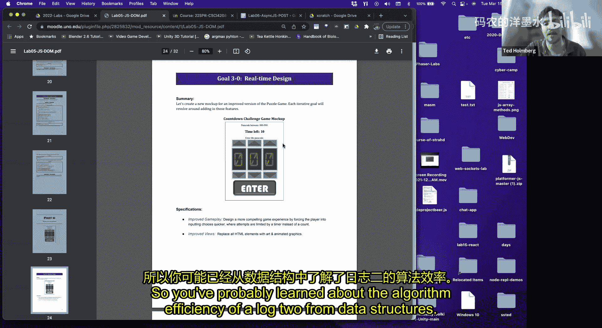

该类使用方括号表示法（`this[digit]`）来动态访问属性。例如，当传入字符串`'hundreds'`时，`this[digit]`等同于`this.hundreds`。所有对猜测状态的修改都封装在这个类中，然后由我们的MVC架构中的控制器和模型来调用。

## 目标三：实现图形化界面与计时机制

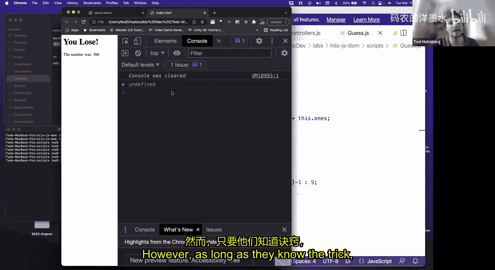

现在，我们开始实现第三部分的目标：将游戏升级为具有图形化界面和计时机制的版本。

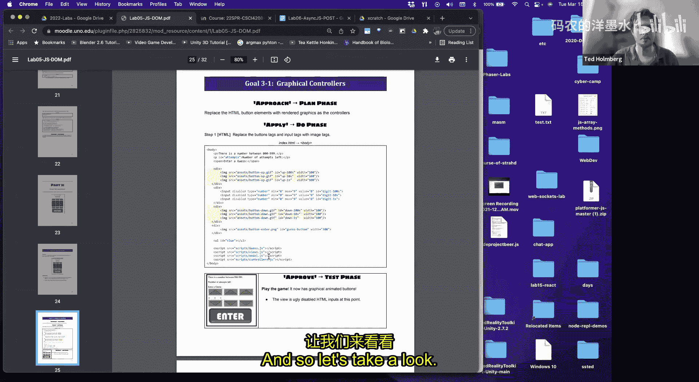

### 目标 3.1：将控制器按钮图形化

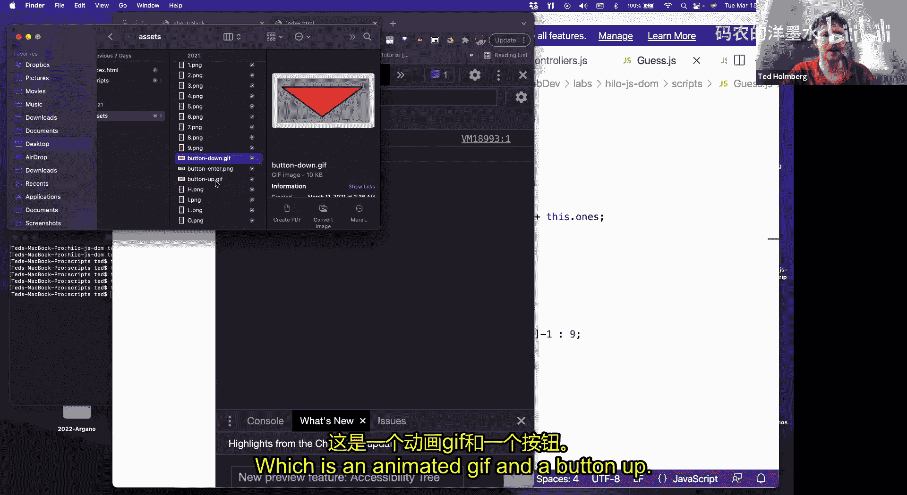

我们的计划是将HTML中的按钮元素替换为图像，作为新的控制器。

以下是具体步骤：

1.  在HTML文件中，找到控制按钮的`<input type="button">`标签。
2.  将它们替换为``标签，并设置`src`属性指向相应的按钮图片（如`button-up.gif`和`button-down.gif`）。
3.  保持`id`属性不变，这样我们就不需要修改JavaScript中绑定事件监听器的代码。

**代码描述（HTML修改示例）：**
```html
<!-- 替换前的按钮 -->
<input type="button" id="up-hundreds" value="+">

<!-- 替换后的图像按钮 -->

```

完成此修改后，游戏功能应保持不变，但按钮已变为图像。

### 目标 3.2：将数字显示视图图形化

接下来，我们将显示猜测数字的输入框也替换为图形化的LED数字图像。

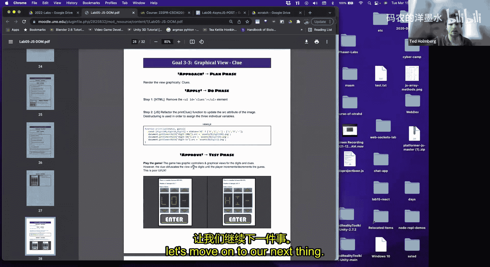

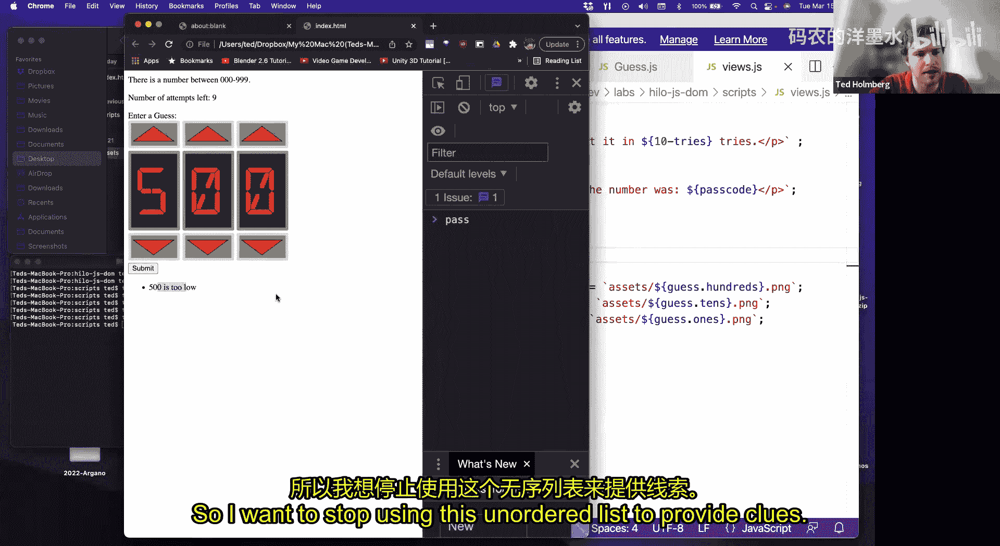

以下是具体步骤：

1.  在HTML中，将数字输入框替换为``标签，初始图片显示为`0.gif`。
2.  在视图（`view.js`）的`printDigits`函数中，修改更新逻辑。不再设置输入框的`value`，而是设置图片的`src`属性，根据当前`Guest`实例的值动态指向对应的数字图片（如`5.gif`）。

**代码描述（`printDigits`函数修改）：**
```javascript
function printDigits() {
    document.getElementById('digit-hundreds').src = `assets/${guess.hundreds}.gif`;
    document.getElementById('digit-tens').src = `assets/${guess.tens}.gif`;
    document.getElementById('digit-ones').src = `assets/${guess.ones}.gif`;
}
```

至此，我们仅修改了视图和控制器，模型完全未动，就成功地将界面从文本切换为图形。

### 目标 3.3：将线索提示集成到LED面板

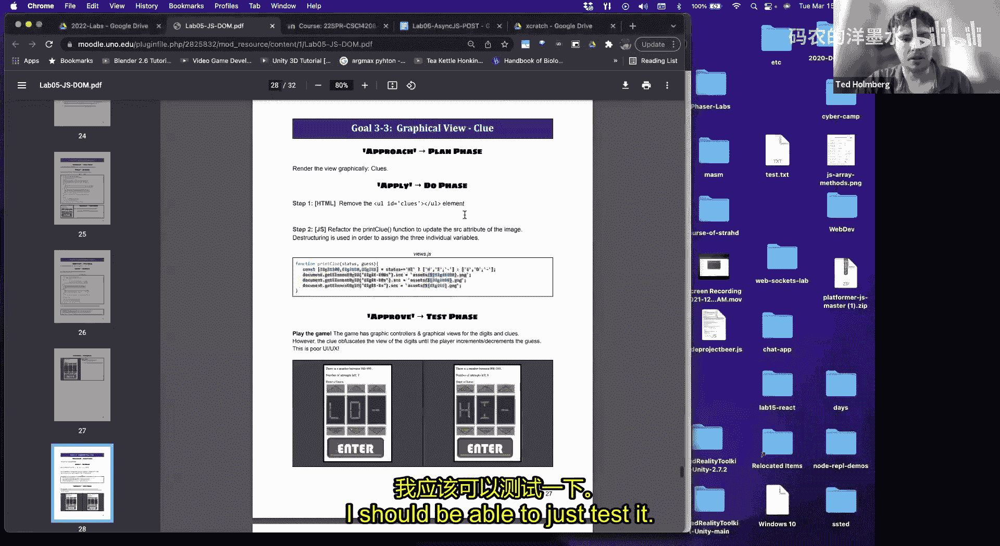

我们希望将“过高/过低”的提示也显示在中央的LED面板上，而不是下方的列表中。

以下是具体步骤：

1.  从HTML中移除用于显示线索的无序列表(`<ul>`)。
2.  在视图的`printClue`函数中重写逻辑。根据传入的`status`（‘H’或‘L’），决定显示‘HIGH’还是‘LOW’的图片组合。

**代码描述（`printClue`函数修改）：**
```javascript
function printClue(status) {
    // 使用三元运算符和数组解构，根据状态决定显示的字符
    const [digit100, digit10, digit1] = 
        (status === ‘H’) ? [‘H‘， ‘I‘， ‘-’] : [‘L‘， ‘O‘， ‘-’];

    document.getElementById(‘digit-hundreds‘).src = `assets/${digit100}.gif`;
    document.getElementById(‘digit-tens‘).src = `assets/${digit10}.gif`;
    document.getElementById(‘digit-ones‘).src = `assets/${digit1}.gif`;
}
```

现在，线索会直接覆盖显示在数字面板上。

### 目标 3.4：为线索提示添加自动清除计时器

目前，线索提示会一直显示，直到玩家再次操作。为了提升体验，我们添加一个计时器，在显示线索1秒后自动恢复显示当前猜测的数字。

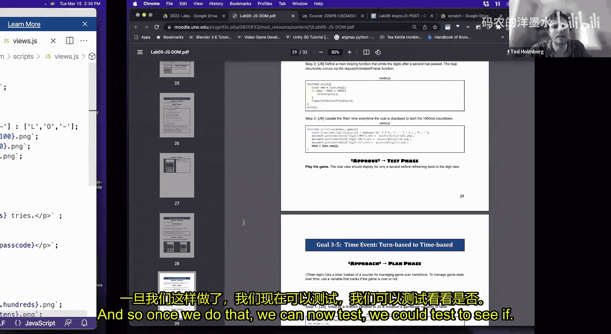

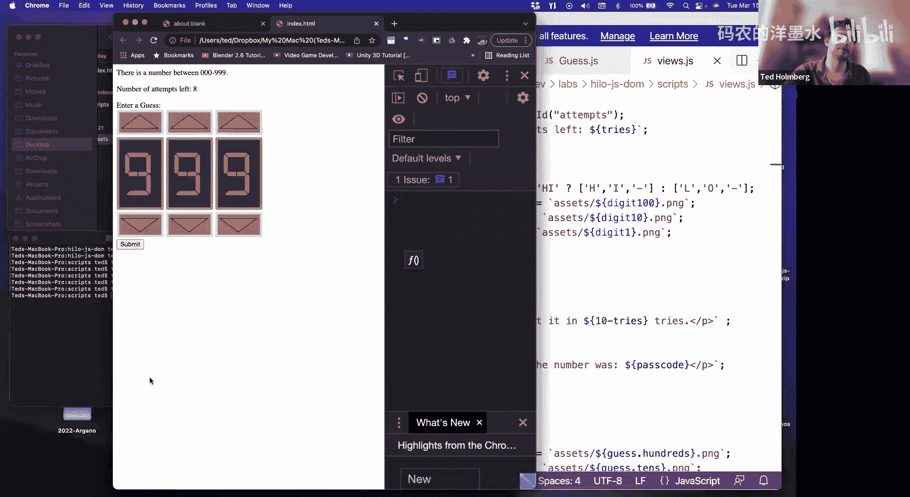

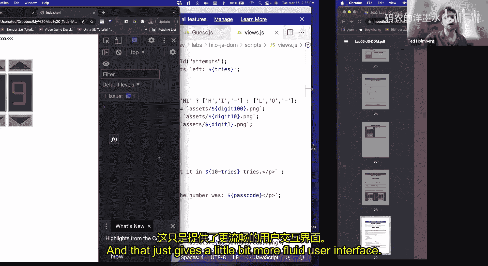

以下是实现思路：

1.  在模型(`model.js`)中定义一个全局变量`thenTime`，用于记录起始时间（使用`Date.now()`获取的毫秒时间戳）。
2.  创建一个主循环函数`main`，通过`window.requestAnimationFrame`重复调用。
3.  在`main`函数中，计算当前时间与`thenTime`的差值。若差值超过1000毫秒（1秒），则调用`printDigits()`恢复数字显示，并更新`thenTime`为当前时间。
4.  在`printClue`函数中，每次显示新线索时，也更新`thenTime`，以重置1秒计时。

**公式/概念描述：**
*   **时间差计算**：`timePassed = Date.now() - thenTime`
*   **条件判断**：`if (timePassed > 1000) { // 执行操作 }`

这样，每次给出线索后，面板都会在1秒后自动切回数字显示。

### 目标 3.5：实现基于时间的游戏机制

最后，我们将游戏的核心机制从“限制猜测次数”改为“限制游戏时间”。

以下是具体步骤：

1.  **修改模型状态**：在模型中，用`timeLeft`（剩余时间）和`isGameOver`（游戏是否结束）变量替换之前的`triesLeft`（剩余尝试次数）。
2.  **更新胜利条件**：在`guessNumber`函数中，当猜测正确时，设置`isGameOver = true`并宣布胜利。
3.  **更新失败条件**：在主循环函数`main`中，检查`timeLeft`是否小于等于0。若是，则触发游戏结束（失败），并调用`printGameOver`。
4.  **更新视图显示**：修改`printAttempts`和`printGameOver`函数，将显示内容从“剩余尝试次数”改为“剩余时间”和“所用时间”。
5.  **实现时间流逝**：在`main`函数中，每当检测到过去1秒（参考目标3.4的逻辑），就将`timeLeft`减1，并更新屏幕上显示的时间。

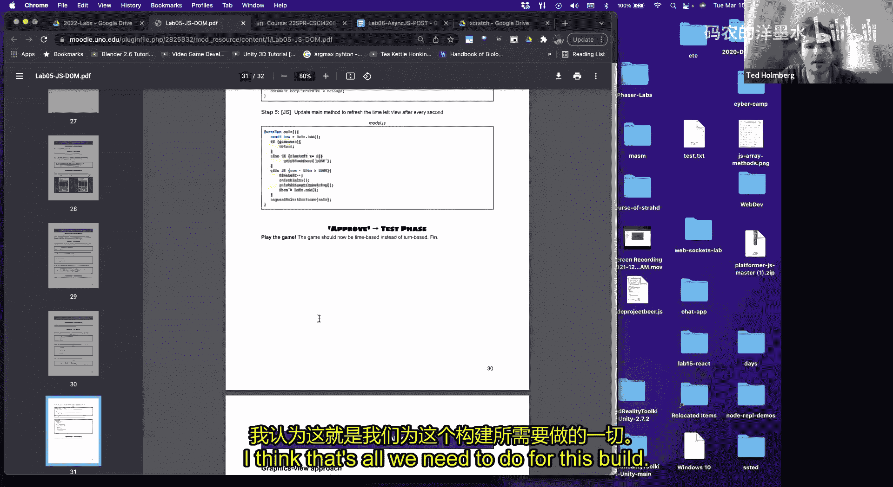

**代码描述（`main`函数核心逻辑更新）：**
```javascript
function main() {
    if (isGameOver) return; // 游戏已结束，停止更新
    if (timeLeft <= 0) {
        printGameOver(‘lose‘);
        isGameOver = true;
        return;
    }

    const now = Date.now();
    if (now - thenTime > 1000) {
        timeLeft--; // 时间减少1秒
        printDigits();
        printAttempts(); // 更新显示的时间
        thenTime = now; // 重置计时起点
    }
    window.requestAnimationFrame(main);
}
// 启动游戏循环
main();
```

现在，游戏变成了在30秒（或你设定的初始时间）内猜出正确数字的挑战。策略也从纯粹的逻辑二分法，转变为需要在时间压力下进行效率权衡，游戏体验变得更加紧张和有趣。

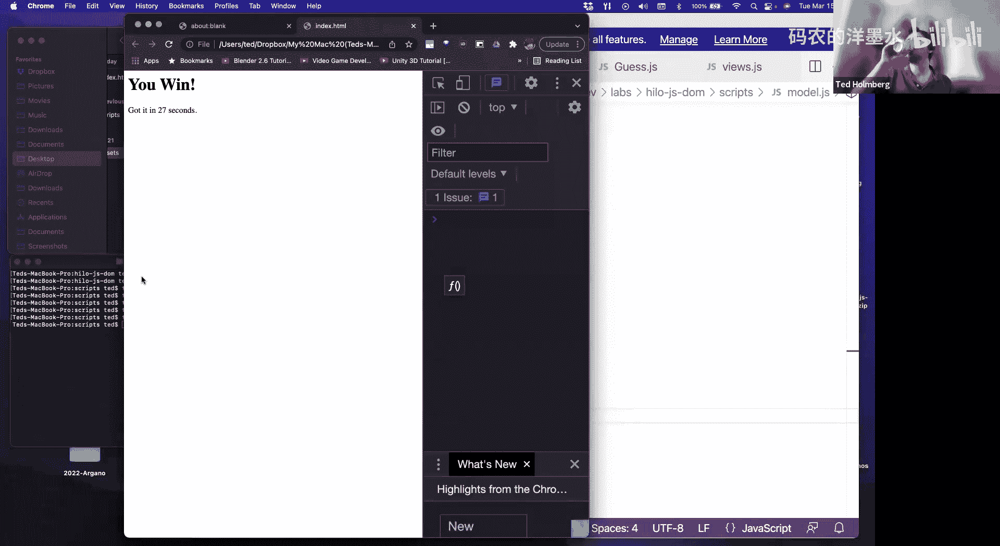

## 总结

本节课中，我们一起完成了“高低猜测”游戏的最终升级。我们成功地将一个基于回合的文本游戏，改造为基于时间的图形化游戏。在这个过程中，我们实践了以下关键技能：

1.  **图形化界面**：将HTML表单元素替换为动态图像，并通过JavaScript控制`src`属性来更新显示。
2.  **计时器与循环**：利用`Date.now()`和`requestAnimationFrame`创建游戏主循环，实现了基于时间的状态更新和事件触发。
3.  **MVC架构的威力**：我们仅需修改视图(`view.js`)和少量控制器逻辑，就彻底改变了游戏的呈现方式和核心规则，而模型(`model.js`)的核心逻辑保持稳定。这充分证明了良好架构带来的可维护性和可扩展性。

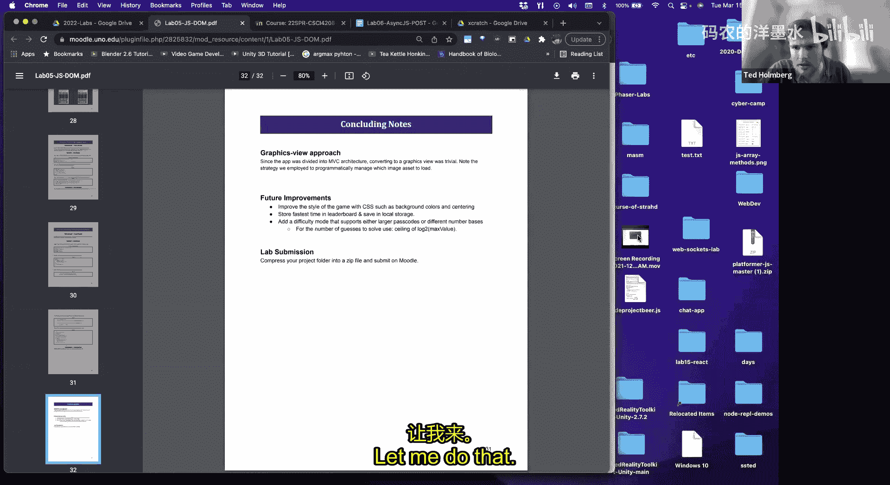

你可以进一步扩展这个游戏，例如添加CSS样式美化、通过本地存储(`localStorage`)保存最快记录、或者增加不同难度（如更多位数或十六进制数字），使其更加完善。