# 【全集】加州理工学院 高级Web应用 中英字幕 1080P p11 Lecture 11 - HTTP POST 请求 -BV192zTBrEmu_p11-

。

Okay good afternoon everyone， we're going to do this video lab。

With HTP and asynchronous JavaScript so here we'll have a lab dedicated to building out the contact form so you might recall the contact form that you had from your portfolio page lab didn't do anything this lab will go ahead and finish up that implementation so that we can actually use it to start collecting data from users who might submit onto it。

And so here the technologies we're going learn to use is we're going to learn about HTTP request in particular we're going to be making post requests to some backend service the backend service will be one that's managed by Google so we're just going to focus on being clients to HP request and responses we're just going to focus on being web clients and we're going to learn some we'll learn how to do that in both HTML using forms and submit events and we're going to learn how to use that using asynchronous JavaScript without having to use any HTML we'll learn how to use those two technologies to send requests to a web server。

Okay， so this is a relatively short lab。We'll have our quick little introduction that goes over all the learning objectives and then it'll be broken down into five separate goals。

The first of goal will be essentially to create a Google form as our backend database of sorts and then the rest of it will actually be building out our on client side as just a collection of HTML and JavaScript files and so the goal2 here would be to create all the implementation just an HTML and then we'll slowly transition away from HTML and see how we can do the same things using JavaScript so we'll use the JavaScript document object to set the data into the HTML form。

 but then we'll still use the form on goal3 and then on goal4 we'll see how we can encapsulate the data that's going to be sent to the web server using JavaScript but we'll still use the form submit action to send the data and then the fifth and final goal will use exclusively asynchronous JavaScript to send that HTMLTP request without having to implement anything from the HTML side and use any。

The built in kind of browser functionality that's kind of hard coded into forms and then we'll just have our a little bit of concluding notes after that。

Yeah， it's a beautiful day outside and you're hearing the wind chimes likely on the porch。

So in terms of our lab introduction， the prereC for this is， well。

 this is probably the first time we actually have a prere that isn't just a browser and an IDE I feel like I'm hearing myself here。

And in fact， let me do this in fact too。We'll go ahead and put。I think that was my bad。

 I wasn't muted。Okay。So this will be the first lab that we actually have a prere to so this will be the first lab in probably a sequence。

 I think we have one other lab where we'll be doing asynchronous JavaScript。

 but you'll also require having a Google account for this lab since we're going to rely on Google as our backend service。

So the motivation behind this lab is we want to learn to use。

HUTP to send request to a backend service。I'm not going to use headphones。

This lab focuses exclusively on client side， thus we'll send ACP request to a pre-existing backend。

 which is why we're going to select Google for this instance we'll be doing the same thing on the next lab as well we'll find some backend restful API that we can make calls to and then we'll focus on learning how to make web calls and getting that data back from a web server on the client side and once we get comfortable with that we're going to pivot and start building their own web servers that can do just that so that we'll be able to design them。

 but I feel like before we start designing them we should use them a little bit so we get comfortable with what their role is。

 what job they do for us for our web applications。So our goal for this lab is to implement that contact form on our portfolio page and to store the data that gets submitted from the contact form into a Google form。

So the learning objectives that we'll cover will be ATTP request in particular we're going to be doing post request and a future lab we learn a couple of different types of requests like get request and delete request and put request we're going to learn the async Away keywords that allows us to do asynchronous calls to JavaScript。

And and I'll talk more about what it means to be asynchronous versus non asynchronous calls。

 but pretty much the basic takeaway about asynct JavaScript script versus or in any language actually versus non asynchronous calls in non asynchronous calls but you're typically used to if you're building an algorithm that has a collection of statements。

 there's the expectation that it gets executed statement by statement by statement。

 but there are some actions that can occur that you have to wait。

For them before you can go ahead and trigger a response and so probably the most common form of asynchronous programming you're used to is event driven where we set up a listener and we wait for an event to happen and then we then we handle that event with a callback function and that is a form of asynchronous implementation。

no。嗯。And。And well， so that concept extends to when we have a web client having to communicate with a web server。

 so when a web client。Sinces you request to a web server。

 it's going to be a nontribue amount of time to get back a response。

 the response might take a second， it might take 15 seconds。

 but what you want to do inside of your client side app is wait for the server to send back a response and then you're going to do whatever you want to do with that response with that data that it provides back to you and we're going to see how we can send that request today to the to a server。

So that's effectively what async await is used for， it allows us to be able to send out like a。

A asynchronous call like a fetch call like a request to a server and then wait for a response to happen and then manage the response once we've once we've gotten it so with that said a fetch method is an asynchronous call that is our built in method on our JavaScript library that allows us inside of the API that allows us to send aTP request。

Before the fetch method， we would have had to use third party tooling to do that， or again。

 another way to do to send a HP request would be through an HTML form。

 which is going to be the first goal that we do。And then also we'll talk about what promises are in JavaScript。

And again， there's a lecture that you should watch that talks about all these concepts。

 so this lab is the companion lab lab to those lectures and hopefully sometime next week I'll go ahead and publish a quiz so that you can go ahead and evaluate your knowledges on those。

Okay， so a quick overview well， I think this overview here is exactly as the the。

Table content so I will not go over that and our project architecture is we're going to have a main directory that we'll call contact form inside of a contact form we'll have our index on HTML page and then we'll have a script subdirecty that's going to hold all of our scripts and I don't think that this is correct actually I think we're only going to build two scripts for this we're going to have a form controller and a form model I don't think we need a form view。

And I don't think we need form data because we'll just put our data inside the model。

 so I think I think that might have to update that。

 but notice there's nothing to download here and this just means that we're going to make everything。

There's no assets for this lab， so we we get to make everything from sp so actually let me start with that let's。

哦。什咩。Go into。Here， so I'm going to make a new folder and I'm going to call it。

What was a contact form？Perfect， and inside a contact form， I'm going to create a scripts folder。

Okay。Perfect， and let's see here。 Let's also。So yeah， contact form now exists。

 so let me change into contact form for my terminal and I'm going to create that index。 HTML。Perfect。

 and then I'm going to change into scripts because probably anything I'm going to have to make thereafter is going to be inside of my scripts directlyy。

Perfect and okay。And let's open this up here because we know we're going to have to effectively oh mine。

Oh，Let's。A太 person。Okay， so now goal one， well， before we started pulling in anything。

 we're going to need a Google form。Made to do this。 So there's one of two ways we can do this。

 So first let's define our goal。 we're going to create a Google form to store our contact data。

Submissions that the user is going to want to supply to us so the approach is we're going to use a preexisting backend services store our form data so Google provides access to post form data as long as you have a Google account so Google has a lot of really great services under Google Drive one of them is Google Docs and Google Form is a part of Google Docs so we'll be using Google forms and I'll show you one of two ways that we can go ahead and get to the forms page there some concepts we're going learn in this particular iteration is we're going learn a little bit about backend services so up till this point we've been using the web client which is our browser and we've just been using it kind of as a as a viewport and a JavaScriptscript runtime environment but now we're going to use it in the way that it's intended to be used right to be able to also connect with web servers so we're going to learn to submit data to a backend。

That will then store the data that we submit to it as data persistence so you can think of this as a rudimentary database of sorts。

And so we're going to talk a little bit about a concept of endpoints and all an endpoint is is you could think of it as a。

As the URL。That we have to send our request to so effectively a web server is listening on some route。

😡，For typically a particular type of HTTP verb， so either like a get verb or put verb or delete verb or a。

Or a post verb we're going to be using post today and so when it's issued an action。And some data。

 then it can go ahead and receive that request and then process back a response and send that back to the web client。

So here we're just going to define this as the URL route and ACTP verb that the server listens suit in order to be able to send and receive ACTP request。

 well it receives ACTP requests， it sends back responses。

So you can think of it as a client server relationship。

Which is clearly why that's called the webP website so Anyway。

 let's get to the next step is why don't we open up a Chrome browser and go to forms。google。com。

So this is probably the easiest way if you want to get two forms， right you can just。

And then you can just go and select to create a blank form。

 so this is one way to do it I'm going to show you an alternate way and I'm actually just going to use the alternate way if you open up Google drive。

You can also create a new Google document and one of the options will be to create a Google form。

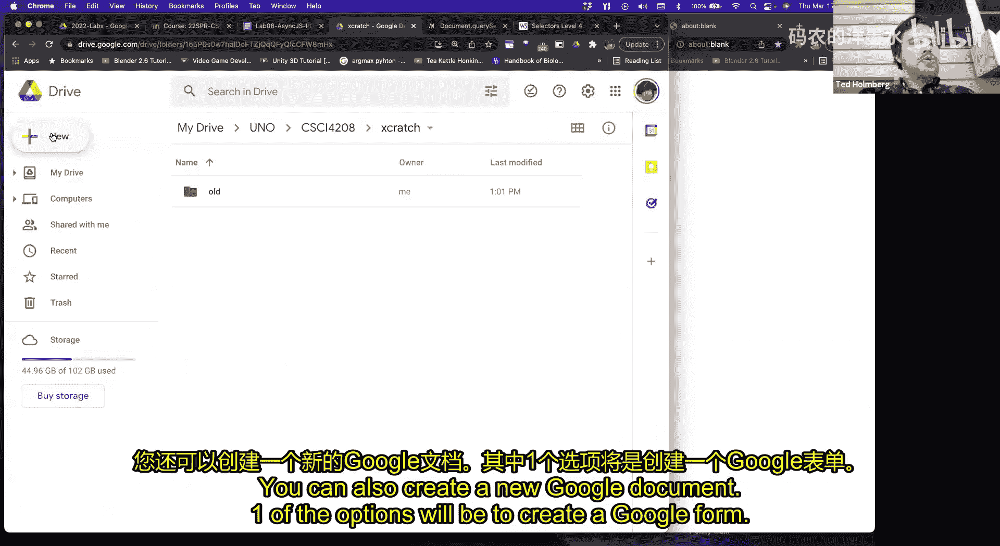

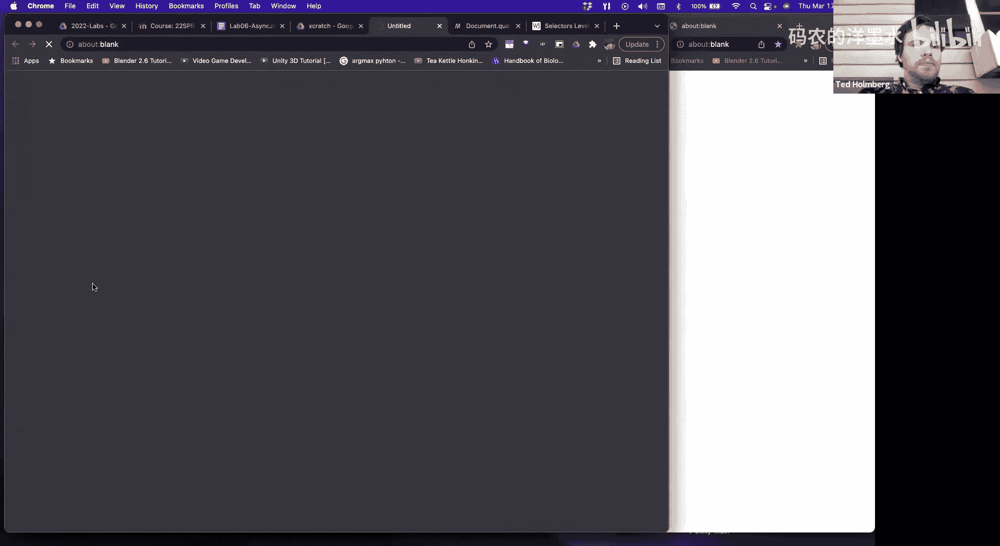

So those are the two ways I'm going to give it a name really quick， what's called this。Contact form。

没。Perfect。Okay， so now I have this contact form made。The next thing I want to do is。

I want to fill in the Google form with all the required input fields that we're going to need。😡。

And so ideally it would have the same input forms that my portfolio page would have right let's see I called this contact response okay not what I want。

Let me be consistent with the lab， so I'll call this contact response perfect。

And so i'm going to create a name email and message so let's do that I'm going to go in here i'm going to say make a name I notice Google's actually form you while I is smarter enough to know if I put a name it probably wants this to be a short answer perfect then I'm going to go and create a new questions we're going hit the plus sign and then I'm going to do email and again it's probably smarter enough to know to make this a short answer but if it didn't I can select any of the options I want my form to have。

Then I'm going to do hit this plus sign to add into a question， and then I'm going to do a message。

Excellent， so now at this point， I now have a form that has a name， email and message。

 and actually just to test this out。I can click on that preview icon it's the eyeball icon so let's do that let's go to this eyeball and it'll allow me to go from the editing pane to the view pane on it so now this is what others would see if I were to share this form with them and I can actually test this out let me actually submit so let me say for instance。

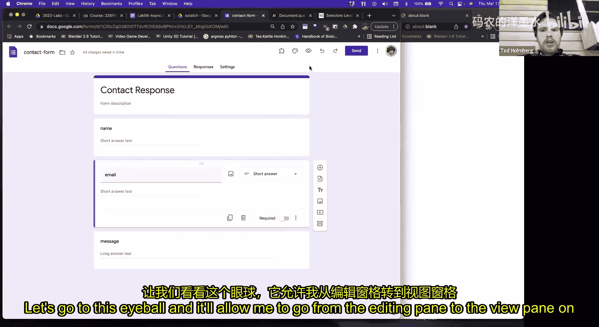

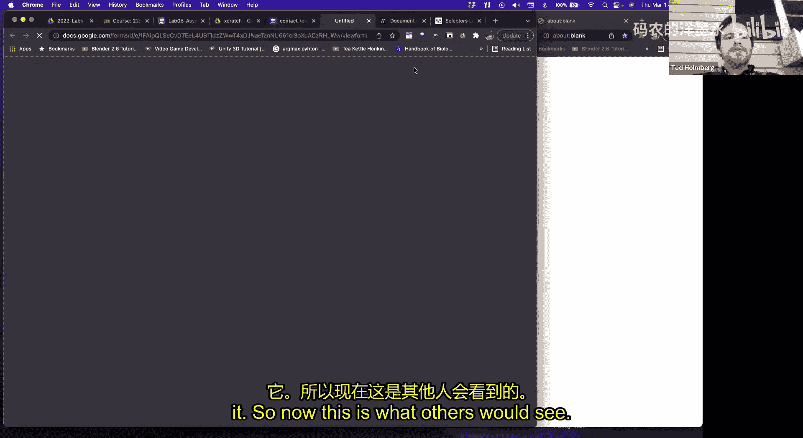

Ted。And let's say that this is Ted@ Ted。com。And。Test。Task， one， two， three。

Okay perfect so let's just test we're gonna do a submit we'll see that Google gives us back a redirect that shows that we've actually sent a request and it's been recorded if I go back into my directory here where I have my contact form let me go back into here where my contact form here where i'm in the editing pane notice I have up here the ability to see the questions and to see my responses and here it shows that I have one response and then I also have a settings pane where I can adjust some of the settings stuff I'm going to go to the responses here and I see that my responses right here so for name。

 email and message I have Ted Ted Ted co and test test 123 perfect and in fact if I select to create a spreadsheet I can click this this。

It's going to say do you want to create a new spreadsheet Well yeah go ahead and create that and then it's going to aggregate all the results into this spreadsheet So here's another way I can pull this data where it gives me the timestamp that the submission occurred on and then it has a name column an email column and a message column again this is all just built into Google forms as part of Google Docs。

Okay， so we float around with this a little bit， now let's see what else。

So let's move on to the next step now that we've actually built a form that we can use to collect data because at this point this is going to serve as kind of our database right this is where we're going to get our data persistence at for capturing whatever data that we want the users to submit so that we can archive it。

So here in order for me to go ahead and have my own web page interconnect with Google Form。

 I need to get some data from Google Forms so we're going to do this intermediary step that's going to post some necessary things and so just so you can see what's happening here。

Okay， so just so we can see what's happening here。Let me actually do this。Let me open up。

 let's go back to that view。And let me go to。Here。I'm going to go to View sourceur。嗯。嗯。

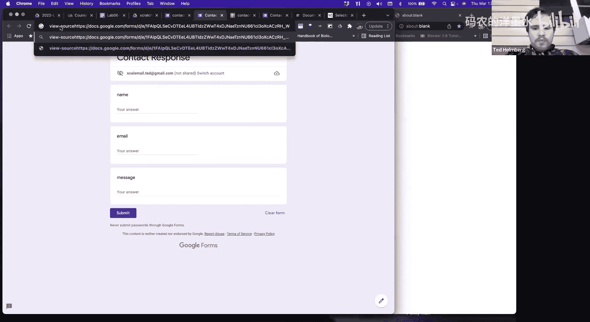

Okay， so if we view source you could see these generated forms look awful right is there this is it's all a single line of H。

Oh Lord， okay， so I went through the work of finding where the name values are and so we're going to step through this code but。

😡。

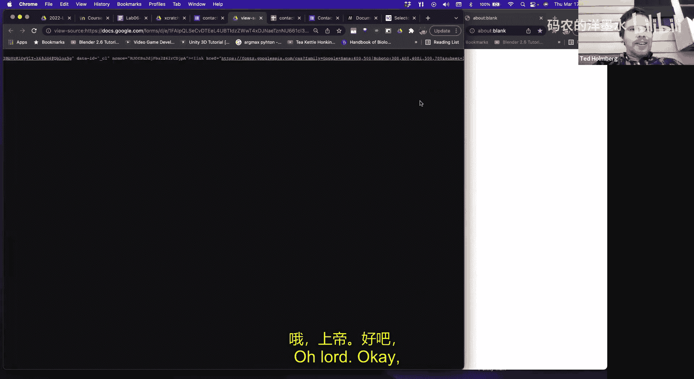

And see what actually happens so actually why don't we why don't we grab this。I will go to。Here。

 let me go to the eyeball again。So here where the form actually exists that such that we can submit to it。

Oh， let me clear this。Okay， and let's grab this a line at a time and I'll explain what each of these things are doing。

 So the first thing I'm going to do is create a function。Okay， and what's this function doing， Okay。

 let's get this。Let's do it from the。Okay so this is a function called print label。

 so this is a i'm creating a function declaration I mean a function assignment so print label is the name of the function and i'm assigning to it so given a parameter I you can think of I an index i'm going to use the document object model and i'm going to use the query selector all method on us on there so one of the。

Function calls we've we've seen a lot for the document object model is get element by ID well this is an alternative way that we can get elements from our dom and so what this allows us to do is it allows us to use a all sorts of selectors effectively anything that can qualify as a cS selector we can use to select elements into from jascript so this is a very powerful mechanism to search our dom if you want to know more of a query selector all you can go again into the Mozilla developer page and you'll see that they have an entire selection for the document query selector but there's some interesting ways that we can define。

Some selectors， one of them is we can actually match based off of attribute。

So let me see here where I can show you in the literature here， so this is the example here。

 which is called an attribute selector。So what you'll see here what i'm doing is i'm going to for on the document use query selector all and then inside of the square brackets so inside the string is what i'm selecting on if I define the thing in square brackets then i'm looking for an atema element by an attribute that it has so here i'm looking for an attribute called Aria level and here the。

The symbol of whatever that hat equal sign is allows me to look at the first part of a value and make a decision。

 so here just so we can see based off of the W3 specification if we have an attribute So again。

 these are the different ways we can match an attribute with our query selector all so inside of our square brackets right you have an attribute name and let's say you have the hat equal to and then a value well this represents an element with the attribute whose value begins with a prefex of whatever this value is if I did。

Dollar sign， equal sign。A helicopterlicopter passing by if we do dollar sign equal to then that represents an element who has the attribute value at the end of whatever the value we're searching for is and if we do star equal then it's going to look for at least one instance of a substring so these are these are these are identifying based office of substrs so here hat equal is the first part of the substring the dollar sign equal is the back end of the substring and star equal is anywhere inside the string so to get give you an idea is。

Here the attribute would be type in the HTMLm and then hat equal would be looking for a substr that starts with image slash if you're looking for a specific like folder。

 this would be a great way to do that， whereas if you're doing。

Dollar signed equal and you're looking for the HF I'm sorry the HRF attribute in HTML element。

 you might want to check for any references that are at the end of the substr right that end in dot HTML so this allows you to look for an extension。

😡，And so here。If you S equal， you can look for any instance within a substring that just has the word hello it could be at the beginning。

 it could be at the end， it could be somewhere in the middle so that's just giving you an idea of what these symbols mean that way when you look at this it's not all just foreign code to kind of decipher it and again if after looking at these this this doesn't make any sense please let me know what part might still be confusing anyway so here we're creating a variable called print label and we're assigning it to it a function object using that arrow notation it takes a parameter of I to represent an index we're going to make a call to the document query selector all to get all document objects that have an or level of three and then we'll index into that because that's going to return back an HTML collection as you might recall it's going to return all the elements back even there's only one even if it's then it's going to be one inside of an。

Tl collection so we'll index into the particular index that we want and grab the inner the inner text of it so we'll get what is at the text of this of this HTML element let's talk about what is happening here in just a moment。

Then the next thing we're going to do here is we're going to go ahead and create a function called print entry and again this is going to be a function assignment so this is going say two parameters now notice one thing when we declare function object if it's one parameter you don't have to use parentheses that's implied but if there's two parameters then you have to go ahead and use parentheses so the parameter list here is an E and an I the E represents an element and the I will represent an index and here all we're doing here is we're console log so here we're invoking the print label function we just defined right above it and we're passing the I that gets past the print entry and here E is an element an HTML element so we're going to access that elements name attribute so the name attribute is going to be an important concept in the fact that just like on the client' side we have an ID attribute we can defined to an HTML and。

TmL value。So that we can reference it on the client side。

 the name attribute is what we give to an HTML element to give data that we want to send to a web server that to how we refer to it。

😡，So the name will be used effectively like an ID on the server side。

 so that's going to be like the distinguishing factors between ID and name so an HTML element can have both those things and they could be two different values。

😡，You can have an ID that has one value， you can have a name as another value on your client's side。

 you might refer to that HTML element as its ID and then on the server side it might use that HTML element data using the name property so it allows us to have like a separation of responsibility IDs are for client names or for a server sending to the server。

😡，Okay， so then what we're going to do so these are just two functions this isn't doing anything yet。

 in fact， if I were to copy this code here。And paye that in， you'll see。And in fact。嗯。

let's test this out so if I do print label。And if I do an index of zero。

 let's see what it returns back print label， oh， I got to。There we go。

 camelback notation print label is not defined print oh。Hate auto complete sometimes， Okay。

 there we go。Okay， so if I do print label zero notice what it's doing here right off the bat is it's searching the dom and it's giving me back this label right here。

 so it's giving me the labels of the forms so if I do print label one it's going to give me email right here and if I do print label two。

It's going to give me message so we can see what this first method is doing。

Is it's returning back the labels。Now I can't quite use the print entry yet because the print entry requires an HTML element and an index so we're going to see how we're going to be able to make a function call to that now you might be wondering yeah can you explain what AA level is is that one more time like AA level so Aria so so the fact that this is inside of brackets lets me know hey this is an attribute that belongs to an HTML element now AA level just happens to be an attribute that belongs to these form elements inside of Google forms now there's this is this is proprietary knowledge though this is domain specific knowledge this is not a general name that you will typically need to know this AA level attribute just so happens to be the attribute that Google uses to identify their forms here and since。

We're going to use Google's backend it behooves us to be able to get this data we're going to need this data to connect to our own form。

 so I kind of did the leg work to see how I can essentially。

Gather this information from the Google form so we'll be able to use it。

 but to see where are your levels actually defined that actually let's go back to here。

 yeah that's more of what I was asking。😡。

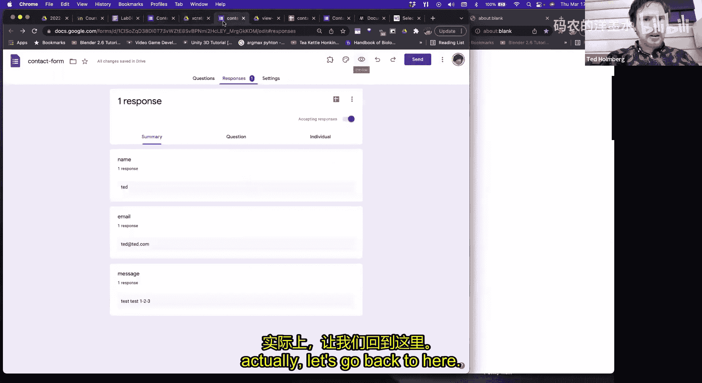

Yeah， let me go to control F and you'll see here are your level I'll do a a find I'll do a。

IFind on this document and notice Aria level equals three it actually found to three times if I had and it's going to find it for every instance that you have a question in a Google form so if I do the first time there it is and look look at what the inner Txt is to this HTML element so you'll see this HTML element that has the AA level3 is a div right I see it's a div element it has an ID that's randomly generated so it's going to be different for every form so I can't use that to identify this form value it uses this class that look at this this is a random sequence of alphanumeric characters this changes every time I can't use that either。

😡，I can't use the role to identify this because lots of roles have the heading value。

 so one unique thing that Google applies to each and every one of those questions on a form is this Aria level attribute。

😡，And so we're going to take advantage of that， we're going to see hey。

 each time I want to find one of these these questions inside of our Google form。

 there's this A level， there's the first one for our name。

 there's the other one for our other label email and there's the other one for our message so if I want to be able to get those those forms to ensure that those are the forms that we're looking for that those are the input fields that we're looking for。

 we can verify it by looking through the Dom for any instance of A level and see okay I found the message field。

 I found the well the message label， the email label and the name label and again on the rendered HTMLL what it's looking at here is this。

😡。

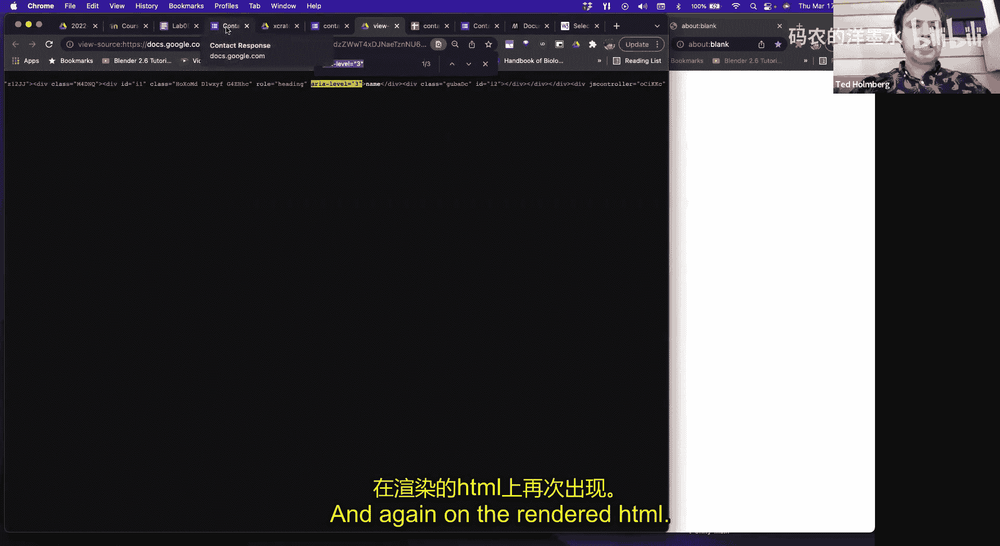

This and this， does that make sense？Yes。So if we're gonna to use query selector we can't just use RE level we have to actually look through the code and find what our unique identifier is Well so so for this code you can just use this code as it were because I did the legwork of finding that all the HTML elements in Google Docs the ones in order to get the labels so that we can we can identify what the names are so what we need to do this is what our goal here right now is in order to send data to web server we need to name that data and that name has to be the same on the client side as it is on the server side so so when we create a form on Google on Google forms typically you're using the front end that Google design and it randomly generates the names so we need to find the randomly generated names for this field here for this field here and this field here for the name field for the email field and the message field。

Because if we send a request to Google Forms and。We use the same names as what this contact form is using。

 it'll post in the same way。😡，Does that explanation make sense？Yes。Yes。

 and it'll make more sets as we're actually implementing I think the code as well。So in fact。

 when I run this I think you'll get a better sense of what's happening but what I'm doing initially is just to make sure that the name attribute matches what we expect it to be。

 we're going to also print the label and so this function is just looking for where the label is inside this Google form so that we can print it out and you could see like when I made these method calls print label for index zero it found the name label and it printed it out right it printed the inner text and all it was doing there was this was the inner text right the inner text of the element that had A level three。

😡。

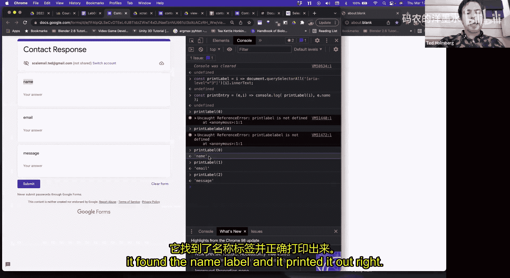

And so I printed out so is index error was name。Index one was email and index two was message。

Inside of the HTML collection that we got back from the document object model from this this first one and then here this is just a console log there's nothing special happen here so let's do this again actually why don't we do entry list。

😡，So let me go back over here and actually let me clear。Okay， so now let me do entry list here。

 So what is this， I'm going to make a call to the document object model again。

 I'm going to use the query selector all， which is another way of getting elements from my。

Dm and so just so just so everyone's on the same page。

 if I ever want to inspect my in memoryory dom I can do that from the depth tools hitting the elements tab this is effectively the the dom constructed in memory for this page so this is essentially what i'm getting access to and have functionching calls on。

😡，Okay， and then i'm going to do a very similar thing here here I'm going to try to select from the document object model that is this page any HTML element that has the name attribute and remember what I stated earlier is you have a name attribute when you're looking to send data to a web server so that means since this has a field that will have a value that's designed to go to Google's backend server that creates that Excel document or they're the spreadsheet document and that collects the responses。

😡，Miss Field has to have a name associated with it。

So does this email field and so does this message field so I'm going to tell the document okay return all the HTML elements that have a name attribute。

 but in particular the name attribute that starts with entry because what again when Google forms generates these frontends for us when it generates these questions for us。

 it gives it a randomly generated name but the one consistent thing about these randomly generated names is that they all are prefixed with the entry terms so that you know this is an entry into the form。

😡，And so when the web server gets a response from this form， when this form is submitted。

 it's going to send。😡，Essentially， it' a query string。

A keys that start with entry and then a random set of numbers。

 and then the value would be the value we put into this form for name and the value that we put into the form for email and the value that we put into the form for message。

😡，So actually let me go ahead and just run this and here， let me go back into here。

 so let me prove to you if I type an entry inside of here， let's see what happens。😡，Entry。

You can see there's lots of entries， Okay， so first of all， see there's。Well， here， oh Lord。

 it's probably not even capturing it here。 What can I do this， Oh， not equal sign。Okay。

 so is it able to find anything， I can't even find it on here。 so I'll probably have to go into。

Not only two instances of entry。Oh what about name？and you can see there's lots of okay name yeah。

 you can see all these generate so we can't find it by name it attribute that's why we want to look for that prefix of entry。

And yeah， and it's not even rendering inside of this page when I go to look at the view source on it。

 so I might actually have to look for that inside of the。

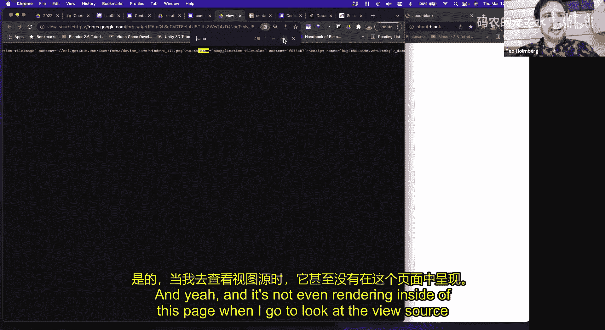

Well， why don't we look inside of here though， so let me do this call and let me look at entry list。

So， look， what my entry list shows is， hey。There were three matches from our Dom。

 right because we got a node list here。 There's three matches from your Dom that hasn't actually be called name and that starts with the label of entry。

 And they're all inputs。 Well， guess what， That's great because there's three inputs on this page。

 And if I unpack this。 And I look at the index。 I'm like， oh yeah， look at this。 This is a。

This is the name， so it's got the label name， it's got entry dot 178 of4，3，6，5，4，4，6。

 so this is the name。嗯。oh yeah here it is so this is the name we're going to have to use to send to the web server if we want to go ahead and submit on to this name field。

And let's let's go， okay， let me recolapse this， let me go into input one here here。

 notice this name has a different entry and that represents the email field。And then， here。

Thats unpack this， this name attribute has the value of entry3。1461068812。

And of course these entries are all going to be different for you。

 but that's going to correspond to my message field here so we need this is information we need to know to send data。

 you can think of these as the IDs， the identifiers that will allow us to set a name and email and message data into our web server so we need to collect that information。

😡，And that's what this that's what this script does effectively so now I have this and in fact let's finish that one line of code here。

 let me go back here and then I'm just going to now one thing you're going to see here is。

What I got back is a node list and this node list kind of looks like it is an array but it's not an array right it's actually a it's a node list it's an object and unfortunately it's not an enumerable object such that we can call our our array functions on it so what we're going to do here is we're gonna to learn some of the techniques we learned in the JavaScript data structures lecture where we can go ahead and take this object and deconstruct it into a collection of values and then we will wrap it in square brackets which will then cast it into an array so by deconstructing it and then defining those individual elements into a collection we now have an array that is now suitable for calling array method calls so for each of these input elements inside of this node list we will invoke the print entry。

Method and remember the print entry method， what is happening there is let's look at back at the source code giving an element so that will be an input element。

And an index value， then we will print the label at the index value and we will print the name attribute of our input element。

😡，So let me go ahead and。哦。Do that。Go ahead and run that line of code and you're going to say the output that I get from this code now is。

😡，The name field， so the thing that has a name label has a HTML name of entry。1784365446。

And the email has entry1529700185， and the message has entry 146106，8， whatever， 8812。

So this is just information we need to have， but we kind of step through to illustrate how we're getting that from this document。

😡，But again， this is all very specific to this individual problem。

 but you could see how we start to use JavaScript in interesting ways to be able to do some data collection that we need to interface with effectively their backend service。

Okay看。So we've done that now and we've gotten this output and notice the example output is different than what I'm doing now and it's going to be different from what you're doing。

 we can think of these entries as our endpoints so we need we need these entry names to send to Google's backend so that we can actually set the values inside of the form because the form is looking for these specific names to be able to set data to that value。

 essentially you can think of that as the variable names of the form on the server side。😡，Okay。

 the next thing we need to do is we actually need to get the forms ID so that we can add that as part of our as part of our endpoint URL。

 so the form ID is going to be different for every Google form this up may be achieved in two ways we can either just the easiest ways to use the URL address from our top bar or we could also query the dom for the for the ID of the form so what does it so here effectively this here。

😡，When you look inside of the U bar， what I have highlighted is the ID for this form in order to actually submit data to this form。

 we need the form ID as presented by Google。😡，And again， this is a domain specific problem。

 this is just information we need in order to interact with Google server and since that's the back end we've selected。

 it's you know， it's information well have to collect。😡，Okay。

 so what's the other way we can do it well I can create this function and I'll actually walk through what this function is doing。

 so let me go back over here。Let me clear do I want to clear this yeah。

 I clear this because I can always get that information back。Okay。

 so here I'm going to grab the ID so how am I going to do that I'm going to call document do location dot h ref and i'm going to match so locations H ref is going to return this In fact。

 let's take a look at what this is going first of all。

Let's take a look at document do location do H rep。 Let's see what that is。

 So if you notice that's actually the URL that we're currently at Now， I can actually on any string。

 do a Regx match。 So what the string you see here that I'm matching against would be the same way that I could do any other redgx。

 So I think if you do system programming concepts， you learn a little bit about red Xex。

 is that correct。Intro okay， so so effectively this is just so what the rex is。

 it's a regular expression it allows me to define attributes to look for on a substr。

So the rex command that I'm looking for here is just find a string that's with is 25 or larger and the only thing inside of the URL that's going to be 25 characters or larger is going to be the ID so if I look at the ID then you're going to see oh yeah that's the ID that I just assigned in fact here let me actually get the other part of this code where I'll actually just go ahead and print out the ID so here I will just then。

There's my ID。So those are the two ways I can now and you'll see what you'll see here is that's the same thing that's inside the URL so I can either just copy paste from the URL or I could do it programmatically right and always like to do things programmatically so we can see how we can achieve those results。

Okay， so those are the that's not what I want， those are the two pieces of data that we'll really need in order to submit our own form。

To Google's backend to add it with the submissions that we've generated on that document on that form document。

Okay so now a quick summary is we need the ID of the form， we need the name。

 we need the email we need the message once we have that then we can actually start building our own form on our client side so the next goal is let's actually send a request to the HTML form let's use the HTML form element to submit from our client data to that backend service so the first approach we're going to do this for it is just exclusively HTML so you could see how we can send data from an HTML document from client side to a web server without the usage JavaScript。

So again， we'll use ACML to submit data to the backend service I。e。

 our backend service is going to be Google Docs ACML has a form tag that can submit requests to an ACTP server and ACTP request requires an action which is effectively an URL endpoint and it requires a method which is going to be an ACTP ver so the method would be get post put or delete those the four methods we have access to we want to post data to the Google spreadsheet that we're going to be using a post method。

So again， the concepts that we're really going to be looking at here on iteration two。

He is going to be。I that。I think getting white noise on my speakers。

we're going to look at building a front end service。

 so our front end service is effectively going to be Uy UX。

Our user interface where the browser maintains views and controllers that the user interacts with。

 we're going to learn a little bit how to do a submit event。

 and this is where the user triggers a request from the web client to the web server and that request is triggered by submit event that occurs in the browser generated by the form element。

We'll learn about the request itself， recall or know if you don't know already that HTP or the hypertext transfer protocol is the protocol that browsers use to send request to web servers and this is the pretty standard protocol that we use we'll learn an alternate protocol called web Sock at some time in the future。

 but this is a request response model so we have a client that sends a request the web server parses a request and then sends back a response to the web client。

😡，And then the connections terminated after that so the client always initiates the request and then the server will send a response and then disconnect after that and then if the client needs more information'll send a new request and then we're going to learn how to use the form tag we've seen the form tag but we're going to learn the functionality that the form tag provides to us and it's really that the HTML form can trigger those submit events to send those HtP request to a web server okay so the stages we're going to have here is we're going to inside of our index on HTML we're going to go ahead and we have to set all the same inputs that our Google form expects that's our backend so why don't we create a HTML document that has all of that data so here。

I'm going to have create a form the action is going to be where I send my。😡。

Where I where the URL to where i'm sending that request to so notice this is going through Google docs。

 I need the form ID to go here and notice slash form response is the endpoint that Google uses to get form data at so every time you hit the submit button。

😡，Here where that's actually submitting to is that form request URL。😡，So actually。

 let me grab this really， let me grab it from here， so I'm going to grab this ID。Okay。

Is it highlighted I can't tell oh there we go， so let me grab this I。

Because I'm going to need that inside of here。U， no。Okay， perfect， so now I have the ID。

And I'm sending some form request and it's going to be a post method and then here I'm going to then inside of my form going to create these divs that's going to have an input。

And the input's going to be type text and it's going to have placeholder value inside the field and then it needs the name and that name has to be the name that the web server is looking for for us to impute data into so it's going to be the first entry that we saw and then I'm going to create another div that's going to be another input field that's going to be for emails and it has the placeholder email I'll make another div that's a text area that is score rows and it's going to have a placeholder of message so let me go ahead and also get those entries。

😡，Clear this。And let me get that line of code back here where I'm printing out these so the one for name is going to be this one。

 so let me copy that。And paye that in here。Let me copy this。And paste that in there。

And let me copy this。And paste that in there。 perfectfect。

 So now let me just see what this page is looking like so far。 So if I go to my index H and go here。

 here， drag this in here。Oh I have issues Okay so I have a form placeholder is how it says name in there placeholder is how I see email in there and placeholder is how I see a message in there and this is a text field a text field and a text area that's for rows and again we we've put in our names for our web server so let's see what else we need to do for this step。

Let's go back here and then I just test it。 So so what's going to happen is when I click the submit button notice I didn't have to set up an event handle or anything The submit a click event on a button in a form automatically generates a submit event and the submit event will send let me go back to my source code the submit event is going to send it's going to。

Use action and method from the form so it's going to submit the event to this URL and it's going to submit with a post method and it's going to send this data that has anything that has a name attribute and it's going to send the value that's inside of these inputs as the value and the key it's going to send to the server is going to be with this name So the name or the keys and the values associated with these names are going to be whatever the users submit so let me test this This is client。

😡，Task。Client test one email will be email at。Email dot com。Test1。

Let's submit and look at that I got to redirect from the server so I sent the request the request send back a response and the response forced a redirect to illustrate that my contact response was successful so I just sent a request an ACP request from my client from the browser to Google's backend service and it redirect me to their success page their contact response page so if I go back here。

Towards the document I see now I have two responses right I have client test one。

 I have email at email do co and I have test one here and in fact。

 if I go to this Excel document I can see。There it is。

 it updated right there where I now have a time and I have a client， the name。

 I have the email and I have the message。Excellent。

 so now we could see how easy it is in just H to send this to send an HT pay request。

 but usually in our apps， we're not going to use HTML forms for this we're going want to learn how to start building these requests from ja and sending them to backend servers in the background where it doesn't force redirects or anything so here we notice it worked the page did redirect to the Google response page and the submitted data does appear on our Google spreadsheet a disadvantage of this current approach though is that it offers no control in in resolving our server responses and everything has effectively hardcoded into our HTML so again that's not a programming practice is and maybe we don't want people to see that we are getting redirected to a Google form we' going to hide the fact that Google is our backend service and that when someone sends a requests we get to control what the response that the user season。

And again， we're going to address all that in these future goals so the next thing I want to do here is well。

 let's use asynchronous JavaScript to submit the user's data to the back end service。

So the approach here is well we'll use JavaScript initially so we'll slowly start implementing our solution to be 100% JavaScript。

 but we're going to focus on just using JavaScript to set the attributes for our AC form。

 so that's what we're going to kind of reserve ourselves for just this iteration。😡。

So we're going to use JavaScript to submit data to the back end service， i。e， Google Docs。

This approach is similar to the prior except that the formss attributes will be set within JavaScript as supposed to be in hardcoded into the HTML the HTMLP request is performed by the HTML form still we're still going to use that submit event at this time for this iteration to send that data so the concepts we're going to learn here are the form attributes from from the DOM elements from the HTML elements as the existing JavaScript so in order to submit an HTP request and HTML form must have an action which is the URL and it has to have a method which is that HTMLTP verb and the child values must be defined with name attributes that have a unique label to them so again the name attribute kind of represents an ID for the web server side of our application。

And then we use the ID label as the client side ID for that data。And then again。

 we're going to create a submit listener since we're going to be setting this up in JavaScript。

 we'll see how we can add an event listener。That listens for submit events and a submit event listener may be set on a form and triggered by a child button when it's collector pressed。

Okay， so let's actually do this let's go into our HTML form and let's update some things here here I will just go ahead for now for brevity's sake。

 I will update my form let's go over here。Okay， so now what I'm going to do is。

I'm still going to have my HTML form， but effectively I'm going to go ahead and I'm going to give it an ID so I can access it inside of JavaScript。

😡，I'm also going to give IDs to my input element， so my name input I will give the ID of name。

 my email input element， I will give the ID of email and my message element I will give the ID of message now recall we need to give these names。

😡，Inside in order to send the data to the back end server。

 but I'm going to give the name attribute to these elements inside of JavaScript。😡。

So since we're going to rely on JavaScript to go ahead and do this。

 I'm going to have to include some JavaScript files。

 I'm going to break my logic between the controller and models。

 I'm going to adhere to an NVC breakdown right just like we did with our last project so I'm going to create a form model and I'm going to create a form controller and the controller will have everything for accessing DOM elements and the model will have all the internal logic be able to send out request。

So now let me create those， so I need a form。Model。js file。And I need a form。Controller do js file。

 so now let me go into my scripts here now that I've made those and let's get these into my ID。Yeah。

Excellent。Okay， so now that we're done with the AC steps。

 let's take a look at the JavaScript steps we need to be able to implement this the first。

Is let's get all of the data we need which is going to be the form ID and the entry one entry2 and entry3 entry one is the name entry two is the email entry three is the passage the message and then we're also going to create a method that's going to be able to get a path and get path is effectively just going to be able for us to pass in a form ID and it's going to generate the URL the pathway to be able to send out a form response so in fact if I just want to test this out。

So you can see what this looked like。Right。Now， if I call get。Path and I do like send in a test。

It's going to send back there it's going to produce a URL and where the ID would go that's where test is I should put test ID here so we can see test ID。

And just a programmatic way to generate this， so it's it's just easier for our code to to kind of exist so not what do I want。

Let's go back over here and actually let's。Add this so this is effectively we're going to initialize the data and a get path function that returns our path string。

Okay， now I actually need to go back here， oh， I deleted all that stuff。

 so let me get my form ID again。I should have grabbed it while I had a chance， okay。

 so this is my entry one。So let me get entry one。And I'm actually going to store it here as entry one。

Andside of my script。And let me get here entry2。That's my email。嗯。

There we go and then let me get here entry three。Okay。Okay。

 so now this should actually correspond with the actual document I want to submit on also let me get that ID and I'll describe it here at this time since it's available。

Copy that from the URL bar and we will update this。There。Excellent， okay。

 so now I have the data for the form that I just generated。Thank。So the next thing。

 let's go into our controller and add some controller logic。

 we want to add a submit listener to the HTML form via the DOm。

 so I'm going to create effectively a method that initializes all my controllers。

Let's take a look at this， so I'm going create a method called init controllers which is just a function what this is going to do is it's going to grab the contact form from the document using the get element by ID method call and it's going to store the ACML element in memory and then it's going to take that and it's going to add an event listener where it's going to listen for submit event to occur and it's going to buying the callback function submit event to that and then I'm going to invoke in it controllers so that it actually goes and as that event listener and then the next thing I'm going to do is actually define what that submit event does so let's go ahead and define that behavior so I' want init controllers to be the last line of code so I'm going to in between in it controllers and the invocation of it I'm now going to paste my my callback function so my callback function submit event is going to grab it's going to access from the document。

The element， the input element with the ID of name。

 and then it's going to access the name attribute and it's going to assign the name attribute the value from entry one。

 and then it's going to do the same thing for the input element that has the ID of email it's going to access the name attribute of it and it's going to give it entry2。

😡，The value of entry two and then it's going to do the same thing for the message input。

 it's going to access the name attribute and it's going to assign it the value from entry three。

Then after I do that， I'm going to go ahead and access the form with the ID。😡，Contact form， recall。

 that's going to be our form right here。And then what we're going to do is we're going to pass the form ID to get path that's going to generate the path that we need so that we can set inside of the contact form。

 remember for a submit event to occur to send data to a web server。

 we need two pieces of data we need an action attribute and we need a method attribute the action is the URL。

 the endpoint where we need to send a request to where the web server is listening for a request and the second the method is the type of request getting made we want to post data。

To the form at this address to this action。Okay， so this is all the data that we had hard coded inside of the index on HTML。

 so at this point we should be able to go ahead and test this out again， let me go back。

Let me refresh。Okay， so。I've refreshed my page。 I have my form。 Let's do this again。 Let's do test2。

Let's do email at email。com we'll put this is what like goal three。Using Js to。Define。

Attributes would submit。And notice we got a response back。

 So we know we were successful in sending a request to our server。 And the fact。

 if I go back over here to。😊，I see you now have three responses。Here I have TED2， I have。

This is aggregating so I'm getting the second email email do co and here I have goal three using JavaScript to define attributes that's perfect。

 Okay， let's move on to the next goal then because we were successful now with setting our data。

Using jascript， But it's not quite where we want it to be。 So let's define our next goal。

 Our next goal is we want to use jascript to define the action query string。

Well I don't like this word at action but what we want to do here is we want to use JavaScript to define our query string that effectively encodes the data that we're sending to the server's endpoint that is going to go ahead and receive so right now we're requiring the form to encapsulate the data by giving it the name value pair but what we're going to do on this step is we're going to encapsulate the data ourselves inside a JavaScript so we're no longer dependent on the HTML form to do that and again what we're slowly doing on each of these goals is we're stripping away。

Buildilt in behavior we're relying on the HTMLL form to do and we're starting to do it more ourselves through JavaScript so our approach here is the we're going to use ja to encode our data as a query string we've kind of seen this already on lab one we were encoding data into a query string so that we can send it to another client page as part of the URL string but the real use case of these query strings is to send data to servers because recall clients aren't supposed to directly connect to other clients they're supposed to connect to web servers so we were kind of using a hack to be able to send data from one client page to another through Hs。

😡，So we're going to use a similar strategy that we use in lab one to send our data from our client to our web server。

😡，So this iteration will handle encoding data into the query strings sent by the ACL form the objective is to start constructing the ACTP request without depending on the forms built in logic with this approach we decide what data to include in the request but also depend on the form submit to trigger the ACTP request so again what we're going to do here is we've already defined our attributes in ja now we're going to encapsulate the data but the submit event we're still going to require from the ACL side to actually send that request to a server we'll wait to the next hole to figure out how to send request objects from ja exclusively so here a query string you can read more about query strings here I give you reference what we've talked about them a little bit and the lecture definitely covers that really well in depth URL object so JavaScriptscript does have built in a URL object which is used to manage URLs in query strings I think we saw a little。

bitit of that in lab one so this that was a bit of a taste for this lab and then we're going to use what's called encode UI component this again is going to be a JavaScript method that encodes text strings into Us so the things that they are encoded inside of our address bar to and and try and see how data transmits into a URL。

😡，Okay perfect， so there's no steps in HTML we're going to do everything just in JavaScript。

 so we're going to actually do four different steps for this goal。

 we're going to refactor the submit event to get input values from the dom and pass them to the function in our model script。

😡，We'll define a send to Google DB， it's called form here but I think I renamed it to send to Google database function that manages operations of sending our data to the Google form will create a gett URL function that converts a path into a URL and encodes the data into a query string。

And then we'll define a in it request function that will initialize our ACCCP request with an action and a method remember the actions is the URL and the method is going to be the post verb that we use so for step one we're going to go into our controller script and we're going to create a key value pair to associate each entry name with this corresponding input value from the text input。

And we're going to send that object to a method in the model that is going to be responsible for sending it to the Google form。

😡，So let me go ahead and so we're going to update our submit event logic。

 so let me go into my controller， let get into my source code。

 let me go into my controller here so this submit event is going to get completely updated。

 So what I'm going to do here is I'm going to create a new object a new empty object called form data。

And here what I'm going to do is I'm going to。Have as a key to form data entry one which is defined inside of my model right so this will be the key and the value of that key is well I'm going to use the document object to get an element by ID i'm going to get the input field that has the ID name and i'm going to grab the value so the thing that the user typed into there and I'm going to sign that into this this object and then for entry2 I'm going to get the value of what's at the email text field and then for entry3 for the key i'm going to get the value of what's inside the message So actually let me comment this out right now and let me do a return form data here so we can actually see what this looks like So if I hop on over here let me go to view。

Developer tools so let me go to my developer tools let me go hit the back button here and do a refresh so what' did I call this submit event so let's see what happens when I do the submit event right now oh and actually let me give some names name。

嗯。Let me do name one。User at email and this is a message Okay so now when I go ahead and invoke that you can see yeah entry dot178 like this entry key has the value of name one this key here has the value user at email do co and this entry key here now has this is a message see all encapsulated into just an object a key value pair which is effectively just an object in JavaScriptscript perfect okay so let me go back into my source code and let's actually then。

Invoke this function called post to Google Db and we're going to send it that object。

 So this doesn't this doesn't exist yet。 that's going to be the next thing we're going to implement。

 So our next step is inside of our model script。 we're going to use the form ID to get a path Oh let's see let's actually take this code and we'll read we'll explain it line by line。

 So let's go into our form model here。And here I'm going to create a function called post to Google databasease。

 It's going to require that data be passed in so it's looking for that parameter。

 Then what I'm going to do here is I'm going to go ahead and get the path from that Gi path function we got。

 Now the get path function gets me back this path。 But now for this goal。

 I also want to append to that the search parameter string。

The parameter string that has the key value pair of our entry do like whatever this is that's our key and then whatever name was placed to that right so whatever our form data is we need we need to convert into a query string so we're going to create a new function that's going to be called gett URL where we pass in the path and then also the data that we want to append onto the path in the form of a query string and then we're going to initialize our request so another function we need to create that we want to initialize as a post。

To this URL that we've created。😡，So let's see what these next two methods are going to look like。

 let's first start by。Doing this gett URL。Which will actually create the not the path and data appendance to that path I'm going to put this under here。

 so get URL is going to be a function that's going to require a path。And a set of parameters。

 So what we're going to do here is on our path， we're going to create a URL object。

 So this is a built in。A class on the browser that creates URL objects that have very specific functions that allows us to convert this into a URL。

😡，For sending requests and responses。So now that I have a URL object that goes to this path to the Google backend service。

 I am then going to iterate， I'm going to do a for loop to iterate over each key inside of our parameters inside of our form data and from that URL object I have search parameters。

😡，I want to set a key value pair， so we've seen this before in lab one。

 so we're using the same strategy we use in lab one to produce a search parameter onto our string and then we're going to return that URL。

😡，And then once we have that URL， which is both our path and our data。

 we will then send that to this function in it request。

 which will go ahead and it submit it as a request。😡，So here this is supposed to be our HTP request。

 let's take a look at this function。So I have a function called in it request is takes in a verb。

 the verb that we're passing in here when we invoke it is post and then it's going to take a URL。

 the URL we're going to get is the one generated fly that helper method。

 then I'm going to just grab the contact form from the document object model and I'm going to set the action attribute。

这边。The the URL， the string of the URL， and I'm going to set the verb， which is what we pass in。

 so it's going to be post。And just to test this out also， I'm going to do a console。

 log on this URL so we can see what this URL looks like。So let me do URL and also， yeah。

 we'll actually to do URL two string actually， to see what that two string method looks like。

And I think that's it， we can just test that out。So let me refresh this page and so now let me put。

T name。Let me put user@email。com， this is a test of encoding data in JavaScript。

 and I'm going to submit onto to this。And I got a contact form， excellent。Let me go back here。

To my responses and yeah， look at this， I got a new response。Where I have my test name。

I have my email address and I have the message this is a test of encoding data in JavaScript now unfortunately since I had sent that I didn't get my console loggged。

 but you can imagine let me see if we can't test what it looks like by calling let me go back and let's actually put some data in here so we can see。

Test name。User and email。 This is a message。And let's see what happens here if I were to call directly Git URL。

So in order to do that， I need a path， so let me do this。Let me。Contact form。

 no don't want to do that。Let's do everything here。Instead of this。Let me see if I can't just。

Do a submit event post to Google Gb。Let's see if I do submit events what happens if I invoke that。

Directly， okay， perfect， so you'll see。This is what the URL looks like with our data encoded into it because again。

You'll notice this last time when we implement it， we didn't add name attributes right to our form our form doesn't have if we go back here。

😡，When we do a submit， we're not using。The HTML form to submit that we've encoded it in the URL here so you can see the first half of this URL is going to be the sending it to the endpoint。

 but then it's going to create that question mark。And then it has entry it has key value pairs。

 so the key equal and then the entry the value and then the entry and the value this is a message so youd see all the data we're sending to the back and server is publicly exposed inside of our pass so this isn't a secure way to send data this is a way to send data using search parameters。

 but it exposes all the data as being very public so keep that in mind。Excellent。

And so there's just one last step， so what I think I'm going to do in the in favor of keeping this lab as one of the videos it doesn't make sense to separate this into two videos。

 I'm going to continue with the last step， but if any of you have to leave since we're a little over time already。

 you'll have the opportunity to see me step through this through the video。

So don't feel compelled to necessarily stay， but I will go ahead and finish out this last iteration。

So that it's easier to to for viewability later on。

 so with that said there's one last step that we need to do to completely transition outside of using HTML in any way to send data to our backend web server and rely exclusively on JavaScript to do it and that's to go ahead and actually send the submit event。

Using JavaScript。And so here。With that being our goal。

 our goal being to send an HTB request using asynchronous JavaScript we'll learn how to use the async and away keywords so here our approach is we'll use JavaScript to instantiate and send our HTP request for a backend service this generation will handle instantiating the HTB request exclusively in JavaScript we won't use an HTMLl form at all in fact we'll remove the form tags so we don't trigger a submit event。

😡，And and so we'll use the JavaScript fetch request method。

Alongside the asy await keywords to be able to issue this via JavaScript。😡。

So some some things you should know about I linked to all of the API documentation for what we'll be using if you want to read deeper about it。

 so we're going to be using a request object， so again that's built into the browsers built in as part of the API spec so that JavaScript has built in support for setting ACTP objects to web servers。

😡，We'll learn how to use the F method to send a request to a web server。

 and then we're going to learn the keywords a sync and a weight that allows us to define a function that's asynchronous。

 which means that we can wait a wait for it to finish processing before continuing on。

So the first thing we want to do inside of our HTML steps is we want to remove those form tags and replace them with di tags because we're no longer going to use the built in。

F that forms supply to us。So here I'm going to go to index@ HTMLm and I'm going to replace this as a div。

And now when I'm going to do my JavaScript steps so I'm going to do for this step。

 it's going to consist of five separate steps， I'm going to refactor my S to Google database。

To send a request。I'm going to use an async function that's going to get the request and fetch it to the server and return back the response object from that server。

 I'm going to S step 3 instantiate a request object with the URL and HTP verb。

For step four I'm going to create a callback function for the response event that sends some alert message。

 a success message to the user to let us know on our own page that we successfully submitted to Google form because we're not going to do that redirect anymore we're not going to get the Google redirect and then the fifth and final step for this goal is we're going to refactor our event listener to a button element instead of a form element。

Okay。So let's。Start by refactoring our post to Google database function so let's go to our form model here and here I have my Google post to Google database here I'm going to refactor it so what i'm going to do is i'm going to get the path like I was before then i'm going to get the encoded data so i'm going to put that search parameter and get a URL so the URL is a combination of the path along with the search parameters or query string。

And then i'm going to invoke the S request method that doesn't exist yet。

 so we're about to build that it's going to be an asynchronous method it's going to require two things it's going to require the the method that。

Whi is we're going to use a post method and it's going to include the URL endpoint。

 the action we want to have send to our web server and then in response so when this is done processing we can do a then function a then function it registers a callback function So again this is a higher order function。

 the thing that we're passing here is going to be a function itself and the then method is used for asynchronous calls when this is done processing。

Then it will trigger this response。As a callback to that。

And it'll automatically send to that response the response object we can actually play around with that a little bit as well。

 so that is an example of an asynchronous call， So then the next thing we want to do is actually let's implement that send request function。

So I'm going to replace in it function。With this send request。

 because we're going to do this entirely through JavaScript now， so this send request。

Is going to use the keyword async we know to use to make a function asynchronous it has at least one function that we have to wait for so or one function call one method that we have to await for and so here the method that we have to wait for is the fetch method because that's an asynchronous method itself and the fetch method can send a request object to a server and then the server will send back a response。

😡，So since we want to wait for that response to come in on our JavaScript。

 then we have to declare this function itself as a S， so if I ever want to use in a weight。

 I have to declare the function that's awaiting async， that's the rules。😡。

So during the function declaration I use the Asinki word and again when we use the verb and URL。

 we're going to build a request。嗯。We're going to build a request object and with the request object I'm going to in it request。

 I guess I shouldn't delete it with that function because that's going to initialize a request object and return it back to us and a request object requires that verb and it requires that URL。

And then we're going to send that request using this fast method to the。Server。

 the web server and the web server is going to give back a response and then we're going to return back that response that we get back。

And so that response that we get back would then be given to the response function that gets triggered here。

Yeah。So now let's actually go and update or。Refactor our in it request function so here our init request function is just going to be a function that takes in a verb and a URL we're going to create a new object that will have all of the initialization that a request object will need so things that the request object is going to need is going to be a URL and then so there's two parameters it needs the URL object and then it needs a an object that contains a key value pair of things that the request is going to send to the server that's going to be things like its method type so will have a method。

That will have the verb either post or put or get or delete we want to send a post method。😡。

We're going to send a mode， our mode that we're going to do is going to be no cores that's for cross origin scripts。

😡，But since we're testing this on the client side and our client is separate from the server。

 we want to ensure that the mode allows us to send no course request so that we can actually submit this。

Otherwise， we might get a failure if we don't have this watch remove this and test this out to see what happens and then built into our browser API is the ability to create request objects。

 so i'm just going to initialize a new request object that has the URL object and has these essentially these parameters that we've put inside this object that has a method and it has a mode。

😡，And then once we have that request object， we can send that to the fetch。

 so notice we are building this inside of the in request is's going to send back an actual request object and we can send that request object using a fetch。

And then once we do that we need to define what that response event is。

 so let's go ahead and do that that's going to be inside of our model right here we're going to alert success actually let's do something else let's do a console log and and print out the response that we get back and then we'll update that later。

So here， and again， this gets called after the S request gets done processing because we registered it as a callback using the thenI method and again。

 that's that's another way we can do asynchronous programming。😡，Okay。

 and then after we've set up what our response event is going to be。

 let's go ahead and actually update our initial initial in it controllers method inside of our controllers because now we're no longer setting up for a submit event。

 right？Here we're we want to set up for like a button click。

 So here we're going to grab the submit button， which is here right。

 so we have this button that has submit。And we're going to add an event listener on a click instead of submit now everything is handled in JavaScript right on a click event。

 we're going to trigger the submit event。😡，That we div the find here。So let's refresh our page。

 let's put test name here， test name name。We'll put user@ email。com， and this is the last step。

Let's do a submit here and look， I got a response object here。

 see so this response came back from the server。I notice I didn't do any redirect so actually in my response event。

 if I went to do other things actually let go back and see if I actually captured that data so let's go oh I have five responses test name name I have this is the last step So here notice we actually we able to do an entire submit purely from ja and in fact。

 let's do that test like I was saying before actually。

 let me go back into my code here and like what if when we're building a request we didn't do this mode What if I omit it this course So let's do that let's comment that out and see is that necessary let me do a refresh let me do user name let's do user at email and this is with no mode。

Of no course， I'm going to submit that。And look at this， it access to fetch failed。

And why did it fail because look at this I have origin as null has been blocked by course policy。

 course policy as a security thing that browsers have implemented core stands for cross origin request script。

😡，And that means when we try to go ahead and send have two different JavaScripts to send data on a server。

 that's not also on the server。😡，So right now we're trying to write into the server from our client。

😡，Which isn't Google server。By default， it doesn't allow that so I can add a part of my request I can add a mode where I don't look for this cross origin request script and so that'll allow me to send post from a server that's outside of the domain of where the server scripts are running so we'll kind of see this again in the future when we start doing backend implementation but that's what's going to happen if we don't add that as part of the request so notice this isn't this is something that gets triggered from the ja side and not from the HTML side which is why we didn't have to set a mode inside the HTML element and again this is for security reasons because jascript is a programming language and HTML is a declarative language it's not so so these are safety specifications to try to prevent。

😡，actors who are not trustworthy from doing bad things。So it's a security protocol。

 but to be able to just work around there， we are we have an option to add a mode type to our request when it does not belong on the same server when our script is on a different server so that we can still send that post。

And here， what I can do is instead of sending the fetch， let me do this。

Let me do a console log so we can see what that request looks like as well。That request， Okay。

 so let's， let's inspect that request elements。 Let me do a refresh here。 Let me do user name。

 user at email。 This is a message and a submit。 And yeah， here's my request。

 And so notice the request object。Is essentially just an it's a class built into JavaScript and it's going to have all the necessary data required to send an ACTP request it's going to have a method with that ACTP verb it's going to have a URL which is effectively the endpoint that we're sending the data and in this instance that URL also encapsulates the data so that this is just a head but usually HTP request can also have a head and a body we'll learn more about that in the next lab how we can actually go ahead and send our data as a body that can be unpacked by the web server。

😡，Or we'll probably look at that when we start building our own web servers and then you'll see there's other things like headers and refers and all these other attributes that are predefined for us。

By JavaScript by the request class so that we don't have to worry about that ourselves。

 you our mode is in there no cores， and so this just gives us all the information we need to send a web request。

And then get back that response。 So let me fix this。 So it's and just as a。

Let me let me fix that and let's say I wanted to make my own page so if this is for。

For your portfolio page， maybe my response would be to access the document objects body do innerhtm and just set that to be blank so here。

Or something like。记得。Submitted。So let me refresh that and here， let me do this again， username。

 user right email， this is a message。Let me submit that and notice bam， you'll see。

Now instead of doing a redirect to Google， if I wanted to。

 I could just rewrite the contact form page with whatever HTML content I want like we've done previously and now you can have your own data submitted page on your portfolio page so for this lab you can now actually do your own update to your portfolio page one last thing I would recommend though if you were to do that is if you go to the responses here they have an option。

If you hit the three dots so that you can select to get an email notification for each new response and if you do that and this is attached to your portfolio page。

 you'll also get an email sent to you whenever someone submits so you don't have to look at the form you'll be notified and then that's what you're looking for contact form so this is a free way to get a contact form functional on your portfolio page and without anyone being the wiser that you're effectively using a Google form to do that Excel and we are done with this lab we will do the next lab starting next week。

Excellent， thank you for all who have decided to stay around and and watch the entirety of this I'll be posting this for those who couldn't on on Moodle and inside of Discord。

Excellent。Is there any questions about this lab？Before I end the video。

I think that's all thank you Excel， Thank you， Thank you so much。 Okay， let's stop this recording。

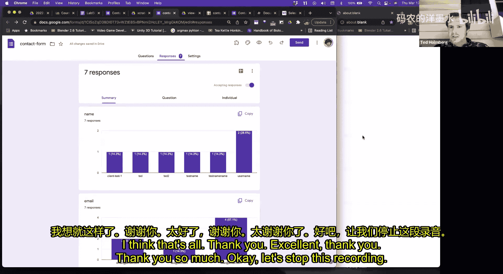