# 【全集】加州理工学院 高级Web应用 中英字幕 1080P p12 Lecture 12 - 模块化、异步编程 part1 -BV192zTBrEmu_p12-

Excellent， okay， so we we are going to start on lab 7。

So this will be the last of the current labs that we have that will focus on front end at least for now。

In this lab， we will build a quiz game that maintains a leaderboard。

So in here the big takeaways are we're going to learn what a rest client app is and to build a rest client app is going to be dependent on concepts that are related to HCtP and the JavaScript thatch API so we've kind of seen a little bit of this in the prior lab when we did the contact form and then we're also going to look at another thing that we haven't looked at yet JavaScript modules now there's a lecture series on JavaScript modules there's also a lecture series on the asynchronous ja and any questions you might have on the code base should probably be answered there but the modules will be a better way for us to start organizing our code now one thing about the modules is they do require。

U to host our page as on a web server and not use the file protocol。

 so we will require ACTP protocol so that。The general breakdown for this lab。

 we could think of it as effectively two parts， the we have part zero which is where we kind of break down the learning concept so that you understand the purpose of the lab not just to build an application but what you're supposed to learn in route to building that application and here again it's because we really want to hammer on these concepts of ACTP request that come from the client and in this lab we're going to pivot away last lab we learned how to use a post request to go ahead and publish or to write data。

 create data onto the Google form here we're going to use get request and we're going to use put request。

Alongside with the fetch。Methods inside a JavaScript and that fetch method is an asynchronous method so we use the asK keyword with the await keyword so if a function requires and uses in weight on a function call like on fetch。

 then it has to be asynchronous。And then we're going to learn a little bit about JSON JSON we it gets covered slightly in lecture nine on standard objects we look at the JSON object。

 it's a way of serializing our JavaScript objects in fact JSON stands for JavaScript object notation。

 but it's actually become kind of a dominant way of making human readable serialized code。

And so for that reason， it's used in other languages outside of just JavaScript as a means of configuring applications。

 and then we're going to look at modules。So those are all going to be the new things we want to learn how to use we're also going to talk about what it means to be a rest client。

And we're going to design a browser app that sends ACTP requests to RE APIs。So。

Once we cover goal zero we can start talking about actually building our application our application will be in two parts part one will be a quiz game and they'll be broken down across seven goals because we're going to take an iterative approach to building out our application where we do it a step out of a time just like all of our other applications and so effectively the first thing we'll do is we'll look at a preexisting rest API that we can request trivia questions from this way we don't have to go through the process of building our own sets of questions and answers we're going to find a service that does that and we're going request questions as we need them to go ahead and publish them into our game so the next thing we want to do would be to actually go ahead and send get request to that back to that web server so that we can get a trivia question and answer then we'll take the returned data which will be in the form of a JSON and we'll want to go ahead and display it into our our viewport。

On our browser using the document object model。Then once we get the question to display。

 we'll do the very same thing with the answer and then after we get the question and the answer to make it an actual game。

 we'll look at building timer events。Oh yeah。There we go we'll look at building timer events。

To display the hUD。And then we'll create a game over scenario and then we'll。

Build it such that we can have a next trivia question and then finally we'll have the ability to submit and answer and handle that outcome and then that'll give us at least a minimal viable product for our quiz game and then once we do that then we can consider building part two of our game where we actually focus on doing a leaderboard in order to get a leaderboard that's shared across every client not just the local client because that's going to be the goal here we're going to look at another API called JSON B that will allow us to store data on a effectively a remote server so that when anyone loads to our quiz page。

 they'll be able to see。Publicly the scores， the top scores everyone who played this game will have had。

 so these top scores won't be local， they'll actually be global。😡。

Then we'll build a main menu where we will display the leader board and then we'll have to make a request to get the leader。

Board play it into the Dom from a JON and then be able to put new scores into the later board and we'll manage that using events in HJTP。

So that's effectively the breakdown of this lab。And I'm hoping to get through part one today。

So a quick introduction on this lab。The preres you should know a little bit about HCTP protocol。

 which we've covered already in the prior lab and of course I have the lecture videos that are published on it as well in terms of software requirements we will have to go ahead and host our page on a web server。

And not just open it using the file protocol and the reason why is because we want to make use of JavaScript modules and JavaScript modules are not allowed to be opened in the file protocol。

 so we're going to start pivoting to testing our applications using web servers so there's one of two web servers you can use you could use either the Chrome web server right the one that we potentially installed so if I go here to apps。

I could go ahead and use this Chrome web server what I'll likely be doing for this lab though is I'll actually use node and node actually has a builtin module that's called ACTP dashash server that I can use to host a local server for testing as well so I'll show you how I can actually launch a server using node and that'll be a primer for when we start building our web servers in the coming weeks moving forward。

And again， this will just be a static server， so the only job the only role is going to play is to host the HTML pages and deliver that to the browser。

 so it's not going to be doing any kind of other backend requests except delivering web pages。

So the motivation for our lab is we're going to learn the Fe API and build a RE client and use JavaScript modules to better organize our apps code base our goal is to build a quiz game that requests trivia from a web server and maintains a shared leader board for all players the learning objectives that we're going to cover。

We're going to learn how to use the fetch API and send requests to what are called rest endpoint。

We're going to learn about RE client architecture for developing a distributed application by distributed application that means not all of the codebase exists on the machine that we're running since we're making request to some exterior service suddenly our application has a dependency on another application that's running on a web server。

 and so now we're starting to talk about building distributed application where part of our application is running inside the browser and another part of the application is dependent on an external web server to provide data into our client。

Eventually we're going to learn how we can build both the RE APIs。

 custom REpis and the front ends that will rely on that。

 and that's effectively what a full stack application will be。😡。

We'll make use of asynchronous JavaScript with the async awaits key words and we'll build async functions with that we're going to use JavaScript modules with the import export statements for improved modularity of our code base so really we're going to compare how we build this game to the platform game recall the platform game we had a ton of script imports we had to do and we had to do them in a certain order modules it going to make。

Building on our code base much simpler where we're not relying on the HTML to define all of our dependencies。

 and in fact we won't even care what order we do our imports to。

Will make use of a classless css library in this lab so this is an alternative to bootstrap or building our own there are other css libraries this particular one will just have provide a responsive style and you don't have to produce any class names to the elements it'll just kind of。

😡，A naively produce a relatively attractive style， so we'll see this approach to building out a responsive webage will look into scheduling and clearing timed events。

And then we'll use the document object model to implement a single page application。

 so we've already been doing this where instead of having multiple HTML documents we maintain the state of our document inside of our JavaScript environment。

 however， we're really going to take advantage of the fact that we now know how to use the DOM and we're going to build an application that is going to be very react like in fact this you can think of this lab as a primer to react。

And effectively， it's my plan， my goal that we will redo this lab using using react so you can see how similar it is to kind of create your own just see what react is doing the background。

So we're going to kind of create a lightweight version of react。

Our project architecture is we will have the quiz game。

 then we will have our HTML file right here our index on HTML file then we'll have subdirecties for styles and then scripts and our scripts directory all of our source code is going to go so we'll have like an app。

 Js file and HGtP Js file and a view dojs file and we can think of these almost as modules。

Where we can start dividing the responsibility of our code bases and then all of our components。

 all of the HTML that we'll eventually want to write to the DOm。

 we're going to create G files that are going to go in there that's going to represent those HTML elements that we're going to want to write or rewrite to our viewport。

Okay， so let's start the way we always start。Let me go and grab。嗯。对。Okay， let's see here。

 let me go to desktop let's go， let's just download it where it belongs let's go into。Yep。

And let's go into labs， let's save that and there it is。Perfect。Okay， let me delete this zip。

And let me rename this for the purposes。Of just quiz game。

And what do I have here so I have a readme in here quiz game in this lab you will build a quiz game with a leader board see the lab document for further details all starting files are contained within this readCO scripts components readme this is a directory that holds JavaScript functions that model and HTML component in the view organize all such components within their own directory to improve readability browibility of the codeb so just some some readmes in here and then here's the minimal viable product CSS file that will produce a responsive styling for us without us having to produce any class names now the disadvantage to this is that we don't we have less control but the advantage is we don't have to care about doing any styling whatsoever。

So we'll play around with that just to check it out it' fun to play around with different things with each lab。

Okay。So let me go back， let me close this。So I have my starter files so now let's go into the introduction on all the learning objectives in depth so we talked about RE APIs we talked about RE clients and we talked about that so a fulls app shares data between clients and servers via ACTP request responses a browser is effectively a rest client when it depends on an ACTP request for data so up till now we were just building in browsers application the moment our in browserrowser application starts requesting external data we can start thinking of what we're creating as a distributed application and we can start thinking of our browser application as being a client to a rest API or what I'll effectively call a rest client。

So a rest API refers to the data that a server provides a via ACTP request。

 so an HTP request effectively browsers request data from a web server。

 and then the common methods that we can we can go ahead and request data is either to do a gi。

 which is effectively like a read to do a put which is effectively an update。

 you mutate something that already exist， you could do a post which is to create a new thing。

That doesn't exist yet and you can do a delete which is to delete something if you've taken databases you would know these as cruD operations right create。

 read update and delete effectively the same thing as what a cruD operation is in a database is what you a request that you would make through ACTP to a web server。

An end point。嗯。So a RE end point， well we we will have a crash course in databases again。

 but we won't use the Oracle database for this class we're going to deviate out and use Mongo to give you something a little bit different than what you've already covered just to expand your knowledge base so if you don't recall that from database doesn't really matter。

But if you do， then you can see kind of where there are shared similarities on how distributed applications kind of work in terms of data management and data persistence。

In terms of the rest endpoint， the URLs on a server that listens to HP request and returns back data。

 so effectively the endpoints are just the addresses you go to for each in particular function you want to hit up。

So some APIs are very simple， they might just have one or two different requests you can make。

 some are very complex and you can make dozens or maybe even hundreds of different requests and they're all on their effectively their own URL。

 their own endpoint。And then fetchch is a synchronous Office API that allows our browsers to send ACTP requests。

Okay， so asynchronous JavaScript。What is that well JavaScriptscript provides provides nonblocking functions。

 which allows for other code to execute while our our asynchronous function waits for the process to complete so if this were a ja application you would require that to be multithreaded you don't need threads in jascript jascript uses the concept of essentially events and so what will happen instead is when you have an asynchronous function like a function that needs to wait on the server to provide data it will go ahead and。

Issue that and then wait for it to get back， but continue to execute the other instructions that it can execute until that response is delivered。

So this is an important feature for any kind of network related tasks so that your code does not wait until the server responds before proceeding to the next task so in terms of async A weight any function may be declared as asynchronous with the async keyword the statement whereby a IO some kind of input output operation occurs is declared with the away keyword so the weight is what we end up。

That's what we're waiting for， but if you have at least one weight in vocation in your function。

 then the entire function has to be called async。And then what's happening， how does this work。

 how can we actually get as synchronous code working inside of our code base while it's this concept of promise objects and asynchronous function returns a promise object。

This allows for the function to execute and then just to move on to the next task task the promise object is later resolved when the async function completes thereby resolving the promise what we do is we have callbacks that we trigger when the promise is resolved again it's a form of an event so when the promise resolve it triggers an event and then we have we bind a callback function that will do something in response to that event and we kind of saw that again last lab with the the contact form but we're going to see much more clearly in this lab。

So let's talk about our JavaScript modules， so modules allow imports between JavaScript files without having to link the scripts in the HTML so we can actually have JavaScript files talk directly to other JavaScript files。

This provides for more readable browsable and scalable code modules require the HTML to be hosted by an ACTP server though。

 so modules have their own scope that is not part of the global scope or function scope so what we've learned up to this point is you can have variables or data scope at the function level and you can have a scope at the global level now we're seeing that you can also have data scope in the module level and it only exists inside of that module so if you needed to get data from one module to the next you have to either import it or export it。

So a module is an eight。HTMLM document would link a script with the type of module。

 so we link them like we do normal scripts， but we have an additional keyword we have to apply in terms of import。

 the import keyword allows a script to access functions or objects and its module scope in terms of export。

 the export keyword provides an external access to functions and objects。

These are returned as anonymous objects containing all the exported functions and objects。

And then lastly default， the default keyword exports a single function or object along with its name Okay。

 so let's before we start this lab， we're going to do a mini crash course on JavaScript modules。Yes。

The difference between dot dot slash and dot slash is critical dot dot slash represents in your path being relative to the parent directory。

 whereas dot slash represents your path being relative to your current directory。Okay。

So before we move on， we're going to actually make sure we can do this， so let's create a。

Let's see here， am I currently in out us？So I'm not in  Quiz game。

 so I'm going to create a new folder。How did I create this folder， there we go。

 and I'm going to call it module Tester。Okay。So Els in here， Okay。

 I'm going to go into module Tester form。And let meat。Get that bigger so it's easier。 Okay。

 so now if I check。Here that Okay， so there's nothing in module tester yet。

 but I am in module tester， so let me just create。诶。Bard。js。Let me create a。Food do Js。

And let me create a。Index。hm。Okay， so inside Mike。So first let's go ahead and declare a module in HTML and use and I'll host this on HTML just a moment。

 but let's actually get this in there so let me go over here module Tester let's open these documents up so we'll open this one。

🤢，We'll open this one。And then we'll open this one Okay。

 so I bar I food and I have index on HTML and so on my HTML it's going to be super simple it's just an HTML element that has a head element and i'm going to import inside the head a script tag now notice。

The type that I'm declaring is a module。😡，And then the source is going to be F。

jfs and right now for the demo purposes， I'm just going to put them all in the same directory okay so。

Let me now host this on a server， so let me let me do clear me do LS yep okay so I'm in the director with the index on HTML。

 so I'm going to use MPM to execute a module that's built into node that's called HTP dash server。

So now what I'm going to do is I just launched an ACP server for my command line using node uncle it's at local address at port 8080。

 so let me go here into。And see if it brings me to an empty page and it does excellent。嗯。

And actually if I go and inspect。h the elements， I could see， yep， there's my head。

 there's my body inside of the head。And there's my console， Okay。

 perfect now the next thing I want to do。Is I want to go into bar and create an object or function and export it。

😡，So let's do that。So let's go into bar。And here。And justice has this out actually。嗯。这个。

I'll talk about what's going this， but since I have this。

 let me refresh my page really quick go here。Do will refresh， Yeah， okay。

 see I'm getting food to print。

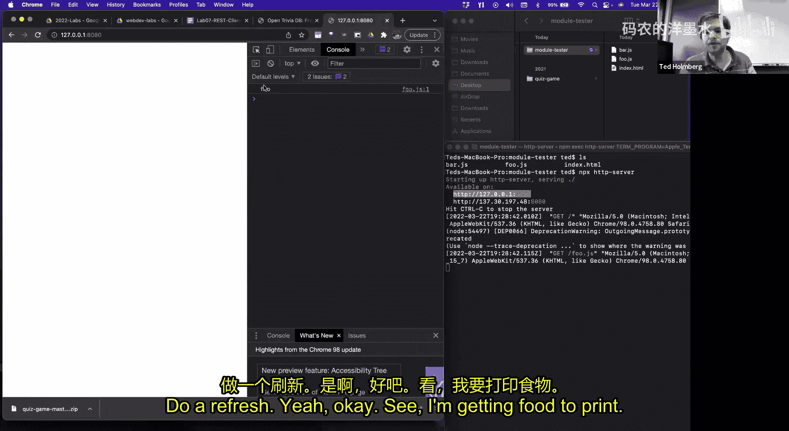

So the reason why food is printing is inside of food。js。

 I have this console log and so when I go and import this module it's going to execute everything。

 right？That any instructions that are just that on their own。

 just as it normally would when it first gets loaded into the runtime environment。Excellent。

 and that's because。Javascript supports an imperative paradigm in addition to a procedural and an object oriented in a functional。

 which means I don't have to put my instructions in any kind of structure。

 I can just put them on their own and they will execute when they get loaded。Okay。

 so we know that this works。So the next thing I want to do is I'm going to create a named object。

That's just going to have some properties like it's going to have the name bar type span and age zero。

 but then I'm going to export。And so since I'm using the default keyword， I'm going to。

 I get to name what the thing I'm exporting is， so I'm going to name it bar。😡。

Which is the same name that I used here， but it doesn't have to be if I it's going to export it with whatever name I put on this line。

 so here I'm going to export this object outside of this module。😡，Yeah。

So now what I want to do is inside of。MyF， I' want to import the default exported function into F JS。

So let me do that I'm going to replace this console log and what i'm going to do is I'm going to import bar the bar object that gets exported here。

 I'm going to import it here from and then I give it whatever the file path is。

Of the JavaScript module that I want to import so since they're both inside the same directory i'm going to use a relative path to the director i'm currently in and i'm going to import bar Js and so that's going to now get saved into a bar variable inside a F so if I do console log bar。

I should be able to get the content of the object that I defined in the other。So let's go ahead and。

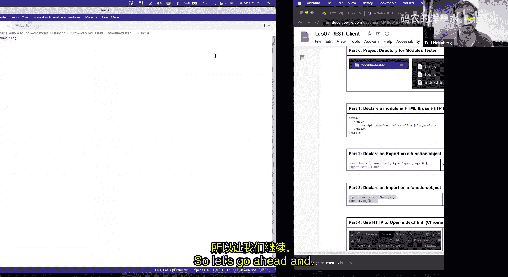

Go back here， let's refresh。And there it is。Notice inside my console I can see name bar types spam age zero now one reason why this is so fantastic is look at my HTML。

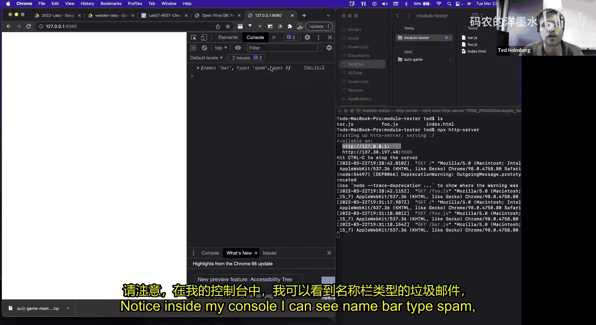

I was able to do that import without having I was able to get the data from Barr without ever having to update the set of scripts inside of my index on HTML。

 so think about how cluttered and how difficult it became to manage our platform a game as we grew out the complexity using script to build out such an application became rather difficult so we can rely on modules to give us that same kind of script to script behavior that we expect from a language like Java or language like C++ or a language like C sharp。

😡，So it gives us that an ability to create larger scale applications very flexibly without the overhead that we had in La four on the platform again。

Excellent， so this is no working， so i'm happy with these results。 so now I can go here， let's。

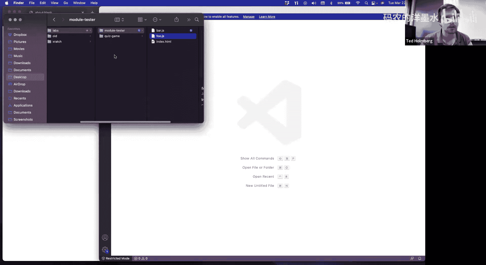

Let's see here I can。P。Kill my server。And actually now if I refresh it， you'll see。

I now can't reach that page。And let's go ahead and clear okay， that terminal。

Excellent so now we're ready to move on to our lab because we know that we can actually get our modules to work with the approach that we just did so now let me go to Ls i'm currently still in there so i'm going to change it to the parent directory but then go into quiz game so now there's nothing there's read me scripts and styles perfect。

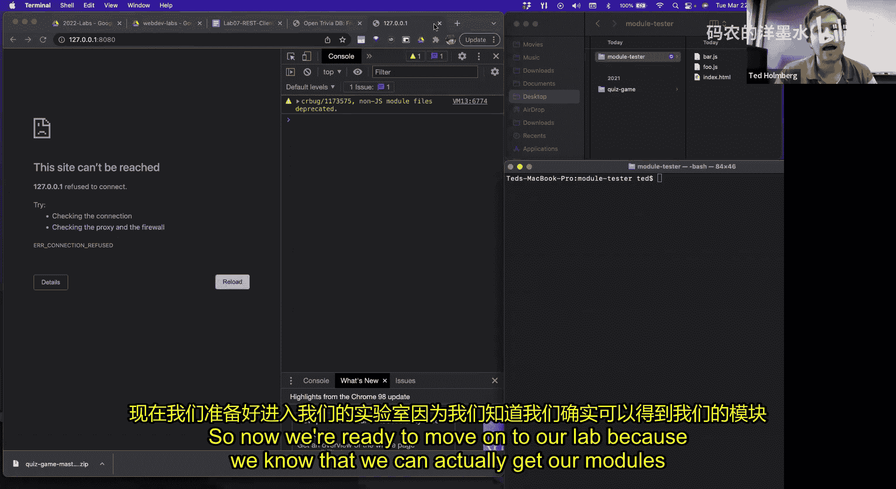

Let me clear that。Okay， so let's move to part one where we're actually going to build out our quiz game and so in this instance this is a small sample of what we're looking to kind of build out quiz game we'll have a time we'll have a score they'll have a category and a difficulty and a question and base off the question we'll have a selection of possible answers so it's multiple choice and we'll have the ability to skip so this is what we want to have done by the time we're complete part one。

So the way that we're going to do this though is we're not going to write all these quiz questions ourselves we're going to rely on this service called open trivia database it's free to use its user contributed trivia question database so this is an open trivia database that provides a completely free JSO API for use and programming projects used this API does not require an API key。

Many of them do so when you go to build your own RE client you might have to find a service that relies on API keys but this one doesn't you just use a URL with the search parameters and it will go ahead and return to you JSON with the data that you need so let's actually take a look at this I'm going to when we go there our effectively our API health for our API overview is going to be we have five different parameters the first is the number of questions you want delivered the second is the category for the question the third is the difficulty of the question the fourth is the type of question whether you want true or false or you want multiple choice and the last is going to be your data encoding for sending into the browser。

So their website allows an easy URL generator so that you select the parameters you want and it generates the rest endpoint for you and since the entire recipe uses get request。

 you can use the API in the browser just to test it out and so I give you an example here that we could test out or well just create so let's say we want one question let's say that we wanted to create a computer science question let's say it could be any difficulty let's say that it always has to be multiple choice and let's say that well use just the default encoding so we're going to generate that API and then what I should have when it does that。

嗯Where。There we go and then it's going to generate an API and then put publish it right up here。

 although I think I refresh them and get at least one let's do this again computer science。

Any multiple choice generate API， Okay， perfect， so now you'll say you have this URL。

To effectively this PhP application， and then you have the search parameter that's a key value pair that if I send the request there。

 it's going to send back a JSON into our browser， let's test that。And yep， there it is。

 I can see response code zero， result， category， computer science type multiple choice。

 difficulty medium， the question is what five letter word is the motto of the IBM computer company the correct answersers think the incorrect answers is click logic and Pix。

So we're going to have to know how to parse this in order to build our questions。

 but we can see every time we send this request， it's going to send us back this JON object。

And it's going to be a different question each time。And then if I change this parameter for amount。

 let's say I do it to 10。And then refresh oh。10 and then hit enter is's going to give me that many questions。

Excellent， so we can see how requests can be made to a back end web server。Okay。

 excellent so that's our first part learning how to use the API and so now I think we we've done that so the next part we want to do is well can we use a git request。

To the rest API。To go ahead and get some trivia data into our JavaScript runsheim environment。

So our just like all of our other labs， we're going to break this into an approach。

 apply and an assess， so our approach will be use HP get requests using using fetch to go ahead and request from the web server's RE endpoint to get trivia data into our browser so to do this。

 our first step is going to be to create HTML file that links the CSS and JS files and that has an element for view that we will use the DOM to access and then write into because remember this is going to be a single page application so this will pretty much be just our HTML we won't mutate the HTML after this。

Everything else will happen in JavaScript using the document object Okay， so let me go here so okay。

 so the first thing I need I need to create an index I you see doesn't already exist right LS notepe so let's create nope。

Right。Okay， so now I have an index on HTML let's actually put some contents in there so let me go to my quiz game into index to HTML I'm going to drag it into here and so we're going to put the following HTML in there so i'm going to create an HTML element inside my HTML element is going to be head element and a body element inside the the head element i'm going to link the style sheet which comes with the lab is' that MVP that will provide attractive responsive stlink without us having to apply any class names and then i'm going to go ahead and use this script keyword and i'm going to import this as a module。

And the module I'm going to import is the app module and so since I'm importing the app module I won't have to do any other imports from the HTML side of things I'll be able to do it directly between JavaScript files。

And then I'm only going to have one element in my body。

 I'm going to use semantic HTML to create a header element and I'm going to give it the idea of view so that I can access it from my JavaScript runtime environment and then any kind of update to my viewport will happen from the JavaScript and I'll use the viewI to do that。

So now I'm done with my index IDtl page。So the next step I want to do is I want to create a ACtp。

js file， which will be responsible for sending my ACTP request to the web servers。

So I will define an exported function that sends an ACTP request get request to a rest endpoint so let me grab this and then we'll see what well let me first make so let me do this a let me go into scripts。

clear that to LS okay， so all I have is components。

 so let me go and create something called ACTP got Js。Excellent， so now that should be a must。

My scripts directory， so let's go over here into the scripts directory there it is。

 and let's just drag that into my IDE and let's oh no don't want HTML。

Let's grab the contents of this and then we'll step through and actually see what's happening here。

So I'm going to create a function。assignment， a function assignment。

 so notice I'm using the keyboard export。When I define this function。

 that means that this function will be available outside this module if other modules of other scripts import it。

So in addition to that it's constant so I can't change the implementation of this function。

 function name will be called Sget request and then I'm going to assign this is a function assignment。

 this is going to be in a synchronous function and it makes sense it's going to be in as synchronous function because we're going to have to fetch data from some backend server that's what a Sget request is going to do we're going to pass it to URL and effectively we're going to define our function as a fat arrow function。

So。I'm going to we're going to pass in a URL and then we're going to give it an implementation inside the implementation。

 we're going to create an empty object that we're going to call options。And again。

 we're always going to prioritize using as little privilege as possible。

 so if we can label things as constant we will， and since we're only going to mutate the state of options but never actually change the reference of it。

 it can be constant。And then inside of options， we're going to give it a method。

Whi is going to be the HtTP verb that we want to send as a part of our request and we're going to send a get request。

Because this is a send get request method， then we're also going to go ahead and。Make a call。

 we're going to make a fetch call so fetch is asynchronous we have to go ahead and invoke it alongside a weight。

 which is why this method is as sync we're going to use the URL as our endpoint and then the option with the method get so we know which verb we're trying to to utilize and so this will resolve a promise object that will eventually become our response。

We're going to await for that response to resolve so we can do an await on something and it is trigger when it resolves and we're going to request the JSO from that so the response object will contain a JSO data and we can extract that JSO data as data as an actual JavaScript object。

😡，Using this method call and then we will store that in data and then we will return that data from this function。

Excellent， and again， all of these comments are right here。

So now that we've defined that function that can send an HTP Git request for an endpoint。

 the next thing we want to do is create an app。js file and we're going to want to import all of the exports from our ACP。

jS as ACP and initialize a trivia Git endpoint and the game state。Okay。

 so let's start by creating that core。App times app。js。嗯。Perfect。So now let me go here。

 I have my app Js， let's get that in there and here。So what I'm going to do here is。

I'm going to import everything。 Star allows me to import everything。😡。

And I can give it a label as HTTP， so it'll go ahead and put everything into HTTP。😊。

Essentially like an object ACP and I will go ahead and do that import from the starting at the current directory do/lash the ACp。

js script。And then inside my app， I'm going to define my get trivia endpoint as。😡，HPS。

 whatever the generator gave to me here， so I can look at it。

 this is this part is the URL and then this is the search parameter term the question mark amount equals one so one question and difficulty equals easy。

So always easy questions， but it can be of any type。

 and then I'm going to maintain the state of my application inside of an object。

 a empty object that we will call state。Excellent， okay。

 next thing I want to do is inside of App J yes I want to find a play function to play the quiz for now。

 we're just playing will just be to print the result of our get request。嗯。

So let's go into our app and let's actually do a function。So again。

 we're going to use function assignments。So play game will also be an asynchronous function iss going to be asynchronous because we're going to rely on send get request。

 which itself is asynchronous so notice how this can start chaining。

So we're going to wait for send get request to return back a response object well actually data right because if you remember if we look in here it gets the response but then from the response it gets the JSON which will be a JavaScript object and it's going to return the JavaScript object so we're going to wait for it to return our JavaScript object and we're just going to log that in to consoles out log now notice since I imported everything as this label I'm going to get that function available to me inside this ACTP object。

Okay。And so the next thing I need to do is we need to go into our。Our app script and on。Windows。

StartU， we are going to find a global start function to launch the app and have it execute when our initial window loads。

So let's go here。😔，There we go， so on window dotstar so when the window initially loads into the browser。

 this asynchronous function is going to get called。

 the reason why this is an asynchronous function is because well。

 play game is is an asynchronous function and play games in aynchronous function because it needs to wait for a response from this in get request method inside of HTT paper。

And then we will go ahead and invoke that， but that you do is send a request to get back some data and we'll just log that out。

And so we're going to add in the window and event listener such that when the browser loads。

We will invoke this start method and the start method is inside the global scope of our browser。

 Remember， the window object is the global object， So we're going to find a start method that allows us to start our game and the rest of our game will be。

Defined inside of our module scope。But since we're in module scope。

 the reason why we have to produce something in global scope is so that we can have a launch point or application because right now none of what we're writing is available inside of the window object so we need a starting location like a main method of sorts to launch our application。

啊。Okay， perfect。So let's see what we do next。We now can go ahead and test our test our other application。

 so we're going to use an ACP server， so again in order to do this。I need to。Host。

Just to MPX NPX will allow me to use the node package manager to launch an application directly from the terminal。

And then HTP server is a built in core module that's part of node and when I launch that I'll listen on local host port 8080。

 which I already have open here so let me refresh and actually。Actually， for me。

 it's not going to work well if。I'm not in the right directory， let me get into the right directory。

 Claire， where am I？I am inside of scripts， I need to be inside of。

The directory that has indexed on HTML， I am now。So I'm insidequiz game。

 so now let me relaunch my server and let me try to go ahead and refresh this page。And yeah。

 there it is。And look， at what I get inside of my viewport here， I got a response。

And inside of my response is a it's a。I got a response code here this is JO I have a results array inside of my results array index zero I have category entertainment film correct answers Robboop difficulties easy incorrect answers is blade runner Terinator and predator to and the question is which of these films is not set in。

🎼I can't quite read the rest of that， but you get the idea， is it in the future， I don't know set in。

It doesn't matter。You can see we got the question。嗯。

So we can move on to our next step our next step is well we want to display that trivia question to our do so the approach that will or to the viewport so our approach is well use the document object model API to access the HTML element that has the view ID or the ID view and set its interH with the question text so now what i'm going to do is since I want to manage all the author of my HTML。

Elements from JavaScript， I'm going to start creating JavaScript。A scripts。

That represents each HTML element that I want to render into the viewport。😡。

So I'm going to create inside that component subdirecty a new script that's going to be called question。

js， so let me go。Into here。Let's kill this armor。Okay。Okay。

 let's clear out all this so right now i'm still in quiz games so let's go into scripts and actually let's go into components。

See yeah， let's go into components。And let's actually create what's going to be called a。Question。

 J asked。And。Let us go here， Scs components。Question。 J asked perfect and here。

I'm going to define a function question and I'm going to define it with an uppercase letter because it's kind of it's effectively the functional equivalent of what a class constructor is so I could I could have implemented this in one of two ways I could have used the class keyword but in this application I want to familiarize you with a functional programming paradigm instead so we're going to build this application using a functional approach we're going to do that because react uses a functional approach it does give the option for a classbased approach and inheritance class based approach but it is more common to use functional approach when using GuUI frameworks frontend frameworks。

So effectively， we can think of this as almost like a constructor that creates a。HTMLt element。

It will take in trivia a trivia object and then I'm going to go ahead and use the string template that's going to create a heading element that's going to have a div and then I'm going to dereference from the trivia object the category I'm going to dereference for difficulty the trivia the difficulty so again this is from the data that we'll be getting from the object we got back from the trivia API and then we'll go ahead and then create a heading for element and in a paragraph tag we'll go ahead and dereference inside that trivia object that gets passed in the question。

And so that this could actually get used， we will then export and by using the default keyword。

 it will be labeled as questions， so we'll be able to export this question function so that we can use it elsewhere in our app。

Okay， so now that I have something that can alter HTML that represents a question。

Let's go ahead into our view and we don't have a view yet so let's make a view。

 so let me get into just the scripts directory so let me make sure let me clear here。Ah。

 what's going on。Okay perfect， so here i'm in the scriptripps directory I'm going to do LS right now app JS HTP JS components。

 so now what I want to do is I want to create a view dot jS does not exist yet。

Let's get that into our IDE and inside of our ID here we will import question from components so so again。

This will be from the current pathway that we're in there is a component subdirecty right this component subdirecty inside that component subdirecty is that question。

 js5 so for our view we're going to import that question function that allows us to author a question in HTML。

And the next thing I want to do is I want to go ahead and create a function inside of my view that I'm going to call render doll。

So let's take a look at this。So here I'm going to create a function， render dom。

It will take in an HTML element。Some kind of HTML。And it will call document。

git element by ID and it will grab the view， the element that has the view ID。

 and it will set the inner HTML of this right of our header。😡，With whatever this HTML is。

 so we're going to be so if we build。Our HTML tree。And passing it into render DOm。

 we'll be able to render all of our HTMLO and one giabbit dysfunction。

So this is what we'll rely on to be able to。Display HTML into our viewport now using JavaScript。

So then the next thing I want to do is I want to define an exported function that renders the play scene。

 so this is also going to be done in view。So let's go here。

 so here I'm going to create a exported function， so that means that this can get imported by some other module。

It will be called play scene， so notice I'm using like upper case letter I'm representing that I'm creating some kind of action。

😡，But it's a function， right， so it's going to take in a collection of property。

 so it's going to be an object。And so the implementation is I will destructure from the properties object。

 trivia data， the trivia data。And then I'm going to invoke the render dom function that I had just authored with the contents of me to effectively invoking this question。

 the question function with the trivia data now remember when I invoke this question function it's returning back to me HTML right so this is going to return back to me a string that is HTML and I'll just take that string and I'll label it inside of this string template。

And so then that will then get。Add it to the view elements in our HTML here since it's doing that in vocation there。

 excellent。So now what we want to do is we want to go into our app and import。

Our view JS so that we can control drawing to our viewport。All the view。Functions from our app。

 so here from the very top， I'll keep my imports together， I will then import VJS。And so now。

 instead of that console log， I'm going to go into。My play game。

 and I'm going to update that so inside of here。Instead of just printing that inside of play game what I'm going to do is I'm going to get the JSON results so remember there was that results array I'm going to destructure that so I just get the trivia data because we're only ever asking for one question right right here the amount is one so we're only ever getting one question so I'm going to dereference that that from the state。

 the trivia。And then I'm going to send that into the placingene and so remember what placingene does。

Is that's inside of view， right？Because we imported all the functions inside of view as view。

 so from view， we will invoke placeene， which will pass in these properties。

 which will destructure the trivia object and send the trivia object to the question。

 and then that's going to invoke the question with the trivia data that then is going to return back this string that is HTML values back to view。

 which will then tell that to render to the do。Yeah。And so now if I go and launch。

 so let me get back to。Make sure that I'm at the index HTML。And let's launch our。Our server。Okay。

 so now that I've my server launched， let's go ahead and refresh。

And look at that instead now I'm actually rendering category entertainment， television， difficulty。

 easy and a question in which state of America was the fresh prince of Bel Air born and raised and and if I refresh the page。

 it'll make a new request and give me a new question。Excellent， okay， let me kill the server for now。

And let's also。Clear it， okay， perfect。So now let's move on to three and three。

 we can now get the questions to display， but let's consider well。

Let's also provide the ability to show the possible answers so our approach here is we will define an options component for our HTML of a trivia options and use it for the questions component so let's go here so right now I'm inside ofquiz game let's go into scripts。

And cyto of scripts as components， we want to build a new components。

 which is an option for the player to selectax so let me create that and so I'm going to call that with an uppercase options do JS and again I'm using the same conventions that would typically be used inside of react as a good primer for react。

Okay。So now that'll have options let's go ahead and define a function that's going to return the HTML for trivious boolean options remember there's one of two options we could potentially have so let's go over here we have options let's open that here so we could either have a true false question or we can have a multiple choice nope no。

Okay， so let's go and get our implementation here。是。Okay， so on the instance of a Boolean option。

 we're just going to create a function that returns back。A div that has two buttons。

True and false and both of them will have this on click。

Where it's going to go ahead and evaluate a check answer。

And pass the message true and on click check answer false。

So you can see we're already handling something， or we intend to handle a user event when they click on one of these buttons with message passing to the same button checkgan。

Okay。So then the next thing I want to do is I wanted to define find another function inside of my options。

js that will turn the HTML for trivious multiple choice options。Now notice I'm not exporting these。

 these will be the decision of which ones I'll utilize will be made inside of this script in this module itself。

So here I'll create a multiple options。Function that given some trivia data。

 I will go ahead and I will deep I will。Use the spread array to break the incorrect answers into a collection of。

😡，Strings themselves and then i'll encapsulate that to build a new collection that is the correct answer along with the three incorrect answers so this will be a list with all the answers and I will call this options。

Okay。And then I will just tell the options to sort so that they're always in alphabetical order。😡。

And this way， the answer and the incorrect answer are all mixed up， we don't know which is which。

And then I will。Store those into A， B， C and D， this will return back an array so I can destructure the array and bind them to variable names using a destructuring call so that I get the first element in variable A。

 the second element in variable B the third element in variable C and the fourth element and variable D。

 and then what I return back is always going to be。

Some HTML so in this instance its going to be a div tag so notice we always want to contain our element so if there's more than one element that we want to go ahead and provide back we wrap it in a div tag so here we wanted two buttons but we didn't just return buttons we took the two buttons and we wrap it in a div tags we were returning one element so the idea is that we're only ever returning one element even if that one element contains a collection of other elements that you really want so here for multiple options we want to have four buttons but those four buttons will be nested inside up a div tag and they're all have and onclick event。

Where it will check answer we'll call this helper method called check answer。

 but here we're going to pass in whatever the value of A is or B or C or D into check answer。

And then we're also going to add that as text in between the elements， HTML elements。Excellent。

 so now the third thing I want to do is I actually wanted to define a function called options。😊。

That will decide which of those two things to do。So let's go so we have a boolean options。

 we have a multiple options， so my options will take in some trivia data and it's going to use a switch。

Statement based off of the type， so if the type case is boolean， then I'm going to return back。

A boolean option passing in that trivia data and if the case is it's a multiple then I'm going to return a multiple options。

 so this just makes the decision on whether I should give a set of true false buttons or whether I should give a set of buttons that have a collection of four different answers。

And then the only one I'm going to export is going to be the options。

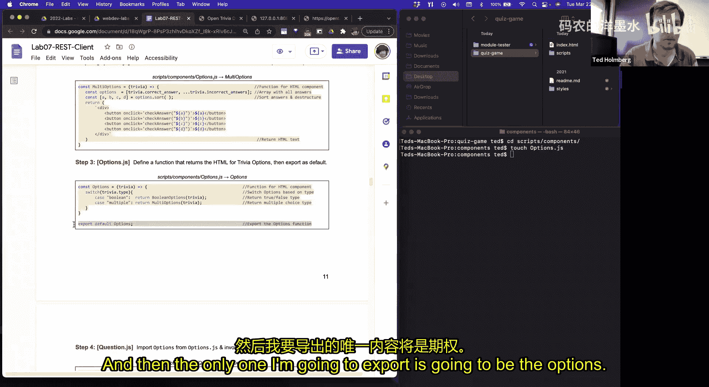

Because the logic of which one it actually gets is done internally inside this module so i'm going to export by default using the term options and options will be this so this is the one thing that gets exported outm when I import this module。

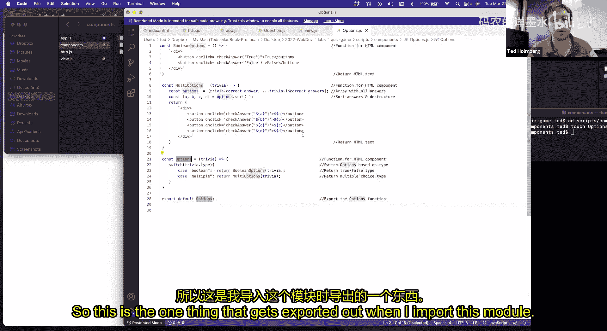

So now that I have that， let's go into our questions。JS file and actually import this options。

 so let me go to my questions at the top。And let's actually go ahead and import options。

And so now that I have options， when I go and have my function that produces the HTML with a question。

 I can add to it。After the question， I can make an invocation to options and pass the trivia that got passed into question to options to get the necessary options。

And you could see。I'm not going to have to mutate app or view or anything else by doing this I should get my questions alongside my answers alongside my question so in order to test this I should be able to just run my app so again I'm inside a components so let me go back to from back to scripts back to the root directory of my project into quiz game let me launch my app so NPX HTP dash server use node to do that。

And then， let me go into。Here and hit， and there it is。You know， the buttons don't do anything yet。

 but now you could see I have true or false。If I hit refresh。And。

And you can see that responsive design from that CSS that we're using。

And then we have multiple choice and then with each request I do， we could say， yeah， awesome。

 this is very cool。I get all of my par and since it's in multiple since it's in multiple， I'm sorry。

 since it's been sorted in alpha numerical order。I don't know which one is the right one。

 or wrong one based off of the ordering that I'm rendering。Okay， perfect。

 let me go ahead and kill my server。And clear， excellent。

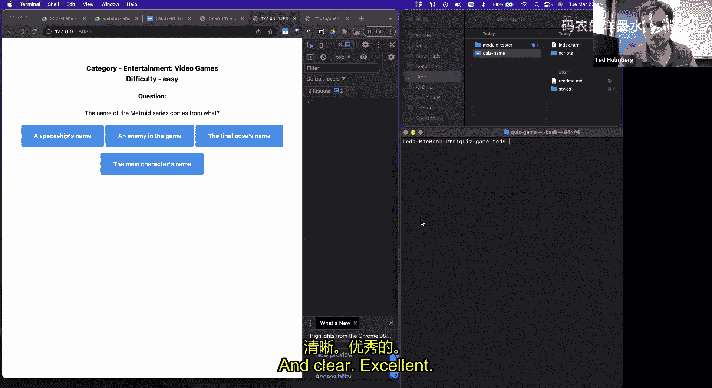

。So now that I can render questions with answers。

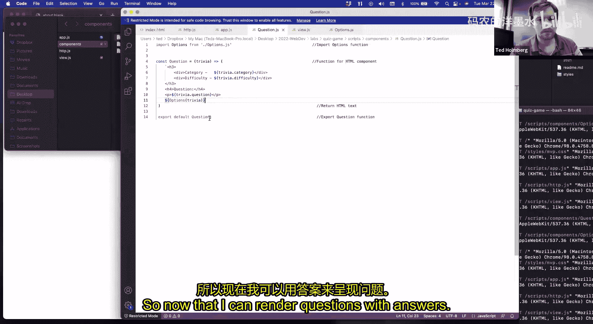

Oh， I guess I want to come over here。The next thing I want to do is I want to define a timer event。

And actually display that into my hood so I'm going to。

Refactoror my game state with initial properties right now， it's in an empty state。

So I want to give the properties of a score， so my score is going to start at zero。

 I'm going to have a timer my timer is going to start at 20 a。

Interval that I will set to null and then a trivia question object that I will set to null so these are just things that I'll manage over over the course of my application。

That i'll be able to maintain so here let's go ahead and set that so a score a timer my interval ID so that I which will be。

The timer event， so this allows me to clear the timer event。When I don't need it any longer。

 that's what the purpose of that will be and trivia is the current trivia object that I'm using。Okay。

 so now that we have a ability team to manage the state in our game。

 the next thing we're going to do is we're going to define a new function that checks if the timer is non zero and then decrements it and renders our placece So let's check that So let's go into our app Js and create this function。

 So we're an app Js I'm going to do it。Above the window dot starts。

 they're going to keep all the module implementation together。And so here。

 countdown is going to be a function。And so if inside of my state。

So I have a state object if inside the state I have a timer if the timer is nonzero so zero resolves to false and non-zero values to true。

 so if that's a non-zero value I will decrement timer and then I will tell the view to go ahead and play the scene with whatever the current state is so I'm going to pass play scene with this data here。

So we can start using that so the view can start rendering a hud。

So now what I need to do is inside of my app JS， I need to find another function to set the timer and schedule countdown interval。

And call the play function， so let's do that let's create a function that will create a game for us。

So here's a function that will create a game what it will do is it will set timer to zero。

 so it will mutate whatever the state of it is here and then i'm going to set interval。

I'm going to register， I'm going to schedule a timed to event。

 the callback function will be count down and it will trigger that every 1000 milliseconds or one second and I'm going to register。

This timed event。😡，As my interval ID， so this returns back in ID and I can use that to clear this from the scheduler。

😡，And then after I do that， I'm going to go ahead and invoke the methodth play game。😊。

So then what I need to do is inside of my start， instead of telling it to play game。

 I'm going to tell to create game instead。So here I'm going to update this inside of my Windows start to be create game。

And then what I'm going to do is I'm going to define a function。

Inside of my h so I haven't created this yet so i'm going to have to create a h and i'm going to since the h will be represented as a set of HTML elements i'm going to。

Put that inside of my components folder， so let me go into my scripts。

And let me go into my components and now that I'm in there， I'm going to create a new。Hud。

js file and so the responsibility of this is just to render the HTML contents that will make up my HUD。

So let's go here。And here。Perfect。And so this is just a function that given a value for timer and score is going to create a set of HTML elements。

That。Um，Actually。This should actually be inside a div。Itself。

It should abide by the rules that I stated。It。That any that we should strive to just return back one HTML element it requires multiple things nested so that it's an individual A HTML component where we're turning back that then has children elements okay perfect and then I'm going to export the h so the hD is just going to sayquiz game and then it's going have time and then whatever the timer value is score whatever the score value is and then it'll give a horizontal rule。

So then what I need to do is inside of my view is in addition to importing a question。

 I also want to import my HD so let's go to view and right now I'm just importing a question so let's also import the HD。

And so now that I've imported it， I can update。My play scene。

 so I'll just grab the updated play scene and we'll take a look at what is happening with it so let me。

So right here。Giveniving a collection of properties I'm going to destructure the properties as a timer。

 a score and the trivia question so remember what's getting passed from the app is the state object which has all these attributes and so now since I've destructured these I have them in individual variables so to the HD I will send the timer and score and that's going to render the HTML that I need and then to the question I'll send the trivia which will go ahead and render the question along with the answers。

And I see right now， just for those of you who are on the hour and 15 limit， we've hit that。

 but I'm going to just continue for this first part to be where I want it to be inside the video。

 so I will post the video and you'll have access to it。Okay。

 so now my render dom every time it's called。Or whenever play scene gets called。

 it will tell the render Don method to include。😡，TheCa of these two invocations。

 so it'll get the HTML from the hUD and then the HTML from the question so let me save that。

And that's it， I should be able to go ahead and test this out。

So again we have to use the ACTP server so let me go back to where the ind。

 ACml is so right now i'm currently in components because I made the HU last time I was at the terminal so now i'm inside of quiz game so let me use NPx to do ACTP depth server okay so now i've launched this so let me go over here and let's see what happens here a beautiful。

So I have。Game quiz and I have a timer and notice my timer is counting down。

And I have a scored zero and I have a question and I have a collection of answers we're getting something that's looking much more like a game now we're not handling everything we need because well look at this。

Our timer got to zero。And then it stopped。

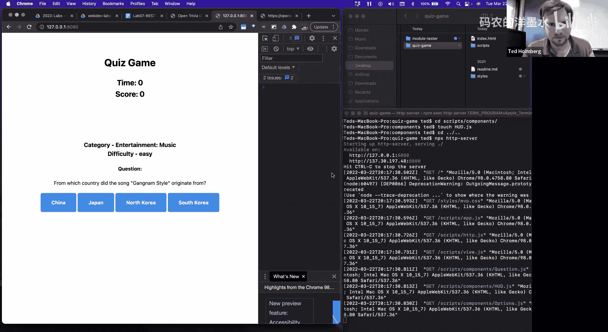

Excellent。And the reason why I did was because of the countdown here， right。

 because the moment it becomes zero， we stop invoking countdown。Right。

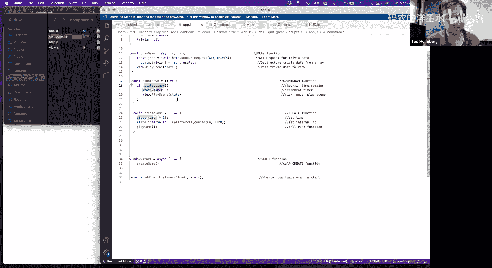

Okay， let me go and kill the server。I don know。Ctrol see that。 Okay， and let's clear that。Perfect。

So then the next thing I want to do is I want to display。

A game over screen into my viewport into the Dom if the timer runs out。

So at the time rever gets to zero， I'm going to game overs scene that has a button to start a new game。

And so in order to do this， I'm going to go into my app。

js and refactor my countdown to clear the time interval and show a game overs。

So here inside of our app， we have countdown right now it just sees it checks to see if it is not zero。

 but if it is zero， then what we want to do is clear interval with the scheduler that timed event that is our interval ID and then I want to make an invocation to our view object to invoke the game overs sceneeen and pass it the state of our game so we need to define a game overseen so let's go into view。

Let's going to our view Js here。And we're going to create an exported function。

 of course it's got to be an exported function because we're invoking it it gets invoked from our app module。

 so we need to exported from our view module so it has so our app module has access to it it will take in properties。

 the properties as you might recall is the state we're passing the state so I'm going to destructure the state as the timer the score and the trivia and then I'm going to tell this render dom function to go ahead and invoke HD with the timer and score。

And also to go ahead and produce a heading one element that's game over and to create a button that has a on click event it that can go ahead and invoke a start method and this will say start menu。

And so once I do this， I should be able to test this out right and see if I don't get a game over with the start menu。

So let's test this out。I'm still， I haven't changed directory so I'm still inside my quiz games so I'm going to go ahead and use NPX to launch a web server and then I will refresh my page here。

 it should start a new game and I will wait for 20 seconds to pass and see if my viewport doesn't update with a game over screen。

Yeah。And。A， beautiful game over startman， you know， again， it doesn't do anything yet。That'll。

Let's go ahead and kill this server。嗯。We will clear all that mess out of it。

And the next thing I want to do is。对。I want to display the next trivia to the dom。So。

When I want to offer the player an option to skip a question and request a new one before the time expires so to do this I'm going to create a new component that will be called the skip component。

So let's change into my scripts directory inside my script directory is components and I'm going to create a。

Skip do Js file。Perfect。And actually me grab the code and then we'll take a look at what this component is going to do。

Okay， let we go in here inside of components， we have S。

 let's get that into the IDE and so it's going to be a function。

That just returns a div inside the div is a button that has an on click that be that will invoke play game。

And it will be called S。And then I will export。And default call it skill。So that when I import。

 I can just import a skip。Excellent， so now what I'm going to do is inside of my view。

 I'm going to import the skip。So I can append that。There we go。

 so we're going to import the skip component。And then what I want to do is every time I goes to render the play scene。

 I want to render the hud with the timer of the score。

 I want to render the question with whatever the trivia date is。

 and then I want to render a skip button。So let's go into my play scene。Okay。

 and so after the question， I want to。Invoke the skip button and make this part of the string that we're passing to our render Dom function。

Excellent。So now I want to refactor my play game to be a global scope so that the event dispatcher also has access to it because remember so long as it's in module scope。

 we can't necessarily access it and so now we need to update this so that we can also give access to it to the global scope so that our event dispatcher can handle that so let's go to app。

And。App JS， let's go to app Js。And play game。 So right now this was its own thing。

 but we're going to change this so that the play game now can be。

Triggered by events or can be a callback function if necessary。Excellent。

 so now what we can do is let's actually test that out so let me go back to my root directory。

That has inside a quiz game。And let's launch the server。Yeah。Yeah。Oh， whoops not MPm。

 it's got to be MPX。Okay， and here we go， let's refresh。

And so now I have a skip button and when I skip。It gives me a different question。

So effectively what it's doing is it's just invoking play game again。

 but it's maintaining the state of my timer right so i'm not restarting i'm just able to get another question。

嗯。Before my timer runs out。Excellent， so I have one last thing that I need to do for this part of the game before it's complete。

 I need to be able to handle being able to submit an answer and then handle the results。

So what we need to do for that to work is recall that previously on site of our options。

 there was that check answer function that we were invoking。

 but we haven't done anything with that yet。So now let's define that check answer function to determine if the player is correct or not so we're going to do that inside of our inside of our app and so to ensure that our buttons have access to it now remember our buttons are calling functions inside of our global scope every time we're doing and onclick function call from there it's going to look at the window object for these so we're going to register the check answer function to be part of the global scope where the buttons are also located at effectively or where the buttons are going to try to invoke functions from because they don't have direct access to the modules。

The modules are on their own scope。So let's go into our app JS file。嗯。嗯。And inside of our app Js。

We're going to create this check answer function that's going to register this function as part of the global object and given an attempt so this attempt remember comes from let's go to options。

Remember， we have these on clicks that。😡，Or passing in strings either true or false or whatever the actual value of the answer is so what's going to happen here is thiss going to be when when the check answer button is clicked it's going to be passed in a string value so what we're going to do is we're going to from our state。

Get from the trivia。Data the correct answer because remember that was one of the values that we have direct access to and we're going to save that as the answer。

 and then we're going to check to see if the attempt is equal to the answer。And if it is。

 we'll increment。The score with whatever the value of the timer is。

 so you get a higher score based off of the time and then we'll actually add more time on the timer。

 which means that you can keep building a higher score。

 so we'll add to both the score and the timer the quicker you can answer it or the more timer you have the higher the points are and then we'll invoke play game which means that you'll get another question to answer。

Now， if you get it wrong。We will clear the interval and we'll invoke the game overs sceneeen so this is going to be a very ruthless game instead of decrementating points if you get it wrong。

 the first question you get wrong， you just lose。That's how we're going to handle that just to make it easy。

And then once we do that， that's it we we should be able to use the HTP server and。

And open our index HTML and see if we can play the game and get the correct answer。

 hopefully we can get the answer， I think I even have my my server so。Running。

 so let's see if I can just refresh with those changes。Okay， what's the answer。

 what's the name of a singer Frank Ocean second studio album which was released and I don't know。

 does anyone know the answer to this？呃。Oh， I got it right， look score eight and I got more time。Okay。

 and let's just do that， okay。Nope I got a game over that time wow。

 I was incredibly lucky I got 34 points just randomly clicking on questions。

 but look I was also able to go ahead and get a game over it tells me the time I had when I got the game over and the score that I had so I have what feels like a full and complete quiz game that I've built and I was able to build a rest clients inside my browser I depend on this open trivia API to go ahead and import these questions and then I've used both modules。

And I've used both modules and the DOM effectively to build out a scalable application that looks nice and clean like look at the quiz game here。

 remember what my index on HTML looks like， it's just this。

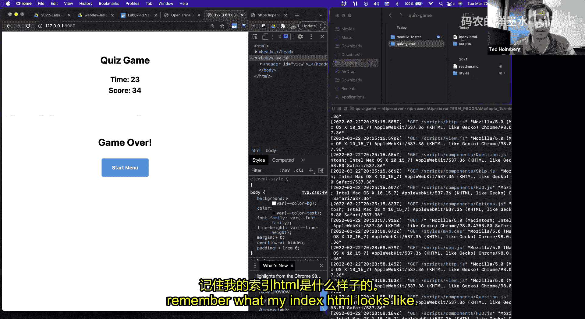

Subuper I never has it updated throughout the course of building out my application and all my components as I needed each new component to render。

 I could find it on its own and programmatically go ahead and insert that into my DOm tree and then just keep those all archived by themselves so all of the core logic exists in app HTP request exists in this module and all my viewing all the thing that gets rendered into my DOm goes here and then all the individual components that the view relies when we' go in here very clean looking architecture。

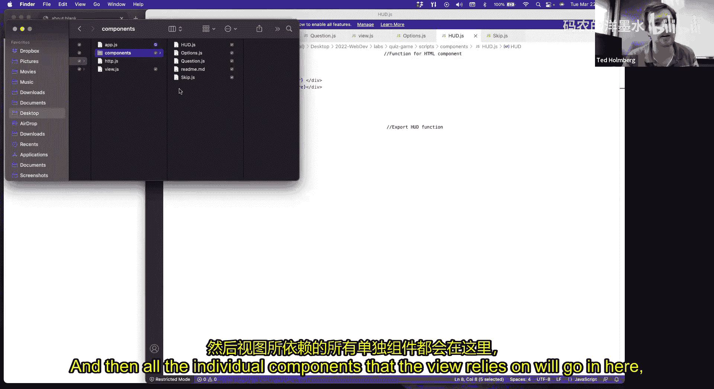

So that's going to be it for part one thank you for second around if you had to I guess for a little bit longer than we had and then on Thursday we're going to finish this lab out and do part two where we actually add a leaderboard a global leaderboard a public leader board where everyone who plays the game we'll share between the top scores and we'll look at using a different API use two different APIs in our game one for the trivia questions and then the other to be able to go ahead and store the data for our leaderboard so before I end today let me just ask does anyone have any questions about what we did。

And if not， then I will go ahead and Okay， great， well then I will go ahead and end today's lab video thanks everyone for。

f。We're being part of it。

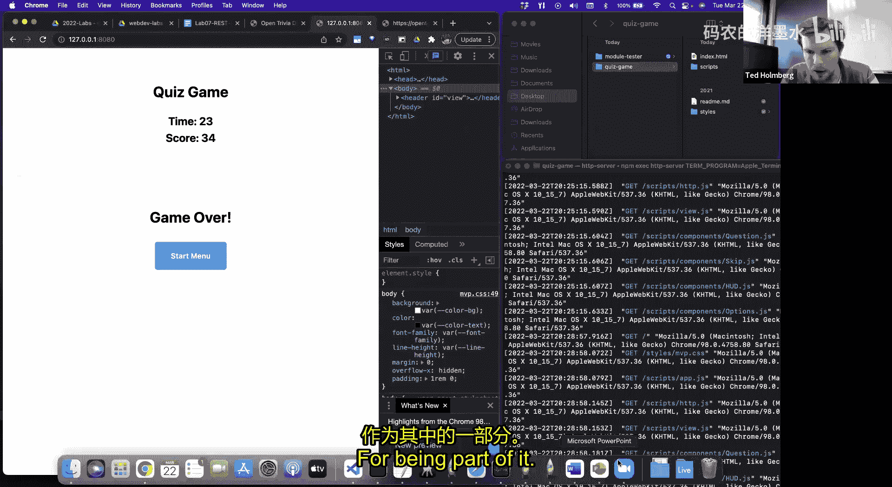

top。