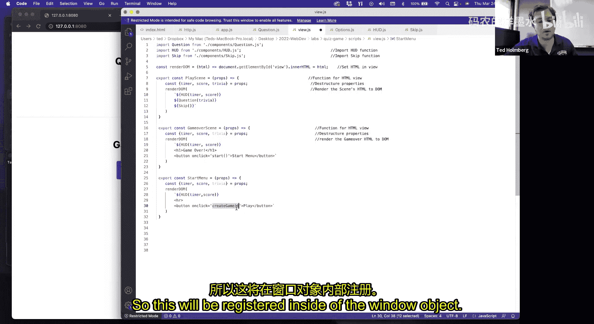
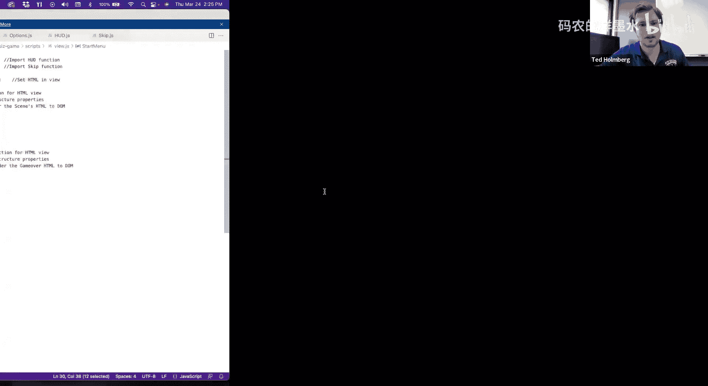
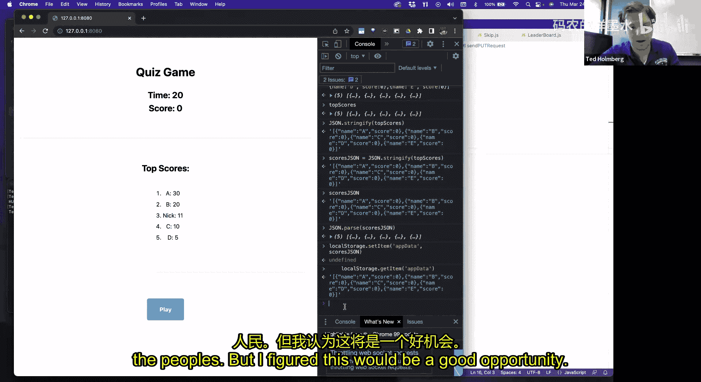
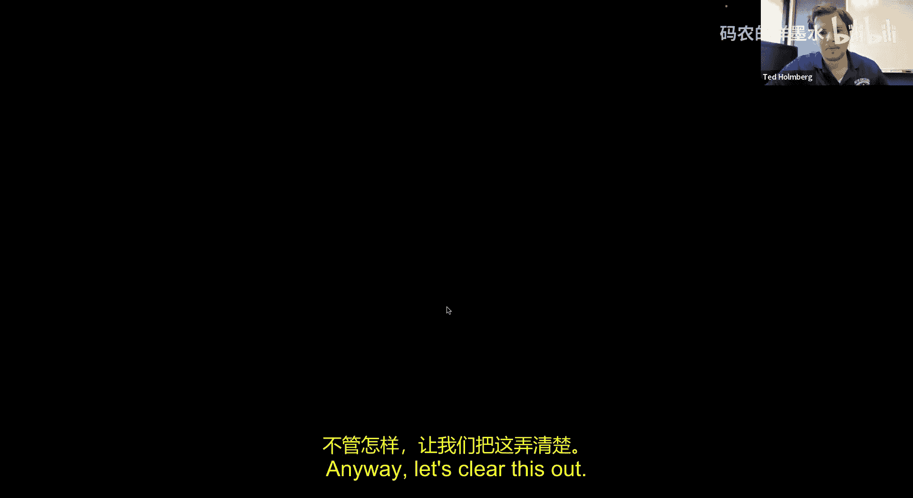
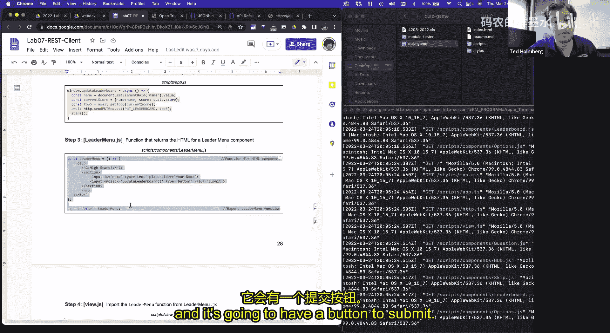
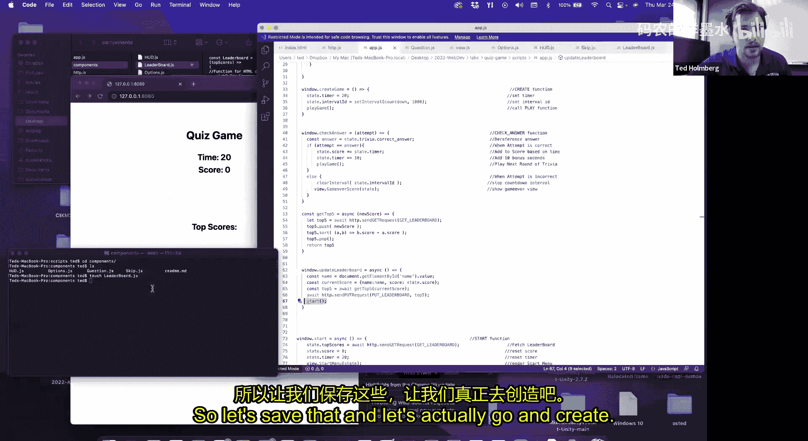
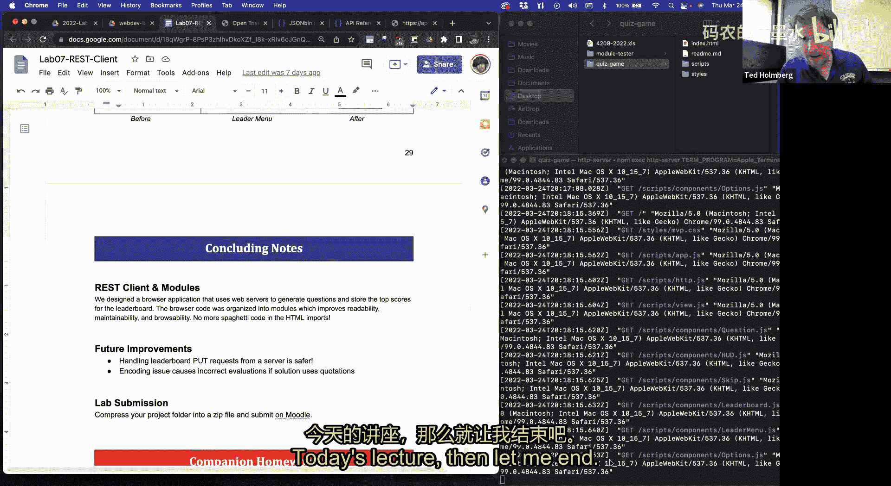

# 【全集】加州理工学院 高级Web应用 中英字幕 1080P p13 Lecture 13 - 模块化、异步编程 part2 -BV192zTBrEmu_p13-

Okay， in today's video lab we're going to continue in lab seven， part two。

 so last lab we finished building out the base component of our trivia game， our quiz game。

And so let's run it really quick so I'm going to be in the director the main directory quiz game and just as a reminder of where we last left off let's go ahead and run our application I'm going to use node the node package manager to execute this built in module as part of the core module of node which allows us to host a ACTP server right to our local host and so as long as as inside of the B terminal that includes my indexside HTML the launch point of my of my web application can go ahead and just run that perfect so now if I navigate to this address。

Which is local hosts at 8080 let me go over here， this is where we last left off。And so we have。

Our header here our countdown time where we had a score that we implemented we're using a rest API to go ahead and request a question with a set of answers oh I ran out of time so I get the game over this brings me back to the start menu which is going to ask me another question I could skip to another question that I might know the answer to right this is。

And if I don't answer a question within a certain amount of time。

 I get a game over if I answer the question right， I will go ahead and get a score。Excellent。

That go and then。Now notice right here， there's a slight bug。

 but I think we'll correct this in the second part where when we start a new game。

 our score seems to say carry over from the previous game。

 but we're going to correct that in part two because part two。

 we actually want to implement a leaderboard for this。

Where when we launched into the game instead of launching into a question let's see what it's going to look like。

 let's look at the mark up here， we're going to want to produce a leaderboard in order to do this leaderboard we're going to go ahead and we're going to use Git request to go ahead and get the state of the leaderboard but then we're also going to do put request since we want the leaderboard to be public to every user and have all the same names for every individual user this means that the leaderboard data can't be stored in the individual client right it has to be stored in some publicly available space so we're going to use another rest API that that effectively let us use。

Be used to store Jsons。And again， we'll do more things with the DOm and events。

Inside this part two and this is just a lockup so this is what our main game starting board should look like where it's going to have like the heading h with the quiz game and the time of the score and then we'll see a top set of scores the top five scores with names and then the score that they achieved。

And then we'll have the ability to go ahead and then play and if that play button that then launches。

 I'll said to a set of questions。Okay， so。Moving forward with this implementation。

 we're going to use a simple and robust JSON St solution， so there's this service JSON bin。

Io that provides a simple rest interface to store and retrieve JSON data from the cloud。

And so this is really designed that their own kind of phraseology for this is it's designed to help developers focus more on the app development by taking care of their database infrastructure but without having to do a lot of database setup stuff so think of this as a baby database of sorts。

So a quick summary， we're going to use JSON bin to provide a free JSsonN hosting service for public or private data note that any data available from the browser should be public right never use private keys in your browser code because it's always viewable from the browser you can always like use the inspection tools a dev tools and see anything that's available there So if you do have things that are like API keys and they're supposed to be private keys that's one place you're supposed to store that is your server because your server is not viewable your server is not a transparent box that can be inspected into your server acts kind of like an obfuscated black box that you can manage all private data so always understand any data that you send into the browser。

Expect it to be publicly viewable by the entity that you're sending at anyone who's using the browser at that time。

😡，Okay， so a quick overview if you wanted to see， we can copy this URL Jsonbin。o API reference。

 let's take a look at where this brings us。So here we could see oh， they have a 3。

0 they've doublecated version two by February 28th just recently。

 so we'll see if that affects us or not always nice when they update the Es so whenever we go to manage data we potentially want to use those cru operations and notice they actually order this to spell out cru if we take the first letter the ability to create。

Data， the ability to read pre existing data， the ability to update pre existingist data。

 the ability to delete preexist data。So these are the。

General broad operations you do for data persistence。And so here they they have things on schemas。

 other APIs they offer if I go and click on create for instance， here they'll show me the easy ways。

 the route like the route URL then the route I need to go to and the request site would be opposed they show me the things that I could put in my request header。

They show me the different content types。So the content type we used before used a search parameter in lab six right when we were sending form data to the Google form to go ahead and be appendant。

 we were able to just put that encode that into the URL。

 but in this instance we're going to have to exchange data inside of the body of a request object and the benefit of a request objects when you're using a post or put or create is that it can have a body and just not a header a header is visible to any entityity that that request is passing through so it's viewable but if you have data that you want to protect if you want to hide from from。

Middle entities from when you initiate the request until the web server gets the request you want to encapsulate that in the body the body is nonviewable and so we're going to treat the data that we're passing along as being effectively private to our application so we're going to start sending it into the body of the request using a JSON again all of these concepts should get discussed in the associated lecture as well。

Okay。So if you wanted to see just the basic API for being able to create or read or update or delete so that you can use this in more meaningful ways for other applications。

 I link you to the API right here。So。Okay。And so。Let's say here。

 but effectively you could break the API into two different parts。

 you're going to have the Bs API which is going to allow you to create which you're going to use a HCP method of posting to create you're going to use Git to be able to read preexisting data from the Bs the JSON B API you're going to use a put method to be able to update preexisting values inside of there and then we're not going to worry about really。

Delete。So again， private and public pens bins or use this。

API so forget and put actions do not require or key， so they're safe to perform in public code。

 however， post and deletes。Actions require a key and so it's unsafe to perform in a public code so our code that we're deploying in our browser is public code so we want to avoid putting our API key in there。

 so you're going to notice we're going to focus exclusively on and this is I think this is inside the the beginning here we're going to exclusively focus on then using the gett and put request because we can do that without issuing an API key which means that we will generate we will create our JO inside of their web application from the Gigo when we log in so that it preexist。

And willll only ever mutate that one piece of data so that we won't ever issue a delete so notice。

We won't use any operations that will require the API and that way we don't have to reveal it。Okay。

 in addition to that we're going to look at the collections API。

 so using the collections to create collections create API。

 you create collections to group the records， which later can be fetched using the query  builder。

Okay， so a quick view so we should be able to open this in the browser because this is a gi request。

 any gi request the browser can even do for us right inside of the viewport when we put the URL in the address bar。

So。Before I look at this， let's take a quick look at this dashboard。

 so when actually let me get go to the very beginning。

Of this service so jO then doio oh no not dashboard I want so when you first get into here yeah you can see since i'm logged in they have the ability to add to a collection and you can do all this typically let me see what it looks like if I go into an incognito window。

And let's go to the initial address， JO then。o so I'm already logged in。

 but if you you haven't created an account yet。It's gonna to give you the option to get started and to be able order to log in if you already have I think when you go to get started they give you options so that you can actually log in with a preexisting account I log in personally with my GithHub account so I'm authenticated and author my GithHub account to go ahead and use it as a validation tool to access a user profile inside of JSO bin。

o so I can start generating my own JSONs to store in their service。Yeah。And just so you know。

 let's take a look at the pricing and you' see there is a free plan and that's exactly the same plan I and a free plan。

 you know it restricts you to 10，000 requests we're not building any large scale apps。

 it's just you know for experimental testing portfolio purposes so this meets our requirement and you know it's pretty bare bones but it allows us to do exactly what we need to do for lowscale projects but this is not obviously a service you'd want to use the free plan for for deployed service。

Excellent， okay， so when I go into my actual dash you'll see that I have the ability to inspect the bins I've already created。

 I want to say let's see here looking at the ID number for this right here it ends in a CO2 so let'm me go back to my dashboard So this is the one that we'll be using in the lab but preferably you will create an account and make your own general bin I give the the the instructions on how to do that inside the lab so that this exists and then you can go ahead and and view it。

Let me get the link here， I can view it here。🤢，Oh， I guess let me click。Yeah。

 so I can view the initial content。Of it here now one interesting thing is every time a put is done to it。

 every time there's a mutation to the data it tracks it。

 it does version controls so there's 28 different rights to this bucket that I have at this particular ID so if I click on that I could see version one and then version2 and then version3 and I can go all the way to the most recent version which is 28 to see the current state which is actually being used by the application。

And actually I can also access this by just the pending latest so let me show you and this is what the link is so if I go to this URL this is the endpoint if I go to this URL and this be for bucket and then the ID of the bucket I want to access and so here let me get rid of the last so here this would give me the first version of the data。

 but if I want the most the latest version I could just do slash latest。

And this will give me the latest version， version 28， and if we mutate it again。

 it will give me version 29。So this is going to be the link we pretty much want to use to go ahead and read the state of our leaderboard form。

And again， if at any time what I'm presenting， you have questions on。

 just go ahead and drop it in the chat channel and I'll try to address it。

But I'm Trust trying to give you a quick intro into the service we'll be using to store our data。

On a back end service so that we'll be able to get this JO at any time so one thing you should look at this JO is it's actually an array right so we have an array inside the array is a collection of objects and I actually have five objects one two。

 three， four， five each object has two properties a name property and a score property。And notice。

They're sorted by scores， so the highest score is the at index zero and the lowest score is at index4。

Excellent， okay， so here are going to be the steps to create your own JO bin you would create a free account。

 I would suggest to use in your Github account。Then you can go to your dash I just showed you my own personal dashboard there should be a create new button。

 let me see if I can't at least show you what that looks like let's go to the dashboard Yeah right here they have a create new button where if I'd select to create new。

I could。Go ahead and add to a collection I think I have mine defined at the API collection。

You have to generate a collection for your data to be a part of and you'll see。Here when I did mine。

 I had it as part of。It API collection。And then I can go ahead and。Enter some valid JSON data。

Make sure to hoggle it to be a public bin so again let's go back to my dashboard and right here you see it has the option to be private or public you want to be public because if it's private it requires a key we don't want to use a key so we want this to be publicly available to from our browser code。

Then we would actually select to create and then JSO then is in posted and they will have an access URL field to get its been so here they'll create。

This URL that you can then use just like I showed you that has the endpoint using the ID that it's going to create for you to access that JSO so this allows us and again JSO just stands for JavaScript object notation there's a lecture I talk about it I think I talk about JSOs inside of the standard object I think that's lecture nine standard objects。

You could find a lot more about JSON's and I define JSOs much better though on my series of lectures when I talk and introduce Mongo D pig。

 so if you want to jump forward and just watch a little bit or jump to the points where I talk about JSON and those lectures you could do that because those are all available to you。

Excellent， okay， so now that we have an understanding of the backend service we're going to use to store our leaderboard and how our leaderboards effectively just going to be an array of five objects where each object contains a name and a score value。

 then we can start talking about actually implementing this。So。

What I'm going to do is for my first goal for building my leaderboard。

 I want to display a main menu to the dome right now I don't have a main menu that I go to so let's build one so we can eventually put our our board into there。

So we're going to define this as an approach apply approve set of sequences our plan our do and our test us like all the other labs so for our approach in this goal we're going to define a main menu seen in our view and then render that to the do so we're going to go into our view JS and we're going to add an exported function that's going to render the start menu into view so let's go into view JS。

Go here， let's go here， view Js， perfect， and I'm going to add。

A new function that can be exported presumably so that it can get imported by app to invoke it whenever the app needs to update the view to be the start menu versus the game overseen or the play scene。

 so our start menu maybe I should have called it start scene to be more online。

With place scene and game overseeing。Um。I'll keep it the same so it's in line with what the documentation is anyway so let's see what we're doing here so this is in a exported function I prefer to use function assignments as opposed to function declarations。

I use fat arrow notations to define my function， my functions is going to take that props a props object。

 so this is just a design pattern you've probably seen so let me describe this this is a common design pattern that you'll see in either JavaScript or in Python。

So this is a mechanism that gets around the limitation where we don't have the ability to create overloaded methods where we can create methods with the same name but different element types or different parameter lens so remember what both Python and JavaScript allows us to do is to have default values so one way to work around that is you define functions that take in a single object because the single object can itself have a variable number of values that's the advantage of a loosely type language over a strongly type language so whereas in Java if we were to take in an object it would have tot be a welldefined object。

😡，Well， unless it's a abstract class or it's an interface。

 in which case you can use the same reproachion Java。

The object we can pass in here can have any number of。

Properties and so then we could just dereference the collection of properties any one of these functions need so here I can have this one attribute。

 But the first thing I do that's getting passed in as this parameter is Istructure from properties three different values Now in reality the value of properties when i'm using this inside of my app do js file is going to be the state remember I have this state。

Property here， which is just an object that contains all of the states of my application。

 my web application。😡，So score， timer， interval ID and trivia or all。

Stateful things that get defined and again this is this is we're using for this application a functional approach。

 so functional approaches still have states that it has to manage over just like object oriented approaches。

 but instead of encapsulating the state across a collection of objects。

 we encapsulate our state and a data store of sorts some place where all of our state resides at at one time。

So then in actuality we would pass that as the object into our view where we can then destructure it and then get access to the value of timer。

 the value of score and the value of trivia Now even though we're de trivia in this instance we don't need the question and answer so the only thing we're going to be using is going to be the timer in the score notice what we're doing here is once we get access to those properties we're going to invoke the render dom methods and this requires a string to get passed into it so we're going to do a string literal that's going to dereference and invoke the HUD function that we import it from components and remember that just is going to print out the first half here quiz game time and score and then and then we'll do a horizontal line and then we're going create a button that says play and then we'll have an on-click event that well go ahead and invoke as a callback function。

Whenever theres this button is pressed or clicked on to invo create game and this create game since it will be triggered by the event dispatcher will have to be registered in the global scope and not the module scope。

 so this will be registered inside of the window option。

Excellent， and so let's save that。

So then the next thing that I'm going to want to do is I'm going to want to go into my app JS file and actually refactor our start method to set the score to zero and and have the view render to the S menu we need the score to go to zero because right now we just keep carrying it over each time we start a new game。

So that's going to correct that issue since we intend to have a leaderboard so let's go to the app and let's go to。

Was it？Our start， yeah， when to start。So let's go into start right now start just creates a game。

 so instead what we're going to want to do here is we're going to want to set inside our state the score to zero whenever we start the game we're going to want to set the timer to 20。

And we're going to want to go ahead and tell view to invoke that start menu。

Now that we have a startment。T this over。Perfect。😊，And again， we're passing it that state property。

Okay， so now that we've done that， the third thing we're going to want to do to achieve this goal is we're going to refactor our create game method into being globally scoped so that the event dispatcher may access it。

So we already had a create game right here， but right now it's only a module scope and since I want to be able to invoke this from pressing a button。

I'm going to have to now register it as part of the window object。

 so remember the window object is available to me。Globally。

 so I can always register a new property by just doing window do create game this is a new property and then i'm doing assignment which will be this function。

And again， this is one reason why I've been preferring doing function assignments as opposed to function declarations。

 so if at any time I have to change membership of this function。

 I could just preface whoever owns this function with the dot operator。

So there's not a lot of refactorctory that has to be done there。And again。

 another advantage of using function assignments over function declarations is all declared functions are hoisted。

 whereas function assignments are not。And again， Hoistton has talked about in I want to say the first basic JavaScript lecture that we talked about。

Okay so now that we've updated our our create game method。

 we should be able to actually test and when we got to test this。

 we're going to use our ACP server they'll have mine launched so actually I should be able to leave it launch this entire time in the background and I should be able to refresh my page and every time I refresh the page any save changes to my index H should then be served into my browser automatically so I'm going just keep the server running in the background and so let's open the index on HTML and our game should actually start to a starting menu so let's see if it does that so everything looks saved I don't see any dots let me go over here refresh and there we go we now have a starting page that we go to quiz game time 20 score0 I'm gonna hit play and play launches my game into what was traditionally just play so now I starts the timer it gives me a score zero gives me a category difficulty easy Greenland is almost。

Big is Africa true nope and so I fail so it goes to start menu and the start menu now brings me to the start like play again right so this is all working very beautifully right I now have a launch point from my application and ideally I can put the leaderboard between these two horizontal Lawrence right so that whenever we restart to a new game or whenever I initially launch in my game I could see who the top five people who played it were。

So。The next goal i'm going to have is let's issue a get request to our web server to that that to the rest API that's going to allow us to manage our leaderboard data to get the leaderboard data now we already have data for a mock leaderboard set up we should at least have some created our initial data set that。

For。All intents and purposes is this and I actually give you the ID to this so while you're building it out you can test using mine。

 but I would prefer for you to go through the process and make your own。

But if you need to debug at any point， you can use my key as well。Okay。So。Again。

 for this goal for our approach， we're going to use an HP Gi request because does we want to be able to get the data。

 but it also doesn't require an API key either to request the web server's RE endpoint to get the leaderboard into the browser。

Jm over use a get request on the web server's endpoint， yes， that's what we want to do。

Okay so in order to do this we need to initialize some constants for the JSON bin ID and the ACP get endpoints again I like to define these constants because if I have to refactor my code or if I have to ever change any of these because let's say the API changes I know where to instantly go in the code base to mutate these endpoints or my IDs or anything else it needs to change so that my code is as flexible as possible that way I don't have to hunt in various functions that rely on this data if it were hard code I try not to hardcode anything my functions and use named constants instead to represent that kind of data it's a good software engineering in principle to live and die by。

Okay， so let's go into our app and we're going to assign these constants along with the rest of our data。

So let's go here into our app， so at the very top here I already have this one name constant for being able to have the end point to get trivia。

JaO so here in order to get our leaderboard， I don't need the trivialvia one again。

 let me delete that。So here I'm going to create a constant that's going to represent my B ID。

And so yours should be different than mine。And then here I'm going to create a get leaderboard URL。

 which is going to be the string template right that we saw before and the part that will be different that is not hardcoded would be whatever your particular bin ID is so just to make this as readable as possible using a string template I can then embed the bin ID value right here and so that'll be the actual endpoint that I'll have to hit with an ACTP request to be able to get the data I'm searching for from the web server。

Okay the next thing I want to do is I'm going to create a local variable inside of my state so I have some some new state I want to manage it's going to be a collection so I'm going to use an array and I'm going to call this top scores so let's add this into our state object。

For our data， so here I'm going to create a comma and add a new。

Key value pair top scores will be the key and it'll initially the state will be a empty array。

 but when I finish requesting that data， that's where I'm going to store it inside my application。

That's the intent of that。Okay， then the next thing I want to do is I want to refactor the start method inside of my app JS to be able to get the leaderboard data from the server and display it into the console。

So let's go ahead and let's go into that start method。That's going to be。Right here。

 so now i'm going to。Go into my state。And I'm going to do an await。😡。

And then inside of ACTP I have the S get request method that I already made we already created this let's actually take a look at this so inside this module I have one method sit can send a get request now notice the beautiful implementation of this function we didn't hard code it just to get a trivia request when we first made this we made a very flexible such that we can pass any type of URL so now that we have a different endpoint we can use the same function because we created something that was pretty flexible。

So we will send at the URL that we want to send the request to and we're going to do the same thing we would normally do for any get requests we're going to create。

A new kind of parameter object that will have the HP method we want to use。

 and since this is defined as sending a gi request， we're going to add that method as a gi。And then。

We're going to send， we're going to do a fetch to the URL that got passed in with the options object that includes the method type that we want。

 either get or put or post or delete。😡，And we will await eight response objects and recall here。

 we would then when we await the response， once we get a response。

 we will then use the response object of the JSON method on there to pull the JSON data that's embedded into that response and the body of that response and then when we get that data。

Read into memory， we will then return that back to the invoking function。

And so remember this was an a sync function every sync function has to be invoked with the weight keyword and since now we're using a weight inside this function。

 it itself also has to be a sync， but it was already a sync so we don't have to do anything special to add with that but just keep that in mind anytime you have at least one call of a weight to wait for an sync in this process we have to have that function that the weight is defined in as a sync itself so here we're just going to use this method we've already developed last in the previous video lab video and we're going to use that new URL endpoint that we just created that get leaderboard。

And so that's going to return to us。The data， the JSON data it's not JSsonN anymore it's now in memory JavaScript objects。

 so actually it's not just a object though it's an array that contains five different objects and I'm going to bind that I'm going to assign that into the top scores。

That is inside a state。And then we're just going to console log that just to make sure that I got that data from some back end service into our browser。

 into our client side of our application。And so once I do that。

 I should be able to test that out so let's go ahead and again we'll launch the HP server if it's not already running。

 but I started running it earlier and I haven't killed it yet， so I'll let to continue to run。

I'm going to open the index on HTMLL file and let's go ahead and inspect inside of our dev toolsol to see if we get something that's stored inside there now I'm not going to get what's here I'll get something now so I'll get whatever stored inside of my JSON bed。

Now when you create your own JSON bin make sure it's mocked up to have the aesthetic of how we intend to have our data model。

 this is what's called a schema， so you have to our client our client logic is going to be biased on having the data inside the JSON be defined in a very particular way。

 it's going to be biased on having an array。😡，because top scores is expecting an array to be there and that array having five objects where each object has a name and score。

 so when you build out your object in JSON Ben， make sure that it is looks just like this that you adhere to your database schema so again when you produce for your final project。

 a schema of the data that persistent data that your app's going to rely on。

 you have to know for parsing it on either your web server or your web client what how it's going to be stored and you're going to see the importance of that in this lab。

😡，Because your code might not work if you don't store it exactly in this way。😡。

The the logic for reading in the top score is dependent on it looking like this， Okay。

 let's test this out。Should we include no course mode？

That's a good question I did not we should for a get request。

 there's no body that's included so we shouldn't have an issue with including no course mode for this。

😡，So gets just include the headers typically， so let's actually test this out。Save that。

And oh look at this look at in my dev tools in my contact in my console log I have a array of five elements and if I expand that I got named a with a score 30 name B with a score 20 name Nick with a score 11 name c with a score of 10 and name D with a score of five and in fact if I go and look at。

The data that's stored on JONb。o， I see if that's exactly the case。Perfect。So that's exactly。

 so I'm able so I successfully was able to request this backend service for this data that I now own and have the ability to mutate。

🎼So this will give me data persistence for all of my users who use my application。

 I can have a shared leaderboard now stored using this service， very exciting。Okay。

 so now let's move on to our next goal here I want to display the leaderboard to the dom right now we're just doing a console log。

 but let's actually author this let's actually write this so that we can see it so here our approach is we're going to define a leaderboard component because that's where what we've been doing for everything that's been writing out to our dom we we any new HTML will be contained inside a JavaScript component that represents that HTML that we want to author so we'll define a new one that's our leaderboard component that returns the HTML to be used by the main menu scene。

So this means we have to go into our components。And we're going to create a new JS file that's called leaderboard。

js and again it's convention that all of my components。

 my AC components are going to start with an uppercase。And we want that we're going to want that as。

Yeah， we're going to want to export that too。So let's go let's go actually to our terminal here so i'm in scripts let me go into components Okay so i'm in the components I going do LS I can see of my hUD the component my options component my questions component my skip and just to read me so here i'm going to create a。

Leer。Or do Js file。Excellent， so now if I go and inspect the contents of that components I should have leader board created。

 let's go ahead and open this into our IDE。And here we will go ahead and。

In code inside this function， the HTMLm that makes up our leaderboard so let's see what that's going to be I'm going to create a function assignment I'm going to call it leaderboard I'm going to assign it a function where I can pass in a top scores that array and i'm using fat arrow notation to define my function which means I don't have to have a return keyword but in order to go ahead and ensure it returns the string literal I encapsulated inside of parentheses So if I hadn't articulate while I was doing this before it gives me a way to easily encapsulate a multiline。

Fad arrow function right because I'm not using curly braces so and if I tried to use curly braces。

 that's actually the syntax I use for object to define a anonymous object。

 so in order to create a multilined string to be returned by fat arrow function I can encapsulate the string in between parentheses。

And then the parentheses is kind of serving for me a way of encapsulating the string the same way brackets do for statements of code。

It could be。These lines on the string okay， then once I do that I have my HTML a heading element that'll be top scores then i'm going to use a section element。

Inside of this section will be a ordered list so it'll give me my numbering for free be four one。

 two， three， four and five and then i'm going to go ahead and dereference into their list items so this is a function let's look at my components it doesn't exist yet right。

If I look at my components， again， I know that this is supposed to be a HTML component in vocation because I'm using that uppercase。

So I know that I'm going to invoke list items I'm going to pass the top scores and presumably this will go ahead and return a collection of list items that's been stringified that will then be the children of this ordered list so if there's five list items that are in one string that gets returned by this function and vocation。

 then they will be numbered by the OL， the ordered list parent HTML element。Okay。

 so now the next thing I want to do is still inside of leaderboard I'm going to create。

That list items function that it relies on so I can think of this as like a helper component function。

Now this doesn't need to be known outside of the leaderboard JS file itself and that's why we're just going to export by default the leaderboard so this will be another HTML component that allows us to break the construction of the HTML element into smaller bits to make it more readable。

 right？We're using。our various code strategies， the same kind of methodologies we learned how to define in Java one to start breaking down the complexity of our user interfaces。

So that they're very object like or very functional like where we can break it down into smaller parts that where one part relies on another so for instance。

 with list items which gets invoked here we're going to pass top scores again i'm going to use a function assignment and i'm going to use fatarrow function notation here i'm actually going to define a a a。

A code block so I'm going to use the curly braces now since I'm using a code block here。

 I actually have to explicitly have a return type。So I will have a return type of whatever is defined as LI here。

 the first line of code I'm going to have here is going to be an empty string and I'm going to use the let because I'm going to change the state of the string over the course of this function call。

😡，So AllI represents a list items， so this will be the plural then what I'm going to do is on top scores that's an array。

 all arrays as you might recall from our data structure lecture have a sort method and the sort method is a higher order function which means it takes in a function itself in order to sort an array。

 the function it takes and we're passing in an anonymous function here is one that defines how the sort occurs。

So and I believe as in Java too， you probably learned how to implement sorting logics。

And so this works very similar to that the way that a sort works is it sorts by evaluating two elements at any given time so we can just label these elements as a and B now in reality you can name these parameters anything because they're just parameters right they are labels anyway the way that a sort function has to work though is it has to resolve in a negative a positive or a zero value so here the feature we're going to use to define our sorting is going to be the score。

So these are objects we're sorting on， remember top scores is an array of objects that have two properties。

 a name property and a score property， so we'll dereference the score property from the second parameter and we're going to subtract it from the score property from the first parameter。

😡，And so we want to sort it in high in such that the highest score propagates to the top and the lowest score propagates to the bottom。

 so we want to subtract the B score from the A score so that the result is if the B score is higher than the A score。

 right？Then we want the B score to propagate towards B sorted in a higher order if the A score is higher than the B score。

 then we want the B object to go take it sort to the back half of behind it and if it's the same。

 then we don't have to mutate the order at all really。Okay。

 so this is just so this will produce either a negative positive or zero that is the internal sorting logic we then use to arrange the elements。

 So what we're going to have as scores here and this is going to be a constant is going to be the the ordered。

Collection of objects， so then we're going to do a four loop for each row for essentially each object and scores what we're going to do is we're going to use that string template to create a list item and I'm going to dereference from each row the name inside that object and the score so that I get a list item that is the name Col and score and I'm going to append that I'm going to concatednate that to the list item so when I do this the first time I go from an empty string to having one list item and then when I do the four loop to move to the second element I will append a new list item and then a third。

 a fourth and a fifth so this is going to return a string that will include all five list items back to back which will then be embedded into this ordered list here and then that ordered list will give it the number in 1。

2，3，4，5。嗯。Okay， excellent， so the next thing I want to do here is I'm going to need to import that leaderboard。

Into our into our view so that we can actually use it so let's make sure that's saved。

 let's get a view let's go to where we are importing things into view and we're going to now import that leader board from the componentsonent directory leaderboard。

js。And now the next thing I want to do is I want to refactor my start menu to also include the leaderboard with the top score and like one of the nice things here is you can see how easy it becomes since we're making everything modular and we're using a very kind of in conceptually an object oriented way or again a functional programming way but you see how functional programming can self-organize itself in the same way we kind of consider things to be object like so that we do minimal refactories for our code base so here let me go into my SART menu。

So inside my start menu here， probably what I want to do is I'm going to do this right between my HD and my horizontal rule。

So here， the hUD already produces a horizontal rule if you remember。So here right underneath there。

 I'm going to also。Add the leaderboard and pass a top score， so let me go ahead and。

Get top scores de reference from my properties so that I have access to it so I can send that to my leaderboard。

And so that's it after I do that， I should now have implemented enough code such that I can test to see if we to leave a board at it。

So let's just refresh our browser window and see if we don't get this here a set of top scores that have one through five there。

So save that， let's go to our browser here。That has our local host 8080， I'm going to do a refresh。

And there we go， we see our top scores。A 30， A20， Nick 11 C 10 and D5 I see i'm still printing here in the console too I can probably remove that let me go remove that really quick。

That's going to be。Inside of my app。Let's see console law right here。是。No。

 I can just remove that now that's not needed。So let's test that and now yeah we don't get that anymore。

 but we do get it here， which is exactly what we want。So now we get our top scores。

Now the next thing I want to do。Now that we can get our top scores。

 we need also the ability to well mutate the top scores so if we have a player who's playing our trivia game who's playing our quiz game and they got a score higher than one of the ones that's inside of our top score list we're going to want up。

Send a put request。To our back end service that will then update。Our collection of scores。

To update our leaderboard。So here our approach is we'll use that ACP put or request on the web server's REM point to update the leaderboard data。

So here we'll define an exported function inside of our ACTP module because right now we have the LT to send get request。

 but this is the first time we're going to be defining a put request。

 so let's go and create a method， a helper method inside that module that will allow us to start sending out a put request。

So let's go here into our HttP module and we're going to create an exported function。

 so here i'm going to again use a object。Assignment。

 so it allows me to export this because this will produce it。

 this will essentially save this as a function object。And I will call this itput request here。

 it has to be asynchronous because we're going to be using the fetch method on there and since fetchch is an asynchronous method that requires a weight。

 then the method it's calling that fetch for also has to be asynchronous here in order to put data。

 we not only need the URL， but we need to get past the data that we want to send to our web server。

So that it can go ahead and use that。To store。So I'm going to use the fat arrow notation， however。

 I'm going to go ahead and use curly braces to find my code block。

 so I'm going to be explicit about the return type here。

Use the actual return key okay so i'm going to do that similar thing to what I did with my get with my send get request function。

 I'm going to create a empty object that will hold the options for this request。

And then one thing I definitely always have to define as one of these options is going to be what type of method is this ACTTP request here I'm going to define this as a put request。

 a put method request。😡，Here also I have to define how is the content type going to be encoded inside of the body of this request。

 so since this is a put request put request and post request both have bodies that they can have。😡。

So here I want to go ahead and say what the content type of the body will be。

 it's going to be a JSO application slash JSO will allow me to embed JSO data and so the advantage about using the body over the header is recall when we were using contact forms we encoded all of the data we sent to our contact form as a search parameter and that made it public it was viewable to everything from the client to the server and every link in between。

If we want the data to be private to be hiddens the back until it hits your web server。

 then you want to encapsulate that data in the body because the body is not readable in route until it hits the web server。

But the moment you do that you have to define what the content type is and typically we're going to use JOs as our content type then next thing we want to do is we then have to define a body that we're going to add into our request。

So we'll create a body property and the body property has to encode it has to strify the data。

 so recall we have JSON Dutcht Strified so to give you an idea of what this looks like。😡。

Let's go here， this is a this I was covered no。I'm already this is covered already inside the standard objects lecture we have this JSO I can have the option to stringify。

Any type of data and here I could say for instance。

 let's actually get an object let's let's get something that looks like top scores so say we have top。

It's going to be top。Scores。And let's say top scores is going to be an array of four objects。

Where each object。Has a name。And a score。And actually， let me copy this so I can just。Paste。

And paste。And。Paste， paste again。Perfect。So imagine this is what my top scores look like and actually let me give a different name。

🎼Let's save that。 Okay， so in memory， I now have top scores Now if I want to send this in the body of a request。

 I can't add something that's just in memory。 I have to serialize it and I have to serialize it as a Json。

 which is a string， a human readable string that contains this data， So one。😡。

I have a object built in called JSson inside of my browser that has parse and Strify Strify allows me to be able to pass in。

😡，This data。And look at what it does here， it goes ahead and converts it into a string。

Into a JO strip。And actually， if I take the result of this。😡，Let's call this my。

Scores JSO if I was to take this and receive this inside my browser， right JSON score。最爽。

That's a string I could actually use Json。carse。And then give it this string and it's going to parse it back into a in memory。

Javascript objects， so notice it pars it into an array that actually contains objects that I can then index on get values of score that are numbers and strings that are the properties for names。

So this is a very useful built in library for effectively allowing us to serialize data so that we can either add it into local storage。

Another one is local storage， so if you want to save data locally on a client。

 you can set item right where we could set the item， let's call this our app data。

As the string and then as the value， I can give it the scores JO。Right。

So now if I looked if I wanted to get back something from local stores who I wanted to get an item。

 I could give it back that string， look at app data。

And it can return that back and then when I get that back I can use Json do parse and then rebuild that so if you want to store data on the client side you can use local storage with set item and get item method set item requires the key value pair get item just requires the key the cool thing about that is whenever you refresh the page you can get the data from a prior session however we're doing something different here we're just wanting to send it to a backend server so that we can get the same scores on all the people but I figured this would be good opportunity to talk about local storage anyway let's clear this out。

Okay， so that's what's happening there with the JON Dstring of five。

And then once we've essentially encoded our data as a string。

 we can then go ahead and call our fetchch to the URL。

Along with the options where we have the body and the headers and the method type。

 and then we'll get back that response。And now the response here is going to be just a response object。

 there's no data for us to get back because we're telling it we're giving it a command to put data in so we only want to change the data we're not getting anything back so we're just going to get a response object so we don't have to do the dot JON like we did with a get。

😡，Because you could think of this more as like a setter method as opposed to a getter method。

 so then we'll just return whatever the response object is。😡，Okay。

 so the next thing we need to do now that we have the ability to send a put request is to find an end point here。

So let's go into our API。And we will go ahead and。Set a put leader board so that's going to go to our API。

 json bin。 to our bucket at that bin ID so we're sending that our F there。

And then the next thing we're going to do is we're going to make a test function。

 we're going to make a global function test， we're going to put this in app。

 we're going to delete this function after testing。😡。

So here we're going to do window dot test put and the reason why we want to do this is we want to test to make sure we can mutate the state before we actually start adding the logic to mutate the state。

 we want to force a mutation。😡，So we're going to create a method。

 let's go into app and then we'll talk about what it's doing。

So here we will remove this after this stout。😡，In the global namespace and window we're going to create a method that's called testput we're going to put in the global space so we have access to it from our dev tools it's going to be asynchronous so we'll have to invoke it with the await because again we're going to be issuing the S put request here we're going create some mock data right to an array that has names ABC DE and then set of scores and then we're going to test our Sput request to see and verify that this actually works so we'll await for HPA put request and we're going to go to this endpoint and we're going to send this data right the two parameters that that new method requires and then the next thing we're going to do is we're going to launch our HP server already have mine running and we're actually going to issue that command in our dev tool and we're going to see if our browser viewport doesn't update。

So let's go here。Let's so right now I have Nick in there the rest of this kind of looks the same。

 but actually just for testing purposes already have a lot of these。

 let's change this to like 300 200150 and let's let's change this。It's a test day。Test B。Testing。

Testday。Testastic。Okay， let's refresh。My page。Okay， now I should be able to access this test put。

 so let me do。A wait。Test put。Yeah。And let me see if I do a refresh and yep。

 once I refresh my browser， I can see that the put was successful when I invoke that method from my client side it's successfully。

Request it the backend service to update the JSON with a new set of names and scores。And actually。

 let's go back and get it back to the original state。That I had， so let's go refresh this。

To that I got the return refresh here and okay perfect and then I've updated it back and I'm going to delete this。

I just did that to make sure that my put request would successfully succeed。So after I verify5。

 remember， get rid of that otherwise， every time you start your game。

 it's going to overwrite everyone's top score that is not what you want to happen。

And then what we want to do after this， our next goal。

 and I believe our last goal is to go ahead and be able to get the name and update leaderboard and to we want to get the name of the current player。

😡，And then update the leaderboard with that name and the score So when a player score is in the top five then the game should prompt them for a name and update the leaderboard So the first thing we wanted to do is we want to go into our app and we want to function that adds a new score to the top current five scores and remove the lowest so let's go into the app Js and define a way to do that so i'm already an app so we'm going to define that right here。

So here I'm going to create a function again I try to always create my functions as constant so they can't be overridden I typically prefer to use the function assignment operation this is going to have to be asynchronous function because we're going to rely on a weight method to be able to get the top score to compare to see if the current player score beat it so and the reason why I want to do this whenever the players stops stops the game is this top score could potentially change from when they first started the game so every time this is a good rule of thumb every time you're about to mutate some remote data verify that the data that you want to mutate that you have the current state of it。

Now typically this logic will be done on the backend service to ensure that you know it's going to be accurate but we don't have a real backend service right we're kind of just connecting a front end to something that's managing backend data so we're going to evaluate whether we should mutate the top score or whatnot on the browser side。

So here what I'm going to do is I'm going to get the top five。😡。

I'm going to pass in the new score that's the score that that's going to have just been had from this player。

 I'm going to get the current top score now from the remote service I'm going to go to HTP and get send a get request to that endpoint that's going to give me the top five then what I'm going to do is I'm going to push the new score onto the top five。

And I'm going to go ahead and I'm going to。And I'm going to re the top five such that the highest score propfagates to the top and the lowest score goes to the bottom and then I'm going to do a pop and so remember what a pop's going to do for me is it's going to then remove the lowest score。

是。So this this is a logic that will ensure that the sorting scores that the lowest one will always get removed。

 then I'll return the state of top five here。So that'll get the new top five effectively。

And then the next thing I want to do is I want to create a global function again so that the event dispatcher can handle this that will update the leaderboard on the web server。

And this will also be defined inside of the F JS。So here I'm going to assign this method into the window object so that the the event dispatscher will have access to it on like a button press this will be called update leader board it'll also be an asynchronous method I use the fat arrow function and I'm going to use a code block so I'm going to use curly braces。

And I don't necessarily need any return type for this。

 So the first thing i'm going to do is I'm going to grab。

An HTML element that's going to be in my dom that has the name ID and I'm going to grab the value of that presumably that's where I'm going to have the user's name at。

😡，This doesn't exist yet so i'm going to have to do that in the next the next step。

 so once I have the user's name i'm going to create an object that's going to set as the key the name that we just got from input from HTML input from the user and then as the score key。

 the value of the score I'm going to grab from my app state and so the state object the score and I'm going to set that as my current score。

Then I'm going to call that get top five method， that isynchronous method here。

 and I'm going to pass it the current score， which is that object that has that name score。😡。

Set the or keys， the name and thus the score keys。And then this is going to return back to me。

The top five。Right， and then what I'm going to do is I'm going to then send a put request。

To the put end point with that top five now I'm going to do this regardless right so so if for some reason their top score fell off i'm updating it with the same state it was before or if their name was one of the top five then it's going to update that right so notice i'm doing this put requests regardless。

😡，没。So I might be putting the same top top five or maybe I'm doing a mutated state I don't really care and then after that i'm going to invoke the start method again that's going to relaunch my start menu that has the hUD and the leader board。

 the new state of the leaderboard and a start button。😡。

Then the next thing I'm going to do is we need to create a component。

Inside of our components that's going to be a leader menu。

 which is going to request it's going to have that input。

For a name and it's going to have a button to submit。

 So let's save that and let's actually go and create。

What did I call it this component， a leader menu？And here we go here， let's pull that into here。

And so my leader menu again is going to be a function and by convention I will use uppercase or I'm going to use a function assignment I'm using that arrow notation and so that I get an implicit return statement I'm going to use a set I'm just going to return back a string。

 but since I want this to be a string that exists on multiple lines。

 I have to encapsulate inside of a parentheses just so the parser knows that it can。

It includes everything until the end parentheses。So that allows me to make this more readable looking string and so this string is just going to return a div inside the div is going to say high score so presumably it should only show this later menu whenever the user got a high score based off with the previous top high score that it knows then we're going to use a section element where we're going to in an input with an ID of name remember this is the thing we're going to get the value of the type type the type is going to be text and we're going to have placeholder in there that's going to say your name and then we're going to have another input which is going to be a type button and it'll have a value of a submit so this will be a submit button which will then。

Have an on click well it's it doesn't do a submit event though it it has an on click event so on the event that we click on it is going to invoke the update leader board method。

 which。😡，Is this method here， that's why we registered with a window global object。😡。

And so the the label inside the bottom will say submit that's what the value there is。

 So this is in the submit event， it's a click event that's going to invoke the update leaderboard inside of our Windows object。

And then we'll have a horizontal rule under that and we'll export the leader menu so that it can actually get displayed so we need to actually import that into our view so we can actually use it。

So let's go into our view Js here。Let's import the leader menu from our components Now the next thing I want to do is inside of my view。

 I want to make a quick decision so I'm going to create just this method inside of view。

A helper method that's going to going to be called is top five we're going to pass in a score and the current top five and we're going to see if。

Inside of top five， if there is some， so this is checking the existence。

 remember we looked at some or any as existential or existbased lookups on data structures so this allows us to pass a higher order function so for each item in the top five if there exists one that has a score that's less than the score that the current score that is part of this game if at least one of these is true because this returns back a true or false statement。

 so if this is true for at least one case。😡，Then the entire statement will return true so we can use this。

To determine if this score beats at least one of the top five scores。

Then I will go ahead and add this invocation in here， so let me go into my game overseening。

And underneath the h。But before game over， I'm going to do this in vocation。It's going to be。

I'm going to pass is top five。Right and so is top five requires a score and a top five so I'm going to go ahead and put score and top five so this is going to return back something that's sure or false so i'm going to use a turnernary operator right that's the one that has a question mark and a colon so if this returns true I'm going to go ahead and add the component of leader board and if this returns false then i'm going to add an empty string because then we're not going to bother requesting for a name and telling them they got a high score so we'll only print the high score in between programmatically in between the hUud and the game over message if it's true that they got a top score so again this is a beautiful thing about using components I can start making selection statements or repetition statements that allow me to modify my dome。

And then the the last thing i'm going to do is I can test this out so that's the last piece of code here let's launch our HtP server if we haven't already and then using our。

Browser， we can refresh here。And let's play the game， so I have currently E has zero points。

 let's see let's。Let's skip， so let's first see if we don't get any ability。

So let's wait for this to you know， lose with no points。

And then we'll see if we don't also have the opportunity to update so here we ran out of time。

Top scores is not defined。Okay。View 22， let me go to view 22。UmTs。Let me go。

 and let me make sure that V 22。This is why we test things out we have to inside of game overs sceneeen if I'm going to try to pass some top scores。

 I need to go ahead and actually dereference top scores。So， this is。

Absolutely why we test things out， I had actually missed a line of code。In this end stage。

 so let's make sure that I'm actually dereencing that so it exists when I do this and let's refresh the page and see if it doesn't work again。

So here let me just okay so that was game over so I got a game over and notice I did not get a request to get a leaderboard menu so now let's play again and see if I can't get one right Harvard university is located in which city。

Is it in Providence no？Let's say here skip， let's get。A bear does not defecate during。No。

 I I'm sure that's false Oh wait， a bear doesn't defecate to。I'm clearly awful at trivia。Okay。

 who is Sonic tales right a Okay， so now let's say if when I lose， okay， let me lose。Oh。

 I actually got that one right。诶。Oh wow， I'm getting oh。Okay there we go。

 so now since I had a top score 52 now since it's true I was higher than one of the scores it's going to then invoke that component add in the high score。

 I should be able to add in my name right and submit that。And when I submit， notice。

When it then revoke invokes the start， it now shows that Ted is 52 and in fact， I double submit it。

And so notice this could be。A slight issue with managing things from client science out of back services since I was able to hit the button twice before it updated。

 it gave me the top score twice oops。Rachel， if I want to protect all against that。

 I would add more logic， but I don't want to do that this is a a relatively simple application to give you a proof of concept of this excellent so we are done with this lab now。

And we've learned a lot so just some quick concluding notes here we' learned a little bit about RE clients and modules we designed a browser application that uses web service to generate questions and store the top scores for the leaderboard the browser code was organized into modules which improves our readability maintainability and browability there's no more spaghetti code in the HTML imports like what we had before so clearly further improvements I would want to handle my leaderboard request from the server to be safer we already saw how it's not safe how accidentally overroding at the first two top scores by accident right so clearly that's not ideal but it's good enough for what we want right now but this is definitely a way we could improve it also I might have some encoding issues that I need to correct incorrect evaluations。

If the solution uses quotations， so these are for questions， my my questions。

 if there's a quotations， it might not print out very well so I can probably make that a little bit better。

Excellent， is there any questions anyone has about this lab？😡，Well， then we are done with。

Today's lecture then let me end。

Just recording。