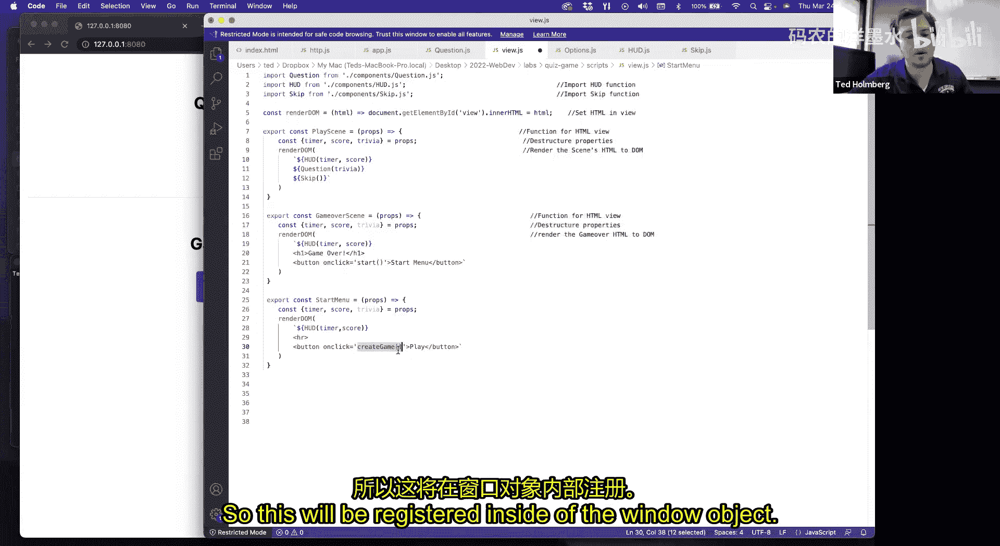
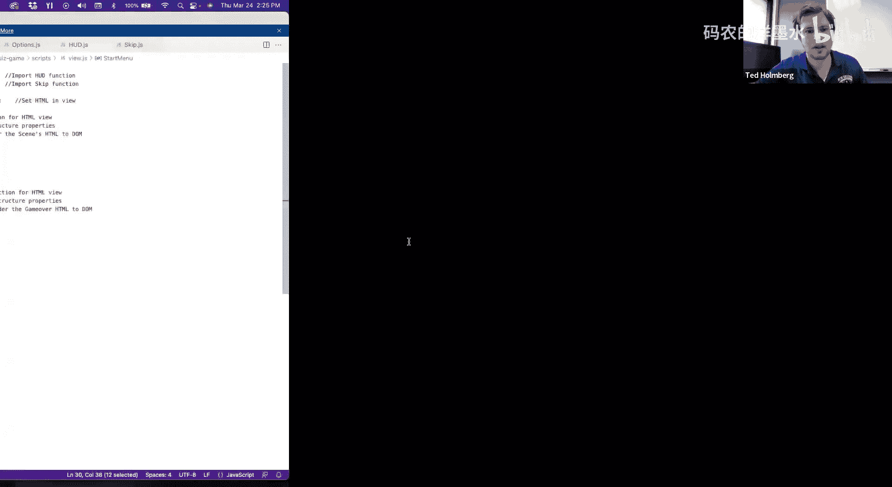
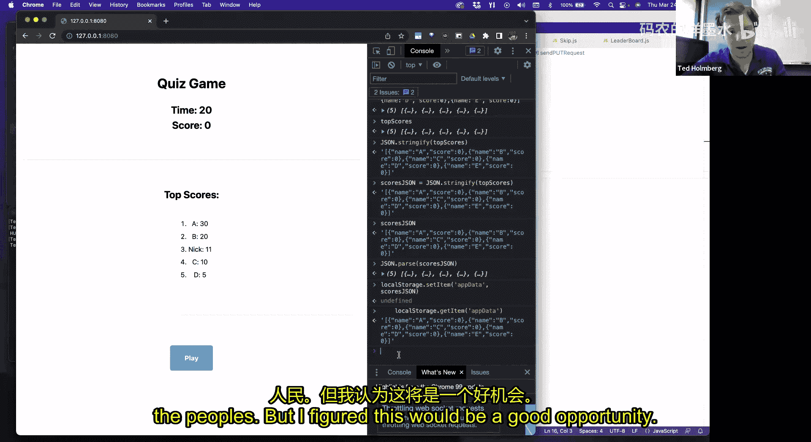
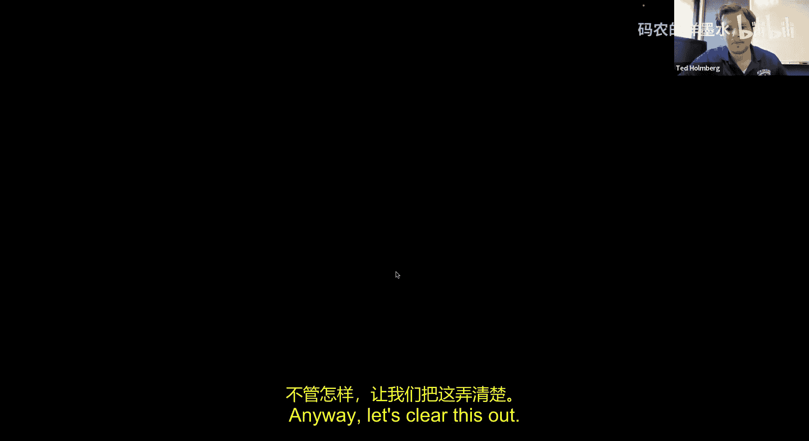
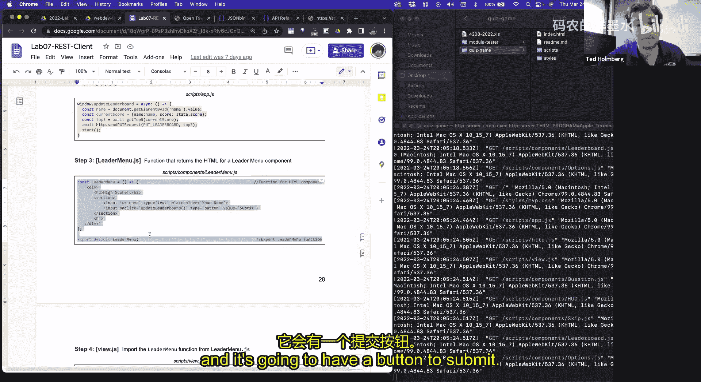
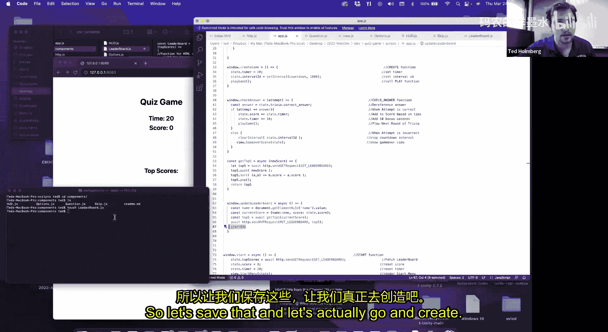
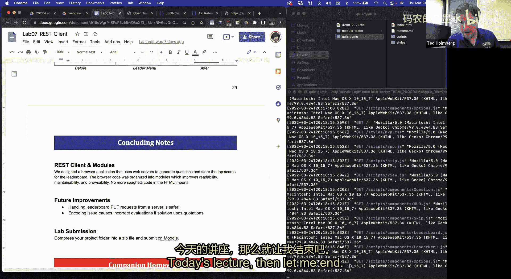

# 高级Web应用：第13讲：模块化与异步编程（第二部分）


在本节课中，我们将继续构建我们的问答游戏，并实现一个共享的排行榜功能。我们将学习如何使用一个名为JSONBin.io的外部REST API服务来存储和获取数据，从而实现跨用户的数据持久化。

---

## 概述

上一节我们完成了问答游戏的基础组件。本节中，我们将实现一个排行榜系统。这个排行榜将显示前五名玩家的分数，并且当新玩家获得高分时，能够更新这个列表。为了实现这个功能，我们需要一个后端服务来存储数据，我们将使用JSONBin.io这个免费的JSON存储服务。

---

## 使用JSONBin.io作为后端服务

为了存储排行榜数据，我们需要一个所有用户都能访问的公共存储空间。我们将使用JSONBin.io，它提供了一个简单的REST接口来在云端存储和检索JSON数据。

以下是关于JSONBin.io的关键点：
*   它是一个免费的JSON托管服务，适用于公共或私有数据。
*   任何从浏览器可访问的数据都应该是**公共的**。切勿在浏览器代码中使用私有API密钥，因为这些代码对用户是可见的。
*   我们将主要使用其API的**GET**（读取）和**PUT**（更新）操作，因为这些操作不需要API密钥，可以在公共代码中安全使用。

### 创建你自己的JSON Bin

以下是创建你自己的排行榜数据存储的步骤：
1.  访问 [JSONBin.io](https://jsonbin.io) 并创建一个免费账户（建议使用GitHub账户登录）。
2.  登录后，在仪表板中点击“Create New”按钮。
3.  为你的数据选择一个集合（Collection），或创建一个新的。
4.  在编辑器中，输入初始的JSON数据。排行榜数据应是一个包含5个对象的数组，每个对象有 `name` 和 `score` 两个属性。例如：
    ```json
    [
      {"name": "PlayerA", "score": 30},
      {"name": "PlayerB", "score": 20},
      {"name": "PlayerC", "score": 11},
      {"name": "PlayerD", "score": 10},
      {"name": "PlayerE", "score": 5}
    ]
    ```
5.  确保将Bin设置为 **公开（Public）**，这样我们就不需要API密钥来访问它。
6.  创建后，JSONBin会提供一个唯一的访问URL（包含一个Bin ID）。我们将使用这个URL来读写数据。

---

## 实现主菜单场景

首先，我们需要创建一个主菜单场景，作为游戏的起始页面，并在这里显示排行榜。

### 1. 在视图模块中添加主菜单函数

我们将在 `view.js` 中添加一个导出函数来渲染主菜单。

```javascript
// 在 view.js 中添加
export const startMenu = (props) => {
  const { timer, score, topScores } = props;
  return renderDOM(`
    ${hud({ timer, score })}
    <hr>
    ${leaderboard(topScores)}
    <button onclick="window.createGame()">Play</button>
  `);
};
```

### 2. 重构应用启动逻辑

接下来，我们需要修改 `app.js` 中的 `start` 方法，使其在游戏开始时重置分数并显示主菜单。

```javascript
// 在 app.js 的 start 方法中
const start = async () => {
  state.score = 0; // 重置分数
  state.timer = 20;
  // 获取排行榜数据（稍后实现）
  // 渲染主菜单
  view.startMenu(state);
};
```

### 3. 将游戏创建函数全局化

为了让HTML按钮的 `onclick` 事件能够调用 `createGame` 函数，我们需要将其注册到全局的 `window` 对象上。





```javascript
// 在 app.js 中，定义 createGame 函数后
window.createGame = createGame;
```

完成这些步骤后，刷新游戏，你应该能看到一个包含“Play”按钮的主菜单界面。

---

## 获取并显示排行榜数据

现在，我们需要从JSONBin.io获取排行榜数据并显示在主菜单上。

### 1. 定义API端点常量

在 `app.js` 的顶部，定义用于访问我们特定JSON Bin的常量。

```javascript
// 你的JSON Bin ID（替换成你自己的）
const BIN_ID = '你的Bin_ID';
// 构建获取排行榜数据的URL
const GET_LEADERBOARD_URL = `https://api.jsonbin.io/v3/b/${BIN_ID}/latest`;
```

同时，在应用的状态对象中添加一个 `topScores` 属性来存储这些数据。

```javascript
const state = {
  score: 0,
  timer: 20,
  intervalId: null,
  trivia: null,
  topScores: [] // 新增：存储排行榜数据
};
```

### 2. 在启动时获取数据并更新视图

修改 `start` 方法，使其在游戏开始时获取排行榜数据。

```javascript
const start = async () => {
  state.score = 0;
  state.timer = 20;
  // 获取排行榜数据
  state.topScores = await http.sendGetRequest(GET_LEADERBOARD_URL);
  // 渲染主菜单，并传入排行榜数据
  view.startMenu(state);
};
```

### 3. 创建排行榜组件

我们需要一个专门的组件来渲染排行榜的HTML。创建一个新文件 `components/Leaderboard.js`。

```javascript
// components/Leaderboard.js
const listItems = (scores) => {
  let items = '';
  // 确保按分数从高到低排序
  const sortedScores = [...scores].sort((a, b) => b.score - a.score);
  for (const row of sortedScores) {
    items += `<li>${row.name}: ${row.score}</li>`;
  }
  return items;
};

const leaderboard = (topScores) => `
  <h3>Top Scores</h3>
  <section>
    <ol>
      ${listItems(topScores)}
    </ol>
  </section>
`;

export default leaderboard;
```

### 4. 在主菜单中使用排行榜组件

首先，在 `view.js` 中导入 `Leaderboard` 组件。然后，更新之前创建的 `startMenu` 函数，将 `topScores` 数据传递给 `leaderboard` 组件进行渲染。

```javascript
// 在 view.js 中
import leaderboard from './components/Leaderboard.js';

export const startMenu = (props) => {
  const { timer, score, topScores } = props; // 解构出 topScores
  return renderDOM(`
    ${hud({ timer, score })}
    <hr>
    ${leaderboard(topScores)} <!-- 在这里渲染排行榜 -->
    <button onclick="window.createGame()">Play</button>
  `);
};
```

现在，当你启动游戏时，主菜单应该会显示从JSONBin.io获取的排行榜数据。

---

## 实现更新排行榜的功能

当玩家获得高分时，我们需要更新后端的排行榜数据。

### 1. 在HTTP模块中添加PUT请求方法

我们需要扩展 `http.js` 模块，使其能够发送PUT请求来更新数据。

```javascript
// 在 http.js 中添加
export const sendPutRequest = async (url, data) => {
  const options = {
    method: 'PUT',
    headers: {
      'Content-Type': 'application/json'
    },
    body: JSON.stringify(data) // 将JavaScript对象序列化为JSON字符串
  };
  const response = await fetch(url, options);
  return response; // PUT请求通常不返回具体数据，只返回响应状态
};
```

### 2. 定义更新排行榜的端点

在 `app.js` 中，添加用于更新排行榜的URL常量。

```javascript
const PUT_LEADERBOARD_URL = `https://api.jsonbin.io/v3/b/${BIN_ID}`;
```

### 3. 创建更新排行榜的逻辑





我们需要一个函数来比较当前玩家的分数和现有排行榜，并在必要时更新。

```javascript
// 在 app.js 中添加
const getTopFive = async (newScore) => {
  // 1. 获取当前排行榜
  const currentTopScores = await http.sendGetRequest(GET_LEADERBOARD_URL);
  // 2. 将新分数加入数组
  currentTopScores.push(newScore);
  // 3. 重新排序（从高到低）
  currentTopScores.sort((a, b) => b.score - a.score);
  // 4. 只保留前五名
  currentTopScores.splice(5);
  // 5. 返回新的前五名数组
  return currentTopScores;
};

// 全局函数，用于在游戏结束时被调用
window.updateLeaderboard = async () => {
  // 获取玩家输入的名字（假设有一个id为‘name’的输入框）
  const playerName = document.getElementById('name').value;
  const currentScore = { name: playerName, score: state.score };

  // 计算新的排行榜
  const newTopScores = await getTopFive(currentScore);
  // 将新排行榜发送到后端
  await http.sendPutRequest(PUT_LEADERBOARD_URL, newTopScores);
  // 更新后，重新启动游戏（回到主菜单）
  start();
};
```

### 4. 创建高分输入组件

当玩家获得高分时，我们需要一个表单让他们输入名字。创建一个新组件 `components/LeaderMenu.js`。

```javascript
// components/LeaderMenu.js
const leaderMenu = () => `
  <div>High Score!</div>
  <section>
    <input id="name" type="text" placeholder="Your Name">
    <input type="button" value="Submit" onclick="window.updateLeaderboard()">
  </section>
  <hr>
`;

export default leaderMenu;
```

### 5. 在游戏结束场景中条件渲染高分菜单

在 `view.js` 中，我们需要判断玩家分数是否进入了前五名，如果是，则显示 `LeaderMenu` 组件。

首先，导入 `LeaderMenu` 组件并创建一个判断函数。

```javascript
// 在 view.js 中
import leaderMenu from './components/LeaderMenu.js';





// 辅助函数：判断分数是否足以进入排行榜
const isTopFive = (score, topScores) => {
  // 如果排行榜不满5人，或者当前分数高于最后一名，则返回true
  return topScores.length < 5 || topScores.some(s => score > s.score);
};
```

然后，在 `gameOverScene` 函数中使用这个判断。

```javascript
export const gameOverScene = (props) => {
  const { score, topScores } = props; // 确保解构出 topScores
  return renderDOM(`
    ${hud({ timer: 0, score })}
    ${isTopFive(score, topScores) ? leaderMenu() : ''}
    <h1>Game Over</h1>
    <button onclick="window.start()">Menu</button>
  `);
};
```

现在，当玩家游戏结束并且分数足够高时，就会看到一个输入名字的提示，提交后排行榜将被更新。

---

## 总结

在本节课中，我们一起学习了如何为我们的问答游戏添加一个完整的排行榜系统。我们主要完成了以下工作：

1.  **引入了外部数据服务**：使用JSONBin.io作为简单、免费的后端来存储和共享JSON格式的排行榜数据。
2.  **实现了数据获取与展示**：通过HTTP GET请求从服务端获取排行榜数据，并创建专门的组件将其渲染到游戏主菜单中。
3.  **实现了数据更新逻辑**：通过HTTP PUT请求将新的高分更新到服务端。我们编写了逻辑来比较分数、对列表进行排序，并确保只保留前五名。
4.  **完善了用户交互**：在玩家获得高分时，动态显示一个表单供其输入姓名，并在提交后自动更新本地和远程的排行榜数据。



通过这个实践，我们不仅巩固了模块化开发和异步编程（`async/await`）的知识，还掌握了如何让前端应用与远程REST API进行交互，从而实现数据的持久化与共享。这为构建更复杂、交互性更强的Web应用打下了坚实的基础。