# 【全集】加州理工学院 高级Web应用 中英字幕 1080P p14 Lecture 14 - 静态Web服务器 -BV192zTBrEmu_p14-

Perfect， okay。

So。In today's video lab we're actually going to move from the front end and start exploring our backend so in today's lab we're going to actually build our own web server we've learned a lot about web clients and we've seen in the last couple labs how web clients can actually request information from web servers。

 specific information but all web servers at least deliver HTML documents to the web client to the web browser so recall that the technologies that we're going to predominantly be learning on top of the basic technologies which has been HTML CSS and JavaScript are going to be node Express。

 Mongo and react。And so we're really going to explore the first of those technologies today。

 so we there are companion lectures that will go into the basics of node and the core modules for node and also the basics of NPM so I would implore you to go and watch those alongside this lab so you can become more familiar with what we're going to be doing。

But effectively you can think of node as a runtime environment for JavaScript that runs on top of the OS that you can go ahead and invoke from a bash terminal as opposed to having to be contained within of browser environment so this allows us to open up a whole lot of opportunities it allows us to start producing applications in a very general purpose way that aren't just designed to run inside of a browser but can run as its own self-contained entity and so now we can start building like ACTP demons to listen for for a request and actually send a response or we can actually build any kind of application we want similar to Python or Java or anything else so you can think of node as the equivalents of like Java C and Java or as Python that you can access from the terminal。

So and in fact。Just to show you， if I go right into my terminal here and type in node V。

 right I can actually go ahead and effectively launch the node application。

 it's essentially a terminal application and so I can feed it JavaScript source code files and it can parse it and execute for me。

And so NPpm stands for node package manager we're going to take a look at that so let's take a look at our table contents。

 this is a relatively short lab so you can see we're going to do an introduction where we're going to define what is a web server what is node what is NPm then we're going to have eight different iterations。

Over the course of building from scratch。A web server。

 so we can actually see what all the considerations that goes into a web server。

And so the first iteration will just build a web server deployed with node that's a hello world。

 so as basic as it gets， and then we'll go ahead and deploy instead of with node with NPpM our node package manager。

Then once we learn how to use NPpm， we'll go ahead and actually take the EL file name from the URL paths and learn how to parse。

Paths。And start actual actually working with the file system from node。

 then we're going to start learning a little bit about the status codes that web servers will issue back to the client。

 we'll learn about 400 errors or 404， we'll learn about 200， which is a success。

 we'll learn about how to serve HTML files to the browser and then how to do redirect so that's 300 status code 300 so that if it is a directory we can set redirect to a file。

And then we'll learn a little bit about status code 500。

 which is a server side error as opposed to a browser side error or client side error。

And then we'll just have some concluding notes， so relatively short lab today。

So in terms of the introduction the preres， there's none here right as long as you have node installed like so make sure that you install node。

 there's a number of ways to do it， I'm not going to go into the details because I already have it installed as of today the current version is 17。

8 I had just updated it earlier today。But if you're watching this video in the future and it's a later version。

 that's completely fine。The motivation for today's lab is we're going to understand how a web server listens for and then responds back to a browser I'm saying browser but really any client's ECTP request and of course our goal is we're going to build a simple barebone web server application in JavaScript that runs in node from our B terminal and so that way we can understand all the considerations that go into building a very simple web server。

And then once we learn how to do this， we'll migrate to express。

 which will do a lot of this heavy lifting for us so that we don't have to really be worried about building this from the ground up any longer our learning objectives is we're going to learn how to use node and NPm we're going to learn a little bit more about ACTP but from the server side and。

In that capacity， we need to learn a little bit about what mine types are。😡。

And then these ACTP codes I call them error codes， but they're not always referencing something that went wrong right it's more of a status code but we will learn some of the error related status codes that are there and then also we'll learn routes or what we've been calling endpoints really from the client perspective。

Okay， so a quick。Server site architecture for our project is we will start the project by making a project folder where all of our assets and Scs will be organized so this is relatively simple since we're building a server we're just going to need a server do Js file inside of a folder we'll call web server notice there's no data that we have to go ahead and download so we can just build this right from scratch so here let me do this so let's see here toggle over here so here we have where our labs traditionally go I will create a new folder that I will call。

Web server， perfect。

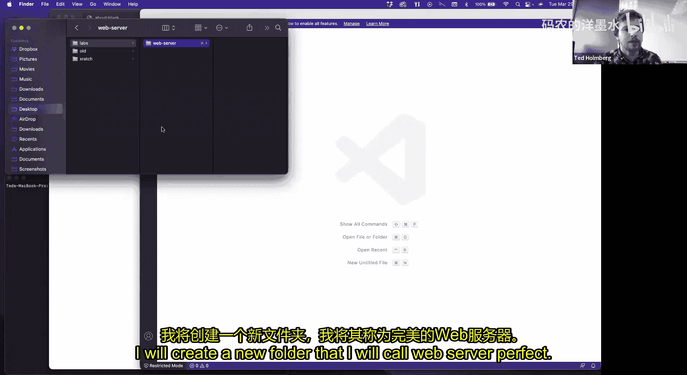

Okay， now that I have a web server， let's see here。Yep， let's go into my web server。

Okay and now let's make a server。js file okay， so inside of web server I should now have a server。

js file perfect actually let's get that loaded into the IDE。

So that we can go ahead and start adding that as we need to。

Excellent okay so now let's talk about some of the concepts that are worth mentioning first NPpm again short for node package manager you can think of this as the package manager for your node packages so very explanatory name there effectively what it does is it installs your node dependencies and it can launch your node apps。

So node JS we could think of as a JavaScript runtime environment which allows us to want JavaScript on the server side so from the OS without having to open up a web client or web browser so some of the advantages of node is it has built in packages so node include several modules that provide functionality for things like HTP servers file systems web sockets cryptography and much more you can go to the API right here and you can see all of the built in functionality so again just like we we're using MDN。

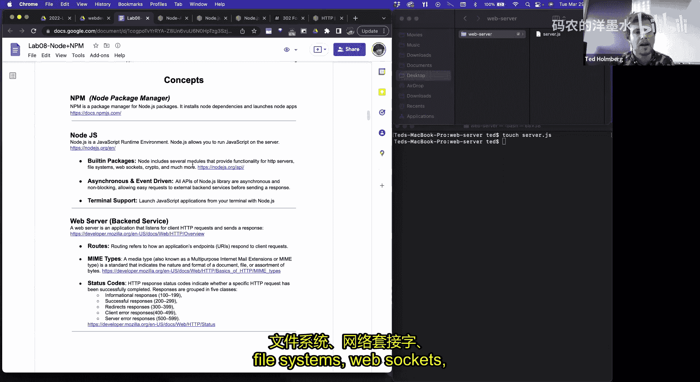

Prior for learning how to go ahead and do everything in the client。

 it would behoove you whenever you have any questions or doubts or considerations of what it is you want to do inside of the node runtime environment is to go seek out the API。

Annovate what objects are in there， what classes are there。

 and what methods are associated with those classes and objects。

And we're going to explore a little bit of that in today's lab。

Where you should also know that node is asynchronous and it's event driven。

 so all of our APIs of node library or asynchronous and non blocking that allows for easy requests to external back end services before sending a response。

And so again。Understand that nodes architecture。Is single thread but the way it manages the ability to not block since it's on a single thread is to use an event driven system so just so effectively what that means is that you have the event dispatcher and whenever something gets registered in the event dispatcher right it's registered with a callback function and as events occur like say for instance promises become resolved or resolve event might get pushed into the event dispatcher then any any callback function that's bound to that promise for instance。

 is then executed so so。It's effectively very intelligent way of handling。

Multi threaded like implementations on a single thread and this way you don't have the complexity that can sometimes happen in multi threadreaded applications where you have to worry about sinks and blockss。

Another nice thing about node is well， the terminal support right we can launch our JavaScript applications right from the terminal with node。

So some other good concepts that are worth mentioning before we start is well we're going to actually be building the web server so technically we are now on backend services and a web server is an application that listens for client HTP requests and then sends back a response an HTTP response and of course if you want。

Additional information about how the HTP cycle is I produced some documentation here that gives a quick overview that if you just want the additional information this is a great resource here that MDN support that MDdN has in terms of what is the client what is the role and responsibilities of the web server and what is effectively the protocol HTP so if you have any lingering questions regarding HP this is the place that I will direct you the big takeaways is that on our web server we're gonna to have routes so Ras refer to how an applications endpoints or what we'll call Us respond to client request we have mime types and type is a media type also known as a multipurpose internet mail extension。

And it's essentially the standard that indicates the nature end format of a document that's being sent from the web server or being requested from the web client to the web server and then the web server can go ahead and deliver it so let's go ahead and take a quick look at。

The associated length that I have here。So when we get into actually defining our amount types you're going to see。

 effectively we're going to examine the extension of the file that's being requested from the web server so that we know how to parse it and then send it to the client and these might be things like fonts or images or text or videos。

 sometimes it could be multipart so it could be like a message or form data sometimes it might be list so here we have like text/lash CSS would be how we request a CSS style sheet or how we request an HTML document or JavaScript document。

And images might be things like gifts or JPEGs or PGs。Audio might be things like。

These look like our various videos， so like webm。Form data and you could just see all the different ways that we can go as effectively have data encoding。

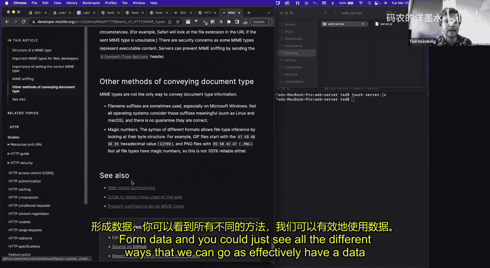

So we have to be considerate of that when we're building out our web server and then of course also a status code so the MIme type gives us context about the documents being requested from us and the status codes are what we send back in terms of how successful or not we were in fulfilling that request so every ACP responses has a status code associated with it to indicate whether a specific ACP requests had been successfully completed or if not like what could have been the issue so typically you don't usually see a lot of status codes between 100 to 199 those are typically informational responses this is really popular when those successful responses are usually encoded as 200 and in fact it could be coded as anything between 200 to 299 redirect responses or typically those responses that caused the client to redirect to some other location will actually implement a redirect inside this lab。

And then errors can either happen when sending a request and not being able to resolve a response satisfactory either because of an issue on the client side and if that's the case。

 it's a 400 to 499 error status code and if it's a server，And error。

 then it's usually error code 500， but it could be anywhere between 500 to 599。So again。

 these will help you debug things as you start as you encounter them as you build out your web applications and if you want to learn more again I give you that link and you can see what all the individual。

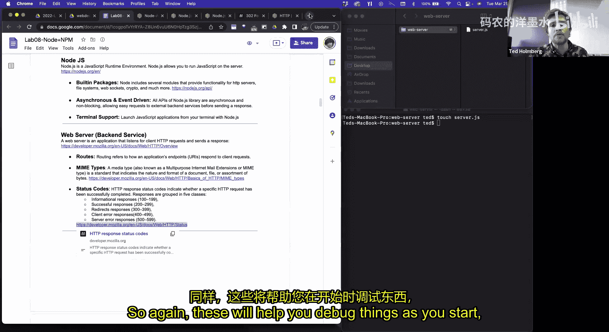

Status codes are in between and again the Campania lecture I think goes into greater detail for all of this。

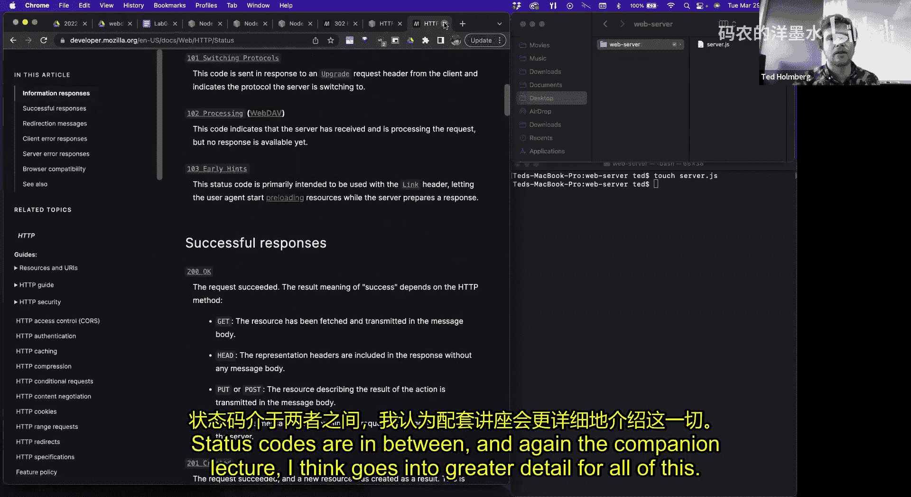

Okay， now with that said，'ve done we've covered all the basic information we need to know。

 let's actually start building a web server。So the first thing I want to do。

 my first goal will be well， a simple web server that gives a hello world response deployed with node。

 so our approach is while we'll make a web server that listens for a request and from a report and sends back a response。

So in our first step we'll have to go ahead and create that server。

t js file which I've already done excellent so i'm going to import a module the ACtP module so the ACT module is one of the core modules that's pre builtt into node and that will help us go ahead with all of theresponsibilities and roles for handling requests and responses so we're going to let me grab this。

So let me go to my server and so I'm going to go ahead and you'll see I'm putting require HTP so require is a mechanism that allows us to import。

A module in node so require is so there's a little bit different syntax when I originally wrote this lab now if I'm not mistaken。

Let me see something really quick， I believe that node might actually support。

The same kind of imports that the client does。Let's see， node 17， let me see。

This was one of the things that was a。Sa here。Yeah。Oh， excellent， yeah。

Let's try this out let's try the let's try the this newer implementation style out so we's try the same import mechanism that we can do in the browser inside of our。

Andside of。Our node code as well。Well。I'll keep this and then we'll refactor what we'll do。

 but this was the classical way that we normally have to import modules。

But it is my understanding that the news version of node has actually been updated to be in line with importing modules the same way it happens on the client side so we'll do a refactor of this afterwards so we can see the two variant approaches Oh let me go through the code too so here we're going to import from the HTP module and we're going to just name that object that gets returned to us HTP。

Then we're going to set up a host name so our host name could either be local host or it could be the IP address of local host。

 which is 127。0。0。1。And then we're going to listen on port 3000。

 so this is just configuration information for me to be able to start listening from the outside world right on a port for some requests that are going to come in from local host from this host nameme and this port。

Okay， so the second thing I want to do is now that I've set up the basic information。

 basic data I'm going to need to actually start listening for requests。

 I'm going to define a callback function that's going to handle ACTP requests that are being made。

So again， this's going to be a callback function that the server invokes when it receives an ACP request。

 the server passes the request object and an empty response object into the function。

 and then what's going to happen is we're going to fill out the response object over the life cycle of this ACP ACTP handle over the life cycle of this callback function。

Okay。So let's go here and let's go ahead and create this HtTP handler and again there's two things that will be passed in the actual request that we' have like the request the HttP verb like what type of request of whether it's a get or put or whatever it'll have a request header and it'll have a request body potentially but this is what we're going to be filling out over the course of this so what we're going to fill out inside of our handler is we're going give it a status code and we're going to initialize with a status code of 200 to say it was a success we successfully gave a response to the request and then we're going to set a header inside of a response to say what content type we're going to deliver back to the client and so when we set a header this is a key value pair so the key is going to be content type and then the value this is essentially defined as a mineme type here that's going to be text so that's like the super category and the type of tap is just。

Going going to be plain text。And then after that， we have to end the response。

 otherwise we're going to leave the client hanging。

So we need to end the response and when we end the response we're going to send data that we're going to end it with。

 so we're going to send back to the client hellello world as a new line character and then when this end occurs then we're going to shut down that connection and this will get delivered to the client side。

Okay。그。Now for step three， we're going to also just create a server message。

 a server message is going to be a callback function such that when we start listening when we launch our server to start listening on that port and that host name we're going to immediately invoke this message just to let us know that our application successfully started so this is just going to be a function that's going to do a console log for us so here let me do that so here server message it's just console logs server running at and then we're going to put the host name and the port。

嗯。And then the last thing we're going to do in this step is we're going to actually have to create something that launches oh creates a server for us and then has the server starting start to listen。

And so again， this is when we're going to use that ACTP module that we were talking about where it allows us to create a server。

So we'll actually look at the APIpi in a moment， but this is just two lines of code， really。

So here we're going to create a server object and we're going to do that by requesting from the ETP module to create server with the configurations that we are that with the configurations that we're going to have set up so effectively when we create a server the first thing we have to do is give it the callback function that's going to handle the request and responses so when the server is listening to a hosting name and a port when it actually gets a request。

 it's going to send the request here into this method right because we're passing it a reference for this method。

And then it's also going to pass it a response。Object， but it's not going to have any data。

 it's the role of our callback method to actually populate a response。

And then once we've actually given it the callback function here。

 then we can say okay the server has now been created has a listen method and when we tell it to start listening。

 we can tell it on what port to listen to and what host them to listen to so we're going listen on port 3000 and we're gonna to listen on local host here so the nice thing about this is understand you can have multiple servers at one time listening on different ports and hit them up and get you know different data from each of those servers and then the third parameter we're passing here is this callback function that will just go ahead and execute when the server starts listening that will be the console log there so relatively simple code here and again if at any time we want to know what was really going on we can go to the API and we can look up not that。

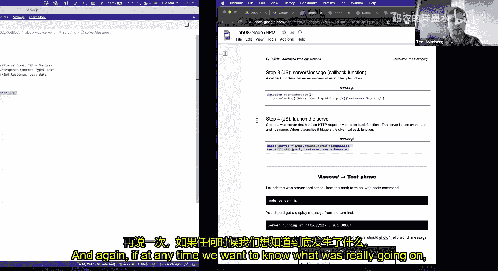

Not that。Not that and not that so if we wanted to see here HtP yep。

 this is where we go here and then I could see。If I wanted to I could say oh what does it mean for server to listen what does it mean to create a server so here let's go to server to listen because that's what we're doing and we could see that this is indicates whether or not no not is listening here you go starts the ACP server listening for connections so very obvious by it' name but again I want you to get used to being able to。

Peruse the API and if there's any questions about what this code does。You can see it。

 you could easily find it here。Lets see here。啊。Where am I here create a。

 I guess I should spell that right。And here， if I want to see what create serverver does。

 I can see right here that it's going to take in my options and then a request listener and that's when I'm passing it and it's going to return back a server instance。

So I was going to construct that server with the configurations that I give it so again。

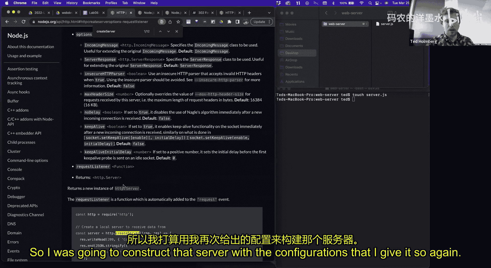

All of this， all of the code you see here， if it's not something that you're familiar with。

 check the API。Okay， so now that we have that we can go ahead and let me make sure that' saved Okay。

 yep， I see that that looks saved so now what I'm going to do is I'm going to launch that。

Using node I can launch that directly with node and then we're going to update to use NPm afterwards。

 so here we go we got our server running app message actually for me。Yeah， this is perfect， actually。

 let me launch it from the terminal here。Right。Expand that out some so it's nice and big that way I can。

啊。No， what was it called server do J？First of all， where am I I think I need to go into。whateverever。

 okay， perfect。嗯。Okay， so I see now I get this run time message over running at and that's local address and that's the port and so if I go and try to go there。

You'll see oh， I actually got that response back and it's hello world right from this callback function here Now if I forget to end that response。

 what's what happens， let me save that， let me kill the server。

 let me read on the server and let me and here。You'll see。It's just。

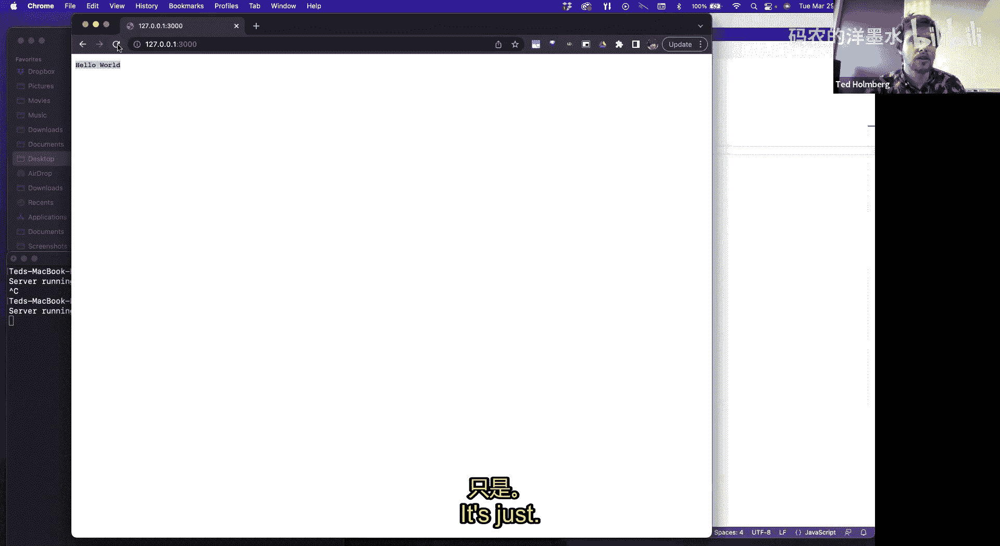

Let me actually open it up in another tab even so you can see it's not giving me the hello world at all right it's going to just look like it's perpetually trying to load that's because I sent a request and my server isn't implemented it to actually end with a response so it's keeping the connection open until these server sends back a response if we don't end the response this is the behavior you're going to get what appears to be just a perpetual。

Loading。W， let me also。嗯。weird， thought that。응。Okay。

Does that loading ever end or does it just keep going and going。

Like if somebody had a web page that did that get that a little smaller there， okay。

 so let's move on， let's close that and let's get that working again。So let's get this back here。

 let's save that， let's relaunch our server with node and let's copy that and send that here。

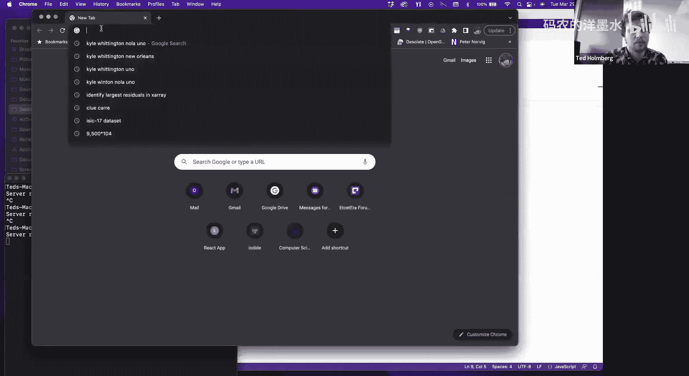

Perfect。嗯。Okay， so now that I've done that successfully。嗯。Oh， is the speaker level fine？

Can you hear me？Yeah。No。😔，Hey， professoror。Okay。And the volume up some。

Does it just continuously load Yeah， does it just continuously load like how do we how do we make that stop if somebody has like a web page that。

So like a server that was an issue that was an issue that was happening on server side so there's nothing I can do from client side to stop that。

So what's happening with the HCTP like life cycle， the response。

 the request response cycle is that when I go to a URL， I'm sending a request。

 at least from the initial get go。I'm doing a get request that's at that end point and that get request is just effectively just the default is to get the HTML documents that are there。

😡，Well， if it's a directory， if it's a if it's a file。

 then I would try to get that file specifically like if I did this。

 but if if the if if the server isn't sending back a response。

 then I'm opening up a connection to that domain name and to that port and I'm。

Sending in like'm I had a callback function like I have an application that's listening to that port so I'm not getting a failure to send anything there。

 but since the response was never sent。😡，I know I'm waiting。

 I'm just waiting for it to send back the response on my client side and because of the failure for me to end it here。

 it never gets set。So that's what's causing that there so that's just a problem from the server side and we can't do anything from my browser we have to correct it on the server side but once I did that once I end it here response that end and then whatever data I want to pass into there then all of a sudden I can do this refresh here let me run my server again I can refresh this and you can say it's instant right there's no loading anymore I send the request it sends back the response this response is hello world。

Does that answer your question？Yeah， does it have like a limit like a five minute limit if it was just to keep listening for five minute not oh so that okay so those kinds of things could all be up to the way that the browsers configured right that's all going to be a client side configuration thing but a lot of times you know that's not necessarily the case if I just let it let it sit there oftentimes the case is I'll just keep waiting。

For that response to come back right。It's a good warning。 Good thing to know about。Okay。

 so the next thing I want to do is well right now what we've successfully done is we've built a simple server that takes some requests and sends back responses and actually gives a little bit of data back as a response。

 not HTML documents， it's just sending raw data that's being rendered by the browser's viewport。

But the next thing I want to do is I actually want to launch my application。

 my server application using NPM instead of node， so right now I'm launching it by invoking node directly。

 but we could think of NPM as kind of our build tool。

So we preference using that because our applications are much more complex as we continue on in the semester。

 and there might be multiple scripts that we have to go ahead and tell to execute and so we can have a build tool that first of all installs all of our dependencies like external modules that aren't built into node and then can even have the ability to start up several different scripts for us。

So。Npm default file that it's going to look at inside of our directory for all the build information。

 for all the configuration information about our app， it has to be labeled package。JO。😡。

So dot JSON is referencing the fact that it's saving all of our configuration data that is in the form of a JSON data structure。

 so it's going to be in the form of like a JavaScript object that is a key value pair。And actually。

 let's do this， let me go ahead and create inside of here。

Package do JO and and then package is just the default name so when we tell NPpm to start it's going to look inside of this directory for a file called package do JO is's going to use that as the startup sequence for our application and again this is what we would refer to as a build tool if you're not if you haven't used a build tool before。

😡。

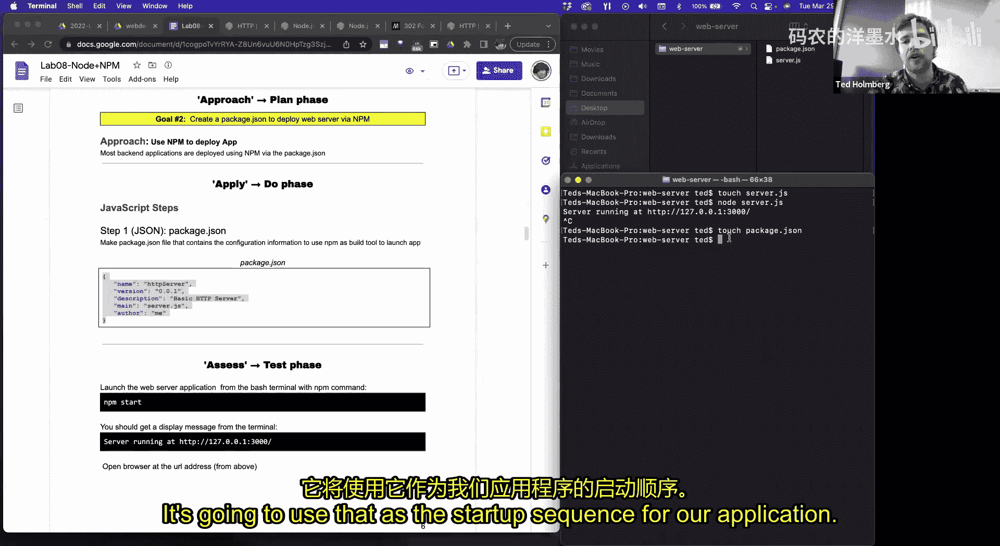

So here we will go ahead and。So here I'm just creating an object。

 so some basic things that you typically will always have inside your package JSO。

 you would have a name key， which is the name of your application。

You will have a version for your application， this will be version 0。0。1。

So this is usually kind of the major release minor release。

 and then kind of this particular micro release。So typically versioning is done in as as a three step。

 but it's up to you like the notation isn't。Necessarily going to be uniform。

 but this is just a very common way of doing versioning for applications a description would be a summary like a English sentence。

 a natural language sentence of what this application does main is going to be the launch point of our application so the main script to launch when we tell this application to start will be server。

 Js and then the author would be whatever your name is right like you want to give yourself credit for every application that you build and you're allowed to do that like that's actually something that gets defined inside of the build tool itself。

Anyway， so these are the most common things that you'll find when we go ahead and create and there's tools to actually auto generate this。

 but we're going to build it manually so you get comfortable with that notice though when we actually created that JSON file it's very crucial that you use double quotations and not single quotations Okay。

 so now that I have this。Let me clear this。Oh I'm still listening let's kill that and let's clear that。

 Okay， so now that I have that Well， that's it。 now instead of using node and then server dot js。

 I can just do NPm start and it's going to use this to build my and launch my application。

 So let's test that out。 let's do NPm。

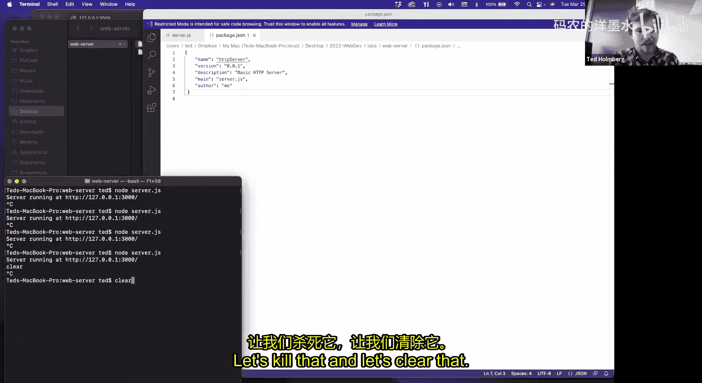

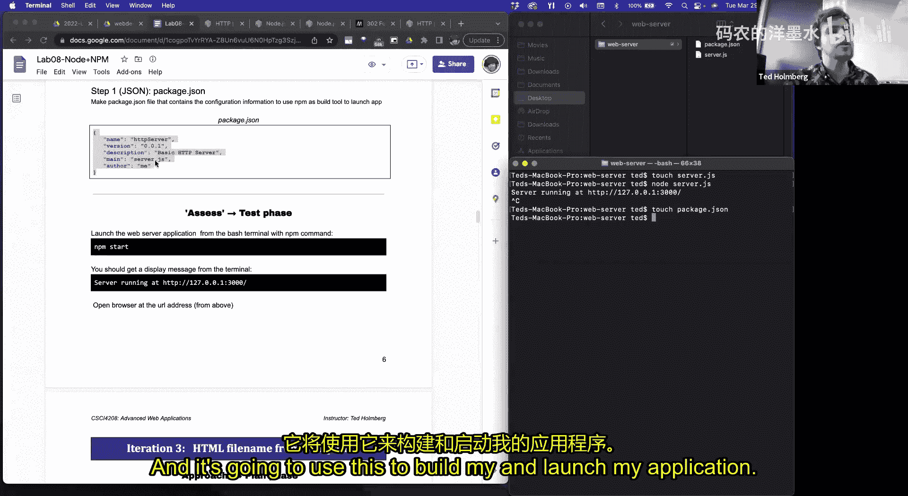

Start and you see。We can then use NPM to build out the application it launches node server dot Gs the main point here and then that callback function gets invoked and we can see our servers now running so if I go here and refresh my page I can see yep I'm still getting that hello world so let's go ahead and kill that。

So now we've learned how to use NPM to build our application， so what's the next thing we want to do。

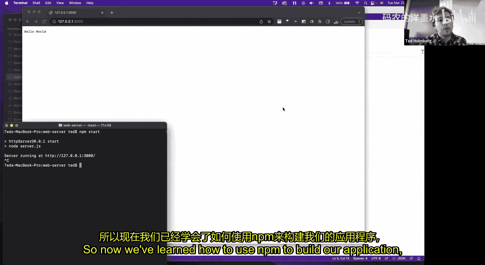

Well， we want to go ahead and let's say parse the HTML file name from a URL path of the HTP request。

So our approach here is we're going to learn to use the URL and Pa modules to parse our request URL path and then to send a file not found error to a client because we don't have any files。

 we don't have any HTML files to deliver from our web server yet。So。

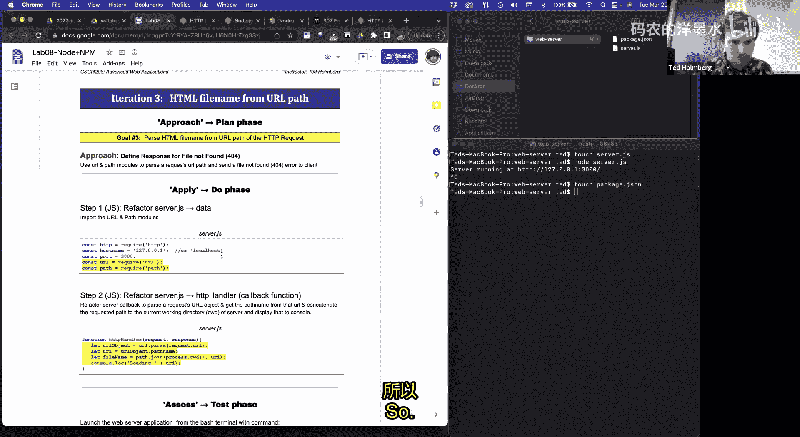

Let's go。And import URL and path。So let me go over here， know let's go into our server。

 so here I'm going to import。The URL module and the path module and again again just to give you an idea without having to look at the API documents。

 which you can do in your spare time just understand that these will give us methods that allows us to parse or to be able to handle both URL and file paths。

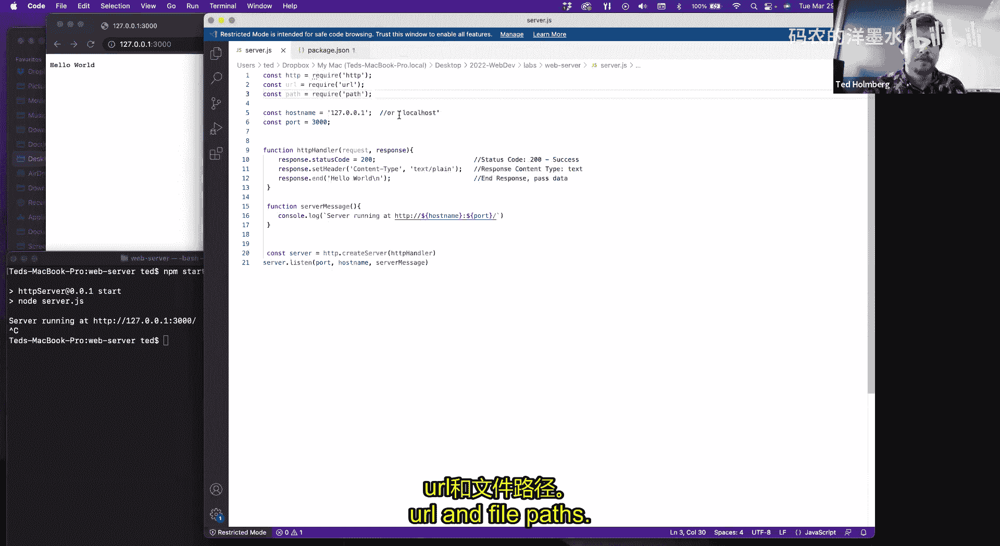

Okay， so the next thing we're going to do is now that we have these modules imported。

 we're going to use them so that we can start getting some information from our request object that gets passed into us so that we can start trying to look internally inside of our website not our website server but inside of our local machine for the file that the client is currently requesting。

So that means we're going to refactor our ACTP handler code to parse a request URL object and get the path name from that URL and concatenate the requested path to the current working directorctory。

 that's what CWD is going to stand for to get the current working directory of the server and then display that to the console。

So we're going to update entirely。

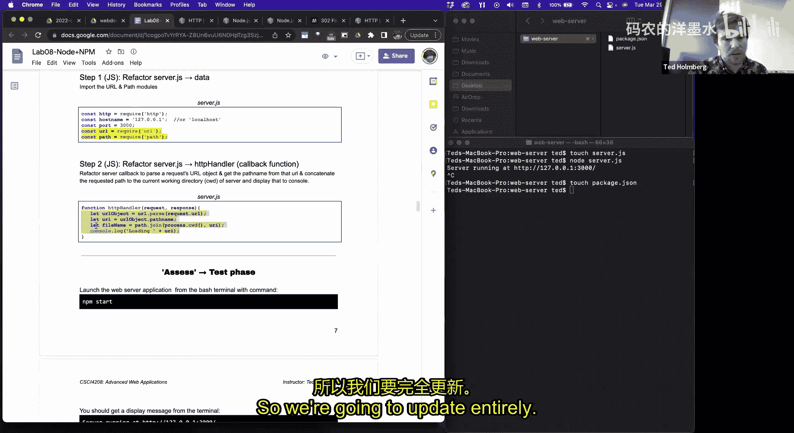

The contents of our HGTP handler here。So instead of just sending this one response what we're going to do is from URL we're going to parse the URL that's inside of the request object and that's just a value that we get from them and again that's going to be what goes in the address bar here so this will give us this will parse this into an object itself so that we can then go ahead and then get properties from it like the path name of that URL which is our URL and then what I want to do is I'm going to use the path module to be able to concatenate that's what joins going to do the current working directory and this URL and you know what I'm going to do I'm going to do two console logs I'm going to do the console log on what the URL is but then I also want to do this console log so you can see what this file name is too so we could see exactly what's happening here。

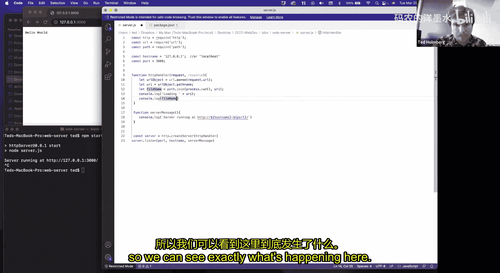

So we're going to get two different printouts when we do this。

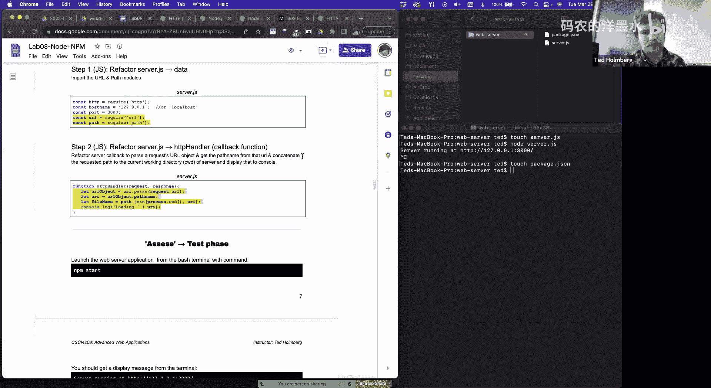

Excellent and so now that should be all we need to do to be able to parse to identify what resource we're trying to that the client is requesting from us so let me clear this let me run NPm start and let's test this out so i'm running here so now let me see if I can't do this in a way so we could see what's happening in an our server down here as well so if I do a refresh here you see loading and just here the pathway is just a slash。

So again the UI that the resource is looking for the lookup is the slash now on a local machine。

 if I get the current working directory， it would be this right users。2022 web dev labs web server。

 the project inside of there。 So let me go and try this let's also do index do hm and here we could say oh the UI that I'm trying to request right based off of parsing that URL to get a file path is going to be a file called index at Hm where it's going to be inside the root directory of my project and then by using the get the working directory。

 the current working directory I could see that that file would be right here in my local。

Inside of my local machine so that I can actually deliver to the client and now again notice i'm not sending back a response so i'm just infinitely。

Loing here i'm not i'm not ending to the client so my client is not doing anything。

 but we don't care about the client right now like in this particular step we wanted to see if we could just parse on the server end。

What it what file？The the client want it and once we can do that， we can start thinking about， okay。

 how can we give that file back as a response？

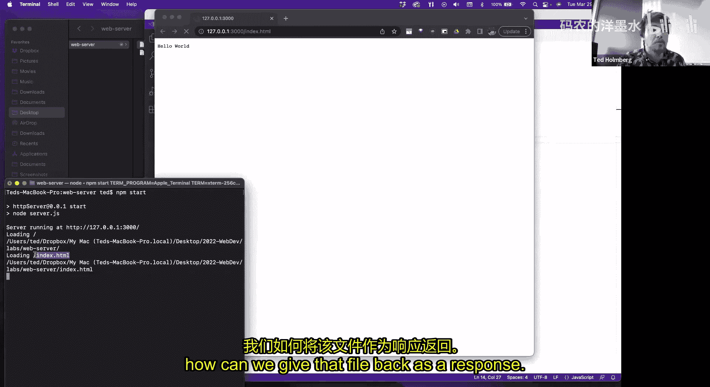

Excellent so this is exactly what's happening look no since the request is never resolved from the back end。

 there was nothing for the browser to display and so it's just going to perpetually keep loading。

And yep， this is exactly kind of the outputs we're getting we're able to effectively parse either a directory or a file that's being requested so now the next thing we want to do is well since there's no file that exists yet why don't we respond back with a 404 error to say oh there's no file on our server at that pathway at that domain that you're asking for so here our approach is to define a behavior for unsuccessful URL routes in our web server and we use a file system module determine if the requested file doesn't exist or not and if it doesn't exist then we're going to send a 404 error file not found。

So the first thing we need to do that is while we need to import the file system module so that we can start accessing files and directories。

 so let's go into let me kill the server here and let me clear that okay。

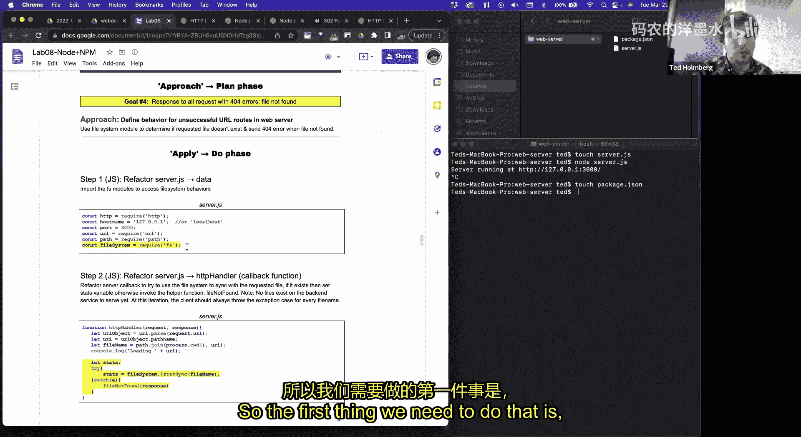

So let me go here and I'm going to。Import the file system。

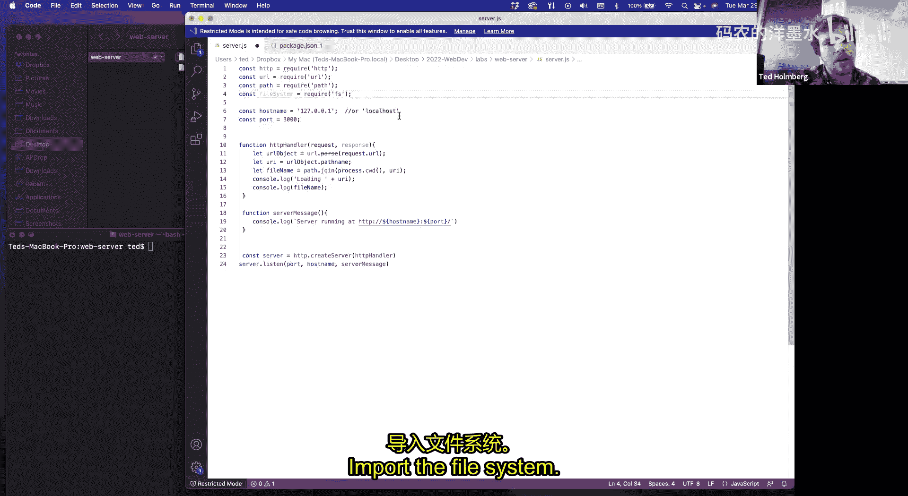

Module， FS。And then the next thing I'm going to do is I'm going to go into my HTP handler and I'm going to refactor that callback function to use the file system to try to sync with a requested file。

 and so if it exists， it's going to set a stats object into this stats variable。

 otherwise it's going to invoke the helper function file not found。

And so note that no files exist on our backend server to serve yet。

 so at this iteration the client should always throw the exception， I mean。

 the server should always throw the exception case for every file name that gets passed into it。

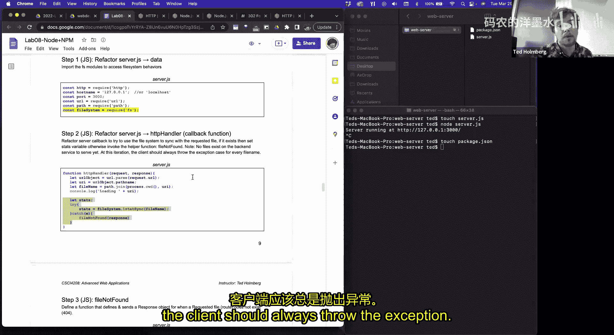

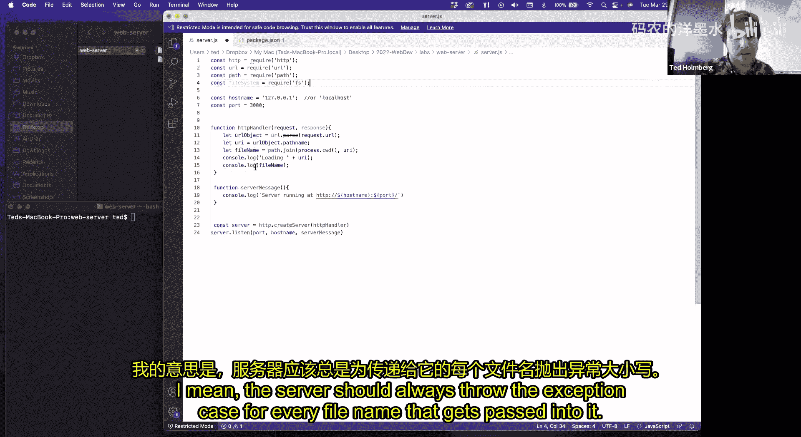

So let me go into here。And we're going console log we're still going console log everything。

 but I'm going get rid of this console log for the file name since we see that and so I'm going to paste this in here so here I'm going just create a variable to hold a stats I'm going to try to get the stats here so I'm going to see I'm going to ask my file system can it go ahead and sync with this file name now we don't have any file names that are locally in there so it's always going to throw an exception and that exception gets thrown we're going to invoke this file not found function now we don't have a file not found function yet but when we do when we implement it it's going to have to take in the response object because we're going to use this as a helper function to produce different responses so this will be the helper function that'll take care of file not found responses。

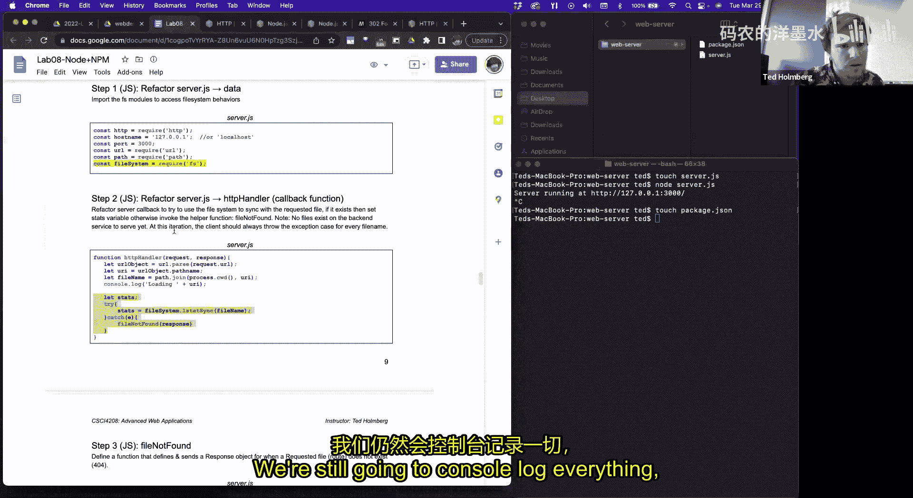

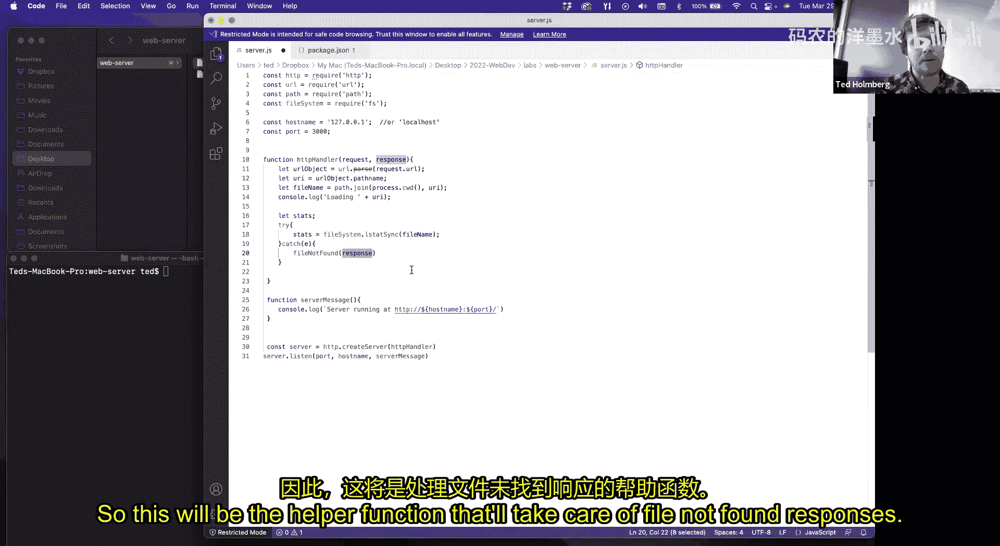

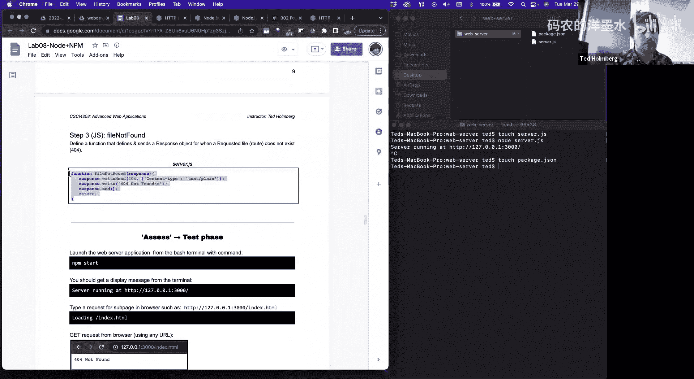

So here， let me just go。I'll do this under my HTP handler。

Here i'm just going to create a function I not found is's going to take a response and to my response i'm going to write the header 404 that's the status code and then。

In terms of the content that has to get written there that's can be passed as a configuration object that is a key value pair。

 the content type of our response is going to be as text slash plain so we always have to tell the client what type of content that we're delivering back and again that's the mindme type that we're using here。

We'll look a little bit more at types in just a moment。

And then we're going to write into the response body so this wrote the header of the response。

 then inside the body， the response we're going to write the text 404 not found and the new line character。

 and then we're going to end the response so that the client can get this information and end that request。

And then we'll just do a simple return statement so that we can go ahead and exit out this block of code。

So let me save that， so now that we have this file not found。

 we should go ahead and be able to launch our application NPpM start and actually try to load index on HTML and let's see what happens。

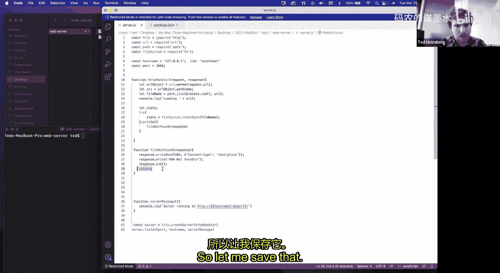

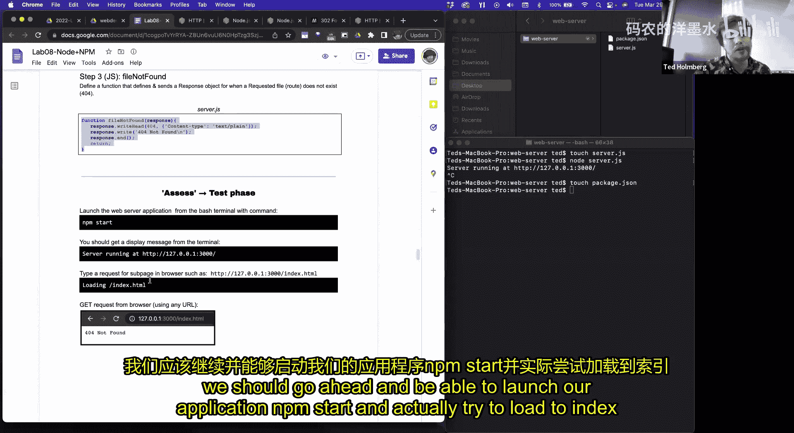

So let's do。And PMm start， we've launched our server， so now let me go to here。Actually。

 let's do this so that in the future。Perfect okay perfect Okay so now let me refresh this and there I got a 404 and I found I see I was trying to load an index on HTML there is no index on H so。

It lets me know， it lets the client know， hey， I don't have a file by that name on the server。

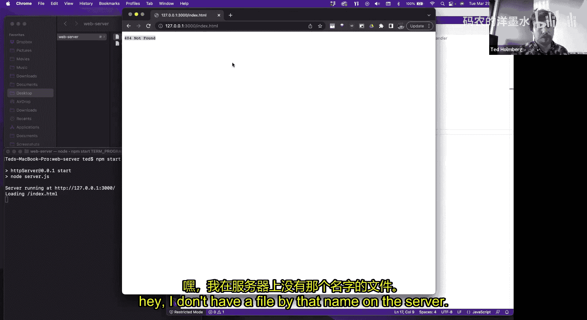

Excellent so now let's see if we can't actually respond with a 200 success。

 let's see if we can't identify when there is a file that exists on the server and if it does say yeah it does it does it does exist so here we're going to use the file system module again to determine the request of file exists and then send the 200。

If it does so let's actually create a let me do this touch index dot HTML Okay。

 and here we're just going to make an HTML document that has like hello world and actually we're going to do a HTML element so that I can ensure I get the。

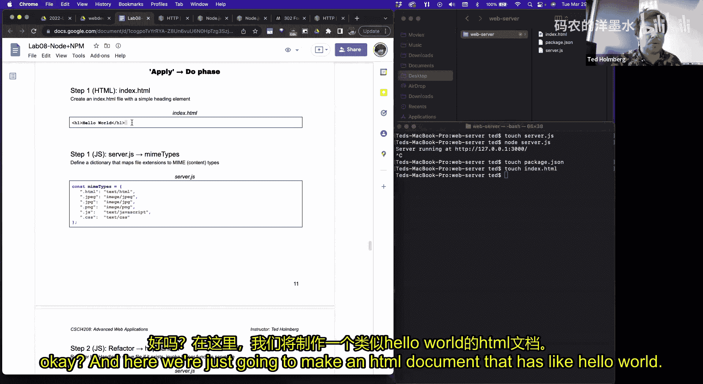

The appropriate styling too。I don't know let's do there Okay。

 so just H1 heading one hello world perfect so now I have one that exists。

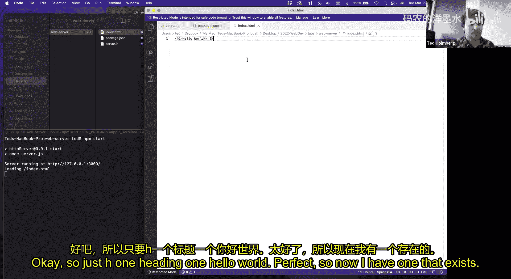

And then the next thing I need to do it's not just being able to have an HTML element that exists on the server now I have to start talking about identifying the various mindme types that the browser is requesting and I do that based off of the extension of the file itself so here i'm going to define a dictionary that maps each file extension to the content type to the mindme type so let me copy this i'm going to paste it and we'll look at just some of the most popular ones inside of here。

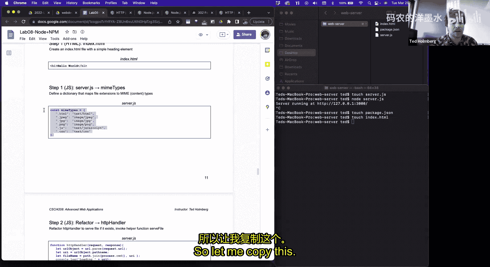

Yes。So here inside my mindme types， if it is in extension。

 HTML then I know that's going to be text type and then the specific type is HTML if it has JpeEG then it's going to be a type of image and the encoding is going to be JPEG same with JPEG and PG and JS text JavaScript CSS text CSS and these are all different image formats so again a well definedfined web server would have all these mime types that it can go ahead and know what the context of the asset of the resource that's supposed to be delivered to the client。

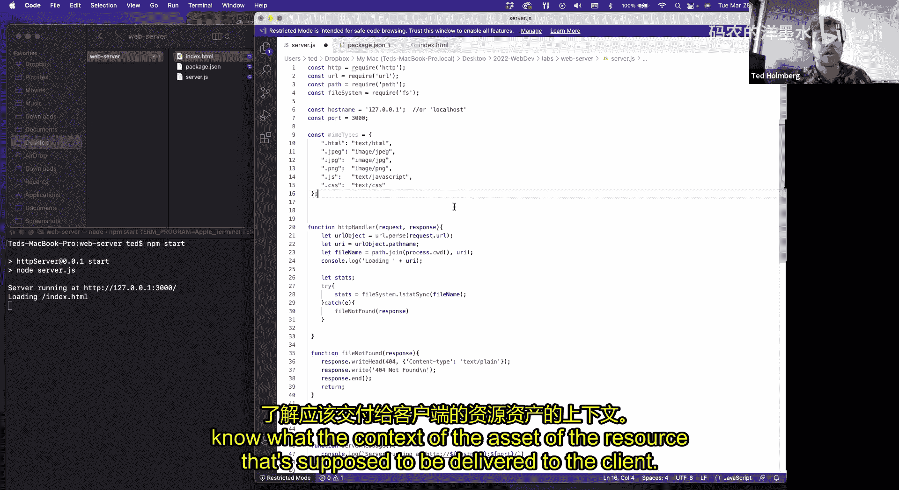

And so once we do that， let's go ahead and then refactor our HTP handler to serve a file if it exists。

And then we'll invoA helper method。

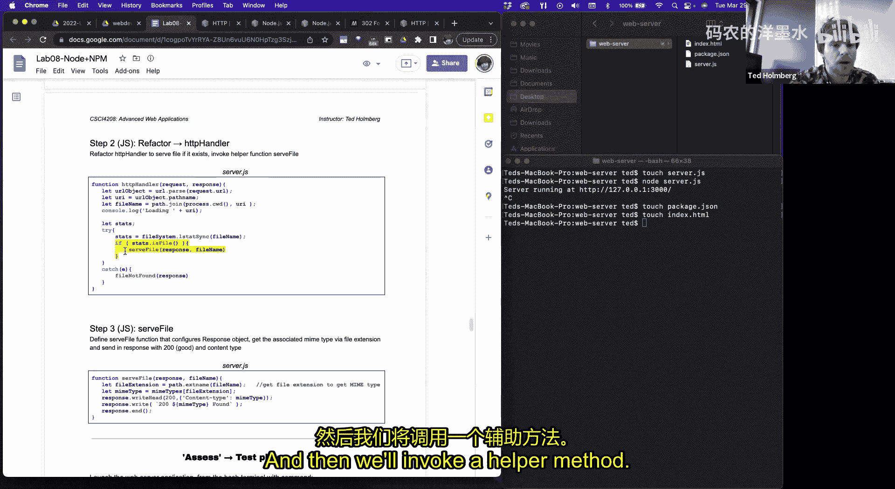

So let me go in here so right here I'm going to check if stats is a file。

 so remember stats is an object I'll do a console log so we could just see what that looks like here。

But okay， from this， since this now is a object that represents the file I can ask or the thing that it's synced with。

 it could ask it is it a file， is it is rectory there's a lot of information。

 we'll see what informations management would do console log。So but if it is a file。

 then we want to invoke our helpware function serve file where we're going to send it that response。

 remember we're always going to send it the response so that we can put what the code is so we can write a header into it so that we could write a body if we need to。

 but we also need to going to send the file name， right？From here that we go ahead and we。

That we had pared here using the URL and the path modules right we're going to send that to this other method too so we can use that to try to serve that file to the client so we're going to send in those two parameters and this will just be a helper method to help me break my code down across different method so it doesn't get too lengthy so what the serve file will do is define a server file function that configures a response object and it gets the associate mime type via the file extension and it's going to send a response code 200。

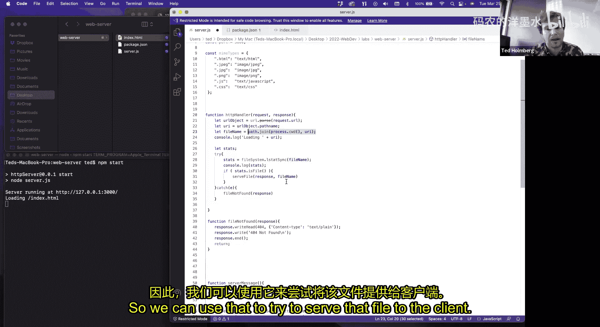

And the content type that is supposed to be delivered so we're not going to we're not going to send the content yet we're just going to illustrate hey we know what type of file you want to open and we have it it was a success。

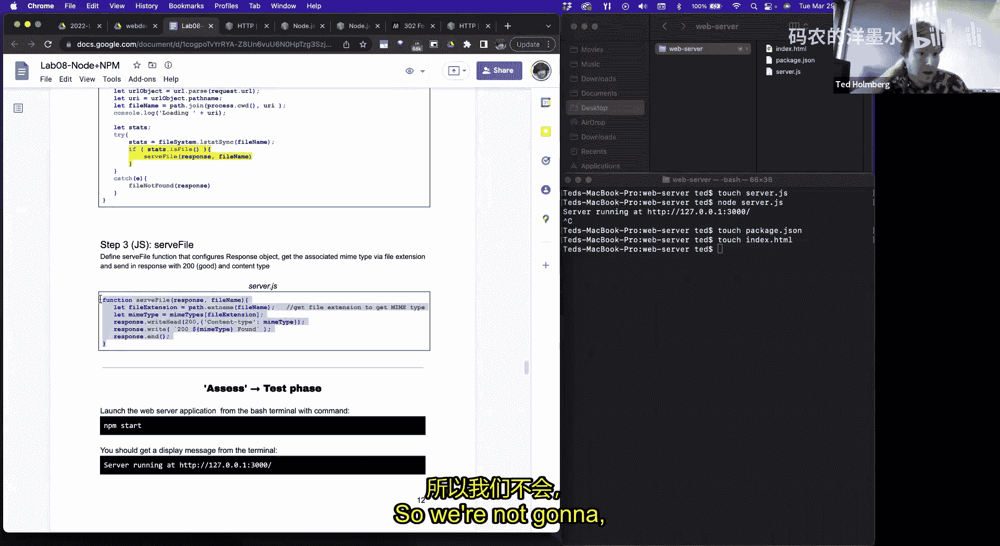

So let me go ahead and create this helper function serve file takes in those two parameters response and file name here what i'm going to do is from that path module I'm going to take that extension name so one of the cool things about node is I can ask a path。

What its extension is like dot HTMLtml or dotcss or dotjs。

And I'm going to pass the file name to be able to get that so that's going to give me something that is a file extension it's going to give me whether it's an HTML or JpeEG or P andG or JS then what i'm going to do is inside my mind dictionary I'm going to pass in the file extension that came from the path that was given to us from the browser from the client side。

And this is going to give me theMme type， which is going to be the value inside that dictionary。

 so if it's at dot hml file， it should give me text/lash HTMLl。

And so then what I'm going to do inside my response。

 I'm going to write a 200 success and then for the configuration here。

 I got to give it that context of the content type and the content type is going to be that mime type。

That we went ahead and de referenceenced， so in this instance， it should be HTML。

And then what we'll do is we'll write into the body 200 and then the mind type was actually found。

 so we'll actually see what gets rendered into our keyboard and then we have to end that response。

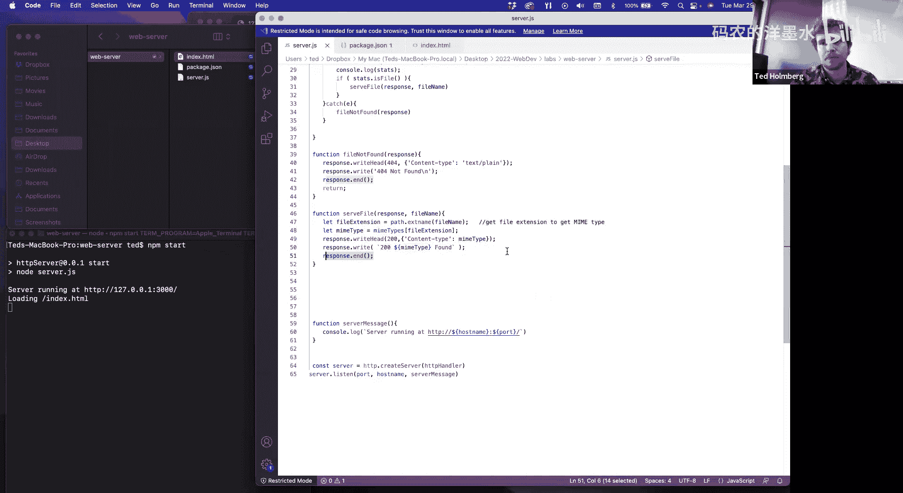

So then once we do that， we can go ahead and launch our web server。

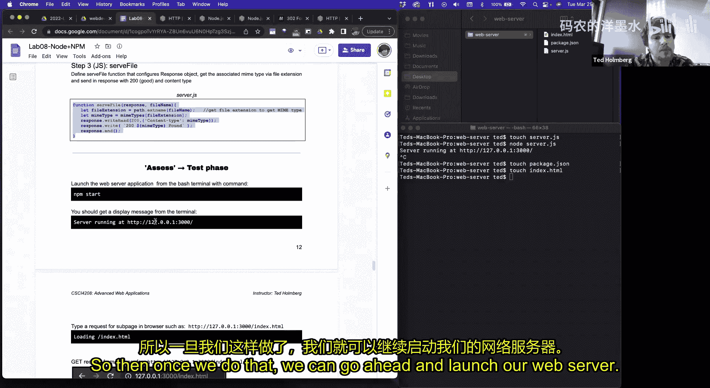

With NPM start， so let me kill it。Yeah。No， not now。啊。Make clear here。And let's do MPm start。

Excellent， and let me go to my browser and。And there's the stats object so you can see the stats object has like the mode and the UID and the block size and the size and all the information that's relevant for this file and a lot of methods here that's not actually showing you if you want to see the methods of a stats object you can just go to the API but two methods we'll be using is whether this is a is a file or is this a directory now we could see on the browser side when we request index that HTML that hey it was a success it exists on the server and that it founded as a text slash HTML file on our server So the next thing we probably want to do since we can actually identify let me remove that console log here before I forget。

So we don't keep getting this print out here。That was right here perfect Okay。

 so the first the next thing we probably want to do is okay。

 let's open up the content of that HTML file now that we know what the what the content type is let's deliver the contents of the file to our。

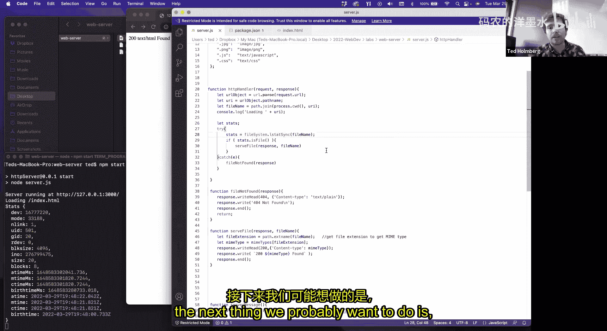

Client。😡，So here we'll serve the HTML file to the browser。Yep that's our goal。

 our approach is again we're going to use that file system module。

 we're going to use the file system module to read and send HTML files to the browser。

So super simple， what I need to do in order to do that is I will have these two lines of code。

 which I will explain in just a moment that goes into our serve file method。

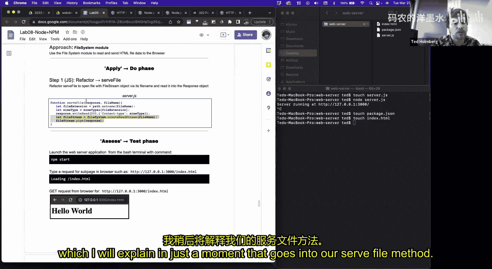

So let's go to our serve file method， so this was what we were doing before。

 So instead of writing this。

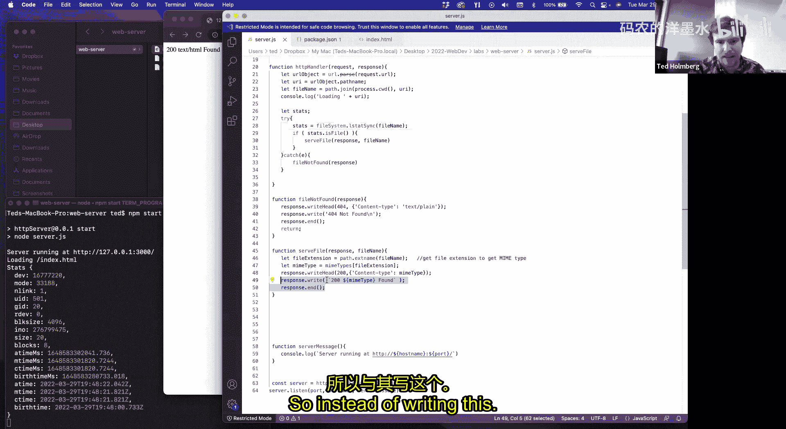

Yeah。

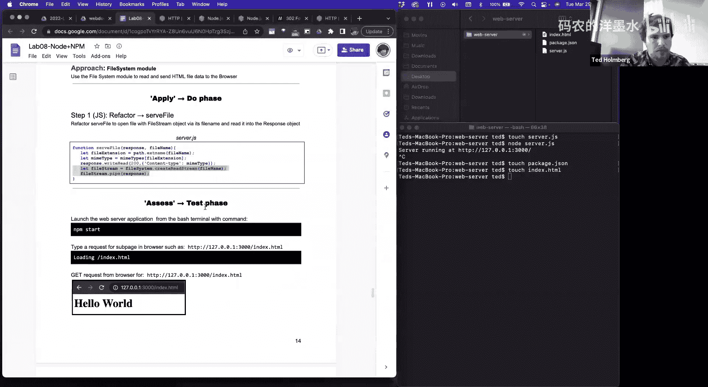

So instead of writing this。Like I just writing， I'm going to use the file system to create a read stream。

And I'm going to pass it the file name， so this will allow us to actually open up the file and then take the tokens that are inside that file and load them into a stream like effectively a reach stream。

And so we'll call this a file stream， so one of the things we can do with this stream as well。

once we can do with this stream then is we can tell it to pipe all the data from the stream into whatever we pass so it's going to pass it's going to pipe the information from the left hand opera of this dot operator so from the file stream into the response。

And so that allows us to funnel all that data from a file to through that connection via the response to the client。

And again， if we want to kind of read more on that， we could always see。

 we already did create server here， but I could read more about well。

 we learned a little bit about the stats。

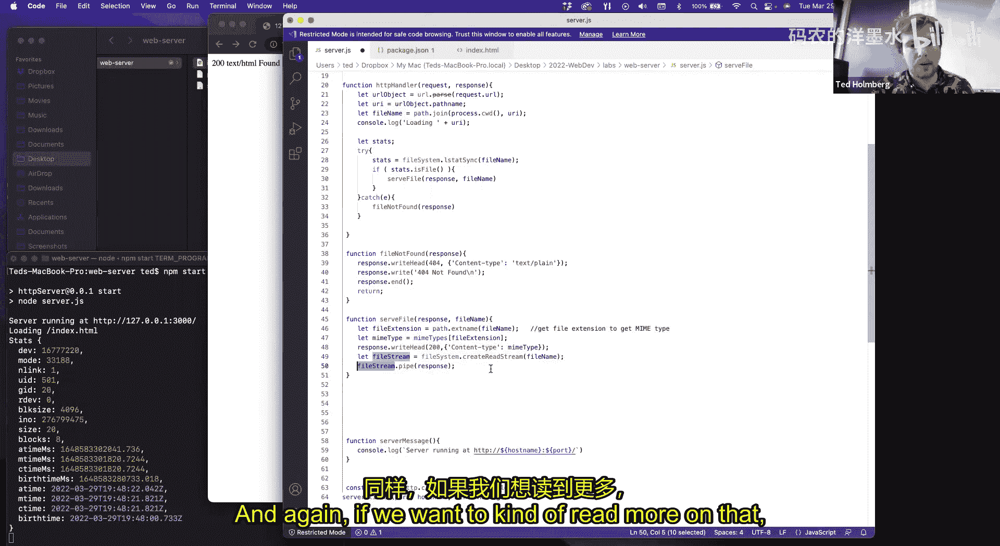

And so again， on the API， if you want to see more information about I file is directory。

 if it's a symbolic link， is it the sizes all the different things you can ask of a file。

You can go to nodeGS file that stats on Learn here。And if you want to learn more about streams。

 which you should be familiar from your Java classes。

 there is actually a section inside of their learning sequence here where you can learn all about how streams work specifically in Java now obviously one big thing that you need to do when you have have a stream is you have to create a reach stream from the file system and pass it a file that you want to create a reach stream from so you need a source。

And then you can then use pipe。And then pipepe will allow you here and a great explanation allows you to take the contents of a stream and then send it。

To some place and in particular want to s out to the response。

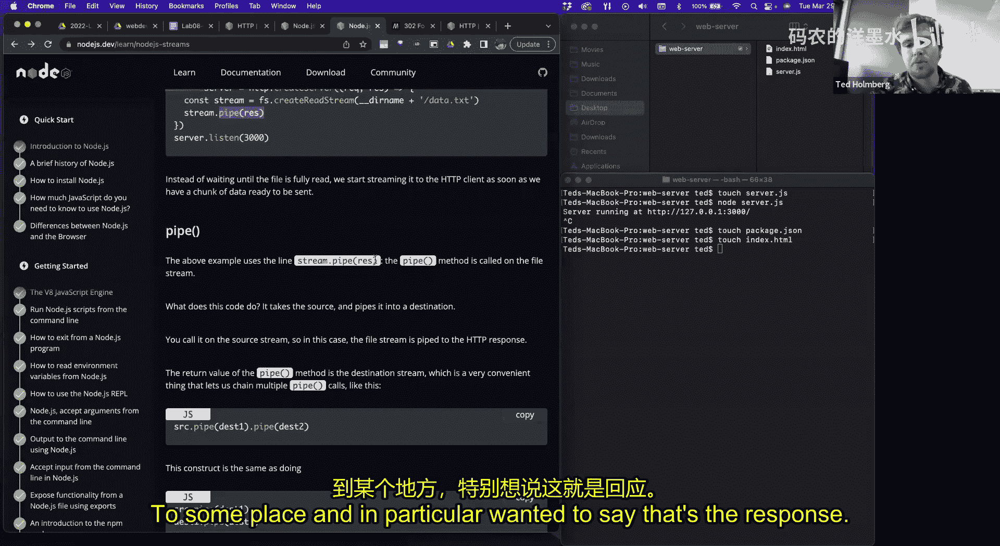

Excellent。So let's actually test that out and see if it works。

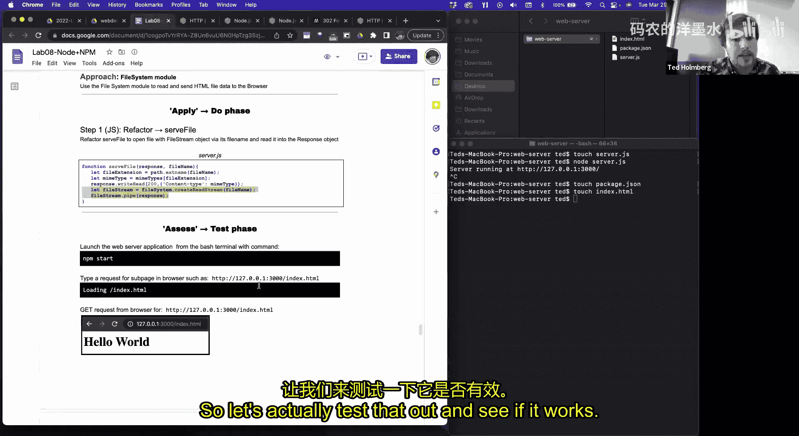

Let's kill the server， let's clear。And let's do MPm start and we will do a refresh here and notice。在。

Make sure everything's saved up I have a dot there。

 which means I haven't saved it so let's relaunch and just illustrates you always have to save your files and always relaunch your server whenever you do any testing so let's refresh there and there we go so now we actually got the contents。

Of our index at HTML file。😡，So get passed from the server to the client and the client goes ahead and renders it as HTML inside of our viewport。

So next thing we want to do， which is super common with the web server because that's effectively what we're building here is a very bare bone web server is if you don't。

Explicitly put that you're looking for index。htm， if you're just putting the slash or you're just looking at a directory for domain name。

 then the default file that you should look at on your web server is for an index。

 HTML and send that to the client。对。So right now， let's see what happened。If we remove indexO HTML。

It doesn't do anything， in fact， let me kill the client here， right？

Let me do NPm start and let me do。See it's trying to load slash。

 but I don't have a I don't have a route inside of my source code。😡，Right， for just a directory。

There's no file to serve that's from just the directory when I look at my source code and my HTP handler when I send in a request with just that route that URLI when I go and tap the file system to try to sync to that file name is going to ask is it a file and no it's not a file and so I'm not doing anything then right if it's not a file I'm just hanging and that's why I'm just never giving me back a response so what I'm going to do here is on the instance that if what it's asking for is a directory I want to do a redirect towards index H so let's refactor our code then so what we're going to do to do that is another status code we're going to use HTP code 302 which is a redirect and we're going to redirect from just a slash request to return a response for a s index HTML so it can render the index page。

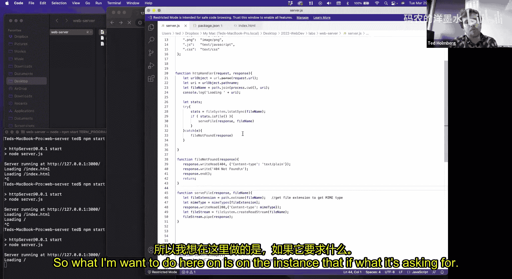

And again， if you want to read more about redirections， I have a lot of content right here。

MDN has a lot of information about how redirections in ACTP work and what it'll effectively do is when the response gets to redirect as a response。

 it will immediately go ahead and rere at where it needs to be redirected to。

So let's go ahead and refactor our HTP handler we need to put in an LSF clause。

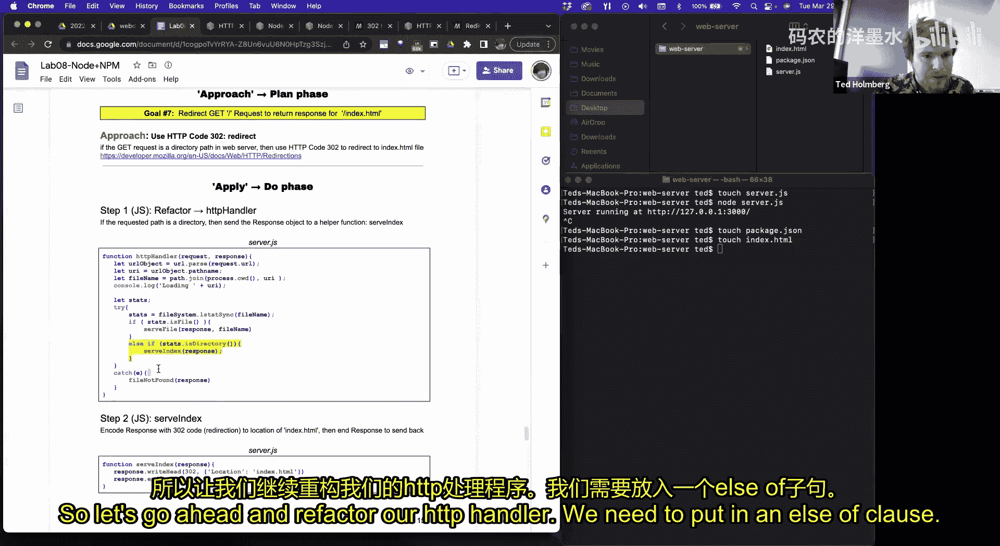

So let's put our else if clause here right where we're trying to access this file so again whenever you trying to access the file could throw an exception if the file doesn't exist or the directory doesn't exist and that's when file that found is triggered if it does if we do sync to something then it's either a file or it's a directory right if we successfully sync it's either one of those two things if it's a file right so we can we can query it and if this is true then we're going to tell it to serve file in which case we'll send the response object in the file name to be part of that resolution otherwise if it's a directory we're going to invoke this new helper function serve index and we're going to pass it that response then we got to pass it the response so that we can fill it out and send it back to the client so let's see what serve response is going to do so it's going to。

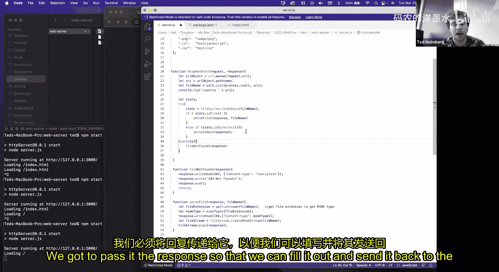

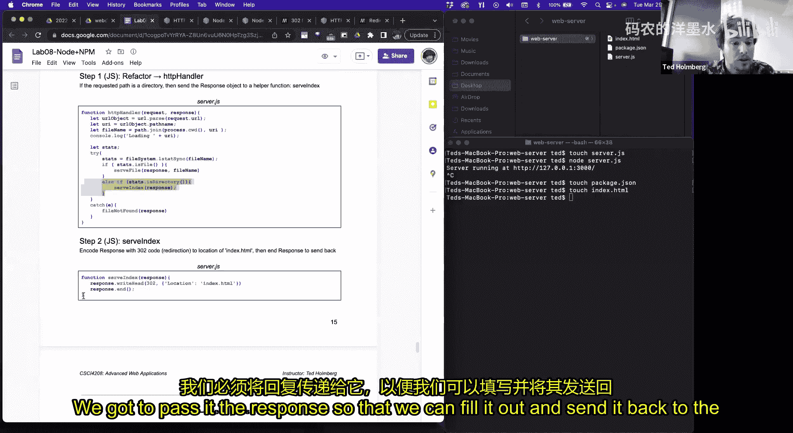

Let's fill this in here， so serve index。Which is going to be the name of the。The helper method。

 in the instance that the file name is a directory type。

We are going to take in the response into the response we're going to write a header of 302 that's a status code that causes a redirect and then we have to apply as a parameter the location that it's going to be redirected to so it's going to be indexed at HTML this is a key value pair and then we're going to end that response。

So that we can actually go ahead and terminate that connection with the client because look。

 I'm sort sitting here talking to you in the background， it's just sitting there still spinning。

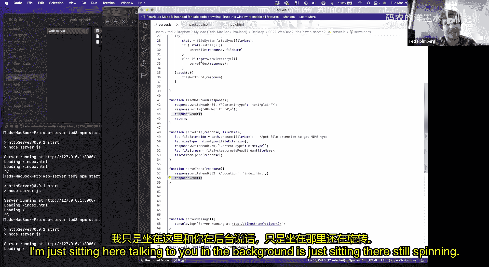

。And then we can test that out， we can go ahead launch NPpm start。

Let's go ahead and kill this， let's clear the terminal， let's dompm start。Okay， and let's see if。Up。

 you saw it。Right there， so I tried without index HTML it cause it did a loading here right from the server and then I got that 302 response which caused a redirect to go look at index do HTML and then it loaded index HTML right there so that's a good example of y and so there we go we do redirect and again if a file doesn't exist let's do like error about HTML。

Right I get loading HTML for four and I found yeah thiss starting to feel more like a good。

Basic web server， let's go back， okay， perfect。So the last thing we need to do here though。

 is on the instance that it isn't a client error and so far the client error when we request a resource that doesn't exist on a server。

 that was a 404。

And if it's not a success， that was the 200 that we saw right that's when we successfully request a file that exists so it's able to complete our request and if it's not a 302 that's a redirect right so that's like we requested the content at the directory and so we redirect towards the index HTML of that directory。

Right so we looked at all those but there's one less status code 500 that represents some internal server error and so 500 is probably the most popular server site error status code you're going to get。

 which is just like a generic error code if you can't find say for instance the file or the directory but it exists like so if you don't have like read permissions on it or the file corrupted or for some reason there's an error that occurs in even the logic of accessing it you might get this 500 internal server error code and we'll actually see how we could trigger that for instance so let me go ahead here and add this else clause in here so if the requested so effectively what I want to do just one pretty simple well I think two steps but the first what we want to do is inside this fLs is we want to check if the stats exists then if it's a file we're gonna to server the file if it's a directory then we're gonna serve the index。

Now if it's not a file and if it's not a directory then something is weird right。

 so we're just going to then say oh， wellll let it know that it's a server error and for some reason we don't have like permission to access or read that file or that file is corrupt and we can't pipe it the way we need to。

So this will just be the default else clause that we'll put in here。

Just to handle whatever edge case might occur。And usually that's going to be because of an error on our part and our logic for accessing something so here we're going to go ahead and invoke the server error function and send it the response so that we can write the response out and send back to the client here the server response the server error response is just going to be we write the head Saus code 500 the content type will just be text plane just like with our 4 or4 error here。

And we will then write to the body of the response oh this was a 500 internal error and then we will send that response back to the user and so if we wanted to test this out we have to break in order to test this we there's nothing we can do to test this because if we if well there is we have to break our serveral logic。

Because ultimately if we want to test 404s， we look for files that don't exist on our web server but when test 200s。

 we ask for files that do， if we want to get 302s， we ask from the directory perspective。

 but the only way of 500 triggers is if something goes wrong on the server side。

So to ensure that， let's break our code， right， to test this out。

So to actually test this let's go into our HTP handler and instead of having this condition that if stats is a file I'm going to accidentally put a knot there right so again you don't want to do this I'm doing this as testing purposes I'm actually breaking my code to force a 500 to occur so when I make a lock I'm going to check the condition of is file and if it's true I want to serve file but I'm going to say if it's not a file I'm going to server the file right that's an error and logic。

So and then if it is a file we know it's not going to be a directory thing because it's either a file or a directory so that's going to cause the else plus to trigger and that'll give us the ability to test our 500 status code so let's launch our server with NPm start let me refresh my page and there you see 500 internal error now if my if my code is written like correctly I shouldn't get that and in fact you never want to get that but you have it there as the ability to be kind of like your generic。

Tell to the client that hey something that' wrong on the server side and there's some internal error that's preventing us from from doing something from producing a response for you and it's nothing that you did it's nothing to happen on the client side it's an issue on the server side so let me get that running again and okay I can open it back up once I correct that logic。

Excellent。And that's pretty much it， we use node， just bare bones node and MPM in the cord modules of node to effectively build a very barebone web server。

 but now you can understand some of the considerations that goes into listening for request and sending back response to the client and what information you need to get from the request typically the mindme types and what you always have to tell back to your client like what the status code is and what the mindme type of the document that you're going to return back is and then if it is a document being able to you know actually access the file system。

 open it up and pipe that into the response so it can be fed into the client and the client can then use that and rendering into the viewport。

So next time we'll actually do something very similar but we'll use Express and you're going to see what Express does for us it takes care of managing all these considerations about setting up a web application that's going to have a lot of endpoints because you can see building up endpoints this way by hand would be very difficult。

 it would be very arduous Express allows us to expressly build out these endpoints and bind callback functions to them and manage all of the middle work of taking in news request and sending back response so that we can focus more on our app logic unless less on this request response logic。

Excellent so is there any questions about today's lab so just some final comments in this lab you learned to implement a basic web server a node that responds to HP request and serves HTML files to the web browser the web server supports 404200302 and 500 status codes。

And in this lab you learned about ACTP routes about MIme types and HTTP code。

 so all the considerations that go into responses as opposed to requests。

 which we've spent the last two labs on and about。So again。

 our future improvements would be to use Express to deploy more complex web server using less code。

So we do fancier things and it's actually easier for us。Excellent。So if there's no questions。

 I'm actually done today， so I can actually go ahead and we can actually leave a little bit earlier than we traditionally do。

Excellent， let me go ahead and end our video then stop the recording。

