# 【全集】加州理工学院 高级Web应用 中英字幕 1080P p15 Lecture 15 - 动态Web服务器 -BV192zTBrEmu_p15-

Okay so for today's video lab， I want to go and move on to showing off Express which is a framework that helps us build web applications using node so last lab we effectively built a static web server so the purpose of a static web server is it responds to a client。

Request to a particular route and then the only thing it does is it returns back effectively an HTML document there's no logic there's no dynamic logic there's no data persistence there's no there's there's no other。

responsibilitiessponi on the web server except to deliver the HTML documents that then get loaded into the client into the web browser and the web browser can then parse and display the HTML and apply the CSS stlings and depict whatever resources like images or audio or video or be able to parse any JavaScript that has been embeddedbed into that HTML and then run that inside of its clientside JavaScript ontime environment。

 so in today's lab。I want to pivot to looking at a dynamic web server and we're going to build a dynamic web server using Express that can actually go ahead and do other roles besides deliver HTML content。

 effectively we can go ahead and set up routes that listen for different HTTP methods such as puts or gets or deletes or post。

 and then we can actually have data that's persistent or at least available in memory on the web server。

And we can go ahead and request that from our web client。

 so we're going to see how we can build a simple web application using Express。And just you know。

 an example of a dynamic web server so we can compare and contrast it to our static web server that we built last time and we'll also see how Express makes this so much easier than hand rollinging those Susan just node and NP。

So of course， in order to do this， you'll have to have node installed。

And so going through just the quick table of contents here。

 again a relatively short lab today we'll have our lab introduction and then we'll go through the setup of an express app using NPM and then we'll create a server that sends a response and then we'll learn how to go ahead and create a server that sends an HTML file and that's effectively what we built lab there by by this lab will be done by iteration three then after that we'll learn how to serve another HTML file so that at least two HTML files that we'll then be sending then we'll learn how to actually be set up our server to accept different methods so again last lab everything was by default in response to a get method but we'll see how we can actually look for a post method and set up a route for that。

And then we'll see how we can go ahead and get data back as a query string。啊。

For the get for submission data。So and then lastly。

 what we'll do is we'll learn how to deploy this basic server。

 this dynamic web server onto the internet so that it's actually available using Heroku。Okay。

 so with these labs， you can start to see， once we have a baseline knowledge of JavaScript。

 we can really start hit the ground running with building applications using these frameworks。Okay。

 so a quick little introduction into this lab。Well。

 this is you can think of this as almost the second lab in a sequence you don't really need any source code from the prior lab。

 but I do it would probably be being beneficial for youve done to do the prior lab the static web server lab just to get some concepts under your belt before moving on to this lab。

 but there's really actually a little overlap so I wouldn't say that it's really a prere per se its just would be beneficial for your knowledge wise。

The motivation for this lab is we want to use Express to build out a web application and we want to use Heroku and get to deploy it into production。

Our goal is to build an express app and deploy to the internet so our motivation our goal are quite in line right now in fact the web server we're going to have here will have like a contact form just like what your portfolio page would have and we'll be able to submit to the web server on and actually kind of maintain and ask it for that information。

So our learning objectives for this particular lab is we want to learn about Express。

 we'll learn more about using Git and post AGTP request from the server side perspective。

 we'll use the body parser again to be able to access the request body so that we can go ahead and put data into there。

And we'll also go ahead and embed data into the response body。

We will serve files and JSON data to the client， and then we will also learn how to deploy using Heroku as our hosting service。

Now quick notes about our server side architecture。

 so when we start the project we're going to make a new project folder that we will call Express web server。

And that' where all of our assets and scripts will be organized in this instance we'll just have some HTML and some JavaScript script that will go ahead and produce over the course of this lab so actually let me see where i'm at here。

I'm going to print my working directory so I am in my lab excellent so let me go ahead and make a。

Express。Web server directory， okay， perfect and now that that's made， let me change into that。No。

Okay， good。Okay， so now I have my core directory for this project so as we continue on i'll be able to go ahead andbed things into there so some basic concepts that might be new in this lab that are worth mentioning JSON files again JSO stands for JavaScript object notation and here me blow this up to see if it's a little bit better for you to read。

It's a it's。Syntax that originated with JavaScript but is used in many more applications and programming languages outside of JavaScript it's become a standard in and of itself。

 but really it's a syntax that's used for serializing objects and arrays and numbers and strings and booleanions and all and all of the different data that we have all our different data types inside of JavaScript and it's based upon the JavaScript syntax。

 but again it's distinct from JavaScript now so it's become its own entity with the zone set of rules in fact the rules for producing correct JSON files is more rigorous than the rules for defining like strings inside of JavaScript you always have to use the double quotations for instance instead of the single quotations or。

Apostropphes。Okay let's say Express is our full web framework and we'll act as our server so if you want to know more about Express there is a link in the lab that you can go to and you can read all about the API it's great because it's got some getting started information it has guides that define how to use all the different various components of it and then of course they have the API reference so I implore you instead of a textbook I think it's more valuable to use the documentation because they're always going to be more up to date。

And just web applications， the technologies that drive web applications。

 it progresses so quickly that you want to go to the source of truth to the most current builds。嗯。

And of course， I have companion lectures as well that I would point you towards。Okay， let's see here。

 I think I skipped this when I was going through JSON files。

 the reason why we want to know about JSON files and why you want to make sure you have this syntax is we're going to use package do JSO。

Similar to what we did in last lab， but this lab we're actually going to use it a little bit more intensively last lab we used it to illustrate its base case on how we can use NPM the new package manager to kind of be our build tool but here we're going to actually use it to actually install some dependencies so again this is going to be you can think of it as our apps configuration file NPM uses it to initialize and launch your apps and again you can learn more about it here inside of the NPM's documentation page。

See again， I should already have a companion lecture for NPM that goes into all the different elements of this。

 but here you get to see all the different attributes。

 the properties that a package on JSON can have and how NPM will parse it and utilize it。

Okay we have talked about rest endpoints plenty of times before or from the perspective of a client。

 but now we're going to start looking at rest endpoints from the perspective of the server who will be setting up routes on those endpoints and responsible for delivering the data so again when an API interacts with another system the touch points of this communication or considered endpoints so for APIs an endpoint can include a URL of a server or a service。

So usually our clientside application will request information from the server side portion of our application and so we give it special URL endpoint so it can access that information so we don't host any HTML documents there we're actually delivering data back and forth there here we're going to use Git and whenever we listen for a Git request we either listen for for something like an HTML file or JSON data right so we're going to return either files or data and then the post request when we listen for a post really what we're looking to do is submit data to the server and in this instance it's going to be in the form of a contact form。

And then just a little bit about Heroku heroroku is a free cloud service that hosts web applications。

 so again if you go to Heroku's webpage and we'll look at that at the later step you'll see that it does include a free tier and so we will be using that free tier for this class。

It allows us to deploy a web application to heroroku that requires node to run node applications offer more powerful and flexibility than just clientside apps right so up until then we've been deploying our web applications while our client side applications really what we've been building are browser applications and we've been deploying our browser applications onto Github pages but Github pages is only a static web server which means that the onlyresponsibilities that can have is to deliver HTML and it's associated content to a web browser you can't program it with any other logic beyond that in fact you don't touch any of the logic on the web server when you deploy to Github pages Heroku allows us to actually run a instance of software。

On there。On their platform， so it allows us to actually have a web server that we can program with our own logic。

😡，And be able to go ahead and respond to ACTP request so that's going to be the big distinction between Heroku and what we have been using GiHub pages for is that we'll be able to actually launch an instance of node and actually run our node applications server side。

嗯。Okay， so we'll also be using the Heroku CLI so that's the command line interface。

 which should make it easy to create and manage our Heroku apps directly from our terminal。

 and then we'll use Git to deploy from our local project to the remote production servers that are hosted on Heroku's platform。

So again， if you want to read more about how we can use get in line with Heroku。

 I have documentation there and I have some documentation on the command line interface for Heroku。

And so we should see an example of that today。Okay， so iteration one here。We're going to set up。

Our express app with mm so in order to do this before we start building anything。

 if we want to use express express is an external module right it's it's a framework that does not exist。

😡，In the core modules of node， so we're going to have to use NPM as our package manager to go ahead and solve it so we can start using it。

So in order to do that， we're going to create a P JSON file that we can tell NPm to go ahead and install our dependencies。

 so again the approach again if we want to use NPM which is our package manager to set up our back then。

 then we have to have that configuration file named Pakistan JSON that installs all of our apps dependencies and defines a launch command for starting our app。

So here， let me go ahead and create this touchch。Package do JO there we go and now now that exists perfect。

 so I'm going to create that and it's going to contain all the metadata for managing building and launching our our node app。

And so just remember， since the extension is a JSO we it's effectively a declarative format then we have to adhere to the rules of JSON so double quotations in this so let me go ahead and open that up。

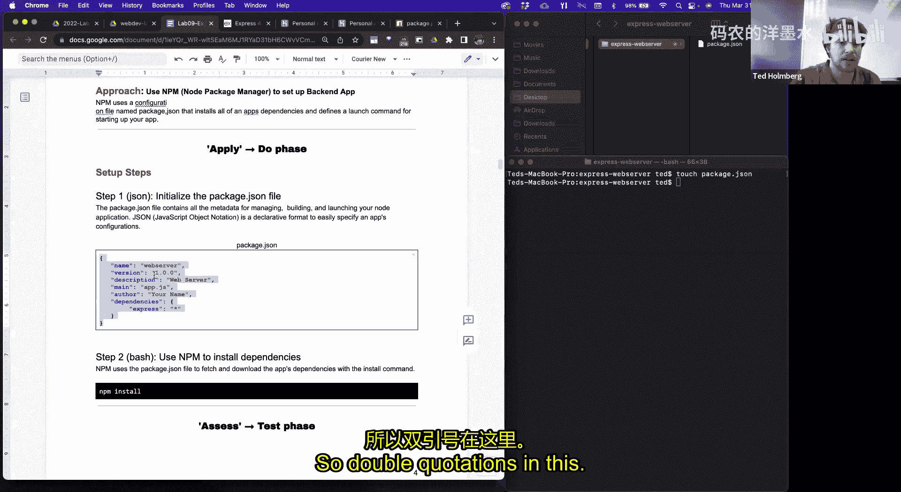

Go to express web server package Json here Okay， so inside of here I'm going to create。A。

Effectively JavaScriptscript objects I'm using curly braces inside of the curly braces very similar to the last time I created a Packers do Json I'm going to have a key value pair and some of the basic properties that you want your Packers do Json to have is a name for the application here I'll just call this web server a versioning of your application here I'll call this 1。

0。0 a description for what this application is here I'll just call it a。

There only can be better about this dynamic web server。using。Express perfect here for main。

 I'll go ahead and define what the main launch point of my application is， which is app。js。

For author， you'd put your name here and now here this is the new thing we're going to learn we're going to cite what is the collection of dependencies that my app's going to require and so since this can be more than one thing I'm going to make this an object in and of itself and so inside of this object I would have a set of key value pairs where the key is the dependency I want to have installed so for instance Express is the web application framework that I want to install and then the value is what is the version you want to have installed and so if you always want to have the latest version you can always use the string of asterisk or star。

For it to pull whatever the most up to date version is now the reason why this is an important concept is these these modules can change very rapidly and to ensure no new bugs are introduced into your web application。

 you can force it at a particular version at any time。

 so you guarantee that your web application will work reliably so that you have so it's a little bit more robust。

And its in being able to launch up and not give new bugs each time because one of your dependent services have changed。

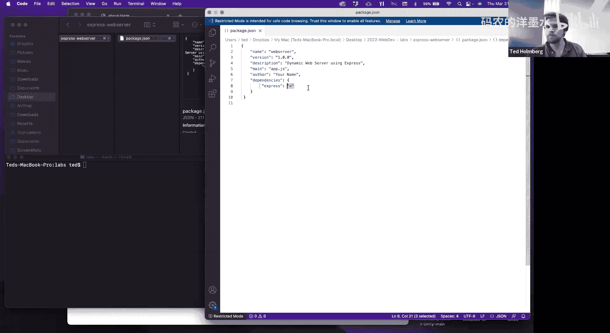

Okay， so we have that made。So the next thing I want to do is from my bass terminal。

 I want to use MPm to install those dependencies。

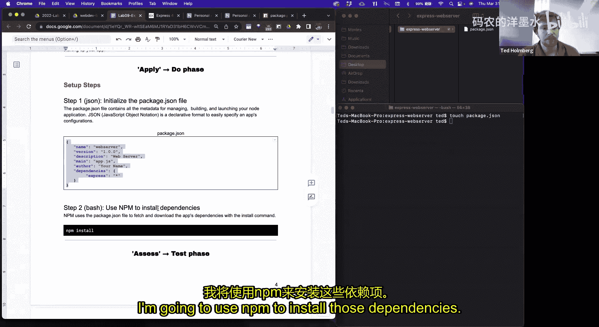

。Okay， so let me go over here。And let me make sure that where am I here Okay。

 so let me go into my express Okay， let's clear that and then let's do NPpm install And so what that's going to do is that if there's a package do jO when I do that iss going to parse it and is's going to execute any relevant。

Instructions inside so since there was a instruction for dependencies notice it created node modules folder and it went ahead and installed all the dependencies not only for Express and not only installed express but then Express itself has all of its dependencies right so when when Express gets installed it checks well what is express need and so notice all this other stuff that it gets installed for us and again that's the beautiful thing about a dependency manager right we don't have to know what we need to installed for Express to work it does it for us it handles the responsibilities for us so now we have everything installed for us to start using Express right at the box。

So let's move on to。Iteration to here for this goal， we want to go ahead and what's going on。

 let me do one thing dude no that didn't quite work。This is。Yeah。Weird。

Just okay perfect just trying to get this where it needs to go Okay so federation to we want the server to send a response so our goal is we just want to send a hello world response message from our server so for this approach we're actually going to use express as opposed to the module aP to set up and listen and respond to request。

So one advantage of using Express is that it will make it easier to set up a server。

 but it also supports what are called middleware modules that make building backware services much much easier and so we can import the modules and use them in our app and so that allow us to define kind of a workflow from when we get a request to when we deliver a response。

Because all of our business logic， all of the logic of our app is going to happen in between those two things for the moment we get a request and deliver the response back to the client Okay so the first thing we want to do is we're going to have to build an app dojs file okay let's go ahead and make that。

嗯。Okay， and inside of our app yes we're going to define the data we're going to need so let's go ahead and take a look there's only three pieces of data we're initially going to do let's open up our app dot JS inside of our ID。

Perfect。Okay， so here I'm going to import express， so again。

 I'm going to import things using note for note I'm going to import using the required method。

So it's a little different than the way client side works now they they do have an experimental way still for importing it the way client side does。

 but it's a little bit more complicated so we're going to use the traditional method that note expects so here this allows us to go ahead and get the Express object。

That has all the express functionality in there for us。

 and from there I'm going to invoke an instance of an express app。

So this is obviously a function object， I'm getting reference of a functional object and I'm actually invoking it which will build an instance of an express app for me and then I need to define a port。

For my Express apps， I'll define Port 3000。

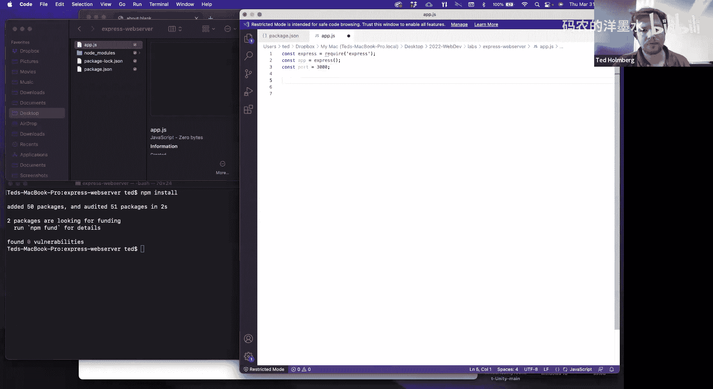

Then the second thing I want to do is I want to define a get route。

Right so when I get ACTP get method I want to define at least the at just the directory just slash at the root directory I want to。

Have a callback function attached to that。And so that callback function will handle all the logic for whenever we get HTV requests。

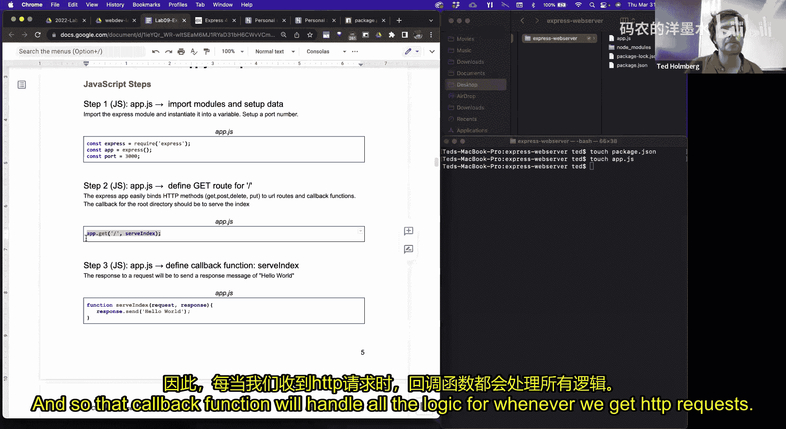

Sent to our root directory。So here we go， So we'll just put so from our express app on the instance of a get if that git is at the URL so the this is two parameters right the first parameter is the route we're listening on。

Or the route that we want to tether a callback function to and the second parameter is the callback function we want in response to that。

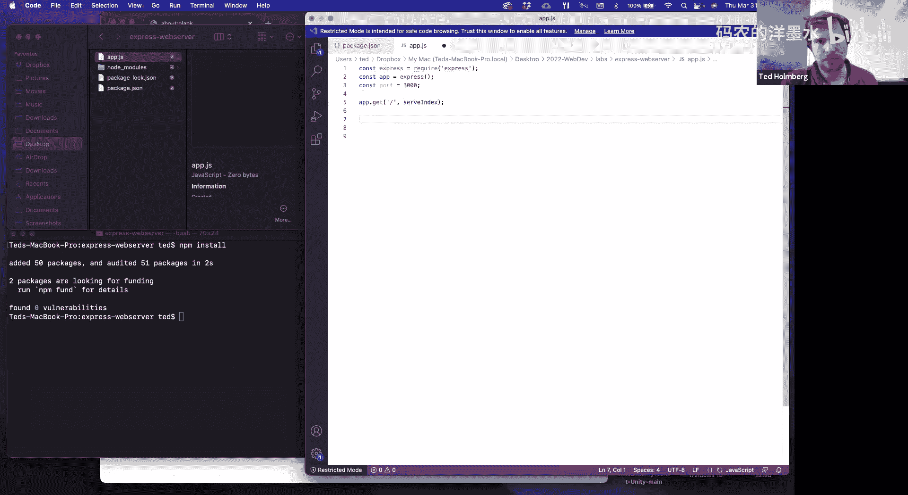

And now what we have to do is we have to define that callback function。

 so the response request will send a response message hello world。

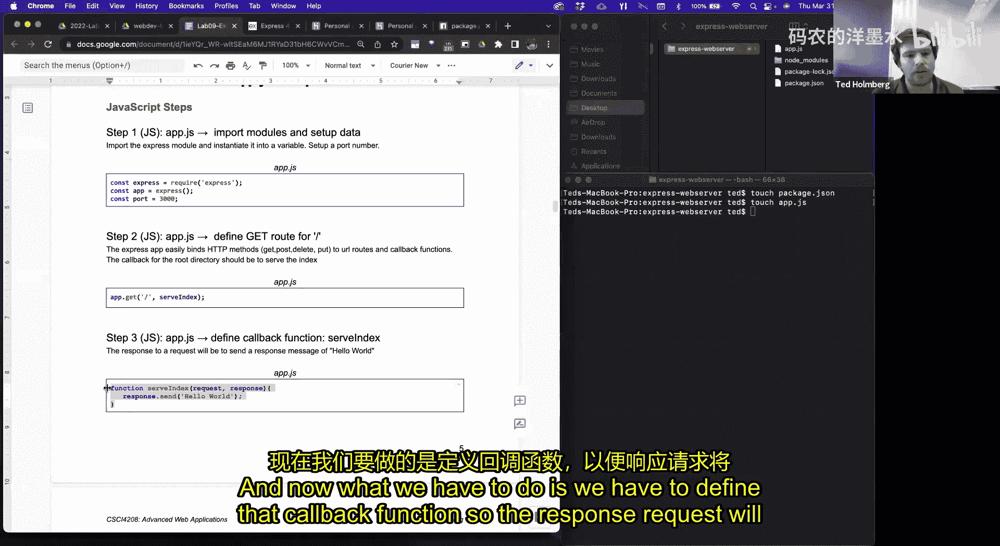

So， here。I'm going to create a function and notice I'm doing I'm declaring the function here so it exists so it gets hoisted。

So I'm not doing a function assignment， doing a function declaration。

 so it gets hoisted when this document gets parsed originally so that I have a reference an meaningful reference to it here at line five。

And so that's taking advantage of how hoisting works in JavaScript and so all of my callback functions are going to take in two method。

 I mean two parameters a request object and response object。

 both of those will be delivered to me by the Express server just like the other server just the HTP server did last lab and here for the response just like last time I'm just going to invoke the send and send a message hellello world。

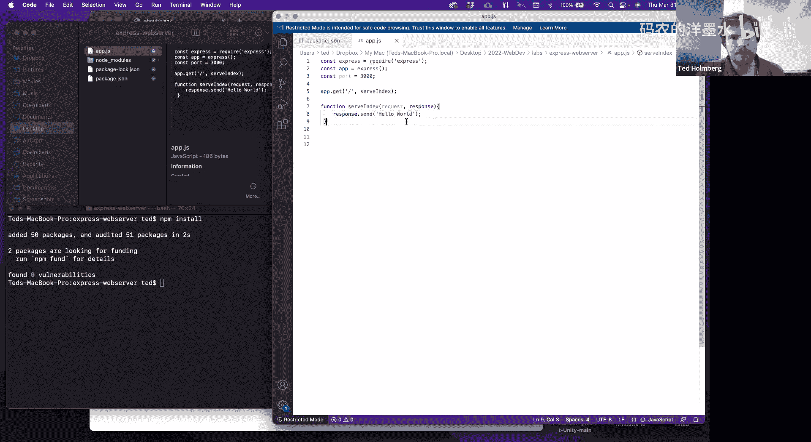

Okay。And of course， just looking at this， just like I have the get method that the Express app will easily buy any HTP method so I could also have done post。

 delete or put there and just buy the URL route with the callback function。

 so it makes it very easy to set up routes。And then the last thing I want to do for this step is I want to have my app start listening on the port。

And。Instead said， let me copy this。And I'm sure I'm going to put this down here。

 so I'm just going to let all of my callback functions get declared at the bottom。

And I'll do all of my routes here and right after I define my routes so I'm going to tell my app to start listening I know I'm going to tell start listening to this port number support 3000 and then after it starts listening I'll do it this console log message just to say that the server is running。

On that port。Okay， let's。Let's try to test it so if we type in node app。

We should be able to on our server， we should get a message on our server saying the server is running 43000 if we open up local host43000 we should get that hello world so let's test that out so let's do。

Noude。系。Server is running on 3000。 So now let me go here to。

Local host 3000 and there it is I have a hello world message that's perfect Okay。

 so we have a functional server using express。Let's move on to our next goal where we actually want to build an express app that can serve HTML T file and again by the time we're done this。

 that's effectively what we accomplished last lab。So here we'll have to build an index on HTML file so we can serve to the client our basic approach is while Express has a built in modules for managing and parsing the content types。

 the mind types that make handling requests way easier than what we're doing last time when we had to manually do that ourselves。

 so web servers are much easier to build in Express。So for our steps here。

 let's make an HTML document an index。 HTMLml perfect。

And let's actually go ahead and just make a heading element that says hellello world。

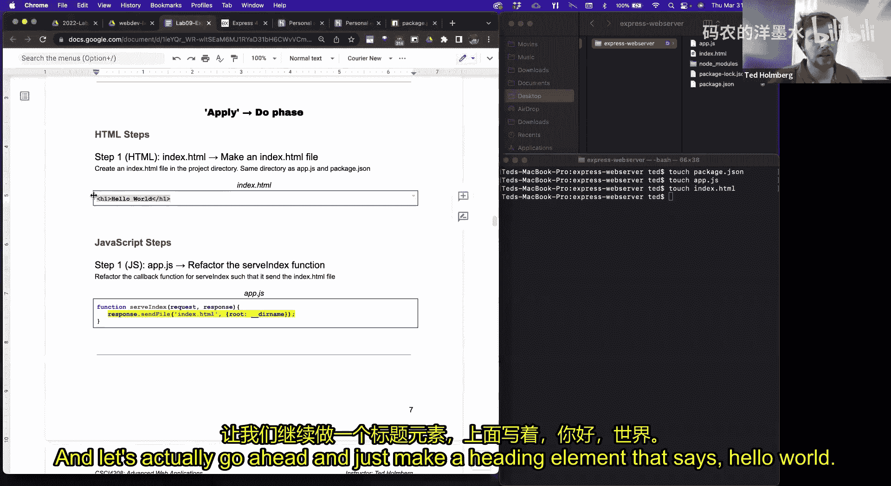

Test this out so let's go here， we have the HTML we just built let's let me open it up in my IDE and there we go we have some HTML。

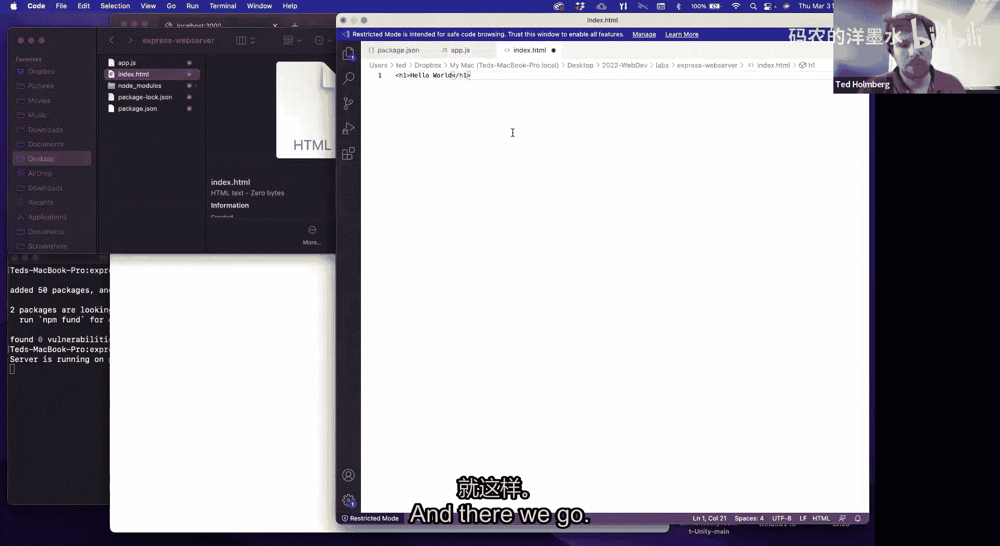

Okay， so now that wake to reach Tmo inside of our JavaScript， let's refactor our Ser index function。

 which is that callback function so that it actually serves the file instead of just sending the hello world message so let's go back over here to serve index and our app so this callback function so instead of telling the response to send this string we're going to tell the response to instead send a file。

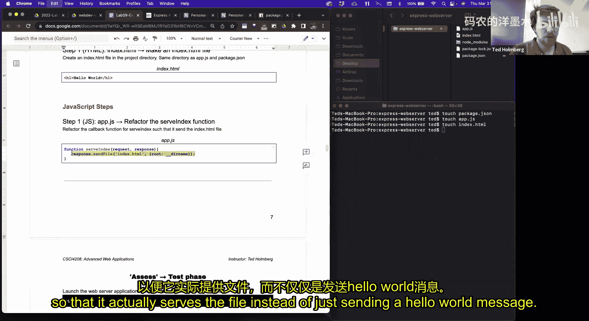

And so when we send a file， we have two different parameters we can deliver， we can deliver。

 first of all， the name of the file that we want to send to the client and the second parameter is what is the root directory。

Where this file exists at and so this is an object that is a key value pair where the key is brute and then we're going to use from node perspective the built in directory name that were actually launched from。

And so that's just underscore， underscore their name。

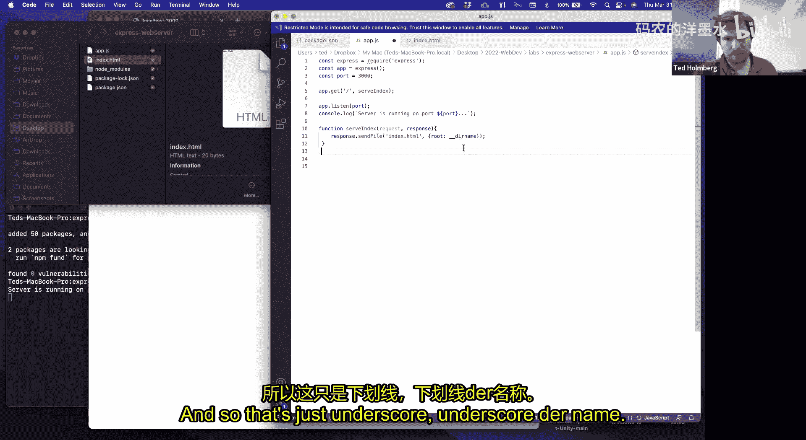

Okay， so when I do that。I should easily be able to now relaunch my web server and so here。

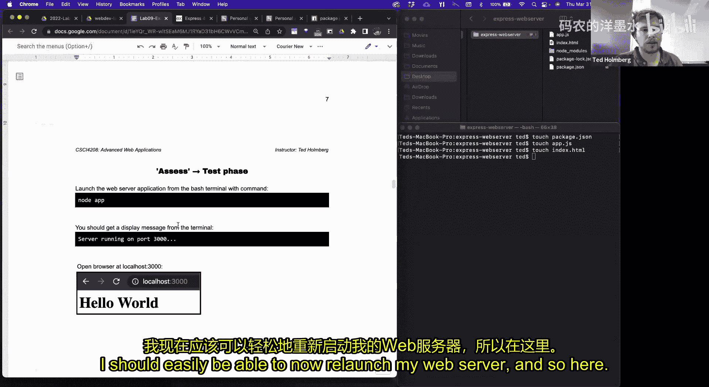

你 see if。And let's see if。There we go， so now we can actually see we have an HTML document because we're actually getting HTML format a text。

So it's that easy to deliver HTML to build a static server。

So now let's just test this out by having it send a setup our server so it can handle delivering us a second HTML file。

So we have that index on HTML whenever we go to the essentially root of where our web server is hosting content from。

 but let's make another file like say， for instance， a contact HTML page。

And let's set up a route so that we can get that file from our server as well， so again。

 the approach is we'll use Express to set up that different route。

And we'll create a contact form that will be on a contact HTML page and we'll learn how to go ahead and。

Get the submission on that over the course of this lab too。 so let's create that contact on Hml。

 So in our first step is let's actually do some H encoding in there。 we'll create a contact file and。

It's going to go in the same directory as the index on HTML right will make everything。

In the same place。And then we will go ahead and make a form。

 this form will have a method of post when you hit the submit button。

 the route that it's going to send that to is going to be contact slash send。

It will have three inputs， one input that will be for text。

 it will have the name of name so that when we send that to the server。

 the server will know how to associate that because the key it'll get is name and placeholder inside will be inner name and we'll have an email field with a placeholder of inner email and then we'll have the name email and then we'll have a text for message which will be the name and inner message and then they submit button excellent。

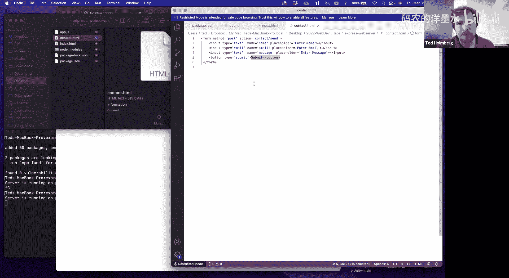

So now let's go ahead and set up our JavaScript Express app so that we can actually deliver that to a web client。

 which means we'll have to define a Gi route， a gi method that's listening on the route/cont。

htm and so again we'll just use express to bind that request to the URL route and then a callback function that gets triggered whenever a request is sent there。

喂。Okay， so let me go to do my。

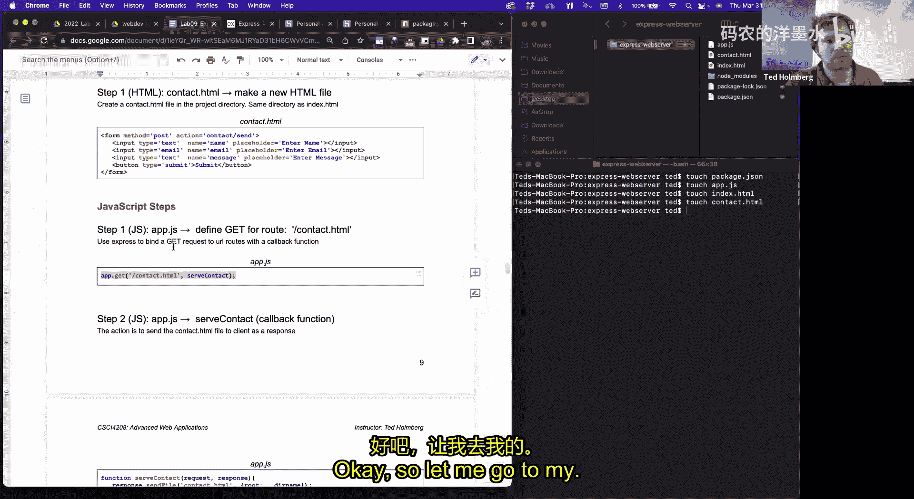

Up here。So here I'll actually listen not just at the root directory。

 but to contact HTML and when I do i'm going to invoke this server contact Ser contact callback function。

 which hasn't defined yet so what our callback function the action we wanted to do is to send the contact HTML file to the client。

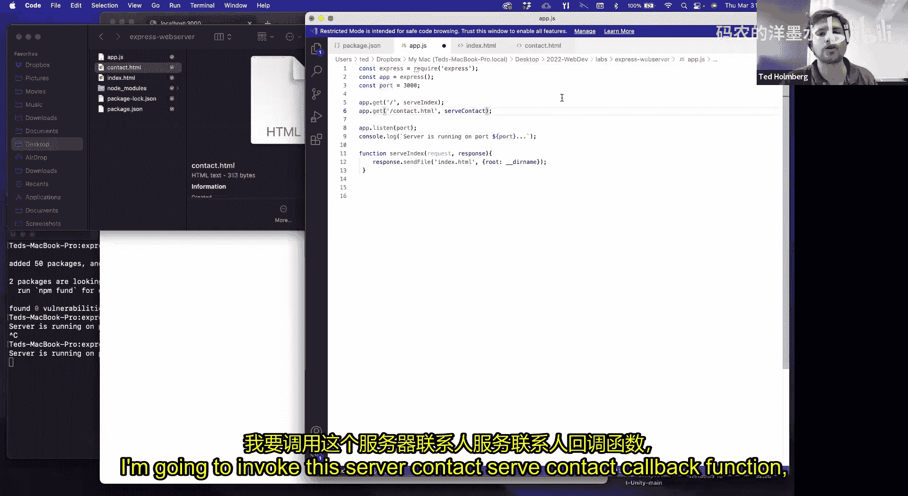

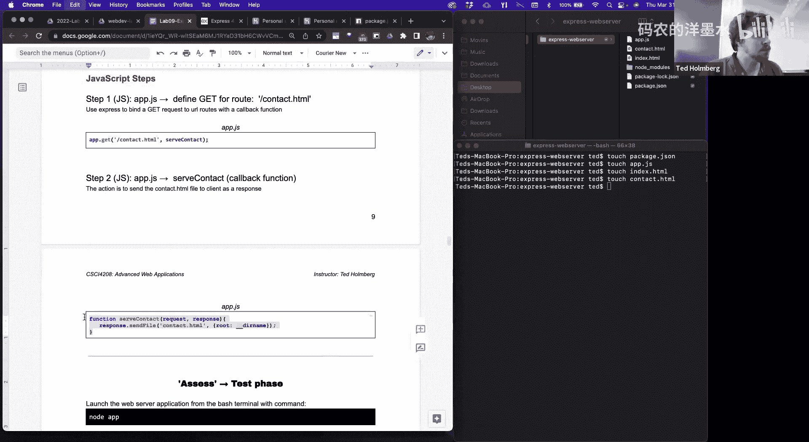

Os。So here we go， so we have a function and go again i'm going to declare it so I can take advantage of voicing so I can have all my callback functions at the bottom by my file here so I can have all my。

My executed statements at the top。Makes it easier to read through for me so again we'll have a request on responses parameters and we'll again tell the response to send a file in this case it's going to send the contact@ HTML file and the route's going to be the same because we have in the same place。

Let me save that。

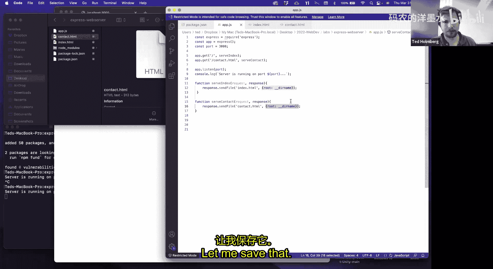

And so that's it I should be able to launch my app and then I can try heading up from local host slash contact@ml I should be able to access this new HTML page let me just copy that here let's relaunch our server me so i'm going to kill it i'm going to relaunch it。

I can still get that， but now if I do concept farm。Or contact@ HTMLt， yep， I now get an HTML。

Page that has a name field， a email and a message and a submit button， perfect me。

Come on server for now。So that if I hit refresh。Yeah， perfect。way I can make sure I test each time。

Okay， so。For the next iteration， what I want to do is don't want to set up a post route and so here I'm going to bind an action。

To a post request from the submit form and so my approach here is again。

 we're going to use Express to set up a post route。

And so in this generation we'll just do a console log on our server that will receive a post request from that post route so inside of my JavaScriptscript what I want to do is I want to bind a post route to the callback function that we'll call contact handler and look again what this route's going to look at so it's going to do slash contact slash send right which is the same。

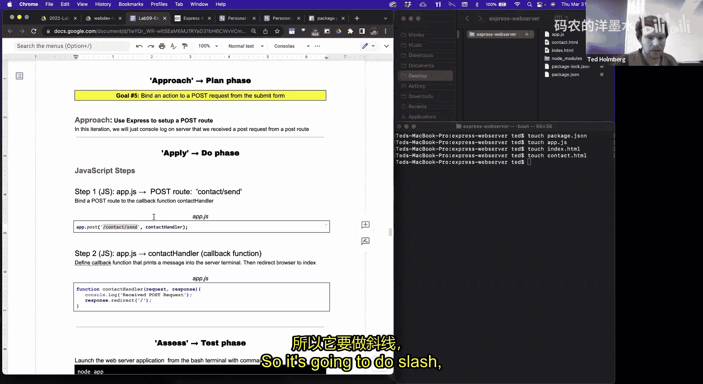

If I go back to my HTML in my contact form that's the action right so the action is going to send this post request on a submit to contact/lash send and so on my server I want to listen for a post on that URL right right that route and in response to that is going to invoke contact handler。

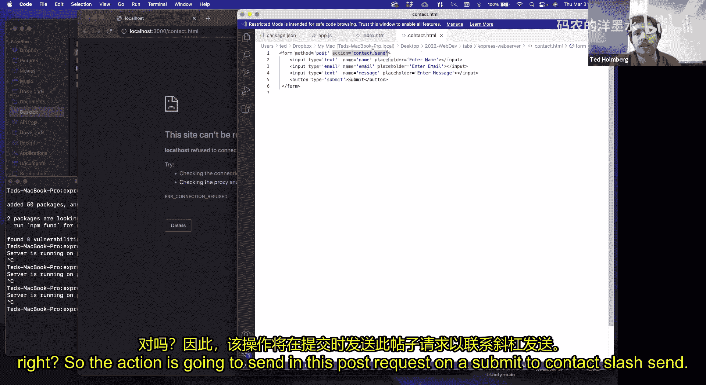

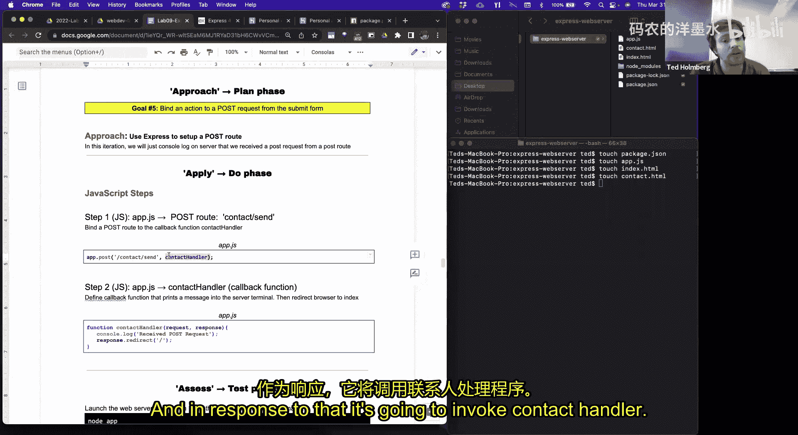

So let's go into our app JS and right where we've been setting up all of our endpoints。

 all of our routes， we have a git for delivering our server to serve an index file。

 we have a gi to serve a contact file and now we'll have a post that listens here and then it will invoke this callback function contact handler。

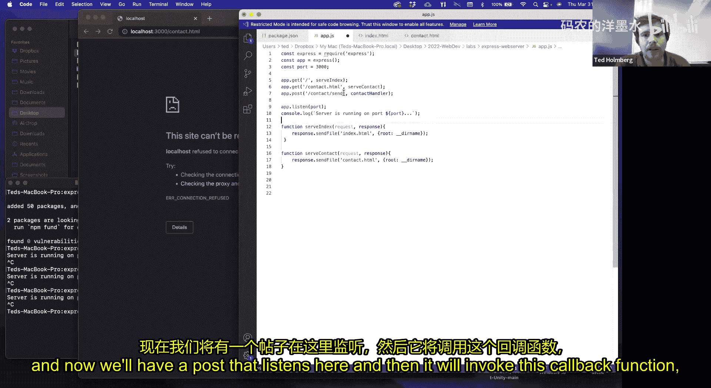

And so the contact handler will effectively just print out a message in the server terminal。

 and then it's going to redirect our browser back to the index page。

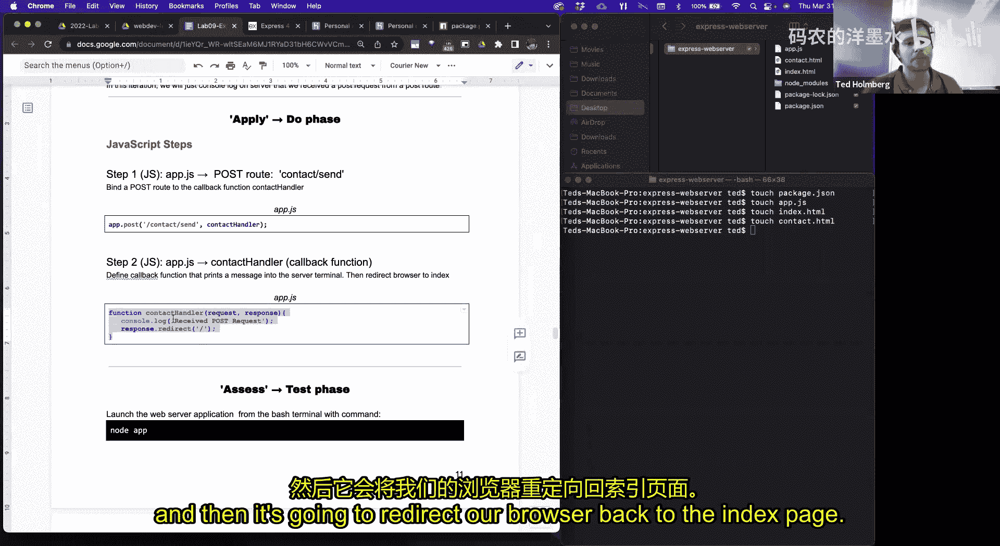

So let's go ahead and declare a function here， contact handler again。

 just like all of our other handlers that we're doing that we use for managing our request and responses。

 we have those same parameters。And here， just to test it。

 we'll have a console log message and this console log since this is running on the server should appear inside the terminal that's running our server application。

 and then it's going to tell the response to redirect to the route directory and when it gets redirected to the route directory。

 then that's going to cause the client to send another request that's then going to serve the index and then send to us to the index page。

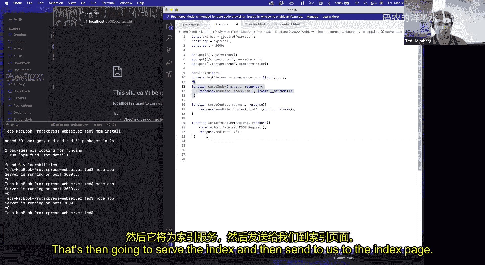

Yeah。

Okay， and that' that's it after we define that that endpoint that route with that callback function and behavior to that callback function。

 let's test it out， let's run our app again and let's navigate to the contact page will enter in some information like user user email hello world right click submit and then see if we get a message that just says that our post request was received。

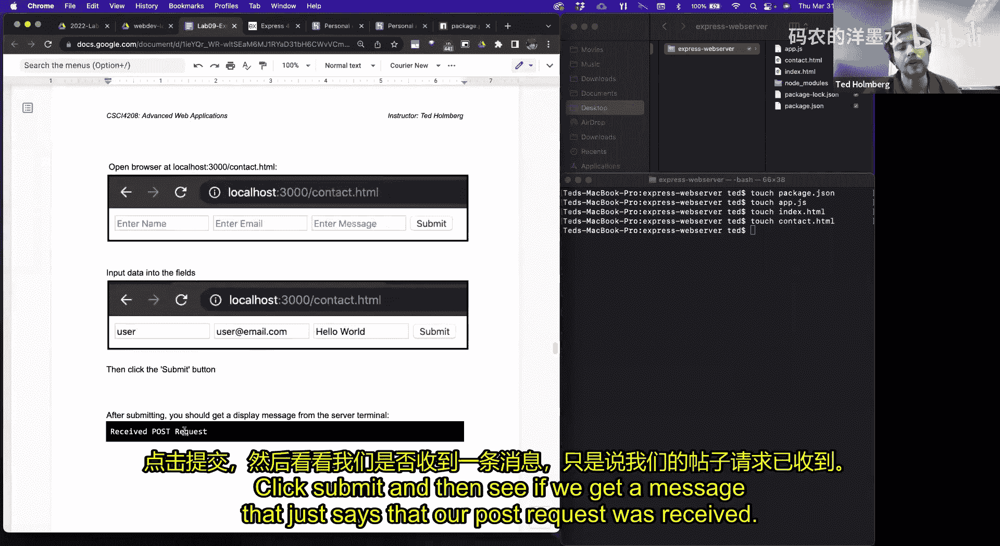

So let's go ahead and let me clear as so let's go ahead and run our app so our app is now running let me go ahead and refresh okay we have the file that got delivered let's type in user as our name let's type in user at email co as our email address and let's type in hello world as our submit honestly could be any of those things these are just test data to make sure that this is running the way we wanted to now if I hit submit from the client side and notice I did redirect back and notice the URL even shows that I'm at the root directory I have the hello world message and from my server side that's running my server demon here。

I see that I received a post request so now I know that I actually got that request from the client to the server so now I can implement some logic to do something about。

So that's going to bring us to goal number six。Where we're actually going to use post and then try to parse the query string that gets sent to us via post request so parse the client data from the post request。

Is really going to be the goal that'm looking to communicate and the approach we're going to use is we're going to use that body parser module。

Which is。One that we had used last time， I believe too， to be able to access。

 did we do that last time no？But this will be a useful module to be able to extract that data and so what we'll be able to do is this is what's called a middleware module so we'll be able to use this before we'll set this up inside of our express app before we start listening to our routes and this will allow us to have additional functionality and so with the body parcel will allow us to do is it's going to parseel as ACTP bodies。

For their data values。Hence the term body parser， so step one here is we're going to import the body parser module so that we'll be able to use it in our app。

And we always make sure just like in Java or Python or anything else。

 you try to do your your imports at the top。嗯。Okay， so again。

 this is going to return back to me an object。好。And the next thing I want to do is I want to go ahead and actually tell my express app to use some of the behaviors built into that module so again express app can use these middleer modules such as body pars to quickly solve problems so that we don't have to hand roll these solutions ourselves。

 the body parser contains methods to convert URL encoded HP query strings into JavaScript objects right so recall when we were playing it around with。

Sending HTML forms。In a prior lab， we saw that。Effectively， what was being sent was and encoded。

 it was a query string。Now we can use the body parser to convert query strings into just JavaScript objects and then we can manipulate them on our server side。

So let's see how we're going to do this so if I go here in between before I set up my routes I can tell my app to start using some modules。

 so here if I do app。 use and then I wanted to use the body parser do json it's now going to be able to get this functionality if you want to see what this does we can always read the API on that。

And then for body power server。We're going to send to the body parser object and this that JSson then we're going to tell it the URL encode it。

For being able to encode or decipher our query strings。And then once I have this set up。

 what this should allow me to do then is if I go back into my contact handler。

 right that callback function， I should refactor that。And just display the body of that request。

So let me go here， so let's see here， so here instead of console logging that we received a request。

 we should now be able to access that body here and we're going to test this out let's go in here。

Me count my server so and let me refresh， let me go back here。Okay。

And here we're at a point where we can go ahead and launch our app and test this out。

 so I'll launch the app from the terminal and then I'll open up a browser and go back to contact。hml。

 I'll input some data， and then I will submit and see if I don't get this data that's been submitted。

So here let's see， let's refresh perfect， so now we know that。Everything is down。

 let's launch our app， our app is now running， we got our contact form， let's fill out the form。

Let's submit there we go， hello world does the redirect。

 but here now notice we can go ahead and print the body and inside that body we see we have a name。

Which is the user， we have the email， which is the user@ emailmail。com， we have the message。

 which is hellello world。

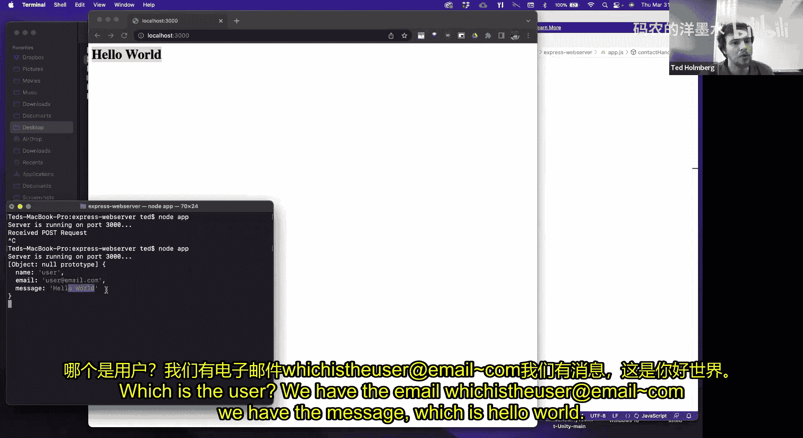

Excellent。So， now。For our next goal， now that we know that we can actually go ahead and get that data into our server。

 why don't we create a new Git route？That allows us to send back to the client all the submission data that we've been capturing from those post requests。

So again， our approach here is we will use Express to get data from our server。

And the Express will provide the ability to respond to the client and send JSON data to the client so we don't have to worry about doing that ourselves。

So first of all， let's create a data structure， just a simple list an array that we'll use to capture the request that come in as post request that will have a name a user an email and a and a message。

 so let me go back here。

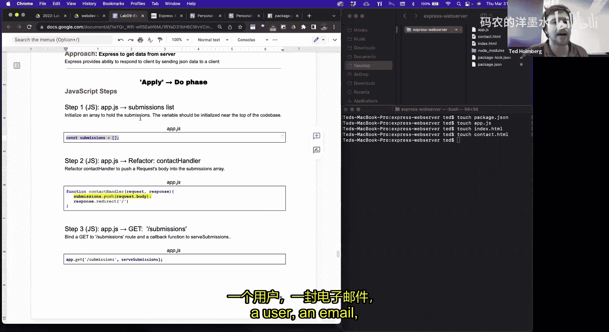

So I'm going to put all my data towards the top， so I'm going to create just a submissions that has an array。

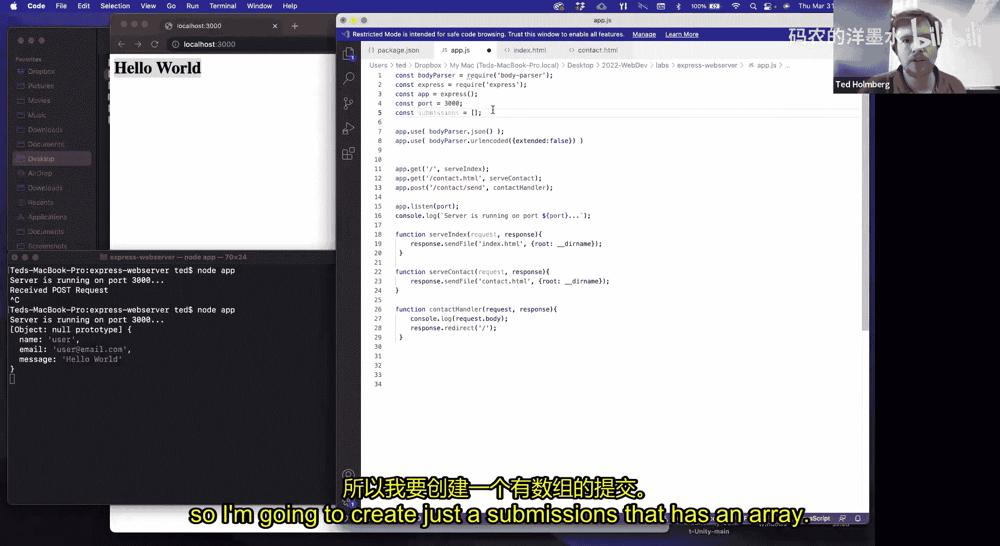

And then the next thing I wanted want to do was I want to refactor my contact handler。

Such that I want to push the request body into the submissions array every time it comes in。

 so instead of doing that console log， I'm going to just push。

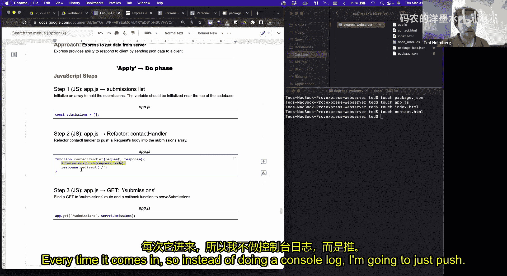

That data right into submission， so here we'll do that perfect。

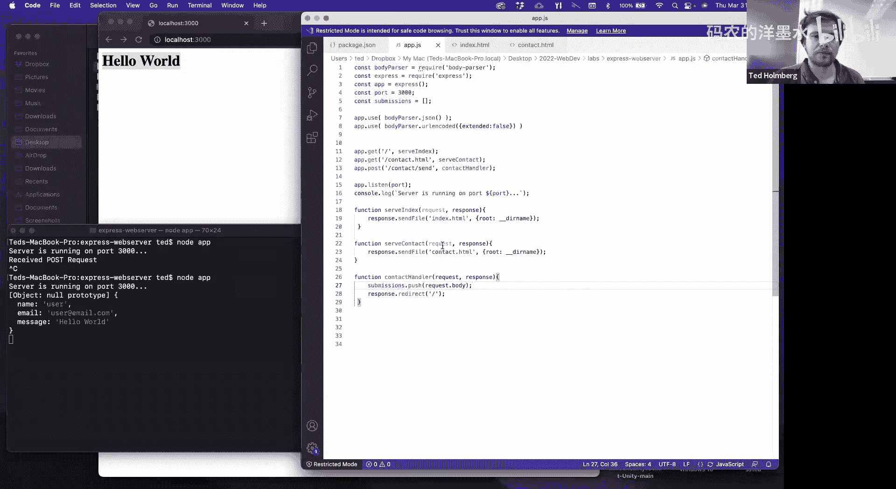

对。And then what we'll do is let's go ahead and bind a get。

To the submissions URL to create a new endpoint to this route here。

 and we're going to bind it to this callback function that we will call serve submissions。

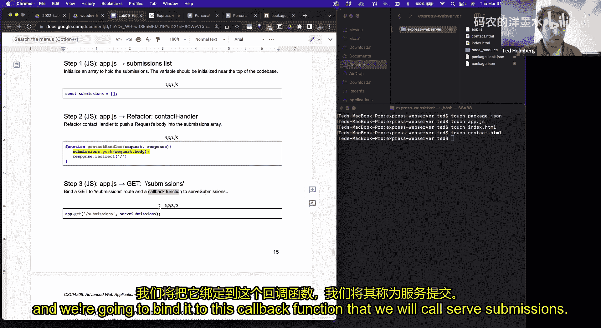

So we'll just set up another route。Here， whenever we have a gi method。To submissions。

We will opt to then invoke this callback function， serve submissions。

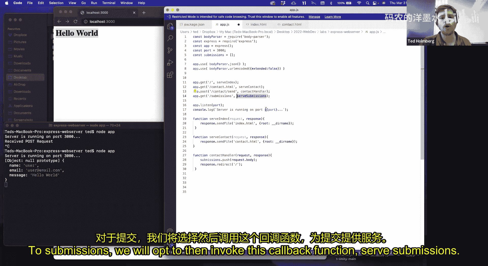

And then in this callback function， we're going to send the submissions list to the client as a JSON response。

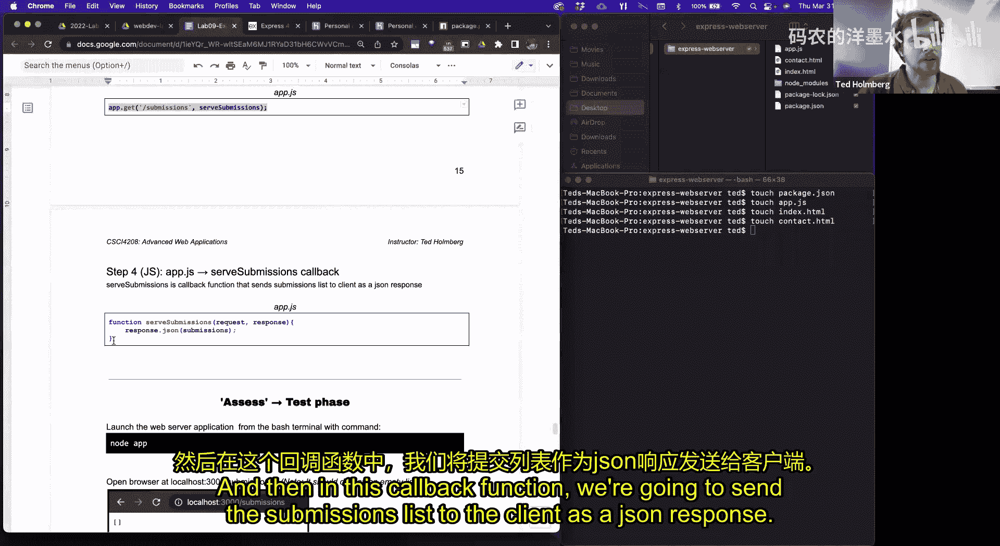

So here we're going to create the callback function and here again。

 the parameters are requires a request， requires a response and on the response。

We're going to use the JSO method。So that it takes whatever this data we pass into it。

 it'll convert into a JSON data and then send that to the client。Okay。

 and once I do that I should be able to go ahead and launch my web server and test this out so let's do this so first of all let me go back here let me go here。

Okay， let me kill that。Clear that okay， so now if I refresh here， okay， there's nothing there。

If I go here， let me go to local host。And submissions。There's nothing there。Okay。

 let's launch our application。And so notice， I haven't collected any data。

 but as soon as my web server launches this endpoint， let's get endpoint right here， right？

Is delivering an empty array and then here let me refresh this Okay so now let's test this out a little bit right so we see that it displays an empty list so now if we go to our contact form and input some data and then refresh submissions we should be able to see that in real time update。

So if I go here。对。So that does the redirect if I go here and refresh there it is I now have。

On my client side here。The ability to actually get that data that's running that that's contained inside my web server and this isn't just something that it can be requested by the browser and displayed in the viewport if I actually go to the dev tools here。

Right and if we do say for instance， say fetch so let's do that， let's say。

Let's say that this is the JO， let's call this our JO。Let's call this our。Submissions， JSON。

And let's do an await。Thattch。And let's go ahead and send it this。嗯。Okay。

So notice we got the response back， our response was a 200。

 which we know is an okay so now that oh I miss spelld。Based on that's okay， but yeah， look。

 so now if I do。Data is going to be assigned and let's do another await here。And JO。

On a response object， we can always do the dotsson and it will go ahead and then pull that body out and so if I look at data here。

 look at what I got。I have that array that contains those objects so that if I do。Eta at index zero。

I have the object with name。Email and message。 So if I do name， all right， I get the user。An email。

And message。Perfect， so you can see inside of my client side。

 I actually have requested data from both the JavaScript environment。

And I could actually use this in my application if I wanted to。Yeah。

So this is an example of the difference between a dynamic web server， you know。

 being able to have some kind of data post to it and then be able to request that data back from that web server and have it delivered into our web client and so now what the star so allow us to do is start thinking about dividing our application across two different parts。

And there's certainly reasons why you dont want to have your data managed on your server side as opposed to your client side。

 at least two considerations， one would be for security purposes because your server side data is not publicly exposed so you can control who gets to see it any time or you can keep it completely hidden and just be able to process it on server side and then produce results that need to be delivered publicly to the clients and another thing is if you have mutable data that's going to change for all users you can you can process that data on the server side and then deliver all that data to the client so an example of this is like if you were building a multiplayer web game and the server would manage the logic for where all the players are at so as you're playing the game and you move your character you tell the instructions to the server。

 the server。Move your character， server side and then update the client to let them know where you should now rerender to。

So again， the reason why that has to get broadcast out is so that all the clients know what's happening in real time for that game and of course that extends outside of things like games right that that would be storefronts for things like inventory。

Or anything else like that。Like in one of the future labs。

 we'll go ahead and see how we can use these back end services to handle things like authentication。

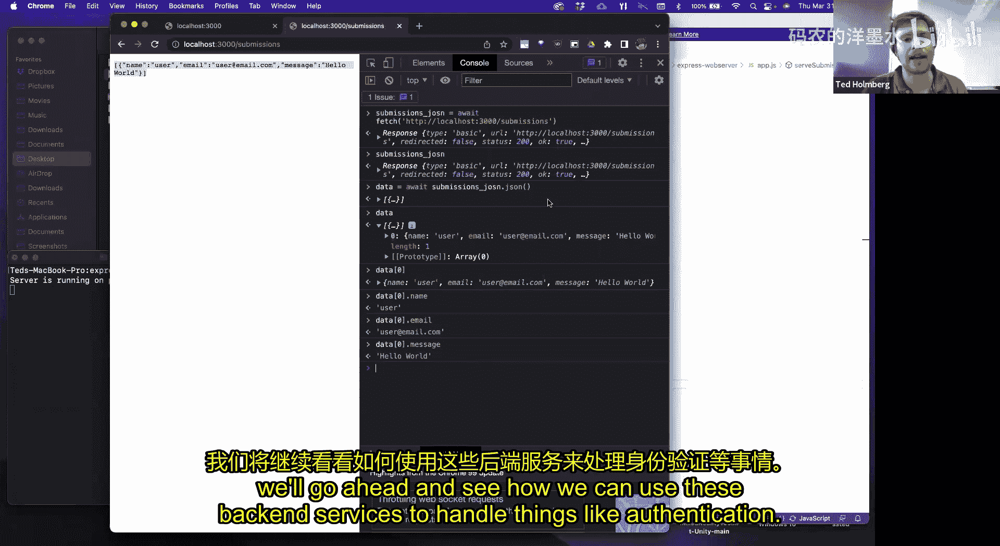

Excellent， so then once we do that actually I feel like that's pretty much what a dynamic server does so effectively we've done everything we did in last lab delivering just static HTML content。

 but we've actually implemented some serverside logic that allows us to post data into it and then request it back out from a client。

So at this point， I want to just go over the basic concept of well， how might we deploy？

This basic web application， the serverside application onto the internet。

 so it's actually publicly available。And so we're going to use heroroku to do that。

 so I just updated heroroku right before the slab so we're going to see if this is working with the new update exciting。

Okay， so our approach is Wegen， Heroku provides a free web app posting service。

And so we're going to deploy our apps using a combination of Perroku's CLI tool and Git so Gis great for more than just version control that allows us to be able to send our code to remote locations。

And so let's just go through before I walk through I want to show highlight some things so yeah we already went through package。

 JSson we already looked through the express API so here。Oh both these are the same。😔，Okay。

 so we will take a look at the Heroku documentation just a moment。

So the first thing we need to do is if we want this to go into production right now for local testing。

 we're using43000， but we can't necessarily declare what port we have access to on a remote server that is going to expose our web application。

 in fact， Heroku is going to manage what port is available to us and then give us that in a environmental variable。

 so for production we're going to assign the port number to Heroku's environmental port that will be provided to us on their platform and we'll only do that if it exists if it doesn't exist then we're going to use port 3000 because that means we're actually local in our local environment。

So this is a way of being able to assign。One number and let's let's look at how this works really quick。

 Let me go back to。

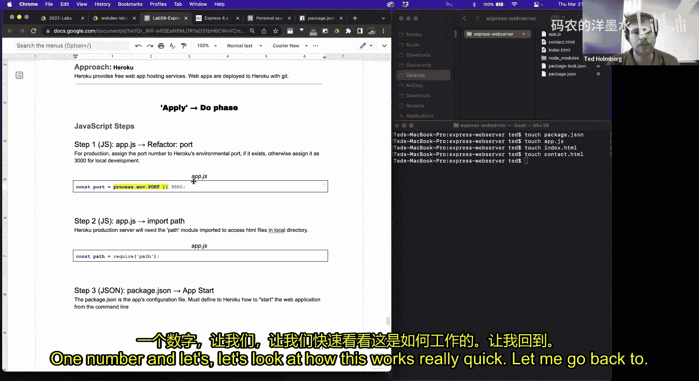

Okay， let me。Clear a this。Okay， so what's happening here if I have。I know。Or。

3000 notice I get 3000 right so if。

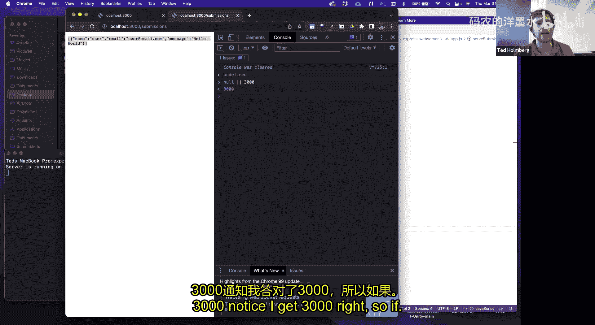

If this returns no value， I'll get 3000， however， suppose that the value is 80，80。

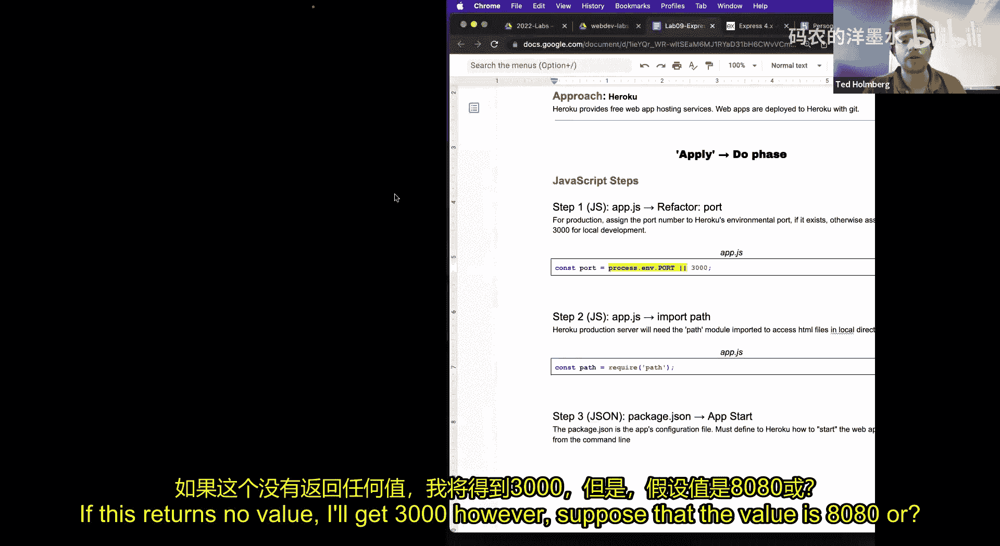

Or。3000 notice then if it's not a Fy value it's going to return the first value right so if that port exists I would be port 8080。

 but if that port doesn't exist， then it's going to return to me 3000 so this is a clever way of maybe being able to set up a port that will be a local。

3000 if I'm in local or development servers versus if I hosted on Heroku。

 so let's update our port number。Okay， so here。We will set this up。For the appropriate report。

 the next thing I need to prime my app if I want to deploy is i'm going to import the path so heroroku broadduction server will need the path module to import and access the hM files in the local directory so this will。

对。Okay。是。Okay。And then the next thing I need to do is in order for Heroku to be able to initially install and launch。

The application on their platform， we need to include into our package on JSO a script。

That defines the startup。So again， the package that's based on is the apps configuration file。

Heroku we need to tell how to start our web application。

 so here we can have a scripts key the scripts key is going to be associated。

 the value would be an object， the start。Key inside that object can be the command line instructions for how we're going to run our app here。

Our app has dependencies so we're going to say oh we're going to use MPM to install and then that's going to install these dependencies on Heroku server because we can't send this is a thing we don't know what a version of note is on Heroku so when we push our code we can't give it the node modules we need Heroku to install install its own dependencies on its platform so when we send our application to Heroku we're going to send everything except for the dependencies and we'll have it install its own dependencies。

When it launches our app and then after installant dependencies， we'll use the an。

 we'll go ahead and use an instruction that invokes our main launch point。

 so we'll tell the node to launch the app。js file effectively。So let's update our Pakistan JSO there。

Yeah。So here。I'm going to do that here actually。So here I'll have my set of scripts that's an object and again whenever I do that I have to make sure there's always a comma unless it's the very last。

Property inside of the package JSO and so the the start the startup script will be to do NPm install and then node app。

Okay， and then once I do that， I can go ahead and set up the instructions。To。

To actually have this deployed。From bash and here this is one thing you'd want to。

From your bass terminal and let's open this up so we can take a look at this。

 we have instructions on how we can download and install this Heroku command line interface So if I go here let me clear all this so if I type in heroroku dash version。

I'm going to see I actually have an application that's running。

That allows me access to Heroku's command line environment。And it let me know what version。

It goes ahead and is configured for。Okay， so now that I actually can have and so if that is not working they have installation directions right so if you're on a Mac if you're on a Windows if you're on U Buntu or whatever。

 they have all these different ways that you can go ahead and install Heroku command line interface。

Okay， so the next I'm going to do is from the terminal now that I know I can issue heroroku commands I'm going to do a login。

So Heroku。Then log in and when it does that。It's press any key to open up the browser to log in or queue to exit I'm going to hit just the turn key it's going to open up a tab and it's going to let me log in from their web page so I'm going to do log in and notice what happens here is it shows bam logging in is done I'm logged in with this username。

So now that I'm logged in。I'm going to tell to go ahead and create。Yeah。And again。

 you can always do the command page， I could always do help or you can read the instructions here to see all the different commands。

 but here I want to create a new web app。And so it's going to create that app for me and when it does that。

Let's see creating app so the app is going to be called Whispering woodLd。They're 36106。

Let me go to my dashboard here really quick。Welled in okay， so here are some exact other ones I have。

 so if I do a refresh yeah that's the new one that just got made。

Wstb Woodland 36106 is going to be the name of my application on their server。

 so I have the ability just to look at my apps on my dashboard。Okay。

 so now that I have this name of an app now that's created an app on their platform。

 what I'm going to do then is inside of my directory right inside of my Express web server project directory that I'm in I'm going to go ahead and tell Git to in this into a gett project so I'm going to initialize this with Git。

Okay， there we go。And then once I have this set up as a Gi project， I'm going to bintel Heroku。

To Emily stretch this out a little bit more。Andm going tell Heroku to set up for the Git project。

A remote。We're going to set up where the remote location is。And I'm going to give it the。

Name of our app， which is going to be Whising Woodland 36106。

So this is going to allow me to set the remote destination for this Git repo to be the application that is on a Roku server。

Can meStre this out a little bit more。Excellent so now set get remote heroroku to and then that's showing me where its it's being set so the next thing I want to do is I want to push my code to heroroku's platform but the first thing I need to do if I want to do that is I need to set up a get ignore。

For the node modules because remember， we can't send our local version of node modules。

 we need to have herokus。Instance of node or NPm install its own node modules and so if you don't have a get ignore and if you accidentally send your own node modules。

 your app will likely crash because your version of the modules are likely going to be different than what might be running on the version of node that is inside of heroroku so i'm going to echo node modules to and then i'm going to save that into this gett ignore so you could do this any any which way right this is make sure I spell that right this is just I could do this in one line so again echoes just a ba command that will will take and print out node modules and then i'm going to redirect into this file do get ignore。

So if I do that。You can see if I do cat dot get ignore all I did here。

 let's create a dot ignore file that now shows。That contains node modules so now whenever I do anything with adding and committing it's going to ignore node modules so if I do get status so also notice。

Right get status I can see I have the docggedor of the app JS， the contact HTML， the index at HTML。

 the package。 lock， which is what happens when I install when I do my MPM install。

 it locks the versions down and it will use that then to go ahead and build my application。

 if I don't have my node modules and then package HTMLL so notice what's not in here's node modules and it's because I maybe get ignored for that。

Okay， so now that I have that， let's go ahead untilll get to add everything。Okay。

 so to verify that everything's been added， I'm going to get status again。And yeah。

 it's all in the green perfect， so that's all the stuff that I want to send to the Heroku app。

So the next thing I'm going to do is let's commit to these changes locally。

So going to get commitit dashm and then I've got to do a message， let's say that this is version 1。0。

0， right？Okay， so then I go ahead and see that I successfully commit it locally， so once I have。

My local changes that I want to push these local changes to my remote。😡。

Get repository and so in this instance my remote repository is my heroku instance I'm going to do get push。

Horoku。Which is the remember I set up that Heroku is my remote brand。

 essentially my remote repository， and I'm going to go ahead and present to the master。

Branch and that we're writing perfect perfect and we are downloading we're。Installing。Okay。

 this is great， we got a build successful， we could see we're getting all this information back from Heroku about what our deployment behaviors are。

😊，And that's it， we now we should be able to go ahead and deployment done。

And here on this message here， it's showing me。That my app should be deployed at this location。

So if I go over here。Let's test it out so if I put in this URL， which is now a live URL。

I have a hello world， right？If I go and do s contact。html。I have a contact form if I type in user。

User@ email， Hello world。I was able to go ahead and have that。

And if I go to submissions is it plural yep there it is and this is host it's not on a local host anymore。

 this is my deployed app so you can see using Heroku' it's incredibly easy with Git and the Heroku CI to easily get our code base deployed and available to the general public and then then once this is available any other client like if you type this in right now。

 I can share this。Everyone here could potentially go ahead and use this。

 I'll probably put this in Discord， but anyone can hit up this URL and actually use my service now。

 so this will make it much easier for you to launch your applications to make them publicly available so that you can make them part of your portfolio pieces。

Excellent so there's one last thing so that that's it with this lab actually this lab was a relatively quick lab there is one thing I want to show you before I open the floor to any kind of questions but some final comments here is in this lab you implemented a basic web application express that responses to get and post request and serves HTML files and Json data to the web browser so here we learned about express we learned again how to use the body parser to get information data from the request body。

We learned about RM points， and we even learned how to deploy using Heroku。

So some future improvements would be well maybe to prevent the public from accessing the submissions right you might want to keep that hidden so we'll talk about having hidden routes that aren't available to the general public where you have to be an authenticated user to access them other future improvements on this app might be well the email the submission to the webma or maybe to store the submission in a database right now whenever our application closes we'd lose all the submissions data we don't have data persistence we just have a variable that's running on the web server。

 but if anything were to happen to our web server instance right if it shuts down at any point then whatever data it's collected will be lost and web server will give us better data persistence and itll give us better scalability so if we have to launch multiple web servers to be able to meet the demands of multiple clients all of our web servers can point to the same database to be able to access the data。

So。So one last thing I want to mention is。Has nothing to do about Heroku。

 but I just want to highlight the order the importance of our middleware so。😡。

One reason why you might want to think of it as middleware is it has to be invoked between when we go ahead and。

Get our express object， But before we set up our routes。😡，So let's say， for instance。

 that I was going to go ahead and accidentally set up my middleware after I declared these routes。鸡不。

And then inside of my contact handler just to prove this is the case， I'm going to do a console。

 log on my request body here， I to I want to illustrate that this isn't going to work so order does matter。

With middleware。So here， let me close my app， let me。

Launch my app again and so let me go to the locally hosted。Let me go back， okay。

 so now if I hit submit， notice what I get back is undefined。Right， you see。

And it's undefined because I didn't tell the app how to parse the request the data from the request。

 so when I'm trying to inspect the body of the request that doesn't exist。

 that's only allowed to exist when the express object knows how to go ahead and decode the URL and then be able to cast it to JSO but this has to be defined before I set up my routes。

 so again， if I move these two middleware commands to my app right？😡。

So if if these two things happen before I set up my routes， I'm going to save that， we'll relaunch。

 we could see。Now we get that so that's just one little thing。

 one caveat that as you're working on this， if you encounter this bug this is a common bug that happens with this lab。

 it's because you had when you were defining your middleware calls you went ahead and used them after you had set up your routes make sure you set up all your middleware before you set up your routes your gets in your post and whatnot in the future we're going to organize our codeb to be more robust so we can't make that mistake but in terms of trying to keep our code base as simple as possible and just so seen the sequence of statements like get executed I opted for brevity but we'll make this a little bit better so that that might not happen but if that does happen to you that's why。

Excellent， so with that said。Is there any questions about today's lab？Excellent， well。

 if you encounter any problems， of course hit me up on discord。

 but other than that we can actually end just slightly early today。They'll end the recording。

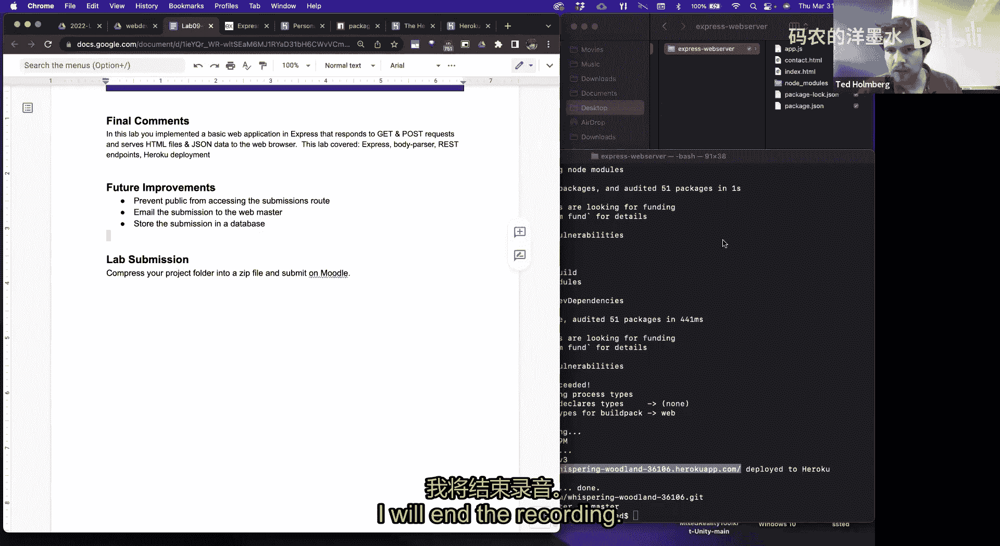