# 【全集】加州理工学院 高级Web应用 中英字幕 1080P p16 Lecture 16 - REST API part1 -BV192zTBrEmu_p16-

Excellent。Okay， so for today's video lab I want to continue along our journey on back end technologies we're going to continue to explore express so previously we've seen how to build our own kind of simple static web server we've seen how to build our own dynamic web server well now I want to start talking about。

Designing our own rest APIs and so the rest APIs you think of are the web services that provide data to either other backend services or to front end services。

 so either to clients or believe it or not servers themselves can be clients to other services。

And so the goal of this lab will be to build a multiplayer version of the high low game right so that we'll have a server that will go ahead and be able to go ahead and。

And run our game logic and then clients will be able to go ahead and send ATTP requests to send in their guesses。

Okay。So here。The contents for today's lab is we'll do a brief little lab introduction where we'll talk a little bit about RE APIs and endpoints and routes and route parameters because that's going to be a new thing we hadn't seen in the。

イトライムポットでワはいはい。We might need to a。Okay， mut all perfect。Okay， so。

And we're going to talk a little bit about UUIs and how we can use that to go ahead and sync assets to deliver to particular clients。

And so that's going to be something that's kind of prime us for the concept of what we want to do with databases。

So after we're done with our little lab introduction。

 we'll talk about some of the considerations we have for designing a RE API where we're going to specify the functions and routes that the API will support then we'll start building out this app and this apps really only like eight steps we're going to and really small steps to the first is going to configure the package。

 JSO because we're going to use MPm as our build tool and our launch tool for a web app。

So we'll initialize the configuration file for our application and look at what we have to fill out。

And NPpM actually has tool where you can initialize this by default。

 but I think it's it's kind of valuable where we hand。

We handwr this initially so you get an idea of what all these properties are then we're going to set up our express app so that we just initialize a basic application to listen on a port then what we'll do is we'll set up a router and controller so we'll listen on a route and set up a controller is going to be a callback function just to be able to deliver some test data from our web API。

And so。Thenll once we get tests successful， then we'll actually start building out our game model and then have an endpoint that builds a new game。

And then we'll build an end point that let's just get that game in since we just built。

Then we'll build an endpoint that allows us to go ahead and send the server a guest for a particular game instance。

And then if the game is over， we'll get the option to be able to play again to reset the game from a game over state to a new state with a new passcode。

And then the last step will actually not be something that affects us for today's lab。

 but rather will be used for。For next lab where we build a client that'll actually use this RE API。

So that we can actually play this game inside the browser。

So this lab and the next lab will be interconnected will depend on this server that we're going to build in today's lab for the next lab to actually serve as a client or to be in the role of a client。

For that server and just some related labs that you might want to take a look at that has motivated this lab while we already built a high low guest game that's not quite spelled right okay and so that will have the game logic that will already be familiar with and then that quiz game with the leaderboard that we built will give you a notion of how RE clients work on the front end and then that dynamic web server we built last lab will kind of give you an idea of what some of the backend responsibilities are in terms of setting up routes and then callback functions in support of those routes。

Okay， so quick introduction for the concepts in our lab well the prereCs for this particular lab are none。

 this is going to be the first in our rest API sequence。

 so the next lab will depend on this one just assume a little knowledge of node and express in JSON the ones that we've gone through already the motivation behind this lab is we want to use Express to implement a RE API because this is going to be super valuable for you as you build up your fullsAC applications。

The goal of this particular lab is to design and implement a RE API that will build a multiplayer high low again。

 as I said before， and our learning objectives is while we're going to learn how to use Express more effectively。

 we're going to learn about route parameters， which we haven't seen yet that'll allow us to have variable URLs。

Well look go ahead and look at the request query string because that's how we're going to send data in this version of the game to the backend server now in most web applications you'll probably want to wrap your data into the body your request so that's not exposed to the public but since we're building the backend before we're building any kind of client side for the purposes of being able to easily test it using the browser we're just going to encode everything as a query string so we can kind of see the behaviors from the client side and from the server side without actually having to build the client side so that's the motivation there we'll learn more about the use cases of UIDs and in particular we're going to use a module called short ID and we'll explain why。

We'll talk a little bit about what RE API is and some design and developing considerations and then you should be able to use this lab document as kind of a as a touch point as kind of like a Kingstone on how you might want to do your back end document that you'll have to turn in。

Then we'll talk about some backend app logic so you'll see some of the backend considerations are going to be slightly different。

 but also similar to front end considerations one nice thing about the back end is all of the data that we have on the back end is actually private so you you can go ahead and say things there that aren't supposed to be exposed to public to the general public and you should only share to the general public that which should be knowable。

And then we'll learn how to actually export our own JavaScript modules from one script to the other。

 from the backend using a note the way that nodes does that as opposed to the way that the browser does that。

Now for this particular lab， our server site architecture is what we'll have our route directory。

 I'll probably call this high low server instead set a number guesser server。

 and then well have a Packstt JSson an app dot JS and then we'll have folders to manage our routes our controllers and our models that we'll need for our app。

So let's go ahead and make that， let me make that directory。Plo。Server。Perfect。Okay。

 so let me change into that。So inside of high low server， I'm going to need a。Hackage do Json。

 I see that Okay， I'll also need a app。Dot jf。And I'll need a。Route。I'll need a。Controllers。

And I'll need a models。Excellent。Okay， so some base concepts that you should take away in terms of rest architecture rest architecture is just a common approach for our backend web services to interface with other backends or frontends like I said before so the way that we should break this down is first let to find an API that's a starting point that everyone in this class should already be familiar with and API is a collection of preimplemented functions or methods right that a developer can import or invoke so you've been using APIs all the way since the very first programming class that you've been a part of now when it's a rest API rest just stands for representational state transfer it refers to the use of using ACTP protocol to provide access to an API so it's a way of providing an API instead of having to install it onto a local machine you can make a request over the internet for data and it returns it back to you。

And then when we're talking about endpoints， well the endpoint is when an API interacts with some other remote system。

 the touch point of this communication are considered the endpoints to that system so for our APIs you can think of the endpoint as the URL of the server or the service that you're trying to get access to。

Or that you're requesting information or data from。Okay， so again。

 we're going to be using more express and just to recover that expresses our full web framework and server that runs on top of node。

And so the new things about Express is going to be route parameters that's going to allow us to have variable URL routes to be defined with the callback。

And we'll look at that when we get there and then also we're going to look at how we can access not just the request body。

 which is what we did last time where you'll be able to see the request query and so this can hold a query string that's located inside of the request objects query attribute。

And then unique IDs are very common with backend services， usually for backend services。

 usually you manage multiple unique session data for each of your clients so like a cookie can even be considered a unique ID but we're going to generate our own in order to track what data belongs to each client and give a unique identifier map to the data so that we can provide it now we're going to make these unique IDs public for this application you can think of it if you've ever played a jackbox game you could think of the unique ID as like a room code so that anyone who has that room code will be able to access a high low game instance and play the game there。

So just some things about unique ID uUI is the most common and most popular node module for generating unique ID。

 however， for this project we're going to use short ID which generates human readable and it's intended for sharing if you go to NPm's web page every module that you can install they have a documentation page so here。

We might look at this a little bit more when we actually implement it。

 but you can see short ID just produces。Identifiers that are easy to transmit is not a huge sequence。

 like if I look at， let's look at you you。UUI MPm， you'll see that those。They might be more secure。

But they're also huge it wouldn't be good to be able to share， let's see if they have a sample。Yeah。

 look， like this isn't something you can share with somebody easily， whereas with short ID。

 we can easily like tell someone our our room code。

 and then they can come to our to our game instance and play against us。

Let's talk about a little bit of the design of our rest API and so this is what your documentation should look like when you're talking about defining your rest API for your own backend service。

 so here the goal is to specify the functions and the routes that the API will support so the routes are our endpoints in this instance we would use paper and pencil right during the design phase so before coding a rest API at all we should first plan out the number of endpoints you intend to use and how those endpoints will interface with the controllers to interface to interface with your backend models。

And again， we're going to use like a model view controller design pattern。

 just like what we did on our JavaScript front end games。So in the application step。

 well there's no coding here it's more like a design step what we're going to do is we're going to write a table that specifies our API details and so we're gonna to have a couple different columns inside of our table here and so this table can serve as a guide for all of our future iterations as we continue to implement our backend service and if we realize we need more routes or more functions we can keep adding on this table but even as we build this out。

 we're going to build a function of this at a time so we have a route that at our API at game for new using a git method and passing start and end data。

 we will go ahead and inside of our server create a new game that creates a new game and randomizes a passcode between whatever the start and end values that got passed in to create that new game on the route of a variable ID so again we're going to use short ID to produce some random sequence well we're actually going to。

Be able to assign a route to any one of those random ID values。

 so if anyone goes to game slash and then those ID values。

 they'll be able to have the option to join the game and what it means to join a game is you get the data for an existing game using that games ID。

For this route here。We can have a sub route so if you go to game and then a particular ID。

 the colon specifies that that's some random sequence well。

A sub domainomain gas will allow us to go ahead and produce a guess invoke the guess method for that gain instance and in this instance we would have to pass it a value for our guests and of course the behavior that would be tethered to this API to this endpoint would be and on the server side we will。

Guess and number in that game instance that's tered to that ID and then return whether the guess is either correct。

 whether it's too low， whether it's too high， or if someone already got it and we're currently in a game over state。

And then if we are in a game overstate， we'll also have the option for a pre existing game we're so at the URL of that game to also be able to issue a reset。

Request。And again， we're just going to use Gi so that we can test this out in the browser because the browser's default request type method is a get request。

 so we'll be able to just type in address a URL address。

 hit the back server and actually get data back rendered right into our viewport without having a client built yet。

And so this will just reset our game with a new random number and then toggle the game over state to false。

And instead of true。Okay， so now that we have a good idea of the design of our API。

Let's start making our game so the first thing we need to do is set up our configuration file we need to make our package JO which we already have let me go over here in fact。

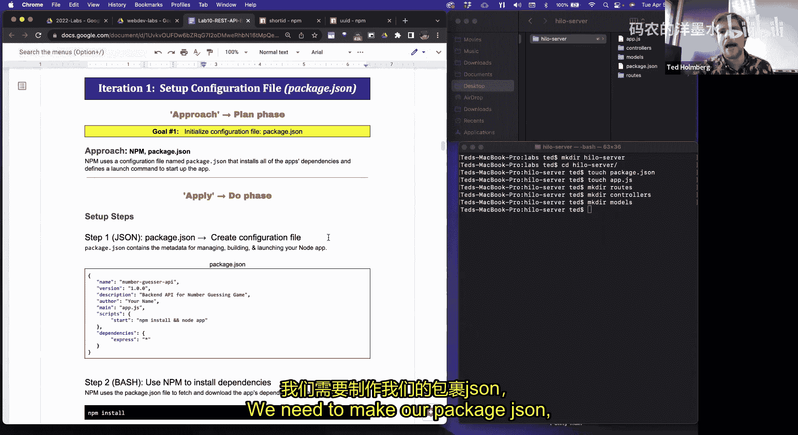

And。Yep， there we go。Here we go， let me open this here。There we go。

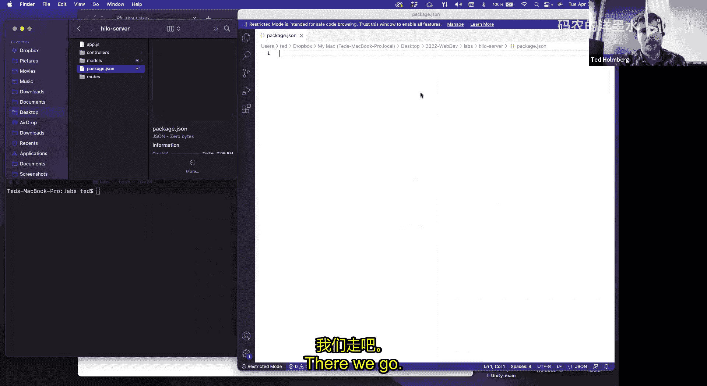

And so here recall package that JSON is going to have all the metadata that's responsible for managing。

 building and launching our node application。

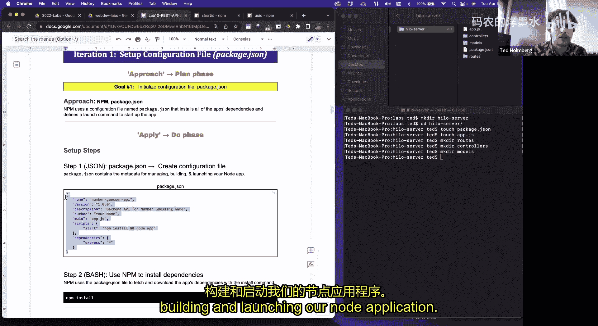

So let's take a look， so it's again in JSO。Format and so we will have a name property。

 which is the name of our app here I'm going to call this high low instead high low API。

I'll call it this。Rest API。Okay， here， I'll give it a version number。

I'll give it a description a backend API for。High low number gasing game。You put for author。

 whatever your name is here。For main， it's going to be whatever the launch point of your web application is。

 so for us we're going to create a Java file， a Java file that's called appJS and that'll be our launch point will have a scripts property that is an object that can contain multiple scripts that we can launch via MPM and recall this was important if we wanted to go ahead and deploy this onto a hosting service like Heroku so Heroku would invoke start which would install all of our dependencies with NPM。

And then launch the application using node and then whatever the launch point is。

 so it would be app chaos。And then we do have one dependency because we're going to use Express as our web app framework。

 so we're going to go ahead and list that as well， so again that is also a object or a dictionary where the keys are the modules we want and then the values are the version and if you just want the most up to date version you can use an asterisk。

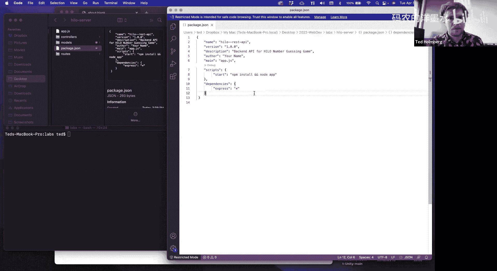

Okay。So that looks just like it had done I think we've used Packers。

 JSON now two times now the next thing we can do here is we can now invoke NPm the node package manager to install all our dependencies so if I go here and we type in NPm install。

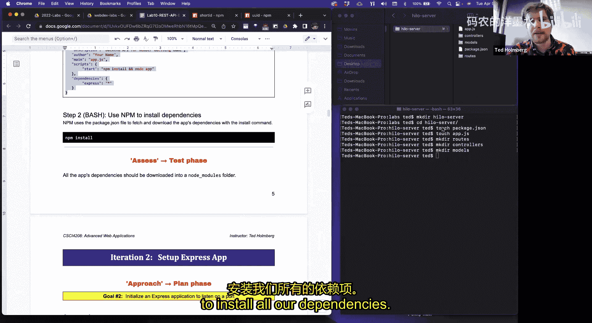

Let's see here oh oh we need to actually go into the high low server， let's clear here。

Change into high low server and now it's to NPM install so that's a good example of what happens if you try to do NPm install。

 butmpm doesn't see a package。 JSON file doesn't have the necessary configuration information to know how to start it up and then you'll get narrow message but since in this folder we have a package。

 JON notice it's going to then produce two things node modules。

 which is going to be all the dependencies and the dependencies of the dependencies that we need for application that we defined and then a package do lock JSON which is the actual versions of the software that we're using。

So that if we want to guarantee that our application will run in the future because there might be a change in one of the EPs。

 we can always just install off of this。

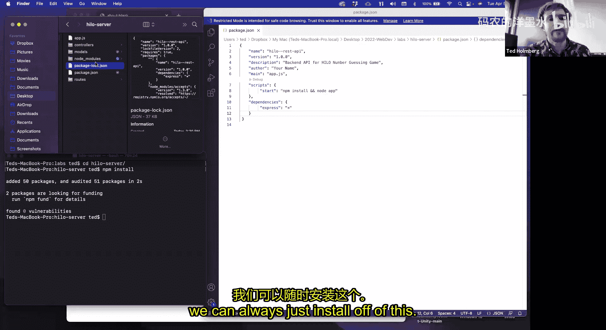

Yeah。Okay， so that's it let's move on to the next iteration now we just want to set up a basic Express app。

 so here we'll initialize an Express application and just have it listed on a port。😊，So again。

 we've already seen this before， this should be an easy step for us。

So one thing to remember about Express is that it supports middleware modules and we're going to take advantage of that a little bit this for this lab。

And this idea of middleware modules where you can have a sequence of functions that pass your request and response objects between each other allows you to kind of break your logic down across functions and makes building backend services much。

 much easier。And so what we'll do is we're going to import the modules that we'll need and we'll actually start up our Express app and start listeninging on the report。

So that we know that we actually have a server that's up and running so really there's just three steps to this particular portion and they're all going to happen in app do chaoss we're going to import our module set up some data so let's do that。

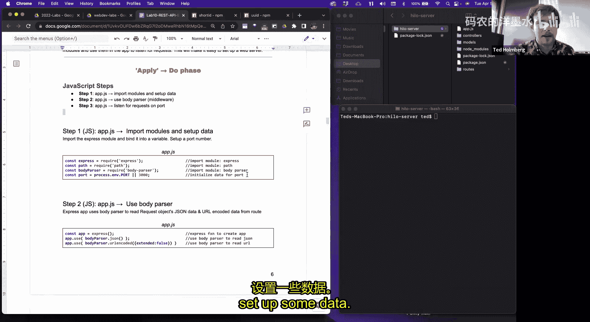

And it we'll step through what we're importing and why we need it。

So let's go here App out Js and have all of our apps core logic。Okay。

 so we're going to import express and that's going to give us essentially a function object and we're going to bind that to a variable。

 we're going to import the module path。And we're going to go ahead and bind that to a。

To a variable as well， we're going to import body parer body parel will allow us to view into the request body to extract data from it。

 and so we'll go ahead and we will。We will store that into a variable as well。

 and then we're going to define a port that we'll listen to and just to prime this for heroroku deployment。

 if we wanted to deploy this on Heroku I'm going to see if there is a。

An environmental process variable named port that already exists and I can use that that would be open for our application and if there isn't。

😡，Then we will just use 3000。So for development purposes， we'll be using 3000。

 but if you were to deploy this， Horoku will define this and then that would be the deployed board。

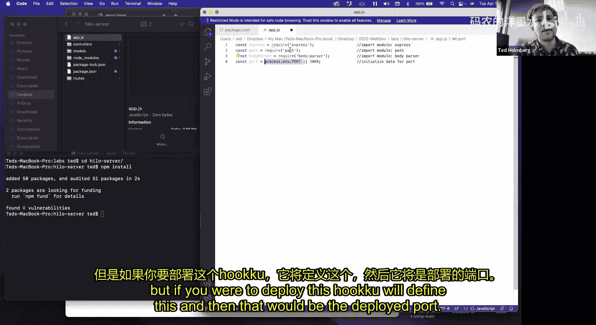

Okay。

So the next thing we want to do is we want to actually go ahead and create a new instance of Express。

Actually， like launch the application and then start binding some middleware modules to it。

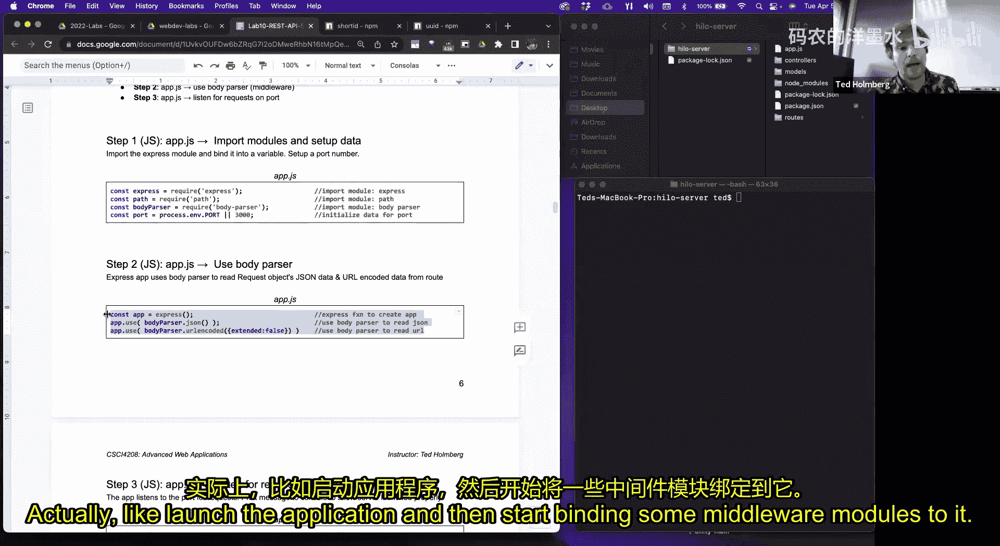

So I'll do that right under here， so here。I'll invoke the express function which will build an express instance for me。

 which will be my app， and then the use method inside of Express allows me to go ahead and use a middleware module so body parser。

 JSON will allow me to then go ahead and parse the bodies and read them as JSON and body parser URL encode it will allow me to also get access to the search parameter strings。

To be able to parse the URLs so again， the comments here are pretty they're pretty good for this particular lab too so you can read line by line。

 which each of these are doing so one allows us to read the URLs。

 the other allows us to read J songss they could send to us。

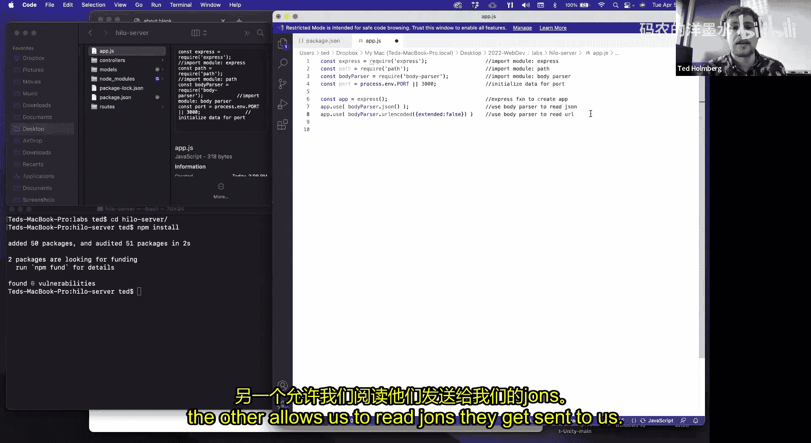

And then the last and final step in this is， well， let's just get the app to start listening to that port and listening to requests on the port and then we'll do a console log。

Just to let us know on the server side that our application launched。

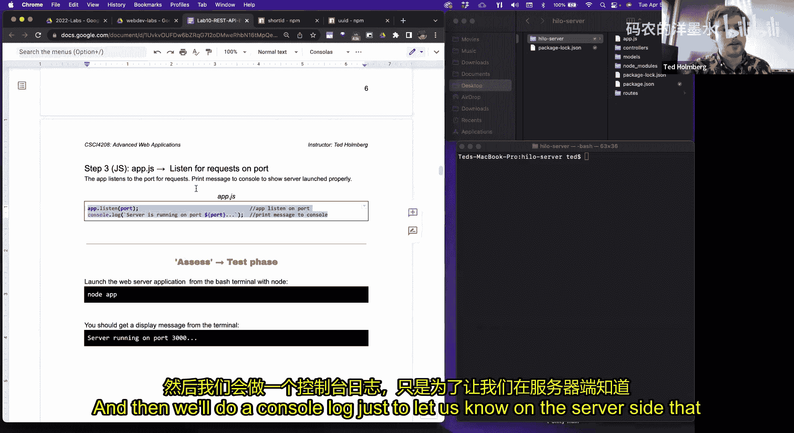

And so I'll just do that right here app that lesson and that has one parameter which is the port number and then once it starts listening。

We'll go ahead and let us know here while we're listening so node。

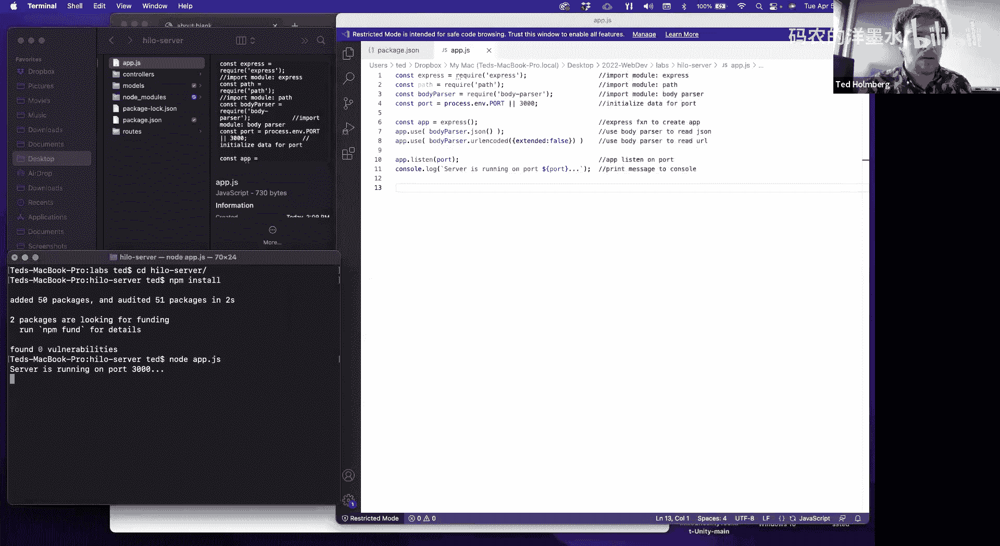

And now we're listening to import， so let's see here。That's it。 Yeah， there's not much I can do。

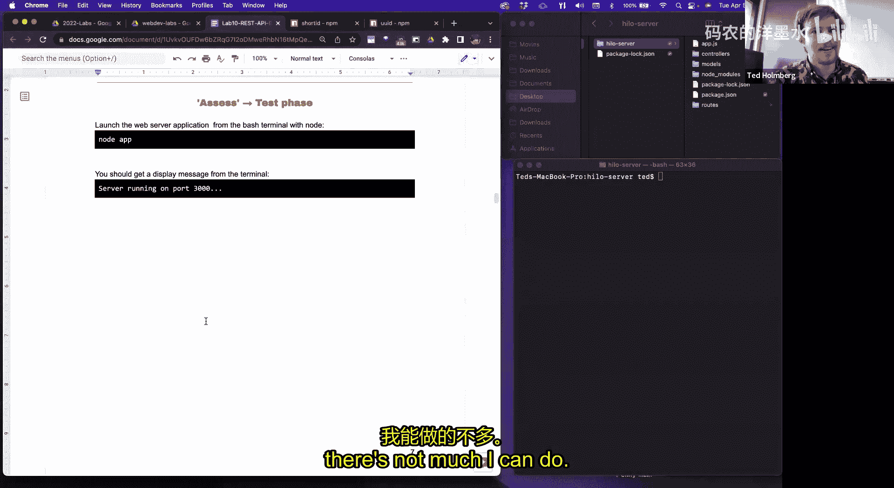

I mean， I guess I can just go to。

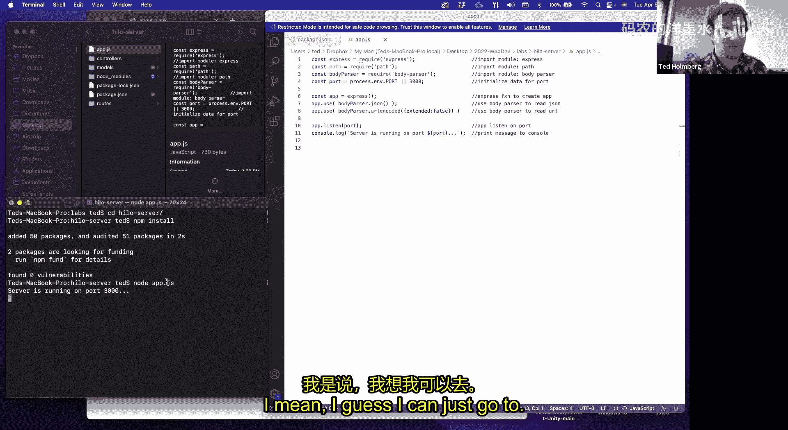

Local hosts and check， but I won't even bother I'll do that in the next step。

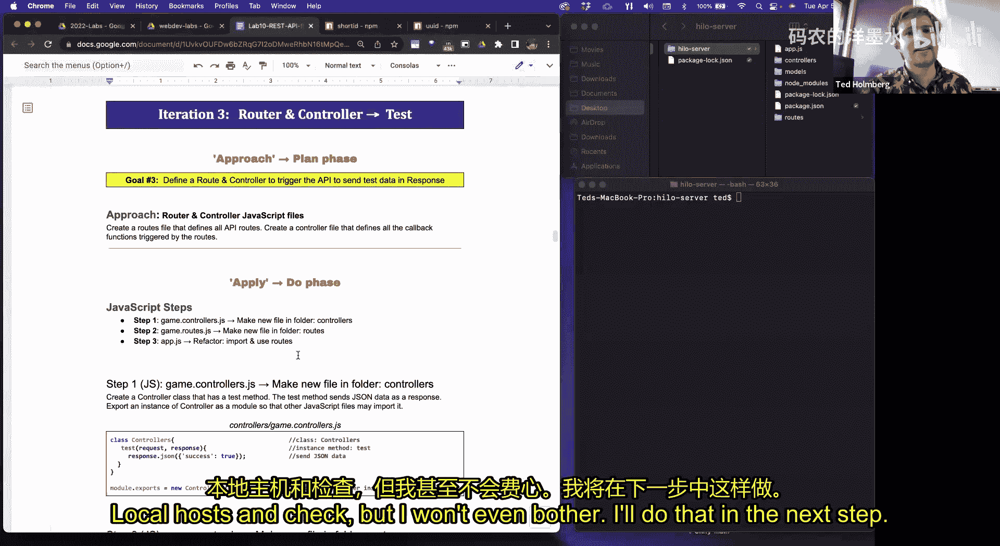

So let's go ahead and kill that。

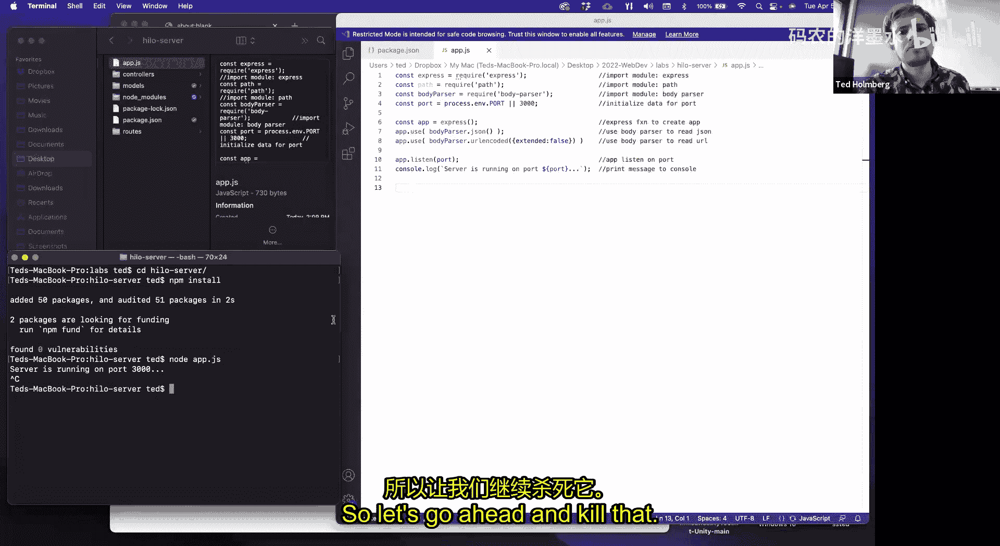

So for iteration three， we're finally going to define a router and a controller and this will just be for a test purpose so here we'll define a router controller to trigger the API to send test data in response。

是。And so our approach here is we want to try to manage we want to make something that's going to be scalable and manageable so instead of putting everything in one script or putting all of our scripts together。

 we're going to organize them into their own directory so notice we have a controllers directory which is going to hold all of our callback functions that bind to our routes and our routes will define the routes and import the controllers and bind the callback function that gets called back and the model will have all of our model data contained within it。

So here we're going to have to create a new。Js file， so let's go ahead and do that。

 and I'm going to make that inside the controllers。 So let's see here。

 So let's do touch inside of controllers。 I'm going to create something called game。

Dot controllers it's not necessary that I put a dot between game and controllers。

 I just wanted to show you that this is something you can do and it's completely legal。

But you could opt to use the typical convention and just call this game controller and use Caml notation or snake notation。

Okay， so I should have that also let's go ahead and make a new folder。

 I mean a new JS file into our routes， so let's inside of routes。We will call create something game。

 routes and again the idea behind that naming is that all of the routes and controllers explicit to the game logic would go in there now if you had other logics that your app was centered around like maybe user login or whatnot。

 you could have like user routes and then user controllers or things like that again allows you to be able to subdivide your app into something that's much more scalable and manageable。

Okay， so now what we now that we made this new controllers app。

 why don't we create a controller class that has a test method and the test method will send a Json data as a response。

And it。

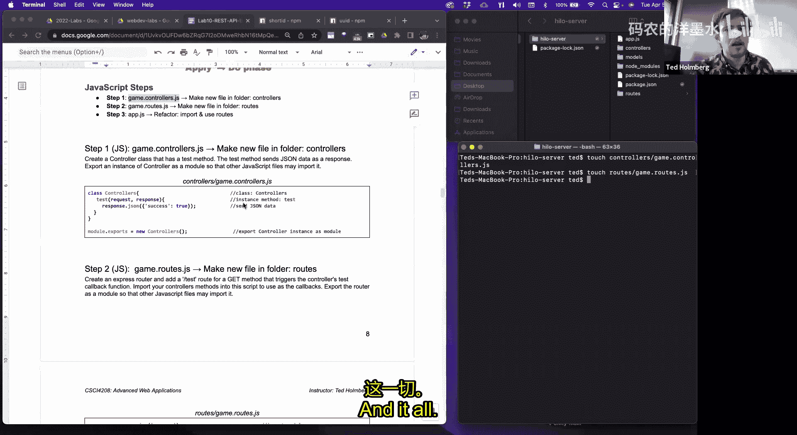

AndSo I'll hear it。Let's go over here。And inside of controllers here。Bring that there。

And there so we'll make a new class we've already seen class constructions before we'll have a instance method。

 so each since these are designed to be callback functions。That are part of the endpoint。

 they have to take in a request and a response object and since they're going to be responsible for sending the response back to the client we will have they'll be responsible for sending some kind of data right to terminate the request and so for this instance for testing purpose will just send back as a response JSON data and will encode into that object or a dictionary where the key is success and this is either true or false so this is so what this implies here is was the request successful on the server side and the server is going to send back a message that says success was true on this。

And then what we're going to do is we are going to want to use this。

Controller these methods inside this controllers class outside of this module so we will access the modules and they have the ability to export into the modules so here this module can then export a new instance of controller so when some so when some other module goes to import this module the thing it's going to get is an instance of controllers so it's an object that will have this function this method。

Of test。

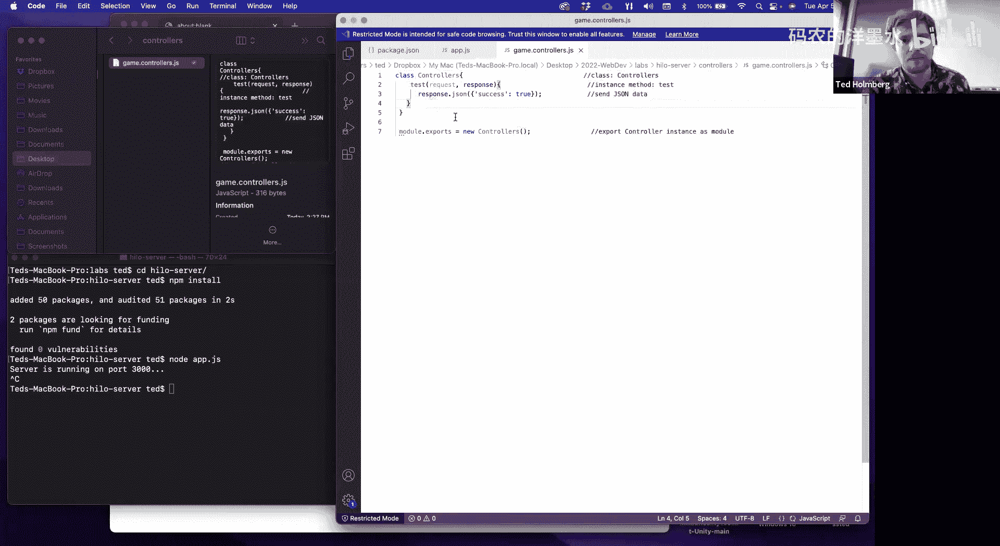

So now that we have the controllers defined， let's go ahead and inside of our game routes。

 actually set up a route that invokes that callback function。

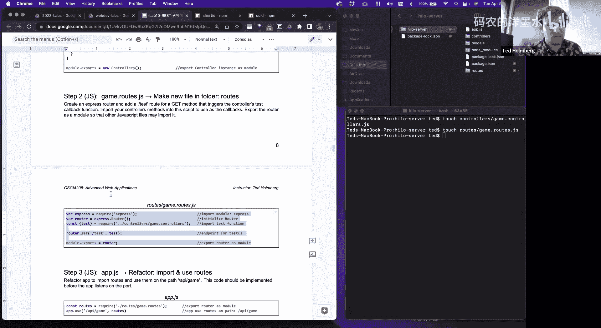

Let's go here。😔，Routes。对。So what what's happening here is while I have to import Express into this module now again anytime a module iss imported it's privy just to the module it's importanted to so if I need access to something related to Express even though I imported an app I also might have to import it inside of my routes here。

So Express actually is a builtin function that manages all of the router calls for us and then we can register routes to the express router so what we're going to do here is we're going to build the router right we're going to invoke the router function and we're going to bind that to a variable and we're going to manage it inside of our own route JS file and then this is the first time we've seen how to do this on node we're going to actually import our own test function that callback function that we defined inside a controllers here。

 we're going to import that inside of our routers JS file。And so we can do require。

 and so here we can just use a relative path inside of our project directory structure。

And access any other JS module that has been exported。

 so since this is a module part of has a module exports。

 I can import it here using the require keyword。So remember the dot dot means from the parent of this directory so if we look at this we have routes and our game routes is there so we got to go back a step and then from this we have controllers and inside of controllers is the game dot controller J file so i'm going to give the pathway relative to the to this module of where to find that。

Source code file， that module。And then since it's going to return an object。

 right it's going to return an instance of。Controllers， I can use the de。😡。

Call to just de referenceence the test method out of there。😡。

And so that way I can just get access to that one function。And so on router right。

 which is the express router that manages all the routes。

 we can set whether we want to tether an endpoint to be in response to a gi method or a post method or delete method or put method so we're going to set up a git method on this route on slash test and whenever slash test gets a get request we're going to go ahead and invoke that callback function of test which is going to send back as a response。

 this JO of success assigned true or a success true the key value pair and then again this router will be used these route operations will be used external to this module so we need to export this to the module exports so that it can get imported by our app Js is going to be the idea and again as I'm walking through if you have any questions just go ahead and put them in chat。

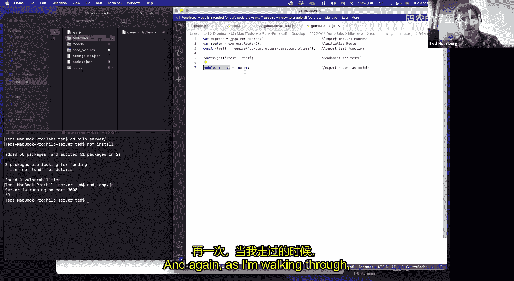

Okay， so the next and final thing we want to do here is we want to go ahead and import our route that we have set up。

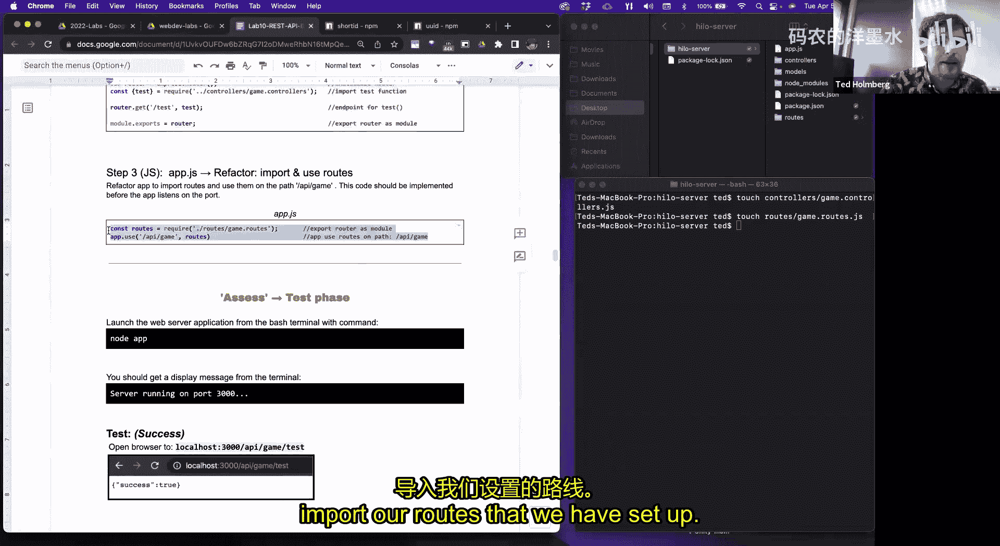

Into our app。So let's go into our app。And let's go， oh，'ll probably do it here。😔，And no， not that。

 I don't want that。So here just like before I can go ahead and import anything that's been exported as a module and since this is my own module。

 I can use the relative path of where that JS file is at and then I'm going to save that as routes and so what am I storing here。

 what am I exporting'm as routes I'm。😡，I'm exporting the express router so I'm configuring the express router inside this JavaScript file and after it's been completely configured I'm going to go ahead and use it inside of my app JS and this again allows me to break my logic down across multiple JS files so it's much easier to read and update and refactor。

😡，Okay， so the next thing I need to do though， is I want to set up a middle point。

For my route so I don't want my routes to be off of the route directory so what I can do is I can say hey express I'm going to use。

😡，This。Um， route。/lash API slashga as the route directory for all of the routes defined by the Express router。

😡，So this way。I can have a collection of。Pages like HTML pages that are available on the route directory。

 but if any developer wants to access the actual rest API， they have to they have to。😡。

Go through these additional endpoints slash API slash game。Excellent。

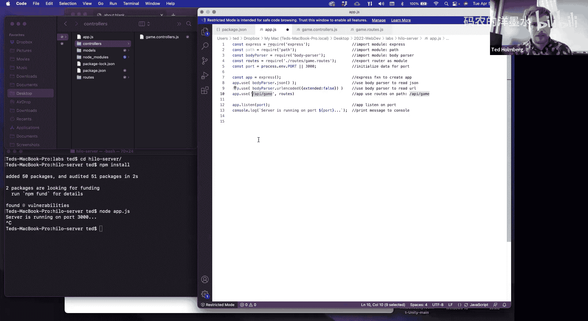

And then that's it。The next thing we should do is let's launch our app。

And let's see if we can't in the browser access that test。😡，Method。😡。

So let's make sure everything saved， let's launch nodede app。Our server is now running。

 so now let's go here。啊是。Okay， so we' we'll go to from local host for 3000 right so that's where our base service is and then since we said that express。

When we set up this middle route let me do it here in the code since we have this middle route set up a slash API slash games right any of the callback functions or any of our rest API is going to be available from there right so from the local host at4 3000 slash API slash game we're going to access that test end point and that should invoke the callback function on our server so if we hit that we're going to get that JSON success true。

Again， if we try to hit that endpoint。😡，From just the root directory， though。We're going to say， oh。

 there's no get。Callback function set up for that endpoint for that URL。Excellent。

 so it's working we actually built our own。endpoint。

 so let's start building out the endpoints that will allow us to build out our game to actually have our game be functional。

So the first thing we should do is we should create a game model and implement the RE API that at least allows us to make a new game in sense。

And so here。We're going to be。Going with a model view controller paradigm so we're going to create a model file that defines all of our number guessing game states and behaviors and the game model will create effectively a dictionary of game so we might want to think of this more like a let's call this more like a game server model。

Wwhichch will create a dictionary of the games and where a key is a game ID and the value is going to be the game object and then each game itself must track the min。

 the max， the random passcode， the game over state and its ID。So there's going to be five steps。

And building up this and point to create a new game。

 the first is we're going to have to refactor our package at JSO so that we can use that short ID module I was referencing earlier。

Then we have to create a a new， let me do that right now， I'm going to create a new。

G file that's going to be inside of the models。Inside of the models directory， and we'll call that。

Game dot model。 And again。All of the logic that will be in support of the game model would go into this Js file。

 but if I had like like user models or if I had other things related to the app that。

Were distinctly different than the game then I could put that in its own JS file and organize all of my data containers。

 all of my data in an easy， navigable way。Okay， so now I have a game dot game dot model jazzs。

 perfect。And then once in order to be able to build an instance of model。

 we'll have to refactor our controller on our routes right so that we can actually listen to an endpoint and invoke a controller。

 which will be our callback function， which will then invoke our model to build an instance of a game。

So first， let's actually update our package。 JSO where we're going to add that new dependency。

 so that'll be super simple。Let's go here。Package that Json。

 and I will do a comma inside of our dependencies。Dictionary right here and the put short ID and then I just want the newest version of that。

And again， if you want to read more about that， you can just go to the NPm， but the idea is to get。

Ids that look like this that are relatively small and that we could share with others because we're going to use it as kind of a room code like you use in jackbox。

Okay， so once we do that， let's go ahead and。Fill out our game model Js file where we create a new class that we'll call a game server class and the game server class will be responsible for managing all of our game data。

 So what's going to happen is the game server will model。

And register games using an ID both from that short ID module and effectively we'll use that as a dictionary so you'll have the short ID is the key and then the value at that key will be a game object that we can then supply to a client that request for。

And so whenever we build a new instance of a game it will have two parameters that the client will have to give us。

 it will be what is the minimal value and the maxim value of the high low gain so you can actually create interesting games with those parameters it could be between  zero to 1000 to 10000 to 10000 it could be from minus 100 to 100。

Okay， let's go into our。

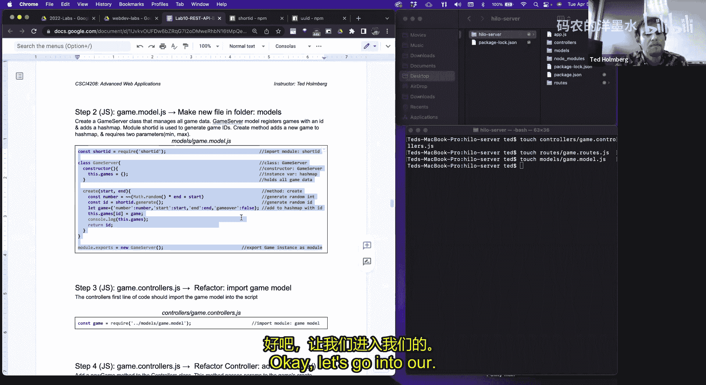

Models， let's open up our game dot modelst Js file here and。嗯。Okay。

 so the first thing I'm going to let's actually。Let's take away some of this。

 And so it's not a big block of code。 And this let's make this a little bit at a time so we can see what's happening。

 So the first thing I'm going to do is I'm going to go ahead and I'm going to import。

The module short ID so I'll be able to use that then I'm going to create a new class that's going to be my game server class。

And the game server class is going to have a constructor and the constructors。

 the instance variable that it's going to have is going to be a games collection。

 it's going to be a dictionary where the keys are going to be the IDs and the values are going to be all the game instances。

Okay， so。Now that I have the ability to construct I want to do that。Yeah。Okay。

 so now that I can construct an instance of a game server。

 notice that's going to be the thing that gets exported to modules so that as say for instance。

 controllers need to import the game server to be able to tell it to do things。

 right it'll have this game server instance to be able to access。

And then we're going to create another method here that's going to be a create method。

 take a look at what this create method is going to do， it requires a start and an end parameter。

 and then the first thing we're going to do is we're going to generate our passcode。

 our secret number using Ma dot random， and then we'll multiply that because it's going to be random number between zero and1。

 then we'll multiply that by whatever the ending value is。

 and then we'll pivot that by the starting value。So again。

 if this were a number guessing game between zero and100， we would just pass in zero and 1000。

 but if you wanted the start to be at 100 or like minus 100 right well that allows us to go ahead and pivot the point where the number could potentially be and then the squiggle squiggle here allows us to cast that into an integer so it drop us a fractional portion then short ID has a method called generate where it just generates a random ID super simple to use so we'll tell it to generate an ID and then we'll just save that into a variable and then we're gonna create an instance of a game object so a game object is just going to be an anonymous object right that has key value pairs so it'll have a key of number and then the variable number that is the passcode that we generate it up here then it'll have the key of start and then the actual value that got passed into the create method here then it。

Have the key of end and then the value of end that got passed into the parameter here。

 then the game over will be false。And then what we'll also do is we will。B to it。This ID。

 so inside of the games。collectionllection will use as the key the ID we generated and then as the value will bind this game instance we just created and then just to test to make sure this is working correctly we'll do a console。

logg and we'll display this stock games， which is the entire collection。

And then what we'll also do is we'll return the ID back from the model to whoever invoked us to create the game so that they know how to access it again。

Because the only way you can get access to that game instance is using this I as the key。

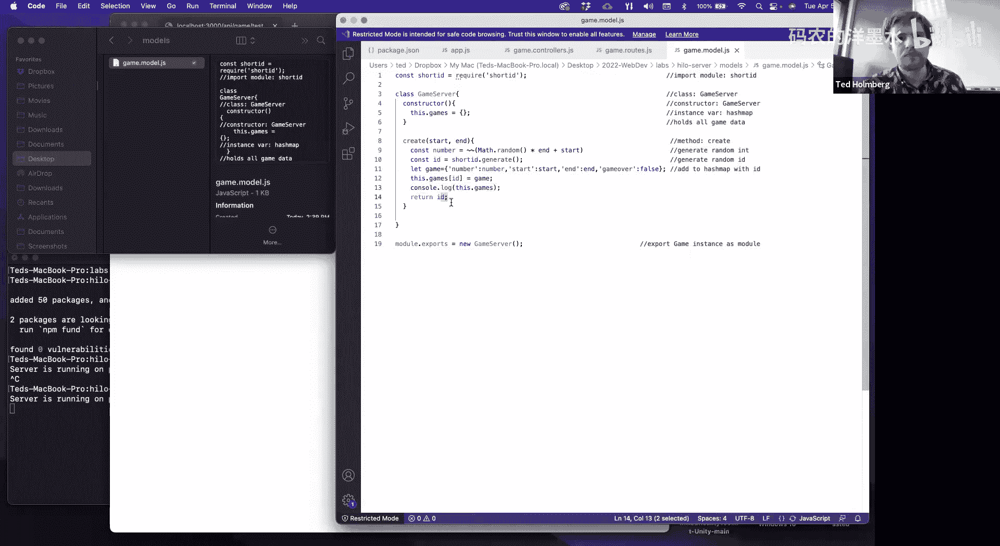

No， that's not， oh， yeah。

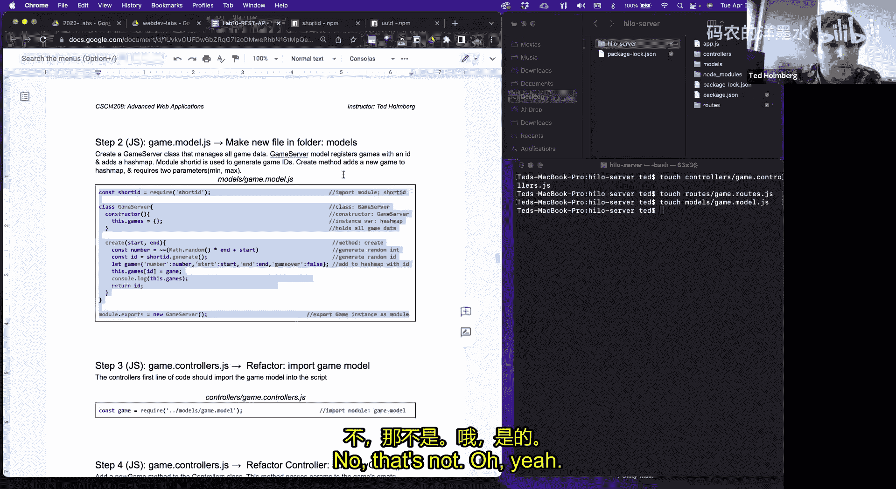

Okay。

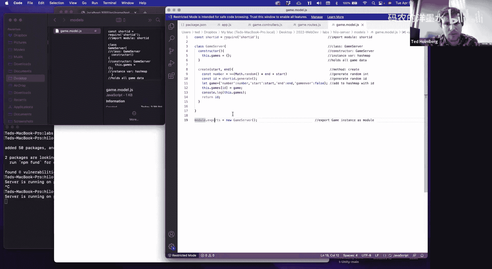

Oh， was I。Okay， the next thing I want to do here is I want to go ahead and。

Go into my game controllers and import my game model so that I can tell my game model to do things from those callback functions。

 So let's go into the controllers here and。

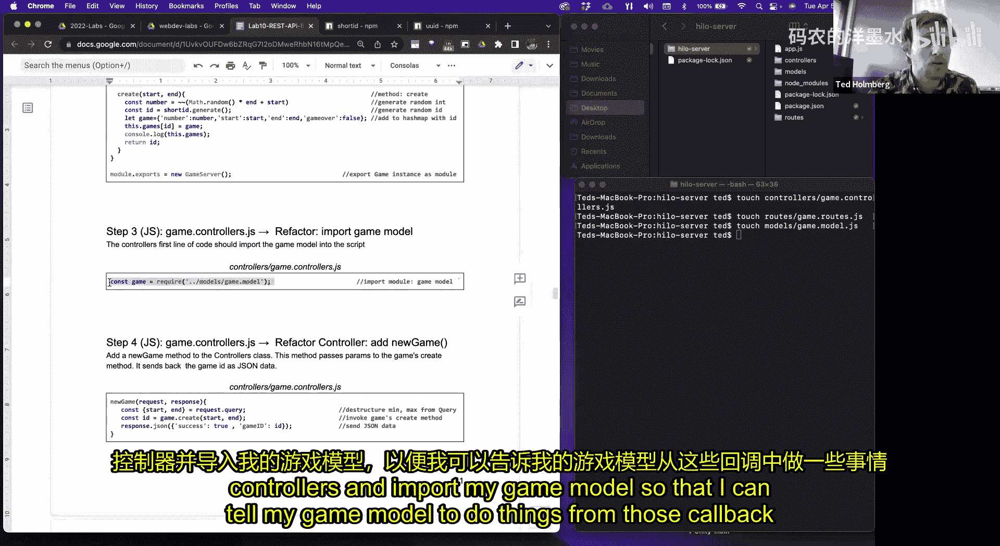

But at the very top， we will。Go ahead and import。From models， the game model。

And notice we don't have to do dot Js when we do these import。

 so even though they're JS files as a module， you don't have to list that and then we're going to go ahead and we're going to import the object right the object is going to be an instance of game server。

And I'll just call that game here。Okay， so now that we have access to our game our game server。

We can start telling it to do things， so let's create a new callback function inside of our controllers right that's going to take in a request response and it will allow us to go ahead and create a new game。

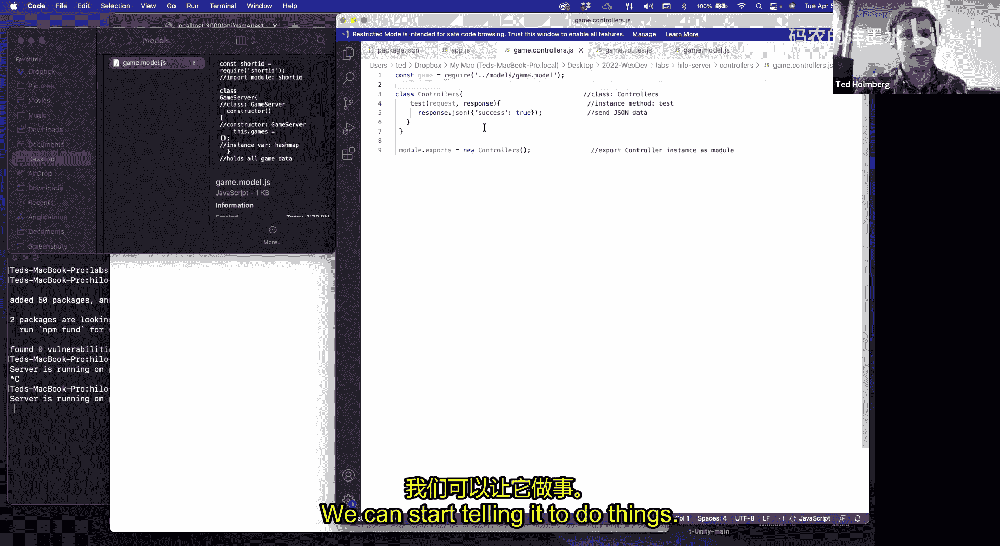

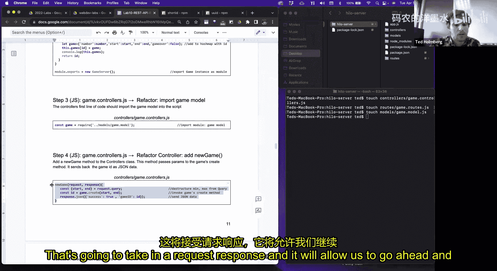

So inside a controller， since this is a class， I can just define a new instance method in there。

Make sure that everything is perfect。And。It's weird formatting going on here。 There we go。

 There we go。Okay， so。The the new game callback function will take in a request and response from the request we're going to access the query string and we're going to dereference from it so the query string。

Is going to have a start。Key and an end key right with values so we want to dereference from the query object the start in the end。

 and then we're going to pass that to our game model here。

 our game server model to the create method we just made and we're going to send that as our start and end。

And so if that's successful， right？If that's successful inside of our game model that's going to return back an ID so we're going to get back an ID and we're going to save that and so in the response when we send back a JSO to the client。

 we're going to say that the request they did it's true it was a success so we're going to give some meta information about the request and then we're also going to give information they're going to need we're going to create a key that's called game ID and we're going to pass in the value of the ID that the model gave to us。

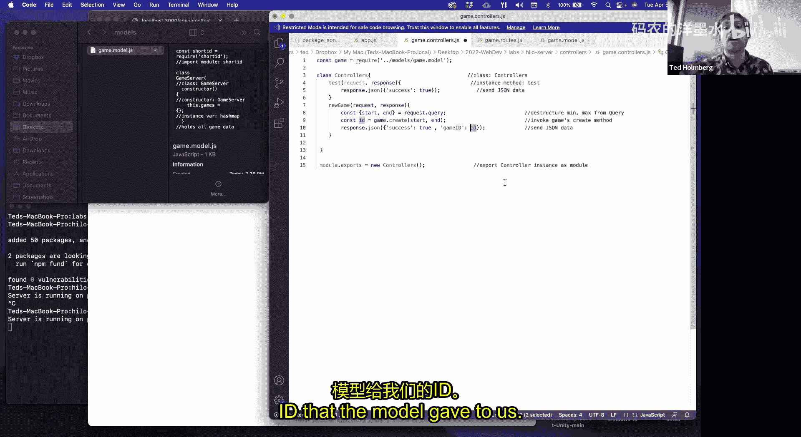

And then the next thing we have to do is we got to go into our routes and actually set up a route to generate to invoke that callback function。

 so we're going to have to import。😊。

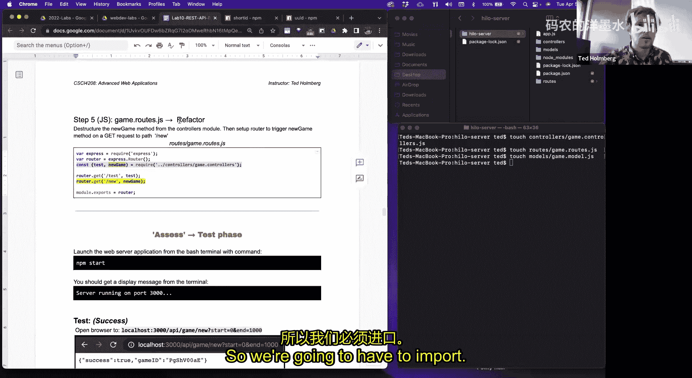

Let's go back into our routes here。And right now we're just doing tests。

 but whats that method that we just created was it called new game let me check here it was new game。

 so since i'm already destructuring things using this。

 I'll just go ahead and also destructure new game。So that I don't have to do dot operators right like I could have just imported the object and then done something like controller do task。

 controller do New game， but I like I like the syntax of this better。

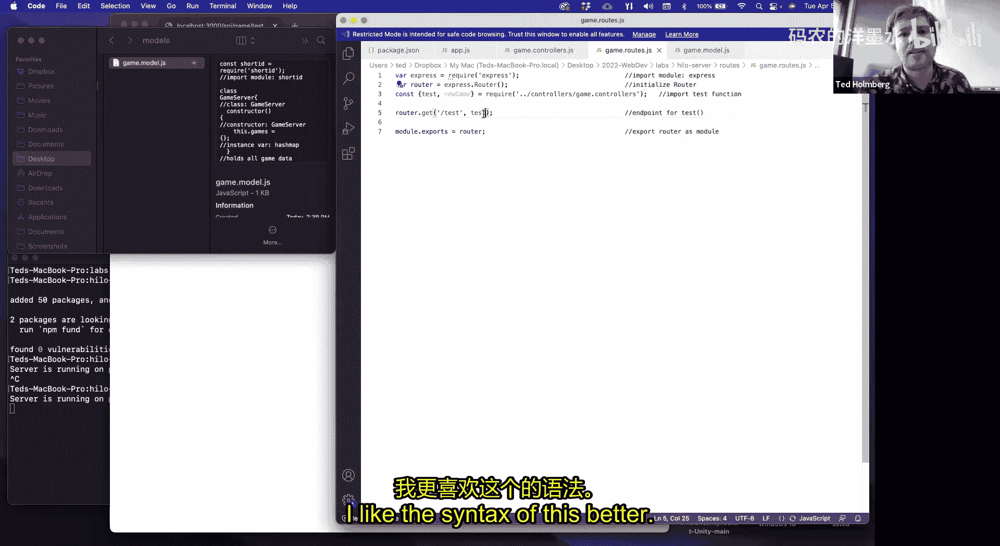

Okay， so once we import that callback function， we have reference to it。

 we can set up the express router to set up a new route。

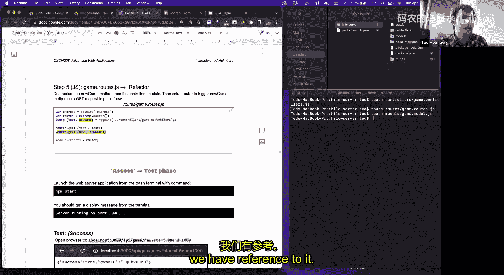

So here this is also going to be all of everything we're going to do for this lab is going to be gi。

We're going to listen on guests， we're going to listen to new and invoke the new game function。

Okay， perfect， and now let's go ahead and run that and see if that doesn't go ahead and start and we can do some tests on that。

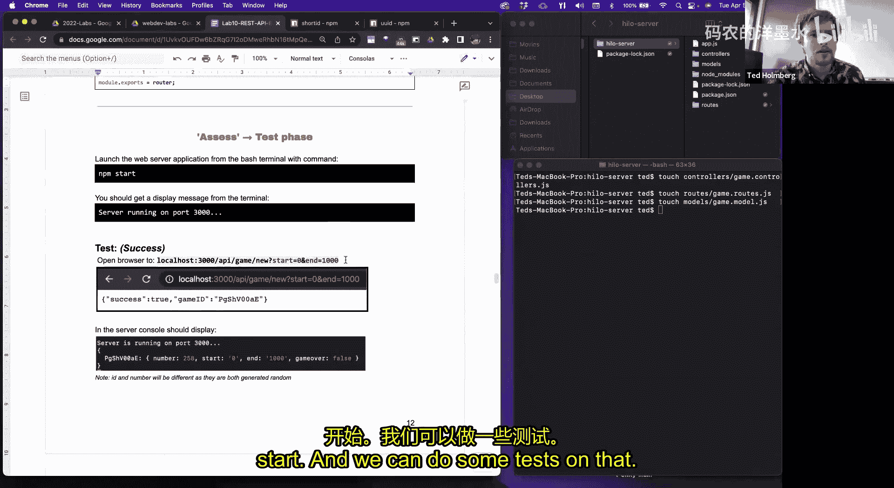

So let me grab our test。And so here， let me go oh， let me kill this server。that so we can see。

 let me run my app。OhLet me do MPm install。Because it's so it let me know， hey。

 you're trying to use a module short ID and you haven't used that so。

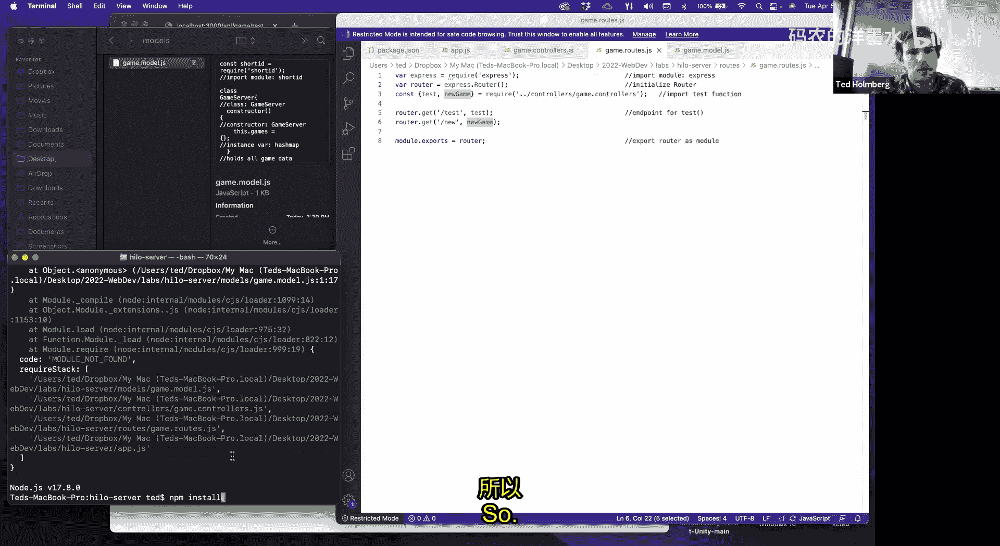

That's why I use NPM start actually here have I paid attention to my actual directions， let's see if。

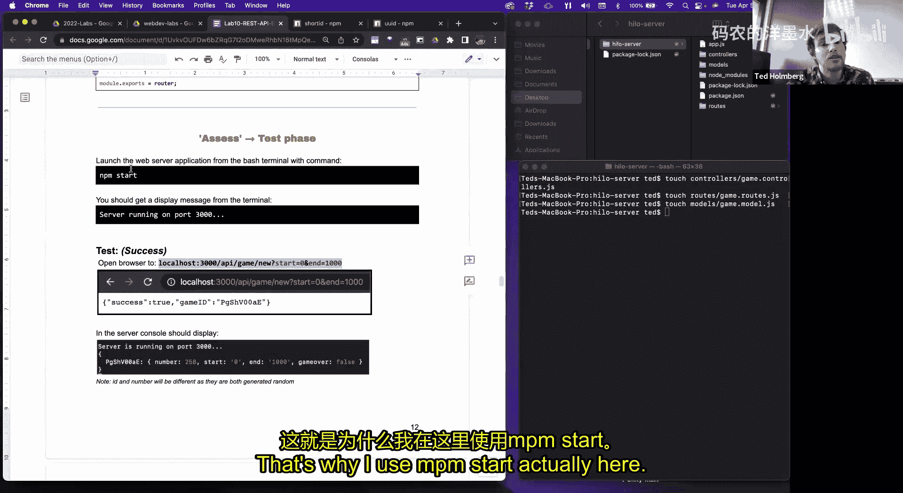

That should have。Installed the new。And then start running it perfect。 Okay。

 so now that that's running， let's go back over here。

Let's test this so we still have that test because we never remove that。

 but now let's do this let's go to local host at 3000 and then all of our API is at API slash game because we set that up in the express app using the middleware and then here this is going to be the new。

The new route right we set this up for new games I on slash new but also the new route is using search parameters right if you recall in our controller here we're accessing the query string and we're dereferencing it binds that as a JSON for so we can dereference it as an object using the deuring structure to get that start end so I'm going to create a key that's start and then assign at a value of zero and then I'm going to create a key that's end and start that at 1000 and for each key value pair I use an ampersstand so this is one way that I can send data to my backend and this is a good way since we're just building a backend service to be able to explore how to do this without having to build some kind of mock dummy end either our client side so I'm going to hit enter on this and notice look at that I got a success true and I got a game ID and it gave me the ID for that game。

To my client。And now if I look on my server， remember I had that console log。For my create game。

 I have a key value pair so notice this is actually returning the object to the dictionary of games where the key is that key here and the value is an object that has a collection of properties number is 947。

 the start is zero， the end is 100 and gameovers false and notice that game that start and end default as strengths。

So just keep that in mind when we go to do our game logic that we'll have to parse those as integers。

 we'll have to go ahead and cast those into integers if we want to use arithmetic relations on those。

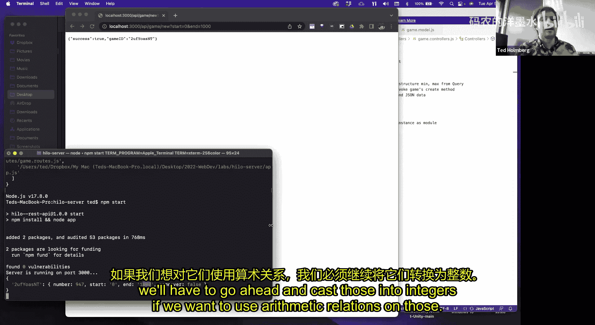

Excellent， let's move on to our next step where we can actually go ahead and get a game back。

 So here we'll implement a rest end point where we can get data for a particular game instance and in this iteration we're going to implement。

Using a URL parameter right like because if we want to get a particular instance of a game。

 we have to get it by its ID so we're going to learn how to use how how to set up a route that could be anything and then we'll based off of what was given to us using serverside logic decide what we give back。

And so that's what's called a variable URL path。To be able to use parameters。Okay， perfect。

 so this will be a relatively short step as well， we only have three JavaScript steps where we're going to add a getter method into our model。

 then we'll add a Gi game method into our controller and then we'll add an endpoint that triggers our Gi game callback function to change or do something with our model。

Okay， so the first thing we need to do is we actually have to create that getter inside of our game server class。

就。And then we'll take a look at what's happening。So oh game model， yeah， so inside of our game model。

 we already have a game so we're going to create a new instance method。

And so here it's the role of this method is to get back an instance of game that's stored inside this game' collection。

 we require an idea as a parameter and the first thing we're going to check is if。

It's true that there is something at that ID so keep in mind in JavaScriptscript in here I'll show you here。

 let's go into developer tools if I had a game object right let's or let's let's say that this is my games right let's say that I have who and this is some value there Okay。

 so if I go into games and if I type in。F it returns something and that that that something can count as a truthy value right now if I put in something that doesn't exist let's say spam that's undefined undefined counts as a falsey value。

 so just by trying to index with a key。If that key doesn't， if it's not used for anything。

 then it won't trigger this if statement， so this will trigger the else。😡。

So if if that key exists inside of the games， then I will access。The game instance。From that key。

 but look at what I'm going to do， I'm going to destructure it so that I take the passcode。

 the random number out of it because I want that to be private。

 I don't want to deliver that to the clients right that should be something that's always on the server side so I'm going to extract that and then I'm going to do that spread operator the dot dot dot data which is going to have all the properties of the game object except for the number。

😡，And then I'm going to return that data so that'll have the men。

 it'll have the or it'll have the start value， have the end value it have the game over。

 but we're not going to deliver the random number to the client that so that no one can cheat。😡，Now。

 if this returns back and undefined， then that means that that was an incorrect game ID。

 so then we'll return back to whatever invoked this Gi method。

 a no to say there's nothing there so but we make sure that we return something。

 either a no reference or the game data that we want to be public。😡，Okay， so after we do that。

 we have to go into our controllerss class and actually create a callback function that will tell our model to try to get the game from our model。

So let's go into our controller here and so since this is a class， I can just create a new method。

So I'm going to call this game iss going to take in a request and response。

 just like all of the callback functions that are attached to end points。

Here i'm going to do something slightly different i'm going to access I could have done this so I could have done this。

 I could have done the de and destruction destructure the property right。

 but just to highlight that we can do this in different ways。

 I'm going to instead use the dot operator to access the property。Id from the parameters。

 from the press were parameters。And store that as a variable。

And then from my game model that I imported up here。

 I'm going to invoke that Git method we just created。

 and I'm going to send it that ID that came in from the request。😡。

From the client and that's going to return back data now data can be one of two things from a model right it can either be the data of the game or it can be nu。

So if data exists now remember null is a F sea value。

 an actual reference of an object is a truthy value。

 so if there is data that got returned back if it's not null then we're also going to add to that data a success key and tell it that was true so the idea of telling the client whether the response was successful or not isn't part of the model's responsibilities is part of our controllers because so the controllers kind of observing for us did the model change state the way that the client wants and then'll always tell with the client know yeah what your request was was successful。

And it's good to give that information so that you can have logic on the client' side。

 be able to decide what to do in response to either a success or a failure。And then once we do that。

 then we're going to go ahead and respond back with that JSO with that data。

 with that JSO that we send back and if。It's a null value。

 then there's no JSON yeah there's no object to go ahead and set properties into so we're going to create a new anonymous object right with a key success and this would be false right because we weren't able to get the game so we'll just say oh no't there wasn't an ID there effectively。

😡，Okay， so now that we have the callback function， we have to set up a route。

 so in order to set up the route I have to go into my routes。😡。

And the first thing I'm going to do here is what was that method called get games so I'm going to go ahead and destructure that from the import the object that I'm doing。

 and then I'm going to set up a route where the route is going to be。And again。

 all of my routes for this rest APII is going to be get so another get and this is going to do slash colon ID so colon ID allows me and so ID could have been anything right so the colon just allows me to define some random thing。

Some random property。And then I will invoke Gi game on that random or that variable URL。

So one important thing that you should know about these variable routes is they should always go after your well defined routes since they're not well defined。

😡，It could all usecate a route that is critical so make sure that these go towards the end。

 just like variable length arguments inside of a parameter。List。Okay。

And that's it we should be able to do NPM start launch our application and test it out so let's do this let me get we're going to test this in one of the two ways we're going to test to see if we can't get back first create a game we already created a game but I need to relaunch the server so it actually has all this logic so let's kill this let's clear this。

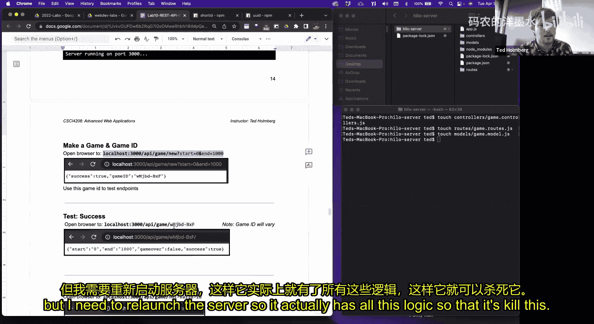

Let's。Relaunch our server， Okay， so our server is now launched。咩。

Refresh this is going to create a new game with a new ID。

 so notice I now have a new game with a new number， a start and end game over is false perfect。

And this is on the server， so let's see if we can't then now that we have that let's see if we can't call this now we can't call it with this we need to use the ID that。

😡。

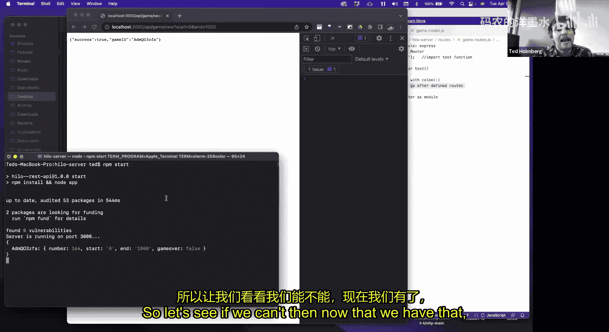

Our server has given to us。 So here I'll go and we'll do local host 3000 slash API slash game and then look at this we're going to use not that one。

 this one we'll just use the ID， the variable。Parameter here right that that returned and express has arrived for that and it actually returns to me that game instance and notice it's everything except for the passcode right so it lets me know what the minimal number is it lets me know what the maximumimal number is it lets me know whether the game is over or not and it lets me know that that request to get the game was true so that came from the controller the rest of this came from the model and again。

 the reason why we might need to know the start in the end because if we weren't the ones who created the game。

Let's try that same thing， though， let's try with this ID here that was given to us。

 or let's do not valid ID so we can see。And so here we're going to try the fail condition。

 just like we tried the success condition， not valid ID， we sell get a response right which is good。

 and so now we know that our that our request failed on the server side。Because we gave the wrong ID。

 so if I were building a client， I would probably say oh there's no ID。

 there's no game ID for that right so I would know how to respond giving this information from the server。

😡，Okay， the next generation we want to do is we want to be able to actually implement where we can make a guess towards our Hilo game instance。

So in this iteration， we'll use the route parameters again， but we'll create like a subpath。

Into that endpoint so that we can issue a command that game instance。So again。

 the route will use the parameter to allow a variable URL based off of the unique A ID。

 but then we'll do slash and then like gas。So we can do something in response。 again。

 this will just be a three step process each time we go and do that。

 Usually what the steps are is we add some。Behavior into our model。

 and then we create some callback function that invokes our model to do that behavior。

 and then we create some endpoint that the client can invoke that'll cause that callback function to trigger。

 So notice we keep doing the three similar things again and again and again。

 So the first thing is why don't we create the logic that allows us to do a guess inside of our game model。

I， there's five different states we're going to do and we're going to step through this really quick。

 So again， since our game server here is。Okay， there we go。

 since our game server is just a a class we can just keep making new instance methods so we're going create what looks like a big method。

 but it's relatively simple， it's going to be gas and it's going to require two parameters the I for the game we're trying to access and the number we want to try to guess so there's a couple ways we can return so one is if the request if the I is wrong。

 then we're just going to return no。Right like like there's nothing there to apply guess to so we're going to see we're going to do we're going to check the inverse。

 so if it's false that the game ID is there， then we return all。Then if it is there， we'll continue。

 we'll access that ID and grab the game object， the game instance there。

 then we'll check true is game over already true？😡，And if it is。

 then we're going to return this synonymous object， this key value pair where guests。😡，Is game over。

Now， if the game isn't already over。Then we're going to see if the number inside of our game is equal to the guest value and if it is。

 then we're going to set game over equal to true and then we're going to return to that user you got to correct your guess was correct。

😡，Now， if the guess number is， if the passcode is higher than the guess。

 then we're going to return that guess， the key gas is too low。

And notice I'm casting here right the plus sign allows me to cast a string into an integer into a number。

😡，And then I'm going to check。If if the passcode is lower than the gas， then I'm going to say， oh。

 it was too high， I'm going to return too high。And if it's none of these things。

 thenll like some kind of error occur。Some kind of error that maybe it wasn't a number that got sent。

 for instance， maybe it was a letter or some reason that caused all these other instances to fail。😡。

And this way we just alert the client to know Detroit resolved any possible outcome。

Its out of our game mark。Based off of these parameters。Okay， so now that we have that method made。

Let's go ahead and define our controller that will invoke that method。From our server application。

 from our server logic。So let's go into controllers。And again， since controllers is a class。

 we just have to create a new instance method。And so here。

 the instance map that we're going to create is going to be called gas。And again。

 just like all the other callback functions thattether to endpoint。

 it has to take in a request and a response and in this instance， I do it in both ways。

Just to show you that I play no favorites from the request i'm going to access the parameters object which has an ID property and then I just save that so that's one way I can reference a property of an object。

 another way is I can just access the object and do a de call on it and just access the property of gas that way。

Which would be some numerical value anyway， I'm going to get from between the parameters so the parameter is the URL parameters right that's。

That ID is。Defined， let me show you。This， that's where idea is coming from。😡。

Line seven from when I set up my router so when I say parameters that ID it's going to give me that passcode that's part of the URL string and then since we're using query strings query strings to pass our data we can also access data from our callback functions that so two different ways to access our our callback functions。

Excellent， anyway， then from our game model， I'm going to invoke that method we just created gas and I'm going to pass it the I that I got from the parameters the。

😊，And I'm going to go ahead and pass and guess that I got from the query string and that should give me back a result。

 one of a number of different results if the result is something that exists。

 so the only time it doesn't exist， let's look back is if the ID didn't exist right any other time it's going to either be guess game over guess correct guess too low guess too high or guess error so if it's any one of those。

Then I'm also going to take that result and I'm going to create a new key success and put that it was true and then send that back as a response as a JSON object。

Now if it was false， then I'm going to put that success was false if I didn't get back an object from my game model。

 then clearly the guest didn't work， so I'm going to let the client know that their request didn't work。

 it was false。Excellent， and now the next thing I need to do is I got to set up an endpoint， right？

I'll just correct this one。And so here this was called gas up when I go into my route。

Here I'm going to dereference。Gas。😊，And then I'm going to all my Express router out there。Fling。

Put it。Keep those comments there， but keep this together。Okay， going to on my express route。

 I'm going to create for a variable length of ID slash gas。

So if it was local host colon 3000 slash API slashga slash some ID slashG。

 I will call the guest callback function。嗯。Okay， let's actually test that out。Let's kill this。

 Let's do。Let me clear my console。 Let me do MPm start。May refresh。Oh that's not an ID anyway。

 so the first thing I need to do is I got to create a new game because I just relaunch my server。

So now that's going to give me an I。 So let me get use that I。 And I'm going to send that。 So okay。

 that's cool。 So I got my game instance。 So now let me。😊。

And so if you recall what I need to do here is I'm going to have to send a parameter of gas and let's test a couple of different things here。

 so let's try on our gas we're going to do a search parameter so this is the end point。

 but since our data requires search parameters embedded into the string。

 I'm going to do the question mark and the key is going to be gas because if you remember my code。

From。Here right we're looking to get a key of gas and let's say we do Nan here let's see that's going to be a success true to actually access。

 but I got an error response because I tried to guess not a number right so that's what allows me to get the final。

哦。Else in the F else chain there here， why don't we try a gas of zero？And so that。

That allowed me to go through， but it was too low， right？Let me try。9，9，9。Okay。

 that was too high guess too high all these are are success true Okay let's see here。

Yep yep and wow look at all these different ways I can test let me try to get it correct I can try the correctness because i'm actually getting the results here so 914。

I know。So let me put 914 on the server I got it correct so now let me try it again but now it's game over because the game state is false right the game over is is now it's now no longer open for more guessing because someone already got。

And so those are all the different returns of the state that our game can be oh and the last one would be on not a valid ID。

 so let's try that。So let's just put like let's change one of these letters or put another letter there and yeah。

 success。Yeah。Excellent， okay， the next thing we need to do here。

In the very last portion of our of our。APpiIs right when we looked at our APIs originally we said we needed to we needed to be able to make a new game。

 we needed to be able to get a game with a certain ID we need to be able to get a make a guess at a game at a certain ID now we just want to be able to reset a game at a certain ID if the game is over。

And then we're effectively done with our RE API there's just one small change we're going to do after this one so here we just gonna implement a rest API to reset the game after it's over and so in this iteration we'll implement an endpoint that resets our game and so the routes will use the parameters to allow the variable URL path just like the last few times so that we can access an actual game instance using the unique game ID and then the game must be over to reset it and so resetting a game just toggles the game over from false and then also randomizes a new number and so just like all the other times it's just a threestep process we're going to define a reset method inside of our model and then we're going to add a reset game callback function in our controller that tells our model to do something and gets information from an endpoint and then we're going create an endpoint on how that callback function gets triggered。

So let's go in and actually just create our。ResSe method inside of our game model。

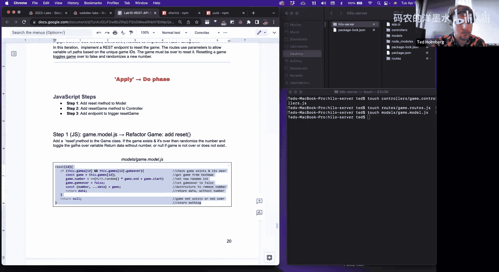

changesnge this to。Geting so on。

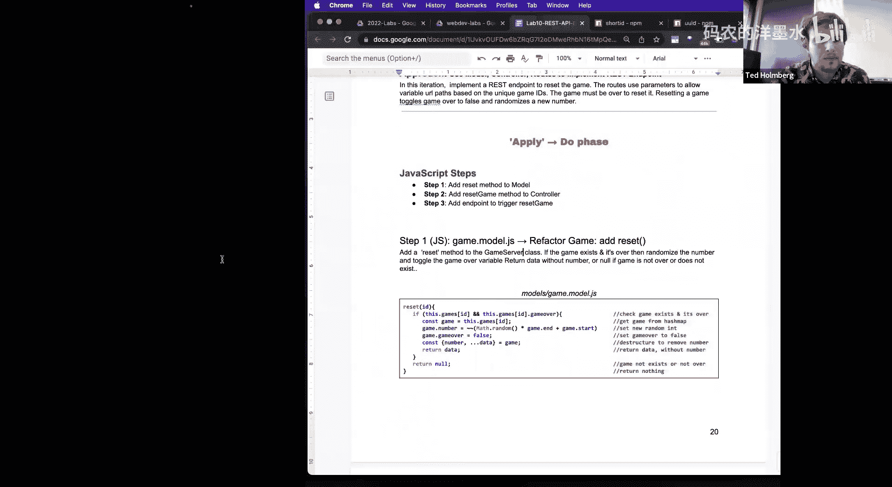

peThat didn't。

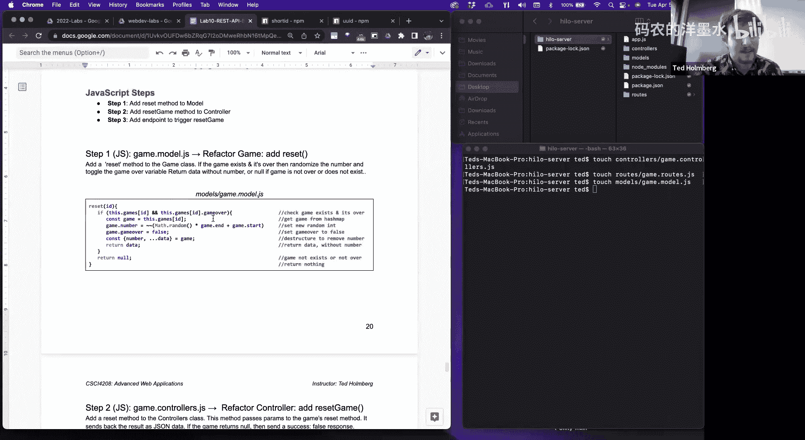

Change all my formatting。 Okay， let's kill the server for now。

 and then let's go into our game model here and。I'm going to create a reset method inside the class that's going to take in an ID it's going to check to see if the ID exists and that it exists if game over is true or false。

So if it's true that that game ID exists and it's true that the game is over。

 then I'm going to get that game instance， I'm going to generate a new random number for number inside the game。

 I'm going to set game over。😡，Back to false。Then I'm going to get that new game instance。

 I'm going to destructure the passcode out of it because I'm going to send this new game instance as a reference to the client and I don't that's private data I don't want the client to have and then I'm going to return data and again if it's either false that that is a good ID or that the game over is not the game is over so to avoid people from resetting an active game we're just going to return a null。

😡。

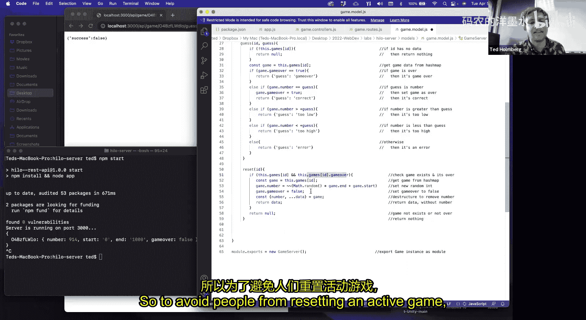

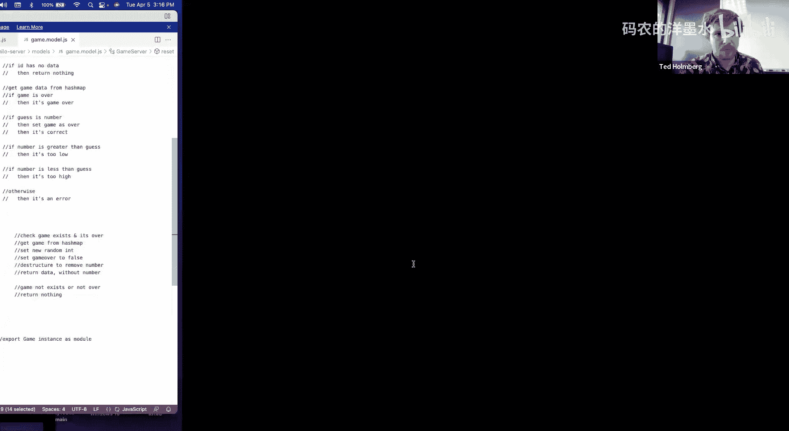

Excellent， so now let's go into our game controllers and actually create a callback function。

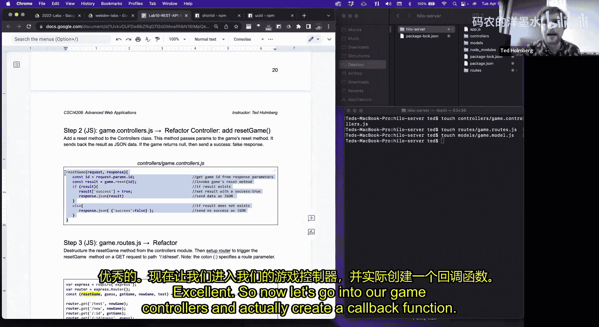

That can invoke that。Reset inside of our model， so I'm going to go into my controllers here。

 and since this is a class I'll just add any new。Instance method， reset game。

 just like all the others it requires a request response objects passed into it。

 I'm going to get the ID from the parameters from the request and then I'm going to on the game model invoke the reset method。

On that ID， and I'm going to get some result back if the result is a true response。

 right if it's a game instance。Then I'm going to add a key of success and then a value of true and then return that back as a response as a JSON data to the client。

 and if it returned back null because the ID was not inside of the game's dictionary or because the game isn't over。

 then I'm going to return successful。

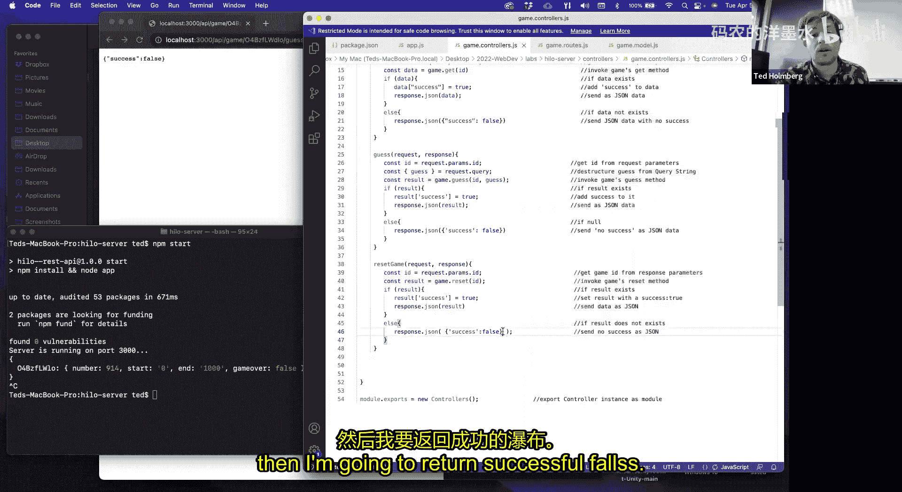

And then the last thing I need to do here is just go ahead and。

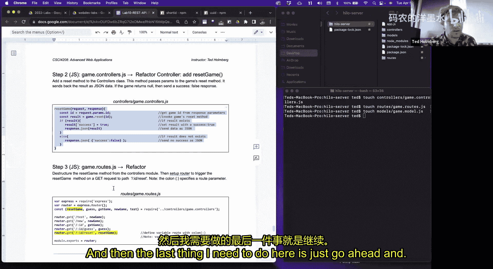

啊。Set that route to this callback function。So。First of all， let me go ahead and I called it reset。

 I believe， let me go back to controllers， reset game。So let me。

Do you reference reset game and then on the express router。

 I'm going to set up a get for a get method on this route。Variable ID slash reset。

 we will invoke the reset game method and's that's it we should be able to test this。

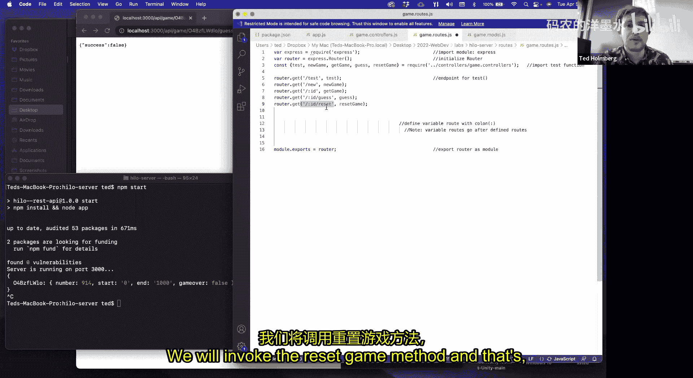

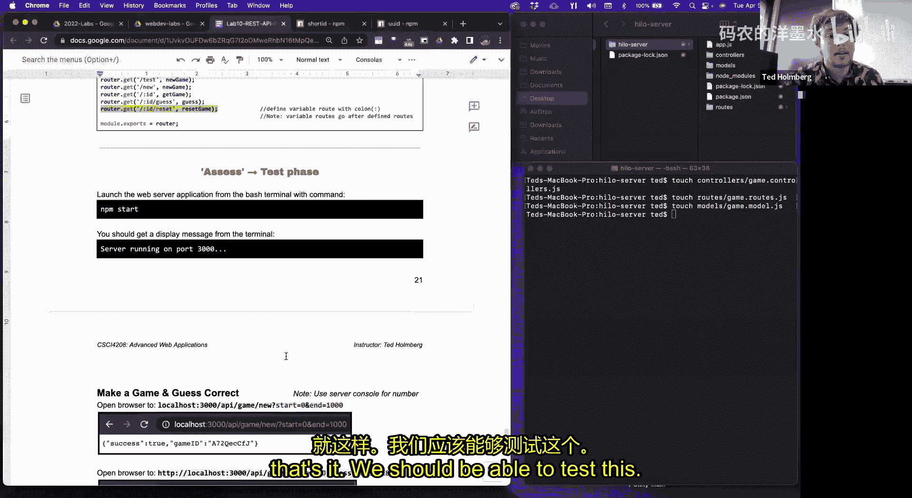

So let's launch our app。Cl， let's launch our app。go over here， let's create a game。Okay， perfect。

 so we created a game oh look， and you see as I keep。Doing that。

 I think this first time I'm showing you is actually showing all the games that it' console logging out so have all these games that I can potentially utilize。

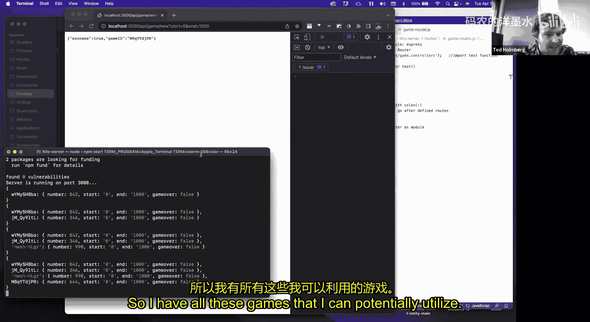

And then let's go ahead and guess it so it's correct， so let's grab one of these games。

 I'll just grab this one。Here。No。Then we want to go to gas and then。

Gas is equal to and let's see that's the last one here， that's M that's 64，4， so let's do 6，4，4。

So I got I got it correct。So now let's call reset on that and it should go ahead and reset it。

So here instead of that， let's reset。Yep， and notice now it gives me start and and game overs false。

 let me call reset again when the game over is false and now that's a false。Perfect。And then also。

 let me do a different。啊。Idedas invalid ID。Inval I， right。

And that's also a false so just making sure that all the ways that my client can touch that endpoint I get some back response my client knows how to handle that。

So yeah I was able to go ahead successfully reset the game， I tested that。

 I was able to successfully try to reset the game but failed because it was in a not game overstate and then use the wrong ID and also got a successful false on that and so the very last step we have isn't going to affect our implementation here like our implementation of our server is pretty much done but in order for us next lab to build a client that'll actually use this API that actually build a client application side and since we want to run both the client and the server on two different locations we're going to have to allow our server to violate or ignore what's called cores cross originin restrictions。

On our local host so that we can test this so if we don't do this。

 then our client won't work so keep that in mind when you're implementing this and if you implement the next lab。

 if you skip iteration8 your client's not going to work so we need to use we need in the request。

We need to I'm sorry in the response we have to be able to allow this header in the access control allow origin and so for the next lab that will also build a front end that uses the rest API to implement our multiplayer number guessing game。

And so we want to bypass these core restrictions on local host。 So to do this。

 we're just going to create actually our own middleware function。

 Probably the first time we've seen how to create our own middleware function。

 So here what we'll do is we're going to。Go ahead and create our own function and select， nope。

 that's Python code。Oh， here we go。 We're going to go inside of our app Js。

 We'll just create a function， right， it'll get hoisted So this will be my own。A middleware module。

 so a middleware module when you define it yourself has three parameters。😡。

Unlike the callback functions， the callback functions are the last thing that that things usually occur on so they get just the request response。

 but middleware gets request response and then a next parameter。

 the next parameter is fed to this function by express itself based off for the ordering of the middle modules that are placed and a function essentially it's just a function object and it's the next function object in line that gets called until you get to the callback function so it's possible that the next will be the callback function if there's no other middleware modules that are between。

When the request first comes in and where the callback function that's tethered to that endpoint finally gets in voteked。

So here we're going to embed into the responses header that we want to access control allow origin and then we're going to invoke whatever next is and that's defined by the express app by passing it in as a parameter so it's probably going to be the callback function。

Of that endpoint and all endpoint and then we actually have to go ahead and tell the app to use this middleware。

 which is is' just a function right so notice when we go in here before I get to the routes that I set up so I put all my middleware before my routes。

And so here I'm just going to pass it to reference that function so it goes to go to use it。

And that will allow us to be able to use this code for next class excellent and just to make sure this works。

 you know， you can just go ahead and kill and hit MPM start and if it launches， then we're good yeah。

So that's today's lab， we in one lab learned how to implement a backend REs API for multiplayer number guessing game。

 it covered route parameters， query strings， unique ID， API designing and developing with RE APIs。

 and we learned how to export JavaScript modules。And create endpoints so ways you might want to improve this app。

 design a front end。Because all we have is a backend set of calls and that's what we'll be doing next lab。

 but other things you might want to consider doing if it were better would be like add username for a game and show the name and win record as a scoreboard or synchronized users together and display who's playing。

 maybe instead of using ACTP， you could do this with web sockets。

 you might want to store the games in a database as opposed to just on the server because if the server crashes。

 you lose all all the active games or the server even goes to sleep。

And maybe even deploy this into production on heroroku so you can actually play it with multiple people instead of just a local hosts。

 you maybe you can make a more fun theme on it where the idea is that you have multiple people trying to hack into a system and the first one who hacks it wins and everyone else loses so you can kind of make like a cyber theme concept on the high low game to make a little bit more interesting excellent。

Well， is there any questions about this about this lab？是。If not。

 I will go ahead and end this video here and I'll post it for all of those who were not able to save for the entire time to view it later tonight。

Thank you， Professor I see you soon。Have a great one everyone I'll see you all on Thursday。

 where we'll build the client inside of this app。

