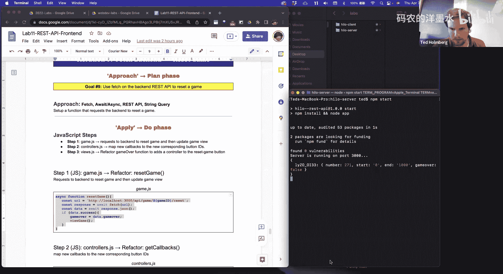

# 【全集】加州理工学院 高级Web应用 中英字幕 1080P p17 Lecture 17 - REST API part2 -BV192zTBrEmu_p17-

Oh， I just wanted to go ahead and produce a quick correction video for the RE API client side。

For goal number9 as per the instructions that were in the video it's going to produce a error and I'll explain why that error occurs and how we can go ahead and fix that and in fact the newest lab document has now a corrected version which is the one that we're going to cover in this video really quickly so let me launch my server and I'll show you the current wrong version that we have and so here this is the issue is in our implementation for reset game So this was one of the last steps that we did and if you might recall in the last video what reset game does is right now it's just grabbing the URL and it's going to fetch a it's going to send that request to our backend server。

あ。And recall the point of reset game is to go ahead and after game has already lost。

 it allows you to replay that game or to effectively tell the server to regenerate a new random number and say that the game isn't over anymore so that people can play it again so we're going to hit that endpoint that causes that reset to happen the back server server and we're going to wait for that response and we get the response our original implementation was once we got that response we were immediately going to go ahead and then get the JSON from that and then use the then function to say in response to this JSON being delivered。

 we're going to just go ahead and then rerender the view page the view the game view however what's going to happen。

Is let's launch the service and see what happens let's see what the issuances up being here so if I go and hit NPpam start i launch my backend server right okay we're going to watch that spin up。

I got。So now let me go and open up our web page here， okay。

 we have our number guessing game and actually let me open that up twice over。

So we can pretend to have two users， Okay， so let's say we have a user who creates a new game。

Let's start a game， we have this game， right？So let me get the game ID and let's say that we have this user that guesses the number。

 the number is 204 I'm going to cheat and look from the server console log so let me put 204。

And so hit submit now right now if we hit replay that works it from this user's perspective。

 like let's do that， yeah， that's what and then we can start replaying。That works。But。

What doesn't work is if we go to new game yeah let's do new game let's start a new game Okay we have another ID here and we find out what。

94 is our number。So let me type in 94 let me win the game Okay so I win the game so let me go back over here and pretend like i'm a second user right and so here i'm going to join the game and I want to join the game。

Pull this out here so we can see so I'm joining the same game。

I'm going to use the game ID I'm going to join it already says， oh look， I lose perfect。

 but then I want to select replay and look replay doesn't do anything。Now， clearly。

When I look at the proposed use case of the logic。And let's take a look at our implementation here。

 so clearly what the intent is。We get the response。

🎼For the reset so the reset should provide back data。

 which was going to be the min the max the ID and game over right we don't send the passcode and all that data except for game over should be。

The same right because we're replaying the same game so the I should be the same the men and max but the game overstate shouldn't So when we invoke you game notice one thing we're not doing those we're not updating our local client side variables and that's going to be the big issue that's whats caused in the bun so recall that we're trying to synchronize the state of our game data on the client alongside the game data that we have on our server So every time we send a request and response and we're we're we're。

Every time we request and get our game state back， one thing we should consider doing is updating the state of our client eye data。

 so it's in line with our server side data。So in this reset。Mtic， we did not do that。

Right we just carried straight on to view game so what causes the issue there is that if I go into the view game method。

 I'm going to grab the view element， I'm going to get the AC that's going to render the game view I'm going to update。

The view element with this new HTML I'm going to add the controller for the submit。

 but then i'm going to check if the local variable for game over is true or false well after we reset the game we never mutated the state of that so from the client perspective it still thinks that the game is over so before it renders this it immediately redirects and invokes the game over menu to then say you lose and that's why that's exactly why whenever I keep clicking replay。

It is actually invoking。It's actually invoking the the game over I I mean I'm not sorry is it actually invoking the reset like it's doing that it's actually invoking view game。

 but it's also then doing game over again and again this is the culprit this game over variable so to correct this what we need to do。

Is we need to go back to our game script。Yeah。And we have to do this the same way that we had implemented our Git game method。

 so we're going to use the Git game or the fine game as a base so the same way that in this earlier function when we request it for the response and then from the response we crab the JSO data and store that inside of data variable and then we could check the properties like if the data if it was successful that we got the data then there's a star there's an end there's a game over right and then we can request to view a game so the exact same implementation we used here we're going to refactor reset game to be instead so here if we look at reset game we're going to use the URL that hits that endpoint that causes the reset on our backend server service then we're going to do the fetch and wait for the response。

And then from that response we're going invoke JO and wait for that data and now we have all the data properties postre from the backend server and so since we have that we should take this opportunity to update our game data that's on the client side so it's in line with what's on the server side now I know for a fact that minimumax and change right when we invoke reset we implemented this ourselves so we know based on the specifications when we invoke the reset function on on the server side it reranizes a passcode and it changes the game over state from true to false so if so we'll check the success property So if it's a success that we got the data then we're going to access the property game over and we're going to overwrite our local variable inside of our data script here。

We're going to overwrite that to now be false， then we're going to invoke the view game so that if we invoke the view game。

 which is inside of our views， if I do that。😡，Then when we grab the view element and when we create the HTML for our game view and then when we add the controller。

 when we go to check this local variable， this clientside variable game over。

 we've mutated it since we've reset it so the game over should now be false。

 which means that we won't。We won't execute this game over function call。

 and so it will allow us to be able to actually click replay。So let's save that， let's refresh here。

Let me refresh here and let's test this out and let's see if this new implementation is correction on。

For goal number nine， so for goal number nine for reset game let's see if this doesn't solve our problem。

 so i'm going to actually start everything up fresh I don't have to restart mars server。

 but we're going to do it。So I'm going to restart my server here。Perfect。

 I now have my service running。 So now I'm going to go over here。 I'm going to。

Create a new game right let's do that Okay， so I now onm going to grab deck game ID here。

And then let me see what this is。So that is number 271。So when me let me get the game over there，2。

71， we're going to submit Okay， so game over you win so now as a second user right let's pull this out here so we can compare。

We're going to join the game that's currently already over so this is going to be so here we're going use that game ID we're going to join now before because we weren't properly updating our client side data to be in line with our server side data when we're hitting replay it wouldn't let us right because it's still how the game was over but now when I click that it updated the client side variables so now it allowed us to view the game without instantly also triggering the end game view afterward so now we can actually start playing our game here and actually do submits 100 is too low so let's do 750。

Okay and yeah here you can see we can just keep playing the game and so that's that's what the issue is with the old video instructions and that's this this is how you fix it and this is a good explanation of why it's important oftentimes to synchronize your local variables with。

What the server state is that the state on the client and the state of the server is constantly refreshed and in parody with one another because what might happen is exactly what was happening。

 we were we were transitioning to a wrong state because our client thought that the game was over when the game wasn't over actually if I refresh the page the server was allowing hadn done the mutation The reset was appropriate we just didn't recognize it because we didn't update the data on our client so these are just considerations to have when you were implementing a distributed software system where you have shared data that gets transferred from one end to the other so I hope this helped and。

And thank you for watching。

是。