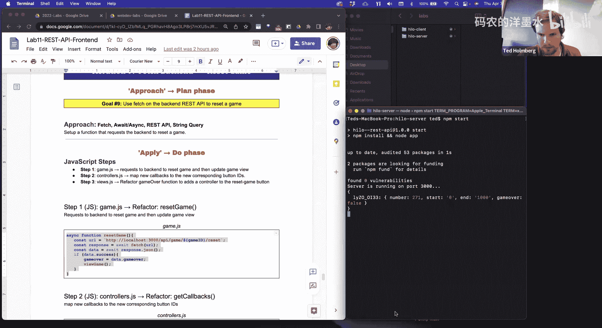

# 高级Web应用：17：REST API 客户端修正教程 🔧


在本节课中，我们将学习如何修正一个在REST API客户端实现中常见的状态同步问题。具体来说，我们将分析为何在“重置游戏”功能后，客户端界面未能正确更新，并提供一个清晰的解决方案。

---

上一节我们介绍了REST API的基本实现，本节中我们来看看一个具体的客户端状态同步问题及其修正方法。

## 问题分析 🧐

在之前的实现中，`resetGame` 函数负责向服务器发送请求以重置游戏状态。其核心逻辑是发送一个请求到后端服务器，等待响应，然后直接调用 `viewGame` 函数来重新渲染游戏界面。

然而，这里存在一个关键缺陷：客户端在收到服务器的重置响应后，**没有更新其本地的游戏状态变量**。这导致客户端的内存状态与服务器的实际状态不同步。

具体来说，当服务器成功重置游戏并将 `gameOver` 状态设为 `false` 后，客户端的本地 `gameOver` 变量仍然保持为 `true`。因此，当 `viewGame` 函数被调用时，它会检查本地的 `gameOver` 变量，发现其为 `true`，于是立即跳转到游戏结束的界面，而不是显示可进行猜数的游戏主界面。

## 修正方案 💡

为了解决这个问题，我们需要修改 `resetGame` 函数。修正的核心思想是：在从服务器获取到重置后的游戏数据时，**立即用这些新数据更新客户端的本地状态变量**，确保两者保持一致。

以下是修正后的 `resetGame` 函数实现步骤：

1.  **发送重置请求**：使用 `fetch` API 向服务器的重置端点发送请求。
2.  **处理响应**：等待服务器响应并将其解析为JSON格式的数据。
3.  **更新客户端状态**：从响应数据中提取关键属性（如 `gameOver`），并用它们覆盖客户端的本地变量。
4.  **渲染视图**：在状态更新完成后，再调用 `viewGame` 函数来渲染正确的游戏界面。

### 代码实现

以下是修正后的 `resetGame` 函数代码示例：

```javascript
async function resetGame() {
    // 构建重置游戏的API端点URL
    const url = `/guess/${gameId}/reset`;
    
    // 发送请求并等待响应
    const response = await fetch(url);
    // 将响应解析为JSON数据
    const data = await response.json();
    
    // 检查请求是否成功，并更新客户端状态
    if (data.success) {
        // 关键步骤：用服务器返回的数据更新本地变量
        gameOver = data.gameOver; // 将本地的 gameOver 更新为服务器返回的 false
        // 注意：根据API设计，min 和 max 可能不变，但 gameOver 一定变为 false
        
        // 状态同步后，再渲染游戏视图
        viewGame();
    } else {
        // 处理错误情况，例如显示错误信息
        console.error("重置游戏失败:", data.message);
    }
}
```

## 测试验证 ✅

为了验证修正是否有效，我们可以按照以下场景进行测试：

1.  用户A创建一个新游戏并获胜，导致游戏状态为 `gameOver: true`。
2.  用户B加入同一个已结束的游戏。
3.  用户B点击“重玩”(Replay)按钮。

**修正前**：用户B的界面会短暂显示游戏主界面，但立即又跳转回“你输了”的结束界面，因为本地 `gameOver` 变量仍为 `true`。
**修正后**：用户B点击“重玩”后，客户端会更新本地 `gameOver` 为 `false`，然后稳定地显示游戏主界面，允许用户B开始猜数。

## 核心概念总结 📚

本节课中我们一起学习了分布式Web应用开发中的一个重要概念：**状态同步**。

*   **问题根源**：在客户端-服务器架构中，客户端维护的本地状态必须与服务器上的权威状态保持一致。忽略同步会导致用户看到不一致或错误的应用行为。
*   **解决方案**：在客户端发起任何会改变服务器状态的操作（如 `POST`, `PUT`, `PATCH`）后，**必须**根据服务器的响应结果来更新本地的状态变量。
*   **通用模式**：这个模式不仅适用于“重置游戏”，也适用于任何“获取-更新-渲染”的交互流程。其伪代码逻辑可以概括为：
    ```javascript
    1. 发起请求 -> 改变服务器状态
    2. 接收响应 -> 获取最新服务器状态
    3. 更新本地变量 -> 与服务器状态同步
    4. 更新UI -> 反映新的状态
    ```



通过本次修正，我们确保了客户端对游戏状态的认知始终与服务器同步，从而提供了正确且一致的用户体验。这是在构建交互式Web应用时需要时刻牢记的基本原则。