# 【全集】加州理工学院 高级Web应用 中英字幕 1080P p18 Lecture 18 - Bug修复 -BV192zTBrEmu_p18-

Excellent， okay so。Today's video lab is going to be a extension or it's going to build from our prior lab。

 so in our prior lab we had built a RE API on the server side with endpoints and effectively an API is no different than APIs that you've probably developed in other programming languages like Java it's just the difference between the rest API and a traditional APIs that you don't download it into your local system you send your your request for data over an ACTP connection。

So in order to emphasize that we've already had one lab prior where we built a RE client that was the quiz game。

 but here we're going to build also a RE client but we're going to do it off the rest API that we designed last lab for our multiplayer Hlo game so by the end of this lab we'll have both the back end and the front end that we have designed and we'll utilize so here instead of using someone else's backend services we'll use our own。

So a general breakdown for this lab is we'll do a quick lab introduction and a lot of the introductory points this is not correct thats like these。

This is going to be more like you know async and dom related stuff。

 so we'll look at all of the the responsibilities that a client side application is going to do have inside of being able to use a rest API and again we've already seen this before so i'll just kind of be re motivating reasserting what we've talked about。

Then after that we'll talk about how to design a client that consumes RE API services and so when we talk about design we're going to talk about actually mocking up our views and making decisions of what is going to happen inside of each view so as you start to build out part three of your final project document。

 you can use this lab as a reference point for that in terms of building out your frontend user stores。

So。Based off of the API， our games going to have a couple different views。

 we're going to have a main menu view that will be the landing page that the user will go ahead and land on and then from the main menu you can have the option to create a new game so we'll go ahead and implement that new view and then that will be the first time that will actually have to go ahead and request a backend service when we need to create a new game we actually have to get the server to make the game for and deliver us the necessary information so we'll fetch some information from the back end and then we'll build a join game view。

And then after we build the view， then we'll go ahead and。

Implement the fetch to our back end service to go ahead and get the data we need to power that view。

😡，To get that game data and then after that we'll create an actual game view。

And after we create the game view， then we'll figure out how to fetch。

The back end to actually produce the request we need。

 which is going to be able to submit a guest to the game at that stage。

 then we'll create a game overview。And then again， in order。

 the options you would have in a game overview would be to go ahead and fetch the back end to be able to reset the game。

 and then we'll have a quick game option。And that'll be it that would be essentially the entire set of。

A life cycle of what a high low multiplayer。Yes， the number game would be like。So again。

 the related lab that you're going to need to have completed would be the one we did last lecture or last lab video。

So just a quick quick little introduction here and again these are。

A lot of concepts you'll already be familiar with the prereqs to this lab well was the rest the API Sur and point it's not just that you had to do it well actually have to run that server on local host。

So you can't do this lab without having that lab complete and running in the background。😡。

And so again， we're going to have it running a local host list on for 3000。Okay。

 so the motivation here is we want to build that multiplayer numbered guessing game。

 that's called this instead of number。Hlo。There we go。

 so were involve a multiplayer high low game that uses where the users play from the web browser。

And so our goal here will be to design and implement a fun end client for a high low game that makes use of the rest API。

So learning objectives here by the end of this lab， we will have used asyca wave and fetch。

To be able to go ahead and send our request to our back end service。

 we'll do more dumb manipulation to update our viewport we'll talk a little bit about the responsibilities and roles of a RE client。

We'll make use of JSON data on the client side again。

 we were making use of it last lab on the server side and we'll go ahead and utilize an NBC software architecture for designing out our front end application。

And so here we'll also talk about strategies to be able to design and develop the front end portion of your full stack application。

 so just some quick notes here in terms of our。Client side。

Architecture we want to start this project by making a project folder with all of our assets and scripts and organize it as such so here I called this number guess or client i'm going to call it high low client I like that better let me see where i'm here there't working directory Okay perfect so。

I am， let's go back。Alas， okay perfect so let's clear this so i'm going to make sure that i'm not in my highlo server I want to be in my own directory So let's make a new directory we're going to call this highlo。

Client， let's make sure we spell client correctly。Excellent， okay。

 so now I have the server and I have the client。And let me go into here， I'm going to。

Change directories into my client and I'm going to just follow this outline so I have all of these made so the first thing I'm going to need is I'm going to need that index onL so I now have an index oncl perfect then i'm going to make a directory that is my scripts directory okay so now I have a scripts directory then i'm going to go ahead and inside of my scripts directory I'm going to create a data。

js file。OkayI'm going to create a。Use Js file。Okay， I'll create a。Controllers。js file。

And then finally， I will create a game dojs file。Excellent。

 and obviously data is where we can manage data， game would have all the game logic views will have all the viewing logic to render contents to our viewport inside of our DOm and controllers will set up all of our callback functions that's going to trigger the game logic to do。

The general breakdown is that the controllers and views。Can inspect and tell game to do things。

 but the game is unaware that these other JS files exist and this allows us to be able to create any number of controllers and views that can operate on the same game JS file without having to ever modify it or refactor it。

Okay， and I think the last thing is from this perspective， so now that I have my files made。

 let me actually go to。The server。And I'm going to run my server now， so I don't forget to do that。

Okay， so the background on my server I'm going to have running in this bass terminal。

 so here I should be Ls yep there it is， so let me do MPm let start。And there we go。

 our server is now running perfect。And we'll just let that run on in the background as we build out our front end。

Okay， so just some brief mentions about concepts again this lab's key focus is on the concept of rest architecture and rest APIs and so what we mean by that is just it's a common approach for backend services to interface with other backend or frontend services or apps and so here we're going focus on building a frontend application that's going to send request to our backend for data and not web pages that's the big thing about an API we're looking for data and not HTML documents and so that's why we use the term API it's just a collection pre-implemented functions and methods the developer can import or invoke the only difference between this API and any other one that you've used is the fact that instead of installing it locally you just send your requests through the internet。

We already talked about what rest is that's the mechanism in which we interface with the API and the endpoints are what we use to communicate with the back end system to send out our request and receive back our data and to our authority we can make use of it you had a question。

那那 no。I。二个。😡，是。这啊。And then from the clients side consideration points。

 we have async a weight where the asynchronous JavaScript just allows us to use promises and it allows us to go ahead and invoke functions and not have to wait for the result。

Like in a default synchronous function so when a problem is resolves it triggers a callback and again the two asynchronous functions we're going to use is going to be fetch which we've seen before it allows us to send HP request from the browser side and the then which allows us to go ahead and attach a callback to a fetch if we wanted to we don't have to do that either we could do just to await function side by side without the。

And then we're going to make use of JSON again because that's what the service can deliver to us so we'll parse our JSON data so that we can actually use it inside of our app and then we'll make use of the document object model to be able to update the viewport of our browser。

 so that we can go ahead and create a single page application by overriding the HTMLL elements that are currently there to build out our different views again these are a lot of concepts we saw previously when we both the other RE client。

 which was the quiz game the big difference here is instead of depending on someone else's API we're going to depend on our own。

So let's talk about。The design for our client for a high low gain so at this point you should only be operating with pencil and paper right so before coding anything client side or server side you should first plan out now for the client side you should plan out what are your views what are your controls and what are your logic that's why NVC really helps establish a good plan for us。

In terms of separating those responsibilities because when we go to create our specification report。

And so we're going to figure out what the views controls and logics that we intend to use and how those clients can interface with our backend service and how the client will then interface with the user right so our client is the middle point between two different entities one is the end user and the other is going to be the server so when we think of what are the user stories what is the journey that a user will take throughout our application we can create mockups of that so for instance our entire application will be predicated off of five different views so I'm going to create a mockup that's going to number each view one through five and the transition from one view to another i'm going to indicate inside of this descriptor here so here's a mockup of our main menu view this would be the starting point for our application notice anytime there's a way to maneuver。

To leave this view and enter another view I'm going to declare that as an option so I have two buttons here new game and join so that's two options new game and join game and so if I'm going to leave this view to go to another then I'm going to specify what view it brings me to so option one brings me to view two whereas option two brings me to view three so view view number two is our game menu it has two inputs right a min and max value and it has a star button so that's going to be one option and only produces one option for us to leave and the real role of this view is to be able to have the end user request a new game from the backend server and so when they do we can then go to view4 we won't do that yet we're just going to go this in consecutive order but understand we would jump from here to hear then。

Let's see so view number three is our game menu view。

And so here our input would be a game ID and the point of this view would be to be able to let the end user request game data from the backend server and there's one option just like in view two to be able to join a game so here there's going to be one of two things that can happen right if it's a valid ID we will go to view4 into our game view if it's an invalid ID then we'll go back to view1 on an error so it'll just go back to the option to go to new game or join game。

😡，For view4 that'll be our game view it has one input where you can put it in a gas again the point of this view is to be able to request a gas。

 the end user can request to make a gas into the game to the backend server and so there's one option which is to submit your gas。

😡，And so after you submit。Your the application is either going to stay on view number four。

 which is our game view or it will transition to view number five。

 which is going to be the game over menu， so our game over menu itself has two different options right two buttons。

 a replay and a main menu。😡，On the option of replay we go back to our game view so that would be four and on the option of two。

 which is main menu it bring us back to view number one and so that produces an entire user journey from the time that they first enter our application to the time that they exit back or move back around。

So again， this is a good proof of concept for what your front end design document should look like。

Okay， so let's now move on to starting to build out our application。

 the first goal that we're going to have is we want to create the main menu of you。😡。

So here we're going to use our mockup so based on that mockup the main menu offers two options a create to create a new game and to join an existing game so here we're actually going to implement our index that HTML page where we'll define our view element and import our JavaScript scripts right then after we do that I don't think we're going to touch our HTML ever again we'll modify it strictly from all of our JavaScript files so inside of our views we'll then define a function that renders the HTML that we want for the main menu view into the view element and then we'll also go ahead and the Windows object to load and invoke when the Windows object initially loads into the page will' invoke the main menu function。

Or load that into the dom。Okay， so let's go ahead and get the index on HTMLL content。

So let's go over here。嗯好。

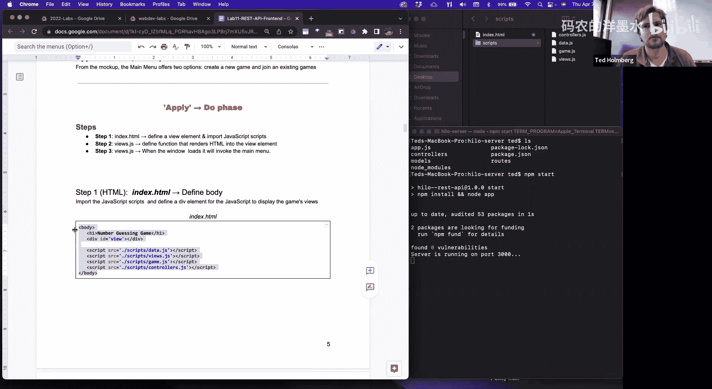

Perfect。Okay， so let's go into client， so let's open this into our editor。

There we go and let's go to scripts we'll just get everything loaded right now so as we come across it。

We can go ahead and implement。So I'm going to open up index controllers， data， game Js。And use JS。

Perfect， okay， so now I'm going to go to index dot js， I mean， I'm sorry index do eml。

And we're actually going to put together some of our HTML code actually。

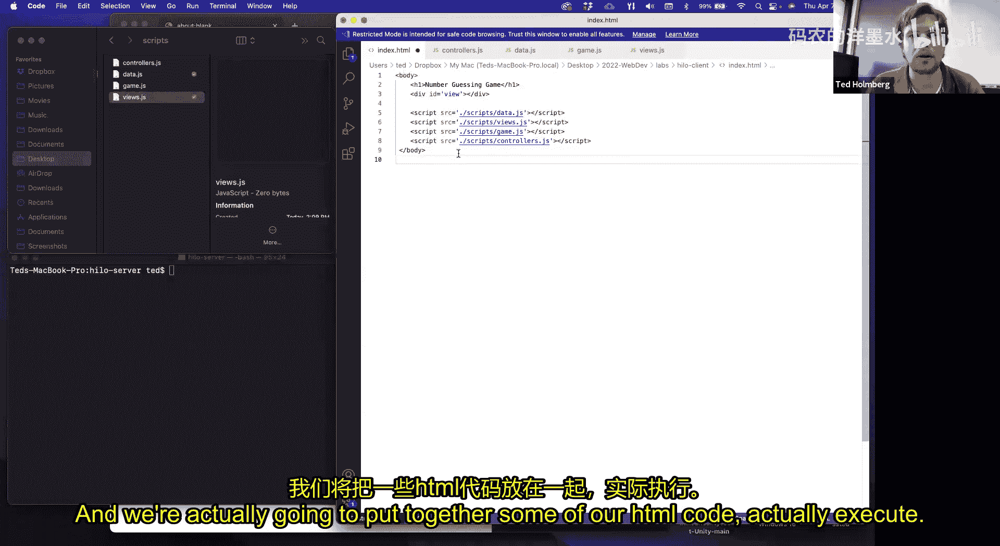

Yeah。没讲。There we go and just so that it's completely legal the way we would expect。

We'll make sure we'll just put an empty head。And we'll also do a that perfect。Okay。

 so inside of our HTML we're going have our head and our body。

 we're not going to bother putting anything in our head。

 we're just going to build ugly ugly HTML contents for this lab just as a proof of concept so we can focus more on the restful calls so here we'll have a heading that says number guessing game then we'll create a div that we give the ID view and that's going to be where we attach ourselves and update the view for our game and then everything else will be controlled by the JavaScript so I'll go ahead and I'll attach our four JavaScript files。

 the data the views the game and the controllers。是。Excellent， so at this point， if I were to。

Let's city here。I was to then。Go to。Here。I will now have yeah， my number guessing game。

 so I have my header right there。And at。可意。As of now I'll just go ahead and use local host I mean。

 I'll just use file protocol right now and we'll see if it yells at me or not。

 whether I have to pivot over to HTP。Okay， and so what we see here is yep。

 our server is running perfect。We haven't made any calls to it yet， though。

 because all its role is is to be able to deliver us content that we might need。

And actually it's possible for me to be running two servers at once。

 I don't know if I've talked about that， but I might have one server that's on4 3000 that I send request to to be able to get data into my front end。

 but then I might have a server hosting my front end on a different port where that server is just responsible for serving the HTML documents。

 so that's a concept that you can kind of think of as what's called a micro server architecture where as opposed to having a monolithic application that's all hosted in one place where you can subdivide our application across tiny services that kind of cross communicate between each other。

In terms of their responsibilities。Okay， so now that we have our index at HTML well why don't we start implementing some of our JavaScriptscript so the first thing we need to do is actually create。

What the main menu contents are going to be so we can render it。

So Docker is a little so there's a question is that what Docker sort of maintains so Docker is。

Typically。More used from my experiences in Devs one cool thing about Docker is that you can create a custom runtime environment。

That has all of your dependencies。😡，s effectivelyffively preinsald into an OS and it allows you to bundle up that OS and be able to launch it out。

 so the idea behind what most doctor instances allow you to do is you can when you download them and run them。

 you can then run applications from the go without having to know how to configure them。😡。

And so Docker is sometimes used for deployment of microservices right。

 but it's more of an environmental scheme to get you as a developer up and running and all of your team up and running without having to all have to install software it allows a uniform set of tooling across a team without the team having to have a lot of legwork in coordinating that。

Okay。Let's see， oh yeah， so let us go into our views。

And so we're going to go into the view script and we're going to create a function that's going to allow us to render the main menu。

So we'll go to views here and we will make a function。

And so all this function is going to do is it's going to grab the view element from the document object right using that git element by ID。

And then we're going to create a string that's going to represent the HTML that we want to display into that view so it's going to create a section that has this two buttons right one is going to be a new game button。

 the other is going to be a join game button and we're going to give those buttons ID so that we can access them inside of our inside of our。

Javascript。Environment， and then we're going to take that string right that the containing the HTML and we'll just go ahead and we'll overwrite the views current set of HTML elements with that。

Yeah。Great， and so now once we do that， I'm also going to go ahead and。

Set the main menu function to be the callback function for when the window object initially loads the web page so I'm going to do that as the very last line of my。

😡，Of my views so here the window object has an onload function。

 this event triggers when the page is initially load when it initially loads and so we're going to provide a reference to this main menu function so that when the page does load it will go ahead and。

Render our two button， so let me say if I。Yep， and see， when I refresh。

 I can now get a new game and a join game button perfect。Yeah。

 just in case I want I'll open up dev tools， I don't need it now。

 but we can kind of start to see how if I look at view now it has a section and there's my button ID and my buttons with the IDs and the contents。

 the labels， excellent。

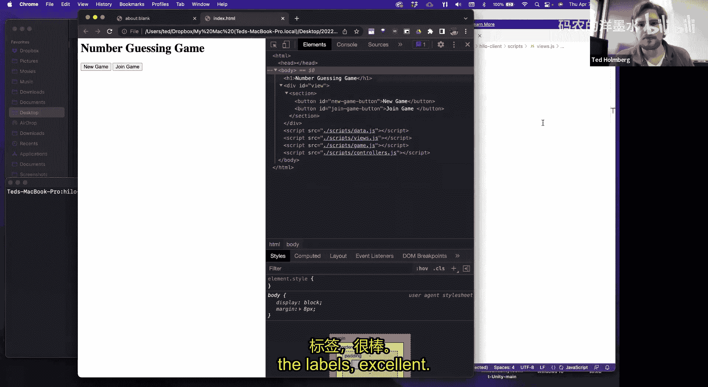

。Okay， and we just tested that already and it's working so that means we can move on to our next phase where we actually want to go ahead。

And create our new game view。So here。What we're going to do obviously is manipulate the DOm and we'll also have to set up an event listener so that when the user presses this button。

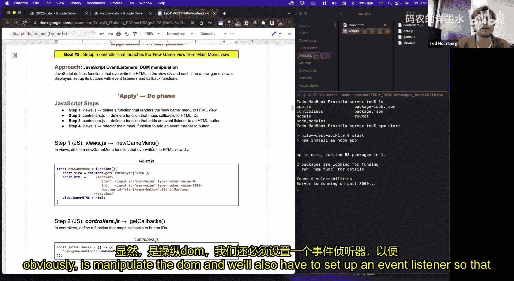

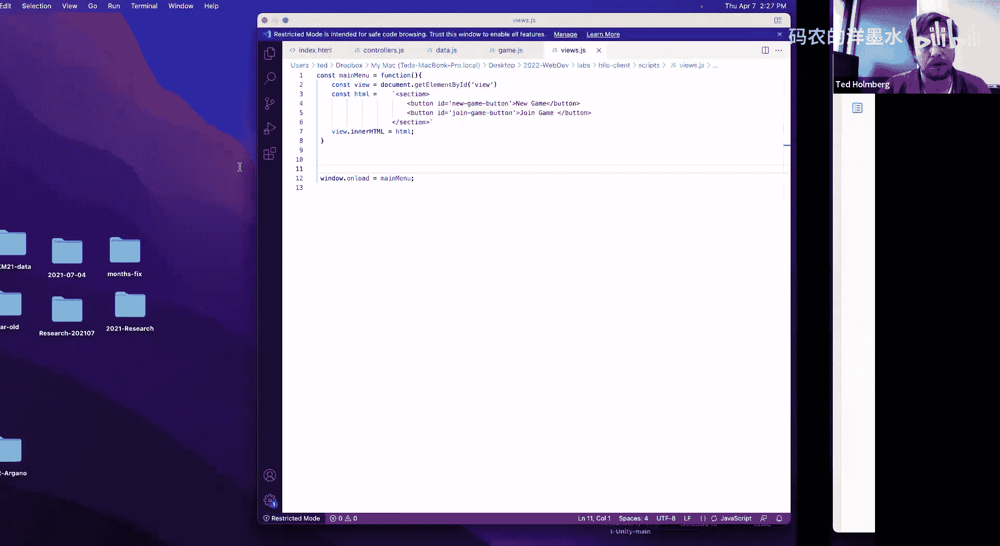

When the user presses a new game button it's going to overwrite the current contents of you with the new contents of。

 well， whatever our next view is going to be， which is going to be the new game view。

So in order to do that it's going to be four different steps。

 we're going to have to go ahead and assign a new function inside of our views script。

 which is going to go ahead and render whatever the elements are for a new game menu and then we'll have to update our controllers script to actually define a function that'll map a callback to the buttons so that when the user presses them that actually does something and it actually has a callback function that responds to a button click。

And then we'll go ahead and。Set those callback functions inside of our views when we initially build out those views Okay。

 so let's do the first step。Let's go into our views and actually create a function。

 much very so much what we did before。Here。Where we'll call it new game menu and it's just a function that's going to grab a reference of the view element。

 it's going to create an HTML string that contains the contents of the HTML。

And then here we're going to set the HTML into the view。Okay， so once I do that。

 I'm going to have to go into my controllers to actually be able to。

Tell the view what callbacks should be assigned to each of these buttons because we haven't done any callback logic yet。

 so let me go into controllers so I'm going to create this getter method that's going to be which is going to allow an external script to get a particular callback。

😡，So let's actually create this callback function new game menu and then I'll talk about what get callbacks is doing so let's go here and actually build out。

点。New game menu Oh， was that oh， that was， we already built that。

That was is inside of our views here。New game menu perfect， Okay。

 so the idea is that when I click on new game， I want to trigger this new game menu like for instance。

 if I were to go to console right now。Ma save this。

And refresh so if I were to go to console now and type in。

New game menu and then invoke that right it updates the to the view that would be the start where you put in a starting value and label where you put an ending value and then a start button so we want that this method to get triggered in response。

To when we press that button。And since this is a control that that should happen inside of controllers。

 so here I'm going to create a get callbacks function。

And all it does is it's going to return an object， but if I want a that arrow function to return an arrow。

 a function， I can't just use the curly braces because that's the same symbol we also use to declare code blocks。

😡，And since that's a valid thing to have after a fat arrow to have a multi line function。

 if we want it to be treated as an object instead， we can wrap it。😡。

In between parentheses to say this is a object， this isn't a code block。

And then I'm going to put a key， the key is going to be the ID of that button right so for the new game button。

 So again， if I go into my views you'll see that I have a button that's called new game button， Okay。

 so for the new game button， the callback that I want。😡。

To be assigned to that based in my controllers is going to be the new game menu function。

 which is this one here。Defined in views。Excellent。

And so we'll keep updating this get callbacks each time you want to assign a callback function to one of our buttons。

😡，That's the strategy we're going to use to be able to do that。Okay。So now that we have。

That let's go ahead and。Add a inside of our controllers。

 a function that will actually do the work of adding a controller。嗯。

So our a controller function is going to allow for variable length arguments。

 which means that it could be one， it could be two。

 it could be however many that it needs to be at any given time。

 so we can use a spread operator inside the parameter list to declare that and so what we're looking for is a collection of button IDs。

Then what we're going to do is we're going to invoke this method to get the callbacks and all that's getting for us is a object。

😡，Containing a key value pair where it's going to be the button IDs and then the associated callback functions for each of those button IDs。

 so here callbacks in will'll have a reference of that object。

Then since this could be one or more than one， this could be any number of button IDs。

 we're going to affordly loop for each ID inside of our collection of button IDs。

We will ask the DOM to get that ID for us and we'll save that HTML element as a button and since that's an HTML element that we now have access to from the DOm。

 we can invoke the add event listener to it and we want to add a click event to it and the click event we want to add to it it's going to be in that callbacks function I mean that callbacks object and it's going to be at the key。

 which is the ID of the HTML element。Excellent， so now this is a function that will allow the views or external scripts inside of our application to be able to add a controller to any given HTML element。

 given it has an ID。😡，And now what I want to do is I want to go into my views and I want to go ahead and refactor it。

 I want to add a line that is now going to add that controller to the ID we defined here。

 so to the new game button。So let me go to the views here， so under main menu， right？

What I want to do is I want to go ahead and after I render that button right I got to do it after it exists。

 I am then going to invoke the controller。Scrip to add controller and it's going to pass it the ID new game button。

So now if I refresh here。And if I click， that should now have an event listener that then invokes。

The new game menu。Which it does perfect， So now we're able to responsively go ahead and update our dom。

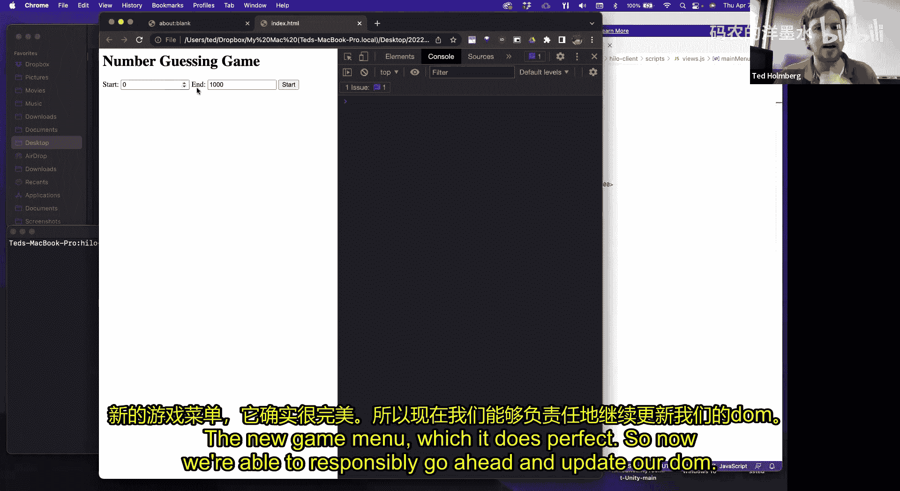

And again， this is just building off concepts we've done previously。

And so here we're going to assess and when you click the new game it does exactly that perfect so let's move on to our nexteration where we can actually start making use of our back end service。

So here what we're going to want to do is when we're inside of the new game， let's go back over here。

 so when I get to this view where I have the option to put in a start and put it in an end and then click start well i'm going to that that。

😡。

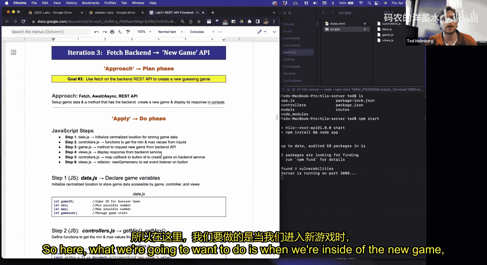

Is going to cause a fetch to our back end service right we can't start a game on the client side。

 we have to rely on the back end server to start the game up for us。😡。

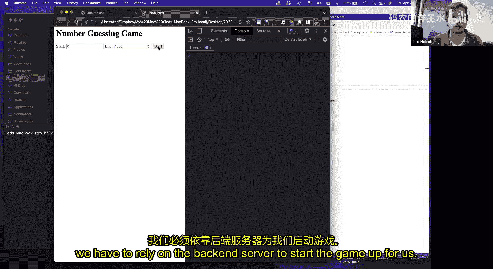

So that's what we're going to do in this iteration。

And so here what we're going to do is it can be broken down into effectively six different steps and we'll just walk through each of them this is just a quick overview of them。

 but i'll walk through them。One at a time so the first thing we want to do is inside of our data script we're just going to go ahead and declare all the game variables that we want to manage so we'll keep our data separate from all the other logics so that we can easily find it without having to go into other scripts and that's one reason why when we declared。

All of our scripts we we want to have that one first so that that's available for all the and in fact if I wanted to。

 I could put that in the head and guarantee that it preloads before anything else。Okay。

 so inside of here。We're going to create。Forward different variables。

 we're going to create a game ID， which is going to be the ID of the game from the back end service that we're currently going to play。

 we're going to have a variable that's going to represent the min and the max。

For this particular game and then also a variable to control whether the game is over or not。Okay。

 so now that we have our game data defined。We're going to go ahead and go into our controllers and actually define some functions that are going to get the miniX values from the inputs。

So let's go to our controllers here。And so here I'm going to create a function get min and all it does is it's going to access the element inside of our dom that has the ID min value and then that's going to be a input eight element so it'll have a value attribute and so we'll just return that value attribute and we'll do the same thing for get Max。

 but instead of using the ID min value we'll use the ID max value。

So those will be two helper functions for us， I I'm sure that actually when I do this。

These are in alignment， perfect。And then the next thing I want to do is I'm going to finally go into my game JS file and we're actually going to start creating some functions that helps manage our game on the client side。

 so let's go into our game script。So here， since this is going to be requesting data from a backend service so that we can import it onto our client side。

 this is going to have to be a synchronous function because it's going to be doing in a fetch。

 so any any function that's using the away keyword means that that corresponding function has to be in a synchronous function。

So this is going to be a start game function and what this function is going to do is it's going to go ahead and get the minimum value from the input field is going to get the max value from the input field right。

 but we don't want to directly。Access the DOm inside of our game script because that's supposed to be our model and our model is supposed to be agnostic toward the underlying implementation of our views and controllers。

So we'll get that information via a getter and so we can mutate the state we can mutate the logic of our getter and our game logic won't change at all。

So here we'll get our N and R max then what we'll do is we'll define the URL right the end point that we have to hit on the backend server to be able to start a game。

 So if you recall from last lab we have the API so our endpoint is local host on4 3000 and then it's slash API slash game and then new allows us to create a new game and then we were using the search parameters a query string So we're going to send as a key value pair start and that'll be the min value and end and that'll be the max value So once I construct a valid。

A thatch I for my URL， once I have a URL that I can fetch from that has all the data that I need to send as part of my request。

 I'll send that to the back end server and I'll wait。

Until I get a response right and so since this isn in a awake key word it's going to return a promise object to me and the promise object will naturally resolve once。

😡，Its once the data is returned back to us。And so since。

Since this hasn't a weight and the next isn't a weight， we'll wait for response to resolve。

Before we go ahead and do this line of code and so in this line of code。

 when we get a response we will then await for the JSON to get unpacked the returned data to get unpacked from the response so that we can actually get the game data and we'll save that as data and so from the data one of the attributes we get back as you might recall from the last lab is going to be a game ID so we'll take that game ID and we'll save it locally。

 and then we're going to invoke a function that will exist inside of our view which is going to be called viewga and so that'll update view game willll update the state of our DOM to go to that next view that we want。

Okay。So now let's actually implement that view game function since we're kind of reliant on it now。

 so let's go into our views here and we will go ahead and。Defined a view game。And again。

 in order and what we're going to do for the purposes of just testing is we're going to do a console log。

And we're just going to display the state of our data right inside of data JS， game ID， men and Max。

 we're going to display that inside of our view game。

And then the next thing I want to do is well I have a start game button right and so obviously I want to do that fetch with the start game button or the start game I implemented this function。

Let's let's go back so I implement this functioning game which is called start game I want this function to get invokes in response of a button press here right but I don't have an event listener there yet so inside of my controllers i'm going to have to update so that I can bind the button ID with that callback function so let's go ahead and update。

哦。Just let me。

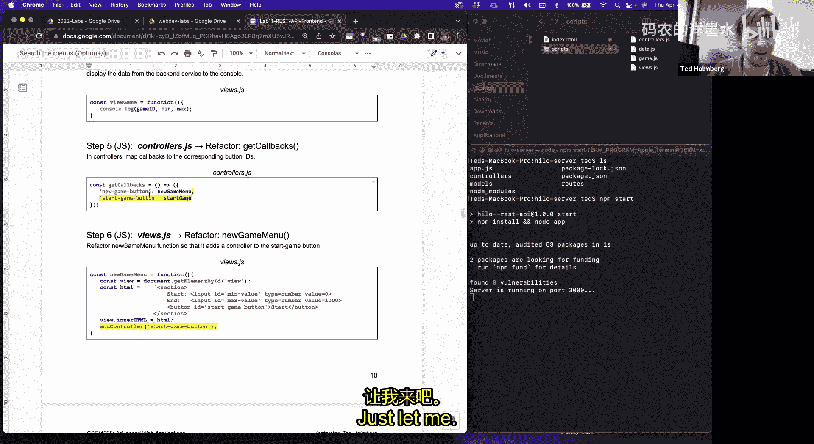

Okay。And so each time we modify this， don't forget to put a comma after the previous entry right so a comma are there and then we're going to make a new key value pair so for a start game button ID we want the callback function associated with it to be start game be the start game function。

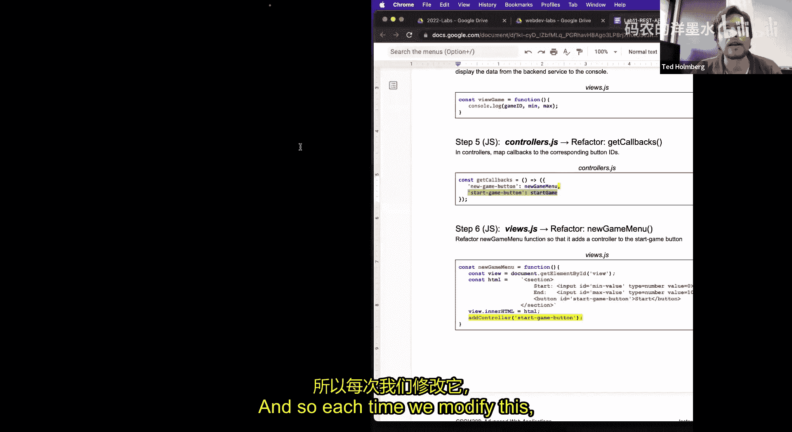

And then once I do that， then what I can do is I'm going to go into that current new game menu and we're going to go ahead and add a controller to that。

So let's go back to our new game menu。Here that's in our views。

We have our new game menu after after we actually create this button。

 that is our start game button ID right， we're then going to invoke add controller and pass the ID that we want to then have the event listener attached to。

Excellent and then once we do that we should be able to start a game and inside of our console we're going to see the game data。

 the data inside of our client site mutate the reason why we didn't update the view is this wasn't the goal to update the view so we just did a console log as a proof of concept so we didn't want to implement too much all at once you if you want to know why we did console log here。

Okay， so let me refresh this。So here let me go to new game and let me hit start I' want to hit start。

I get back a game Id and I get a start a min and a max value。 And again。

 this data is coming from my back end service。 So if I go back and look at my。

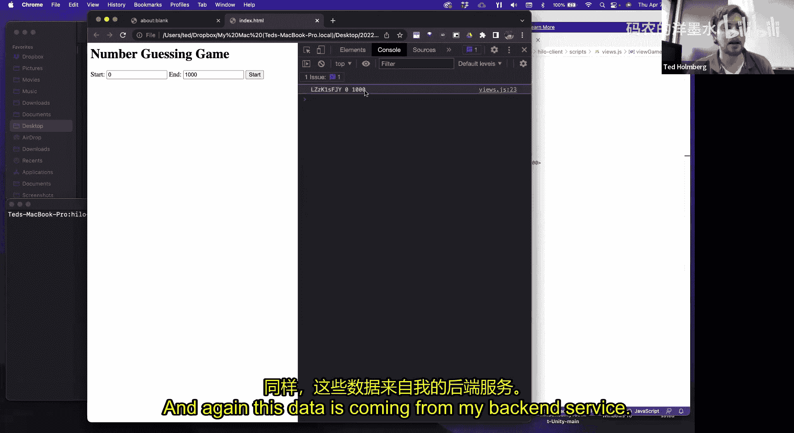

My。Code my server that's been running in the backgrounds all this time。

 look the server actually produced inside of the collection of games。

 a game that has that ID and then it has oh look I can see the number 509 start zero and 1000 game over false excellent so we're actually starting to issue commands to our backend service from our client and then get them back into our client side。

Starting to build a multi layered application。Partart front end， part back end。Okay。

 so the next thing we want to do is we want to finally go ahead and create that join game view。

And again， we'll just use our JavaScript to render our HTML using the view script like we have been doing。

 and then we'll use the controllers to be able to set up the event listeners that will have to be attached to any of the buttons。

So let's start by creating a function inside of views that's going to define the contents of this view。

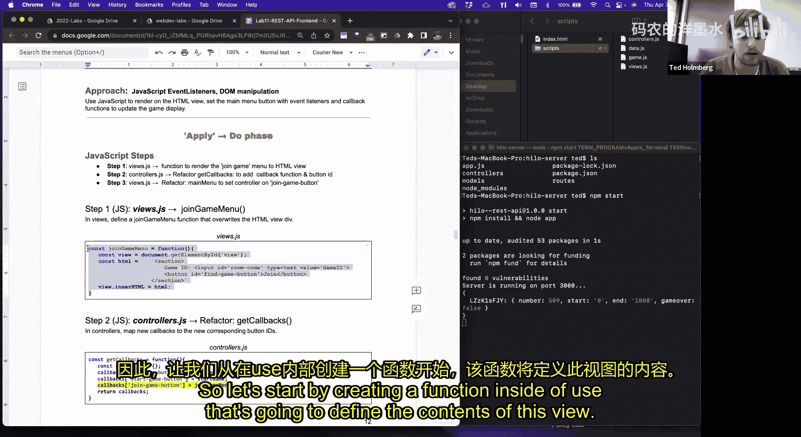

And again， what we're designed here is typically referred to an S8 or a single page application because all of the contents of the viewport will constantly being overwrittendden inside of our JavaScript。

So here。I'm going to create and going to yeah， I'm going to create a join game menu。

And I'm just going to ask the Dom for the view ID， I'm going to create an HTML string that's going to contain a section。

 it's going to say game ID， then it's going to have a input form input field here where it's going to have the ID of a room code and it's going to have the default value of game ID。

And so the purpose of this is the user would type in a game ID here。And then it will have a button。

 the button will have an ID of find game button。And then we'll go ahead and have a label that button join。

So notice anytime we need to access anything inside of our scripts。

 we've been making sure to give them IDs as always。

 that's how we were able to get the min value and the max value。

 the reason why they had a starting value of zero and 1000 was because we gave them default values。

I don't know if I went through line by line， but I think everyone should know the HTML well enough to be able to parse that。

Anyway， once I get my HTML， I'll go ahead and overwrite the view with the new set of elements。Nope。

 that's been changed， let me do this。That's the old implementation。 So when you do this。

 let me go back to。Here， okay， let me grab this。You might have the older uglier looking function。

Oh no， yeah， it was here just didn't it delete it perfect， let's delete the old function。

And replace it with the newer cleaner。Okay， so here all we want to do inside of our get callbacks。

Is going to the controllers。Add a comma。And now the new callback function is going to be to invoke that join game menu right so that's the one of the views we want that to let's refresh our page。

 so when you go to hit join game when you click on it it doesn't have an event listener but what we want to do is trigger this new join game menu function that's in our views now。

So we'll add that into our get callbacks and so now that is in our get callbacks our view can now go ahead and invoke that。

Andside of the main menu function。So again we're keeping the roles of views and controllers isolated right we're not crossanggling them so if I go to my views inside of my main menu right I have two buttons one that is a new game button but now I want to implement the join game button so inside of add controller remember this is a variable length parameter so I can add two IDs and that's fine so im i'm going to go for add controller and add the second ID that I want a callback function to be attached to so the new game button and the join game button perfect。

And then after I do that， I should be able to test that out to be able to click that button and see if I can't join that game。

 so let's go ahead and refresh。And so if I go to Jo game。

 it gives me the option to let's go ahead and get that ID。

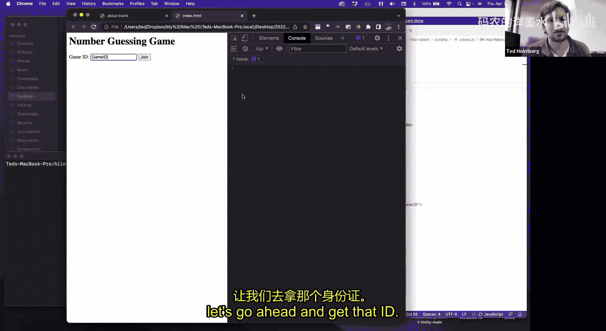

系啊。Actually， that's all it's going to do right because I'm not fetching anything yet。

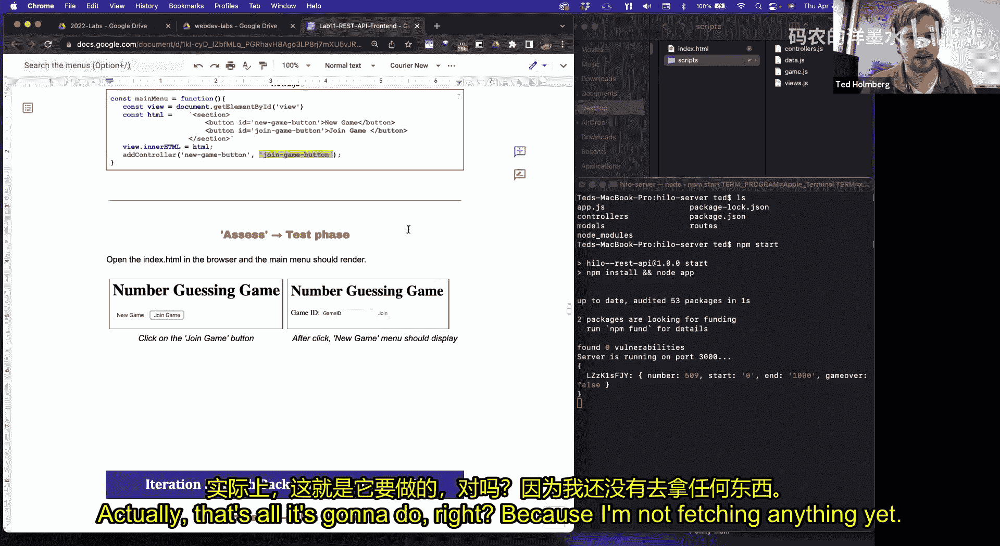

I I don't have an event listener on this view so that is what we wanted to do be able to get to the screen。

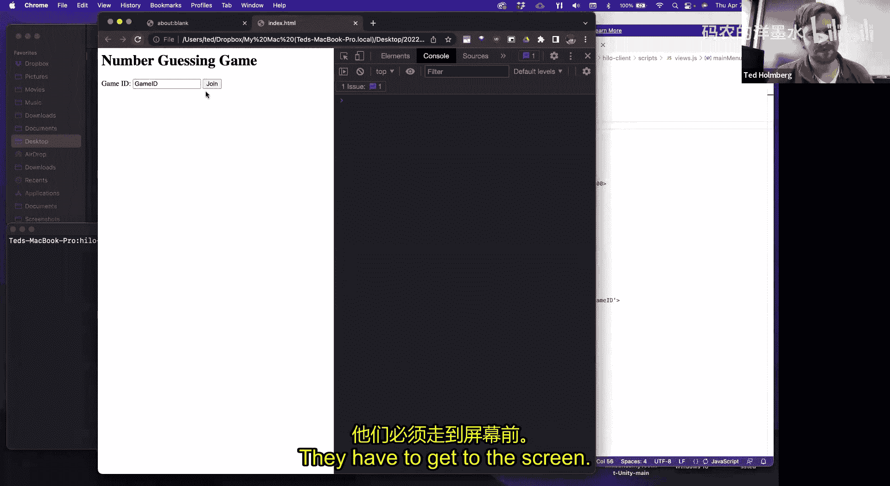

Now let's push this down some。Okay， perfect， so now that we can actually get to the join game view。

 the next thing we're going to have to do is actually set it up so that when the end user presses this join button。

 right it's going to trigger a event that's going to fetch the game information。

 the game state given this game ID。

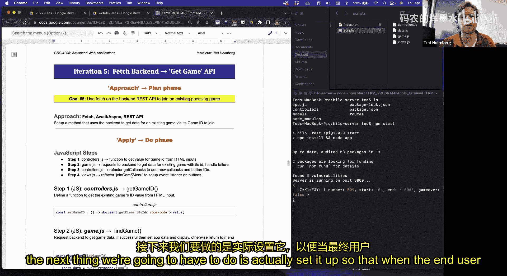

So here we're going to make another call to our backend server。

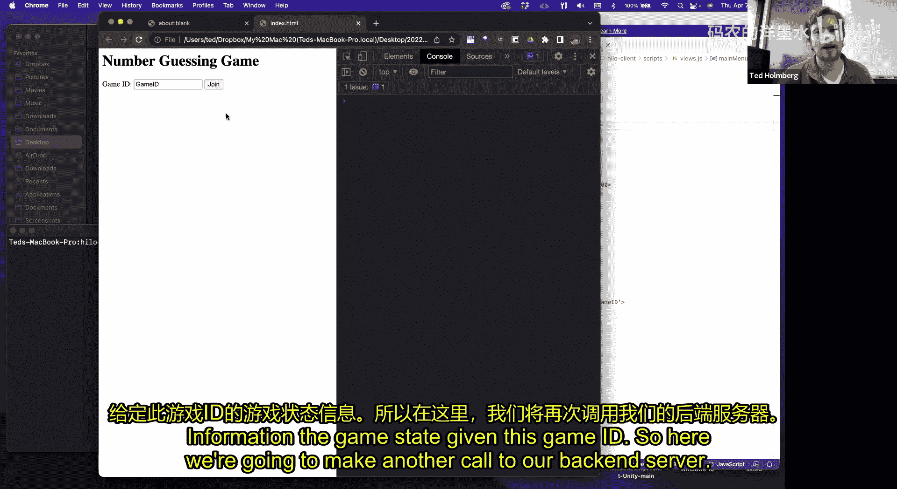

So let's go into our controllers and again， as we already saw when we built this text fields here any time we build in these text fields。

 we give it an ID so let's go ahead and be able to create a function that's going to allow us to get that。

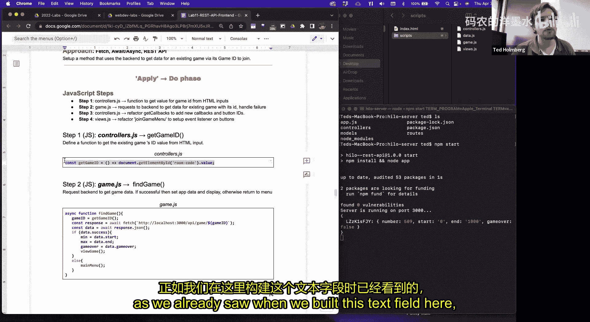

The value from that so we're going to create a function Gi game ID。

And all it's going to do is it's going to access the DOm for the idea of room code and it's going to turn the value from that text field。

And the next thing I want to do is I want to now go into my。

I want to go into my game script and I want to actually create a callback function that will then。

Send a fetch to the backend server to be able to get the game that has that ID so let's go here into our game script instead of our gamescript again every time we make a fetch to a backend server that's going to have to be a synchronous function because the fetch itself is an as synchronous function that we have to wait on we're going to call this fine game here I'm going to invoke from controllers the get game ID to be able to get whatever values inside this field and once I do that I'm going to use this string template right that's going to go ahead and embed that ID and hit that endpoint that performs the get on the server side。

And then i'm going to await for a response after I get a response。

 I'm going to from the response object try to。Get the JSON data that's embedded inside of it that itself is an asynchronous function so i'll wait on that which will then resolve into being data So one of the attributes that a response object has is a success attribute right as not and the reason why it's in there is because we've been putting it in there right that's not the font value that's inside of response it's the one that our API embedded so remember every time we send back。

A response to a request when we designed this， we made sure to put a success true or false so if success attribute is true from the JSO that gets delivered to us then we know that we should have a start attribute inside of that JSO response we should have an end of value and we should have a game over value so we'll go ahead and take those values and we will go ahead and overwrite are our men Max and game over data here right all of our data attributes we've declared here。

And then we'll invoke view game。So we'll update the view of our game from the join menu to the view game view。

For the join view to the view game view and otherwise， if it wasn't a success。

 then we'll go back to the main menu， we'll redraw the main menu page。Excell，cellent。

internetternet's a little unstable， can everyone still hear me？Okay。

 so the next thing I need to do every time I create these callback functions。Am I still here。

 I want to make sure I'm not lecture to。就。No one hear can。Well。

 every time we create one of these functions that's supposed to do something。

 we have to make sure that it's tethered to one of the buttons that the user is going to press so we're going to go into this。

Get callbacks right and we're going to create a new key value pair and don't forget this is saying excuse me the sququigggling lines because it's saying hey。

 you forgot to give a comma separating the key value pairs so here I'm going to create a game find game button key andm going to assign the find game。

Function we just made to it。Great， and so once I do that， then I'm going to update。

The join game menu functions so that it adds the controller for that button。

 so I'm going to go back to this view here and this was inside of our join game menu and here that's where it has the ID find game button there I'm going to go ahead and then add the controller for this find game button。

And you see it's just kind of doing this three step process that again and again。

 I decide what behavior I want to add。Then I go ahead and I determine how I'm going to tailther that to the user interface。

And then I decide what view I'm going to migrate to。Okay， so once I do that。

 I should be able to test this out， I should be able to join the game。😡，And so recall， right now。

 my view game， when I invoke that is still just going to be a console log。

So let me go let's refresh so let me click join game when I go to join game I have the ability to put a game ID let me go to the back end server we already have a。

Again， currently。In the server right with that ID so let me copy that here and I'm going to paste it in here and again I'm just some file protocol here right。

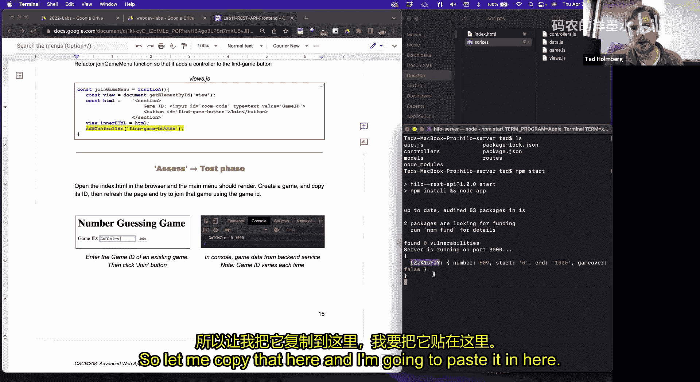

I'm not all I do is send requests to my backend server so I can have servers on actually two different platforms this could be hosted on GitHub pages and then my backend server could be hosted on Heku and that's completely fine because they interface with each other through HCTP they don't interfaced by being on the same machine anyway let me click this join button and oh look at that I got the I got the data there。

Excellent。So that was the success and now let me refresh the page and let's see what happens if I try to join the game without and yeah brings me back to a main menu if it's not a valid game might perfect that's exactly the flow we want from our front end as well。

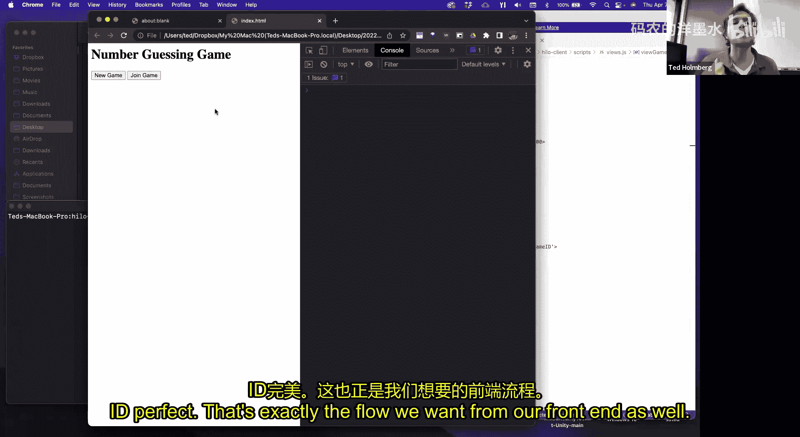

So now the next thing I want to do is I want to go ahead and build my game view。And so。

In order to build my game view。🎼We're going to update the view game function right right now it's just in my to console log but now what we're going to do is we're actually going to go ahead and have it display the HTML into our viewport so I'm going to go to the viewGs file I'm going to update that view game method that function that we have so now what I'm going to do instead of the console log is I'm going to grab the view element then I'm going to create the HTML string and then I'm going to override the view element with this new HTML and just looking at this HTML it's going to create a new section it's going to have a heading element that's going to display the game ID。

Is going to then have a paragraph that will get provide the min and max values that the users can guess from。

 it'll have an input field that has the ID guess input where the user can type in a guess。

It'll have a submit button that has the ID submit guest button that。

Will probably be where we go ahead and submit our guesses。

 and then it's going to have a unordered list。With the ID clue list。

 which will then show this user what clues that they have。

Already done and then this will be managed client side so each player in the game will have a different set of clues because they're all all their clues are private to one another。

So this's just an instance where we all the clients will depend on the server for some game data。

 but then you can also manage individual client data on just the client side and the server doesn't even have to know what the I mean。

 it does when it makes a guess， but it doesn't have to track those。Okay。And so once we do that。

 we should be able to just test this out， so let's do that。

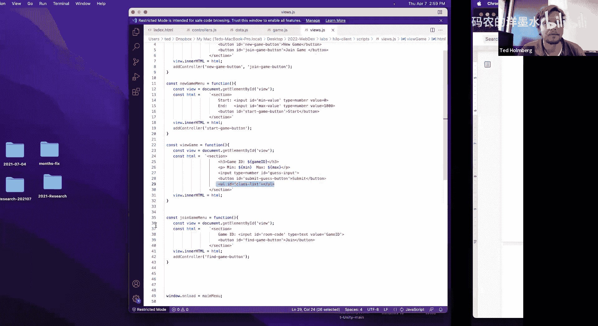

问你。Go to a new game。Let's start a game and now yeah look at that I now have my game view that gives me a game ID and so that is now a new ID because I opted to make a new game and I have a min value I have a the max value I have a place where I could put in a guest and then submit to it so clearly the next thing I'm going to want to do in this instance is created a event I want to create a action for submitting the guess to the backend server。

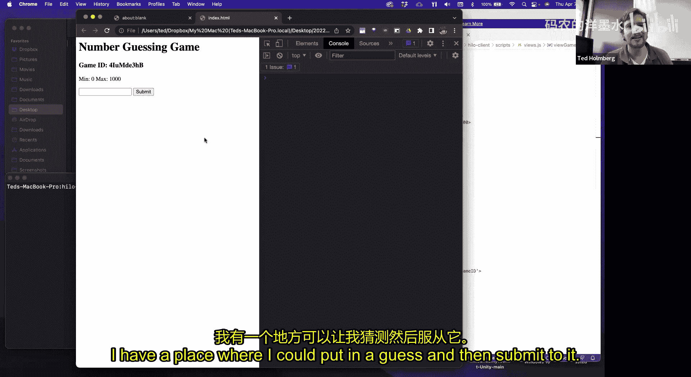

So let's go and well first of all， we need to be able to get that gas。

 so let's go into our controllers and create one of those gi methods。

So let's go here into controllers。And I'm going to create a。

Get guest method and all it's going to do is access the DOm and grab the element that has the guest input so that's that text field here。

And it's going to grab the value that's in there and return it back from whatever function called that。

Again， I don't want to do that directly in the model。

 I just want to build getters inside my controller so that my model isn't reliant on understanding what the logic for accessing data from outside of it is。

And then the next thing I want to do is actually create the function that submits a guest to the backend server。

So let's go into our game Gs file here。And here it's going to be again。

 all these functions are going to be asynchronous functions because they're making requests to the backend server right submit guests we go ahead and then get the guess from this text field right and so then we'll have guess as a local variable and then we're going to create the URL string the endpoint that will allow us to send a guess to the backend server so recall that uses the game ID and then slash guess and then what we're going to do is embed that guess as a search parameter right so the key is guess and then we'll go ahead and embed the value。

Right there and then we'll send that as a fetch to the backend server which will then we'll wait to get a response from when we get a response we'll wait for the response to deliver us the JSON data once we have the JSON data available we can see if this was a successful action。

 a successful request and if it is recall that every time we have a guest there's a multitude of states we can have right there's a guest property it could be correct it could be game over。

 it could be too low， it could be too high or it could be error。So for this purpose。

 we're going to search for one of two actions， if it is correct， we'll send an alert that hey。

 you win and if it's game over then we'll send an alert you lose and if it's not。Correct。

 so if you didn't get it right or if it's not a game over such that someone else already got it。

 then we're just going to have a default case where we're going to reddiplay where we're where we're going to display a clue so we're going to invoke a function called view clue。

 which is going to be implemented inside of our views script and it's going to send the gas。😡。

From the response。And it's also going to go ahead and。Send the gas here。

So this isn't the number of gas， this is the clue right the value of gas can either be too low or too high。

😡，Remember the state of gas is either correct game over 202 high or error and then this second parameter is the actual numerical value of the gas that got submitted for this emit gas so those are the two parameters we're going to have for view clue which we haven't written yet we're about to write。

So now let's go into our views。Here。And。So here view clues is going to be pretty simple。

 we're just going to take in as our first parameter of the clue。

 the second parameter is the numerical value of the gas， we're going to grab the ID。

Of that clues list right， so that would be this unordered list here。😡。

And what we're going to do with that is we will then go ahead and append。To the clues list。

 a list item。That says the number is too high， too low， whatever the clue is。Excellent。

 and so now that we have that。that callback function invoke。

 let's actually set up inside of our get callback so that we combined an ID to a。

Functions I'm going to put a comma here and put a new entry， so for the submit guess button。

 I want that to have the callback submit gas。So now what I can do here is go into the views and then we have to add that controller。

 so we'll add that controller into that view game。Since's where that button is initially created at。

 so notice that what's happening here is every time we're right altering a button。

We have to then give it the callback function。All， so then we'll add the controller to this button we just created here to make guess button perfect。

And then once I do that， I should be able to test this out。

 I should be able to test out all the different stages， I should be able to see if it's too low。

 if it's too high， if if I get it correct or if I get a game overstate so I should get any one of these right that I should expect so let's test this out let's go ahead and refresh。

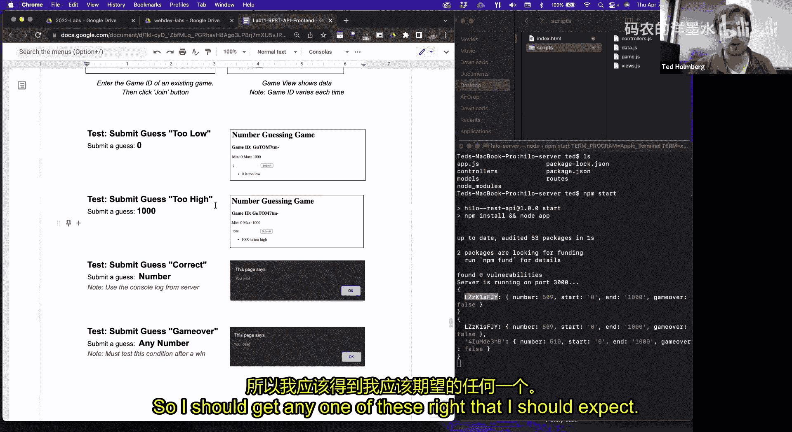

Let's just make a new game start so now I have a new game made right there's my new game ID let's try to get too low so I'm going to do zero。

So zero is too low， let's try to do too high。嗯。So yep， we got too high okay。

 so the next thing I want to do is let's see what the actual number is so the number is one。

 two four， let's test one， two four。One， two， four。

AThat gave us a win alert right so an alert is a built in browser function that will send like this little pop up Mole。

So for testing purposes， this is just a proof of concept to show you how we can design a minimal viable product of a client side。

 we'll just use these。And then let's try to guess again。

And now it's going to say you lose and the reason why we lost the because even though we use the right number。

 right we had or someone had already guessed it so you can it's the first person who guesses it who gets it。

And then we'll hit， okay， perfect。So that is all the different states that we should expect from our game view right so if it's too low we get a message if it's too high we get a message if it's correct we get a message and if it's after the game has won we get lose message so the next thing we want to do is we want to actually have。

A game overview。So let's go into our views and create a function that will overwrite the view element with the contents of a game over。

So it's good of use here。And then let's see what this is going to do so here I'm going to create a function game over menu it's going to be a function and it's going to require a result。

So let the user know whether they won or lost right and so here I'm going to grab the view and then I'm going to create an HTML string so I'm going to create a section element inside the section element I'm going to put a heading that gives the game ID of the game we just played。

And then it's going to have a game over paragraph that's going to contain the result that got passed into this function。

 whether we won or whether we lost， and then we'll have two buttons that we'll have to set up on here。

 one of these will be to be able to replay the same game。

Or the second will be to go ahead and bring us to the main menu。

Of our app and so since these are two buttons that we'll have to put event listeners on we'll give them ID reset game button and quick game button。

And then we'll overwrite the the view with the HTML。

 So the next thing we need to do is let's go ahead and。

Mutate the state of those alerts that we just did so that we can actually render or change our views。

So let's go back to。Where we were doing those alerts。

That was inside of game so here we're doing the alerts right those do the pop ups now we did that as a test right but what we actually want to do with those is we actually want to those to be invoking。

Functions inside of our view script， so now we're going to invoke that game over menu with either a win message if it was correct or a you lose message if it was a game over。

Excellent。And then let's refactor our view game， right？😡，Such that if。The game is over right。

 that's one of the values we get from the。From our data if the game is over。

 then we'll tell a game over you lose right and the reason we have to do this is we only get this lose message on the instance that we're submitting a guess but you might have other players who were trying to load into the game initially and we have to also let them know that when they initially load into the game whether the game is over or not so they know that they can't guess so that's why inside of our view game if you try to view a game that's been over you will get the losing message。

So here。If game over and again that's data that is tracked here right game over is one of the variables in our data。

 so if game over is true， then we'll instantly overwrite the view with a game over。Perfect。

Did we ever a set game over though？you said that or not。Okay， let's see here， let me see。

I think do we set that， let me double check Min Max。

Start game find game yeah we did right here so that's where all of our data is being set when we initially get the game data perfect Okay so now once we've done that let's go ahead and test this。

Let us。Refresh。Let me go to join game。

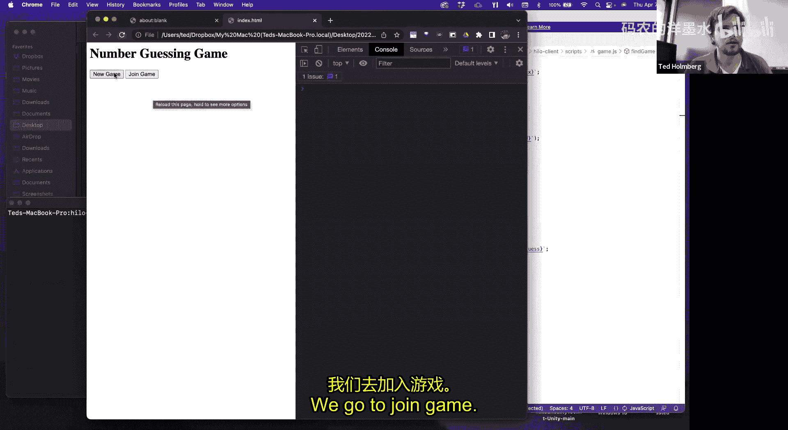

And since I'm going to join a game that's already over， right。

 this is a game we tested it last time and we got it right。

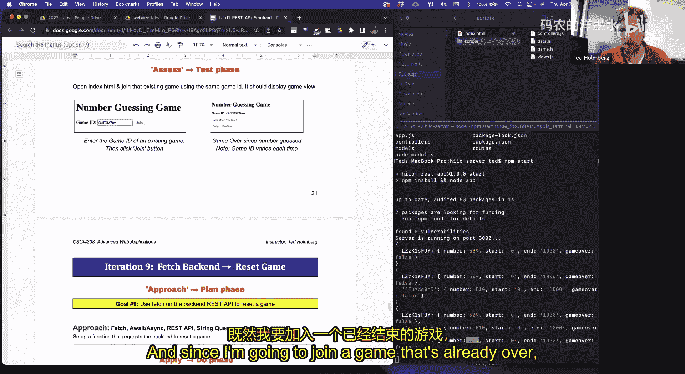

So let me type this in。

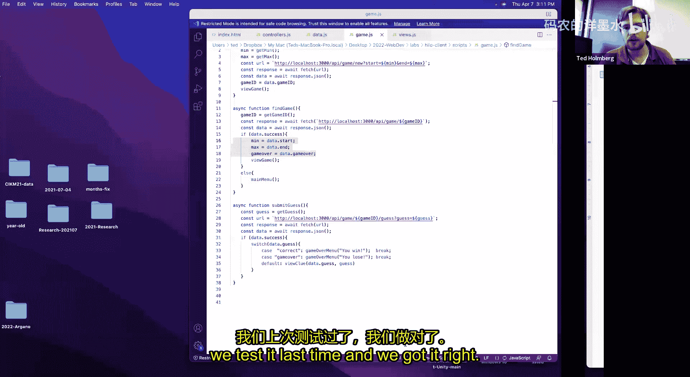

Here。that refresh。Let's just do this new game。Start new game。Okay， so we have this。

 let's see so with this game here。

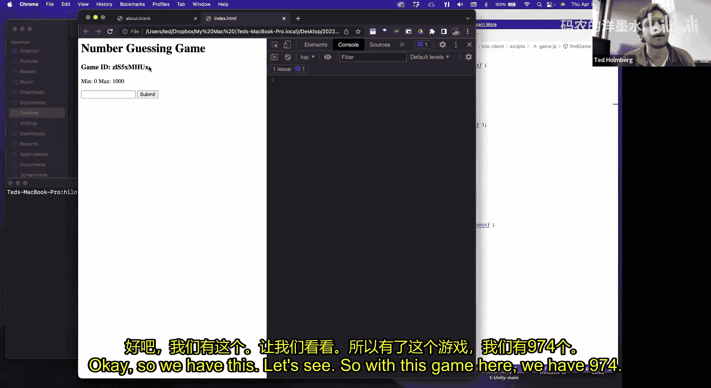

We have97， four。

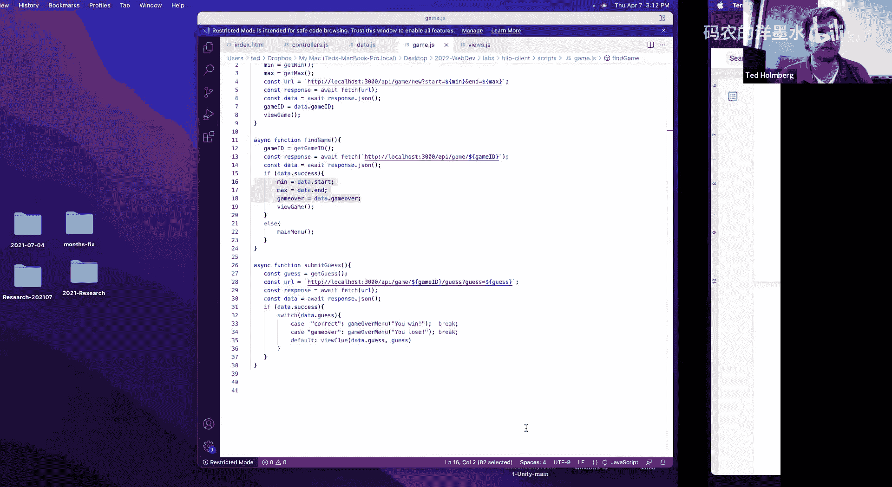

Okay， and then we got the game over you win perfect。

And then we have the option for replay or main menu and presumably I should make sure that this is the case if we。

Go back to main menu。sRefresh。It's got to join game。W the。

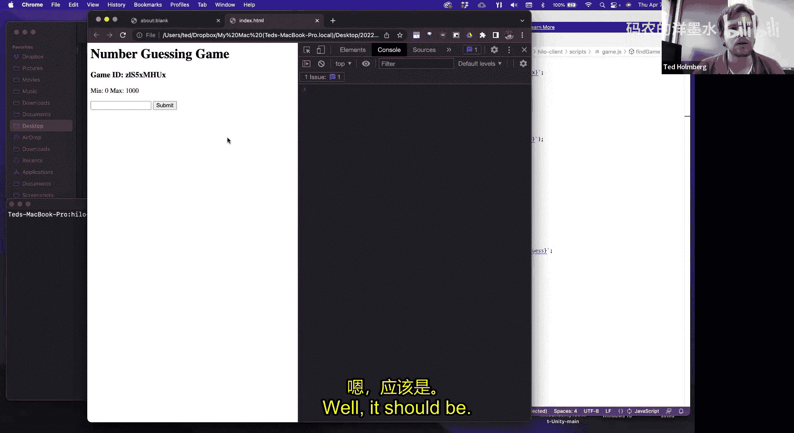

That will check to make sure sure that if game over is。False。The game over is true， you should do。

This should be。Getting。Oh， we haven't。Yeah， when we did that， it should be true， that's interesting。

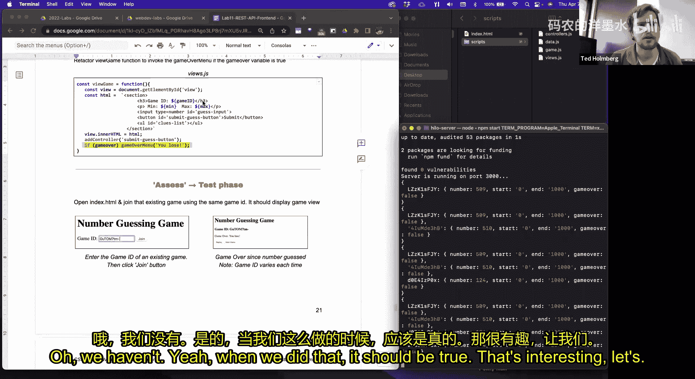

We'll take a look at that in just a moment， let's take a look at our game。Over variableable。

 it is true。Why are you not fing okay， so let's take a look at our views really quick and this is why we test things out。

So if game over then for game over menu。Oh， I put that in the wrong place。

That's supposed to go inside a view game， again， cr important why we test things out。

So in the view game if。The game is over， we instead want to effectively do a redirect。

 we want to instantly redraw it to game over you lose Okay， so let's grab this again。

Let's go to join game。And now let's join the game that's over and yeah， perfect， you lose， okay。Yeah。

Okay。Excellent。So testing is super valuable。Oh， I see。Yeah， you notice that I have very good job。

Okay， and then the next thing I want to do here is I want to go ahead and actually implement those actions on my game overview right so I'm going to create a。

Reset game function that's again going to send a request to my backend server。

 so let me go to my game here。So reset game it's just going to do a URL using the game ID that we have inside of our data to build out the URL we'll send that fetch to the back end server and then I'll use the。

I'll just use the then method here so you can see what I'm going to do is I'm going to do response and then after the response I'll tell it to view the game so I threw an A then so you can see another way that we can implement these these concepts。

So it'll only then update the view game after we get back the new JSON data。Okay。

 so now that we have a callback function， let's go and update our。

Dictionary of our key value our ID to callback function pairings inside of our controllers。

 so let's go here and add a comm。And。Add that and then once I do that， we can then go ahead and。

Add a controller into our game over menu。So let's go to our views and so inside of our game over menu。

After we build the button， we need to go ahead and add a controller to it。

And then we can just quickly test that out such that if the game is over。

 we can see if we can so to grab this ID。Here， okay， so let me refresh。Join game。

Joining the game is already over so you lose， let me try to replay。Okay。Make sure that。

Here we go number。We do reset game， reset game is y on a replay。It's refresh。Jo the game。

Go here oh and it refreshes just in it didn't update my page。

But it did work because presumably we should have a new number， which I can't see。Now， is it？No。

 I can't say it' was it 974， I don't think it was 974。We can try the old number。No。

 so it's a whole different number and now I can't see it because the state's been mutated。Okay。

And then the last thing I want to do though is I want to go ahead and also implement the quick game button。

 so this is a really simple thing to do right i'm just going to add a key value pair and really the only thing we have to do is invoke a function we've already made so if I go into my controllers。

I have two buttons that are let me。That are part of that I'm going to have to get a game over again。

 but I'm going to join another game anyway， so I'm going to do up for the here， let's go in here。

For the quit Game button， I'm going to have it invoke the main menu。

Function and then inside of my views right inside of my game over， I'm going to pass the two IDs。

 one for the reset game button and the other， which is going to set up the event listener for my quit。

For my quick game button， perfect。Okay， so then let's refresh this and let's create a new game。

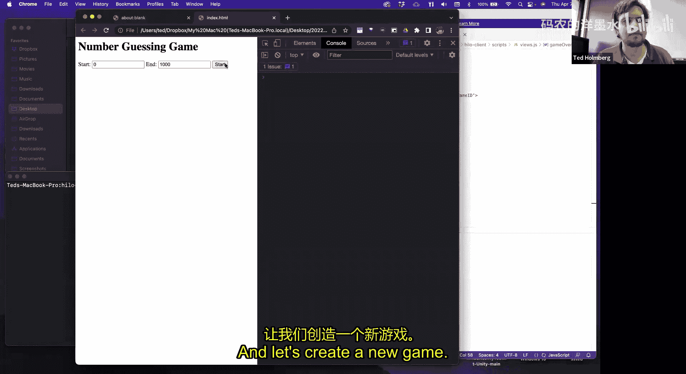

Let's see what。This is perfect。

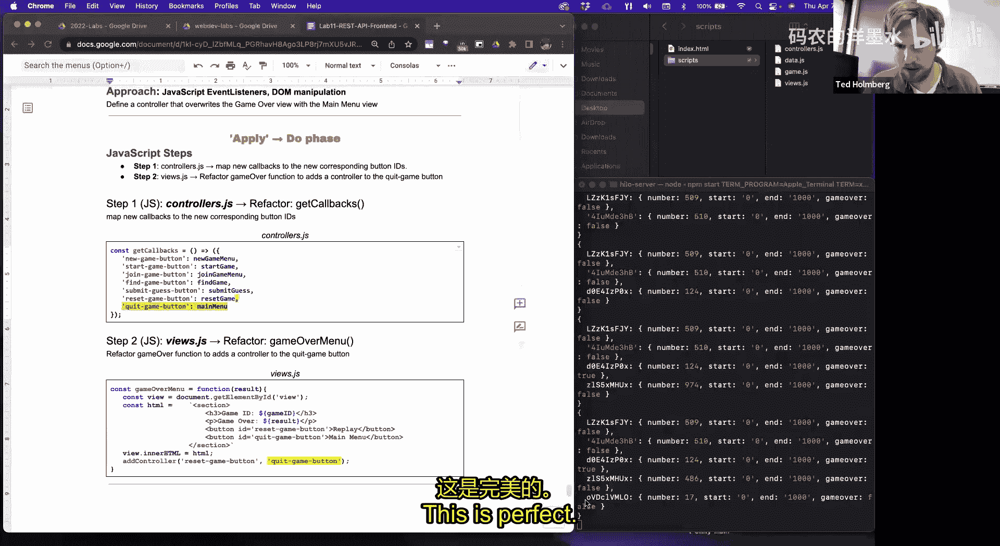

It's 17， well， that's a low number。17 and then I will submit and then instead of replaying I want to go to main menu and brown I brings me to the main menu where I can either go to new game or join and so for the most part。

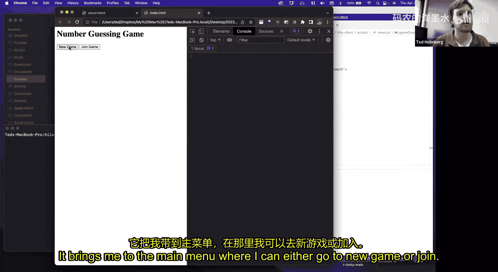

I believe。That that is it so here yep game ID you win and then we opt to go to a main menu which brings us back here excellent and so that's just a quick mVP minimal viable product where we would create。

Effectively a front end that interfaces between our end user and our back end services web services to build out a multi layered application that has a front end and back end responsibilities so in this lab we learned about a front end rest client for our multiplayer high low game。

And so we covered again asyne weight which we've done already before we've done do manipulations ACTP we've all done these concepts before I think that the interesting thing here is that we used a service that we designed ourselves so some future improvements you might want to do to this application you might want to style it maybe add user names for the game and maybe show the names and a win record and a scoreboard maybe synchronize the users together and just play who is playing you could do web sockets to do like realtime two way data transfers maybe store the games and a database as opposed to just on a server and maybe deploy it on heroroku so you could actually play this with other people but they should start to give you a good firm understanding of how we can start using the technologies we've been learning about individually together This is the first like kind of the lab sequence that brought those things together Excel so we are done with this lab is there any questions that anyone has。

So I have a question， so I know why you might not you can't replay from a second user who just logged into the game。

 which has already been one。Now actually we'll do some debugging on that you should be able to send in the request so if you're a second user and if you just logged in you should be able to issue to either replay or you should be able to go to back to the main menu if that game is already over so if it's not working we'll take a look at the code to find out what's causing the issue there I don't know if the top my head。

So。With that said， I think what I'll do here is。And and if I do。

 if there is any issues and what I'll do is I'll put a comment in the YouTube section that has whatever updates might have to go in there。

So I think that'd be a good place to be able to leave additional comments for corrections and whatnot。

Okay。Everyone， have a great day， let me stop recording。

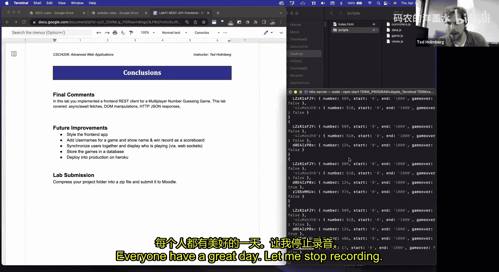