# 【全集】加州理工学院 高级Web应用 中英字幕 1080P p19 Lecture 19 - 用户登录 part1 -BV192zTBrEmu_p19-

Okay so in this video lab I want to go ahead and continue with the user authentication lab that we've been working on。

 so last video we got up to iteration eight where we were able to start using sessions and embedding session IDs into the request response objects that are transferred between the client and the server and so just as a reminder let's go back towards the test portion of that so we can just remind ourselves of where we last lefted off。

So let me。

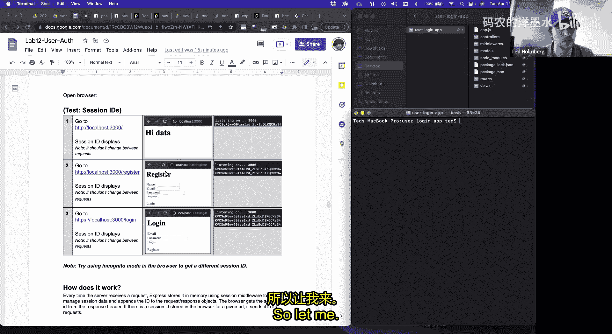

Go to the current version of our。Project。I'm going to launch it with MPm start。

U there we go listening on pour 3000， I'm going to hit refresh here and。嗯。

There we go and as I hit refresh multiple times， you can see that we are currently console logging the session ID。

On the servers terminal where we're running our server on local hosts here。And so yeah。

 and as we go to different。Request across different endpoints。

 you could see that it's recognizing our client and using the same session ID for each request and of course if I went let me copy this。

If I did incognito doesn't use the same。嗯。🎼Fingerprinting that a notna incognito window uses。

 So now this would be given a new session Id。 But now it's going to recognize that one。

 And for each request I make from my incognito window， it has one session I D versus。

This window here。Which has its own perfect and that's where we last left off where we were able to see okay。

 we can start recognizing。When the is the same between requests。

 so now we can start to have this concept of statefulness by embedding some data into the request object as it's being transferred。

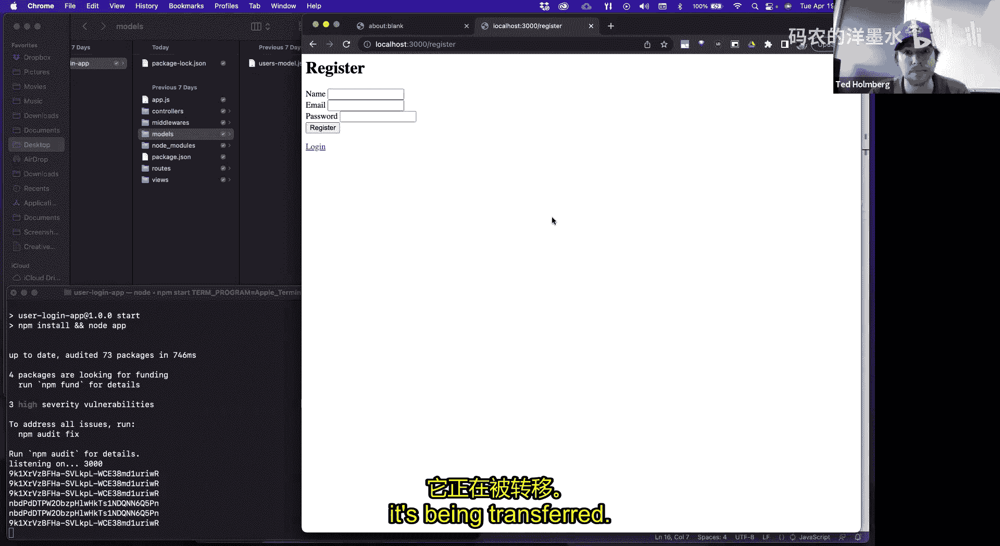

Okay， so now that we have sessions implemented， that's going to be the underlying concept that will allow us to start implementing authentication。

Into our application and so to make user authentication as as seamless as possible。

 we will use a module， a node module specifically designed for that purpose called passport。

So we'll use password to authenticate users using username and passwords。

And so with this approach we're going to not only use passport that module。

 but there's going to be another import we're going to do which is going to be passport dash local。

 and it's because Pass itself provides a lot of variety in how you can authenticate a user so local allows us to define the parameters by defining like a username or user ID and a password that will manage locally within the app。

 but there's other strategies that you can use for user authentication that passport supports such as relying on exterior services such as Google or Facebook or Twitter or GitHub or any one of those other kinds of services that already have。

A login strategy that you can depend on them to do the authentication and they provide you back a token to let you know whether they've been authenticated or not。

But we're going to。The purpose of this lab is to do it all in house so that you can kind of see how these strategies work。

In terms of a fine grain kind of implemented detail。

So let's go and before we can start implementing our user authentication using passport。

 we're going to have to go ahead and actually。Get those dependencies into our app。

 so let's go ahead and add those into our dependencies list here on our package at JSO。

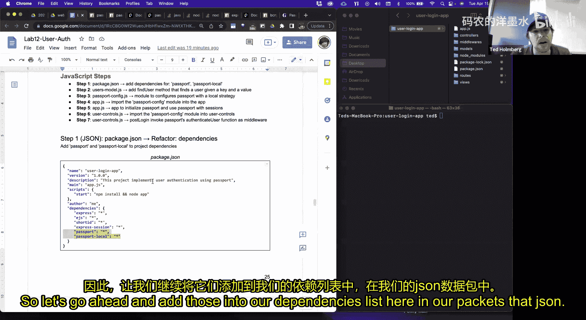

So here， let's go here。And okay。Underneath Express session， which are the last things。

 we're going to go ahead and say we need passport and passport local。

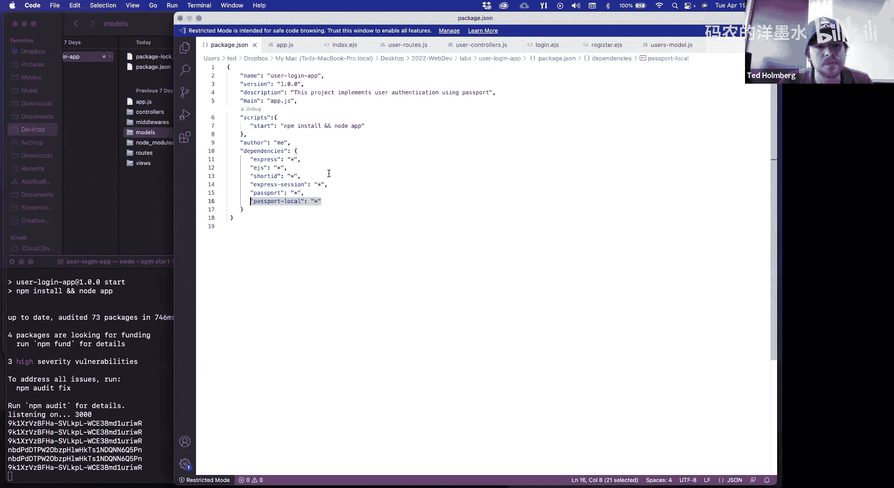

Let's see here and。And so just before we start implementing。

 if you ever have any questions as to what a module does。I want to refer you。

 of course to the NPpM documentation or the actual module documentation。

 so for instance here you can see Pass is an express compatible authentication middleware for node。

It sole purpose is to authenticate requests。Whi it does through an extensible set of plugins known as strategies Pass does not mount routes or assume any particular database schema which maximizes flexibility and allows application level decisions to be made by the developer and the API is simple。

So pass so you provide passport a request to authenticate and passport provide hooks for controlling what occurs when authenticate shouldn't either succeeds or fails so this is a good summary。

And typically NPM will have a summary of any module so again。

 if at any time you need to know what's happening there's tons of points of referrals you can go to in terms of passport local。

 the other thing we're importing a quick descriptive of what that is based off of NPM so a passport strategy is used for authentic using a username and password。

 the module as you authenticate using a username password in your node application by plugging into password。

 local authentication can be easily and unobtrusively integrated into any application or framework。

And of course， there's other modules， but we'll just be focusing on these now if you wanted to know more about passport passport itself。

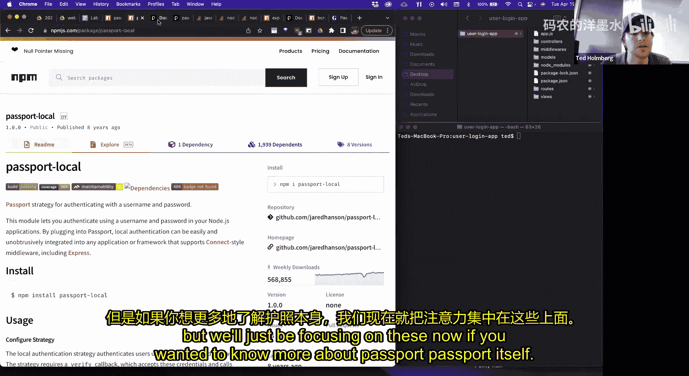

Has its own set of documentation pages， which I would highly encourage you to go and read。

In case you want to use it outside of the bounds that we're using inside the flat。

And then here you can also get passports actual。Documentation on what passport dash local was。

 but it's it should be almost。Word by word， the descriptor that's found on NPL。

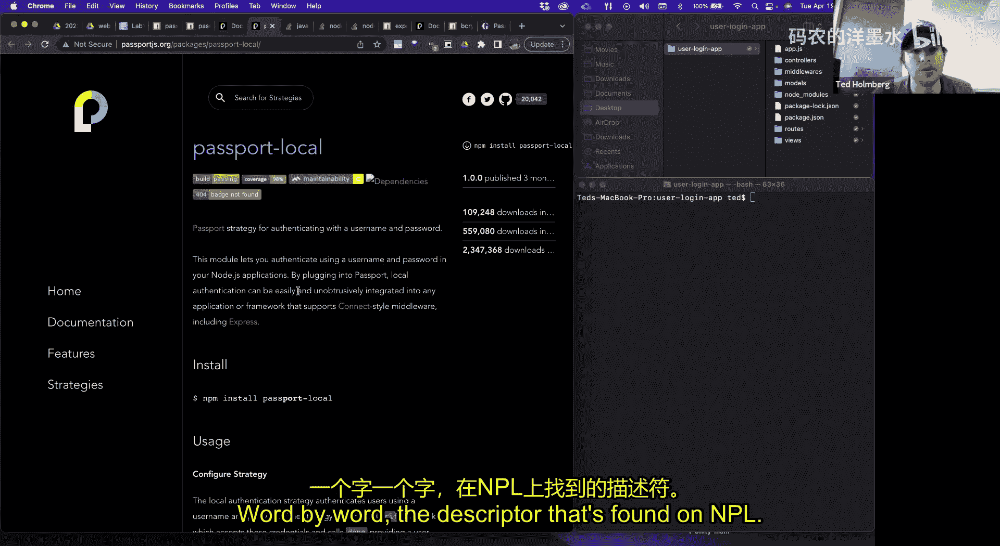

Okay， so after covering these， I'm going to close these out so we can move on as we go through。Okay。

 so we're going to import those two modules。And the next thing I want to do is I want to go ahead and refactor my users's model such that I can start to find users。

So we're going to add a fine user method that takes some parameters， it'll take two parameters。

 it'll take a key， which is the property we want to try to find a user base off of and then we'll have a value that we're going to compare towards that key。

And the function will return the item in the user's collection that matches the value and if no match is found。

 then it'll return undefined。

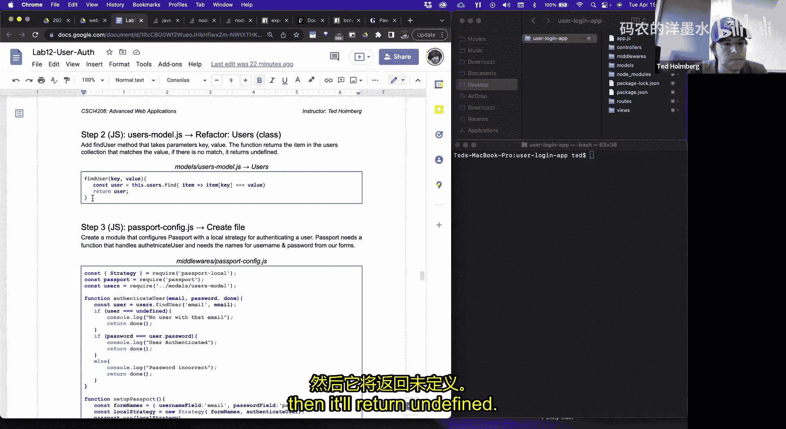

So let's go ahead into our users model here。And right now， all we have is the add methods。

 and now we're going to update that so we can actually now go ahead and try to find a user。

And so an example of the use case with this right we have two parameters the key and the value and what we're going to do is we have this array。

 so we're going to use that one of these array iterator functions right one of these。Dum。

Functions we have covered in the data structuress lab。I mean。

 the day structures lecture find where it'll look for。

It'll iterate over each item and so we're going to pass it a callback function。

 so for each item in the array， it will take that item and it will use the。

Box notation to go ahead and dereference whatever the key is， and if the value held inside this item。

Wwhich would be a user is equal to the value the second parameter passed in then it will return that back to us and if no items match that value。

 then we will get undefined and it's important to note that it will return the first item so it stops once this is true once it returns something。

So that's why it's important that the key that's passed into here should be unique so that only every one user has that particular value associated with that key otherwise they'll just get whatever the first instance is anyway we'll take whatever's returned and we'll return that to whatever the invoking application is。

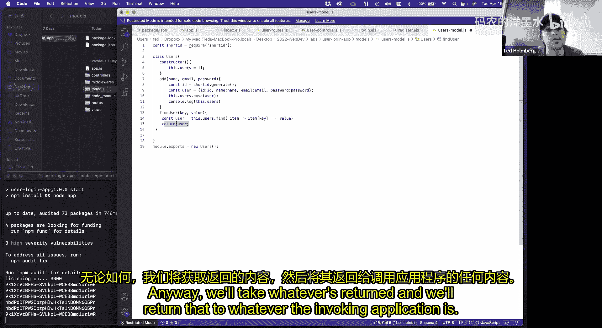

。Excellent， so now the next thing we should do is let's go ahead and create a middleware module that will configure passport for us。

Using the local strategy for authenticating a user and so Pass needs a function that handles authentication that will be called authenticate user and it needs the names for the username and password from our forms so we'll actually step through all this but first let's make it。

So let's go ahead and inside of our middlewarees， we're going to create a new JavaScript。

File we'll call passport dash config。Dot Js。Okay， so once we have that。

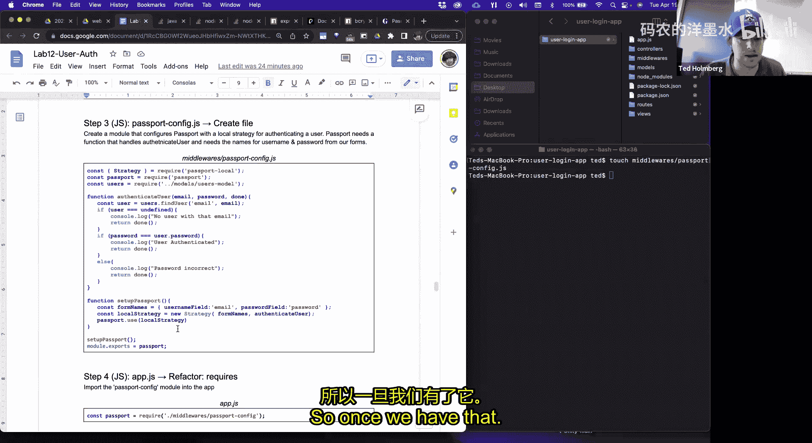

Let's go and open that up。嗯。Middlewares here， there we go。Also let's make sure we save this Okay。

 so inside of our passport dash config， we're going to do the following。We're going to import。

From past4ash local， the strategy。Class。And we'll destructure that so that we have the ability to create a new strategy instance。

 we're going to go ahead and import the passport module and we'll bind that to passport。The variable。

 and then we're going to import our own personal userss model。

And we'll just go ahead and save that into users so we have a reference to that。So passport requires。

Let's go into set up passport first and see what how it is we need to to configure passport So the first thing we need to do is we're going to create a object that we'll call our form names and so effectively passport internally needs to know what are the。

Mechanisms by which we intend to authenticate， so the user name。

Is going to be referred to internally to passport username field so that we'll use that as a key and then our value for that is going to be email because that's what our app is going to use as the ID for authentication purposes and then the password field that internally is going to use so the key is password field will be inside of our app password。

So we're just creating an object that maps our names to the kind of generic names that it internally uses。

And then it also needs a callback function for authenticating users and the callback function requires three parameters。

 it requires the ID， the user ID which for us will be an email it needs the password so that'll be the second parameter which for us will be password and the third is going to be some additional callback function that passport will invoke based off of the authentication process so we'll go ahead and make room for that in a parameter list so that can get passed in。

So then when we go and create our strategy for being able to do user authentication。

 we require two parameters， this mapping between IDs and password right so that's what this object here was so we'll pass inform names as the first parameter and as the second parameter we'll go ahead and pass in this callback function that goes ahead and authenticate a user。

And then once we set up this and then once we go ahead and siate this strategy。

 we can go ahead and just save that and then we will tell Pass to use that local strategy instance for all user authentication so now let's go back up here and actually examine what's happening with authenticate user so we know that it requires these three parameters and email password and some some callback function that we'll just call done。

So the first thing we'll need to do is we will go ahead and from our users's collection。

 see if we can't。With the key of email and then the value。

 the actual email that has been sent in as part of this request for authentication。😡。

So recall that if。Based off of how we just implemented this， if that email exists。

 we will get back a user instance and if it doesn't， we'll get back something undefined。😡，So if。

The user from this fine user call is undefined， then we'll just do a console log message that says there was no user with that email。

And then we will return back this invocation to Dun inside of passport。

So you complete the authentication process， which will then give back some kind of information to our app。

And so if we get past this， that means that the user is not undefined。

 which means we actually found a user， so the next thing you can do is we can take the password that got passed into authenticate user and check it。

 compare it to the password inside of the user instance。😡，And if they match。

 then we'll do a console log on the server side that just says user is authenticated and again we'll just go ahead and then invoke the the callback function that。

That completes this process and if the password doesn't match。

 then we'll go ahead and have an else clause that will console log password is incorrect and we'll do the same thing we'll go ahead and invoke the callback function that gets passed in just to complete the process。

And that's effectively how we're going to authenticate a user that's our logic for authenticating a user for a local strategy。

So at the very bottom of this configuration module， we will invoke setup passport。

 so these are all the instructions on how we set up well actually do that so that when this gets parsed。

It all gets executed and then we will then take passport now notice when we set up passport。

 we're actually telling the passport module to use this local strategy。

 So instead of importing passport。Like we're doing in line two here in the rest of our app we'll be actually importing it from this preconfigured module here。

 so we'll now take our configured passport and put that into our export modules so that we can import it from other portions of our app。

😡。

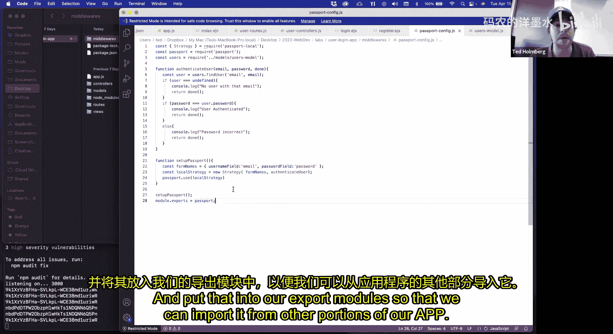

Excellent。I know the next thing I want to do is I want to actually go into my app。

 JS and import passport so we can use it， but not。

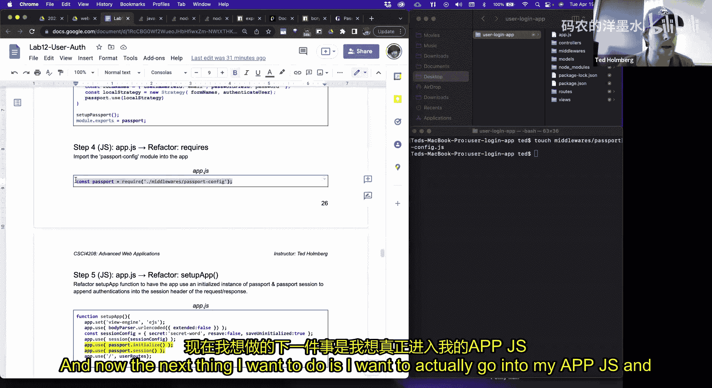

Not normal passport not but our configured passport so here you'll see when we do our import here。

 we're going to do the require from our middlewarees from that passport dash config module。

 so the one that we're actually importing into our app is this one right here that's using our local strategy here。

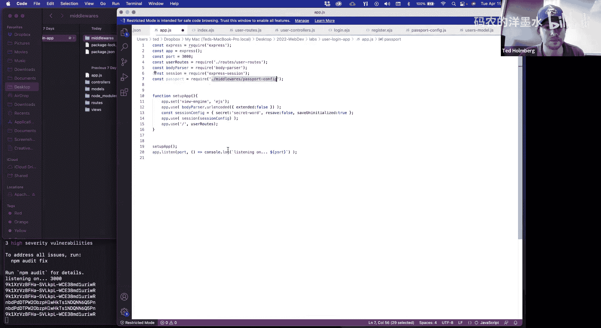

Excellent， okay， so now that we have our configured passport inside of our app。

 let's go ahead and use it。So let's go into setup app。

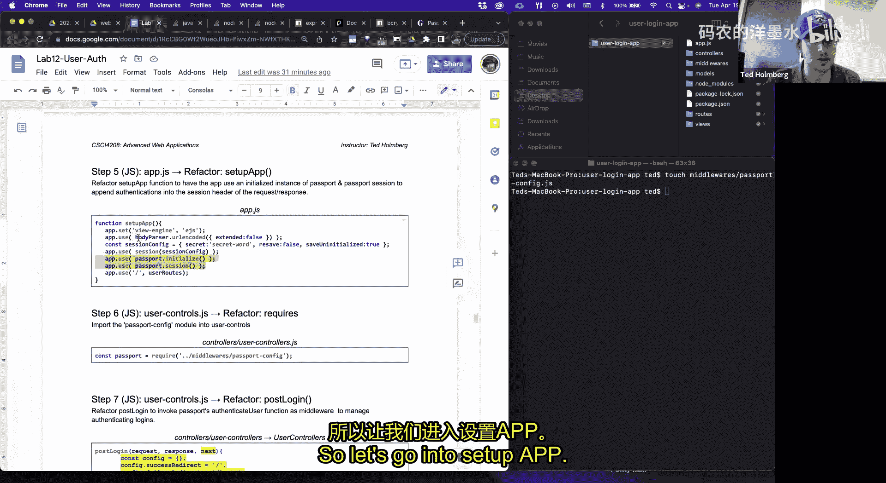

Here and under where we are now using sessions， but before we start defining our routes。

we're going to tell our app to use passport and so in order to start using Pass we have to initialize it so there is an initialized method built into it into the module that we will invokeked and then in order to be able to use passport effectively right now we're using express sessions to get these session IDs but instead of just having session IDs passport well use the session to be able to serialize and desialize user instances based off of whatever key so it would be whatever ID we decide to give to it and so we'll go ahead and tell passport to go ahead and set up its sessions so that we can actually start putting users into the request and response objects。

And again， if we want to read more about these methods are just descriptions。

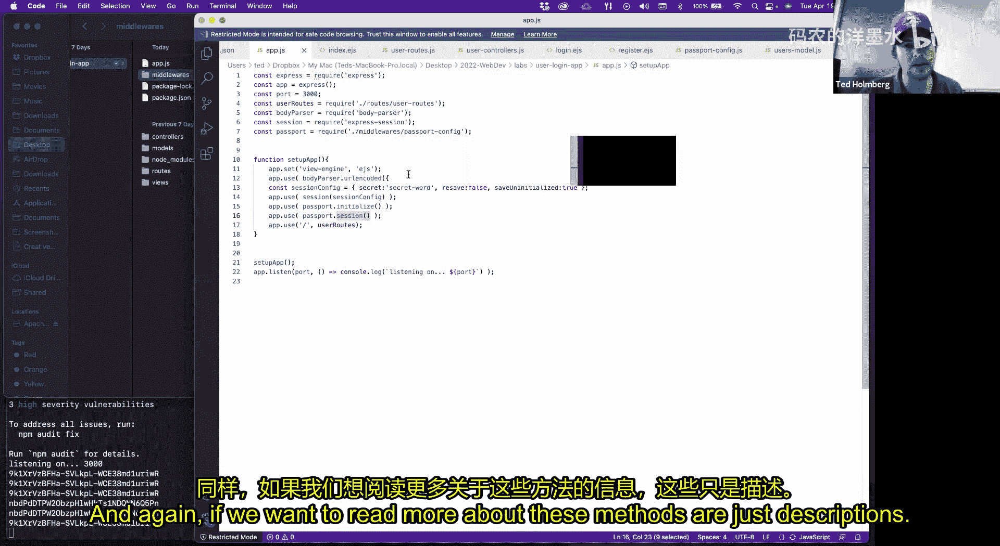

We can see that passport initialize is a middleware that initializes passport seems simple enough。

 and again， middlewarees are functions that have access to the request object。

And the response object and the next middleware function in the applications request response cycle。

 so passport is an authentication middleware as we mentioned。

 basically passport initialize initializes your authentication module and passport session is another middleware that alters the request object and changes the user value that is currently in the session ID from the client cookie into a truly decsialized user object。

Okay。And so the next thing we need to do is。We need to go into our controllers。

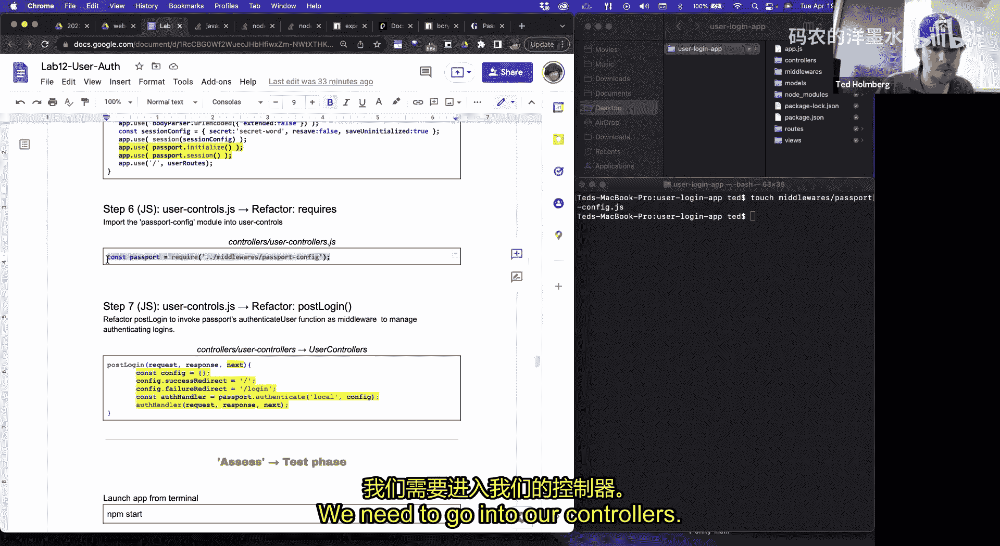

And also be able to set up passport。So let's go here into controllers。

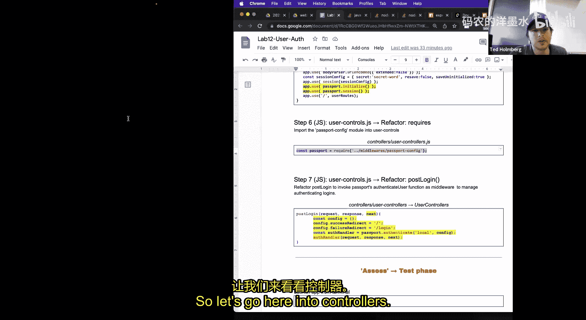

And let's go ahead and import passport。From our middlewares directory。

 from the passport config that we just sent up。

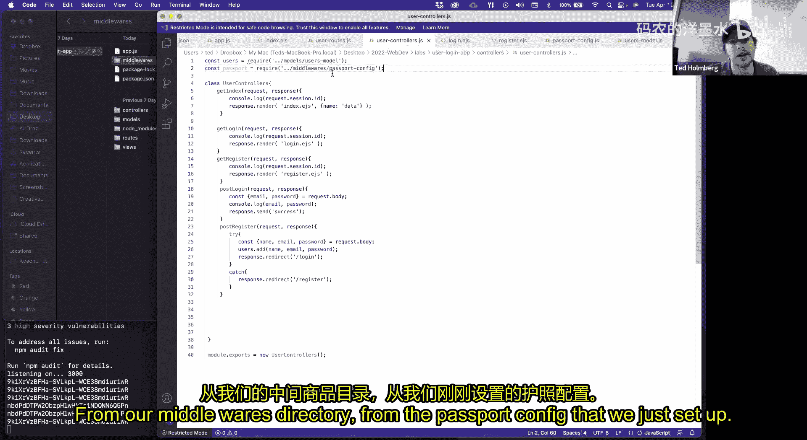

And now let's set up our post login。So that we can actually use passport for that。

So we're going to do a couple of changes here， we're going to refactor that to invo passport's authenticate user function as middleware to manage authenticating our logins。

So post login here。Let's get that there okay so let's see what's happening here so notice we're doing a couple of things when we refactor this we still have request and response。

But now we're adding a third parameter， which is going to be the callback function that gets invoked after this one。

So。We'll rely on Express to go ahead and supply a next function after the login gets invoked so inside of here we're now going to set up a configuration object。

Inside our configuration object we're going to set up two properties right we're going to have a success redirect and a failure redirect so these are two properties that passport module is going to look for when it tries to authenticate on a successful authentication is going to redirect to the index endpoint。

Just the slash， the root endpoint and on a failure to authenticate。

 it's going to redirect to slash login。So now that we have this configuration object that。

Details what to do on a success or failure， we will then use the passport to authenticate。😡。

Using the local strategy。And using this configuration object on what to do on a success or failure and what this is going to supply back to us is a authentication function。

 so we're going to save that authentication function that gets returned to us from the passport module and will immediately invoke it。

And when we invoke it， we're going it's effectively a middleware function that's happening between when a request is received and before we deliver a response so it's going to need the request object so it can pass it along。

 it's going to need the response object so it can pass it along and it's going to take this next function that gets called after this authentication handler gets invoked and it's going to pass that along too。

Okay， so once we do that， that should actually implement what we need to for passport to start doing some authentication。

 so why don't we test this out by starting our out。

And then what we'll do is we have to register a user and there's three cases we should try for login。

 we should try to submit the wrong email and see if it gives us a console message on the server side that says there's no user with that email。

 we should try using the appropriate email with the wrong password to see if we get the password incorrect server message and then finally we should use the correct credentials and see if we get a user authenticative message。

So let's try that out， let's kill the server， let's clear here。

 let's do MPm start and you know there's the new modules we need， right？Oh wait。

 this doesn't even look like I saved it， so let's kill it again clear and let's start it on。Okay。

So now what I need to do， let me refresh this page， perfect。Okay， let me go in here。

 let's do user at。Email。com。Oh， let's do。Let's do， oh wait， that's。

 let's just do user name as the name， then user@email。com and let's do。Asstword  one， through3。

It's registered。Perfect， we have the ID， the username， the email， the password， the session ID。

 let's go to our login， let's do let's first， let's do wrong。At email。com。Quite right。

And don't care about the password right now， let's just try that login。Perfect。

 no user with that email， so that worked。Now let's do user@email。

com the one we just registered but the wrong password we'll just do one， two three。

 let's log that in password is incorrect perfect。We got that message in our terminal here and then finally let's do user@ email。

com and then。Password one， two，3， the appropriate thing and user authenticated perfect so in that function that we made just earlier for our password config right these were the three messages we got no user with that email user authenticated and password incorrect so we know that all of the different statuses for authentication are actually triggering when we should expect them to that's perfect。

Yeah。So the next thing we want to do is we want to actually。

 after we've gone through the process of authenticating the user， like making the decision。

 whether the user has been authenticated or not， we should go ahead and serialize and decsialize the user into the request response objects so that we can make use of the data that we can pull from our user's model。

So again， we rely on passport to do that。And so the idea here is that to restore a user for each request during a session。

 Passport must implement a method that defines how to serialize the user data and another method on how to decserialize a user's data。

嗯。So recall。That we had this callback function inside of authenticate users that passport itself is invoking internally so we can pass parameters to that that will be used for the purposes of serialization of decsalization。

So。The two parameters that we'll start passing in there the first parameter is for some kind of error object and so here we'll just always use null for the first parameter and the second parameter will be the actual user object after authentication occurred so for every instance where authentication failed so for those instances where we didn't have the appropriate email then we would pass false as a second parameter or for the instances where the password was incorrect we would pass false but on the instance where the user was authenticated then we'll take the user that we found right？

And we'll actually go ahead and pass that to that Dung method。😡。

And then that that'll be passed for the purposes of being able to serialize or desialize within our request object so that other middleware will then have access to it on our server side。

Or if we wanted to， we could deliver it to the client side right like we could do whatever we want with it at that point。

So let's go ahead and update our authenticate users。And really。

 the only changes we're doing here is to the invocations of this done method。

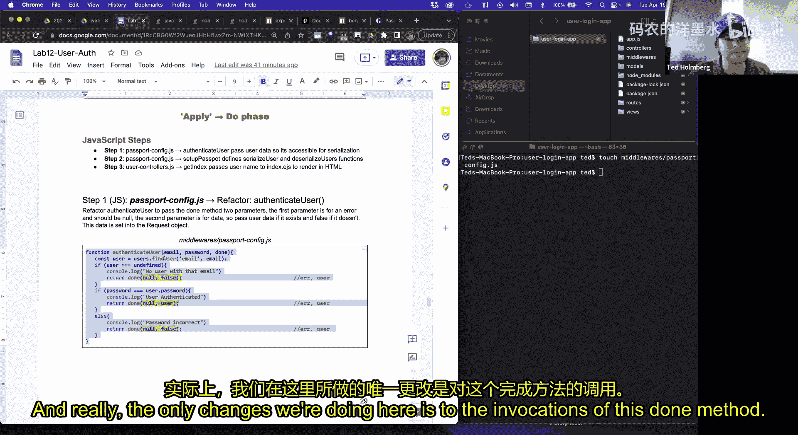

So let's go here to yep。So here I will just do that and the only difference is these done methods right we're now passing in these two parameters。

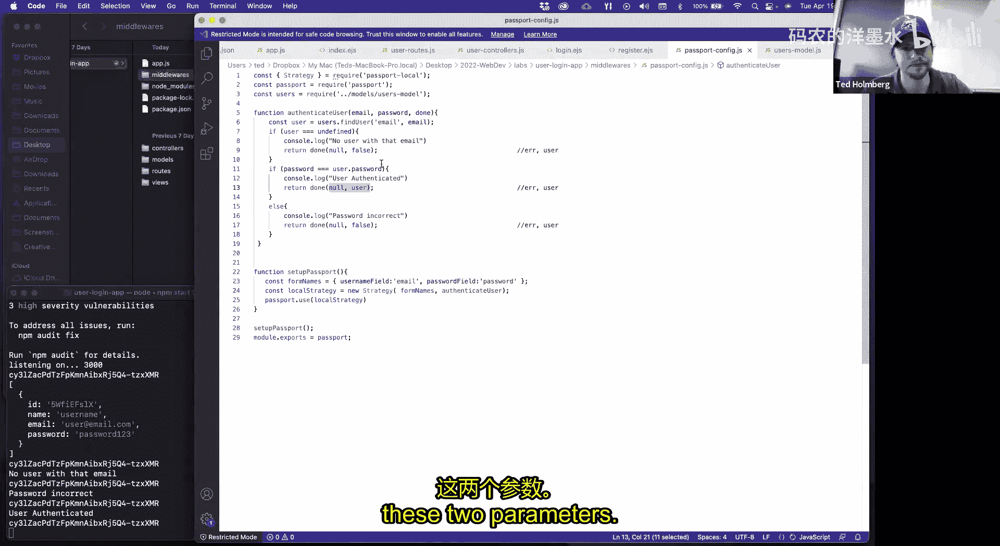

。Okay， so now the next thing we're going to do is when we set up passport passport internally has a serialized user and a decialized。

Properties methods， and so we can assign our own callback function。

 so when Passport tries to serialize or deserilize a user。

 it will use this callback function to do so。So these callback functions I just pass as anonymous functions。

 so in order to serialize a user there's going to be two parameters inside this callback function is fat arrow function it's going to be the actual user object that we want to serialize and then a second parameter is going to be a a。

Callback function that passport itself can pass into it。

And so what we're actually going to do is we're going to in invoke that callback function and it's going to use those two parameters。

 the first is going to be null because that is a error parameter the second is going to be the ID。

That we want to go ahead and bind。For serializing a user。

 so we'll use the user dot ID key for that or the value of that so we we'll serialize this user。

And then the key that we're serializing it to inside of like a store will be the inside of our user model。

 it ID property， so recall when we go into our user model here， when we create our user。

 we give it an ID。😡。

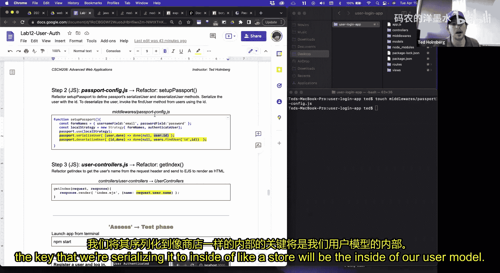

So we'll use that ID for serialerization。

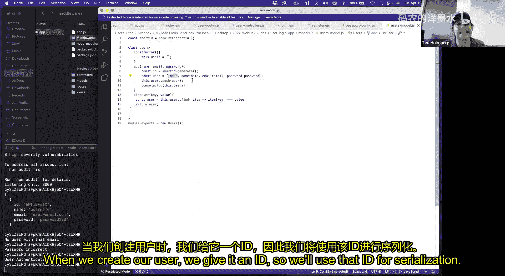

And then Passport will actually manage serializing and decsalizing for us。

 and then for being able to decsalize a user we'll have a callback function that's going to expect an ID。

And again， this callback function will actually invoke the callback function。

That passport will provide the first parameter is going to be null because it's going to be the error message and then the second parameter is well we're going to from the users model。

 we're going to invoke the find user。method that we invoked that we implemented earlier。

 we're going to say that the key we want to find a user by is going to be based off of the ID。

And then the value will be the actual ID that gets passed into this function。So again。

 this is a mechanism that allows passport to serialize and deserialize a user and again。

 if you want more information on what that's actually happening。There's a good explanation here。

 so the user ID。And you provide as the second argument of the Dung function is saved in the session the session that gets deposits the request and response objects and we've already been looking at the session ID we've already seen that there's a session object will passport essentially。

Launches into that session or it hooks into that session and is able to actually input a new object。

 which is going to be effectively our user object。And is later used to retrieve the whole object via the des serialalize a user function and serialized user determines which state of the user object should be stored in the session。

And the result of the serialized user method is then attached to session as a request session。

passport。user object。And so we can actually access that if we want to access that。

 this is the pathway， right， this is where everything would be saved at。And of course。

 the first argument， the DC realizedized user corresponds to the key of the user object that was given to the done function。

 so your whole object is retrieved with the help of that key and the key is used for the user ID and the key can be any key of the user object such as the name。

 the email， the ID， however you decide to implement it。Excellent。

 so now to ensure that this actually worked， we're also going to refactor our get index。哦。

Controller so that it's going to pass in as the name property。

 the user name that now exists inside of our request object。So let's go in。

To our user controllers here。

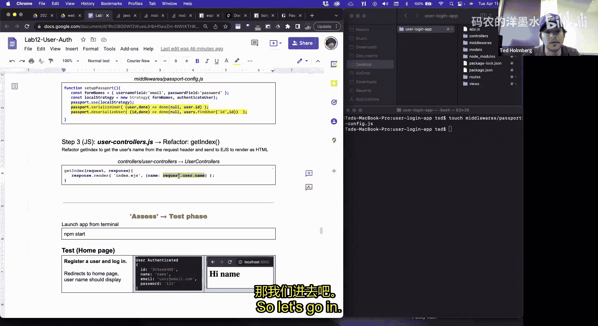

And right now we're just setting name to data right so we're going to change that to actually access the request object and now the request object should have a user object because passport should authenticate after authenticating the user decalize the user and then added it into a request object and we know that the user object has a name property in fact we've added all of the user attributes into there so we should be able to access any one of the properties that we have defined inside of user。

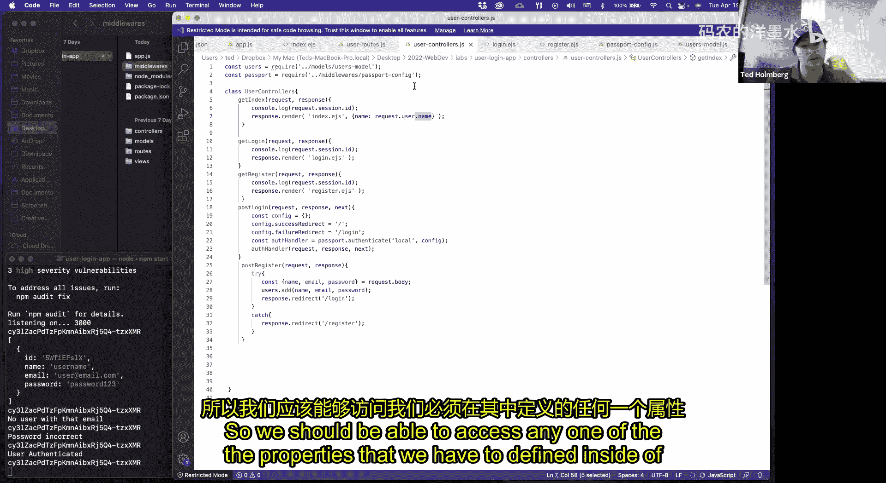

So now it's time to test this out， we can launch our app using NPM start and when we go ahead and register。

A name and email address， we should now be able to see that name on our index page。

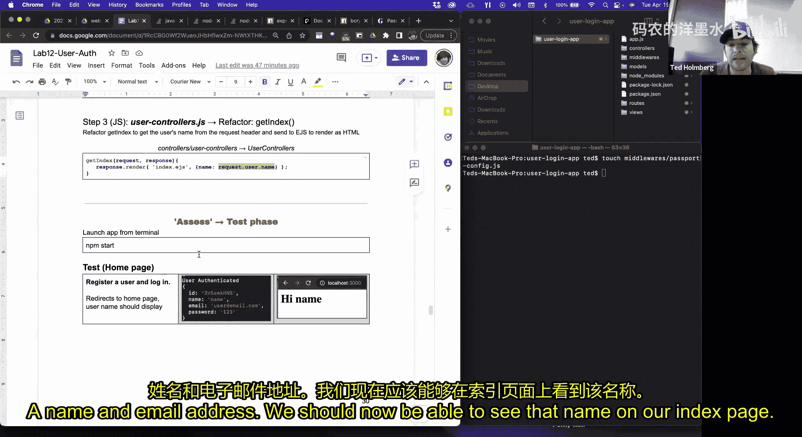

So let's make sure everything saved， let's go ahead and clear this， let's launch MPm start。Perfect。

 and now let's go over here。Let's。Go to register， perfect。 Let's create a user name。

 Let's do user at email。 Let's do。Password 123， let's register perfect and now we're registered into the system now let's go to login。

 let's do user@email。com and let's do password  one23 and let's log in。

Faiil to serialize user into session， so let's see what happened here。Okay。Let's do some tracing。

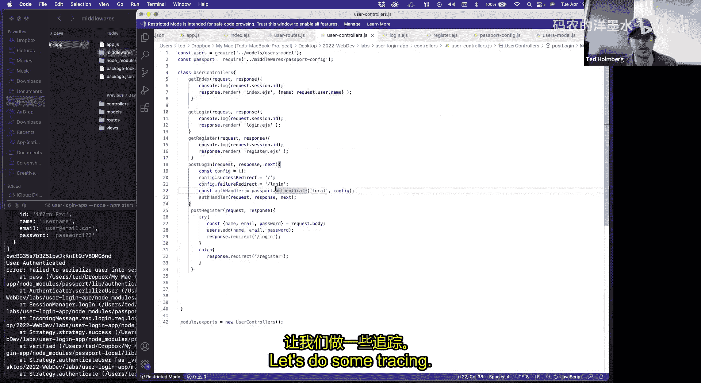

Okay， so we refactored authenticate user。

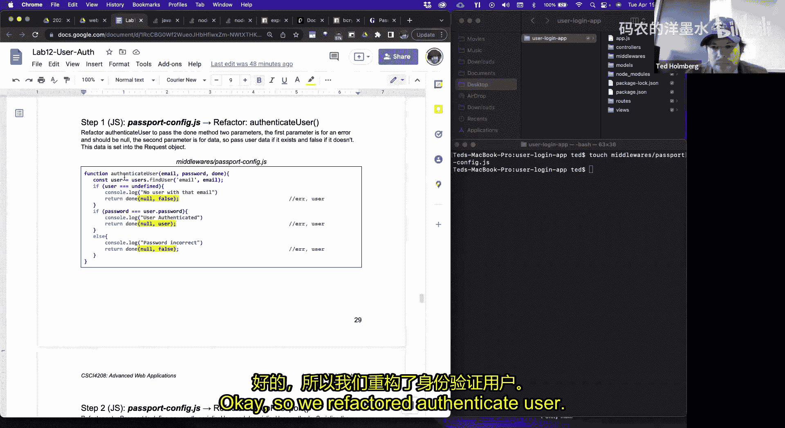

To pass snolls and falses， so let's make sure we get that。Okay， so here we have return， yep。

 that looks good， null or false here， return done noll user yep。And here return done null and false。

 that looks good to me。

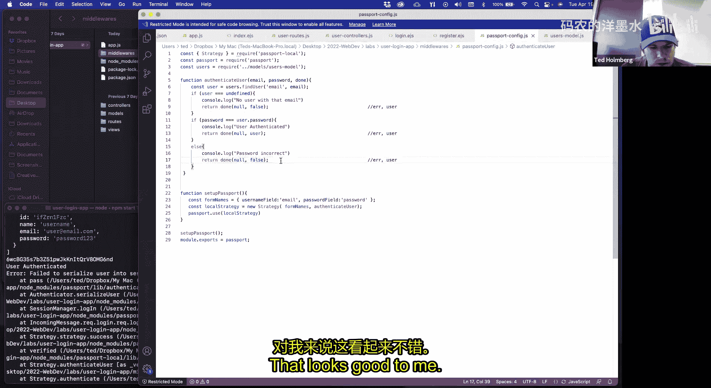

Okay， then the next thing we did here was to define serialized user and decsalized user did we I talked about this actually。

 did I ever add this to set passport？

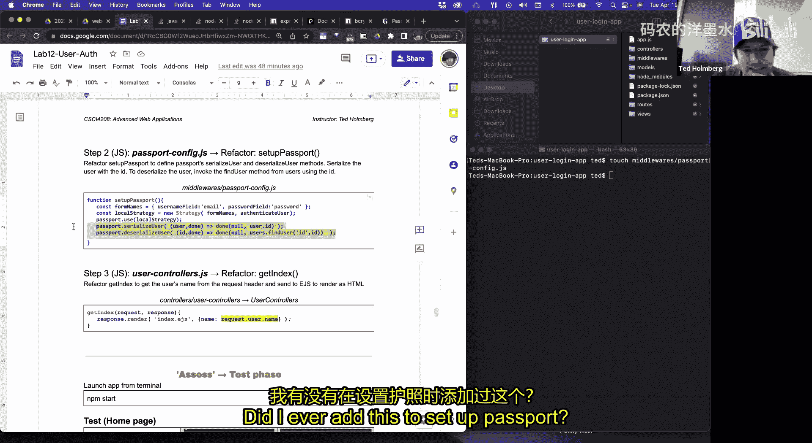

Oh， no， I didn't。Well that would explain why we get an error。

 I spend so much time talking about code and not actually implementing code。😊，So yeah， so here。

 if we want to try to access that user， this is a perfect example of what happens if we do not define。

These callback functions to tell Pass how to serialize and decsalize a user， it tried to do that。

 but since we didn't define a mechanism for that in our actual code when it attempted it failed to do that so now if we actually add the code that does that。

Let's clear this。And let's try this again， let's do NPpm start。Okay， now let's go back here。

Let's do or get Okay， let's go to register， let's go to user。Let's do user@ email。

com let's do password  one23 let's register that perfect I have that registered in there let's do user at email。

com let's do password 123 let's log in and bam oh no don't save that password no stop that。

So now when I go to indexexOP， now it successfully authenticated the user and then it serialized the user into the request such that I can now access the user object in other parts of my app like being able to display the user's name inside of the index page using EGS。

And of course， if。Of course if you。Of course， if you didn't want to use EJS you could deliver this data to your client side as a JSO object as well right that's an alternative approach that you might be using with your particular application so there's lots of different ways that you can send that user's data so that you can go ahead and utilize it。

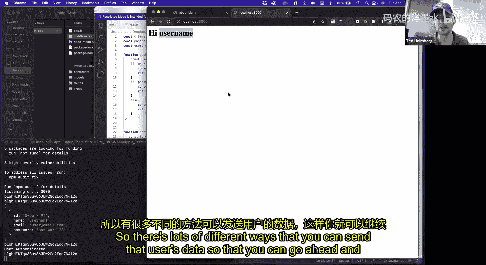

Okay。So the next thing I want to cover now that we've started to use passport is I'm going to show you this cool little module here called Express Flash that allows us to pass messages within our application on the back end of our application using the request object so we can we can use this to essentially put an object that has messages and then we can expose those messages and do a variety of things on our backend so messages dependent to the request and the messages can be displayed without sending back a response to our client。

So let's actually go ahead and solve this module and play around with it a little bit。

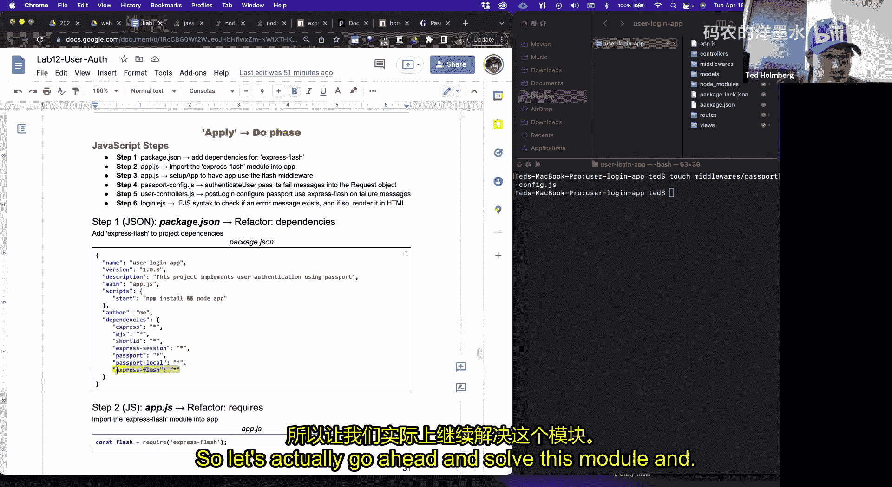

So let me go into my package JSO I'm going to add this new dependency in express dash flashlash and again at any time if we want to know what this does。

 we can just go to the NPM page and see what this module is so flash is an extension of connect flash with the ability to define a flash message and render it without redirecting the request。

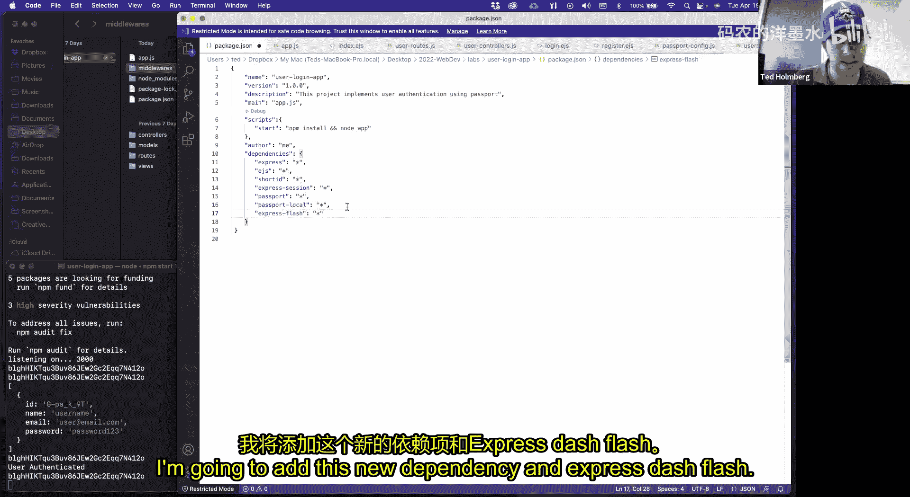

And then they have examples of how you can use it， you'll see examples of how we're going to use it right now and no we're not that far yet。

Okay。So now inside of our app， let's go ahead and actually import the express flash module。

 so let's go here and so inside of all my imports I'm going to import that。

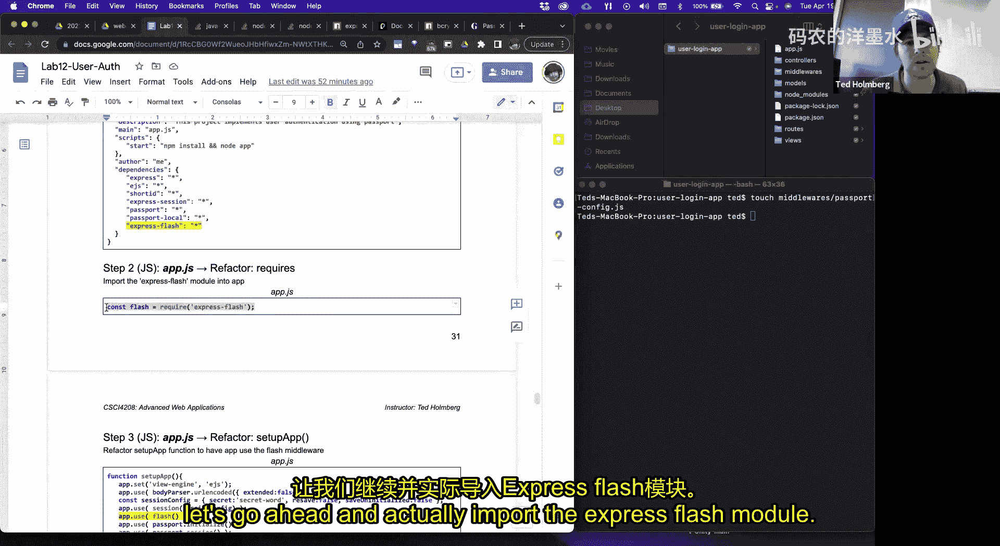

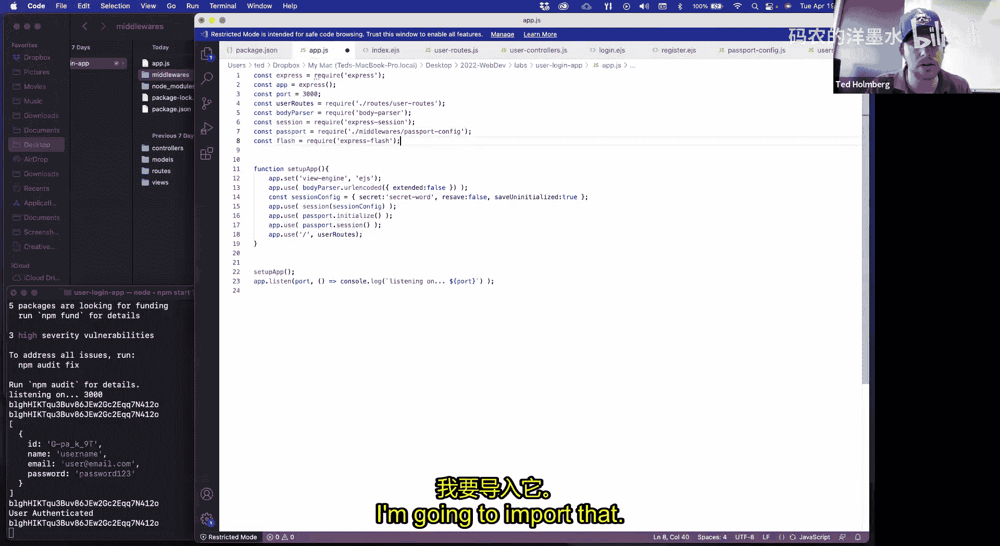

Excellent and so now since this is effectively middleware right it's something that is kind of latching into the request response chain and doing something with one of those request response objects。

 so here i'm going to go ahead and put it before passport because i'm going want to use it via passport。

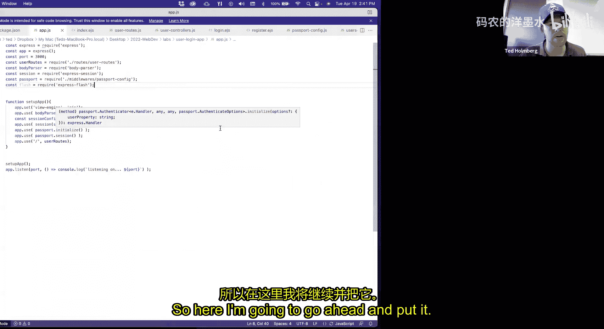

So。I'm going to go ahead and tell my app to use。Flash。

 and I'll go ahead and invoke the flash function that we go ahead and import from the module。

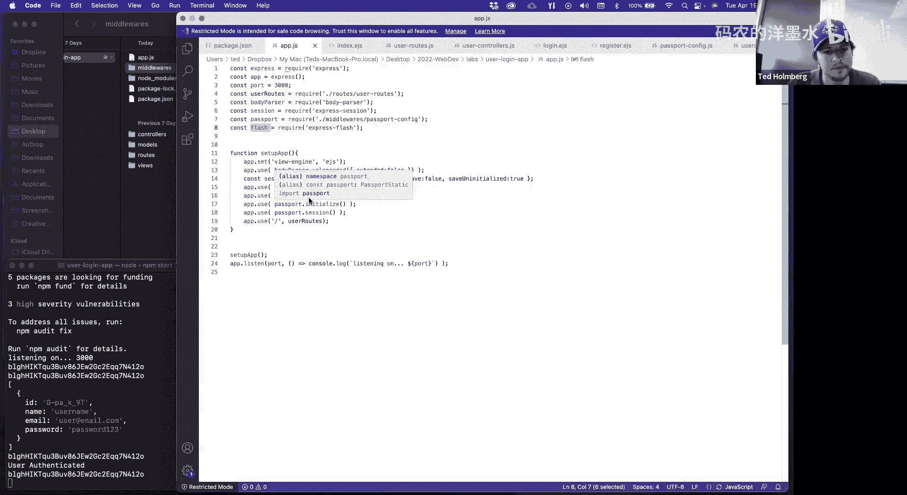

And now what this allows us to do is we can add a third parameter。

Into the invocation of this done function that will allow us to send flash messages。So here。

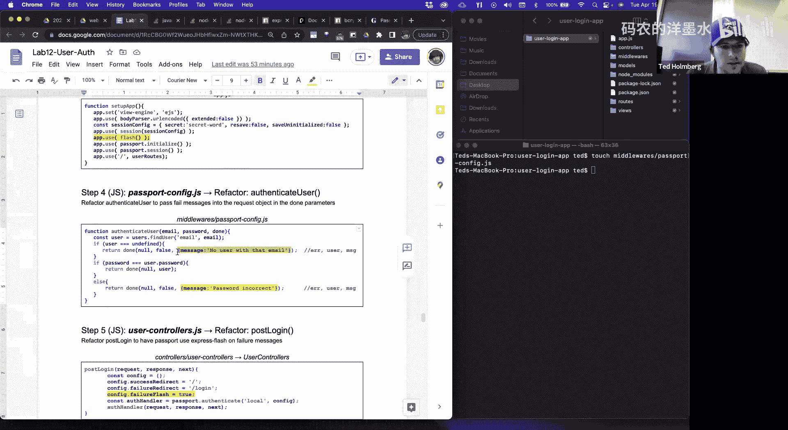

Let's go into our passport config here so here。On the instances that it's false that we weren't authenticated。

 I'm going to have a third parameter because I now am using the express flash where I'm going to have an object that has the key message。

And then the value， no user with that email， so the same thing I'm console in log in here。

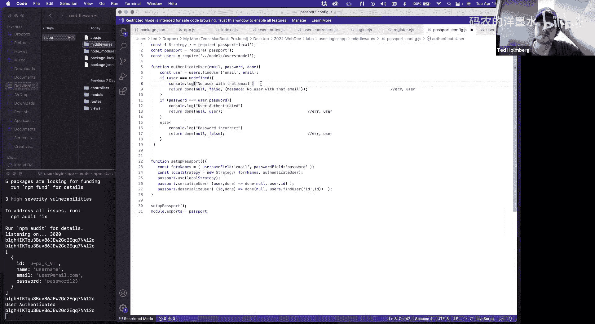

Okay， and then here I'm going to do the same thing on the other instance。

But when the password is incorrect， so on this instance。

 after it I passed the false because we weren't authenticated。

 I'm going to give them messages as to why it's false。

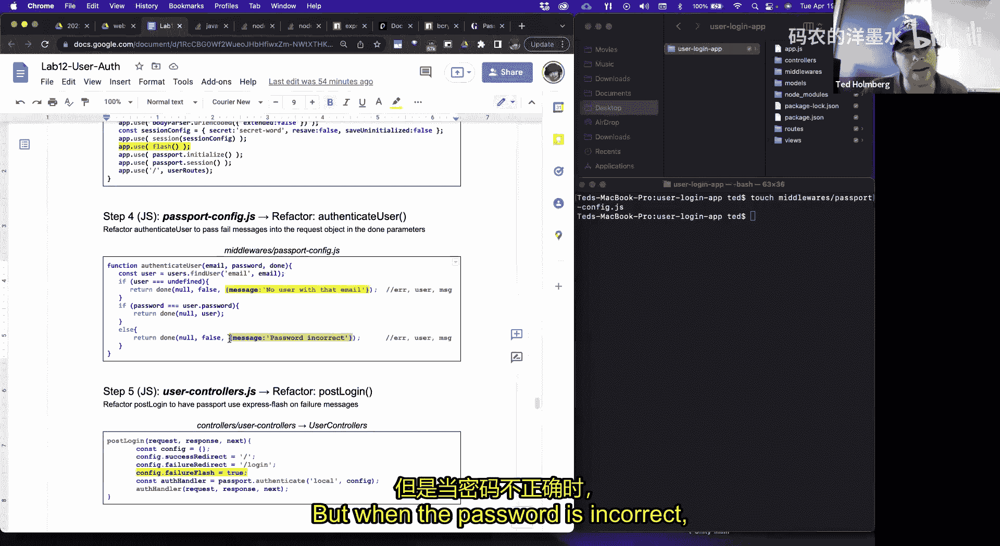

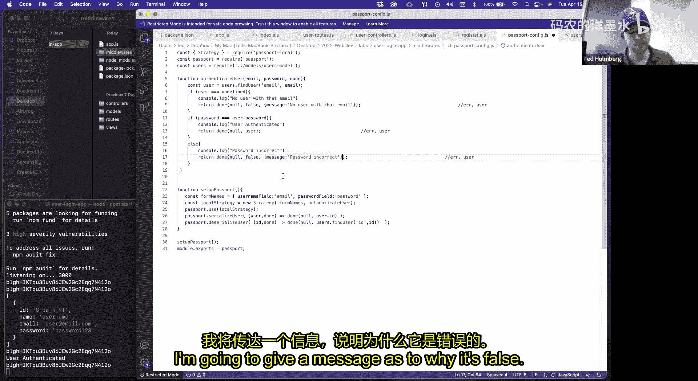

And again， the reason why I can do this， I can have this third parameter is because I'm going to tell passport that I'm using express flashlash。

 so when I go and configure passport with the authentication handler I'm going to create a new property that's going to have the key failure flash so that it knows on those instances that are false for authentication it'll have that third parameter that'll have the object of message。

And then the value of whatever caused that message to occur。

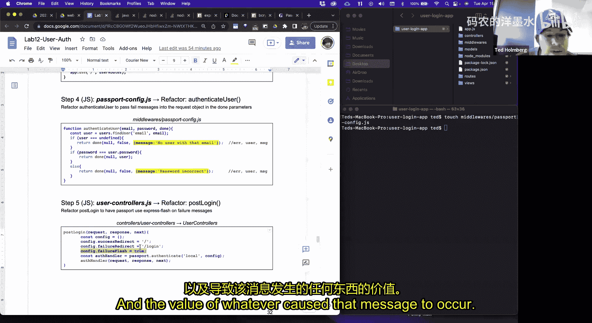

So let me go to my post log in here。And when I do my configuration。

m not I'm going to have success redirect， I'm going to failure redirect and now I also have on config failure flash true。

 we will use flash messages。So when we go ahead and create our authentication function here。

 that'll be part of the configuration。

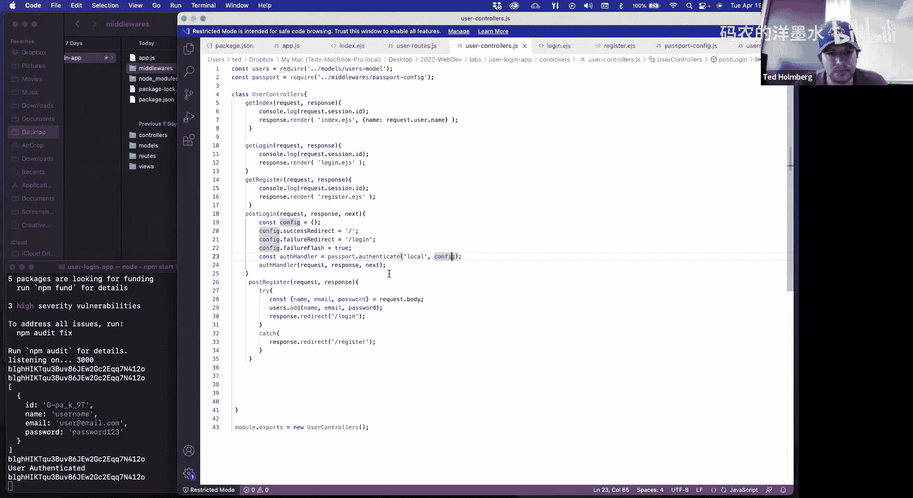

Excellent， and now inside of EJS you'll see that we can now just dereference a messages object right and get the error from it and we we know it's going to be error because that's how passports going to embed those messages。

Based off of this configuration here for failure flash。So let's go ahead and update our EJS。

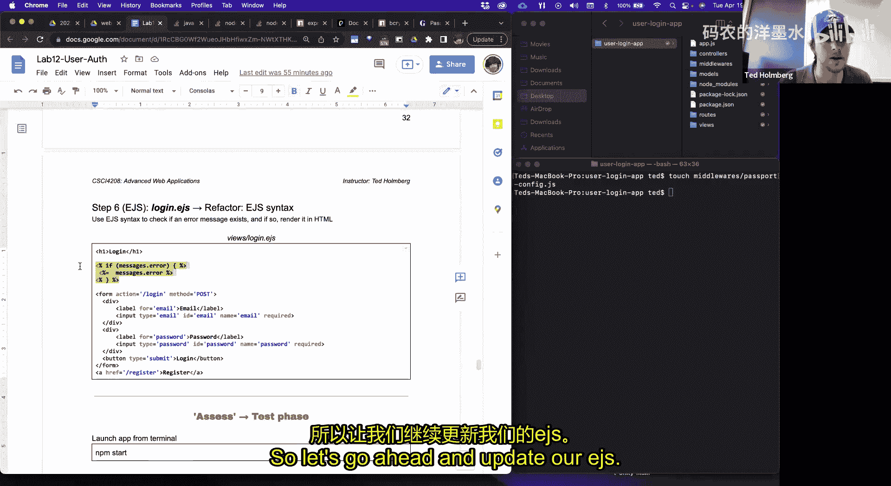

Let's see and that should be on our login。That's on our login， perfect。Here。

So I want to do that above my form， I think I want to do that above my form， but below my header。

 perfect， yeah， let's just do that。

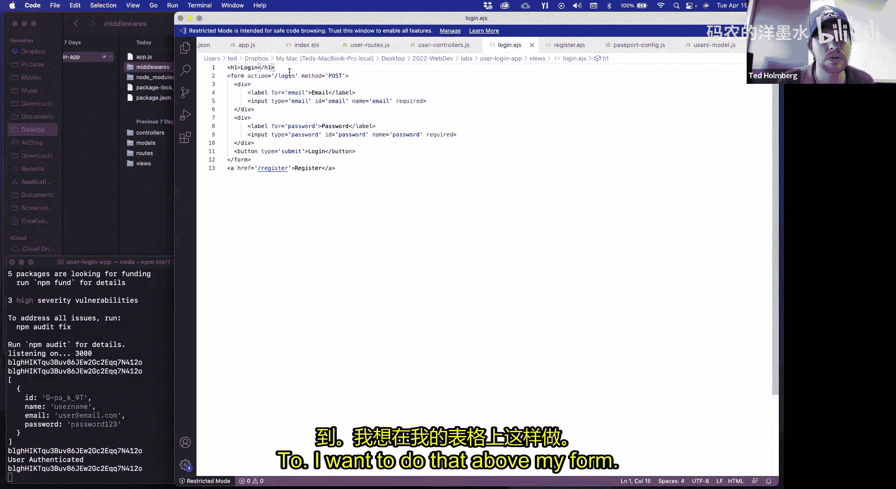

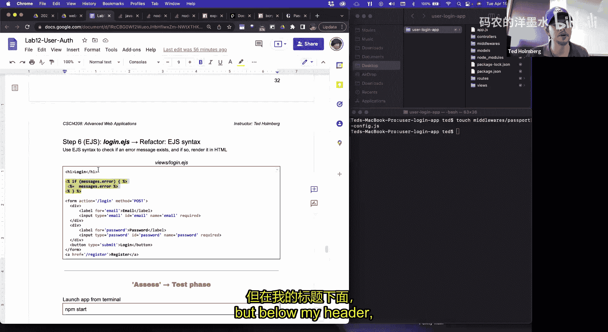

So there we go。And again， in order to go ahead and embed JavaScript like logic into an EJS。

 we use these symbols here right like it's the。It's like the less than percent sign and then on the opposite side of the line is the percent and then greater then。

And then we create just what looks like JavaScript， you know， if messages。 error exists。

 then we will go ahead and display messages。 error。

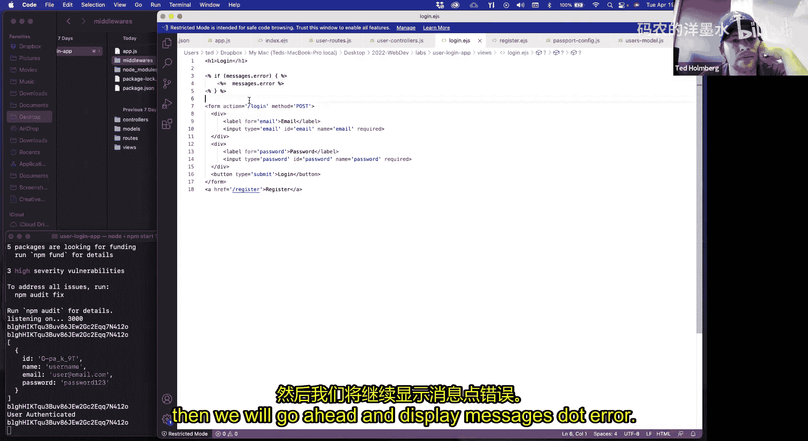

And now let's see if we can't get those messages to start appearing。

On our actual display pages via EJS' to NPM start and test it out。

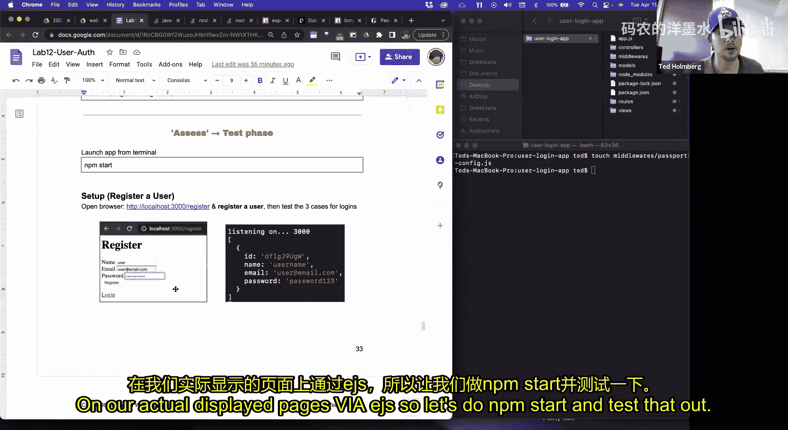

Okay， so let's go here。OhOh， there's nothing there， let's actually go to like register。Okay。

 let's go to user， let's do like username。 Let's do user right email dot com password 1，2，3。

 perfectf， let's register。 Okay， we've registered。 let's now try doing the。

Wrong at email dot com right and it doesn't matter what we put there。

 Let's do log in now look when we。On authenticuthate。

 when we haven't authenticated because we couldn't find the user， we now get this message。

On the browser side， that says no user without email。Okay， so now let's do user at email。

 let's do the wrong password， let's just do one， two， three。And there we go。

 we also get the other message error message。Password incorrect。

You know let's actually try it being correct password word right？And perfect， nope， go away， no。

Now we get to the index page where it also saysH username， perfect。

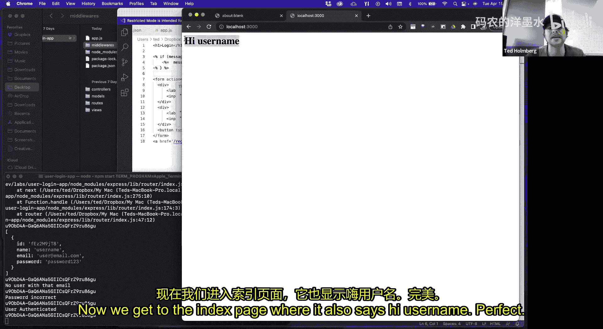

。Okay， so now what we really need to do since we can authenticate users。

 serialize and deeralize them within our objects is we want to start protecting our reps。

And what that means is we want to prevent nonauentated users from accessing what we're going to consider private information so we want to check the request via passport sessions to see if this user is authenticated for that endpoint。

And if they're not， then we want to redirect them somewhere else， and if they are。

 then we will serve up that endpoint。😡，And typically when we serve up that endpoint。

 we can use the decsialized information to go ahead and provide customer information on that endpoint like the username。

 like what we have been doing。Okay， so the first thing we're going to do here is we're going to need to create a new middleware module that we'll call off。

JS， so let's do that， so let's create inside of middlewares， a off dot Js。

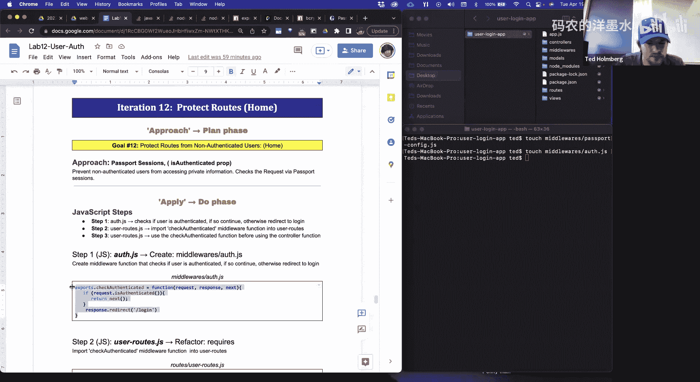

And let's actually go and implement that， so let's go here。Into our middlewarees。

 we have oth JS and let's put that up here perfect。

And so what we're going to do here is we're going to export a function that we're going to call check authenticated so notice I don't know if we've done this in this app before。

 but this is another way we can export functions， we can just access the exports object which is available across all modules and we can add a property to it。

And the property we can add to it is just an anonymous function right so we can just bind a function object to it here the function will be middleware so it needs a request and needs a response and it needs the next callback function。

 the next function in the chain of functions that get called throughout sending the request response chain。

And so effectively， if the request is authenticated。

Right so that's going to provide true or false because this is something that。

We can vote from passport right we can we can check or ask if it's authenticated request if it is。

 then we can return back an invocation to the next function in the callback function。

 which will probably be our endpoint function right the one in our controller。And if it isn't。

 if this isn't authenticative that's false， then we'll tell the response to redirect to the login page。

😡，啊。So pretty simple logic there。

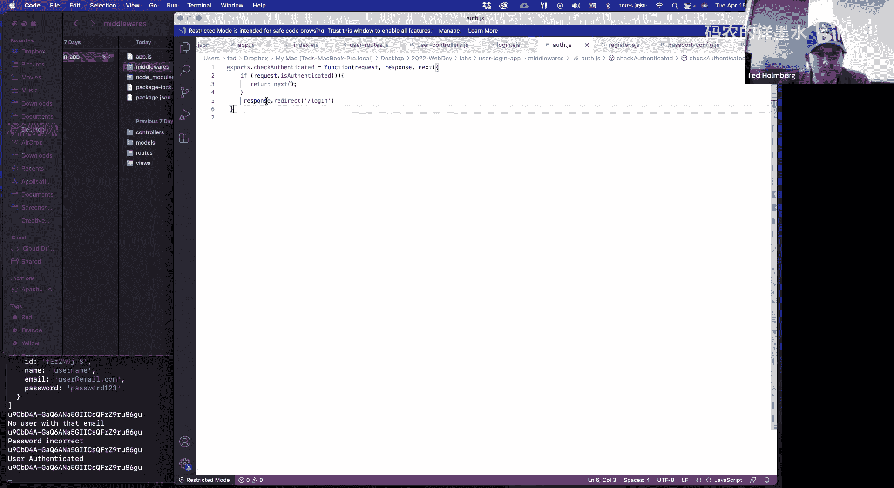

Okay， so now that we have this。Function that checks whether something's authenticated or not。

 let's go ahead and import that function into our routes。

So let's go to our user routes here and let's go ahead and from our middlewares。

 let's import that off module we just made and destructure from it that check authenticated。

Function we just made。I know what we're going to do is we're actually going to put that in between or before this callback function to get the index。

 so we're going to refactor the route to get the root directory or the index to use the check authenticated function before using the controller function。

😡。

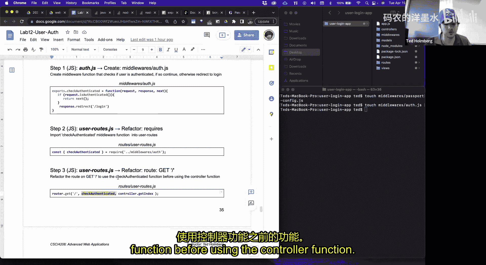

And again， this really highlights why this is called middleware。

Right so here what you can start to notice is when we set up our router right to look at an endpoint we can actually have a collection of functions like get called one after the other and that's what the the next function is right so when this function gets called check authenticated and check authenticated。

Here has this next function well the next function that's going to get password by express。

Is effectively going to be this controller do get index this endpoint function。

 so if the it's authenticated， then get index is going to get called and if it's not authenticated。

 then you redirect to the slash login endpoint。

Excellent， let's test that out and see if it actually works。Let's。Kill the server， let's wipewipe it。

 let's start it up。So let me try refreshing this page。And now notice。

 whenever I try to go directly to the index page， I wasn't authenticated， right。

 so it redirected me to log in。And watch， I'll do that again。 I'll get rid of the login here。

 I'm going to hit enter and it redirects me perfect。 Okay， so now let's well， let's register。嗯。

Perfect， okay， let's log in。And now， since I am authenticated。

 it actually allows me to go ahead and invoke that get index。

 that controller callback function to get indexed。And so then I'm actually served with my index page。

Excellent， so now we've protected this route from users who are not authenticated。

Now the next thing I might want to do and again， how does it work well express middleware is server logic i。

e modules， libraries and functions I invoke between receiving the ECP request and issuing the response just like we mentioned before okay so now that we're protecting the routes for for our index page we should also consider protecting the routes for our login and register page and what I mean by that is if the users already logged in they shouldn't be able to go to the login or register page right they're already logged in。

So we want to redirect requests from authorized users from accessing the register login pages so that it redirects them back to their index page。

 back to their home page， so to speak。So in order to do this。

 we're going to create another function that's going to call check not authenticated。

Which is going to be very similar to the last function we did。So let's go back to all here。

And we're going to do something very similar inside of the exports object。

 we're going to append a new property directly to it。

Check not authenticated it and we're going to buy intotu a function。

 which is going to be a middleware function， so it's going to need it as parameters a request object a response object and a next object by the way in the wild。

I like to be very explicit with my naming， but if you look at sample code and documentation it's pretty common for a lot of sample code to。

To state requests as just REQ and response is RES so if you ever see just rec and res as the parameter names what it's referring to as requests and response。

 but I like to be more for both。Anyway。Here we're going to do something very similar if the request is authenticated we're going to return back a response to redirect to the index page right and if it's not authenticated then this doesn't get invoked so then we'll just go ahead and invoke the next。

😡，Callback function， which will be the endpoint， it will be to get the login page or to get the register page。

嗯。Okay， so now that we have this check not authenticated function defined。

 let's go ahead and import that as well into our route section。

So let's go to our user routes and right now we have just restructuring the check authenticated but we just implemented the second one right check not authenticated and we're going to want to use that as well。

And so we'll want to use that in between all of these public routes where we expect a user who is not authenticated yet to access。

 but we don't want our authenticated users to access so let's go to check not authenticated here right and we'll just put these in between or before the actual。

😡，Callback functions that we defined for delivering our responses。Okay， we'll put that on everyone。

 so now all of our routes are protected， right？Our get index are protected from those that are not authenticated and our login and register routes。

 our endpoints are protected against those that are authenticated so that they're only available if you're not logged in。

Excellent， and so we've just implemented that。 So once we do that let's let's start this up and test it out。

 Let's see if we can't。

Get redirect。So let's kill the server， let's clear。Let's do NPM start to launch it。

Let's go back over here， let's okay， so now when I try to refresh。

It's going to bring you a login because I'm not authenticated。 So now let me go to register。

 I can go to register because I'm not authenticated it right， so these are all available publicly。

 So now let me go to username。 Let me do user email。 Let me do。Pasuseword 1，2，3。

 and let me register that。 Okay， I'm now registered in the back end system here。

 So now let me actually log in， use right email and let me do。

That's for one2 three let me log into the system Okay， no go away， go away Okay。

 so now I have high username so now let me see if I can't go to login right nope redirected me right let me try to go to register。

And let me spell register correctly， Okay， and yep， okay， perfect。 So now every attempt。

As a logged in user to try to access the login register pages fails。

 it just brings me back to the index page， excellent。So now all my routes are protected。

So now the next thing I want to do is I actually want to give the user the option to log out so potentially a new user could log in。

On to this client so and the way that logging out works is passport actually in passport sessions it provides a logout method within the request object so it's pretty simple to do so the first thing we're going to do actually let's look a little bit at express here so here just so you could see inside the documentation terms of logging out passport exposes a logout function on the request。

Object that's at as log out。😡，That can be called from any route handler which needs to terminate a login session。

 so invoking logout will remove the request that user property and clear the login session。

Okay， we'll actually implement that so you can see that in person， but you'll see that again。

 the documentation pages are great assets in terms of explaining anything that might not make sense。

Or what you can or can't do so let's set up a new route inside of a route router。

Let's go here， so let's set up a new route it's going to be a post route right and it's going to be to an endpoint slash logout。

嗯。And so we want to make sure that when we log out that we're going to check authenticated。

 we' protect that route to make sure it can only be invoked by logged in by authenticated users。

 and then if that's the case then inside of our controller we're going to create a new callback function that's going to be post logout that's going to handle the logout logic。

有。啊。

Okay。嗯。

So now let's go to our controllers， so inside of here I'm going to create a new。

Instance method called post logout it's going to take in a request and response object now just like the documentation said inside the request object。

 because of Pass， it has a logout function that will handle all of the logging out of a user so we'll invoke that function and then we'll simply then redirect from our response to go to the login endpoint。

Which will then be a public endpoint and is accessible because we're no longer authenticated anymore。

啊。So relatively simple logic there and then what we'll do here is inside of our index Egs。

🎼Need to actually create a good button that allows us to send that post request。

 so let's go into our index EJS here and instead of just being high add a little bit more so we'll have high just like we had before。

Oh， internet is unstable， can everyone still hear me？

Internet has not been good for the last couple weeks Okay。

 perfect just making sure that i'm still I got a message that my internet's not stable。 Okay。

 so now the next thing I'm going to do here is I'm going to have a form。

The end point that this form is going to hit is going to be the slash log out endpoint the hP method is going to be a post method these are the preferable ways to go ahead and send requests right through forms。

The button will be a submit button so it can trigger this endpoint， right？

And that's it that that'll invoke that callback function to log us out。 So once we do that。

 we should be able to test this right so let's do NPM start。

。Perfect， and let's go here。Okay， let's go to register。Let's go to username， user@ email。Three。

 register perfect， now let's go and use email。Paper。3e log in Okay。

 and now that i'm logged in let's see if I can log out and it brings me back to the login and now if I try to go to。

The index I get redirected because I'm not authenticating anymore I've actually logged out so none of my session。

 none of my user information is saved into the request response objects any longer perfect。

So effectively that's how user authentication is managed。

 but we're still doing something really bad right now where we're saving the passwords inside of our user systems if you look as we log and plain text and this is super irresponsible right like when we're designing applications we just simply can't do this we can't just take passwords and save them in plain text because if for any reason our system gets compromised all of your users' information will be compromised and all these passwords would become available so we you know we can't do this like like if you were to use this codebase as an example of how you develop applications like this would make prospective employers cringe so let's be a little bit more responsible with how we're managing these passwords and we're going to use a new module called decrypt。

And decCrypt is a node module that's used to securely hash passwords and compare login attempts。

To the hash passwords， you should never store user passwords without encrypting methods sore going to we're going to learn the appropriate ways now inside this lab so that is' a little bit more complete。

就是。Let's kill the server。Clear here， Okay， so the first thing I need to do if I want to use B crpt is I need to go ahead and。

Citted as a dependency。And again， let's say if I wanted to know more about BCrypt。

 I can always go to NPpm and we could see it simply is a library to help you has passwords。我 can。

So now let's go and import that into our users model because that's where we're assigning passwords。

 so let's go into our users model here and we're going to import BCrypt。

And then what we're going to do is we're going to update add so that we can actually use be crypt to to hash our password so here let me update and then we'll walk through what we've actually changed let's do that let's actually。

Do that and okay， everything looks good there perfect Okay， so what's happening here is。

When we go to add a user notice first and foremost。

 we're going to now be forced to make this async because we need to wait for the VCpt module to do the hashing before we continue。

So that's going to be aynchronous function we're going to require from decrypt。

So we're going to do everything like normal like we're going to generate our ID from short ID。

 but then we're going to take our password that is plain text and we're going to tell B crypt to hash it for us and we're going to use the salt value of 10 so you might ask yourself well what's that second parameter what is salting well right here。

Salting is simply the addition of unique random string of characters not only to the site。

To each password before it's hased， typically the salt is placed in front of each password and the salt value needs to be stored by the site。

 which means sometimes sites use the same salt for every password。Okay。

We'll talk a little bit about that as we implement。

 but this allows us to know how big of assault we want to go ahead and apply and De a1 should be completely sufficient for creating a hashed password。

Okay， so two parameters， the password we want a hash and then the salt value for it and then we're going to call the hash function on Brypt which is asynchronous what it's going to do is it's then going to encrypt that password and it's going to return back a hash password。

And then we're going to store the hash password into our user's object。

Instead of the plain text password。And then what we want to do is inside of our any place we need access to that password。

 then we're going to need to use B crpt to do the lookups for us since it is going to be able to。

Unhashed。So let's see here or decrypt it， so let's go into Pass Config because that's where we do our comparison with our password and let's actually go ahead and use berypt there as well。

And here we're going to update our authenticate user function。

let's， I'll just do this。

So here， what we need to do is we need this function to be also async because。

We're going to be using all。Beynced and inside of this。

Check here where we were checking if the password is equal to user dot password instead we're going to await。

😡，For be cryrypt to compare the password that was passed in。😡，To the user's password。

And then it'll manage。

On hashing and comparing for us so that we never exposed the password。

嗯。

And then let's testss this out， let's go ahead and do NPpM start and see what our hash password looks like and see if we can't still have the same functionality we had before。

So let's do NPpM start。啊。是。Perfect， now let's go here， let's。Let's go to register。 Let's do username。

 let's do user email。 Let's just do。1， two three register perfect and now look。

 instead of password  one2 three， look at what my hash password is。

So now if for any reason my database got compromised， I'm not exposing。

That information to the general public， it will only expose a hash password。And in fact。

 now and let's make sure I can still log in。Let me type in password one， two， three。

 and despite the fact that this is what's saved inside of our user model when I log in with the actual plain text password。

I do authenticate because BCpt handles the comparison for that。And then I can log in like normal。

 So again， this is the better。

Way to protect your users' information when building in these login systems。

And so the last thing we need to do inside this lab is we also want to hide our secrets in a dot B&V file。

So any secret information？We should put into a process do env that note can access and read that information from with the dot Ev module。

So again the idea here is that we want to secure Se configuration data in a special hidden file。

 so if you're not aware in a Poss complianceliant system if a file starts with a dot it means it's hidden if you do LS you don't see those so like dot get ignoregnore is supposed to be a file that you don't normally see it's hidden to the general users and so dot E and V is again。

By default， a hidden file that you won't see。😡，And so we're going to put our secret data into the dot E and V file and use the do E and V package to access it during runtime。

 and so the idea is that anything that is supposed to be hidden like the secret words we're using to hash or to create our session IDs。

We don't want that to be known to the general public and we don't even want that in our Git repo right so recall when we go to app JS here。

😡，When we create our session configuration I am using a secret word here and I'm actually showing you what my secret word is inside my source code if I push my source code to GitHub anyone who goes to my GitHub repo can then see what my secret word is if I had API keys that are licensed only to me and I needed access to them on my backend code I would probably have them I mean I mean I could hardcode them into my code but if I were to push that onto a GitRepo anyone would have access to my API keys that would be awful。

So to prevent access to these secrets。😡，Keywords that we use for hashing that we use for accessing other services that we're paying for or that we're registered to。

 we don't want to expose that data to the public。But we might want to be able to push our code onto a public reppo。

😡，So to protect it， there's a mechanism where we can hide it inside a file and access that file from our app during runtime and the same thing happens during production as well like when you deploy something into a Heroku。

 you can go into your Heroku dev environment and set the environmental variables and that's where you would also set these like special secret words or API keys or whatnot。

 so we're going to set up our dev environment the same way that a production environment would be set up where we hide these things and they get configured at the OS level where they're never exposed to anybody from our source code files。

😡。

So to use this， we need to go ahead and access install the do ev module， so let's go to our Pack JSO。

Just like so。

And let us go into the app Js and we're going to do this check。

So we're essentially going to check if it's not in production。

 then we want to import the dot EV module and configure it into our runtime process environment。

So let's go here and at the very top。I'm going to put this if statement so if。

Process dot E and V node environment is not equal to production。

 so in heroroku this would be in production so we wouldn't do this in heroroku if we were to deploy this。

 but if we're running this locally， if it's not in production， which means it's our dev environment。

 then we're going to import the dot E and V module and we're going to invoke its configuration method。

 which will effectively launch it and then expose all of。

The contents of a dot Ev file to be available inside of a process object。

To our application so that we can access that。Then what I want to do is instead of having my secret word exposed I want to access the process object。

 the environment property of the process object and get the session key from there。

 so here instead of having my secret word exposed here。

 I'm going to access it from process which I'm going to get from my dot Ev it's going to set up a environment property inside of process notice process is something that always exists right to a node。

And so we're inside of the Ev file， we're going to create a key value pair where we're going to define session and session will be our secret work。

😡。

So now in order to do that， let's actually create a dot E fee file。

。Let me kill this so let's clear so there's multiple ways to do this。

 i'll do this just from the command line， so I'll just go ahead and make do vim do E and V right。

And so that'll launch the in terminal editor， I will then go ahead and。啊。

Edit into their session right i'm going to do all caps so my my key value pair has to match right so notice session here is all caps and then i'm going to assign that to secret word。

😡，Okay， let's go ahead and write and quit。 So now if I do cat dot。ENV。

 I can now read that I have a session。Equal secret words so I actually have a file。

 a hidden file if I do LS notice it doesn't show that right doesn't it does not expose。😡。

Any file that starts with a dot。Now if I do LsL， it will expose all of them and now I can see it here。

 Ev。Yeah。

Okay， so now let's go ahead and create a dot get ignored because remember the entire point of this is。

If I were to push this on to Git I don't want to expose all of my secret developer codes and licenses and keys so even though it's that Ev I want to make sure that Git ignores that Ev files I also want to make sure that Git ignores node module files because remember when we deploy this to heroroku heroroku is supposed to build this on its own instance and it can't use our node modules from our dev environment it needs its own node modules on its production environment based off of whatever version node it's currently running locally so let's create that Gi ignore and let's ignore those two things。

😡。

I'll use the same thing， Vim， and then I'll put gi。Let's spell that right， so dot get ignore。

And I will hit I to be able to insert and let's go ahead and add do envy as things to ignore and node modules as things ignore。

Let me write and quit that。 So now if I do cat do get ignore， I can see that。

Gt will ignore any do Ev files and Git will ignore the node modules directory So when I go to push this onto aository whether it's into deployment or to be able to share my source code with other developers it will not push the Ev file so it will only stay on my local system so it will protect my my developer data that I don't want to expose to the general public and then it also will ignore all the node modules。

 which is all the dependencies， which will always get installed on someone's local machine when they go to launch your app because your instance of node might be different so you never want to share those besides that's a huge file anyway let me just so this is a relatively lightweight app but if I go to get infofo node modules is look at thiss。

Well， it's not that huge， it's 7。8 megs， but get it can get to be pretty big。So you don't want that。

 you don't want to have your dependencies installed。

 do you want them to install their own dependencies。

Excellent and then when we do NPm start it should still work right the idea is that it will then be reading off of the dot and V file。

 so let's make sure that that works here。Thanks。Go and do。NPm start。

 let's launch and let's see if we can't still。Have a working app。So let's go to register。

 let's go to user name， let's user at email。 Let's do password 1，2，3， register。 Yep， that worked。

 Let's try to log in user and do。And yeah perfect everything's still working as per expected。

 but now we're not exposing any data， so this is more in line with what a production level user authentication application would look like where we are hashing the passwords and we're hiding the ways we're hashing the passwords in sessions so that it's not exposed anywhere。

Okay， perfect。So let's see I have a question here。啊。

I've got to go and use dot E and V and everything now yes you should and now this may be a silly question。

 but how would the actual app dereence the value when in code Oh well did did the example we just do illustrate that to you do you see how it can dereence that because what ends up happening。

Here I don't know if if this explains it to you when we tell the module dot E V to configure it's going to load into the process object and the E and V process anything that's in the dot EV file so just like we put that session。

Let's see， it's kind of hard to open this up inside of my。So just like， let me kill this now。

 so just like。I'll do a cat on this so just like I have my session here I can then access that that'll get launched into my application inside the process。

 env object as a collection of properties so I could put more things like I could put an API in here let's say it's Google API key and then I can access from process。

 Ev do Google API key the API key as well right so anything that I put in the do env file I can dereence using this using dot operations on process。

 Ev。

。Excellent okay so so final comments before we conclude today in this lab we implemented a user login app and this lab covered lots of concepts passport passport strategies。

 passport local decentsalizing users and serializing users sessions express sessions passport sessions be sync for hashing embedded jascript for being able to do serverside rendering express flash where we're able to send messages inside of our response object and how we can use that for serverside rendering we talked about env and the importance of protecting all of our our data so that it never gets publicly exposed and all the considerations we have for cybersecurity principles right when you're talking about creating networked applications that's super important because those are the primary vectors of attack right things that are connected online so future improvements I might make to this would。

To you know connect the user's collection to an actual database instead of an in-memory array。

 prevent duplicate emails from being input right we're not protecting that but that's outside the scope of this application right I didn't want to add too much more logic to this it's already kind of a big lab use additional passport strategies right be cool to see how we can authenticate using like Google or Github accounts right and see how easy it is to do that with passport instead of doing it all locally to try other passport authorizations right now we're using sessions but we could we could also use JWT like which are JavaScript web tokens or we could use OA these are other mechanisms that we could use for authorization or deploy actually deploy into production on heroroku were primed to do that we could do that wouldn be very difficult and then you could actually have a basic user authorization lab on the Internet。

Okay， with that said， this live is done， is there any additional questions that anyone has？If not。

 I will go ahead and。Finalize this lab。Excellent。Well， I will see everyone。

Next lecture， everyone， have a great day。