# 【全集】加州理工学院 高级Web应用 中英字幕 1080P p20 Lecture 20 - 用户登录 part2 -BV192zTBrEmu_p20-

Okay， so in today's lab I want to go over web sockets this will be a relatively short lab and we'll build a realtime chat app or like chat form will use a module called socket IO which is available through node and express and it uses a concept called web sockets and so web sockets are a it's a。

Another mechanism by which a server client can communicate that is a little different than UCTP so we'll go over that in just a minute when we cover the learning objectives。

 so let's break down effectively the table of contents of what we're going to be covering today。

There's only going to be six goals this is going to be a light introduction into Socket IO。

 but in a way that should provide you with all the meaningful mechanisms so that you can incorporate this into your own applications we'll start off with a lab introduction and talk about what are web sockets。

 what are so what is socket IO what is event emitting and what is broadcasting all these concepts are pretty critical for building a application that relies on sockets。

Then we'll talk a little bit about the design of our web socket application， some design patterns。

 approaches for modeling a distributed application。

And then we'll actually start building out our application we'll start with using MPM to build out our configuration file。

 which will be our package JSO where we'll initialize our configuration file for our app。

 then the second goal will be to just go ahead and define a express app building out a static ACTP server we're going to do this a slightly different than we've done in previous labs and that's because we want to use our server alongside a web socket server as well so we'll see。

How we set that up slightly differently。And so the next thing we'll do is we'll go ahead and actually set up our web socket server and a socket IO connection。

So that we can listen between the server and the browser。After that。

 I'll go ahead and handle disconnect events so we'll be able to send events over the wire on a disconnect vent we're going to go and do something probably console log just to go ahead and response to that。

Then we'll learn about emitting our own events to the server from our client。

 the event we'll be sending in this app is going to be a chat message from our browser to the server。

 but you could expand this concept to be any kind of events for whatever your application is。

And then we'll learn how to then take that an event on the server and then rebroadcast it out to all the other clients。

And then that will pretty much be it， that'll be a basic chat application that allows clients to communicate in real time with other clients using the server as kind of the broadcasting node。

And then we'll just go over some basic co notes。So here in terms of lab introduction。

 there's no real prereqs for this， you have to have node and NPM installed。

 but you should have those installed from the prior labs。

Our motivation here is to learn how to use web sockets and the Socket IO module our goal is to design and implement a realtime chat app that runs in the browser and the learning objectives for today's lab is we want to go ahead and learn how to use web sockets what are web sockets and web sockets are a it's a protocol so what implements that protocol so that we can actually use it inside the node environment is going to be socket IO so socket IO is just an implementation of web sockets and so that's a module that'll make using web sockets very easy for us and it handles a lot of the lower level communications for us so we don't have to be concerned about those details。

We'll learn how to connect with web sockets we'll learn how to emit socket events from the web client and the the server and then we'll also learn how to listen for socket events and how to bind a callback function such to handle them so pretty much the metaphor for how we listen for events and then bind callbacks to it it's going to be very similar to what we've already seen it's a it's a common design pattern and JavaScript as a whole。

The server site architecture for our application is going to be listed here and we're going to actually go ahead and。

Sufffold this out so let's start our project by making a project folder where all of our assets and scripts will be organized and then we'll create all these necessary files and folders as illustrated below now this application does not require any additional resources so there's no need to get any starter files we'll build everything from scratch over the course of the lab so let's actually start doing this I' going make a directory。

Chat out。Okay， perfect， I'll go into that。Now going to go ahead and make a。Package do， JO。

And let's go into here， yep， okay， perfect， and let's also go ahead and make a app dot。

JS so the package do Json will have all my configuration information my app Js is going to have all my server setup stuff all of my it'll it'll be my server logic I'm going to create a public directory。

 which is supposed to be all of the static。Documents such as my H files， my JavaScript files。

 my cS scripts that are to be hosted by theP hTP server to the client so let me go ahead and make that so let's make a new directory we will call it public。

Because it's designed for public access and then inside of that inside of this public directory。

 I'm going to create the index that HTML file that we will serve to the client。Okay。

 and let me yep it's in there and then the index that HTML file will itself rely on some client side JavaScriptscript code。

 so i'm going to create。A scripts directory to hold all of。

The client side scriptris inside of the public directory， so inside of public。

 I will create a new directory called Scripps。Very similar to what we've done previously when building client side applications。

And then let's actually create the JavaScript file that will put our logic in for our client side portion of the application。

 so let's go and create a file inside of public inside of scripts， we will call it chat。js。Excellent。

 and let me just go and there it is so now。My directory structure looks exactly what we have here and we'll start to implement that throughout the course of the lab。

So let's talk about some of the learning concepts the web socket protocol is a alternative protocol to the HtTP protocol it uses。

It's used to establish with clientside communications just like ACTP is。

 but it varies from ECTP in many ways。Before there was web sockets。

Web clients would have to repeatedly pull servers for new data and this was an inadequate way for transmitting realtime data so recall in ACTP it uses that request response approach that we've been making a lot of use out of in our prior labs one key thing about ACTP is that it's a stateless connection right。

It's not a continuous connection right it's the web client that must initialize the connection each time。

😡，Which means it's not a full duplex connection it means it's not like a pipe where the client can send data and then the server and the client and the server it's more like sending letters where the client sends a request and then it's followed up with a response and then every time the client needs to do something else it has to send a new request web sockets is different from that it uses a bi directional。

So it's a two way and it uses a full duplex， which means that both the client and the server can send and receive information。

Now it's also a stateful connection， which means it's maintained， it's not just。

It's not just followed up with the response and then disconnected so once a connection is established either the climate server may send that data and servers may broadcast data to all connected clients so there's a lot of distinctions there's a lot of possibilities that web sockets open up to you。

That just are not possible or very grueling to do with the ACTP protocol。

And so I'll talk a little bit about how what it means to Po server because polyline servers using HPp is still a common。

Approach for things that are not real time so it might still be a solution you want to make use of so in case you don't need the overhead of web sockets so we'll talk about when that might be appropriate now let's talk a little bit about socket iO socket iO。

It's a library that enables real time bidirectional and event based communication between the browser and the server。

 it's an implementation of web sockets， so web sockets is it's a protocol in and of itself。

 Socket IO an implementation in JavaScript for web Sockets。And so it does， since it's this library。

 it's designed to handle a lot of these calls for very easily again。

 if you wanted to learn more about Socket IO， you can go to Socket IIO's webp page and there's a lot of great documentation for both the server level API and the client API。

Okay， so one thing to know is that since we're talking about a protocol that allows bidirectional communication between the server and the client。

 that means that there has to be something that exists on the server side and there's something that has to be set up on the client side for this connection to be established so for the server and we useocet I for both those sides that's one advantage of having both sides of our web stack built in JavaScript。

So on the server side， we'll use node and Express server to set up a web socket server that listens for events and handles them and then on the client side what we're going to do is we're going to establish a connection with the web socket server。

And then emit and handle socket events。V a JavaScript that will pass through a socket object that's connected to our socket server on our web server。

And the way that the communications happen between the serve and the client is through events。

 so the same way we've been managing callbacks through kind of our viewport。

We're going to do the same thing by setting up events on the client and then listening for those events on the server and then binding callback functions when those events happen or binding data alongside those events so events are or exchanged between the server and client through a socket object。

And a socket event has a name and a data payload， both the server and the client can listen for events and a trigger function。

 a callback function in response the payload data is provided to the callback function。

 so we're going to see this in action when we try to exchange messages。Now again。

 I want to highlight that JSO short for JavaScript object notation is a format of encapsulating and serialilizing data for transmitting between one application to another。

JSON has outgrown even JavaScript to become a just a way of serializing data because it's it's extraordinarily human readable so one way that we can transmit data from one end to the other is the same way that we were able to do with HTP will'll also do that with web sockets and。

In Mongo， when you go to use Mongo as a database in the upcoming labs and if you watch the lectures。

 you'll see that Mongo is a database store that actually stores。Ssons。

So a web sockets transmit data as JSON which can then be treated as our JavaScript objects in our client side or our server side JavaScript runtime environments and so just a quick note about what the difference between ACTP polling versus web sockets are well HTP polling uses the HTP protocol and so recall in the HTTP protocol it relies on the client to send a request to the server and the server then sends a response so imagine if your web application has data that can update in real time and you want to make sure the client side is up to date。

As up to date as possible well without web sockets you can do what's called polling and what polling is it's the process of a web client repeatedly making requests to the web server to ensure that the data is up to date。

And again is used in realtime applications， this pattern evolved due to the limitation of HTP which is relying on the client to establish the connection web sockets maintain their connection between the server and client so that allows service to initialize data transfer to all connected clients and the web sockets are much better suited for realtime applications like chat rooms or multiplayer games or live news tickers or updates or anything else want to broadcast data updates to the client side and not have to wait for the data the client to say wait every minute and then pull the server to say is there something new。

 is there something new， is there something new。Does that just that overhead just doesn't work for something like a multiplayer game。

 for instance， where you need to have up to date information as readily as possible？

Okay so now that we've talked a little bit about web sockets and how they distinguish themselves from ACTP protocol let's talk about some design patterns that would be best to kind of be a little familiar with so the following considerations will help you design a distributed app whereby realtime data may be initialize and shared across a software system system running on multiple machines so first of all is this idea of event driven communication here the idea is we want to decompose the actions of your application into events so with Soet IO it may emit these events from a client or the server to all the other connected machines consider designing an app that coordinates all data states updates with such named events。

No the the second thing to try to consider is serializing your app data so to ensure that your app data is easily easily modeled so it can be serialized and desialized so it can be sent from a server to a client or from a client to the server you have to plan for that effectively so to effectively do that in order to transmit the state to all your clients and servers。

 you should consider what。Has to be shared and how can you encapsulate that in a JSON that's what we'll be using that's what's commonly used you could also use binary data that is supported。

 but JSON is a very effective means so plan for that with your data models on how you're going to coordinate your updates。

The third thing to consider is what is the role for your server？

The common role of a server in a webstockcket app is to maintain the true state。

Of the web app that all other clients will then rely on。

 the server broadcasts the state changes to all connected users。

 and so the concern of the server is in maintaining the data and sharing it。Whereas the client roles。

With differ just slightly so the common role of a client in a web socket application is to support the user controls and trigger actions that change the state of the app these changes are then emitted from the client to the server because the server is the thing that's maintaining the true state of the app so that all connected clients can access it。

So these changes are emitted from the client to the server to sync those changes to all other connected users note that the app state does not actually update until the server state does。

 so you shouldn't see reflected changes on just your client' side。

 you should send an event when you make a mutation to the state of the app to the server and then let the server broadcast it out to all clients simultaneously that way everything's always in sync。

Okay， so those are just some considerations if you were to design a real time application and。

So with that said， let's actually start building out our application today。

 so as our first goal we're going to start very simple。

We're going to go ahead and set up our configuration file our Packers。 JO。

And we'll go ahead and initialize that with NPm so the approach here is the approach we've been using where we use NPm the package JO。

To install all of our app dependencies and to define and launch a command to start up our application so the first thing we need to do is we need to open up package Json and。

Implement all of the metadata that manages bills and launches our node application。

 so let's go over here， we have our chat app。

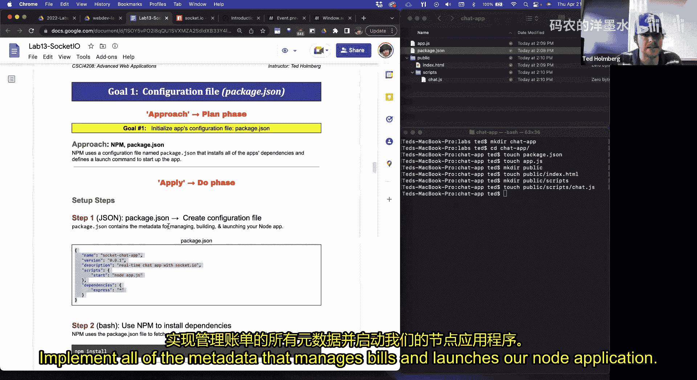

Let's go to package Json let's bring this into our IDE and let's take a look at how we're going to configure this so this looks like all the configuration files we've commonly been making。

Here we'll have the name of our app， we'll call it just soet chat app here。

 we also have a version of our app we'll just our version to 0。0。1 it's the initial build。

We have a small description of our app， a real time chat app with Socket IO here we will define the scripts。

That we can go ahead and invoke from NPm， we want a star script。

 the star script will just invoke app do Js。And then for dependencies。

 we will initially cite as one of our dependencies express since we will build this。

 we'll use Express to expressly build out auto web architecture。Yeah。Okay， so once I do that。

 I'll do NPpm。Install and。What we have here。😔，My。make sure I'm in a last。Okay， that's actually。

Let's remove that and actually make sure that we're inside the appropriate。嗯。There we go。Okay。

 so now that we're actually inside of the directory that has our package。 JON。

 we can go ahead and tell to install because MPm relies on that package。

 JSON file to do all the build instructions for our apps so now with NPM install we successfully go ahead and build out our dependencies so now we see we have this node modules and we have this packagelock。

 JSON file that it produces for us。Excellent。Let going clear that now。

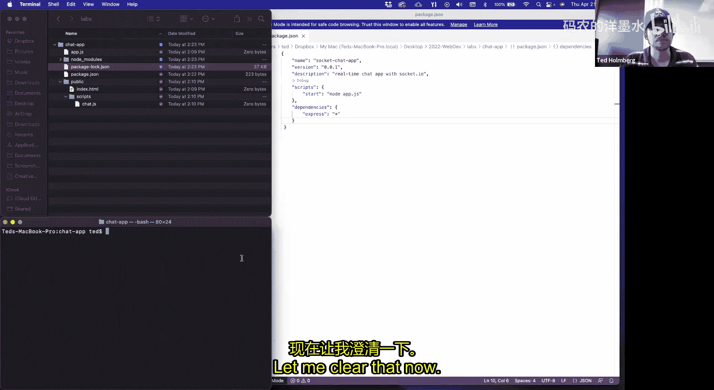

Okay， and the next thing I want to do here is what I just did。

 we're going to use NPm to install and NPpm uses that package。

 JO file to fetch and download the apps appencies。And so after that we should have that node modules folder。

 which we did so the next thing we're going to do is now actually start to build out the logic of our express app。

As a static HTP server， so despite the fact that we want to use web sockets for our app。

We have to initially set this process up using HTP so we need an HP server to deliver the index that HTML file to deliver our client side scripts and to initially then build our web socket server on top of so let's start by just building a simple static HP server and then we're going to extend that out further inside of our application。

And again， Express makes this easy to just listen on a port and serve static files。So again。

 the big approach here is。We'll use the built in modules from express that make building our backend web services much much easier。

 so we'll import those modules and use them in the app to listen for request and this will make it easy to set up a web server that we can then extend the functionality of so here。

And our first step was import the express module instantiated into a variable and set up a port number。

 so here let's go here to our A。 JS file。

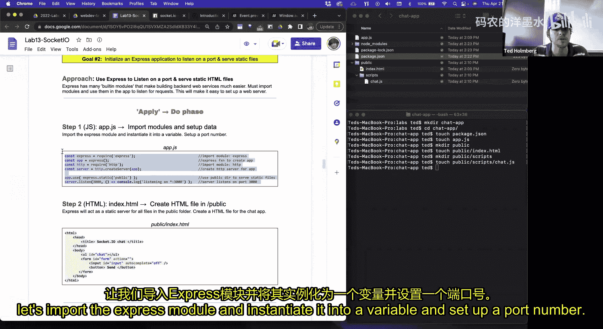

And let's see what we're going to do here。So the first thing we're going to do is we're going to import the Express module that we now have access to because we have it installed as one of our dependencies。

🎼And so I will bind that to the express variable here， and then that's going to be a function。

 I'm going to invoke that function， which is going to set up an express application for me。

 so then I'll go ahead and save that into a variable。

Now since I need access to the server to also set up my web socket server。

 this is where we're going to go a little bit differently than what we've done in the past。

 what I'm also going to do is I'm going to import the ACTP module。是。And so that ACTP module。

 as you might recall。From those lectures and from the prior lab when we examine just note on its own by building out its own static server it has a collection of methods。

 one of them is to create a server so here we want to create hTP server for our app so we're going to pass in our express app into that so it'll make a server for this app for us and we'll go ahead and bind that。

Onto this variable。Then I'll use express， we want to use some middleware。

 so we want our express app to use as a set up as a static server。Using the public directory。

 so all the files in the public directory will then be served as static files from our HTP server。

Now， once we have our middleware setup and we've set up our our static location for being able to deliver files。

 we'll go ahead and then tell our ACP server to listen on Po 3000 and then we're just going to give it a callback function such that once it starts listening and it effectively launches。

 it'll just invoke this console log to say it's listening on。Local host street thousands。

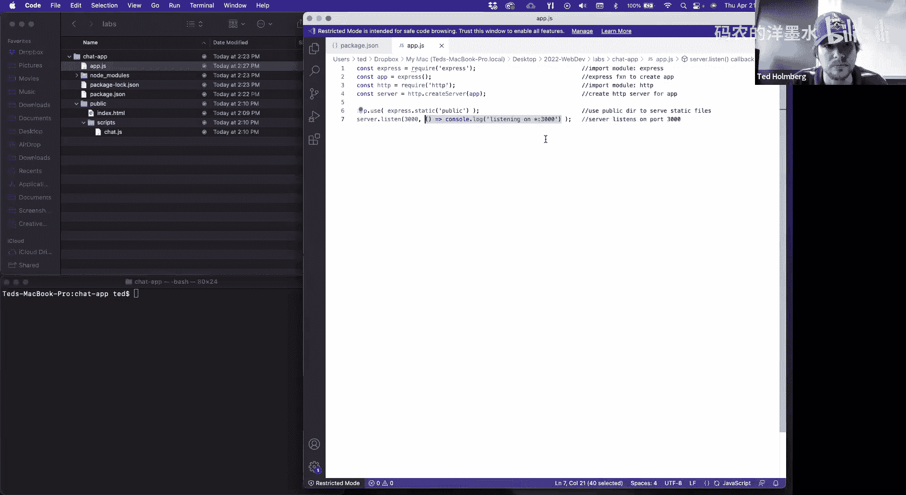

Excellent， so now that we have set up a static server that's on our express app that's going to deliver from the public directory。

 why don't we actually go ahead and implement our HTML file our index that HTML file so that it'll actually when it delivers out there's some content on there。

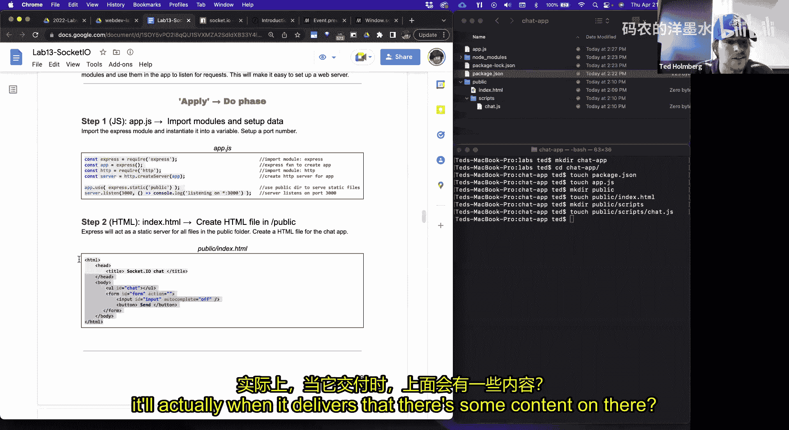

In terms of our chat room app。So let's go in here inside of the public directory I have this index HTML let me open that up into my IDE here and what I'm going to do is we're going to do some HTML so standard HTML we'll have a head tag we'll have a body tag inside the head tag we'll just have a title like SocketIo。

cha inside the body I'll have this unordered list and I'll give it an ID so that I can access it from my script the chat JS script eventually I'm not going worry about that yet we're just trying to see if we can get this delivered to our browser but we're going preplan for that now。

Then I'm also going to have a form where I'll give an ID so again so I can access it my from my J script on the client side。

 I'm going to give my form an action， but again effectively we want this form to send data through the web socket now through ACTP and the default behavior of a form is to to use ACTP so we'll just leave that blank for now because we're not actually going to use an ACP action type。

嗯。Then we'll go ahead and inside of our form we'll define an input field。

And we'll make sure that autocomplete is off so it doesn't give any kind of suggestions as you start to type into it。

 and then we'll also have a button that will be our submit button for this form。Okay。

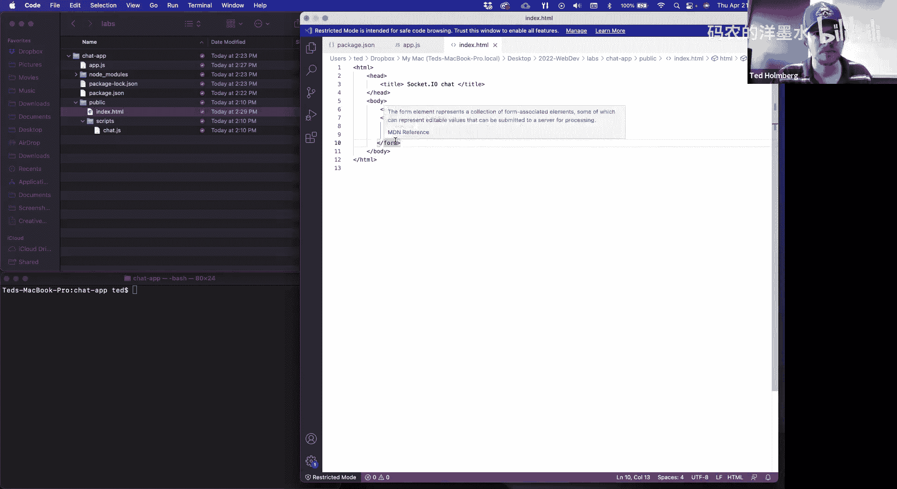

And then once I've done that。Let's go ahead and test this。

 right that's the rest of the implementation we should have a static server and a server a file to serve。

 so let's start our app and see if we can't go to local hosts 3000 and get our HTML page rendered。

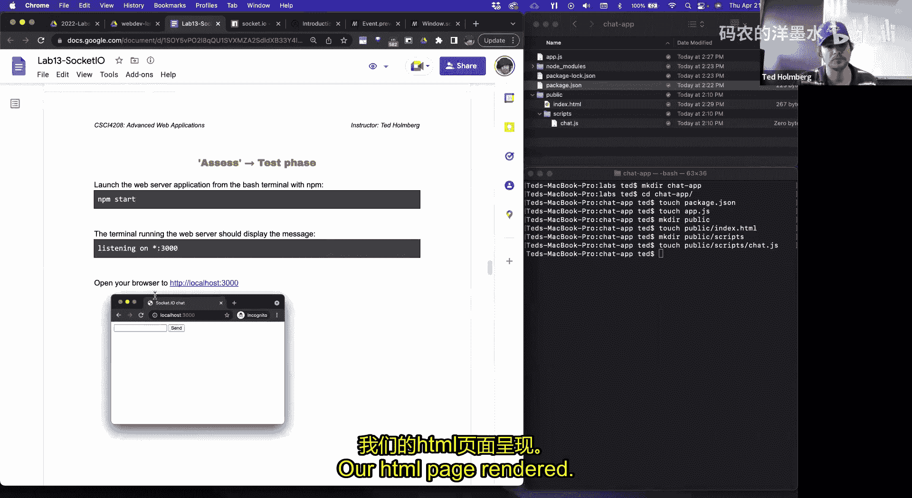

So let's say NPm start。Okay， so we've successfully launched， we got that message list'sing on 3000。

 let's go over to here and let's go to local host。Pourt number 3000 hit refresh and indeed there we go we have a title socket Iio chat。

 we have our input and we have a send button X right now it doesn't do anything right I can click on that but there's no action。

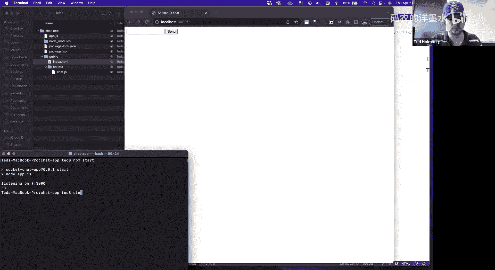

Okay。So the next thing I want to do is actually create a socket Io connection so here our goal will be to initialize a web socket between our server and our browser with socket IO the general approach on how we'll do this is we're going to set up a socket IO on the server and the browser to establish a web socket connection so a socket Iio is composed of two parts it's the server that integrates with or mounts。

The node JSACP server socket IO， and then there's going to be a client library that loads on the browser side that'll be socket。

o clientient。And so what'll happen is when the server goes to host the index on HTML files。

 it's actually the web socket server will actually host its own。

Socket client library that it'll deliver and that we'll have to put as an import into our index on HTML file so that that socket object that then gets loaded on the client side is connected to the server socket and we can send information back and forth through that socket object on the client sock。

So the first thing we need to do is install the socket IO dependency Now I haven't showed you this so far what we've done prior is I go into my dependencies and I just do I keep adding in directly but in today's lab I want to show you a different way as you're developing that you can go ahead and install dependencies so say for instance I want to add this dependency in my app as I'm developing socket IO instead of having to update my package do Json each time from the command line I could just dompm install socket IO the module I want and look what's going to happen here so NPm install。

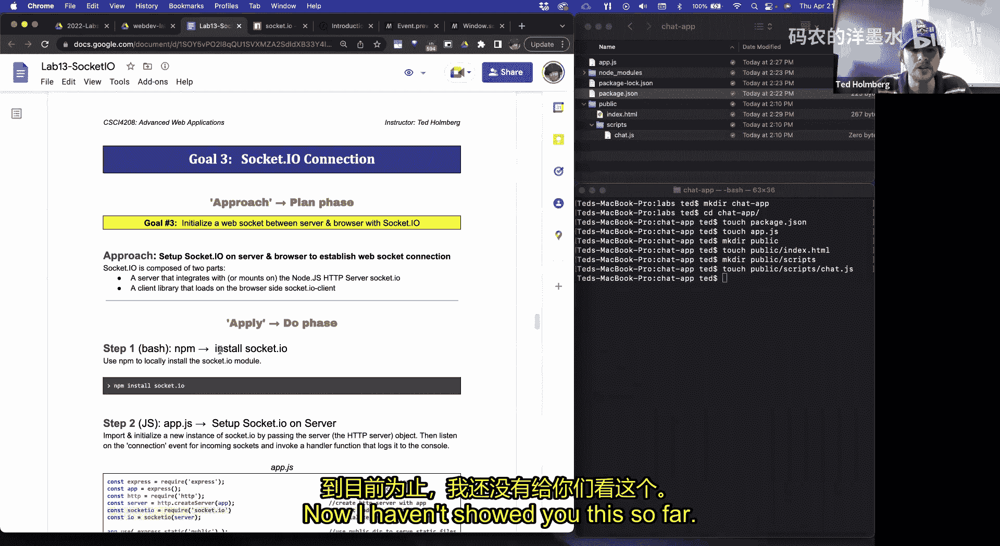

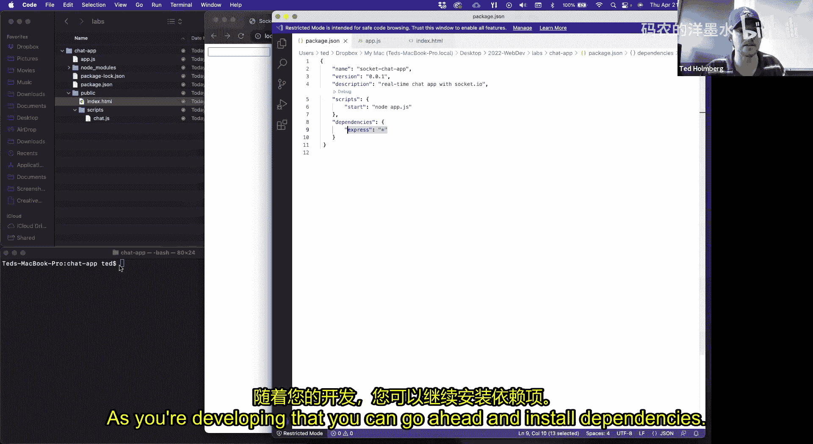

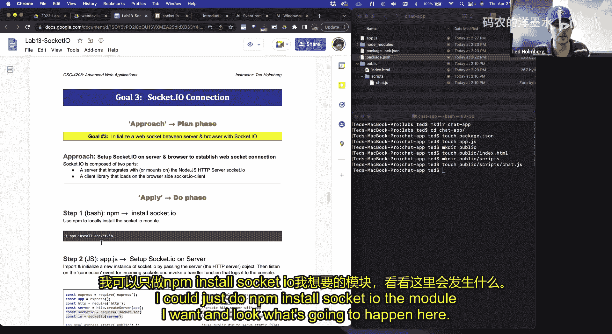

Soocket dot io。 So if I do that。It's going to it's going to install that dependency and it's going to automatically update my Pakistan JSON for me so I've been avoiding showing you some of these shortcut tricks like this so you get really familiar with building out this configuration file manually but here you could see how you can start to very easily build out your Pakistan JSON with modules from the command line in fact if you were to do NPpm in it inIT it'll actually build out your Pakistan JSO automatically for you and then you wouldn't have to remember all these keywords and values but again as a pedagogical approach I find value in manually typing these out so you get comfortable with what's inside of this configuration file but there are certainly shortcuts to produce these that are easier than the way we've been doing them in labs。

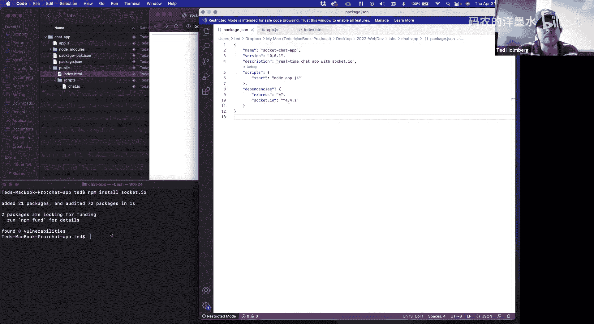

Okay so now that we have our dependency installed， we can now use Socket IO inside of our express application。

 so let's go ahead and set up our socket I on the server。

 so basically what we're going to do is import an initialize a new instance of Socket IO by passing the server that HP server object which is why we want to have a reference to it and then listen on for a connection event on on the socket IO server for any kind of incoming sockets and invoke a callback handler function that just logs the console whenever a connection is made。

Soll actually we'll step through this。

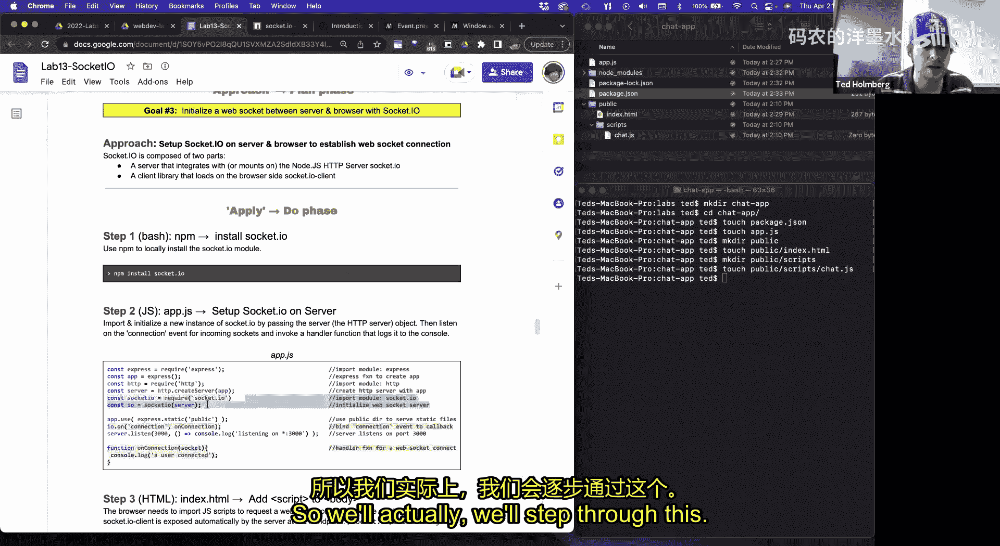

So the first thing we want to do is after we let's go to our app JS。

 so after we have our ACP server made， what we need to do is we're going to import our socket IO module and we're just going to bind that to socket IO a variable here。

And then we're going to call that function that we go ahead and import from the module to set up our Socket IO server and order're going to set up the server。

 we have to pass it in HP server。That it will use， so we're going to pass up this server。

 we just created it right up here on for。And that's going to give us back a web socket server。

That we will then go ahead and save as IO。On our server side。So here。

 this is our ACTP server and this is our web socket server。

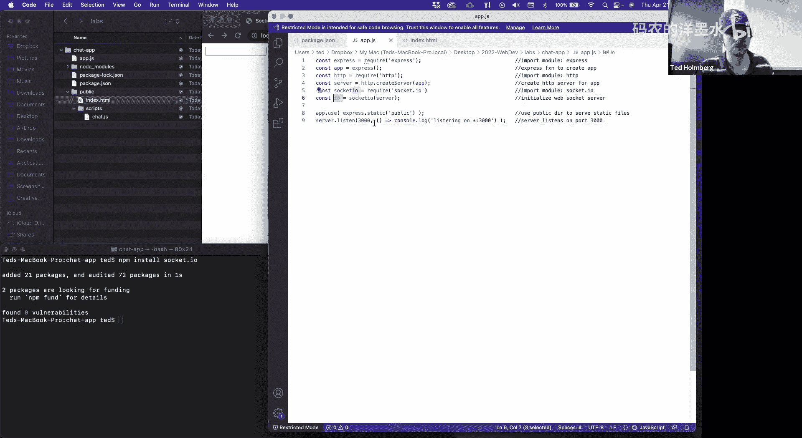

So then what I want to do is after I set up my express app。

After I set up my express app here to serve。All static files from the public directory。

 I want to use the web socket server and I want to start listening for events that come from clients。

 so to bind event names to callback functions， we use the on function so you can think of on this event from the IO server from the web socket server we're going to invoke this callback function。

😡，So there's one of the default events that are predefined by Socket IO is the connection event and this happens automatically whenever a client connects to the web socket server and so we're going to create a callback function that。

😡，Triggers when a connection occurs。

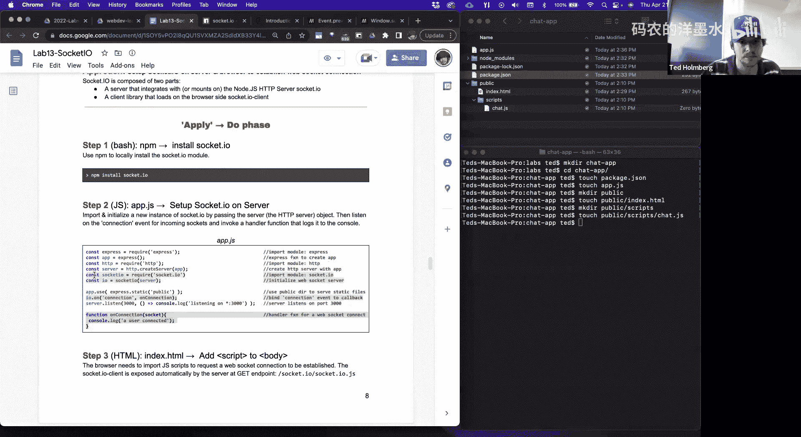

So let's go here and actually create okay， so here i'm just going to create a function that's going to be called on connection again it's the callback function we're binding to the connection event and so every。

Every callback function。That gets registered to the web socket server will potentially get a socket object passed into it。

 so we're going to find as a parameter， a socket object。

 but we're not going to do anything with it in this particular step。

 but we will use this later on in future steps。😡，Right now。

 all we're going to do is when this connect gets triggered when this connection event occurs。

 we're just going to console log to say， hey， a user connected to illustrate the server recognizes that a user was connected。

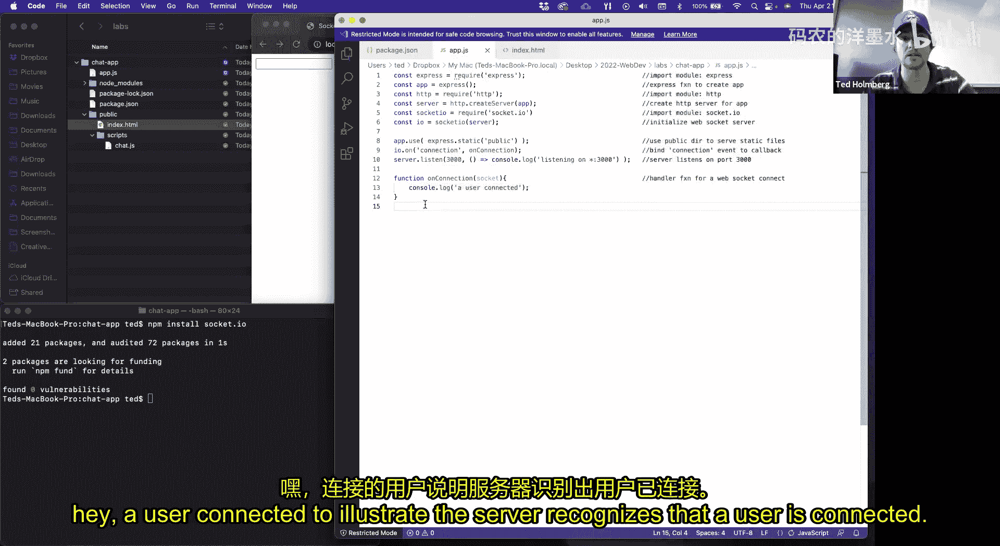

嗯。Now the next thing we need to do is we need to add some script tags into the body of our HTML。

 the browser needs to import the JavaScripts to request a web socket connection to be established and the socket Io client module is exposed automatically by the server at the get endpoint of socket。

Io slash socket ioj so this is a JavaScript file that gets produced by the web socket server and gets automatically exposed to our client side when it goes to import all its other scripts。

And so it has all of the details on how to connect to this particular server so that when our server imports。

😡，The JS file， we can actually set up a socket and send our information to that socket through the web socket via this script。

And the way that we do that is super simple， we just import this script at ssocketos/socketio。

js now we also want to import our Js our chat script so that we can do things with that socket and what we'll do initially with that socket is just you know initializing。

And bind it to a variable。So let's go to our index site H， so here at the bottom。

 I want to import these two scripts one that's。That's built for us from the web socket server that we'll need and that'll give us the socket object that's connected to the server and the other will be the chat JS file that we're building out。

And actually let me go over here and actually I want to use the Web sockets server to initialize a socket object that we can then use to manage the web socket in the browser so there's no need to specify a URL with IIO like we do with thatch or anything because it's defaulted to the host that serves the page。

So effectively， the same local host 3000 will be where we send all for our request to。

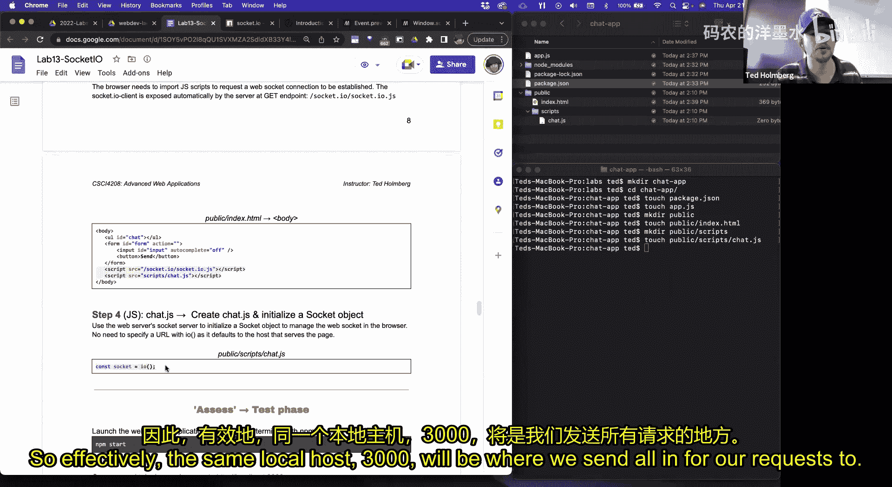

So here I'll just put that in there save that。

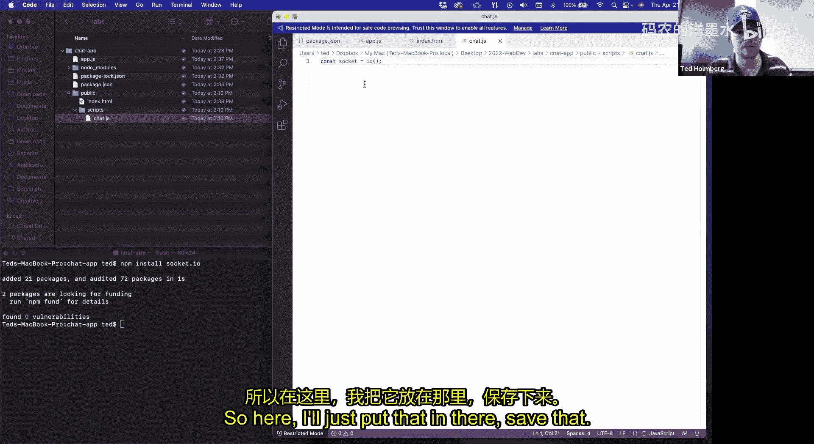

Okay， so now what we want to do is we want to launch our web server and see if it actually goes ahead and loads and we'll check to see if we get that console loggged on the server side as it loads that page to us to illustrate that hey。

 that connection event was detected by the web socket server， so let's see。

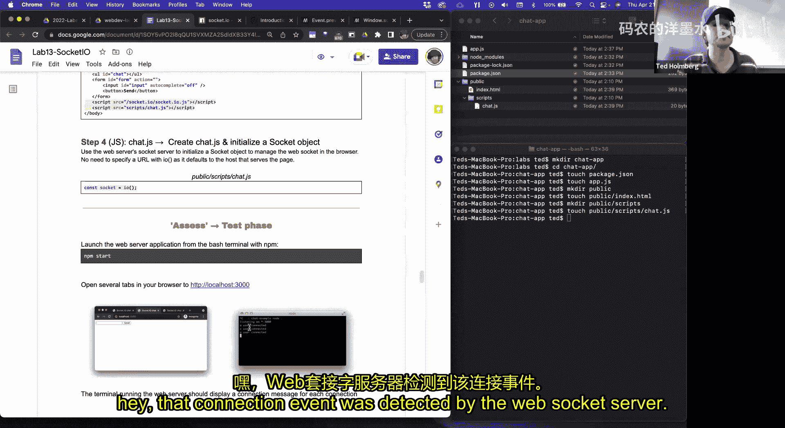

So let's clear this let's do。And PMm start。Okay， so now we're listening。Now， let me go on here。

 I'm going to do a refresh on this page and notice right here a user's connected。

 So that illustrates that we have now established a connection event to our web socket server and it got handled by that callback function。

 And if I refresh the page again， you see a users connected。

 So let's take another couple looks over here。 let's go into our developer tools on our browser side。

 and did I call it socket。Notice here I have that socket the one reason why I want to bind it on this step is so that we could actually inspect it on the client side。

 so here's the socket that we imported from that script。

It shows that we're connected disconnect false， it gives us an ID we have IO right this is our manager。

 we can inspect all the different web socket I'm sorry socket object。Properties right inside of here。

😡，So we can see the state， and so this is what we'll be using to send our data in real time to our web server。

And in fact， let me see this here， let's open up another tag and let's see if we can't see what this JS file that got exposed to us right we should be able to access that with a get file and this isn't something we wrote right this is something provided to the oh no。

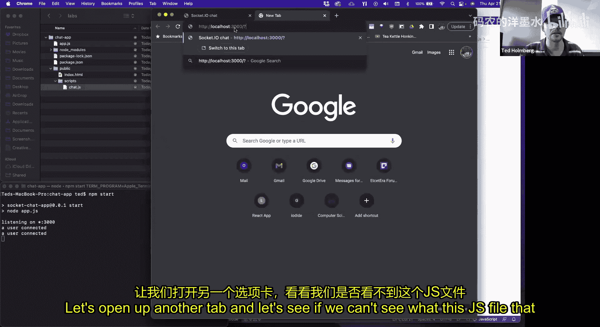

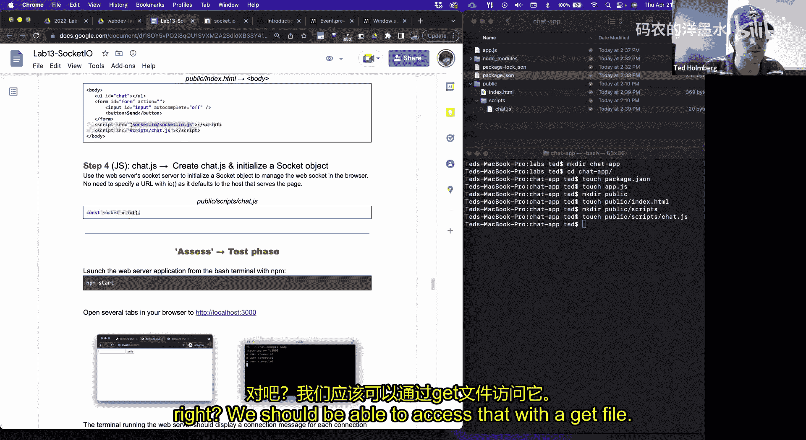

Oh， might have to do public。Okay， so public no， that's not right。Okay， there it is， Okay。

 so you'll see right here。

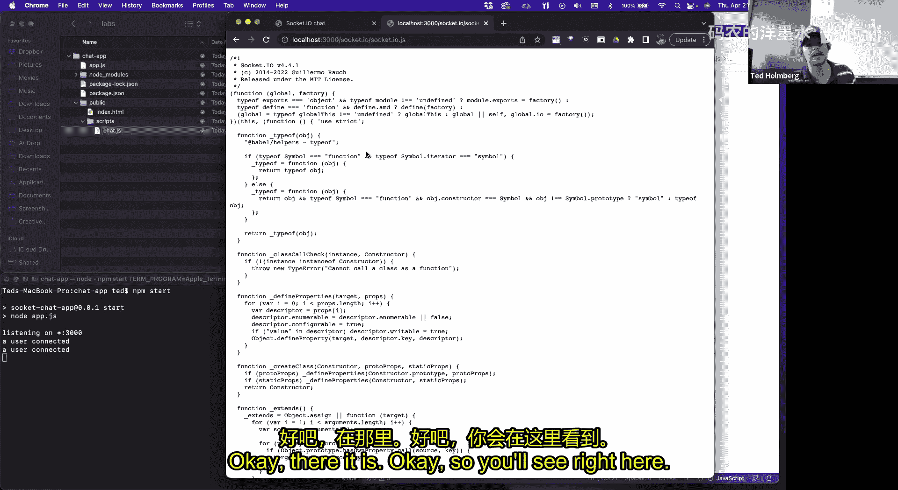

When we say。Go to slash socket now notice the other one was scripts slash chat Ojs because we're putting our own ja files inside of a scripts directory。

 however from the。Public director whatever the static directory root directory is a file is going to be hosted inside the Socket IO directory that is the client side scripts so this is what's making all the magic happen。

😡，This is what we're using to import to build out。😡。

This socket object that automatically is then going to be connected to the server that serves this client script。

😡，Oh， no， cancel。Okay。So let's go back over here， so I will now close that out。Okay。

 so now the next thing I want to do now that we've successfully have the client。

Connecting to the web socket server on the server and invoking a connection event is I want to show you another automatic or built in event that web sockets have and it's a disconnect event so。

I actually want to handle。What happens when a disconnect event occurs I want to bind a callback function to that so here we're going to use socket Is to handle a disconnect event for a socket。

😡，是。And so each socket object fires a special disconnect event when the connection is either closed or disrupted。

So let's go ahead and refactor our on connection function inside of our app JS file that will bind a callback function to the socket server to listen for and trigger when a disconnect event occurs。

So let's update our own connection。

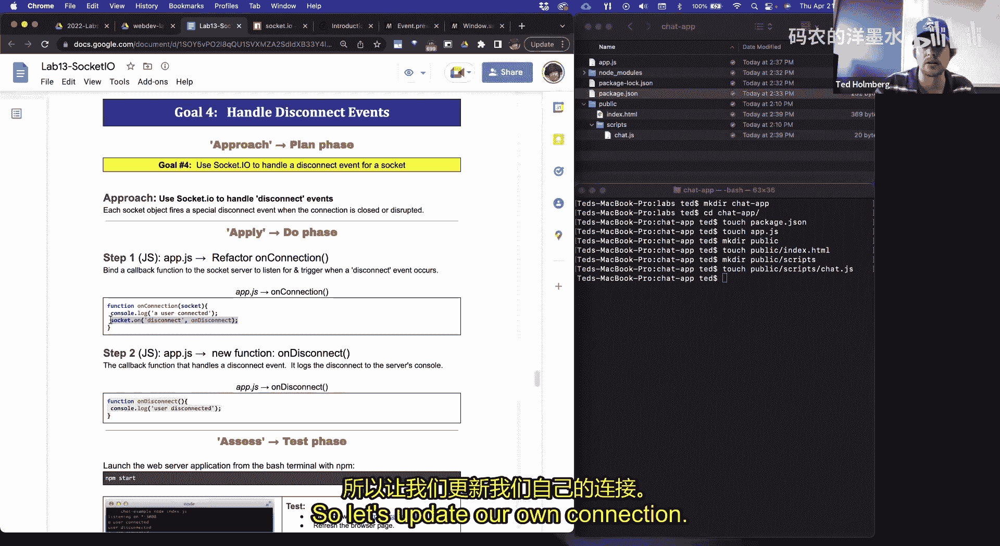

So， here。Inside of app Js inside of on connection here， I'm going to。Add so socket。

 as you might recall， is the object that gets passed in， it's the socket object that gets passed in。

When a client connects。So now in this instance， we're actually going to make use of that socket object so we can do things。

 we can set up events on that socket， so if a disconnect happens on that particular socket。

Then we can trigger the callback function on on disconnect which we haven't built yet。

 so let's go ahead and implement that and all we're going to do。

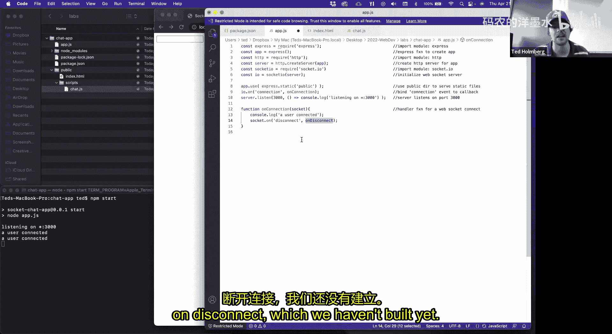

For our app for a disconnect event is to log it on the server to see that it actually occurred。

 but you might need to handle the logic for disconnecting a user。With logic that like I don't know。嗯。

Lologgs them out of the system on the server side。So here you would manage whatever logic requires you to disconnect a user from your system here we're not building a complex system。

 so it's relatively trivial， but it gives you ideas of why this might be important。

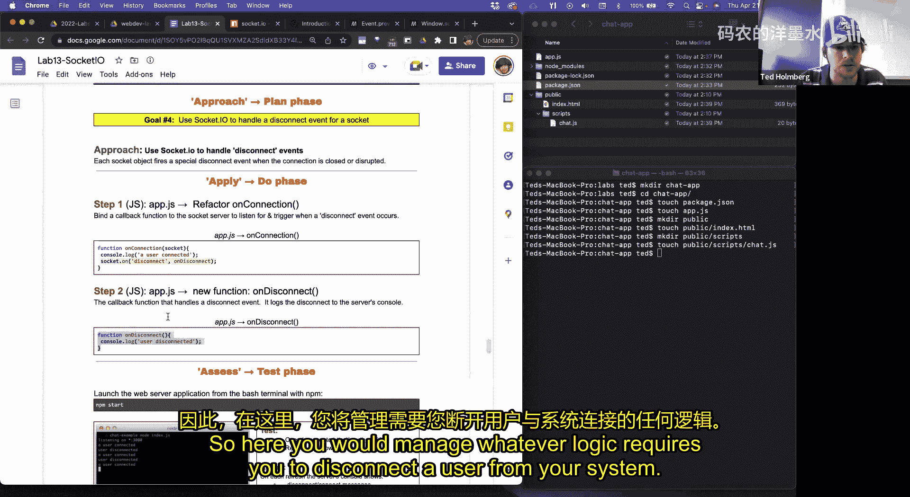

Okay， so for on disconnect， all we're going to do is put console。log user disconnect。Excellent。

And again， all of the logic that we'll be doing on the socket moving forward is going to be inside of this on connection callback function because this is where we get a reference to all the client sockets and then we can listen to various events on those client sockets and cause callback functions to trigger in regards to them。

Okay， so once I have this callback function， defined。

 let's go ahead and test it out and see if we can't listen for disconnect events。

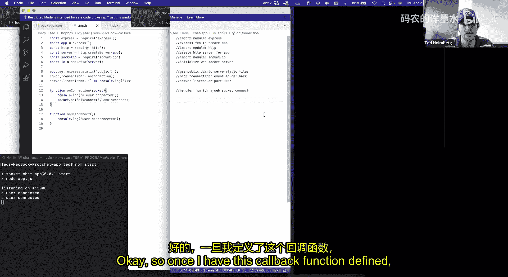

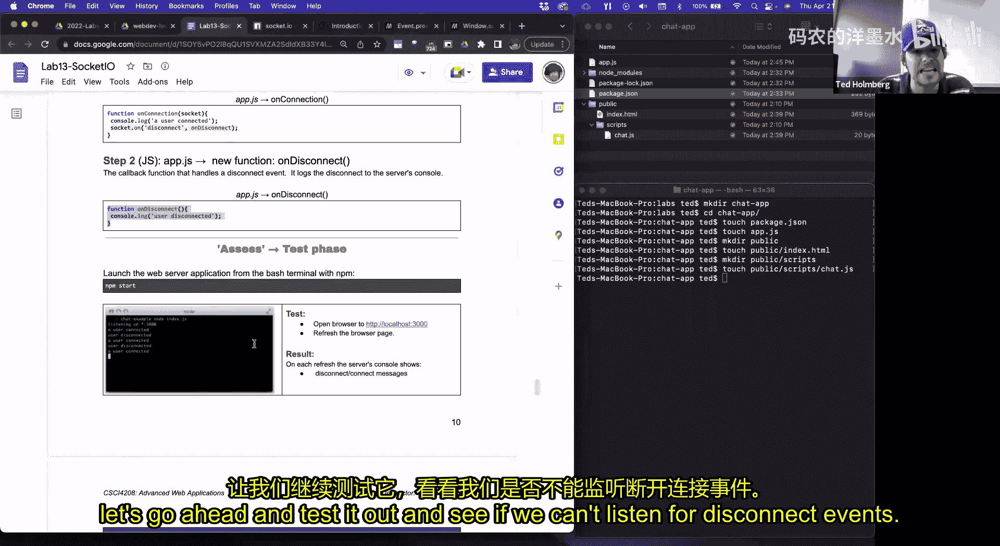

So let's kill the server， let's clear our console， let's go ahead and relaunch it here we' listening and actually。

 why don't I do this？2。I will。Let's create 2。Here。So yeah okay。

 so here users connect it let me refresh this a users connect it disconnect it so notice when I refresh the page it disrupts the signal and it's going to disconnect and then connect disconnect and then connect when I refresh and then if I open up another tab。

 it's going to show a new user connect it if I close it， it's going to show a user disconnect it。

So here we can see either refreshing the page or closing a tab。

 closing the page is going to cause disconnect that disconnect event to trigger and then our call back to console log down the server is then getting invoked。

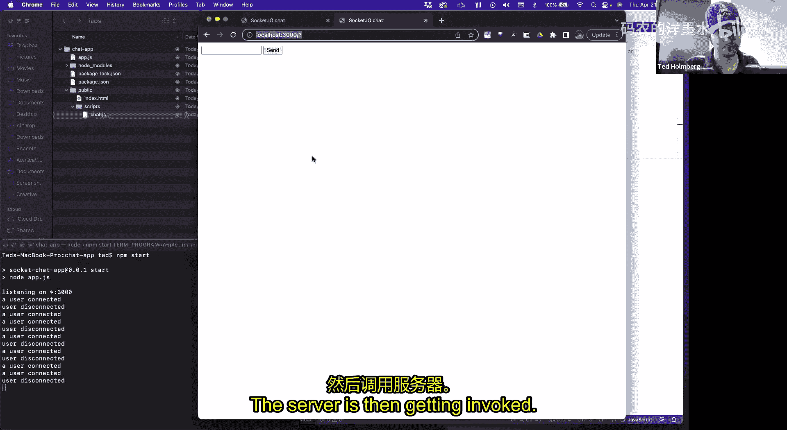

Excellent， so so far what we've done with our web socket server is we've made use of the connection event and the disconnect event right those are the two built in events that we have access to but one of the powerful things about web sockets and socket IO in particular is the ability to create user defineded events and listen for those。

So why don't we see how can we start emitting our own event to the server so here our goal is when a user types in a message。

 we want the server to get it as a chat message event。And again。

 the approach that we'll use is we'll use Socket IO to emit that event to the server。

 and so the main idea is behind Socket IOs that you can send and receive any events you want with any data you want typically be encode that data as JSON。

 but it also supports binary data as well。So the first thing we want to do is inside of our client side chat application。

 we want to handle that submit event， we're not doing that yet。

 so let's go ahead and define a callback function for the submit event。So let me grab this。

 so what we'll do is we're going to update the chat JS file to handle the submit event from the form and emit its value to the server and on the sockets you the first parameter is the name of the event and the second parameter is the data that will be transmitted。

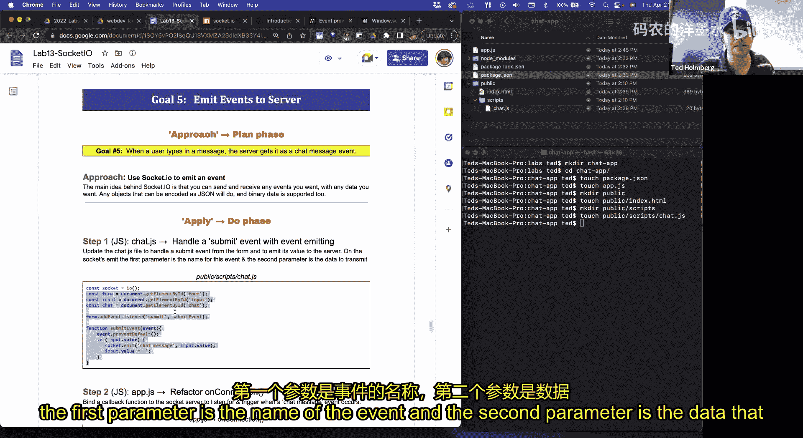

So let's go to our implementation here。Perfect， so the first thing I'm going to do is I'm going to grab from the document by those IDs。

 the form the input and the chat those are the three things we're going to need in order to build up what we want to send to the server so remember the chat is the unordered list we might not be using that yet but we'll use it in the future the form ID is going to be the form element in the HTML and then the input is going to be this input HTML element。

So we're going to grab those and we have reference to them in our JavaScript。

 then on the form we're going to set up an event listener to go ahead and listen for submit event。

And then on a submit event， we're going to trigger the submit event callback function。And again。

 just like socket IO callback functions， default to having socket objects recall that for event listening on the from our viewport。

 it sends in event objects， we're not going to use it。

 but I just want to highlight the similarity here now since I'm using the submit event here。

 I want to prevent the normal default behavior of the event actually I guess I will be using the event。

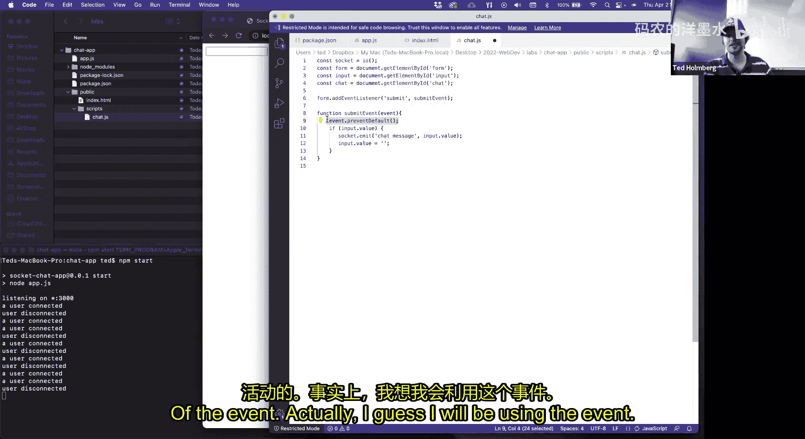

So what is this event prevent default， Well， let's take a look at the the。

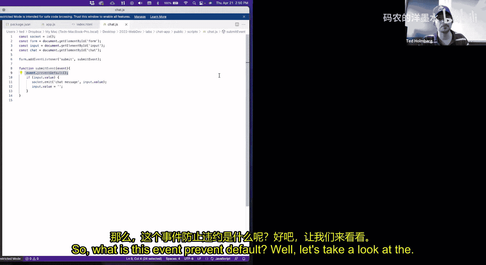

Documentation， so here what we want to do is。The prevent default method of the event。

Tells the user agent that if the event does not get explicitly handle its default action should not be taken as it normally would so recall on a submit event it normally sends to a particular endpoint a particular ACTP action and we don't want to do that now I could have just as easily define this as a click event and not had to do this at all but I just want to illustrate that we can prevent default behaviors from events like the submit event from a current and that's all we're doing here。

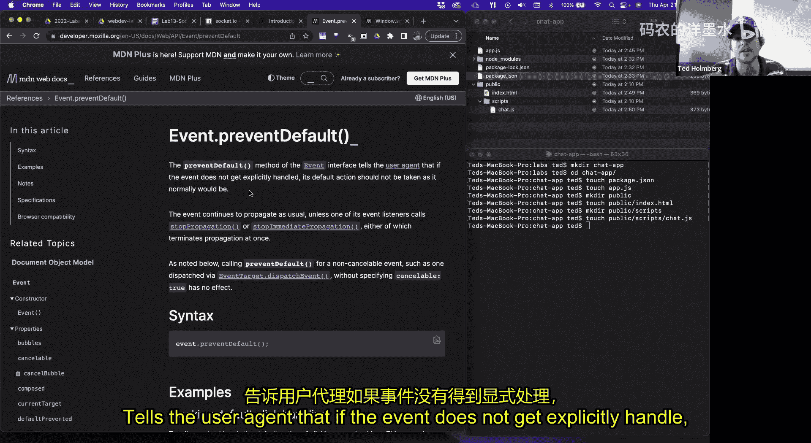

So the core logic though is we're going to check if the input a CM element actually has a value inside of it。

 so if the user had actually type something in this text field。

 then we want to take the socket object right that we have an port in that's connected to our server and we want to admit to it a new event that we're creating ourselves right now again init takes two parameters。

 the first is the event name we want to give to this event we'll call this a chat message and the second is going to be the data payload which could be a JSON object in this instance I'm just going pass in the value which is going to be a string value but you could also pass in a JSON here if you had more complex data than just a string message。

And so here i'm just going to go into the HTML element and grab the value and set that as the payload and i'm going to emit this to the socket object then after this has been emit to the socket object I want to reset。

The value of this input field to be blank， so'm going to I'm going to set it so that it's empty。Okay。

 so now I have set up some logic that will emit an event to my server。

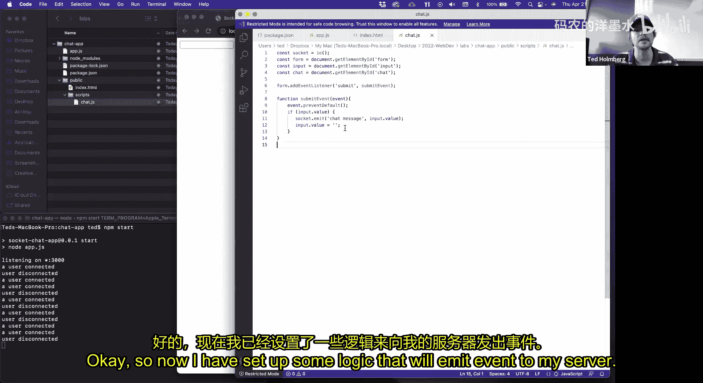

The next thing I want to do is then I need to go ahead and refactor my on connection callback function on the server side to bind a callback function。

And listen for the event that might get emitted from the client side so remember the client side is going to emit an event that's called chat message。

 so now I need to have a callback function that does something when a chat message event triggers on the server side。

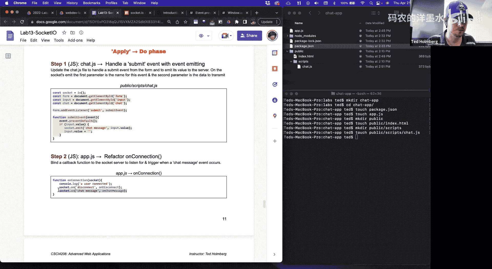

So again I'm going to put all of the event listening for my web socket application inside this on connection callback function。

 so for this socket that gets passed in I'm going to listen for a chat message event to occur and if that does occur i'm going to go ahead and trigger this on chat message callback function so let's define the logic for this callback function。

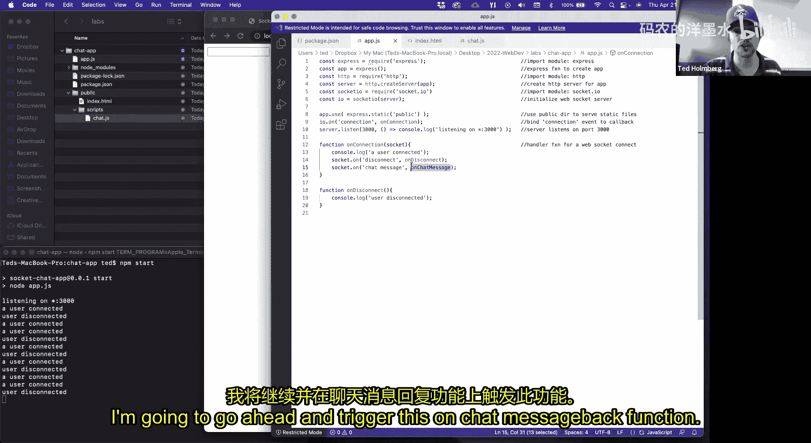

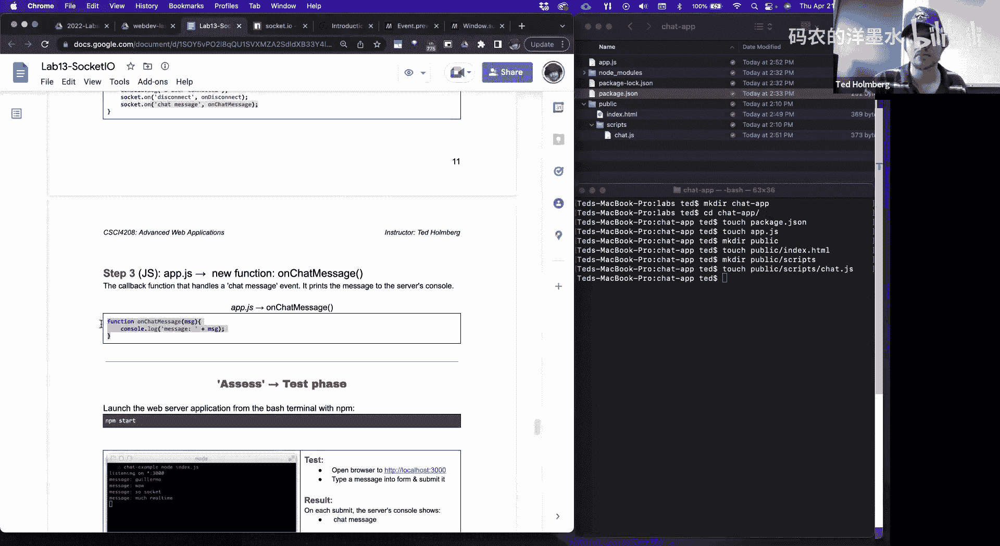

So here。When the callback function occurs， remember the first parameter when we emit an event is the event name。

 the second is the data payload， which is automatically passed in as a parameter to the callback function。

😡，When that event is triggered so here I'll just call my parameter MSG for message but but what it actually is going to be is the data that is contained as the second parameter so it's going to be the string here so I'm going to just take that and I'm going to console log that with message and I'll concatenate that with whatever message got emitted to the server。

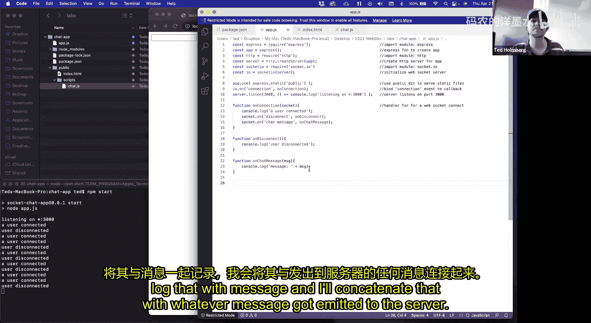

Okay， and once I do that， let me go ahead and do NPm start and see if we can't send these events along with the data payloads to the web socket。

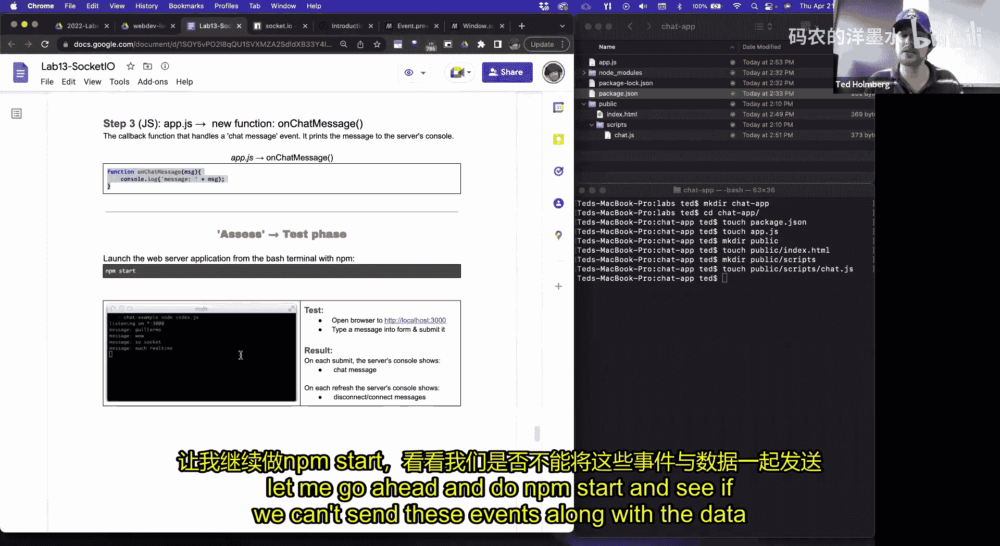

Server， so let's do MPm start。Excellent， so now what I'm going to do users connect it。

 users connect it nice， Okay so。I want to。现得。Hello world。

 so I'm going to input a value into the input field I'm going to。

Hit the S button that's going to trigger that submit event。

 which is going to emit this to the server and deny I。Should。See here。

Let's make sure everything is saved。This is saved， this is saved， this is saved and this is saved。

Okay， let's try that again。😔，Let me make sure on chat message on chat message message， yeah。

 so all looks good to me。Let's kill this。Player and let's do MPM start again。Okay， so let's refresh。

Hello world Okay there we go so it might have been just a caching issue or something not saved。

 but here we can now see when I put a message into the input field when I hit the send button I now created a message that got evi that got emitted from my client to the server that was chat message when the server got it it triggered the callback function which then console loggged that here。

And then。Remember， part of that submit event was then to clear out the input field。So。This is。

Ted so I'll send that and there it is message this is Ted and then this empty that perfect。

 So now we're able to broadcast our messages from the client to the server。

 But now the next thing we're going to want to do who want this to be a real time chat app is to actually go ahead and get the client。

To get this the new state， all these messages from the server and to actually broadcast them to all connected clients。

Ill cancel that。Keep control asking。Okay there。嗯。And actually， they may kill this right now。

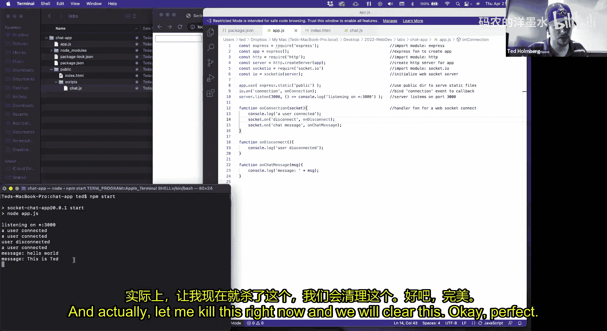

And we will clear this， okay， perfect。So then the last thing I'm really going to want to do with this very basic lab is to be able to broadcast that events from the server to all connected clients。

So。And in order to do this， we can send an event to all users using Socket IO with the emit from the IO server。

So right now we saw how we can use a socket object to emit them for the client of the server。

 but the server， remember our web socket server has an emit method。

That uses the same parameters I can pass an event name。

And then I can pass it in as the second parameter， a data payload and the data payload can be a JSO。

 it could be a JavaScript object， or it could be you know， just my message， it could be my string。

But it's it's。Design very similar as the client side emitit。

 but this will broadcast all connected clients。So let's refactor our on chat message here。

To actually do that emitm based off of this syntax。So that whenever an on chat message。

Gets sent to the server， the server will then rebro or remit it to all clients with the chat message。

 event name and with that data payload。😡。

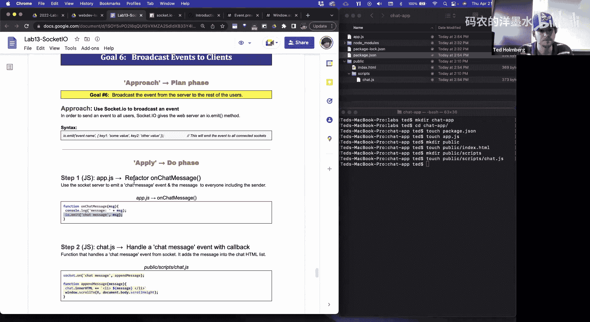

So here we're going to go in here and says just Con logging it， we're going to also set tell IO。

 which is our web socket server to emit the event chat message with the data that got passed in from the client。

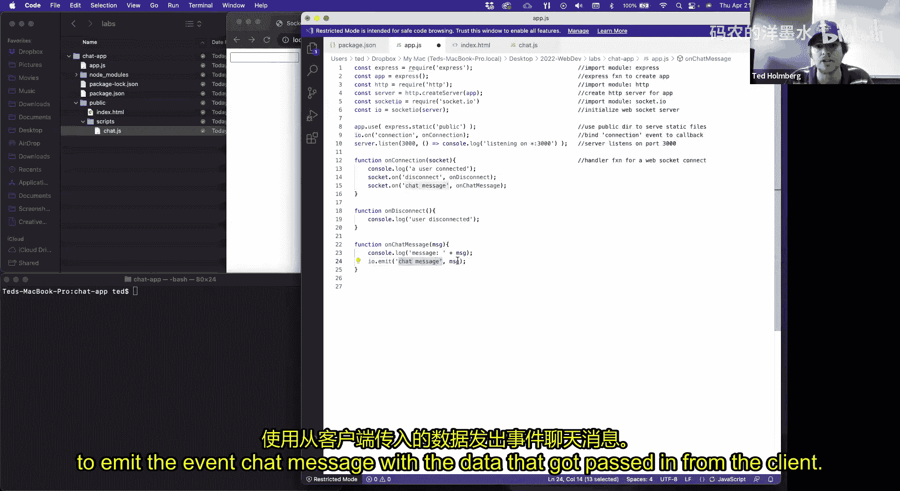

And now that we're emitting something to the client。

Through the socket object that's exposed on the client's side。

 we have to create a function to handle a chat message event from the socket object。So let's do that。

 so the same way we create event listening on the socket objects， on the server side。

 we can do that on the client side。

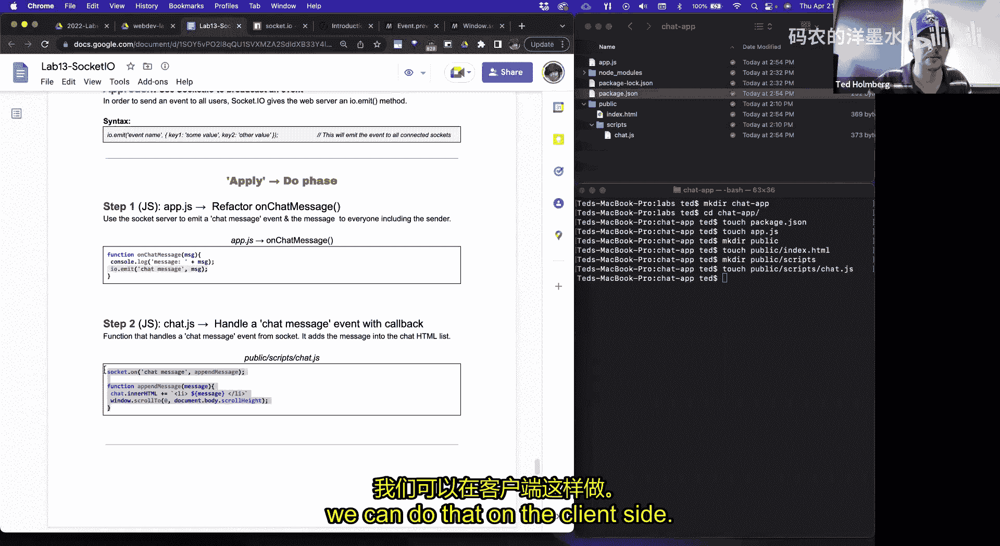

Again， it's a full duplex two way mechanism and the syntax is the same with both sides so let's go to our chat。

And so what I'm going to do is that socket object here that I got set up。

 I'm going to set up an event listener so on a chat message event which is now getting admitted to clients from the server。

 I want to invoke this append message callback functions we can create a callback function that triggers in response to it。

So the callback function we're going to do here is we're going to grab the message。

 so recall here that the payload is the second parameter is automatically delivered to the callback function that's sent either to the client or the server so in this instance it's going to be a string of message but it could be more than just a string right it could be a JavaScriptpt object if it was more complex a data type。

And here I'm going to create a list item element right with that message and I'm going to append that to the interH of my chat now if you remember what chat is it's this unordered list here。

So I'm just going to append this the message as a list item。

And then on the window object I'm going to tell to scroll to the bottom right so I need to give it an X and Y coordinate so every time I add a message I want to make sure that we're at the bottom of the page where we always have access to this input field so after I append the message if this is a sufficiently long conversation I stay at the bottom of the page and again if I want to see what that does I could go to the MDdN web docs and say oh there's a scroll2 function it scroll to a particular set of coordinates in the document and so the x coordinate is just zero and the Y coordinate is going to be based off the scroll height of the body object from the dom so we'll use the dom to determine what the bottom is。

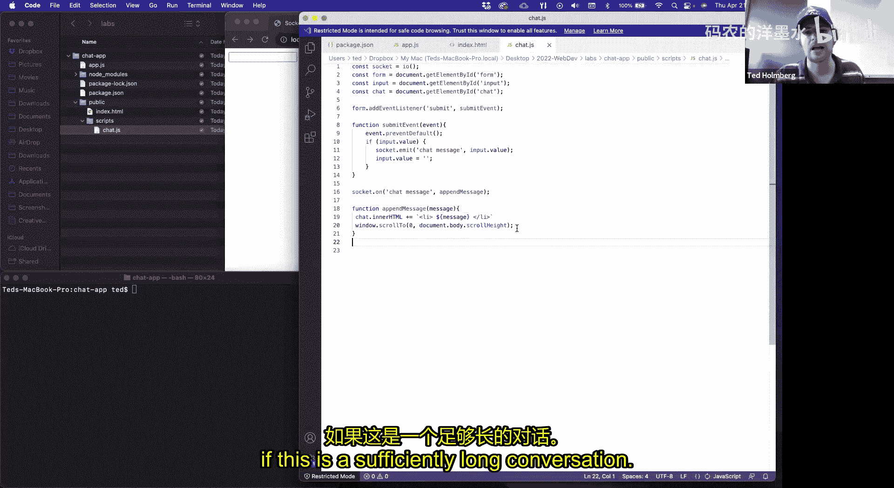

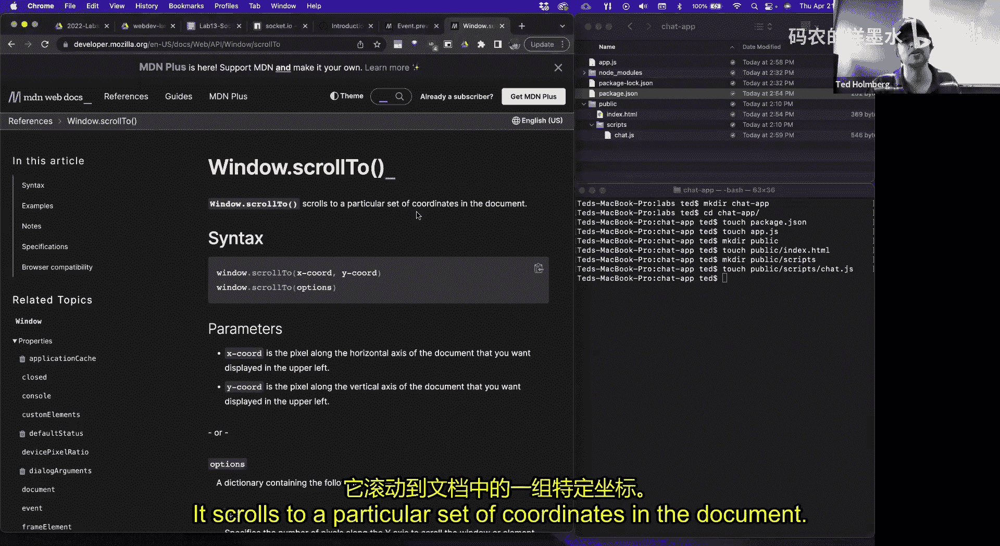

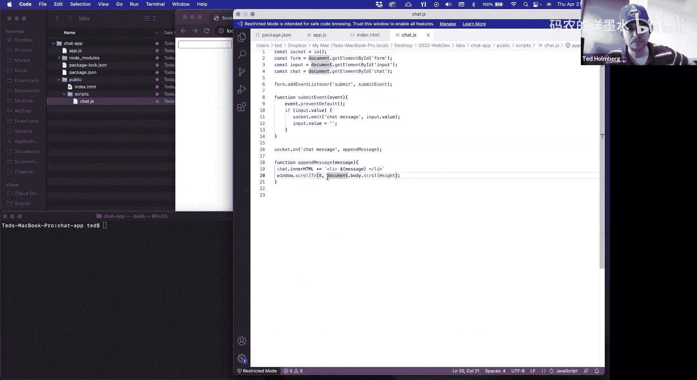

Excellent。So let's go back over here once I do that callback function and listening on that event that should be it I should be able to go do NPm the start and actually have realtime communication between clients so actually let's go over here here let's actually pull this out and shrink it some so we can actually see this in practice。

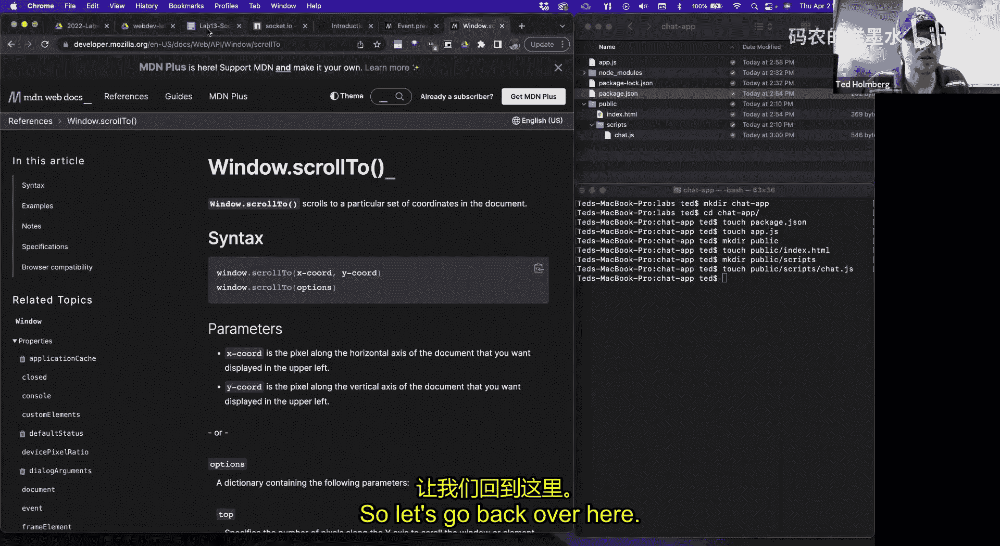

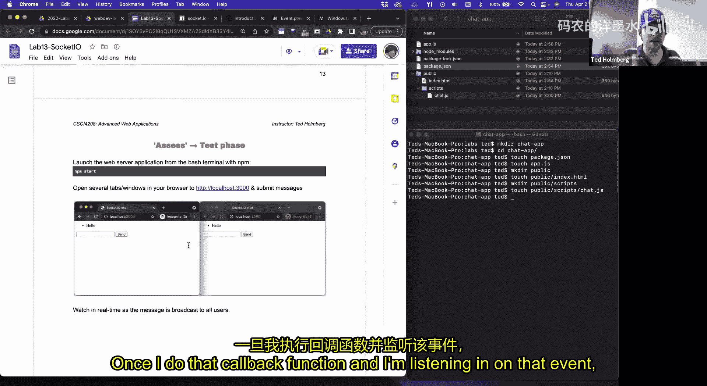

Okay， let's do NPpm start。Okay， we should be connected， let me refresh。

Let me refresh both pages to make sure that。All the new code updates are now being imported in and now let me go hello world I'm going to send that and notice instantlyly and not only updates on my page。

 but on this additional client page。Bye。Hello there and then I get the update here。

🎼Yeah who are you excellent and we could see how we can now have this two way communication realtime communication realtime updates between our clients。

 all of our clients and our server and so if for any reason your application requires this this is a great template to use now I do have a question for you all so first of all is there any questions related to this so some quick conclusions about what we've been able to do and there's kind of lightweight lab。

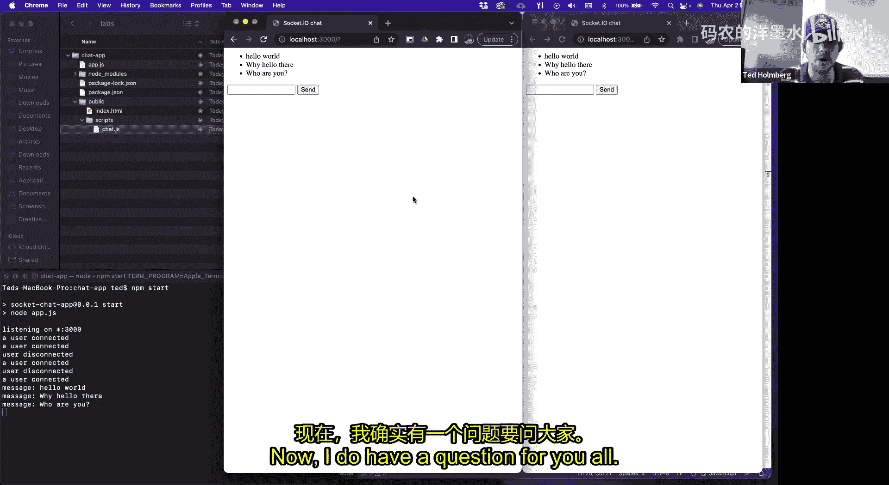

So here in this lab we implement a realtime chat application using web sockets and Socket IO。

 the lab covered installing importing and initializing Socket IO on both the serve and the client and we use Socket IO to emit and handle events from the client we use Socket IO to listen for and broadcast events to all our clients improvements that would make to this particular application would be to style the chat app to be more attractive to add username and login requirements for the chat app to store message histories to send to all connected users maybe make different chat rooms for users to join or to give a list of connected users to display inside of the chat app so this is future features like build on H this MBP。

So are there any questions about web sockets and how we can use web sockets for real-time data transmissions between frontend and back end or does this seem pretty much clear enough and of course if you want to do more than this。

 you can just hit the documentation because you've learned the entire baseline events like how to set it up on the client。

 how to set up on the server and how to set up the event listeners that get triggered based off of events that get broadcast to either side？

So there's no questions about this。Yeah it's much easier to kind of set up two way communication using Javascript than say for instance。

 Java I know that the networking class typically has you build a chat home with the server client using Java and this is far。

 far simpler as you can tell now my plan was to do a。

A kind of more advanced application that showed how we could handle different events i'm just interested to see if you would be interested in maybe a follow up lab that would do that I can give you a sample of what that would look like so my one of my original intents was to create a basic little kind of socket Iio。

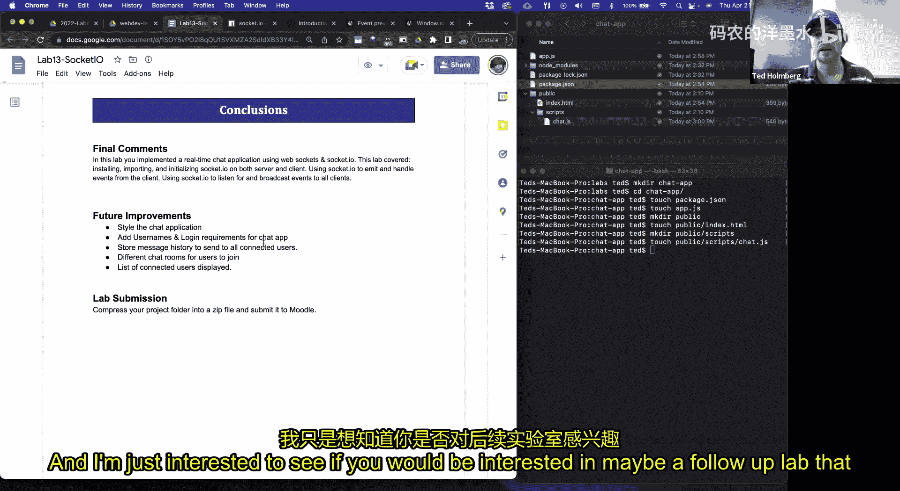

Oh。Kind of a socket IO game so it would look like this let me do MPM start。Okay， so let me go here。

 so be like a basic monster catcher game。Yeah。And the concepts are the same， right？

Where I can create a character on this end right and as I move my character around。

 I could see it here， but now'm not I'm not in this other app。

Notice if I was I could see how many monsters I called， so here let me create another user。

And then here this user can then catch and have a scoreboard and compete and then let me focus in on here。

So I don't know if they'd be interested in seeing now conceptually all that's happened here is the same thing that we just did with the the user chat app which just illustrates that we can make realtime multiplayer browser based games using this technology and it's just a slight expansion off of this concept of being able to figure out how to serialize the data to transmit it to all clients so it's constantly updating so would there be interest。

Potentially of having some optional follow up lab where you could see how that simple web game is created。

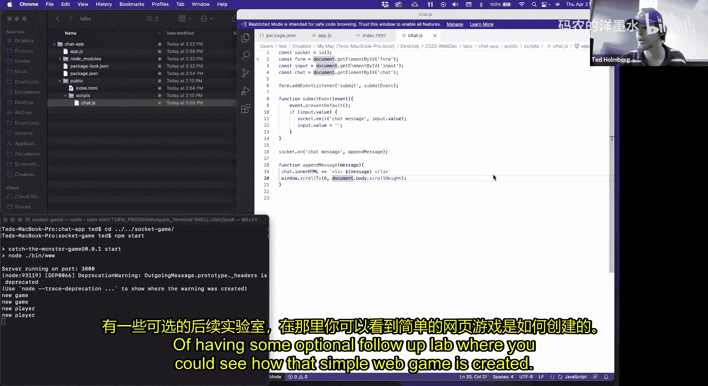

And if so， just let me know。And I might make that a， I might pin it up and make it available。

 but conceptually doing the same thing that we just did in this lab。Excellent， okay， with that said。

 I that's all this lab has。 Soll we'll probably call it a little bit early， at least in terms of the。

The lecture recording today， let me go ahead and。Stop the recording。

