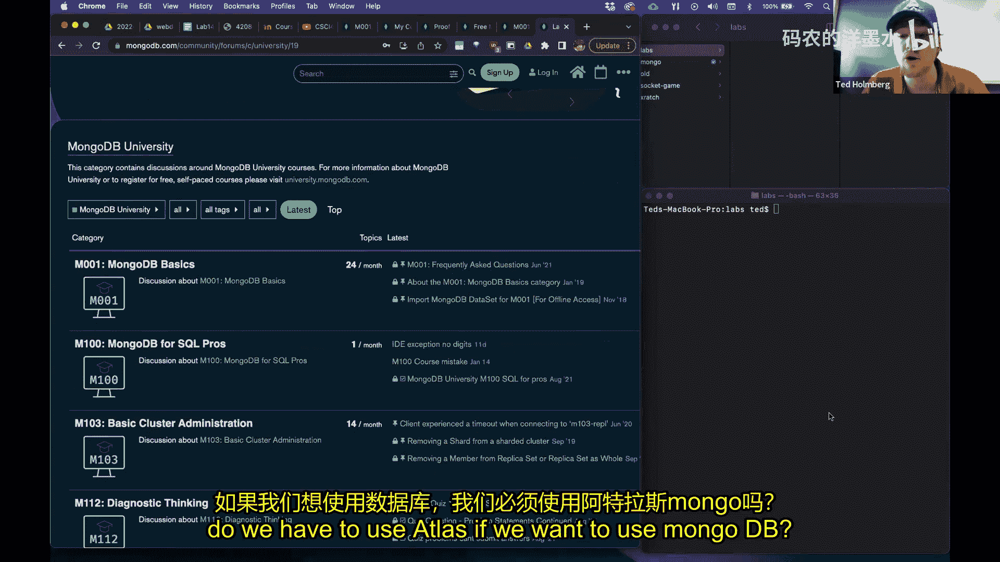
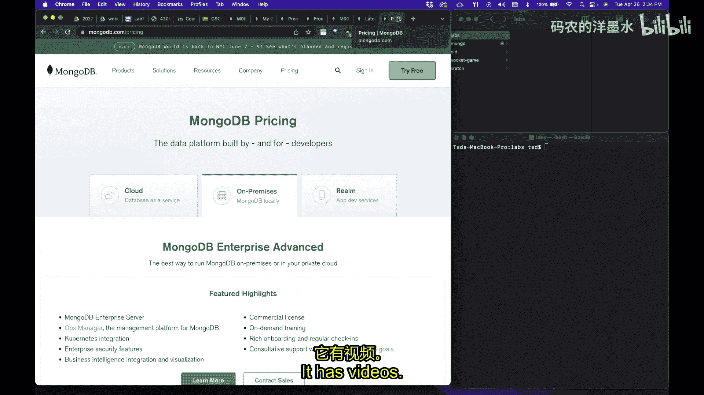
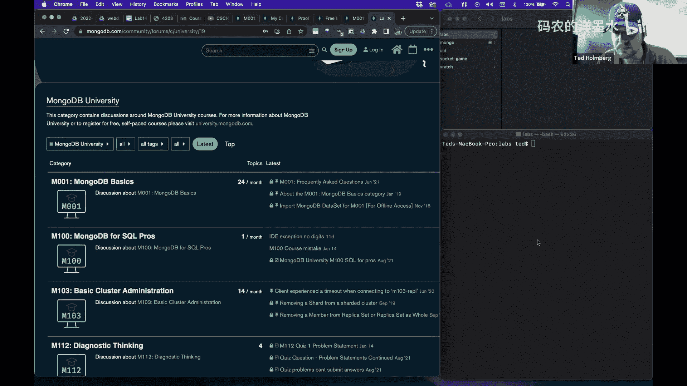
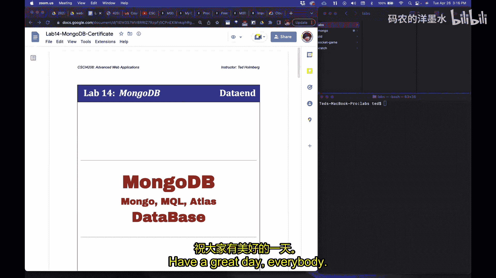

# 【全集】加州理工学院 高级Web应用 中英字幕 1080P p21 Lecture 21 - 实时聊天应用 -BV192zTBrEmu_p21-

Okay， and today's。Video lab， what I want to do is finally hit Mongo and in fact， let me correct this。

Okay， so we I actually inverted these because。Last time we had a more traditional type。

This is going to be different， we're going to try something different with this lab。

So let me introduce it to MongoDB's， the data and solution that we're going to look at in this class and it effectively will allow you to hold your data。

In in JSO form。Which is nice because that's how our JavaScript objects are stored in memory that's how we serialize them so it's nice to be able to store them in the same way you'll see that this lab is very short。

Well and at the same time。Paradoxically， it is probably the longest lap。嗯。We have。

Some quick introductions as to what MongoDB is what MQL is what Atlas is then we'll talk about MongoDB certification and this is one thing I really like about Mongo is that they offer a free university a free collection of test and training and then provide you professional certification at the end of it and so certifications are one of the things that you should be aware of as you continue your education outside of university。

And so it's very common， especially in the domain of technology to constantly be getting new training as new frameworks as new libraries as whole new languages emerge over time it's not very likely that the languages you use today will be what you use a decade from now so it's just this is just one of those domains where you'll constantly be learning and so to help supplement that they'll be certification so you should be aware of this and you should get certified in technologies now because that'll make you that'll make your resume a little bit more competitive。

And then we'll just have some concluding notes so look， this is only a four page document， but。

It doesn't mean it's short and so that's why I also want to spend class time where we can work through it。

So here we have the prereqs for this， this is the first lab in Mongo Db in databases I might actually do another one that shows you how to do all of this locally。

But we'll see if I finished that， but if I do do that， I think it'll be an optional lab。

Please use the PowerPoint slides for reference on this lab there should be on Moodle I'll show you that the motivation behind this lab is we will learn and use MongoDb as a database。

 the Mongo queryry language andQL and AtLlas which is a free cloudbased hosting and deployment environment for MongoDb databases。

Our goal here is to acquire the MongoDB certification and you will learn everything you need to know about using Mongo as your data end。

 so we'll learn about MongoDB， the technology。We'll learn what are collections and documents and fields。

We'll learn our Ct operations so the ability to great read update and delete things inside of our Mongo database。

 we'll learn how to use MQL， the Mongo query language to be able to to essentially perform our Ct operations we'll do comparison and logical queries。

 we'll do array based queries， we'll do MongoDB indexing and then we'll do aggregation of the MongoDB aggregation framework。

So we'll learn all about those things so here our approach is simple certifications are an important asset and validating your technical skills so we're going to work on getting you your first or maybe for many of you your first certification hopefully it opens up a path so that you all start pursuing more as well I wish all of the technologies I wish note I wish express I wish all of them offered free certification programs like this so step one go and download the mongo Db slides i'll show you why I think that's a critical step。

And then go to Mongo University and complete the certification course。

 I have a hyperlink for you here。And I guess I can share that in the chat。There you go。Okay。

 so on completion， you'll see well， I guess。This is not is just yet the course detail so I said this was both the shortest and longest lab it's the shortest that i'm going to be a part of for sure。

 but you'll see that theirre expected delivery time of this lab between instructions and the certification test is about 8。

5 hours， which is a little too long for me to consider a lab in the outside of lecture hours。

 but I'm hoping to use our lecture hours to help supplement that so that it's not going to take any additional time outside of your own discretionary time。

So here it's going to cover six different chapters is how they break down the material and each chapter requires about 85 minutes to complete and you have once you start you have 60 days to complete from day of registration in order to get the certification so this is a time you do have a time from when you start to when you end。

And since I already have the certification， like I can't walk you through it。

 you have to go through it yourself， but we could all do it at the same time。

 so if we get stuck someone can share their screen and we can all kind of help you out with that。

We have so in terms of the lectures， the lectures are six hours。

I think you could probably watch them at faster speeds though and then in terms of the labs and quizzes it's only about two and a half hours of taking those quizzes anyway once you're done the certification I want you to submit your certificate of completion to Moodle it will look like this right here where it'll have congratulations to whatever your name is and then we're going to be looking at MongoDB basics but after you get this certification I would implore you look at the other certifications you could do on here。

Let's see some more things， so these are the slides that I want you to use as reference and the reason why despite the fact that they have training material that you can walk through you'll notice on the slides and this is a very big slide deck because it's actually based off of I actually built the slide deck based off of their training course but here you'll see that I have these kind of quiz questions embedded into the slides these quiz questions are similar to the questions that they'll ask you for the certification test。

So you can think of this as some pre training to ensure that when you do go through the certification process。

 the actual testing portion， you can be prepared that it'll essentially be a crib sheet of sorts。

Which is why I implore you to download this and kind of step through for each chapter and did I break it down on a per chapter basis I believe I did actually so it should yeah see so when you see these parts part one part two part three will be six parts。

That should all be in line with the with the certification， so again。

 this is to walk you through everything that they're going to lecture you on so that you have a similar kind of experiences the other labs and you kind of step through it。

Okay， and of course， you can get that from Moodle where we keep all of our。All of our。啊 slide。

🎼I also have posted the Mongo lectures from here but you can probably just watch the ones on their amy。

 but they are posted on YouTube I guess I'll share this so if you want to see what I'm talking about at any time on one of the slide decks so if you're looking at the slide deck and you're like I'm not understanding why that quiz question is working that way then feel free to go to the YouTube postings of the lectures and there's three of them a part one to part two and part three and you can always jump to that segment and just watch my explanation of any one of those quiz questions and effectively what I should do is get those timestamps and match timestamps up with these overviews but that's for some future period。

Okay， so going to the Mongo Db here， if you click on that link。

 it should bring you here where it'll give you your learning objectives。

 the course details and the breakdowns between the video lectures and the amount of time it will take with labs and quizzes。

And the course agenda here so what is Mongo Db important exporting and querying data creating manipulating documents。

 advanced card operations， indexing an aggregation pipeline and then your next steps。Excellent。

 so let's go here so here you could see that I've already have this proof of completion so the cool thing about this is you'll get a link right here。

 you can verify this proof of completion by copying here so when you go and have say for instance your LinkedIn account you can publish this as a certificate on your LinkedIn using this URL in fact that URL is it's a ID number right that will have your information when you've completed this the particular test you completed or lesson plan you had completed and then your name and then you can also post this on your portfolio pages as well inside of your educational section so you can put not only that you are seeking or have a degree in computer science from UNO but you've completed these certifications this could be the first of certifications you can add to that。

🎼And so this way when you say you know Mongo DB as a one of your skills。

 you can verify that you have a authenticating accreditation body。

 some third party entity that says yes， we're certifying that this person knows this technology。

And so here。Let's go here， so here you can see these are the different。

Moddules that they offer so we're just going to focus on this one MongoDB basics where you learn how to set up your Mongo Db database and learn to search。

 create and analyze your data， but they have all sorts of other courses like authentication authorization deploy authentication authorization in MongoDb usingroll based access control。

 they have introduction to MongoDB charts where you can learn the basics of data visualizations and analytics on your data on your data。

You can learn basic cluster administration so learn how to start up basic DB deployments from the basic simplegogo Mon。

 it Mongo demon process to replica sets and shared clusters。

So they have four different courses that are available all for free。

And other things that are worth noting you can download the video lectures for each one of those you'll get a proof of completion and you'll they also have an active discussion form there as well so if anytime you get stuck you can go there and the actual maintainers of this this。

These testing modules can actually answer any of your questions or you can give them feedback on ways that they can update or improve it。

Excellent。And apparently they have passed， I'm not super familiar with that。But okay。

 so at this stage， we kind of walk through all of your different opportunities。

 the thing that I want everyone to do now is to navigate towards this course。Here。

 if you click on view course from here， you can then click to after you've registered。

See I'm already logged in here once you've registered for this。

 you can start course and well we will spend our lecture hours where everyone can work on this and if at any time you get stuck。

Or if you have a question， you can go ahead and ask me， I think for each question。

 if you were to get it wrong， you have multiple attempts。

 I think you get something like three attempts per question。So if you do get a question wrong。

 you can go ahead and bring that up we can talk about it here。

 those who have got it right maybe can offer some insight of what the solution is or I can go ahead and try to give you feedback as to why it was right or wrong as well so that on your second or third attempt you can actually get it right and ensure that you are able to pass the certification test。

Excellent， does that make sense， everybody？Well， well that when what I will do now then is I will probably even mute myself and just wait for someone to have a question。

 but until that happens。God speaks to you all for。Thiss train。Okay。

 so I have the one of the first questions I assume we should do the labs too like creating an atlas yeah so in addition to watching the lecture videos they also have lab work and certification test and in fact the certification test questions are going to be based off of what concepts are going through the lab and it gives you kind of a playground where you can actually go through。

And actually import data sets and manipulate and update those data sets in interesting ways using the mL the Mongo query language and so yeah it's kind of like a guided walkthrough so that by the completion of。

The labs and tests you'll be prepared to be able to use mongo for your own projects so if you're looking for a database solution this lab will give you everything you need to know there this module give you everything you need to know to be successful in using mongo and actually compass as well using Mongo as a hosting service even because they give you I don't know if I illustrated that let me hop on over here nope not here。

Let me hop on tohu。Well， let me go here。Let me go to the pricing solution here。

 you'll see that they actually have。A free solution。

Typically used for learning and exploring Mongo kind of the sandbox environment。

 so it offers what 512 to five gigs of storage but you should be able to use this no credit card is required they don't charge anything this is what they use for the labs you can use the same kind of cluster for your own projects。

So we' so this so by the time the semester has ended。

 you we have will used Heroku to deploy our web applications and then you can use MongoDB Atlas to be able to go ahead and host your database server effectively to host where your database lives at and then your web application your web server can communicate with your MongoDB Atlas instance to be able to store data to get data to update and create and do everything you need to be able to store out your data and then you can。

Again， the nice thing that they've done here is you can go through and walk through multiple modules and really get a strong understanding at your own speed on how to maximize the use of Mongo。

Okay， let's see what else we have。Excellent。So then here me。Jump back on over to here。

And I will pause the recording until we get more questions so that we just don't have long periods of dead time。

That you're muted right now。Okay thank you yeah so one thing I wanted to also highlight was there's also these dedicated forums where where the educators and all the students globally can go to for each of the modules so I know I'd mentioned that but I just want to show you what that actually look like it's here at this URL mongodb。

com slashcomity s forums and you probably just find it by doing quick Googlegle search if you can't find it from their amy page or their university page。

But again this will be a good resource outside of the resources that we already have from our Discord and from these class discussions。

 you can go here to see what were questions if you wanted into any roadblocks or obstacles that other students had offered or you could see any kind of information like some of these pen information provided by the actual educators。

 the ones who actually designed these modules， but this is something good to know after you've completed this if you do decide to continue through this certification pathway you're not alone through the training and the labs and the lessons。

 so you can get a experience of being around a cohort of other people by visiting these discussion forums I find so like if you decide to do Mongodb for SQL pros then you could go ahead and join in on this discussion forum and see what other people have asked and typically that helps highlight things or obstacles that you。

likely run into you would know where to go ahead and find your own solutions and it's true for all their module that actually gives you an impression of how much certification models they actually have here and they have some pretty interesting looking ones that i'm looking at like data modeling could be a fun one。

Excellent， I just want to highlight that this was available to you。And then let's see here。

I have some other questions do we have do we have to use Atlas if we want to use Mongo D no so that's a great question can it be stored locally so actually let me jump over here。

To go back to the pricing。So one thing you'll notice when you go into the pricing is that data。

 here we go on premises。You can run Mongo Db locally for free。I mean。

 I guess they have their own solutions， but no so at any time。

 so so Atlas is their cloud based solution where if you didn't want to worry about propping up your own server。

 right they'll。Offer it as a service for you， but Mongo。Is a。

You're going to learn how to use the Mongo client to send requests to a Mongo server where the data is actually stored and atlas。

😡，Host that server for you， but you can install the Mongo server on your own machine so you and if you decide to do that。

 especially if you plan on like demoing and out off your local machine then that's completely fine or if you have access to a web server yeah you can deploy and host Mongo locally yeah at no cost。

And in fact， the optional lab that I want to that I'm going to that I'm halfway done creating and I'd like to go ahead and make available to everyone is actually walk through setting up a Mongo server locally so that you can go see what the process is from deploying a server and then sending those requests to your local server for to be stored and so you can create collections and documents and and entries and fields into your own database without having to depend on Atlas Now keep in mind though if you want to have a。

Full stack application that's actually demoable then either you have to find a way to deploy your local server so it's actually public facing to the internet at large。

And so。That's where Atlas becomes very useful so that you can actually have a live project it's not just sitting in a repo somewhere that has to be deployed locally。

 but you can actually have a hyperlink where someone can open it in their browser and using a number of like free solutions out there we saw that Heroku is a free solution we see that Compass has its own free solution Google also has one that is also really popular that we hadn't really covered in this course but they also offer a free solution as well。

Let's see here， I'll show you there。好的。Google Web app。Post， no， let's spell that right hosting。

Yeah you can you can go to Google here and see what they offer in terms of some of their cloud based web hosting services。

 I think for like static web pages， they have like Firebase。Professor。

Some of these some of these Mongo DB， like as soon as we start the course for chapter one。

 what is Mongo DB， it has videos？

We're going we're supposed to be watching these videos during this class time yes so let me mute myself so I say that you can go ahead and do that but yeah that's fine yeah that's all right。

It's all just as long as we were're on the same page I'm not not trying to like cut you out you know it's still working out well thank you yeah yeah yeah so so yeah so the training material be a combination of lectures labs and and test and so again I don't want everyone necessarily to do this over there it's so it's enough volume that I want to lessen the load from your discretionary time and use some of our dedicated lecture time for you to work through some of this so I'm gonna again keep myself muted and at any time if you run into a roadblock and either the lab or the test you'll have。

Support for that right so this kind of an inversion this is a little different than the other labs we've done where I walk through everything and you watch me here I kind of want you to guide through going through this other module that's been put together and if you run into an obstacle then you'll have access to me and the rest of the class to help to help with that so with that said i'm going to mute myself again and pause the recording。

Okay， so we're now done with the scheduled lab and lecture time。

 so I'm going to go ahead and end the Zoom meeting for those of you who are still working on that。

 feel free to continue to work on it until you're ready to take a break and I'll be available in Discord if you have any questions moving forward。

And so I'll go ahead and take kind of a poll on where people are at starting next lecture。

 but we'll likely go ahead and continue this format for this week， at least。Excellent so。

Have a great day， everybody。

