# 【全集】加州理工学院 高级Web应用 中英字幕 1080P p22 Lecture 22 - MongoDB -BV192zTBrEmu_p22-

Excellent， so for today's video lab， I want to go ahead and。Work with the Mongo database。

 but as opposed to having you go and to Mongo University and work on getting certified with Mongo。

 which is an awesome thing that Mongo does， we're going to focus more on using Mongo in a very practical way。

And one that we can use it locally so we'll focus this lab on figuring out how can we host our own Mongo database service on our local host application on our own machine and then how can we connect to it using our express application as a client to the mongo database server。

 and then we'll look at the crowd operations the ones you。

Have learned about in the lectures or in the。Related to Mongo and then as a bonus we're going to throw in some JSO and web token implementation so effectively by the time we're done this lab you will have built a very simple full stack application so this lab will effectively meet the bare requirements that is put forth for the final project so you can use this kind of as a as a baseline of how these parts can communicate between the client the server and the database。

So that you when you add your complexity of whatever your business logic is。

 you could see how you might go up where where you'd make the decision of where each part of that implementation。

 where each feature would go， whether it's should go in the client。

 whether it's go in the server or whether it's go as a query into your database。

 and like how how you could plan for that。So yeah， let's go ahead and get working on this if this is our Mongo Cud+ JWT lab。

And so a basic breakdown of what we'll do we'll have a lab introduction like we do most of our other labs you could see actually the me。

So and then our we'll go through three phases of the lab。

 we will first do our basic setup just to get a server up and running and then once we get the server running we'll look about。

Connecting both our servers so we'll have two different servers we'll have a database server and then we'll have our express server our express server is designed to service browser clients and our database server is designed to serve our express application so our express application will be both a server in one respect but a client in another and that's not uncommon architecturally when we start building out our our。

Our web applications is for。This idea of microservice architecture where you have these services that are available remotely and you're building an application that can consume those services。

 be clients to them， and then also repackage them， retool them， process on the data。

 and then reddever your output to some other underlying service。Okay。

 so once we do that we'll look at actually going ahead and connecting to the Mongo service and then we'll do all of the various cru operations so we'll do create read all read one update and delete and we're going to go ahead and use Mongoose has our client I'll talk a little bit about that later but they support schemas which allows us to go ahead and talk about some kind of relational object mapping onto our data model and then after we're done playing around with our Cr operations we're going to take a little bit at another authorization model so recall in a prior lab we look at using passport in the session based model here we're going to look at JWT the JSO web token model and so we'll look at how we can do a login and then how we can then access protected routes using JWT and again this will just be a quick little primer so there's not going to be it's going to be pretty bare bones and idea。

That to try to conserve with time， so this is a relatively short lab as you can see there's only 10 goals。

 there's a lot that gets implemented and there's not a lot of pages in it considering most of the pages is just source code and images。

Okay， so let's go into the lab introduction。So prerex here。

 you have to have node installed which should not be a problem now you also have to have Mongo installed and I don't necessarily mean the Mongo client。

But you need to actually have the Mongo database server installed and typically the invoking She command for that if you're at your command line interface if you're to launch that would be Mongo D or Mongod。

Which is actually short for Mongo demon because the server runs as a demon process。

And of course you can always check to see if nodes isn't installed because you can trigger it with node and also NPM because we use NPM as our package manager right to be able to effectively start and launch our apps so these are going to be the two required installations you'll have to set up on your own accord if you want to follow along this lab motivation behind this lab is we're going to learn to connect your Express app to a Mongo database MongoDB database and the goal is to deploy a Mongo database server on local hosts and connect it with an Express app。

And again， the things that we're going to do here to connect to a locally hosted Mongo D should be much different than if you were to build an Express app and then connect to your Mongo cluster that you might have on Atlas。

And the concepts would be the same on how you would connect your app to your database。

Our basic learning objectives is to learn a little bit about the MongoDb server we'll learn about the Mongo client and in particular we're going to use a Mongoose which is built on top of the Mongo client that has a little bit additional functionality for us Mongoose offers schemas so that we can define our object relational mapping。

Which you'll see what that means when we get to that phase。

 we'll talk about the CRD operations in MongoDB and of course CD stands for Cre Read。

 update and deletelete， and then we'll look at an alternate authentication model using JSON web tokens。

So this is going to be relatively。Even though there's not a lot of coding actually that goes into this lab。

 there's a lot of folders and a whatnot， so let me start making some of this stuff out so I'm going to have。

A crud app folder。 So that's gonna be my root folder。 So let's do that Crd app。

 And I might just make the rest of these as I go out。 So let's see。 So I have crud app here perfect。

 So let me change into that directory。Okay， so let me also make my package updatesson。Okay。Okay。

 perfect and i'm going to make my app so patch Json is obviously our configuration file that we're going to need to define that we can then use NPm to install our dependencies and to be able to launch our app the web server part of our app the back end part we'll just call app Js。

And so that's going to have all of our express code in there so let me go ahead and make that we're going to have a folder called data so this is a thing and I'm going to talk about about this a little bit more when we get to that step but if we're going to host our own database locally we need to point the database demon process to a particular directory that it will serialize and store the contents of the database so we're we're going to store it for now inside of our project directory inside of a folder that's called data and that'll be where our database content goes。

And it's going to be empty because it's going to be the Mongo server that we're going to connect to that and it's going to deposit that automatically so we won't have to touch it。

 but we need it to exist。Okay， and then let's say I'm going to create a config。

 which is going to hold configurations for my app in particular。

 it's going to hold the configurations for my database。So let me make that and then here。

 let me go ahead and actually create a Js file in there that will eventually implement out database。

js。Excellent， let me go ahead and make a directory for holding all of our models that our application will rely on The models are effectively going to be the collections and the documents that we will then store into our Mongo database so let's go ahead and make that directory and then i'm going to create。

So this particular app is going to model a user， so let's go ahead and create a user file so that we'll be able to go ahead and have that。

Create it when it's time for that step。Oh。Don't quite want to put it there。

 let me put it into models。Okay， perfect。I also am going to create a directory to manage my routes。

 not my routes， I'm actually going to call it API。So I should have updated this。

 but i'm going to call us all of my API endpoints I'm going to do the following inside of that directory and actually let me go ahead and。

Make a inside of API a user dash routes it's going to define all the routes that affect users and of course。

 if my API affected other。Models， I could create another file that defined those routes as well。

 those endpoints。So it helps me organize where all my endpoints go。Okay。

 and then I want to go ahead and have my。Back end service also be able to deliver my static files。

 so I'm going to create a public folder。Where all of my CSS。

 my HTML and my client saw browser based JavaScript code would go。There we go and inside there。

 let me just go ahead and。Create that index at HTML page。And then in fact， also inside of there。

 let me make another subdirecty that we'll call scripts where we can put JavaScript scripts if we want。

And so here's let's go ahead and make actually a script to put in there。

 so I'm going to inside of the public directory inside scriptris directory。

 I'm going to create an API test。 so that'll be my browser side script that I can issue commands from the client to the server and then the server will then do things to the database and then send back a response and then we'll send back a response to the client。

Okay， excellent， so at this point I now have a stubbed out kind of blank implementation of the serverside architecture of everything here so when the time comes to hit the steps I can easily just go ahead and implement those things。

So let me clear this terminal。Yeah。Okay so some concepts that I'd like you to be familiar with before we start touching it is user authentication we've talked about user authentication before。

 but let's talk about a little bit with JSson Web tokens which are commonly referred to as JWT so JWT is like a novel form of authentication and that it allows it actually maintains the statelessness inside the server that typically we strive for with HT2P so unlike the session based approach where the server actually maintains a data story list of the client IDs and then does a lookup when the request gives it that ID instead the way that JWT works is the server issues the client a token。

Which then may be included in its request to get access to any private data。😡。

And so the token is really comprised of three different things it's a headers。

 it's a payload it's a signature the headers identifies which algorithms is to be used to generate the signature so again it's a it's encrypted token that is hands off the payload is the content of the claims of the token so effectively you have a concept of being able to kind of decrypt within inside the token decipher it to be able to extract it and use it and then you have the signature which is created from the encoded header。

 the encoded payload and whatever the secret or private key is that's used for a cryptographic algorithm anyway all four of these components allow us to create a signature。

Which is effectively going to be our JWT token。Now a big thing is， like I said。

 the novel thing about the JWT is instead of the server maintaining a list of IDs that it can look up and then pull the corresponding object with well all of the management of the authentication token is actually done the client side so then it becomes the client side responsibility to store the token and then to deliver the token back to the server whenever it makes a request。

 but again the nice thing about this is that the server is it maintains a statelessness so it doesn't have to manage that set of lists which means it's incredibly scalable as well however there are some security implications that this could affect and like to try to highlight that when this lab is done to show you what it might mean like the big risk of tokens is if you don't handle them properly as a developer if'。

Actually calls them to expire anyone else who gets access to that token can send it in as part of their request and the server would think you were essentially that person。

 effectively anyone with that token has that authentication。

So keep that in mind with JWT to and then we'll see how we can use JWT to protect our routes and of course。

 a route or endpoint that a request cannot access if they don't have proper authentications。

 what we call protected route。Okay， and then in terms of the Mongo database。

 I really want to distinguish between the concept of a server and a client for databases。

 so for the server component， well MongoDB is an open source， no SQL database management program。

And of course， NoSQL as you probably already wear from the lectures it's used as an alternative to's traditional relational databases。

 no SQL databases or they're useful for working with large sets of distributed data。

 especially since our applications are already in JavaScript。

 they're a document oriented information store so。Documents again， as you might already be aware。

 are just another way of expressing the concept of an object。

 a JavaScript object and documents and JavaScript objects almost have a one to one correspondence。

 so it's effectively a data store for JavaScript objects。😡。

So you'll see Mongo or Mongod or the Mongo demonmon is the primary Mongo demonmon process for our MongoDV system it handles the data request。

 it manages data access and perform background management operations now this is what will run so if I want to run a Mongo server I have to actually run it on its own terminal and then open up another terminal to be able to run my express application so I actually have two programs that are open in the background on two different port numbers that are going to listen for request and response in some kind of response to that so I'm effectively going to be running two servers at once but one will be for my database the other will be for my web application now the web client is the bindings in JavaScript or any language for that matter that allows in this instance a node JS app to connect to our Mongo server so we're going to use Mongoose which is a node library for interface。

With the Mongo Db database， Mongos is a。Object document mapping library so it acts as an interface to the MongoDb by letting us define models and in the instance the model is like a blueprint of a Mongo index it maps the properties of the document in that index unless you interact with them in meaningful ways and so we're going to be able to do that using this concept of a schema a schema represents the structure of a particular document either completely or a portion of it it's a way to express expected properties and values as well as constraints and indices a model defines a programming interface for interacting with the database typically these are a reads our rights or updates all the card operations。

Okay。And of course， with crowd operations， we've mentioned this before。

 but it will be highlighted again， the meaning of CRD it's an acronym that's used throughout the world or computer programming refers to the four functions that are considered necessary to implement any persistent storage application。

 so this is not just truth。For data， this is true for file management as well right like just to be able to author a file。

 you can think of having to create it， be able to read it。

 be able to append or update it and be able to delete it。And in fact。

 there's a one to one correspondence with the ACTP verbs， the methods to these current operations。

And so we're going to see we're actually going to use the appropriate verbs throughout this lab that correspond with each of these operations。

Okay， so let's go to goal one our Mongo Db server here our approach will be to launch a mongo Db server app on local host so what you have to do first is download and install Mongo Db on your machine and you can't use。

Not for NPm you can't really use NPm for this you'll have to go directly to Mongo Db for this so NPm will install your Mongo client but you want to go directly to Mongo to get the the executable that allow you to actually install that on your local machine now if you use Mac you can use some package managers as well you might be able if use a bunch of probably package manager as well so for instance I was able to use homebw to install Mongo and my local machine。

Okay， so once you have it installed and you can double check that by typing in the command line that would actually start executing so it's mon God if I do let's see version you should be able to get a response from that so I can see here that it is successfully installed。

Excellent so if I want to start running it there's a couple of flags that i'm going to go ahead and issue i'm going to do the so the db path which is going to specify a directory for the mongo instance to storage data and so i want to i want to。

Invoke this command from the local root directory of my project so that this data folder will be in view of the mongo process I want to specify the port and I want to specify the IP that we're going to bind our application to now I could omit the port and the bind i because the ones that i'm giving you in the lab are the default values。

 but I want to highlight when we do these labs that these are options that you can go ahead and easily configure so i'd rather be for both as opposed to。

As a person not。

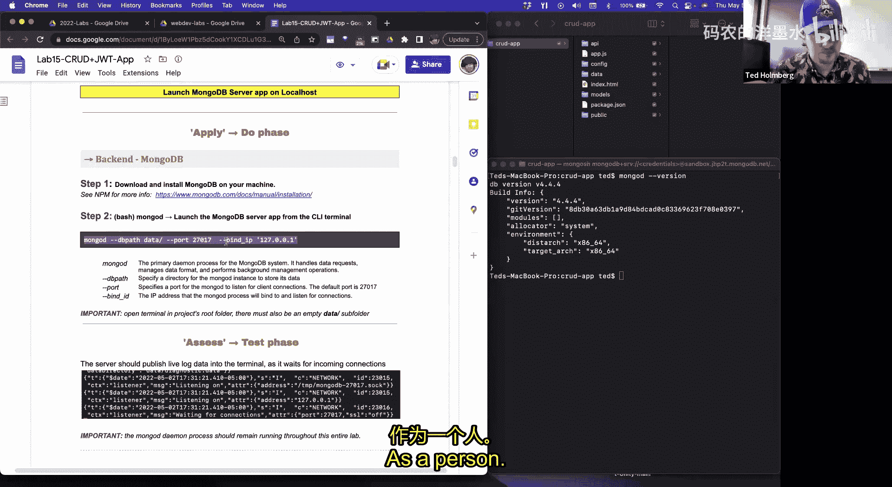

Okay， so let me go ahead and run this here， so here we have our lab there and in fact let me change this too。

Oh yeah， that's right let me change this to icons perfect。Or maybe as a list， yeah。

 I like that better okay。Okay， so let's see where we're at here inside of。Okay。

 so let's go into the cru so i'm going to go into my project directory cru app Okay， so at this time。

 yep， I see I have my data right there， so what i'm going to do now is i'm going to open up。

A new tab on my terminal or you could open up a whole of terminal。

 but I could do a tab here so I'm going to need two different terminals one to be able to execute my web server and another to execute my database server and when I launch my database server I'm just going to let it run for the rest of this lab so here I'm just going do Mongo I'm going to specify the database path is going to be this data folder I'm going to specify that the port number that we're going listen to request for a database is going be 27017 which is the default port for Mongo and I'm just going to use effectively local host like 127。

0。0。1 to bind theip So when I hit enter on that you should see that the demon process should launch and I'm going get all of this logloging information to illustrate that the services are now run。

 you can see here this last let's see if we can't read just some of this output here you'll see here that。

Flow control duration， acquire database。And then let's take a look here and you'll say what was an empty。

Folder moments ago when we launched our database application， our server。

 you'll see that it then deposits into this data folder。

 everything it needs to be able to manage the database and it'll serialize everything in here for us as well so we won't have to ever examine in here but we'll be able to get our data persistence and it'll all be stored right here inside this data folder。

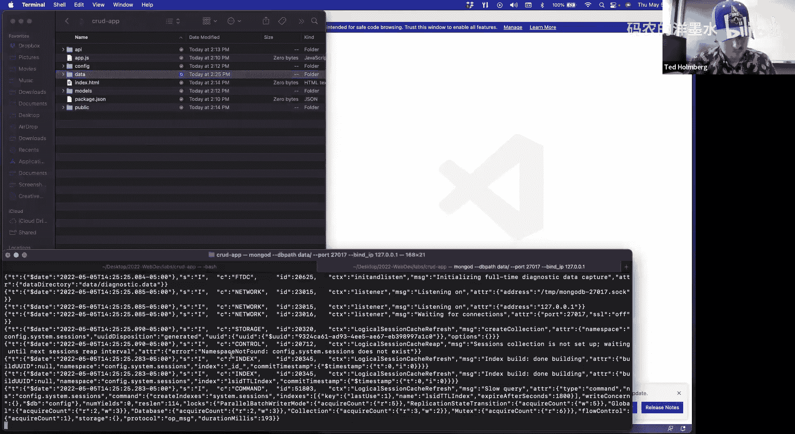

Excellent， now I'll just move on here and we won't have to look at that tab again。

 but you have to ensure that that continues to run。Okay。

 and then let's see to ensure that this is working correctly to。To assess this step。

 we just make sure that we get all of this logging information。

 the server should publish live log data in to the terminal and so again import from the mongo demon process should remain running throughout the entire lab is it perfect let's move on。

So the next thing I want to do is I want to define my configuration file my Packers。

 JSON for managing the backend of this project， so I already have it defined。

 let's go ahead and or I already have it created but let's go ahead and add our details into there because this is going again Packers JSON if you're not already familiar but you should is used for managing the projects dependency scripts。

 the version， the authors and everything else。I would just recommend download so I have received a question when when downloading Mongo DB。

 should you download the community Ed or the Enprise edition。

 I would recommend just installing the community Ed。That's the go to。

 that's typically like the open source local locally host edition that you're going to use and again。

This Mongo Db server that we're using you should consider this for development purposes only。

When you go to launch your app。Typically you don't have the capability to deploy your own database server on a lot of these platforms as a service they'll give you the option to launch a database server that they have kind of preconfigured and then you just need the URL the endpoint to go ahead and hit your request to the database server and then it'll go ahead and send back some kind of responsible is you know how that request what the effect of the request was so when you go to deploy this you'd want to migrate from a locally hosted database to something like the Mongo Atlas or Heroku I think allows you to host like a Postgres server。

So keep that in mind。Okay， so let's go ahead and define this configuration file here。

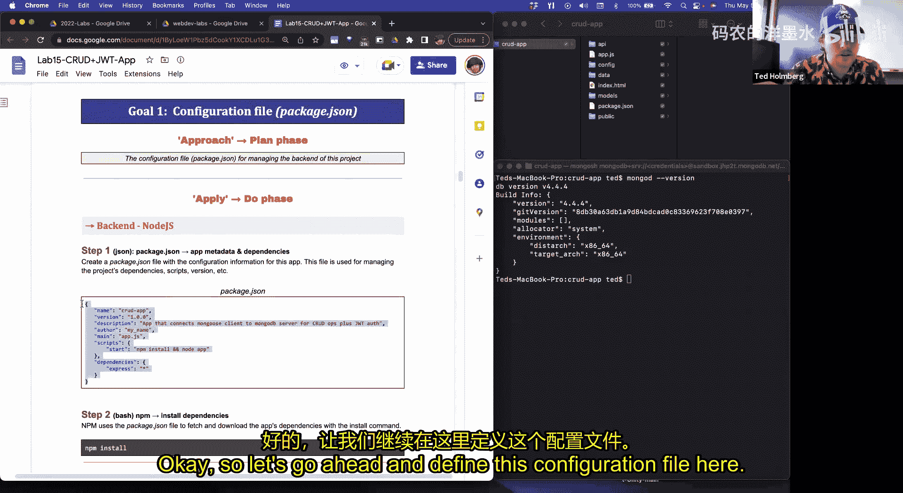

I should open it up， so that's my package that JO。So inside of here， okay， so again。

 I'm going to give my application a name， a version。

 a quick description about what it is for building。And authorship here。

 the main launch point of our application， which is going to just be app JS。

 I'm going to define a collection of scripts， which is going to be my start script。

 which allows me to go ahead and call NPM and Sa and then launch my app that'll give me all my dependencies and then the first dependency that I'm going to go ahead and add in here is going to be Express。

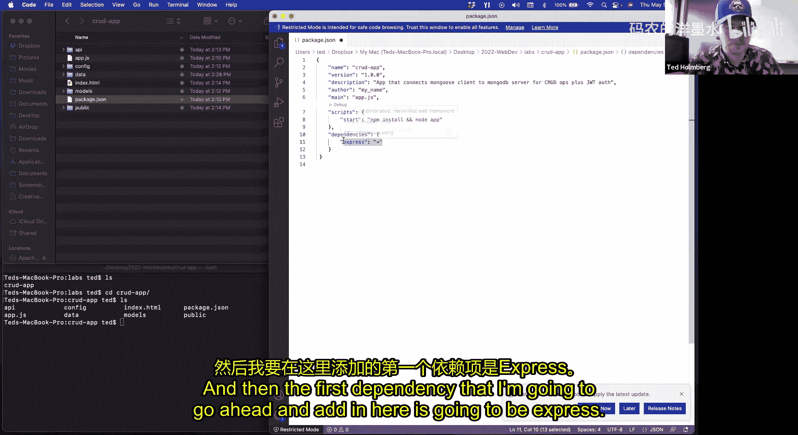

Excellent， because we're going to start by just kind of scaffolding out a。

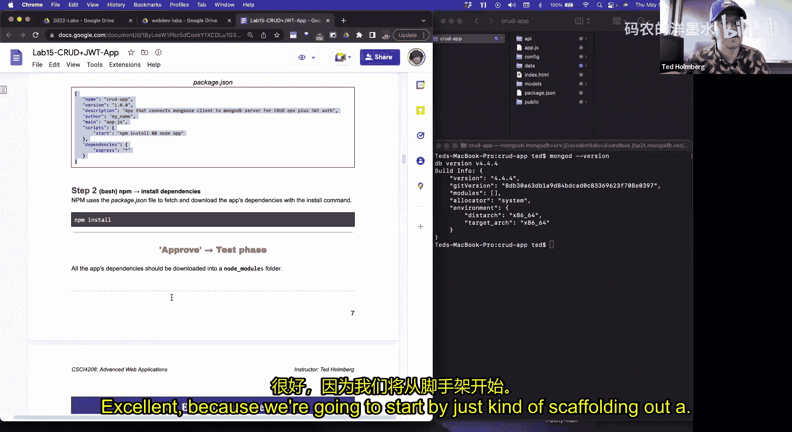

Express app。And then here we'll do from our command line MPm install。And there we go。

And so now we should have our node modules， which now has our express and all of the dependencies expressed and then relies on and that's what we go through the approved stage here。

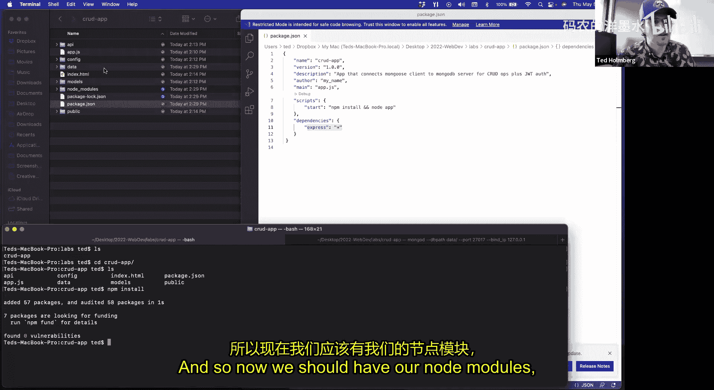

Notode modules perfect let's move on to the next part of our basic setup which is to get our express static server up and running so here our basic plan is we want to create an express app to serve the browser HC files and to listen for HCP request。

So thiss going to do all the heavy lifting for us the。For our back service。Okay。

 so from here on that i'm going to list what are the back end implementations versus the front end implementation so you can clearly see when we're working on one side versus the other so on our back end what we're going to do is we're going to go into our app Js file and we're going to create a static server using Express。

And so I have long for long descriptions here as well。

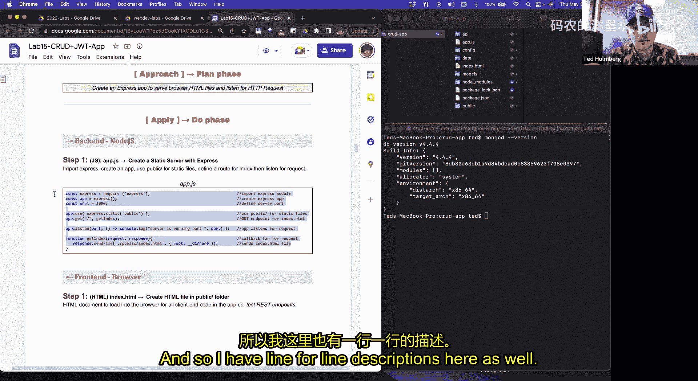

So let's go into our app JS， let's open that into our IDE here。

And what we're going to do here is we're going to import our express module。

 then we're going to create a new express application。

 we're going to define a port number that we'll listen to for our web server from our web clients。

 which is going to be port 3000。Then what we're going to do is we're going to tell our express app to use the public folder to serve static files so remember this static method is built into Express where we can then define a directory that that serves as a static server so again we want the public folder to be that directory and then what we're going to do is we're also going to set up an endpoint that we'll have in here that we'll just look at the root directory and whenever we get a request a get request on the root directory we'll have a callback function will bind to that called Git index get index we' take a request and response and all it's going to do is it's going to send back the index at HTML page。

That we have located inside of our public directory so that way we can actually go ahead and have a client side page that we deliver right our HTML document and then once we do all that we're going to do the very last thing we're going to tell our express app to start listening for request on Po 3000 and then we're just going to buy this callback function that does a quick console log to show what port number it it's listening on to illustrate that everything launched well that everything is where we think it should be。

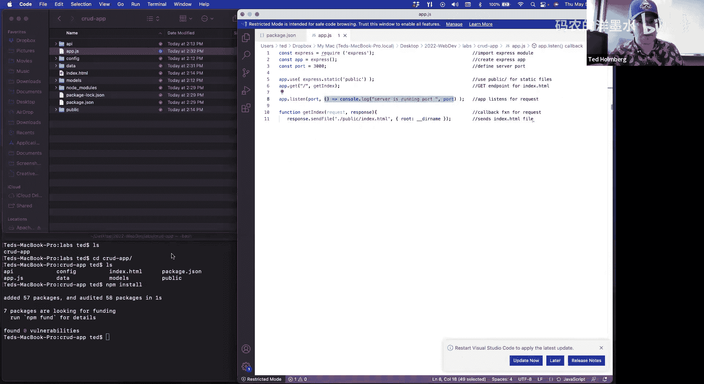

Okay， so now once we get that implementation， we actually have to go and do some front end development。

So we're going to deliver this HTML page， but at this point the HTML page doesn't have any content。

So why don't we define some basic implementation， some basic HTML elements into that HTML page。

 and then we'll use this actually as a guide on what we're going to implement as we continue to move forward。

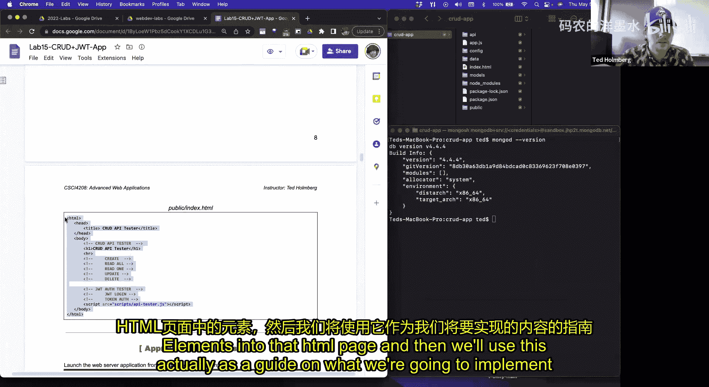

So let me hop into here。😔，And so here I just have an HTML element and then I'll have a head which I'll just give the titleCD API tester inside my body I'm going to do a lot of comments like CrD API tester and then create read all read one update delete these are all going be my future steps that'll solely add into my HTML document that allows me to test if my endpoints of work or not so effectively what my frontend page is going to allow me to do is launch from the browser all of these requests to my web server so that my web server can then send those requests to the database get a response back from the database and then send it back to my client so I'm going to use these comments to know where I'm going to put in my code for each。

Like iterative step inside this lab。And so again， we're going to use this for our API tester for our CRD calls and then for our JSON web token implementations。

And so the actual code， the very end here， we're going to link is going to be that API tester script where all of the implementation to our buttons is going to go。

Excellent， anyway， that's just some pretty basic HTML code。

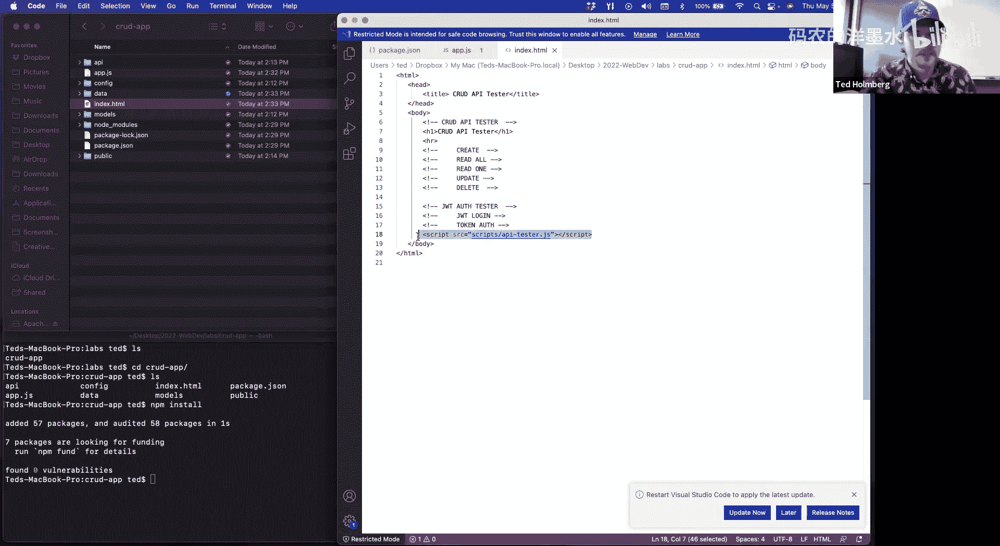

So the next thing we want to do is we want to go ahead and start running our web server and then we want to make sure that we're getting this console message on the server side and then we want to be able to make sure we go into our browser。

 go to local host 3000 and actually get that HTML page delivered。I did I miss racket。

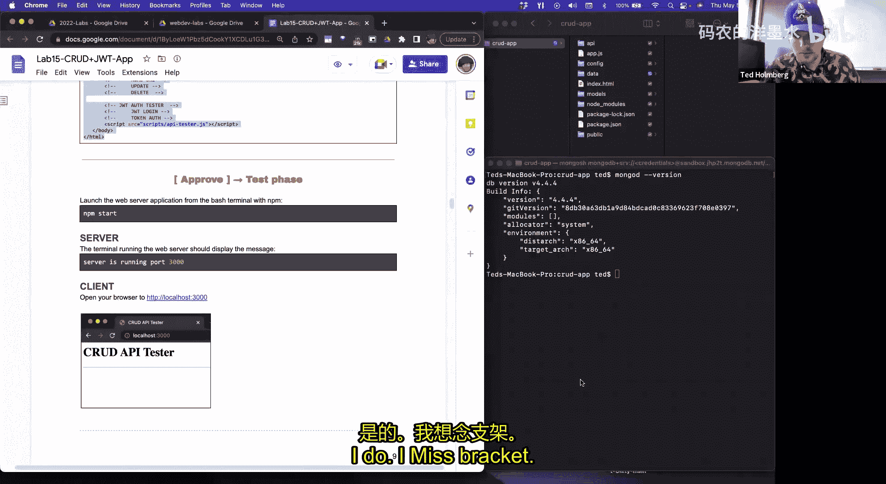

I guess I'll find out。哦。啊，即佢了。嗯嘟啲嘟啲。Oh， I see， yeah。Thanks。

Got to close that function or things aren't going to work so well。Okay。

 so the next thing I want to do is let's do MPM start。

And bam I got the servers running pour 3000 again over here we're still cranking along。

 we haven't connected it yet， but that's still crank along in the background so now let me do this。

Do I have。I don。So closed it。So let's go here。So now let's go to local host 3000。Oh oh。

 let's see what's happening here。呃。Publicindex。 H， index。 H。It's fine to me， let me save this。These是。

Okay， let's see here， oh， whoops。That's not quite right I guess if I want this to work I need to actually put the index out e into the public folder I thought I did that。

 but I guess I must have actually not put it where it goes the importance of having all your folders your things go where it's supposed to go okay let's make sure that's opened up let's close that。

It's good for things to happen like that so you can see what the process of debugging looks like。

Okay， so here server is running for 3000 now let's see if we can't go to our local host。

Let's tryry that again。对。Yeah， and that's what I expected now that I actually have a file in the appropriate directory。

 I get credit API tester。Excellent， I'll tell the server for now， let's go ahead and clear that。

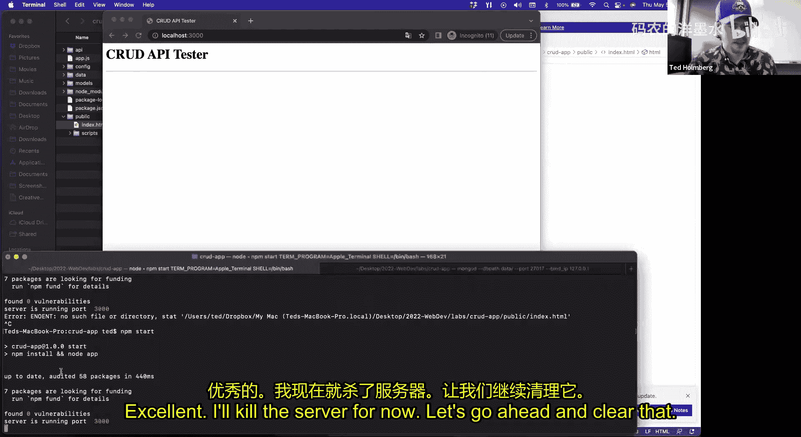

Okay so the next thing I want to do is I want to move on for my basic setup because now I have a basic server setup up I have a database setup my server can deliver client files to my browser。

 so I have everything primeed to start connecting all these various layers together so the first thing I want to do is I want to take my web server and I want to connect it to my database and I'm going to use the Mongoose client in my Express app to connect to that Mongo Db server that we've launched the Mongo demonmon process so the first thing I want to do here is I want to install the Mongoose module into my application。

 so again Mongoose is a library that's built on top of the MongoDb client that that allows us to offer schema support to our JavaScript objects。

So。Instead of manually adding my Pack do JSo。😡。

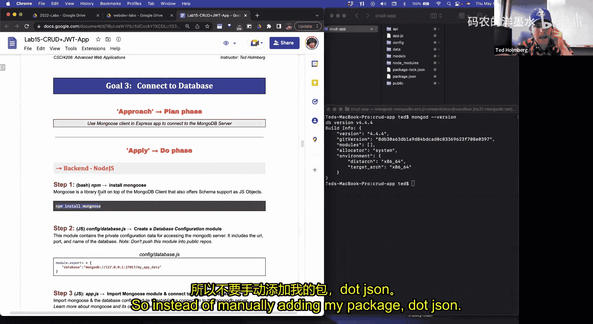

To include a dependency what I can do instead is I can go right onto my command line and I can say hey MPm just install Mon Goose and as long as I'm inside my application directory you'll see that if I go to my package。

 JSON now。After doing that install， Mongoose is now included as one of the dependencies and if I were to go into my node modules。

 Mongoose would now also all of the source code files will now be in the node modules directory as well。

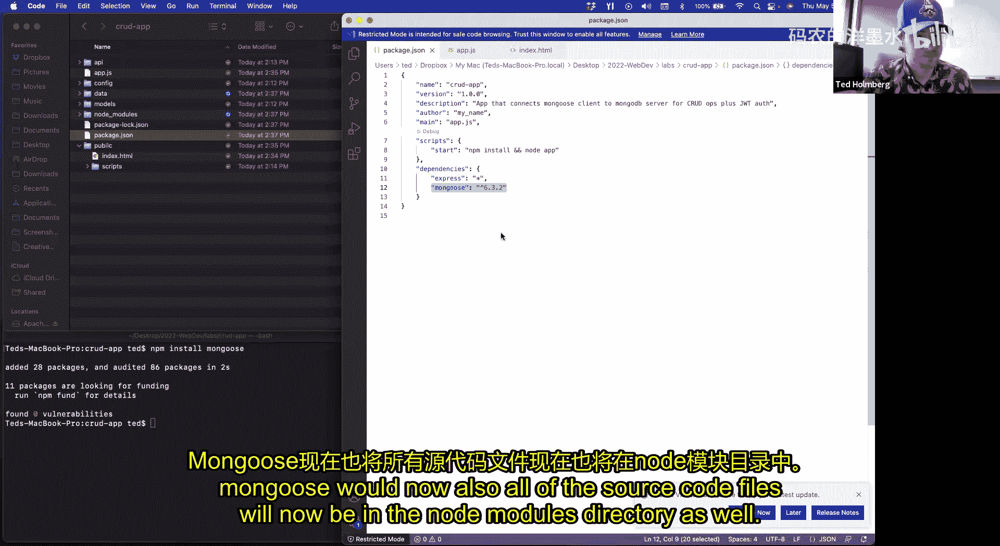

Okay， so that's just an easy way to install things as you're developing。

So the next thing I want to do is I want to actually go ahead and create my database configuration module and so this module is going to contain the private configuration data for accessing the MongoDB server' going to include the URL and the board and the name of the database note it might not always be a great idea to push this module into a public repo you might this it might be one of the modules the config module you put on a gettAR list。

So that you have access to it for your dev branch， but for production。

 typically you would set configure this up in your environmental settings。

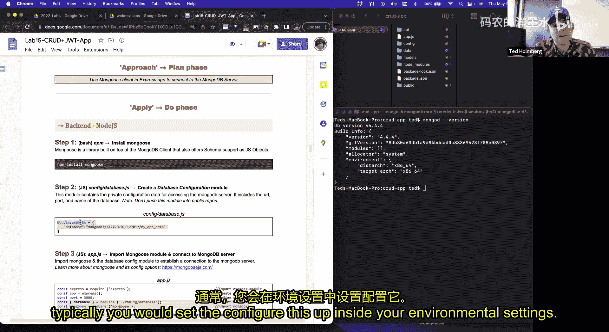

So that's why we're going to separate this logic out just to kind of maintain that concept from the rest of our code。

 So let me go into our configuration right here we're going to configure our database let's go ahead and open this up and let's actually implement that So here all I'm going to do is I'm going to export into modules and anonymous object that that's going to have the key database and it's going to be the URL that's I'm going to use to connect to my data my Mongo server So notice the protocol。

So we've seen lots of ways to do protocols right for web socket it's WS for ACTP it's ACTP you probably have seen that since for years now right so for MongoDV clearly it's going to be MongoDV as a protocol and then we're going to use the URL right and so we're bound our application to 127001 then we're going to do the port number and then we're going to do slash and we're going to give a name to the data set we want to go ahead the database that we want to go ahead and connect to and so since we own the server and we own the client we we can call this anything so I'm just going to call this my app data。

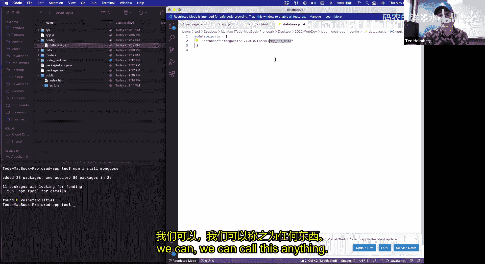

But we can effectively create different databases that we can connect to by just changing up whatever that name is。

Okay， after doing that， let's go ahead and import the Mongos module and connect to the Mongo server inside of our Express application。

So if you want to learn anything more about Mong Goose I advocate that you go to the documentation page。

But let's go here into my okay， let's save that， let's go into our app。

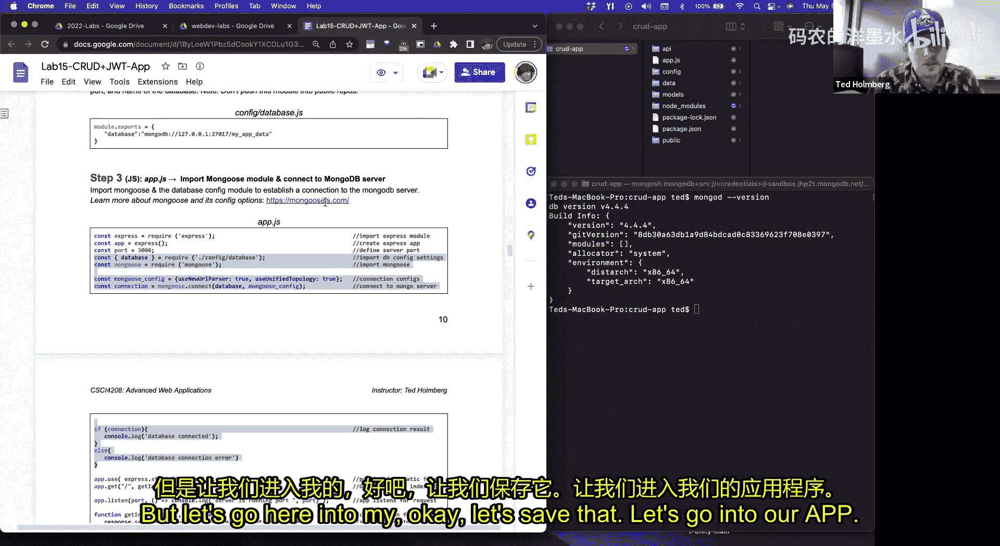

And here after ports。But before I start。Defining all my middleware I'm going to go ahead and implement everything that connects me to the database how am I going to do this well the first thing I'm going to do here is I'm going to go ahead and i'm going to import that database configuration module and i'm going destructure that database。

The the the database field from that right so it's going to be the URL it's going to be this Mongo Db URL that I'm going to go ahead and grab from there。

Then what I'm going to do is I'm going to import mon Goose。

 which is going to be the what I'm going to use is my Mongo client。

I'm going to set up some configurations for connecting。

 so one of the things that Mongoose requires because of various iterations of development is a option where we're going to use the new URL parser to be able to parse this Mongo URL to connect to。

And then we are also going to use a unified topology。

 so these are the two things that are true again， if you want to learn more about what these configuration options mean。

Go to the， the。Document page。But。In terms of actually connecting， we'll use mononggoose。

This method connect， we're going to pass it effectively the URL。

 that's effectively what database is holding， just this URL right here。😡。

And then we're going to also pass it the configurations。

 so we want to use the newer form of pars in the URL that all new versions of Mongo uses and we want to use un5 topology。

And then we should establish a connection so we'll then have an open socket connection to our Mongo server as a result of this call and then we're going to test we're going to see if connection exists then we'll say our daily is connected and if this is doesn't exist then we're going to say that there was some kind of connection error there and then that's just the new implementation we have so once we do that well I guess let me save it。

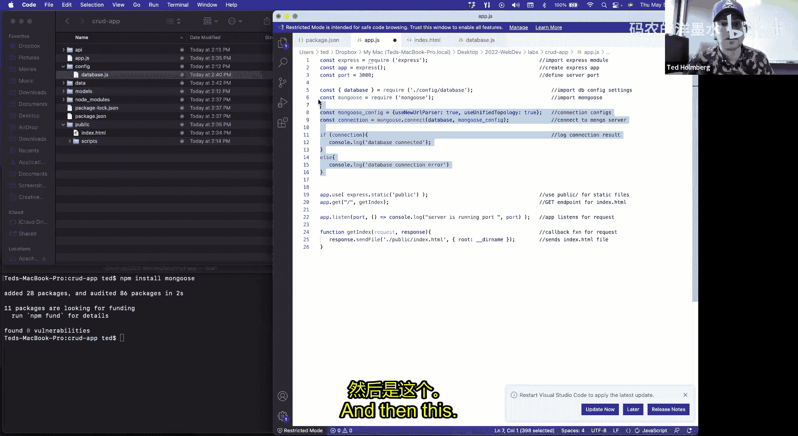

嗯。Yeah。So。You can think of。Two different things that are happening with Mongo and I think this is one reason why in newer iterations。

 you use the keyword Mongo SH。Instead of just the Mongo command so there's actually two command line tools that Mongo makes available one Mongo D Mongo Mongo demonmon is the one that launches your Mongo server。

And so Mongo， what was formerly Mongo， but is now Mongo S short for Mongo Shell launches a。

Reel an interpreter， a command line interface client that allows you to connect to。😡。

Interactiveively connect to a server， but because those are two different tools。

 it can be very confusing I think， to newcomers to understand that databases kind of exist in two different ways just like web applications exists in two different ways a part of the web application as a client and the other part is is a server and so yeah one of the big motivations behind this lab is to illustrate that you have a Mongo server that's usually running in the background and all these things we've been doing with Mongo isn't actually doing anything really at the server level it's attaching to a Mongo it's using a Mongo client to talk to a Mongo server and issue a commands and so the Mongo shell is really cool in the fact that allows you to interact interactively without having to produce source code to issue commands to your Mongo database。

 but it is definitely a line that I want to distinguish between what does the client versus a server。

And there's an understanding about。What the boundaries are there？

A good question about what the difference between the Mongo command or Mongo H command is versus the Mongo D command。

Okay， so now let's say once I do that， I should be able to start up my app and we should be able to see if we connect it to our database so let's go ahead and i'll clear this let's do NPm start。

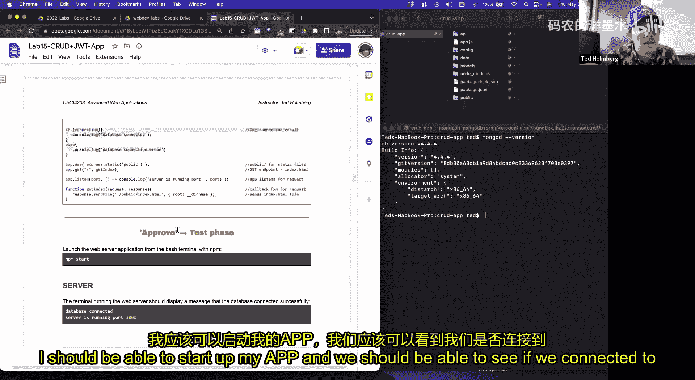

Here。And there I go， databaseb Connect and then my web application is running on server port 3000 and do I still have。

 I don't know why that keeps closing my own。I I keep closing that， does it keep closing it for me？

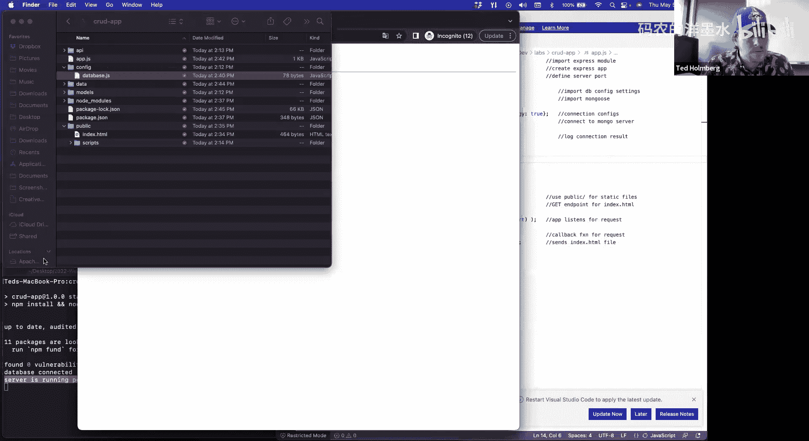

Yeah。二找。Okay， so the next thing I want to do here is I want to actually create a model。

 right a document， a collection that's going to model user data so we're going to define a rest endpoint in our app。

 we're going to create a model， a schema for a user and then we're also going to create an endpoint that allows us to create user document to add into that user's collection that will be maintained inside of our Mongo database。

So we're going to focus on being able to create data。

 but we're also going to have to define the data we're creating we're kind of doing two things in this one step so the first thing I want to do is I do want to make a schema that represents the user' fields and data types in our database so here i'm going to go into my models and all of my database models should go into your models directory here this application is super simple there's only the one model。

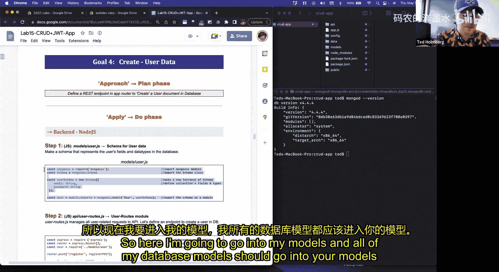

是。嗯。And let's take a look at what's going to happen here。

 so the first thing I'm going to do is since。My models are going to sync with my with what's inside of my database I'm going want to go ahead and get use Mongos a mongoose my Mongo client and import that now one nice thing about Mongoose is it has these some of these additional implementations on top of just being a Mongo client that is nice for us one of that is a schema class so we're going to go ahead and import that schema class as well then what we're going to do is we're going to create a new instance of a schema a data model and we're going to save that into user schema here and so。

We get to define what we're modeling inside of this particular schema so here we want to model an email we want to model a password and the email will be a string it be represented as a string and a password will be represented as a string so a really simple model right so notice what we're doing here is we're passing an anonymous object which're just passing an object a key value pair right so also like a dictionary where the fields inside of our schema will be the labels here would be the keys and then the values are the type of data we want to be able to store inside the schema。

😡，And again， if you want to see all the various data types here。

 I'd recommend you go to Mon Goose's documentation page to see what your options are。

Then after I do that I'm'm going to tell Mongoose to add to its model and so what we're going to do is we're going to register to all the models that Mongoose is kind of maintaining for us a key value pair we're going to call this schema user with a capital U。

😡，So every time we reference it moving forward， we can just call it user and the value that's going to get。

Bind it to this key of users is going to be our user scheme that's going to be this thing here。

And then we're going to export that into our modules。😡。

So that we can import that into other parts of our code。

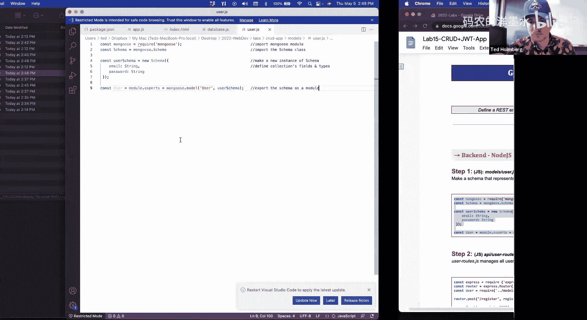

Okay， so now that I've defined my schema for my database。

 I'm now going to go into my user routes module and I'm going to start to define an endpoint that allows me to create a user document and add it to the user's collection inside of our Mongo database。

😡，So。Let's go there that all of our API endpoints are going to go there， so let me go to API here。

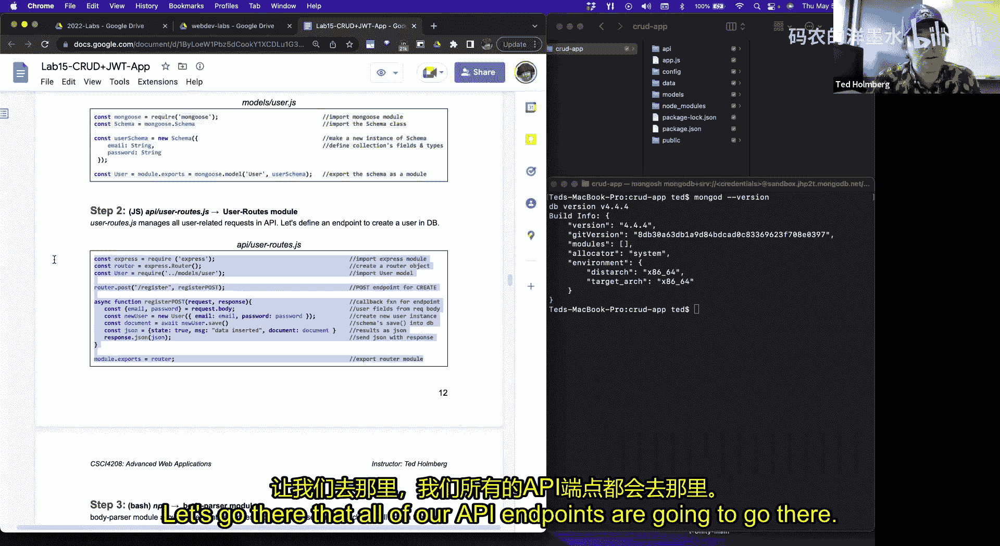

And so inside of user routes。There we go， Okay， so let's see here I'm going to import the express module right because I'm going to have to set up an express router because we're covering all the endpoint so the responsibility of this module will be to define all of the endpoint so we'll use the express router to do that。

But I also want to go ahead and。The logic that's going to happen within these endpoints is going to affect things that exist in the database。

 so i'm going to have to access my model of my users' model from there so I'm going to import my user model into here as well。

And then the first thing I'm going to do here is I'm going to define an endpoint so on my router I'm going to listen for a request that is a post request if it's a post request that comes to this URL just slash register then I'm going to bind the register post callback function to it so the register post callllback function is going to be an async function。

 it's going to be an asInc function because we're going to have to wait for a call to the database itself to resolve before we can finish processing the rest of the logic here。

So the first thing I'm going to do is I'm going to extract from our request the body because the body is going to contain information。

 particularly the email and password right we don't want to put embed that as part of the URL that's that would not be a safe way of transmitting that between the client and the server so we'll go ahead and get as a post post support bodies so we're be able to get that data from the body。

😡，Then I'm going to create a new instance user passing into it。😡。

The values of what is defined in that schema so I have an email field and I have a password field so I'm going to pass it the value of email that I got from the body here and the value that I got from the body for password here。

This is going to create a new user for me， where once I go ahead and create the new user again。

 this is just this is just essentially creating an instance of it， I will then tell new user to save。

Now， since new users， since this user instance is defined inside of the mongoose。Model system。

 it has built in methods such as the save method that allows us to sync to the database and save this user data into that collection into that user collection。

😡，And then I'm going to get back a response from the database。

 it should be the document if it was successful。And the document again， is the object。😡。

That we got we saved into the database， so then we're going to create this like JSON objects there a JavaScript object that says that the state was true that has a message that the data was inserted and that will actually deliver back the document that got returned from the database and then we're going to send that back as a response。

To the client。And thatll allow us to go ahead and test that out。

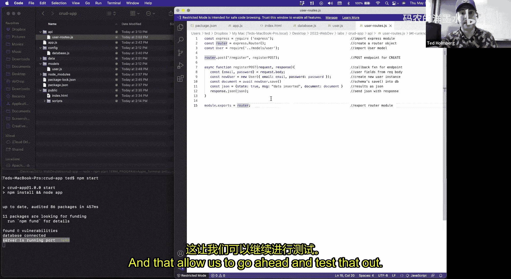

Okay， so the next thing I want to do after implementing my endpoint。

Is we need to actually go ahead and install our body parser module because。

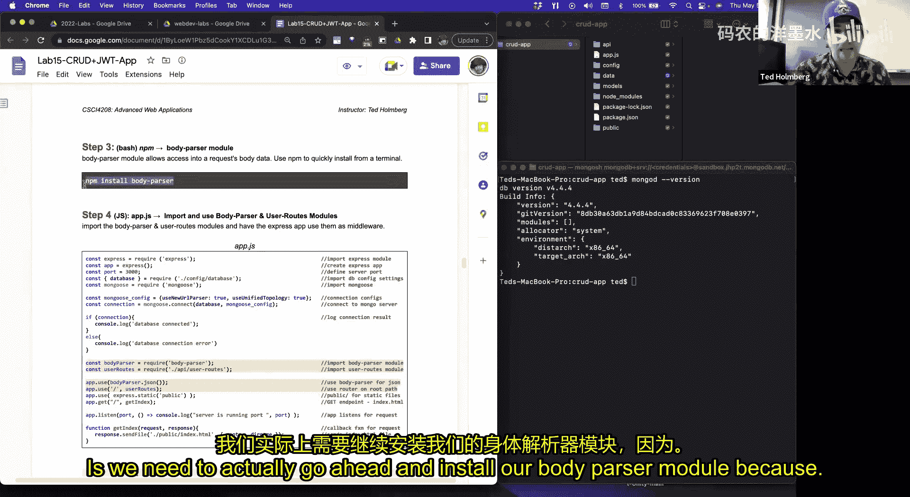

Recall anytime you try to parse the contents of a body， we can't do this out the box。

 this implementation has to be imported， so let's go here。😡，And again。

 instead of manually editing my Pack。 JO， I'm just going to go into my terminal from my root directory。

Of my project and do NPm install and the module and install so I should get that。

 And so now if I go to Pakistan Json I'll say I now have body parser in there excellent So now let's actually said body parser up in our express app so that we can use it。

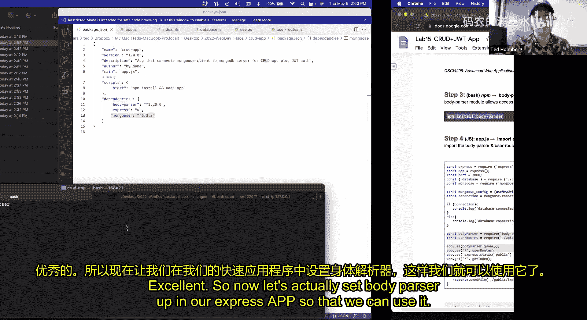

To be able to extract the data from our request so let me go here into my express app app Js and so after I connect to the database before I start doing all of my server level。

 my static server level implementation， I'm going to do the following lines of code I'm going to do these four lines of code。

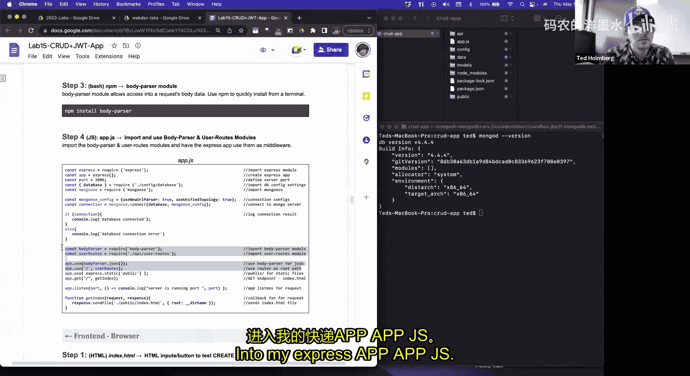

Here I'm just going to go ahead and import the body parser module， I'm also going to import the user。

 the router， the endpoint router， our API， our user routes that we just defined。

And then I'm going to tell our express app to use the body parser to extract for JSONs to be able to extract JSON data。

 and then I'm going to tell the app to go ahead and listen on the root directory for all these potential inputs so we can go to the root directory to get our index at HTML page。

 but we can also go to that root directory to listen to all these API calls that we're going to be making。

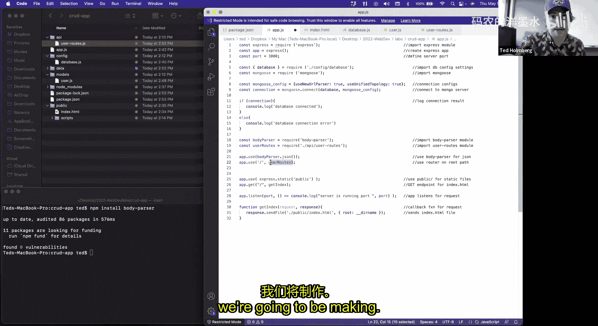

Excellent， then the next thing I want to do here is I want to go ahead and。

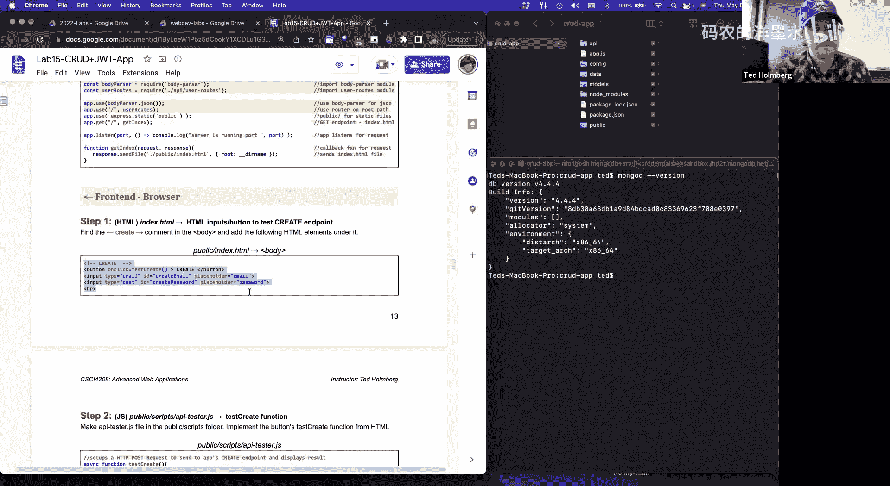

In my index HTML， I want to locate this create comment here。And I'm going to go ahead and。

see here add some HTML elements here I'm going to create a button that says create and on a click event I'm going to trigger a test create method that's going to be defined inside of my JavaScript here and then I'm going to create some input that's going to be required to be able to test this endpoint right so a request will have to have inside of its body an email and a text right so we'll create an input field so that we can enter either of those。

Oh no， not quite， I want to go here。Okay， yeah， perfect。

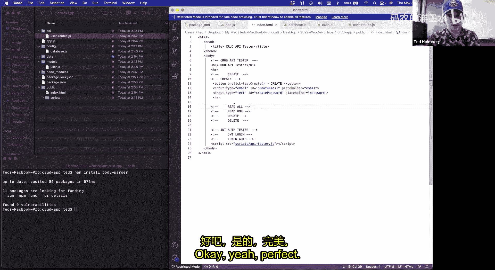

So the next thing I want to do is I want to actually implement that test create。

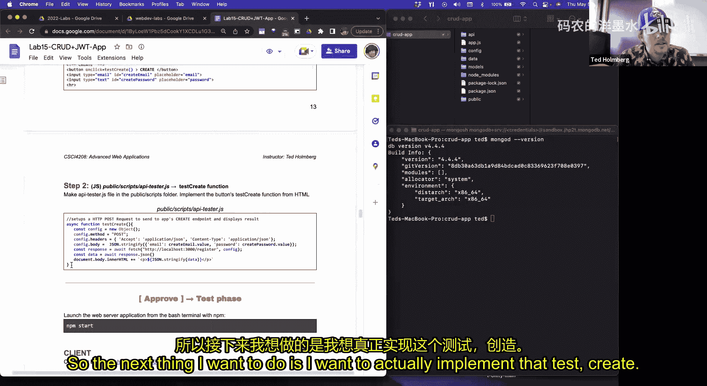

So let's go into my scripts here and I'm sure I have this API tester。

 let's go ahead and open that into our IDE。And let's implement that。So here。Again。

 this is going to be in a syncnc function， it's going to be called test creator it's the on click。

Function that we're invoking here on this button。We're going to create an empty object that we'll use as our ACTP configuration as our as essentially。

All of the data that's going to be part of our fetch。 So we'll start with an empty object。 Now。

 the thing we have to embed as this fetch is for for our HP request is going to be a method for the request。

 That's going to be a post request， the headers。We want to be able to accept。JaO。

And the content type of this request is going to be JOng。Then since。

We're we're letting the server know that this contains JOs。

 we can then define a body where we will create an object that has a email key and a password key and the value will be。

What the so we'll use the ID so I'm just using a shortcut here if I go back to my index on HTML right the ID of create email binds to this input element and the create password is going to refer to this input element so I can grab the values of that directly in my JavaScript。

So I'll just go ahead and make that the value of this object， the value of this object。

 then I'll pass that to my JsonN。str ofify so it actually turns that into a proper string and I'll save that as my body。

And then once I have this configuration with the method， the headers in the body I need。

 I'll go ahead and make a fetch request to this endpoint。

 the one we just defined the slash register endpoint at localhot 3000 and then I'll pass it as a second parameter。

 all of the configuration object， the method of the headers in the body and then I'll wait to get a response when I get a response I should get a JSO back right when we implemented this let's go back to user routes right when we send back a response we're sending back a JSO so I want to get that JSO and I'm going to do another away another syncnc to extract the JSON data out of there。

And then I'm going to stringify that so I can just go ahead and append that to my document to the DOmMS bodies in our HTML so that we can visually see it without having to open up the command line。

 the console or anything， we'll just go ahead and we'll add it as a paragraph element。😡。

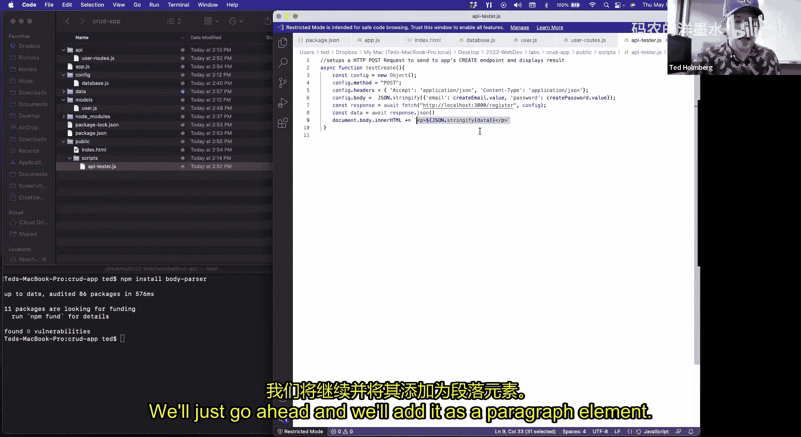

Right into our our code。So now that I've done that， let's go ahead and do MPm start。

And launch your app and see if we can't go ahead and create。Some elements to add into our database。

Okay so our servers running is oh wow， I really do have all these things up and running。

 they're not closing they're just。You're just there。Okay， there we go。Okay。

 so now I have this create email password。 Okay， perfect， so let me type in something like user at。

Email。 co and inside my password let's do password one， two， three Okay。

 so now I have some injuries into these fields let me hit the create button that's going to cause that test create method to get invo and look at that。

We can see that I got back that JSON object from the server， stayed true。

 message was inserted and not only does this document object。

 the document that's returned to me of my user have an email key and this password key。

 but also notice it has this ID key， which it was given to by the Mongo server。Oh。Okay。

 so the next thing I want to do is。Im going to go ahead and actually define a read all。

Endpoint for my user data because now I can create documents。

 but I can' actually see the documents I'm creating so I'm want to test that out so I'm going to define a restM point in my app router that's going to just read all of the user documents inside of the collection for my database。

So again i'm going to separate the set of implementations based off of some backend task and then the front end task so the first thing I want to do on the back end is I want to define a route and a callback function for finding all user documents from the database and so Mongo find is a method that retrieves all users all user documents from the database so again we have access to that by a Mongogoose so let's take a look at this let's go back to user routes here。

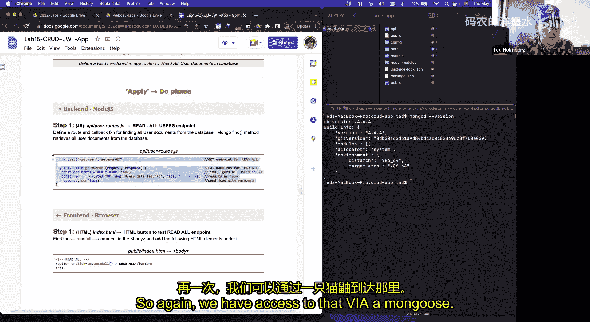

And I always am going to put my code before module that exports for the router。

 so everything this has to be the last line of code。So here I'm going to define a new endpoint here。

 so on the gett user endpoint on that URL I'll go ahead and issue a callback function and that's if on it so on on my router。

 if I get a Git request at this endpoint at get your user I want to define this Gi user Git。Endpoint。

And so here I'm going to create an asynchronous function that's going to take in a requesting response and it's going to go ahead and use that user that we have registered with Mongos to issue a find and so that's going to synchronized with our database invoke that call on the database and find all users in that collection and return that so again there's going to be a delay because that's our express app then talking to our database server。

And then when we get that back， we're going to assume that exists and we're just going to do a status 200 again this isn't super full to code keep that in mind if you're using this as an example。

 you probably want to do some try block and try catch blocks and console errors out and prevent your app from crashing but this is we're not worrying about fault tolerance。

 this is more like a proof of concept。We'll also issue a message to say， hey。

 the user's data has been fetched and then we're going to return all of the documents that's inside the collection and then in our response we're going to wrap that up in as a JSON and deliver that back to the client。

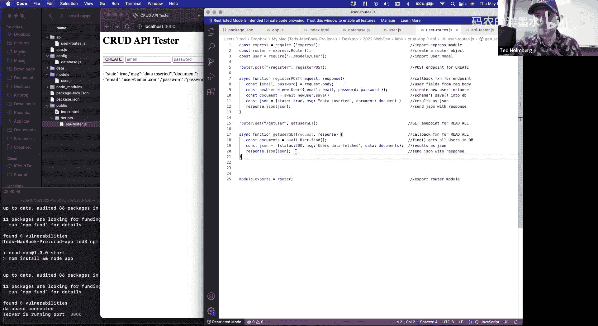

Excellent， so now the next thing I want to do here is I want to go into my HTML。

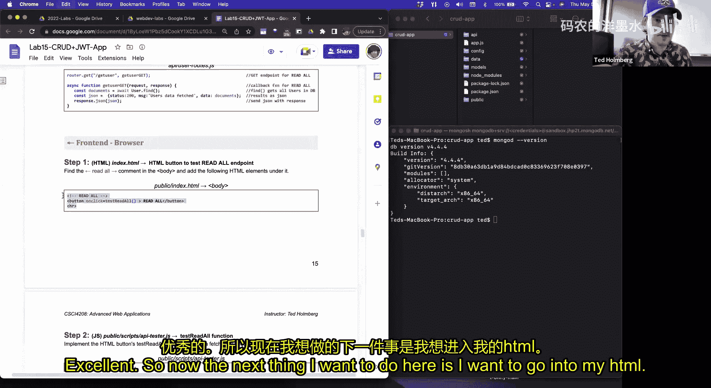

。Here， and I want to identify where I have the read all comment that I had。

Added before and i'm going to add my implementation there I guess I don't need read all here。

 I guess I can create a here as I copy and paste I can delete what is。

Supplemental so here it's just going to be a button that on a click event will invoke test read all and it will have the text of read all on the button label itself。

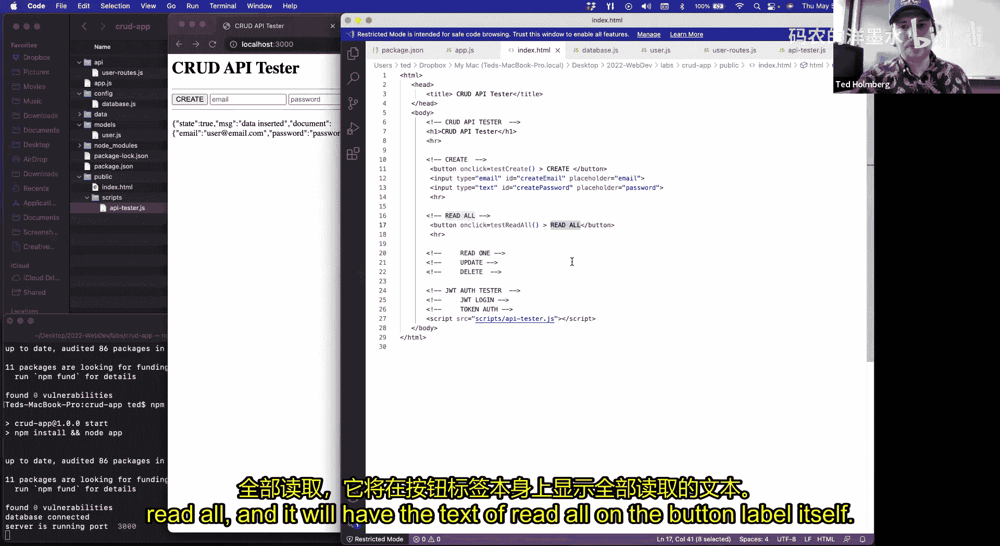

Okay， so let's actually define what Read All does。

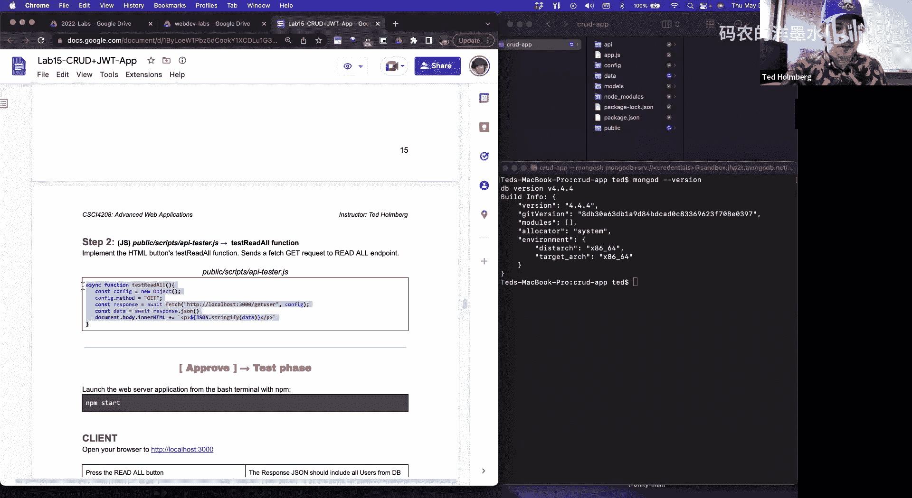

Let's jump into our API tester， this is our browser side right we're on front end development now。

 we're going to do another asynchronous function。Here it's going to be called test read all。

We're going to create our configuration object， we're going to say， oh。

 the method that we want to go ahead and issue is going to be get。

And that's it right we don't have to give any specific headers or any specific body for gett requests we just have to give the method type so then we're going to do a fetch to that URL right git user and then we're going to issue it with a gett method and then we're going to wait to get that result and all of our fetches should return back JSON data so we're going to get back on the client so I'm going to wait for that response to go ahead and deliver the actual JSO that is its payload and I'm going to save that into data and then I'm going to string apply that so it can be represented as a string so we can display it and I'm going to add that to the document bodies inner HTML as another paragraph。

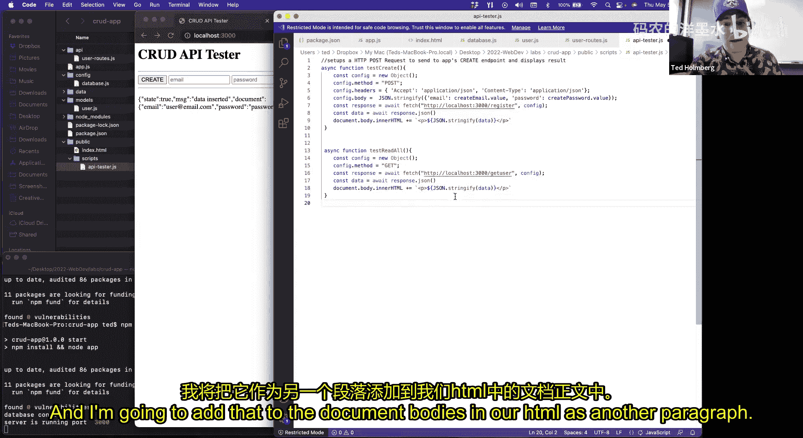

Excellent， then once I do that I'm going to test that out， I'm going to do NPm start。So， let's。

So here we go Okay now let me jump over here let me refresh this page and now notice I have a new option where I can read all going to click that and there it is it shows hey I have a。

This element that has this I， this email， this password， This is that in another room。

 Let's do F at bar dot com perfectect。 And let's make the password。火题。And let's create that Okay。

 so now i'm getting here a message that says hey I created something new right that happens every time I hit the create and I'm going to have to read all method again and now look i'm actually getting both those documents that get returned to me i'm getting everything inside the collection so I have this new element I just made and I have。

This older one than I made moments ago。Okay， so suppose that I don't want to get everything inside of my collection right that seems it's useful right if I'm going to filter or do some kind of observations across my collection but suppose that this actually has to get returned to the client side suppose I just want to read one thing from my collection one document well why don't we define a rest endpoint in our app router to read just that one user document in our database again I'm going to subdivide this into backend implementations and front end implementations and you can see once weve got connected to the database and we define our model this becomes extraordinarily easy just to set up these these endpoints and then go ahead and build these testers form So let's create an endpoint that we can hit to get one particular。

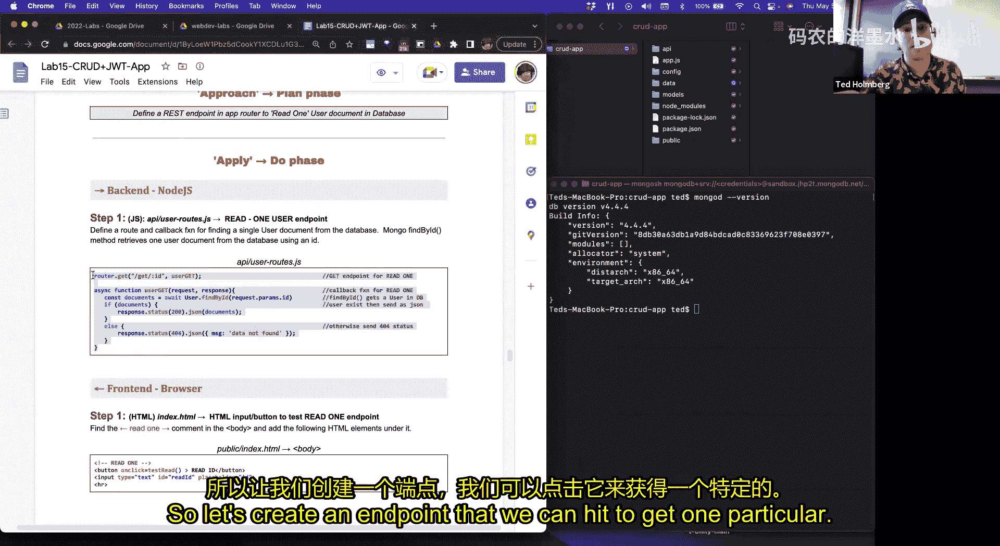

One particular user from our collection。So here I'm going to go into my routers， my user routers。

 I'm going to set up another endpoint so on my router on a gi request。

 if it's a gi request to slash get slash and now I'm going to use a variable parameter。

 so colon ID will be a parameter。Then I'm going to invoke this user get callback function。

 this is going to be asynchronous function， all of these are because it requires us to wait for us to actually connect and get data back from our server。

So again， I'm going to pass in request response as my parameters and then what I'm going to do is from my request is going to be a parameters object right and that's defined here right the parameters。

And since this is colon ID， whatever this value is in the URL will be defined as this key here。

 so this ID this is this has the key ID because I did colon ID here， if I did colon email。

 then I could do PRms。 email instead。😡，Okay。So this is so this and this has a one to one correspondence anyway。

 what I'm going to do is on that mongoose on side of my models， right？

I can invoke the find by ID to Mongo and this is going to sync with my database and I can give an ID and it's going to synchronize through the database and use that ID property now。

😡，This can potentially cause errors again if you put something that is not ID like Mongo ID like it will actually throw an error and it'll cause your express application to crash or this would be something you'd want to protect against and ensure it's in the proper format but we're not going to worry about that because this is just a test example but please keep that in mind if you use this as a reference implementation。

Anyway， we should get back one document。That is that that has that ID and if this document exists。

 then we will send back in response to 200 of success and then we're going to send back the document we got back and if it doesn't exist。

 then we're going to send back a4 a4 error and we're going to send back a JSON that the data was not found。

 we didn't find that data。

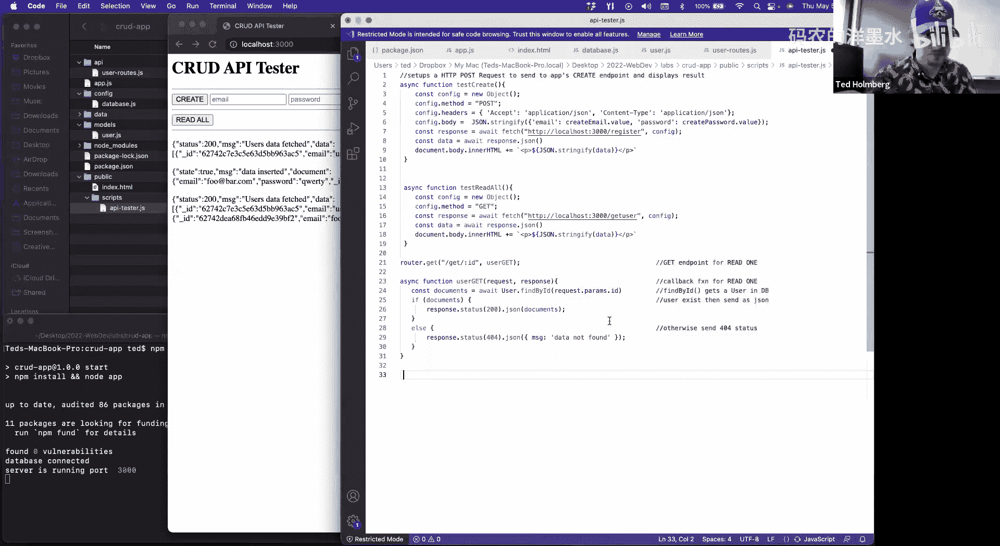

Excellent。So now that we've defined the endpoint， you need a way to test it。

 so what we can do is we can go ahead and implement into our HTML code。

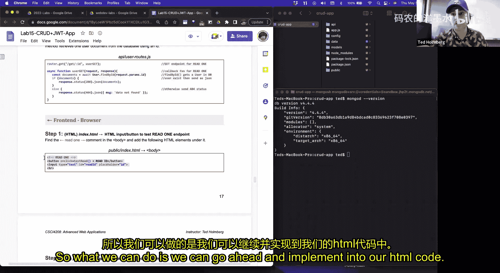

Under Read one here， right where I subbed out this implementation。

 we can create a button and an input field where we can collect a ID number to be able to go ahead and send a request to our backend server to see if it's working or not。

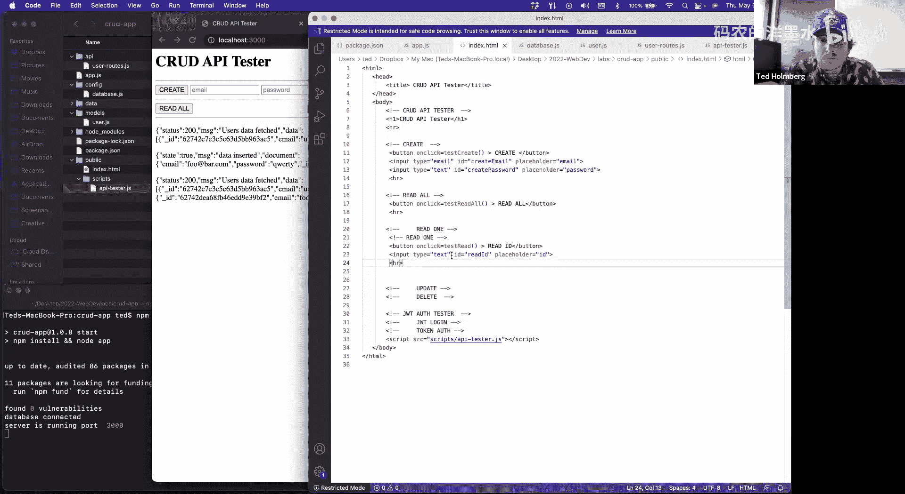

Which means that we have to do a callback function on that button click。

 so we're going to create a function called test read。

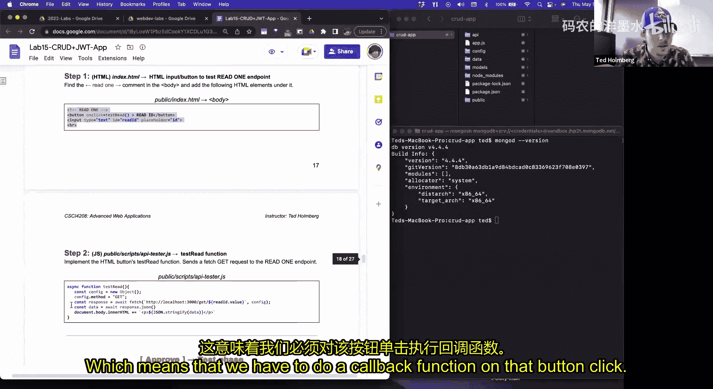

which gets invoked by this button here， test read， so let's go into our API tester。

And it's going to again be an the asynchronous function because it's got a way for our web server to go ahead and deliver a response。

 but what I'm going to do here create a new empty object this is also to be a git method right so the method' is going to be a gi and so since it's a git method I don't need a header I don't need a body so what i'm going to do is i'm just going to go ahead and issue a git request where part of the URL is going to be the ID right so in that field I'm going to grab the value that the user put in and make that part of the fetch URL。

And then I'm going to wait for that response and I'm going to grab the JSON from the response and then I'm going to go ahead and append that to by the body of my HTML document just like what I have been doing so let me save all that I think after I do that I can go ahead and check and evaluate see if this is working so let's relaunch our app and see if we don't get the new functionality on our client side and see if it's not supported by our backside。

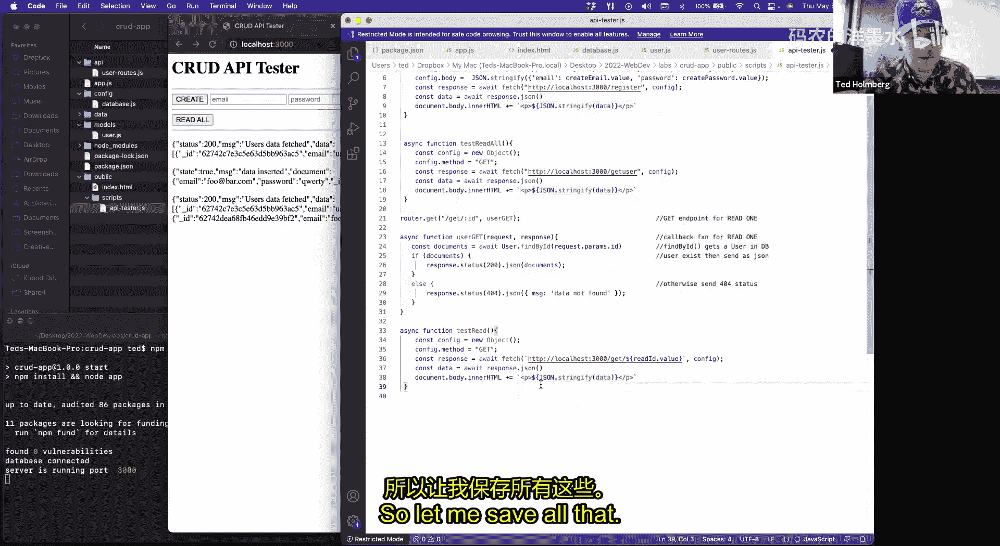

Our back end Okay， so there we go we have the ability to read ID now I don't remember those ID so let me do this let me read all grab one of these Is here oh no I should actually grab it。

I'm going to put it in here and I'm going to tell it to read that ID。And there it was。

 and there it is right here。Wait， oh， that's not a great ID it's going on。

Let make sure everything's saved， got saved。IGet。And index on HTML， test， read， read ID。

 that all looks good to me。And let me go to the route that we set up request responsese user。 find。

Oh wait， do we add in， I don't think I。没人来也。Did I actually add， I think I talked about my endpoint。

 but I never actually implemented an endpoint。Okay。

 well kind of important to implement the endpoints and I'll spend time talking about them Okay。

 so now I have my endpoint defined。And the callback function for it， so let's kill the server。

 relaunch it now that it's actually looking for a fetch there。😊，And let's read all here。

 let's grab this ID。Let's put it into this field and do read ID in there then you see we got back the one ID so based off that ID I can then fetch the document that thing gives me the email and the password and things like that。

 which is important because if I use the ID in my web and like we'll see in a moment I'll be able to get back all of the associated data for that user。

Okay， so the next thing I want to do is。You can see how quickly we're burning through there's only 10 goals I'm already on goal7 here now all of these become very simple to implement once you have everything up and running and this is what the development cycle should kind of be like when you're developing up here your app provided you have all the documentation that you have in place。

Okay， so my the next thing I want to do is I want to update one of the user datas。

 so here what I'll do is my approach will be to define a rest endpoint in my app router to update a user document in my database。

So let's set up an endpoint to do that and let me do that now and then i'll talk about the code so I don't forget to add my endpoint in so here what i'm going to do I'm going to define on my router on a put request so for creating。

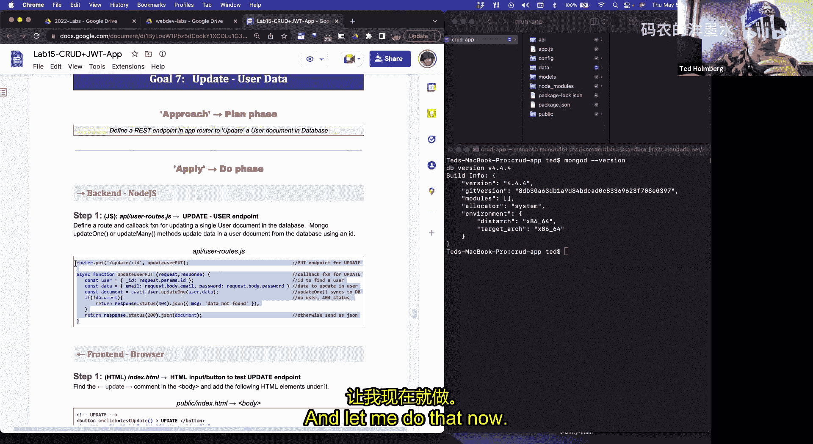

We use post right for for reading， we use getss for updating something that pre exist the method you should use is a put。

😡，So we're going to put。For a put method at this URL so at slash update and then we're going to use a parameter just like what we did for the Gi right of where the ID gets passed in here。

 we're going to invoke the user update put callback function it's an asynchronous function because again we have to deal with our database're going take in a request and a response what we're going to do is the user we're going to create a user document here that's going have the ID underscore ID so the ID that's used in the Mongo database for each of our documents and we're going to grab from the request the parameters of this ID here that got passed in。

And then the data we want to actually update we're going to put in another object。

 so here I have this object， so the two things that we can think of that are actually mutable are the email key and the password key so we'll wrap those up in a body that will be put that will be sent as part of the request from the client and we'll update the state of that right we'll put that this is the key new key value pair we want for the data and then we'll tell our user。

To update one where it's going to use the the first parameter to search for the document to update and then it's going to use the second parameter as the new values for the contents of that document and then after that request it's going to give back the new document。

😡，That's been updated， then we'll check if that document doesn't exist。

 then we'll send back a 404 status and we'll send back a JSON that says hey。

 that data doesn't exist that data wasn't found and if we do have something that exists then we'll just kind send back that data with a status code of 200 that it was a success。

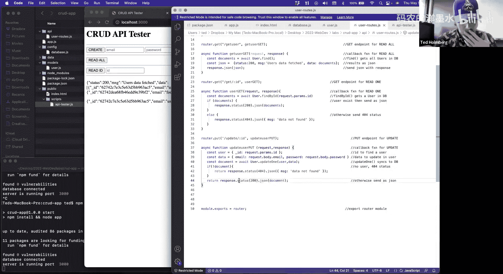

。Okay， so that's it for the back end development now to actually do something with that we have to go ahead and do create a something on our front end。

 so why don't we go into our AC page and actually find where we have our stubbed out update method。

Here。对。And implement that so here i'm just going to create a button that'll go ahead and trigger the test update method which is going to send a fetch to the back server and then I'm going to have inputs that's going to have to go into the request for it to be satisfactory by our backend server so I have to be able to provide an ID and email a password all to update a user document。

And then once I do that， let me go to my API tester JS's what I have my client side code。Yeah。

 for any reason， let me go ahead and go into here。

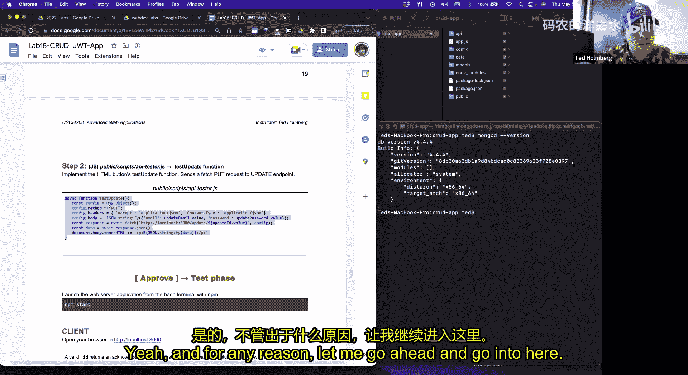

Oops not that okay so now I'm going to create my function test update inside of my JavaScript。

 my client size JavaScript here， I'm going to just create a new object that's going to be my configuration object where I can define oh。

 the method that we're going to send to our backend server is going to be a put the headers。

 well since we are going to put a JSON in the body。

 I have to put in the headers that it the content type of this request includes a JSON and to accept the JSO。

And then the body， I can then go ahead and then pass it in。啲。Contents of the object， so email。

 a key of email and a key of password and then I'm going to access the HTML element。

 the text field that has the value for the updated email and has the value for the updated passwords I'm describing grabing that from the dom and then i'm going to stringify that so that it could be part of our request。

So keep in mind the ID is coming from the URL right so the ID is going to be part of the parameter。

 the variable parameter inside of the endpoint， and then the body is going to contain the contents we actually want to update。

And then we're going to send that to our back server our web application。

 then we're going to wait for response which should give us some JSsonN response right looking back here。

 it's going to give us either a message not found or it's going to give us back the updated state of that user document and then what we'll do is we'll just go ahead and。

As that response to give us the data we'll strify the data and add it well pined to the body of our HTMLL page。

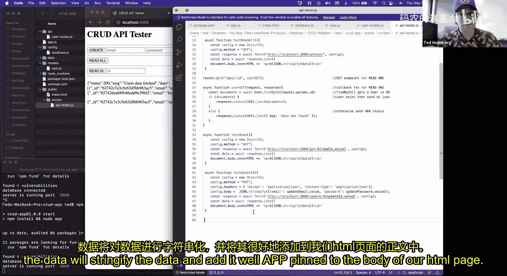

So that's going to be it for update let's test it out just on the client side and see if we don't get a new option that we can then update one of the things inside of our clients so let me go ahead oh yeah。

 restart my server。

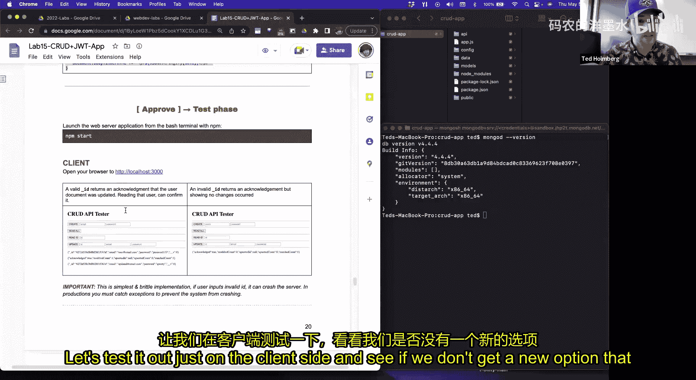

Let me refresh my page here notice I now have a new option to update in order to note what I can update let's just do a read all okay let me grab this one here let's do fo bar here。

And I'm going to update based off of that ID， I'm going to keep the same name。

 so I'm going to do fo@ bar。 co Actually， let's do bar。net。And then instead of Q T， I'm going to do。

哦。The Q T backwards Y T R E WQ perfect and I'm going to tell to update and here I get this code。

 I get an acknowledgement。That oh yes， we've acknowledged that we've done that and we've actually modified the count by one so you've modified something。

 so then if I actually go and read all I can then check the state oh yeah。

 look the email for that document with the same with the same idea I can even just read that one ID since I still have that。

So that ID， I could see， oh yeah， the emails actually changed to dotnet and the password is now quarterly backwards。

So and so if I were to put in an ID that was not right， let's say it's that with email@ email。

com right and password forward 123 right and if I hit update I crash my app because it's not full tolerant enough。

So that's that's an illustration of where here you have to kind of be。

You're going're going to want to listen for those if you use this as a base case。

Because if you don't hit this the strict requirement for the IDs。

 if you're using that as a lookup mechanism， you're going to get a error on your。

Here you can see you're getting an error that says， a， this doesn't quite match。

It's probably going to give you a casting error trying to turn it into an ID so this is a error that's caused between the server and the database trying to connect with information you're getting from the client so you want to protect against that if you're going to actually develop this this example lab into part of your project。

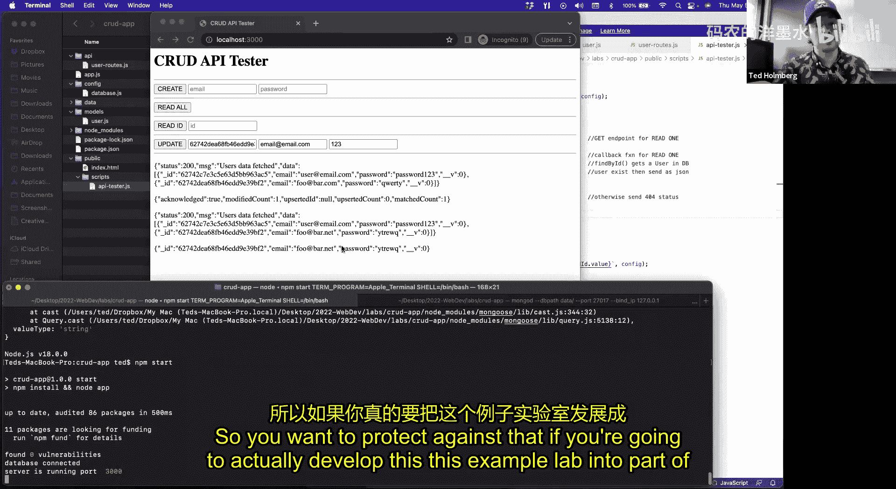

Okay， for those of you， I think this lab is actually mostly I only have a couple more steps。

 so I am going to complete it so it's all in one video。

 but if you can't stay any longer feel free to watch later after I post on to YouTube。

But I'm going to continue on because I only have one more operation than I want to do for my CRD operations。

 I want to be able to do the delete operation and so here the basic approach is I'm going to define a restM point in my app。

That allows me to delete a user collection from the database。是。

So let me go into my user。Rooututes here。And add a new endpoint that allows me to issue a delete to my database。

 So here on my router on a method。For a HP method of a delete， so again。

 we can map the cru operations to one one to one correspondence with the ECP methods post means to create read。

Means to get。Update means to put and delete means to delete。

Excellent so on a delete method we're going to the URL of slash delete slash and then we're going to use this variable parameter right so we'll be able to from the request have a parameters。

We will invoke the delete user delete callback function and in this function again we're going to pass the request response objects。

 the Express says that for us。And then here we're going to use that user model from Mongos we able to sync and call an invocation to our database to delete one。

 and we're going to pass it in an object that the key is going to be the ID key that Mongo uses for IDs and the value is going to be coming from the parameters of the endpoint from the URL that the user submit。

And then we're going to assume that the status is 200 and that the user data was deleted and we will return the document that returns back to us and then we will send that response as a JSON response to our client。

And so the next thing I want to do here is actually go to my front end and move to my front end development。

Where I can actually set it up so I can make a call to the back end service to that new endpoint。

So here I'm just going to create a button that's going to do on a click event invoke test delete and then since I need an ID to delete I'll create an input field that has an ID so I can access that inside of my API tester script。

And then what I'm going to do here is I'm going to go ahead and define my function。So again。

 asynchronous function since we have to wait for a call to our web server here for the configuration it's going to be Me type delete。

And so we don't have to have a header or a body for delete we can just issue a fetch to the URL because we're going to grab the ID as part of the URL itself。

 so config just holds the method type that this fetch is we'll wait for that response from the server we'll extract the JON from it and then we'll pin that to our documents body。

Enter HTML。Okay， with that said。Let me start up this lab and。

Let me go and update this page and now I have the ability digital delete so let me do read all here。

 let me grab this。Right here。This first entry user@ email。

com with a password or password one two3 i'm going to give it the ID to delete that notice user was delete it I get a true acknowledge the number delete it was one so if I go back to read all I can see yeah look at that only have the one item here and actually let me see what happens if I try to delete the last thing inside of my collection let's delete that。

And says oh I deleted another one user data delete it and let me go to read all and there we go we see that my collections is now empty there's no data in there and so let's try to delete the same thing again。

And here you see I get back still a success message， but the number of deleted is zero。

The delete account here is a nothing was sub deleted because there was nothing to delete。

And notice I can pass in IDs even if they're not there without crashing the system provided they're in the proper format so you can't just like for testing purposes you just can't delete things like I did because again。

 it shows how like how brittle this is if we're not doing try catchchbox and trying to protect against those errors。

Okay。So the last part of this lab is's only two more steps left in this lab we're done with being able to set up a basic web server that delivers static HTML files we're done connecting to a Mongo database and being able to issue cru operations from the client to the server from the server to the database and relaying that information back to the client the only other thing that this lab might be missing if you want to use it as a framework to kind of build your own fullsec application is a concept of authentication Now we've already look at sessionbased authentication but let's take a look at the JSON web token implementations as well it pretty simple because you don't have to do much on the server side to manage anything it all gets managed really on the client side。

So here， what we want to do if we want to try to use JSON Web tokens or JWTs is we want to find a login endpoint in our app that will allow a client to essentially get a token to be able to get a JWT token that can then use。

With future request。 so we'll create a login endpoint where the server will generate a token and then deliver that to the client。

 So there's a module。 if we want to do this， we need the module Json web token。

 So let's go to our terminal here。

And we'll just use MPm to install JO Web token。Excellent， so if I go to my package JO， we can see。

 yep， it's there now。

Go back to user routes。And then the next thing I want to do after I've installed that is actually want to go into my user routes into my API because that's where I'm going to be issuing tokens from right when I call that endpoint login so I'm going to have to use the JSON web token to be able to generate a token。

Okay， so let's go ahead and implement that we'll step through。开 account。

So I'm going to import the JSON web token module here。

 then I'm going to define my new endpoint so on a post request from my client at the endpoint slash login I'm going to issue the callback function login post so this is again going to be a asynchronous function。

Because we're going to have to issue a command to our database。So。

What we're going to do is we're going to extract from the the request the body。

 which is going to be the user data inside the user data。

 we're going to go ahead and grab the email from it。And we're going to ask the database， right。

 we're going to make a call to the user。A collection to find one and this particular email emails you should be unique in our system that's an assumption so we're going to find one of that email we're going to tell to execute it。

And then deliver us back that one thing。Here， so well then have this user， if user doesn't exist。

 then we're going to send back as a response a 401。And say that that was an invalid email。

If the password of the user doesn't equal the password that was sent in our request。

 then we're going to send back a status ofpho401 and that it's an invalid password。

And so if the user existed and the password was the same。

 then we will go ahead and then create this object that is a subject and the value is the user ID so this is effectively the payload this is what we're going to encode into the token so the user ID will allow us on the server side when we get the token with a request to grab that user from our database and access things like the email or the password or anything else that this request might or this request might look to either get or update or delete or or what have you。

Then we're going to use JWT to create a signature using the payload。

 right the thing that we want to effectively have。😡。

Reference to on the server side without maintaining a state of it and a secret key now clearly you wouldn't just use the word secret key here。

 this is a hacky implementation you probably have something in a dot env file that would be the secret key for your JWT much like what we did in the other lab but for brevity's sake we're just going to use secret key here that's going to create a token then we're going to deliver that token to the client and do status 200 it was the success and then we'll。

Excellent。

So now let's go ahead and update our front end application here where we can go ahead and just simply utilize this so let me go to index。

html。

And。I think here。😔，Perfect。And we're going to。We're going to get two birds with one。

And update so we're going to create a new header that says JWT off tester and a horizontal rule and then for the login portion we're going to create an on click button that'll invoke the test login which will send a F request or a backend server and we're going to have two input feels right one for the email and one for the password because that's typically what you need to log into the system。

So let's go ahead and actually implement that function that's going to send the that。

So let's go into our API tester。And here we're going to create an asynchronous function test log in。

 we're going to go ahead and define the contents of our fetch it's going to be a post method。

We're going to create a header since we're going to encode a JSON into the body with the email in the password where we have to have a header that lets the server node to accept JSONs and that the content type is of a JSON and then for the body we're use JSON do string ofify so that we could encode this object。

 this JavaScript object with the email and password from the text inputs。

And then we'll send that fetch， we'll send that fetch to dash login， right？

To our our web server and then with the configuration data we just set up there and then we will wait for the response。

To come and from the response we'll extract the JSO and we'll take that JO and we're going to do two things with it since this is for authentication remember it now becomes part of the client side。

It becomes part of the client role to do something with that token right to manage the token the server no longer manages the data。

 like in the previous mechanism we saw， so here what we're going to do is the token that's inside of the JSO that we get delivered we're going to put in our session storage or we're going to put into our local storage or we're going to put it in an inmemory variable but we have to store it somewhere I'm just going to store it in session a storage but word of advice。

You want to make sure that this is destroyed， you want to have an expiration date on this if you're if you're using tokens。

 you don't want them to last long， usually the safest way to do something with tokens is just to put them in an inmemory variable but I want to show off session store so I'm going do that but just keep in mind this could allow I'm doing this to show you what the security risk of using tokens are and I'll show you that once we start doing validation with the tokens which is in the next step anyway once we do that once we store the token we'll then also display the results into our dom andend it to the body。

Okay， let's actually test this out。Let me broaden my app。Let me refresh my page。Okay。

 now I have a Json web token off tester。 Let me read all here。 Okay， oh。

 I don't have anything in my database。 Oh， perfect。

 So let me see if I could do user at email dot com with a password of just 1，2，3。

 Let's do a login with that。 and look at this。 I got a message invalid email because it's not in there。

 Okay， so let's create that user at。😊，Email。t co with a password of。Password 1，2，3。 Okay。

 let's create that。 Okay， so we've created that。 So now let me go into my login here and do user at email dot com。

And let's test1，2，3 login now we get invalid passwords we found the user and we didn't find the password so let's do that one more time user at email dot co and let's do password1。

2，3 and do a login and that's our token and look we have that saved now in session storage too So if I actually go in here my developer tools and look into local storage inside of my。

Get item。Token， all wait。W is my item called in there？Oh， not local sort， session storage。嗯。Oh。

 not Css's storage storage。Autcomple， there we go， and that's our token。

Now to illustrate we can actually use this token to then access a protected route。

 let's create a protected route， let's do a verification on a token so let's define a token verification of middleware function and a protected endpoint in our apps router so the first thing we want to do here is we're going to create a middleware function that verifies the token so that if the token doesn't exist or it's the wrong token we send back a response that prevents us from going any further。

 but if it is the valid token will add the subject of the token will the payload of the token。

 the user ID of the token into the request so it could be used by the next subsequent sequence of calls inside of that chain it's to decide that request response chain。

That happens between middle wares all the way to the final callback function that sends the response。

Okay， so let me go in here。Inside of not my API tester， let me go into my user routes。知。

And we will add some code。 so here I'm going to create a function。

And this is middleware so it requires a next function right so I'm going to do some operations here onmic and responses if it doesn't meet the criteria I'm looking for。

 but if all my criteria are met I will add additional information into the request and then invoke whatever the next function in line is。

So the first thing I want to check is if the request doesn't have a headers and inside the headers。

 it doesn't have authorization， then I'm not verified then I can't verify the token so I'm going to send back response of 401。

And I'm going to send back a JSON message that is an unauthorized request。Now。😡。

If that authorization does exist， then it's going to be a。😡。

Ber and then the token so it's going to be a string that contains bearer space and then token so i'm going to split that into two parts and I'm just going to create the token part we're going to see this when we implement the HTML side but essentially what I'm going to do is I'm going split the token from the rest of the label and i'm going to save that string here so this is a string now if the string is null then again I don't have something I can verify so i'm going to instantly just send a response now and not move any further back to the client with a 401 and then the JSON message of unauthorized request。

Now。😡，If the token is a valid string， then I'm going to verify with JWT。

 the thing that generated the token with my secret key。

And that's going to deliver back a payload or not If the payload doesn't exist。

 then I'm also going to send back a response of status 401 and a Json to the client that hey。

 that was unauthorized request。 So those are all possible cases where。

I am not verified where it's not where there's no access to give now if I make it all the way down here and I do have a payload then i'm going to grab from that key remember the subject let's go back up here so we can see what is subject。

😡，Here， log in post， so when we log in。We generate the token yeah， here， it's right here。

On this line right here， the keyest subject and the value is user from the user that we found right that we looked up。

 we're going to grab the ID as it is in the database。

So I'm going to grab the value which is a user ID and I'm going to buy that I'm going to add a new value。

 a new key into the request object of user ID so that anything moving forward after this function can then look up user ID and use it maybe to do a look up inside of our database or other databases。

 other collections if necessary for whatever you're looking to process now for what we're going to do we're actually going to create our endpoint。

 which is going to be a special endpoint it'll be our protected endpoint。😡。

So here I'm going to create all my router I'm going to listen for a get request to this this endpoint special and i'm going to use my middleware I'm going to pass in first the verify token so if I don't have a token。

Or if the token is doesn't get verified by JWT module。

 then I'm going to send back a response before I ever get to the rest of before I ever get to this other callback function so now if I do get to this callback function。

 which is special get。😡，Then I made it through this middleware which means that my request object should now have a user ID。

 so what I'm going to do is I'm going to access from my request object that user ID and I'm going to create an object that then has the key user there and then I'm going to send that back as a response to show that I'm getting back the ID of this user。

😡。

Okay， perfect。So show that this is a protected wrap。

 So now let me go and let's actually go into our front end now that our back end is done and find in our index H where we have this to this token authorization and let's go ahead and add。

Some HTMLL elements in there。A button that invokes the test all that's going to send the fetch to that protected route。

 so then let's also go ahead to this method。

Inside of our API tester not inside of our user route sorry no yeah。

 API tester not client side we're doing client side now， so an API tester。

I'm going to create an asynchronous function because we're going to do a back end request so inside of my configuration object I'm going to create a gi method so we're going trying to if we look at the user route right this is a gi。

We're going to send it to and then we're going to do we need a header if you recall。

 so this is where you get an idea of what we're splitting here。😡。

We're going to create an authorization key inside of our headers and the value is going to be the bearer space。

😡，And then we're going to append to that， or we're going to concatenate to that inside of our session storage that's where we're currently saving our token。

 so we're going to get that item of token and we're going to concatenate that so that the value here is going to be the wordbeer space and then the token。

 this token here。So again， let me just go back and restate this that what we're doing when we go and do this split is we're splitting on the empty string between the word bearer and the actual token then we're getting the second element in that array right index0 would be bearer index1 would be the token。

This right here。And then we will send a fetch to that and then we'll see what we get back as a response。

 and then we will take the data from that response and we will put that into our。Body。

 the body of our HTML document on our what's rendered in the v port。Okay， so let's rerun our server。

 let me refresh I have special perfect， let me hit special and look at that user ID now and why why is it able to do that without me logging in because of session storage in fact if I go into my session storage here right and if I say oh let's go to token and let's let's wipe that let's let's reassign that。

To just be blank right so now let me try that again let's do a special and look at this actually crashing my system。

Here。Okay， let's okay， so let's see here。So yeah， if we don't have a token or。Let's actually do this。

Probably the safer way is to do a clip。Okay， there we go。Okay， and anyway。

 let's let's actually get this working appropriately。

Yep okay so when I clear it out where it doesn't try to pass it in a blank string right because all I did was overwrite so we had to remove token entirely otherwise you see how brittle my system was what was happening was I still had a token key inside of my session storage but it was passing a blank string and that wasn't a valid token to look up and that was causing issues and again you should have try catch blocks inside of your rackend server so your frontend doesn't make your backend just spas out like that。

But now that we don't have any token， you see， I get an unauthorized request message perfect and that's what I want because that's that that means without logging in。

 this is the default thing。Now if I log in actually。

 and let let's do this let's let me get the ID again because we're logging in with IDs。

 let me grab the ID， oh no， we're doing emails。So let me try this so I could try user。At。

Email dot com。And then we can do。Password1，2，3 let's log in Okay。

 so now I got a token and now let me do special and add now it's working so that illustrates how we can use jascript web tokens to be able to issue a token to the client and the client can then reuse it and get very specific information back right like if I go ahead and log in with someone else let's create a new user let's do like at bar co and just do one23 so let's create that user and then let's go in and log in as at bar。

 co and123 I'm going to log in。Going to get new token I'm going to hit special and now I'm going to get a different Id right different user。

 In fact， if I open this up in another， let me do this Let me do a new tab No not new tab。

 Let me do a。New window。So that was an incognito window， right， but if I go here and do local host。

Let me just clear everything here。 Okay， so now let me log in as a user at email。 co。As'sward 1，2，3。

Glog again okay， so now I on this window I'm getting this user right and on this window I'm getting this user and so notice those are two different users right those are two different I this send in a46 this sends an a5 big。

So you could see like the giving different unique responses from my web server based off of the tokens that were issued to my clients now I said that there were security implications here and that you want to make sure your tokens expire they should be out of memory when the application closes on client side and this is why let me show you why why that's the important part let me go here to get the the not local storage session storage Okay so let me get the token here。

So here is the token。Well， anyone who has this token since it's stateless right so the servers relying on the client to like ensure that they protect this themselves they're going to use it and any request that has this token they'll go ahead and give back that data on so if I somehow am running a script along this website let's say it's an ad script and let's say that it's inspecting the contents of my session store to my local stores and it sees a token in there it might copy that right because it's running the same JavaScript runtime environment as my other code it it might take that and then it might run that script。

Or it might run that over here， so let's say I stole that。Token。

 copy that token now I can pretend to be the user。Because anyone who has a token is essentially that user。

 so let me go to my developer tools here。And let's go to my session storage here， right？

And I'm going to replace my token。With the one I just stole。The one that I just copied。

Don't like double， okay， there we go。So now before that this was my original ID。

 but now when I click special again， look I'm now grabbing the information from the token that was over here so again。

 that's just a little bit of a security consideration you should have when using JavaScript web tokens make sure please please please that you destroy them properly because they could be utilize for accessing data。

In ways。Excellent and that's that lab we've looked at everything to build a pretty much basic simple full stack application in the span of about。

A little under two hours， we connected to a database， we put up we loaded a database。

 we did card operations and we did some authorization using JW2。Sure， I'll。

 let me finish this recording then I'll help with whatever issues you're having。

I just want to make some future improvements I would do here clearly I would improve the fall tolerance to catch errors on the server side and prevent crashes from clients doing dumb things I'd also prevent things like duplicate emails and not really checking for that try playing around with deploying this in production and actually using heroroku and Atlas and other like platform as services so that this was actually reachable and add a functionality into this fullsac app so that it actually has a purpose right now this is like a bare bones example of a full stackac application but doesn't do anything it allows you just to test pre operations and then evaluate what's being given back it allows you to give a token JWT token and then see that you can actually like protect a route but a fullsac applications should actually have a purpose for doing all of those services and that's really what your project will be to do。

But not too undifferent from this。Okay。Excellent and let me and that's it。

 that's this that's the lab。

