# 【全集】加州理工学院 高级Web应用 中英字幕 1080P p23 Lecture 23 - MongoDB增删改查、REST API、JWT 身份验证 -BV192zTBrEmu_p23-

Okay， welcome to a new lab video we're going to work on a user authentication lab so what's probably going to be the case for a lot of you is that you are going to want to be able to create custom login profiles for your full stackac applications and this lab will be a good reference point for you to be able to do that but we're going to cover a lot of different concepts in this lab and you'll be able to break it apart and use the parts that you might want to use based off of your own architecture so this is going to be user login lab we're going to learn how to use the passport module in node。

And BCrypt will use in support of Pass， passport will handle a lot of the authorization authentication logic for us。

 willll learn a little bit about serverside rendering of HTML pages as well using EJS or embedded JavaScript。

 an alternative to EJS is also Re， which we'll take a look at a little bit later in the semester。

Or it is coming up soon and so yeah the big the big point of this lab is going to be to cover authentication models and we'll build a basic user login page。

And so this is going to be a relatively big lab because I wanted to cover a lot of different concepts here。

I would not be surprised if this gets split across multiple sessionss。

So the first thing we're going to do just like every other lab is we'll go through the lab introduction and introduce all of the new technologies that we're going to be covering over the course of this lab。

Then the next thing we're going to do is talk about how we go ahead and design a user login app and just effectively some of the mockups we' produce for that so specify the routes and the views that the user login app will have the next thing we'll do is we'll just go ahead and set up a simple server。

That we can then iteratively build to be more and more complex until we have completed our project。

After we get our simple server， we'll go ahead and use EJS。

 which I'll introduce in a moment to be able to render a serverside HTML page and deliver that to a client。

After that， we'll learn how to use EGS to embed JavaScript into HTML。And again。

 this is for the purpose of re enteringing it on the server level into an appropriate HTML file and then delivering that to the client。

For goal four， we'll go ahead and set up a login and register pages in addition to the index page for goal five。

 we'll go ahead and display the register and login forms。Once we have the forms。

 we'll start allowing post requests to be made to our web server from those forms。

And once we get data from the client， then that'll motivate us to start defining data models to represent a user object on our server side。

 so we'll go ahead and manage that responsibility once we have users inside of the backend server。

 we can go ahead and start talking about playing around with client sessions in Express so that we can recognize when the same client is issuing requests to us。

Once we can identify。The same client via S we'll go ahead and talk about how we can use Passport to authenticate a user。

Once we've authenticated a user， we'll also use passport to be able to serialize and decialize users。

Then we'll play around with some backend modules， flash messages is one such module that allows us to pass messages using the request object to the back end of our application。

Well we'll talk about how we can protect routes and by protect routes。

 we can ensure that routes only accessible if the user has been authenticated or if the user hasn't been authenticated。

 so you'll have to be logged in to access the homeage or if you're not logged in。

 you'll be able to access the login or register pages。😡，After we've protected our routes。

 we'll give the option for a logged in user to log out。

And then we'll talk about using BCryip to be able to hash our passwords so we don't save them as plain text。

We'll talk about using dot Ev。n environment so dov to be able to hide secret information that shouldn't be pushed onto GitHub。

And then we'll have our concluding notes， so it will be a very diverse lab。

 but one that will be filled with lots of good content。

So let's hit up our introduction so there's no pre rec to this lab this is the first lab in the user authentication sequence。

The motivation behind this lab is to learn to use Pass and beCrypt in our express applications。

The goal is to build a simple user login application using serverside HTML rendering and there's going to be all sorts of new learning objective source in this lab。

 so again we're going to learn how to use passport。

 we'll learn what a local strategy is as it relates to passport we'll learn about protected routes。

We'll learn be crypt and how that will help us ensure that the passwords we're managing over are safely stored we'll talk about express sessions。

 which will allow us to identify clients。Repeat clients。

We'll use Express Flash that allow us to use the request object to send different messages across our middleware。

We'll use eJS short for embedded JavaScript to be able to actually start implementing HTML on the server side now i'm using this as a proof of concept that you can use the information from this lab outside of just eJS you could instead of using EGS deliver JOs to the client which would have the same kind of information or you could use other template engine such as react for instance to go ahead and。

Produce the end of view that's supposed to be provided to the client。

We'll talk more about middleware we've seen a little bit about middleware but well extensively use middleware because that's effectively what passport will be for us and then again we're going to learn about。

v and the importance of keeping hidden information hidden from everywhere。

 including your GiHub reposts。So。In terms of our server site architecture。

 we're going to generate every all of the folders and all of our JavaScript files over the course of this lab so there's nothing there's no template things we have to go ahead and and download so let's go ahead and start to create the project hierarchy now so user dash log and dash app is going to be our directory so let me do that let's make a directory。

User dash login dash app。Okay， I have that perfect， I'm going to now change into that。Okay。

And now let's also go ahead and I'm going to create a package。 Json。

 which we should be familiar with why we need that to set up all of our configuration。

 we'll go ahead and also create a app dot JS， which will hold all of my server logic on my application logic。

Okay， and let's go ahead and we're going to we're going to subdivide all of the supporting scripts or modules into their own directories to organize our code so all of our controllers are going to go into a controller's directory so let me make that。

Okay， all of my middleware will go into a。Where my middleware scripts will go into a middlewares。

Direectctory， so let me make that。All of my models。We're going to go into a models directory。

 so let me make that。And the models directory will typically be one that would attach to your database。

 so a lot of times。What we're going to be emulating in this lab since we're not actually using a database for this lab。

 you would replace this model's directory with one that would be accessing this data from your database or it would hold the logic from pulling this data from your database。

Okay， let's make one for our routes。And then finally。

 let's make one that's going to have our views since we're going to do serverside rendering to deliver to our client。

Okay， so now we have the entire directory structure for our application kind of built out。

 let's move on to the concepts。So user authentication is the process by which you verify users credentials for access to nonpublic restricted data right so so there are some web pages where there's no authentication authorization required right it it's viewable by the general public but certainly there are those pages that you want to have login credentials for and customize the view for that particular user so we're going to learn how to do that using user authentication we're going to do user authentication using passport that's a node module for user authentication and it supports sessions it supportsauuth and suppose supports JWT these are all different。

Mechanisms by which we can go ahead an authenticated user now for this lab i'm going to restrict myself to sessions。

But。Again， there's a lot of different ways to do things with web applications so like feel free to also investigate how JWT works or all so you're not when you build out your own applications not necessarily restricted to do it the way that I show you。

 but for。Illustrating a we're going to use sessions。

Okay so when you see the word local strategy well a strategy for user authentication is whereby the express application manages all of the username and password data that's local strategies so strategies are a way of authenticating Uni user local strategy implies that we're going to manage that logic inside of our own application now this is typically something that can also be outsourced so alternate strategies may outsource this so you say for instance Google or Facebook or GiHub or Twitter and so passport also supports this where you can you can have passport effectively redirect you to a Google login page and Google login will then send back response to you giving you like a token that lets you know that the user has successfully logged in using their credentials and that's an alternate way that we can go ahead and support logins now we're going to just manage that all ourselves for this app so you can understand all the logic that goes into that。

And of course your app may also like supply multiple strategies。

 you might allow for them to use Google Facebook or GiHub or you might have them register their own username and password just your application and the choice up to you and again password supports multiple strategies and of course a protected route is a route or endpoint that request cannot access if they do not have the proper authentication。

 so even though it's a gi request if the request body doesn't have the authentication that is expected by the server side。

 it will usually do a redirect to something like a registration page or login page and so examples may include not accessing the user profile page unless the request comes from that particular user。

Let's talk a little bit about sessions， sessions allow a server to identify fly a client between requests using a browser cookie。

The client session ID is given to the browser in the response from the server and then it can recognize that by。

Checking to see if it has an ID and then mapping that ID into effectively a dictionary of IDs that's currently managing over and that'll be handled through us through a module Express session。

 so Express session is a module we can use for Express app that will manage session cookies and will append session IDs to request objects。

And then we also have a passport session which extends the express session to include user authentication statuses inside of the cookie。

So BCrypt is also a node module it's used to securely hash passwords and compare login attempts to hash passwords so one important thing once we're responsible for other people's data is we should never store user passwords。

In plain text， we should always encrypt them。 So for any reason our application is compromised the。

The actor who compromised or accessed our data set won't be able to access those user passwords。

 they won't be able to know what they are。EJS as I said earlier stands for embedded JavaScript it's a templating engine for rendering server side HTML and can contain JavaScript code so this is one of multiple ways that we're going to learn how we can send HTML documents to the front to the front end one way we've seen that is to have HTML documents that have the JavaScript attached to it and then we do all of our parsing and our rendering on the browser side on the client side and alternate way though is that we could actually do all of the processing of what goes into an HTML document on the server side so we're going to play around with that a little bit in this lab and then an alternate to both those is we can use like a library to do that for us and that's what react game we'll take a look at that later。

Express flash。Is another express module that allows messages to be transmitted across our server through the request object one nice thing about the request objects and the response objects are they're passed across our app over the life cycle from when we first get that request until we finally deliver the response such so a cool thing about that is we can make use of those request objects that are getting passed around on our server side by embedding messages in there。

And then dot Ev is just a node module that allows us to set up a processed do Ev that contains hidden or secret data that should not be exposed to the public or to like GiHub repos or anywhere else。

Where your code might be available to be read by other humans。

And so things like that might be things like hash words that you're using words that you're using to hash。

On or like APII keys or anything else that's supposed to be private to just you。

 you'd put them into effectively a hidden file that gets bloated by the Express app that will then allow you to access that from this process。

😡，Excellent。I the design of our。loggin。对。Our log in。Okay， there we go。So again。

 whenever we go into the designed phase， the initial phase we want to design specify the views and the controls and the logic of our client app。

 we do this usually with pencil and paper before we do any coding to try to figure out what our route is going to be。

 what our review is going to be， what our control is going to be。

 and how the ACP request will be resolved。So I'm going to create three different mockups。

My first is going to be what a traditional logged in page looks like an index page。

 it'll say hi and then whatever the user's name is。

And then I'll have the option to log out and so this is going to be a private profile page for the user。

 so it should be a protected route。😡，So that a logged in user。

Should be able to request it and only a logged in user and so there's one option。

Which will lead to logout， which goes to three， which will go to the log in page then。

Okay let's look at our second mockup which is a register page this will also be a protected route it's a protected route for just public request now what this means to be a protected route for public request which means if a user is logged in they shouldn't be able to get to the register page they should only be able to get to the register page if they're logged out there's no one logged in so that's what we mean by protected route for just public request there's a couple of inputs in here where there's a name email password and then of course when you go and hit the register button that should go ahead and post the form data to the backend server。

When there's one option， right， the login， which we do a redirect。

 it'll do a hyper reference to another page for us and that'll bring us to the login page。

And the login page will provide an email and a password and then a login button。

 and this will also be a protected route such that it has to be logged out user or public request。

The input fields will be used to log the user into their personal profile page and there's one option here。

 which is to， well， if you go to click on submit， it'll either go to one or I'll go to three for an error so that such that you have another a chance to log in。

And then if you register right， there's actually a second option。

 if you click on the register button the register link， it should jump you to the register page。

Anyway， once we understand our mockup we can start building out our project so I've done enough I think basic setup here so that everyone understands what the scope of this application is so why don't we start building this out so the first thing we want to do is start super simple we're just going create a server that listens on a port so before we can even start our server we're gonna have to create our package JO of course and then we'll you know include express and then we'll just scaffold out a simple express application。

嗯。Okay， so let us so we already have our package that JO。

 so let's go ahead and implement all of the information that's critical for managing building and launching our express app。

So let's go here inside of here is our login and we're going to open up our package。

 JSON and so here inside of our package do JSON it's going to look very similar to all the ones we've done before so we're going to give our application a name I'm going to call it a user login app I'm going give my application a version and I'll call it 1。

0。0 I'll give my application a description so that people who come behind me to help manage my application。

Understand what the role of this application what this application is supposed to do。

 so it's just a project that implements user authentication using passport。

The main launch point of our application will be app JS。

 the scripts that we'll be able to invoke from NPM， if we invoke start。

 it will run NPM install so we' to install all of the node modules。

And then it will run the launchpoint script node app。The author will be me。

And then the dependencies that we need initially is going to be express。

So that we can actually start building our express application。

Excellent and so now the next thing we want to do is we also want to create a bare bones express app that will listen on a port。

 so this is going to be very similar to what we've done in the last couple labs。Let's open up our。

H that Js file here。Excellent。And so really， what we're going to do here is we're going to import Express。

We're going to then invoke the express object to create a new instance of an express object。

 which we will then bind to app。We're going to set up a port for us to listen to。

And then we'll have our Express application listen on that port。

 and then I'll just define a callback function as a second parameter that will get invoked once the Express application is listening on that port and here we'll just put a function that will do a console log that says listening on this port。

嗯。Excellent， so now once I've done this， I should be able to test my code。

By just running NPM start which will install all of my modules and then launch my application。

 so let's see if that doesn't work。Let's go here。Type in MPm start and when I do that it's going to。

 let's see here， let's make sure everything is saved。Let's see that's save， let's see that's safe。

 And let's picture sure that I'm in the right directory。 Okay， let's log into the。

 let's change into the directory。 And we have to be in the same directory that's in the package thats Json。

 So now if I do Ls。 Yeah， there's the package that's Json。 So now let's do that again。

 Let's do NP PMm。Start。And yeah there we go and now it's going to do NPM install and it's going to launch the app so it's installed my dependencies and now it's listing on 3000 and in fact。

 if I were to go to let me open up a。Let's go to。So forward to go to local host 3000 perfect I see that there's something that is listening on there。

 but we haven't set up any route so I cannot do a get on there because we haven't defined that but something is launched because I didn't get this so if I got something that didn't exist。

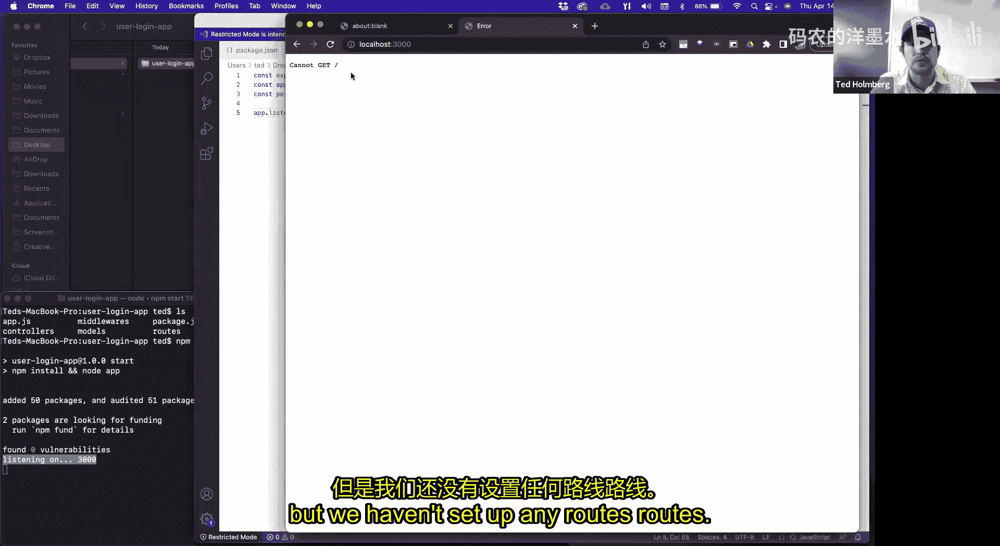

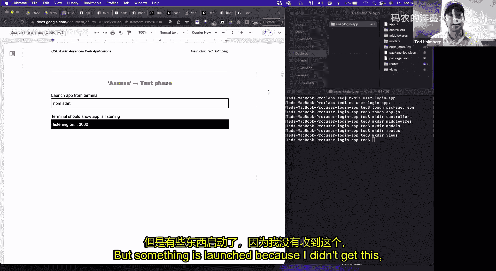

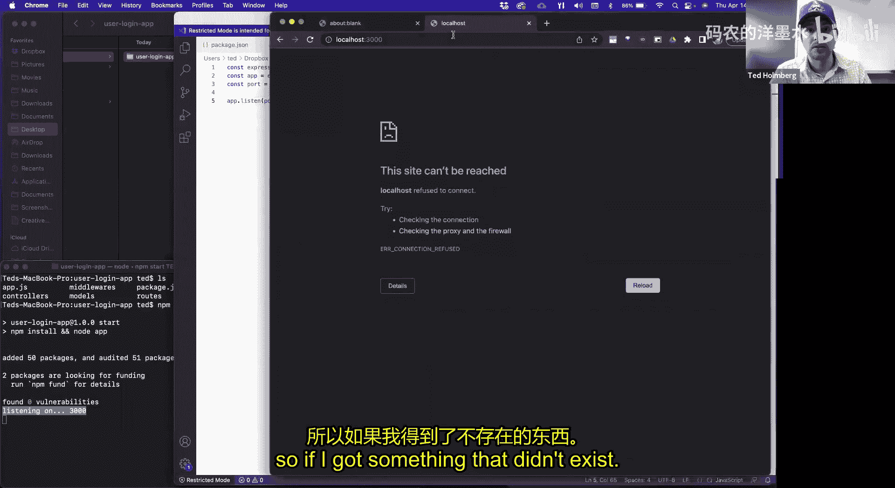

Oh， it would look like this。Didn't need to do this。😔。

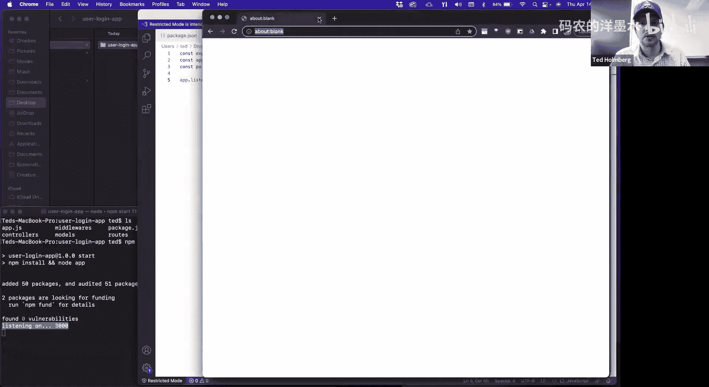

close is that yeah， it would look like this， so I'll go from this site can't be reached if I do a refresh。

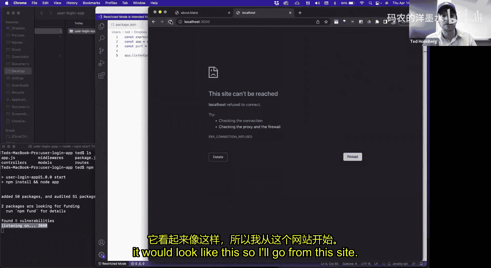

To cannot get perfect。So now let's move on to our next goal。

 where we're going to learn how to use EJS or embedded JavaScript to render some server side HTML。So。

But beed JavaScript is a template engine right that we can use from Express。

So we're going to have five different steps in order to complete this goal。

 the first is we're going to have to import the EGS module so that we can use it。

 so that means we have to in our dependencies of our package that JSO include that so let's go to our Pack JO and I'm going to do a comma after express and include another key value pair EJS。

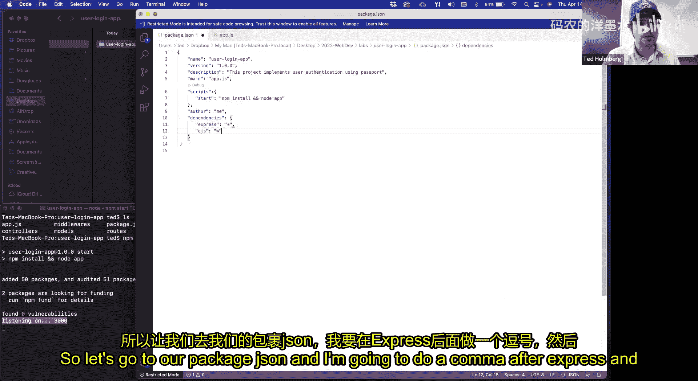

And the next thing I'm going to do is I'm actually going to let make clear of this。

I'm going to have to create a new file inside my views which is going to represent my index page。

 so since we're going to use EJS as a template to be able to process and parse over this document and then produce an HTML from that。

 we're going to use the extension EJS and not HTML。So let me touch。

 let me make a new document inside of the views that will represent the index。 ejs。Excellent。

And then once I do that， let's just make a。

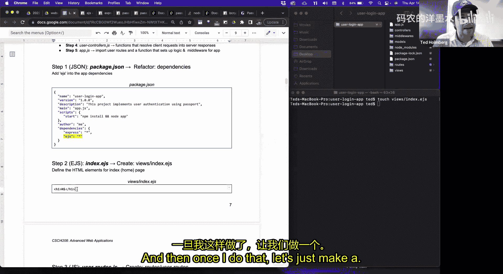

Basic HTML something that'll render a basic HTML page that just saysH。嗯。

So here I'll just do a heading one and I'll say hi。

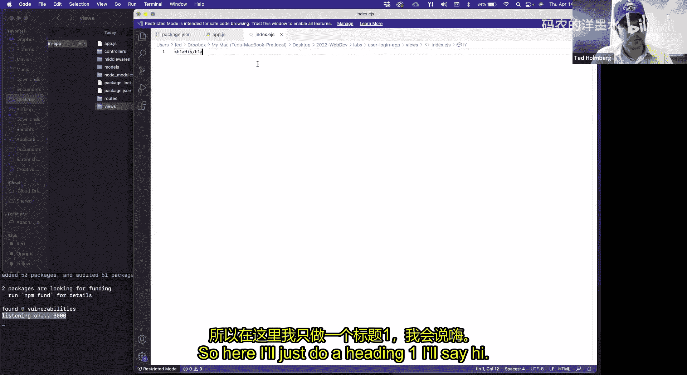

Okay the next thing I need to do is we need to actually set up some routes and some callback function some controllers to be able to deliver this page to the client side。

 so let's go ahead and set that up let's go ahead and so make a new file so inside of routes。

Inside of。Oh， it doesn't exist yet user。Routes dot Js， Okay， so routes user dash routes Js， Okay。

 and then I also want to create inside of。Controllers， a user dash。Controller script。Okay。

 so let's make that。And now that I have a user route， let's go ahead and。

Implement it and i'll walk through the code of what we will be doing there let's go to my routes so inside of routes I should now have a user routes s js file perfect and so inside of there what we're going to do is we're going to import express from express we will go ahead and get a router object and we will bind that to a router variable then what we're going to do is we will import our。

Controllers module， right so that we can get our callback functions and then on our router。

 we're going to set up on a gi method to the index。

To the index endpoint right just the slash we will from the controller that we're going to go ahead and and import we're going to invoke its get index callback function and again we're just passing a reference of the function we're not invoking it so we're passing a reference by not using parentheses as we've done many times in the past。

And after setting up this route， we will then go and export our router so that we'll eventually be able to import it into our app so it can actually go ahead and use it。

So now let's go ahead and define our controllers right because we're trying to use them and our router doesn't exist yet。

 so let's implement that so i'm going to open up user controllers and so inside of user controllers。

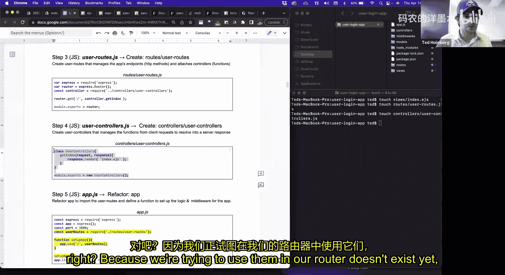

I'm going to create a new class of user controllers inside of this class I'm going to create a method called gett index gett index since this will be a endpoint right to call back to a route。

 it needs to be able to accept in a request and a response object。

And then is going to be responsible for delivering a response。

 so for the response we're going to tell it to render。And then we're going to pass it the index。 ejS。

File that we created。And then we're going to go ahead and create a new instance of user controllers。

 and that's what we're going to assign into the module exports so that when some other module imports from user controllers it's going to get a new instance of this class。

Okay， so now that we have defined our user controllers and our user router。

 let's go ahead and set that up inside of our。App。So inside of my app。

 I'm going to do an import of the user routers。And then I'm going to create a function that's going to be responsible for setting up all of the middleware in my express app before I start listening。

So inside of setup app， I'm going to have app。uses。And on the index directory。

 I'm going to have it use the user routes。That we're going to import from here。

And that are all going to be set up inside of here so recall if I would have put another extension on here like in the in the high low game app。

 then you then client code would have to go to that essentially。URl before it can access the routes。

 but here we'll just make all the well expose all the routes from the index。

And then we'll invoke setup app right here right before we start listening。

So that all of our logic is pieced together before we launch our app because that thought listen is the thing that launches it for us。

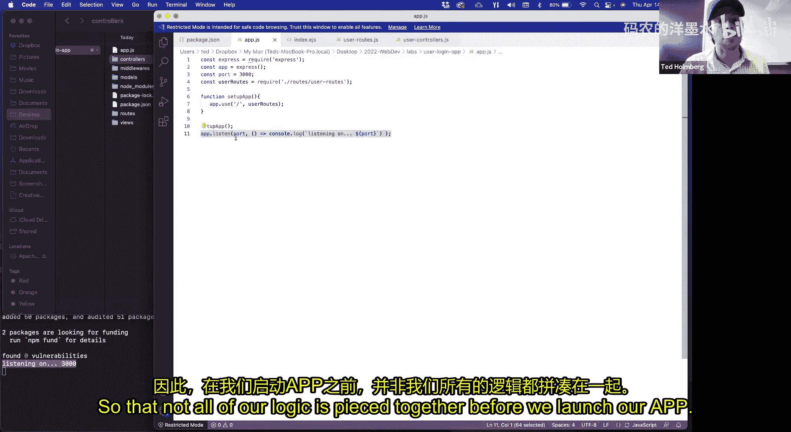

Excellent so now let's go ahead and test this by stopping our terminal if it's I means stopping our script our server if it's still running and telling to do anmp start to reinstall whatever dependencies we've added and to relaunch our application so here i'm going to control seeing。

Control C perfect let to clear this， let's go ahead do NPm start Okay。

 it's going to install my dependencies。Right now it's letting me know that one of my dependencies has a vulnerability。

 I research this just the moments ago it's EJS， the vulnerability is as of a couple days ago。

 I expect it to be repaired hopefully soon。Letss a refresh。And there it is。We now have our。Hi。

That is in HTML format display on our server saw I mean all of。Just went on our client side。

 but delivered from our server。Okay， now。Let me show you one reason why EGS could be a fun thing to play around with in such an application。

 it's because we can actually embed logic， JavaScript logic into the HTML of the EGS and the embedded JavaScript hence the name。

That allows us to embed JavaScript into our app。So first。

 let's go ahead and actually utilize EGS as our view engine inside of our express app so that's going to be something we're going to have to set up。

When we first set up our app， so let's go into that function that we created in app J else right here under function setup app。

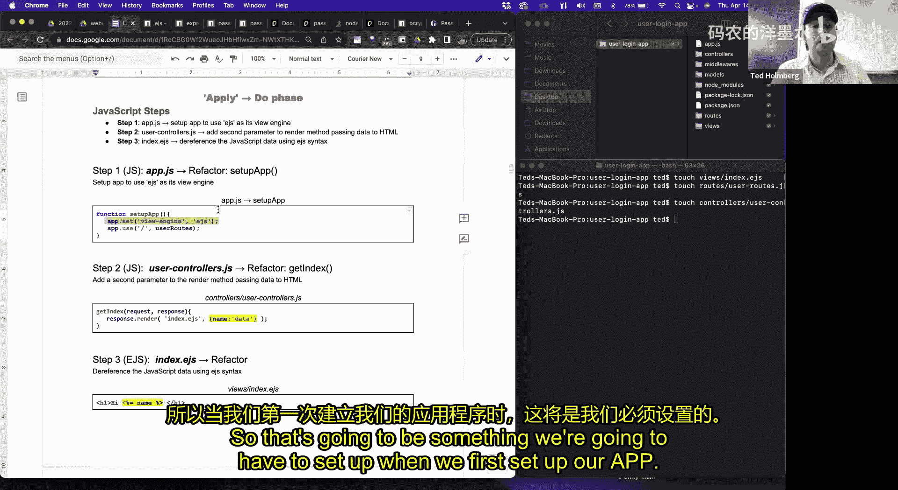

Before I set up my routes。I'm going to tell app to set。😡。

The key view engine with EJS is thus it knows what technology we're going to use as the server side view engine to render out HTML documents。

So now we can take advantage of the full functionality that EJS has。

 and I should have a companion lecture that covers EJS。

The next thing I'm going to do is I'm going to actually pass some variable data。2。EJS。

 when we go to render that response， so let's go to the US let's go to the controllers here。

 the user controllers so here。When I go to my response and render。Index on EGS。

 the second parameter can be an object that has a name value pair。

 so I'm going to create a key of name and the value will be data。

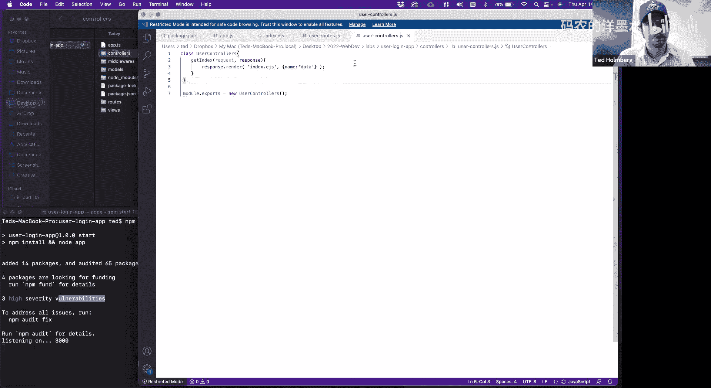

And then the third thing I'm going to do is inside of the EJS we'll actually dereence。

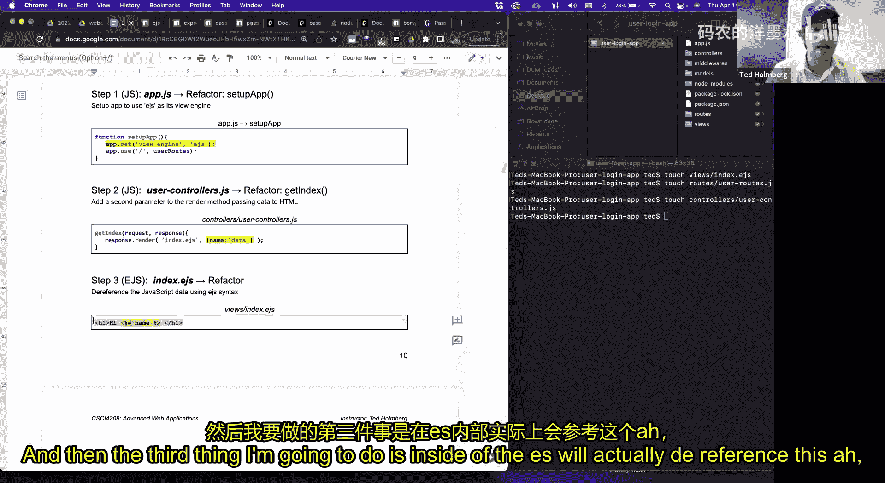

This the key inside of this object that's passed into it， so let me go here， so instead of just high。

 what I can do is I can embed or dereference or do JavaScript like logic by embedding it between these symbols so it's like the less than percent equal sign to start and the percent greater than to end the scope of where you want to embed JavaScript logic and here I just want to dereference the name key which should be of the value data。

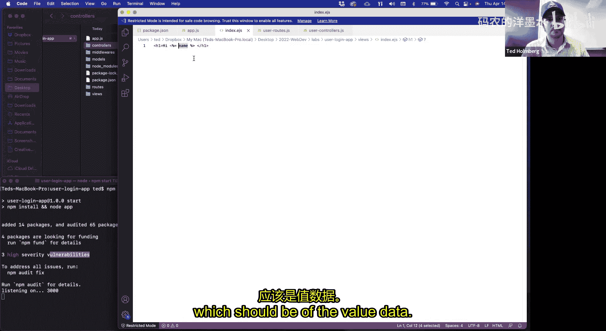

Excellent， once I do that， let's test this out。By doing NPM start， let me see， I actually had a。

You said this already， but this is server rendered HTML right yes so what's happening here is we can't just deliver the EGS file to the browser because the browser doesn't know what an EGS file is the browser is limited to only a couple types of data types in which it supports so。

The initial thing that a browser opens is an HTML document that HTML document can include other types of documents such as CSS documents for styling or JS documents that have scripts in them that it can then parse and then launch using the window object and the JavaScript runtime environment。

If it's any other kind of file format though， is not natively supported by the browser。

 so when we're encoding all of our client side logic。😡。

For to be rendered on server side what we're doing is we're using a extension ejS just another form of this would be like with react react uses JSX right JavaScript extensible its a ja an exible version of JavaScript both of them use the same kind of concepts it requires a backend server to parse what looks to be。

HtMl code or JavaScript code， but in a way that it can produce an actual HTML and JavaScript and CSF document to deliver to the client so the client can actually parse it and view it。

And so what we mean by serverside rendering here is that we're not actually creating an HTML page right。

 we're creating an EGS page and then the server parss that and converts it into an HTML and it might also convert into a CSS or a JavaScript or whatever that can then be delivered to the browser so it can be parsed does that make sense now if I wanted to not use EJS but still do this lab。

The way you might do it is instead of delivering instead of。

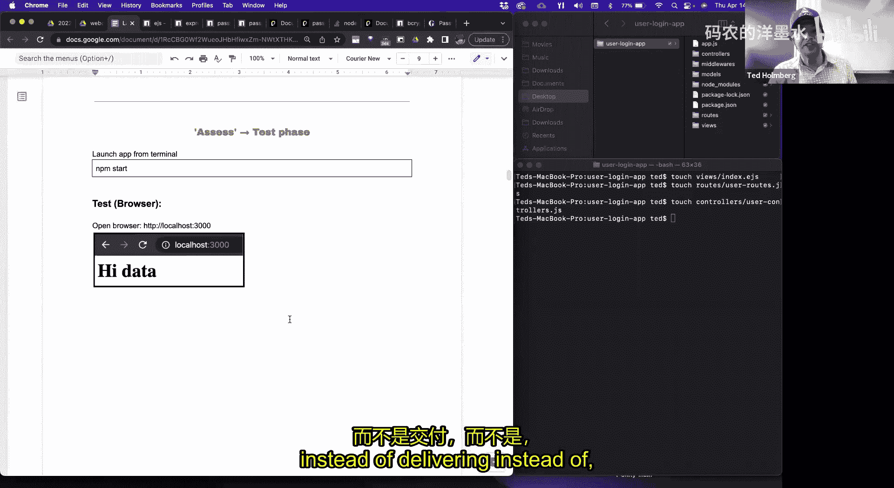

Sending responses， let me go here。So instead of sending responses that are EJS files right I can instead deliver JSON objects to the client and so if I had all my logic pre-implemented on my client side so that it expected the server to give me back a JSON that had let's say this name data then my client can then receive that and then do all of the logic of rendering it right so this is just a different approach to do what we've already done and if you wanted to use these concepts but use it in a way that we've done another labs instead of rendering with EJS you would just deliver a JSON that had this and then your client could accept this and then render dynamically with whatever data gets back kind of like what we did in the last lab with the game with a high low game。

So I'm trying to illustrate that even though we're using EJS for this lab。

 you can still use this lab in ways that go outside of it。

 it just shows an alternate way do things already to do things we've done already。

And again， it'll be like that again when we go and take a look at Re。

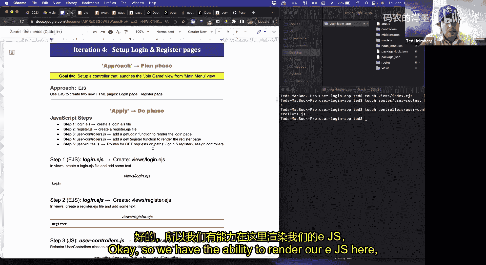

Okay， so we have the ability to render our EJS here。

 right that's the last thing we really took a look at。Which when it's delivered to our client。

 it's converted into an HTML document。

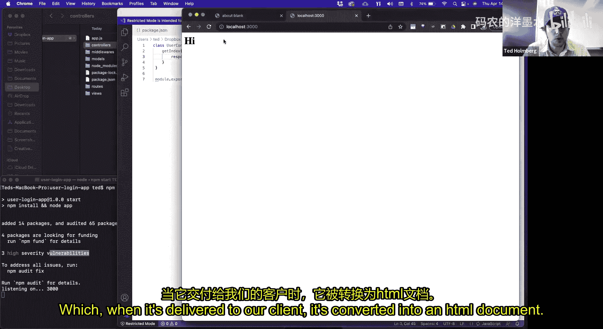

But actually， do we actually， we didn't try out actually seeing if we can actually render something that had data embedded into it。

 this still just says hi， let me rerun my server， let me refresh and now notice what's rendering to my client side is high data。

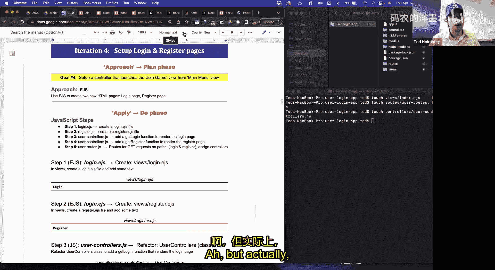

And of course， what's in the EJS is just the high and then whatever this name is。

 so now we can know that。What's being delivered the way that we're getting that？

That value of data is from this second parameter here。

 where we're injecting this object so that EGS can parse it and then use it to dynamically create different content on that page。

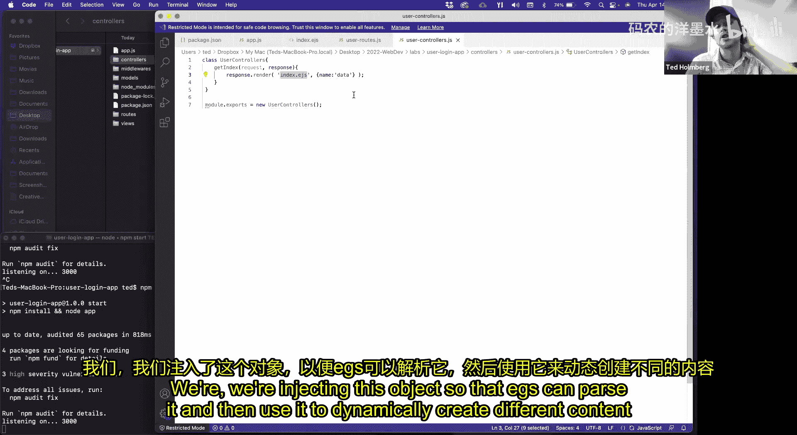

Excellent， so now our next goal is let's set up to other routes。

 one that will represent our login page and one that will represent our register page。No。

 not quite right here。 Our goal is set up a controller that launches the。Oin。And。Register。F。

Excellent。Okay。So let's actually go ahead and inside of our views create two new EGS files that will represent one for a login endpoint and one for a register endpoint so I'm going to clear this so here let me create inside of views。

A。Win。eggs。And then let me also do the same thing。For a。Register。 ejs。

Excellent so now once i've done that let me go into my my user controllers and go into my user controllers class and add in some new methods。

 so inside of here I have to get index method inside of that class i'm going to add another class another method instance method get login。

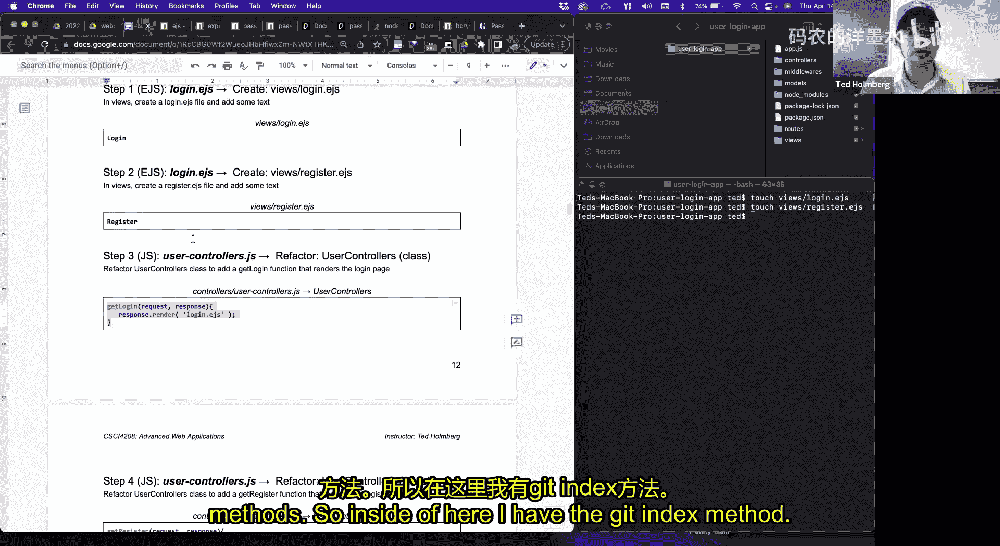

Which again is going to take over a request response and here it's going to go ahead and just on the response render that login。

eggs page we just made。

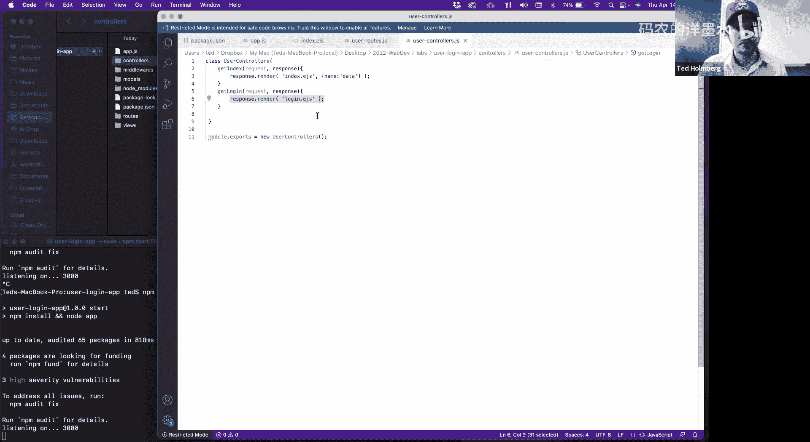

And then here， let's go ahead and。

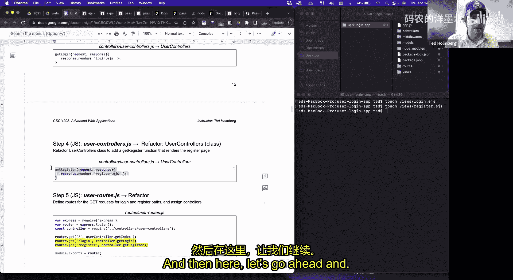

Do the same thing， let's set up a。Callback function get register that takes in a request response but then tells the response to render that register。

 egs page and actually let's open up those pages and just put something there so that we know that it was successful so here and log in i'm just going to type in log in。

And inside of register here， I'm just going to type in register。At least to make that spell， right？

Lord。There we go。Okay， so now we have some sample text in there。

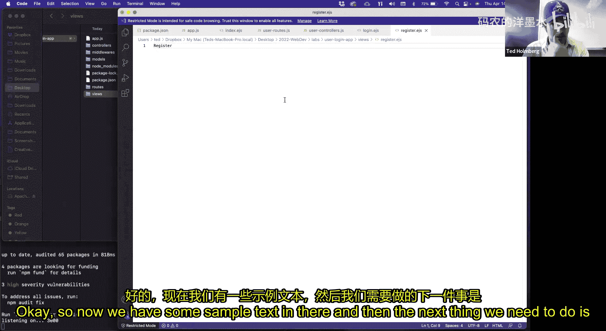

And then the next thing we need to do is we need to go into our router and then set up on those new endpoints those callback functions we just defined right so get login and get register so let's go into our router here and here I will。

On slash login as a first parameter from my controller instance。

 I will pass the function as the callback， get login。

 and on the instance that a request is sent to slash register。

 we're going to send back as of the callback inside of our controller instance get register as our callback function。

Oh。Not quite right。Okay， and the next thing that we need to do is test that out。

 so let's go to NPm start and check the register and login end points to see if it doesn't actually bring us to those。

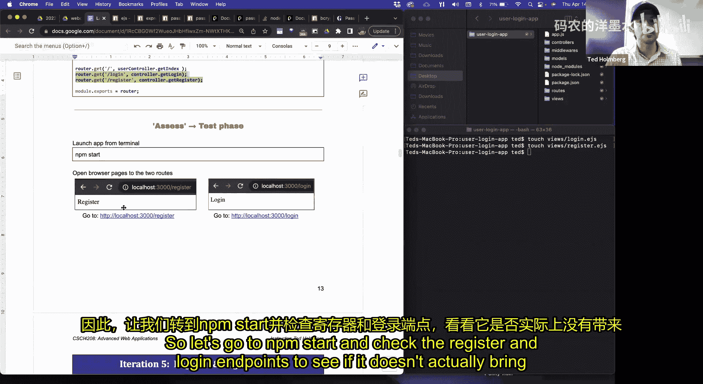

So let's。Stop。And let's。Clear that's。Start our server excellent。

 So now let's go here and see if we can't go to these endpoints。 I'll refresh this perfect。

 let me go to。Login， yep， we have a login endpoint and now let's go to register。

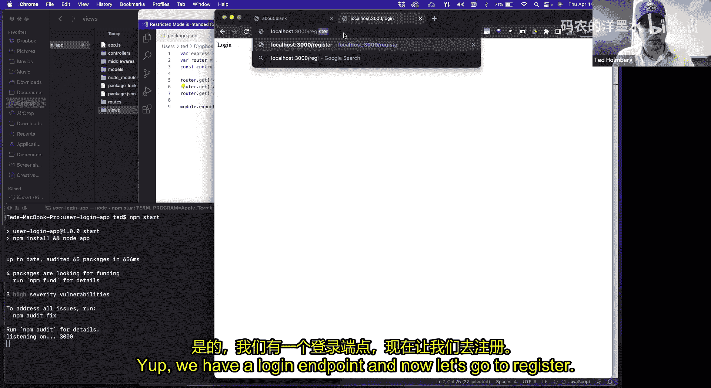

And we have a register endpoint， excellent。Okay， so now that we have our endpoint set up。

 why don't we set up some form data that we can actually send？From the browser to the server。

So let's go into our register EJS and just go ahead and make what looks like HTML code。

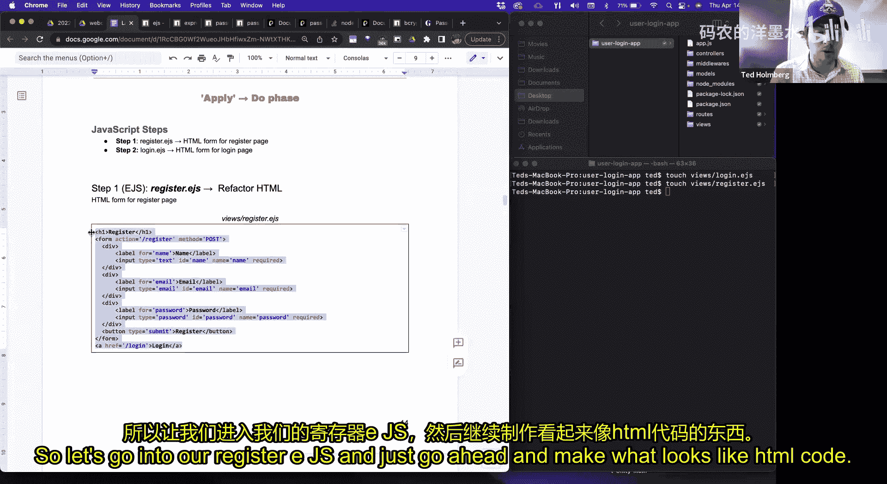

So let's go to here this is the register page we're going to get rid of that and instead。

Put this here so what do we have here we have a heading one that says register we're going to create a form that has the action of sending the request to slash register as its endpoint and the method will be a post method。

Here inside of our form because our phone goes to here we'll have a div that's going to include a label with a name and then an input field that's going to。

Say name it's going to have the ID name and it's going to have the name name right because the server is going to collect things based off of the name field。

And then here we'll make a divb that has the label email and then we'll make sure that this has the name email。

And then we'll have another divb that's going to say password and we'll make sure it has the name password。

嗯。And then we'll have a button that has the type submit so that when it's clicked。

 it will go ahead and send this data inside of the body to this endpoint as this method as this HP method。

 then outside the form we'll create an anchor tag that will hyper reference the slash login end point。

So it gives the options if they。alreadyready have a account they can just switch to the login page instead。

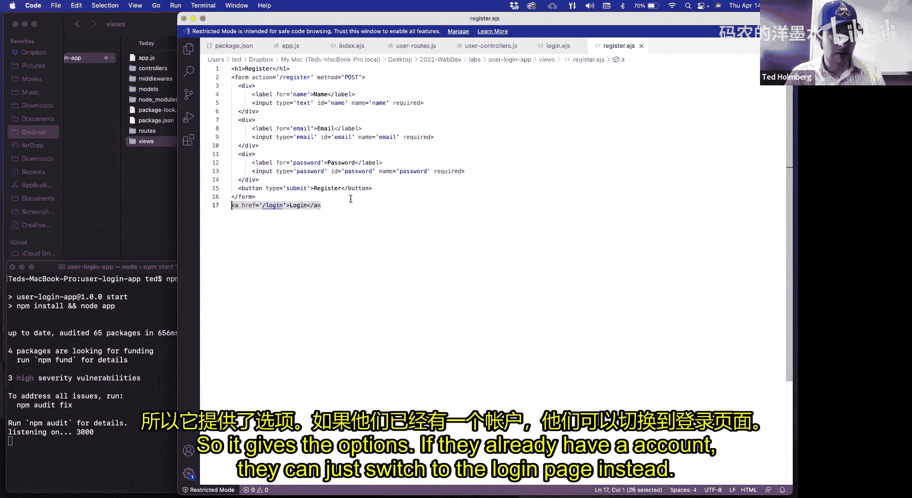

Excellent， so now the next thing we should try to do is let's go ahead and。

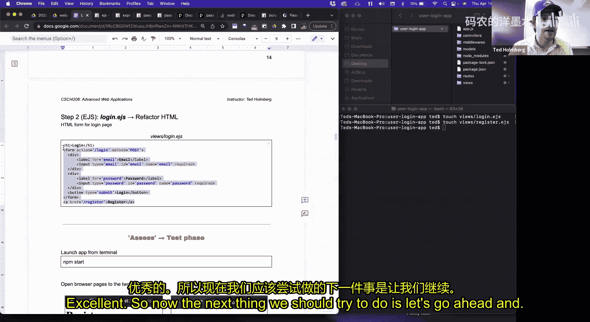

Set up a login page form as well so i'm going to open up login do ejs I'm going to get rid of what was originally there here is going to be very similar I'll have a heading that says login I'll create a form that when it's when its submit it will send a request to the slash login end point as a HP method post here will the login will have a div that contains the label email and then an input field as email which we will name email will also have another。

哦。Input， which will have the label password and which will also have an input to be able to take in the password。

 which will also have a name of password。Then well also have a button inside that form。

 which is a submit， so on the instance of a submit event。

 it will go ahead and send this request and then we'll also create an anchor tag that hyper references the register so you can easily oscillate or toggle between login pages and register pages。

Excellent so now that we did have that let's go ahead and see if we can't go ahead and test this out so let's kill the server let me clear the message let's do NPm start to relaunch our server install whatever dependencies we might need let's go here and now i'm going to refresh this page and lo and behold we have a register right。

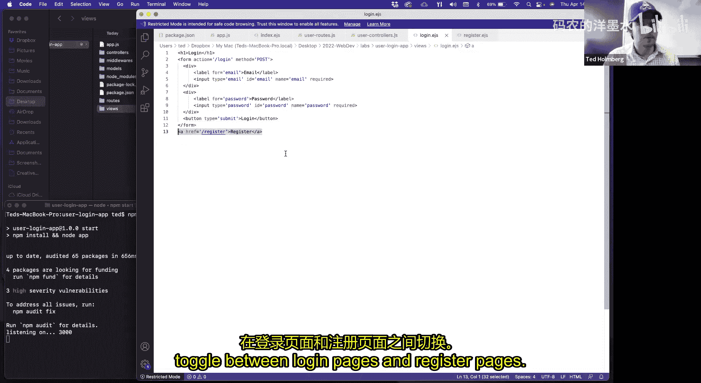

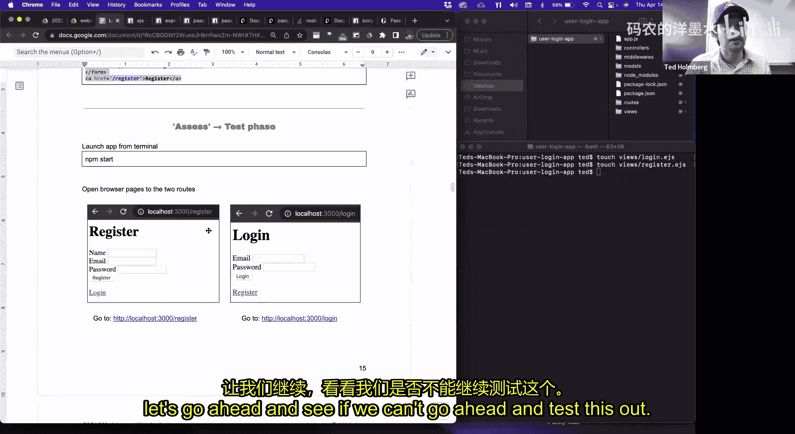

And let's go to login。And we have。A login and let's see can I click the register here yep and can I click the login so I can easily oscillate between those two Now what happens if I try to do something here does anything happen。

I log in。Cannot post login and it's because I didn't set up any routes on my web server to capture those so even though we were sending this data to an endpoint we now have to set up our web server to listen to that endpoint and deliver response。

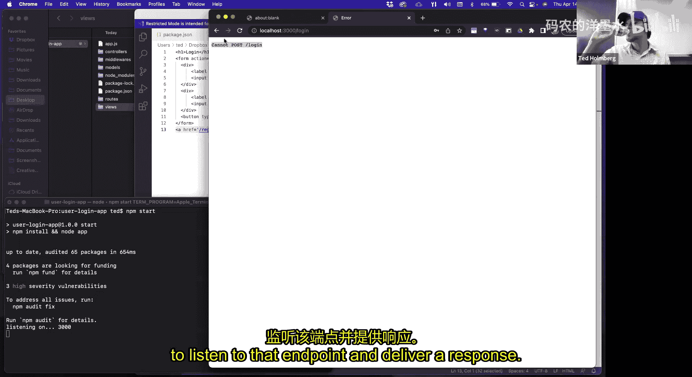

对。So let's actually go ahead and set up the post form to the server。And again。

 we'll use body parser to be able to get extract the data from the request object。

So the first thing we need to do is。Let's go ahead and that one of the built in。

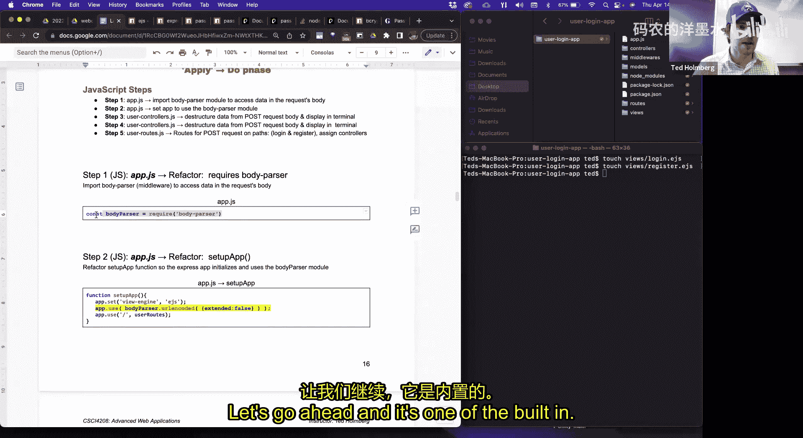

Module， so we should be able to go into our app here。

And we will import the body parser from the body parser module。

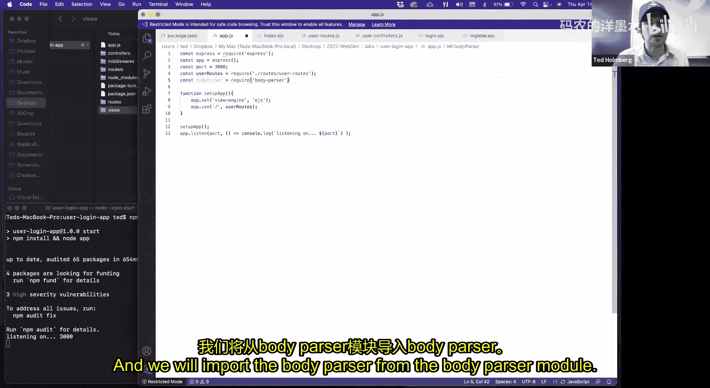

The next thing we're going to do is inside of our setup app function where we're setting up all the logic。

 we're going to go ahead and ensure that we're using that so underneath。

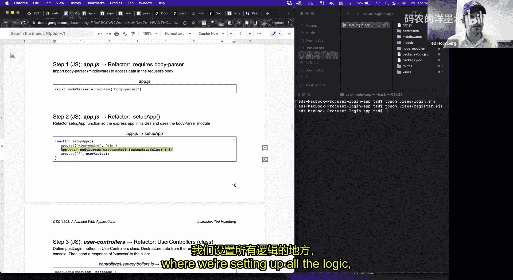

Where we set our view engine， we will then tell the app to use the body parser URL encode it。

And this's just the parameters that we're giving。And again。

 if you want to know more about this module， you can always hit the node API this is part of the standard modules that's included so that we can naturally take and request objects。

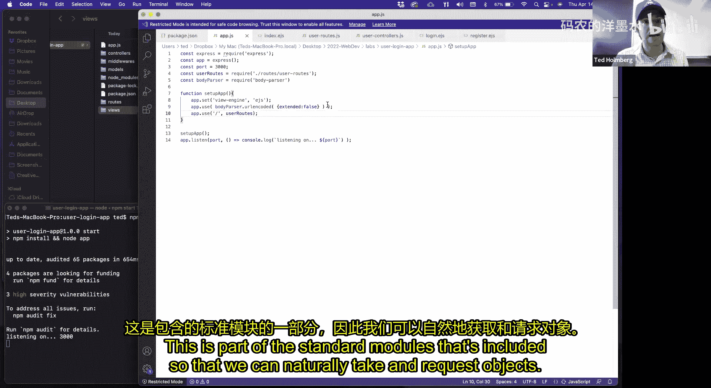

And read their bodies。Okay， the next thing we need to do is actually set up a callback function。

On the instance that we get a request as a post method。

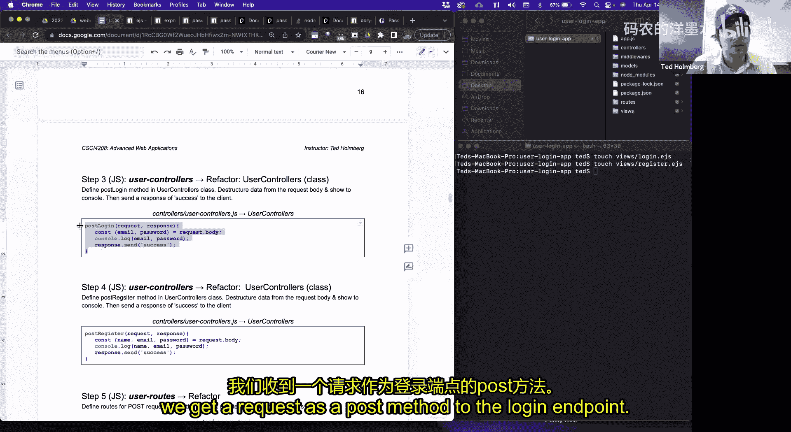

To the login endpoint。So let's go into our user controllers class here and set up a new instance method。

'llCall it post login it's going to take in a request and response objects here what we're going to do is now that we have the body parser imported in we'll be able to from the request object get the body and we're going to destructure from it。

The variable that has the name。😡，The has。name key。Of email and the name of password right and again。

 whenever we have something like a field， that's why it's so important an input field that gets submitted via a form it's so important to give these labels as the attribute name because that's how we're going to access it on our server side。

So here we'll destructure the email and the password and then we're going to test by just doing a console log to make sure that we're actually capturing that on the server side and then we're going to send a response。

That will just print the text success。OnOn the client side page。

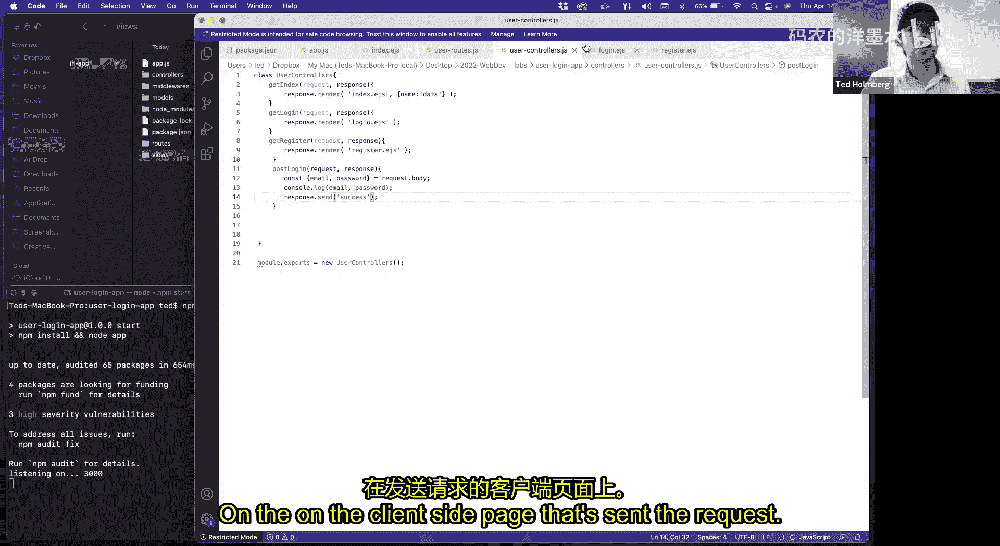

And that's in the request。And then we're going to do the same thing for post register。

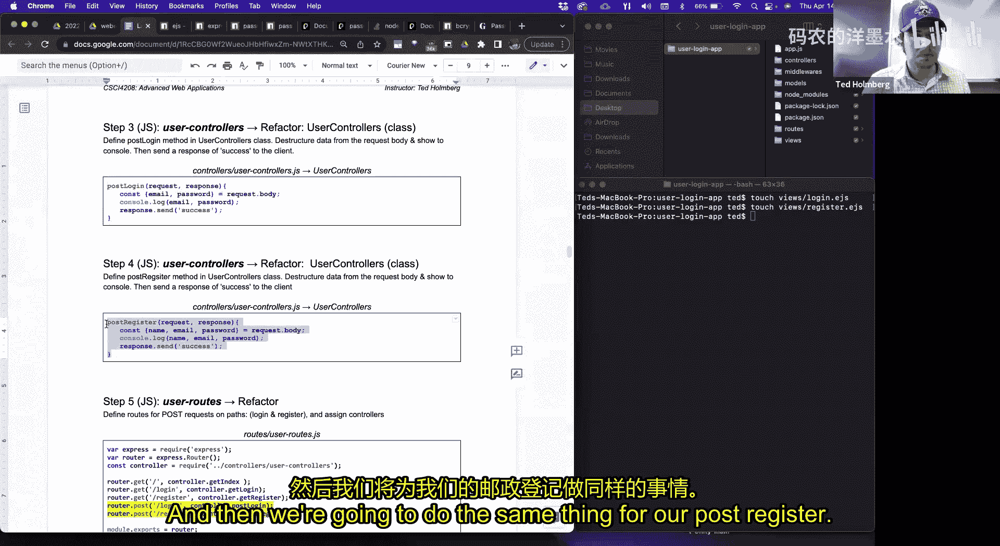

So here we will do a instance method inside of our user controllers class post register it' again take in a request response object here from the request body we'll destructure the name。

 email and password the three text inputs that are inside that page and then we'll just do a console log and then send back to the client and message of success to illustrate that it worked and then once we did that we need to go ahead and set up our routes to actually listen for post from there so I think this is probably the first time or maybe one of the first times we set up a HTP method that's not a gi but notice how easy it is you just do dot post。

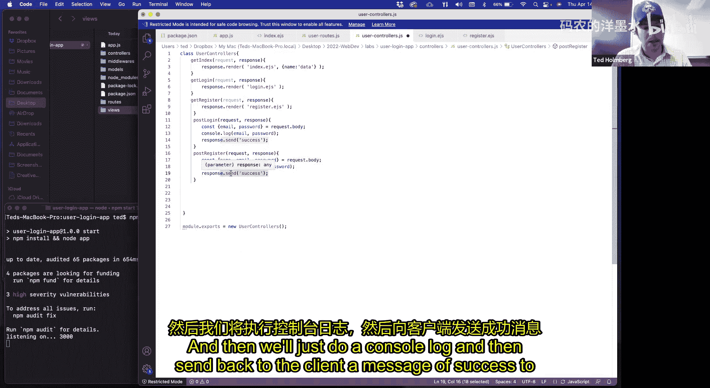

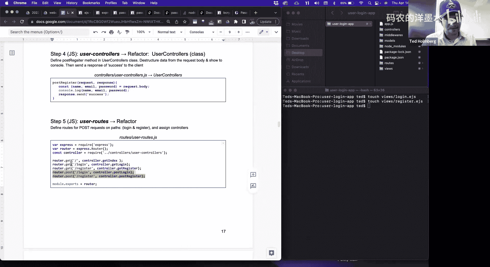

And then the concepts are all the same。So let's go to routes here。

And we're going to set up a on our router on a post method at the endpoint slash login。

 we will tellther the callback function post login and then for a post method to slash register。

 we will go ahead and provide a callback function to post register。Excellent。

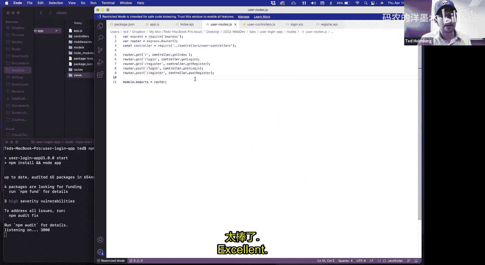

Okay， so once we do that let's test this out and there's a couple different ways we can test this out。

 we need to test this well from the register page and see if we get a success。

 we need to test this from the login page and see if we get a success。

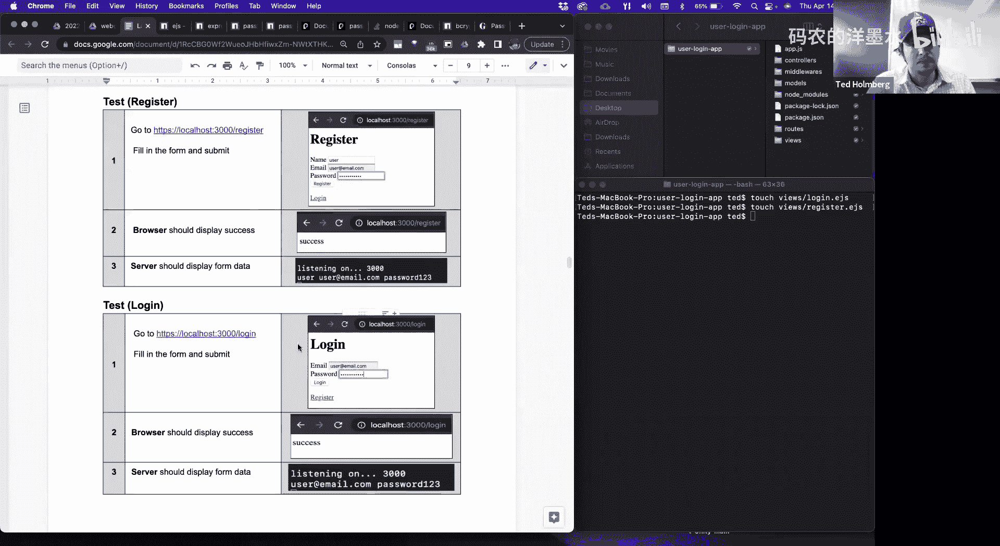

So let's go ahead and kill our server。Let's clear it。

 let's launch it NP PMm start install whatever dependencies we added and let's go here， so for login。

Let me cancel， okay， let's。Do a get request there Okay。

 so on log let's do user at email dot co and let's do。

Password  one23 I'm going to click login which is going to submit and there is my console log user at email。

com with password123 and I got a success message here that got sent as a response excellent cancel that let's go ahead go in here let's do it let's go to register。

Let's type in user name， let's go to user at email and let's do password。One， two， three。

Let's click register， which're is going to submit here we see。

We got a success message sent here and as my console log， we see I got username with the name， email。

 user@ emailmail。com and password 1 two， three， excellent。

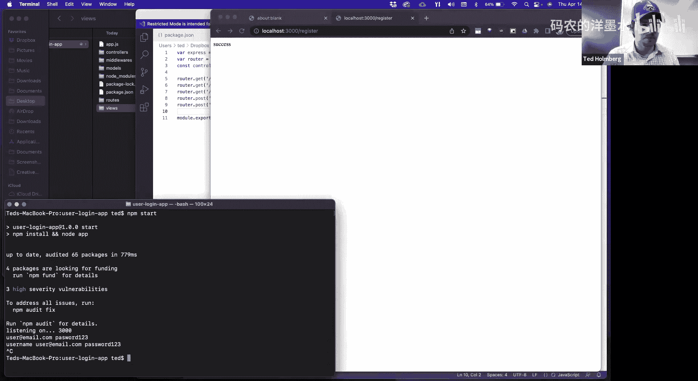

ear that so now we know that we're actually delivering data from the client to the server side。

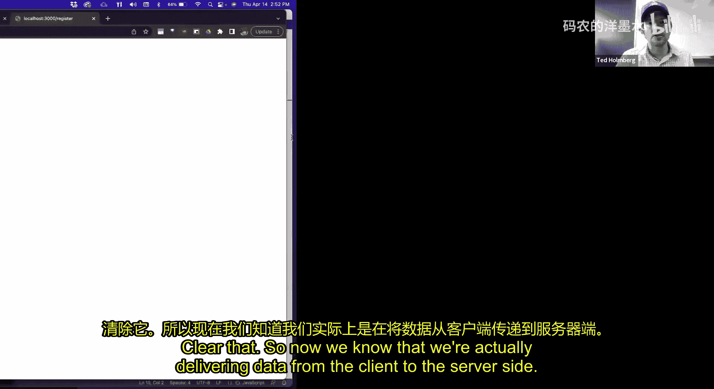

So now let's move on to the next goal where we'll actually create a data model that will represent a user。

On the server side。That will be part of our users's collection。

And so the first thing we're going to do here in order to manage our。

Whenever we create a new user on the server side， we'll want to give it make sure it has a unique ID so we'll use short ID to assign an ID to each entry into our users's collection。

 so let's go into our Packat JSON here and set up a new dependency。

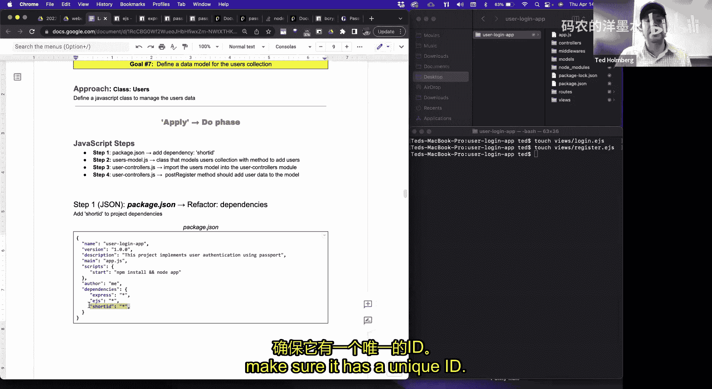

Short ID， which we've already seen previously。

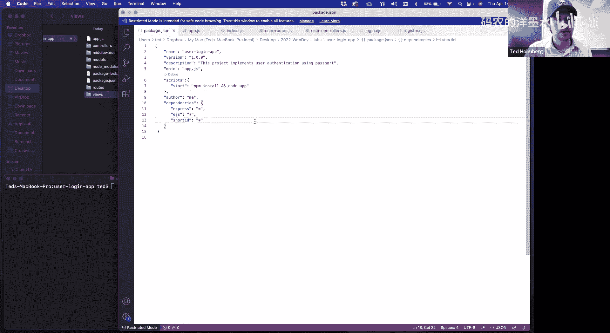

And so the next thing we want to do is inside of the models。

 we're going to build our first model logic so let's actually create a file so let's inside of models。

I'm going to create users dash model。Dot Js。Excellent。

And then let's actually implement a data structure that can represent a。

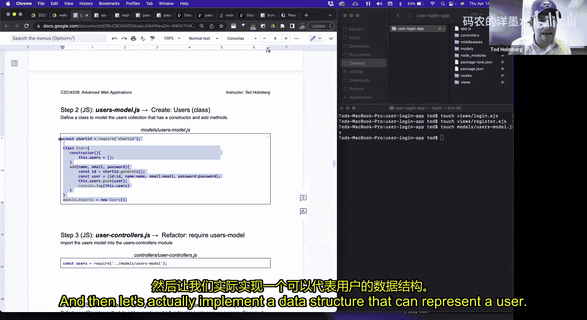

User， so let's go ahead and go into our models and open up that。

Scrt we just made that file so here what i'm going to do is i'm going to import short ID right since I have that available and then inside of class users I'll have a constructor so when I create a new instance of users is going to have a list。

As one of its census variables of users， that'll be our users' collections where we'll add all of our new users。

 all of our registered users， well have a method add that will take in a name。

 an email address and a password。It will then use short ID to generate a new ID。

 which we will then save into a variable called ID and then a user object will be a key value pair that's going to be the three。

Prameterters we passed in， so it'll have the ID。Keyword and then it'll actually have the value of ID and then it'll have the name keyword and then whatever the value of the name is it'll have the keyword email and then whatever the actual email is the keyword password and whatever the actual password is then once we've created this user we will then push it into the users list and then just to ensure that this is working we're going to do a console log on our users' collection every time we add a new users to it and then what we're going to do is。

Two module exports where all of the exports are managed at。

 we are going to create a new instance of users so that when it gets imported。

 that will be an instance of users that we will go ahead and gain access to in other modules。

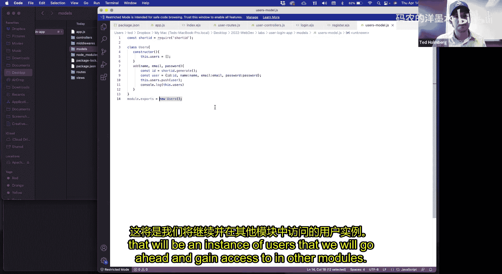

Okay， so now let's go into our controller script。

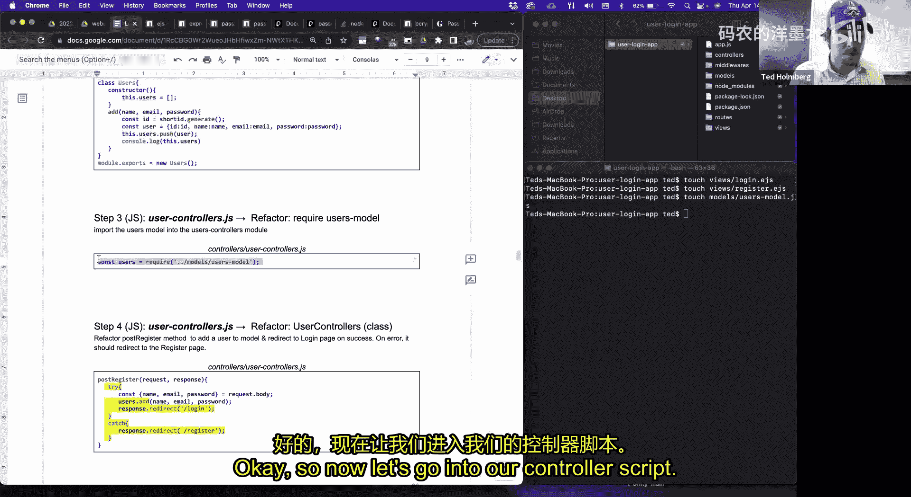

And actually import this model we've created。So here this is。There we go。

 so now we have the users' model instance that we can import。

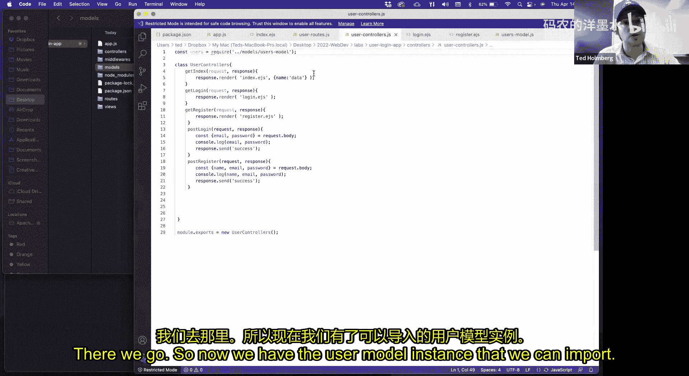

Let's see and right now， let's see I have a question right now it's storing it locally on the servers volatile number yes。

 so we are not doing anything in terms of managing a database right now as a proof of concept this lab really focuses on building out a user authentication system in server memory only。

 but what we would do here at this point if this were a true full stack application and data persistence was left on a medium that doesn't include just inmeory right in memoryory storage we would be making these requests to a data。

Enpoint。And then we would get the response back from our database for that user data。

 so accessing data from a database is not too dissimilar from accessing it from in memoryory。

 it's just another client request via ACTP and a server response that then delivers the data we expect as opposed to just doing an in memoryory lookup。

Yeah。And again， on the Mongo well be covering Mongo inside of this class。

 the Mongo lectures should go into those concepts on how we replace out these calls in memoryory lookups to be database lookups instead。

But we're going to try to remove all that complexity when we introduce a new concept to just rely on things we're already familiar with。

Okay， so now that we have imported that， let's actually go and update our post register。

Method inside so here let's see let's refactor this so what we're going to do is we're going to use a try catch block。

 so inside the try block wherere from the request body we're going to try to destructure the name email and password。

And then we're going to attempt to add the user the reason why we're going to do the try catchch block is in case this fails。

 we can respond intelligently with the catch， so in the instance of a success if we are able to add that user。

 we will then tell the the send a response to redirect the client to slash login then because the registration would have been successful on the instance that it was a failure we would go ahead and readdirect back to the register page again。

哦。And now we should be able to go ahead and test this out and so again。

 if we go ahead and fill out the form when we do MPM start and we go to register should it should go ahead and redirect us to log in and then we should get a console log here of the object。

The user object they got put into the user's collection， so let's go here， let's go here。

 let's type in MPm start。Okay， now that we're running， let's go here to the register page。

 let's type in。User name， let's type in user@ email， let's type in password 123。

 let's click register， we got redirected so that was success and look inside of our user collections here right we now have an object that has an ID and that ID was generated by short ID for us the name with username the email with user@email。

com and the password as password123 so we know that we've successfully put that into the collections。

On inside of our userss model。Now。I do have a little note here about a problem。

 you may register the same user data multiple times into the user's collection。

 the app should prevent the user from registering a preexisting email address。

An additional note it's an easy fix， the fix to do this is trivial。

 but it's out of the scope of this lab because I don't want to produce multiple steps for a lab that's already too large so we already know that we have a little bit of additional logic we should implement to protect against that we're just going to ignore for now。

And here's an example where。You have dual registrations。With the same email address。

 the email address should be the unique thing。So once it's been registered。

 you can't reregister it again。Okay， so the next thing we're going to start talking about is this concept of sessions with Express。

 we can use Express to establish sessions with clients so express session is a middleware that generates a session ID and places it into the request response objects。

And the browser saves the session ID as a cookie on their end and appends it to every request that it then sends out to that server and so since it's using the same session ID。

 the server can then identify。😊，That particular client。So in order to manage this。

 we will use the express session， which。

Will manage all of that logic for us。So let's go into our dependencies。

 we'll put a comma and we will add as a new module we need express dash session。

And then inside of our app Js， we will go ahead and we will import express session， so let's go here。

对。And。Import。Our our session module， and we will just store that inside of a variable。

 let's called session。

Okay， now in our setup function， let's refactor that to configure a session and actually use it sessions require a secret string for hashing and then we want to set the save un initialized true。

So that the session IDs remain the same for request from the same client。

So those are just some basic parameters。Thank。Okay。So in order to create a session。

 what we're doing here is we're creating a configuration object session config is what we're going to call it。

 we need to have a secret password for hashing purposes to protect the information。

 we need save aninitized set to true otherwise each time a new client the same client goes to do a request it'll actually give them a new session ID and we don't want to do that。

And then once we have those configurations， we can create a session and use an express app。

 so we'll invoke the session object。And or invoke the session function and pass it the configuration information。

 and then the resulting object will then be used in our Express application。

Let's see here。Let's just see here if at any time you wanted to read up on any of these modules we're using you could always go to NPM MPM has information about the EGS template here so if you wanted to see what some of the syntax or example code is and options it should be listed here。

In for Express session， again， the API is all listed here where you have session。

We give it the options， which we embed inside of an object and it creates a session middleware that with the given options。

So if at any time you're confused at any one of these lines of codes， please look up the API， right。

It's all available online for you to read。Okay， and as I clear through these。

 let me get rid of the EJS form and let me get through this expression session。

 the next one that i'll probably look at is going to be when we talk about passport。Okay。

 so now that we're using sessions， what session does for us is it will now embed a session property into every request object and one of the values will be the session ID so why don't we update all of our Git methods to see what the session ID is when we make request。

From our browser， so let's go into our user controllers here and let's update。Our get index。Here。

To do a console log where from the pass and request object will'll access the session object and the session object will now have a property ID。

 let's do the same with request。Let's do the same with register and let's see if as we hit each of those individual pages。

 if we don't get the same session ID from the same client， let's test that out。

Let's kill the server。Let's clear， let's do MPM start。Okay， let's see， let's make sure I saved。Okay。

 what does it not like What did I do here， console log session ID session。😔，Here。

 let me make sure that this is saved here。Play and let's do Mpam start。No， okay。

 let's say what is the。16 does not like this。Okay， this looks fine。😔，Session config， session config。

 imported session。😔，아。No， that's。Unexpected end of input O did I。Mi I。

I lost a problem with copy paste I lost a。诶啊。Curly brace。So it couldn't parse my document。Excellent。

 so now let me save that。 and in fact， if I wanted to， I could。Since we're using hoisting here。

 I can put this here at the bottom。Should avoid that。

But maybe I'll keep it the same as it is inside the document。Okay， there we go。So let's save that。

 let's clear。And let's do start Okay， perfect now that we actually have our closing bracket that should work。

 So now what I want to do is let's go to the index。

Perfect and look I have this session ID that i'm putting out right Okay， so now let me go to login。

And notice it's the same session I take。Right so。Let me go to register。And the same session I did。

And in fact， to prove， I'll go back here to index， yep， to prove that this is unique for each。

Browser， let me go to an incognito window and go there and notice the incognito window is then given a session ID and it's different than the normal Chrome window that I have open right and so here let me go to login and there it is in login right。

So same session ID for incodino let's close that let's resent it here from my normal browser tab and here it is so we can see it can recognize between these two clients and distinguish between them。

And then make decisions， right based off of this ID。And in fact， let's do one other thing right now。

 I'm just printing up the I。 Let's see what's actually inside that session object。 Let me save this。

 Let's kill the server。 Let's relaunch the server and let's see what happens when we log just the。

Did I put that in here？😔，Request that session。that seems though right。

 I mean you have to go to the login。Oh， thank you。 put in login， thank you。For some reason。

 I thought I put in my index perfect， Okay， so let's go into our login。And there we go。

 so here you can see exactly what's inside of a session object。

And it doesn't even print out everything in there right like right here we could see well there's a cookie property with the path and when it expires and the max age and whether it's ACP only or not。

 notice it doesn't even expose to us ID in the printout for that。

But we know it exists because we can access that property right by just doing do by。Excellent。

 I'm going to change this back， so it's the same。Okay。And let's call that server。

Excellent， and we were able to successfullyhouse all that。嗯。

And so the next thing we'd want to do is actually go ahead and implement。

Passport to be able to authenticate users using the username and passwords。And let me see here。

 I want to say with the amount of steps we have。We have a large chunk of code in this section that I kind of want to be able to spend the time to explain out。

 so I might just defer since we only have about seven minutes left I might defer to next class and opening up with an exploration of passport so we can introduce base based off of this so let me say if I do decide to do that what my。

So that means next time if I do that， we'll learn how to authenticate the user with passport and then serialize and decsalize users with passport。

 then then use the flash module to send messages。Between parts of our application and then protect routes and then do user login and then encrypt the passwords using Brypt and then use do Ev so this is probably actually good stoppinging point instead of trying to force this last step in just a couple minutes。

 we'll just end our lab here and we'll pick back up where we've learned how to use sessions。

 but then we'll learn how to use those sessions to authenticate a user using passport。

Excellent so we will will finish this up next lab video and then this will be a great resource for anyone who's looking to be able to implement a user login system I'd also encourage you to look at other documentation though for JWT just so you can compare it to the way that sessions end up working。

But we'll pick up with goal nine next video。Ex yeah， it shows， it shows here that the lab 12。

 this one that we're doing right now is due on Monday， are you going to move that yeah get yeah。

 that don'll get pushed back。Those were those due dates were kind of。They were。Okay。

What's where i'm looking for yeah they were markers to give me a timeframe of when I should have covered this and when you should know it to be successful on being able to deliver your full stack app by the end of the semester and we're within the timeframes we need to be so i'm happy i'll push it back though so you like I like this this the authentication one is much much easier than。

Other ones I've seen， it's really a straightforward。Oh。

 excellent oh you're talking about other authentication tutorials you're talking about。Yeah。

 I've had to authenticate using like tokens， I think when we get to tokens I want to learn more about those so passport would be interesting next class。

Excellent well also take a look at some of the lecture videos and depending I try to keep these labs pretty I try to base them off of foundational principles so it doesn't feel like there's any magic going on but also keep them opinionated so when I show you one thing and does eliminate from me other like avenues we could have done this but it's my goal to put up more labs in the future and then just have a collection of lab videos that people can decide like which one they want to play around with and so in the future wouldn't be that all the labs would be necessary it would be select a lab。

Ptaining to a topic and then go through it so that you understand how it works。

reallyally like EJS to EJS is a very， very nice strategy of putting like HTML up on a website。

I actually prefer that one。Oh it is very nice and we're going to see how we can use it to send like messages to the user if the username isn't right or the password isn't right。

 we'll be able to adopt it as a strategy， it it's a very powerful way to be able to like take all the processing that's happening on the server side and deliver in the client without having to implement it on client side。

So yeah it'll be this will be a fun lab to learn all sorts of new technologies kind of compacted into one that can be useful inside of your appss so again this is this I think these last couple of labs are going to be super critical to getting everyone in a place they need to be to have success by the end of the semester。

Excellent， is there any other questions？Well， if there's no other questions or comments about this particular lab。

 I will go ahead and end today's video and I will see everyone next week on Tuesday when we finish this up。

Oh。