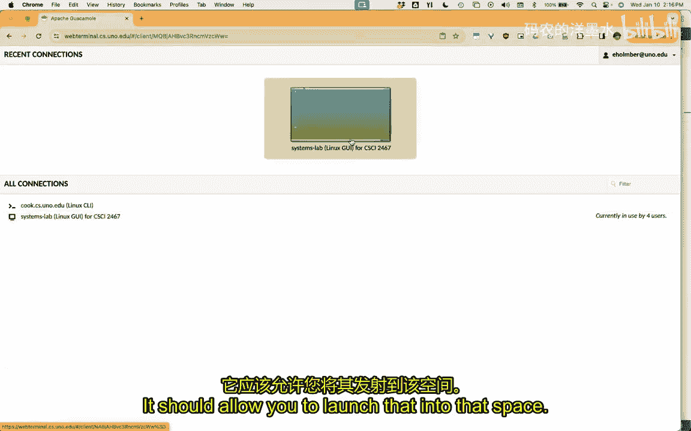
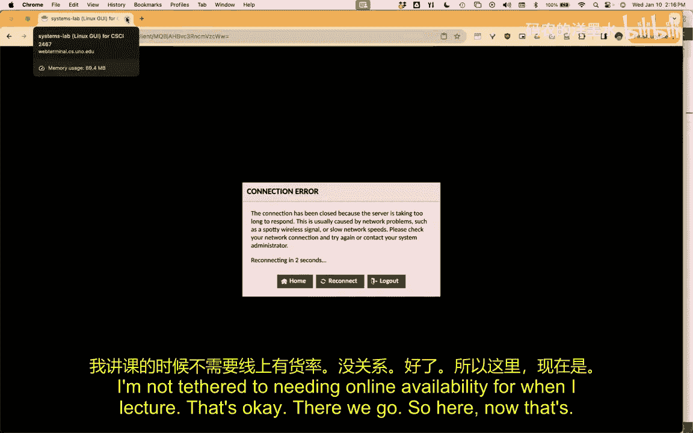
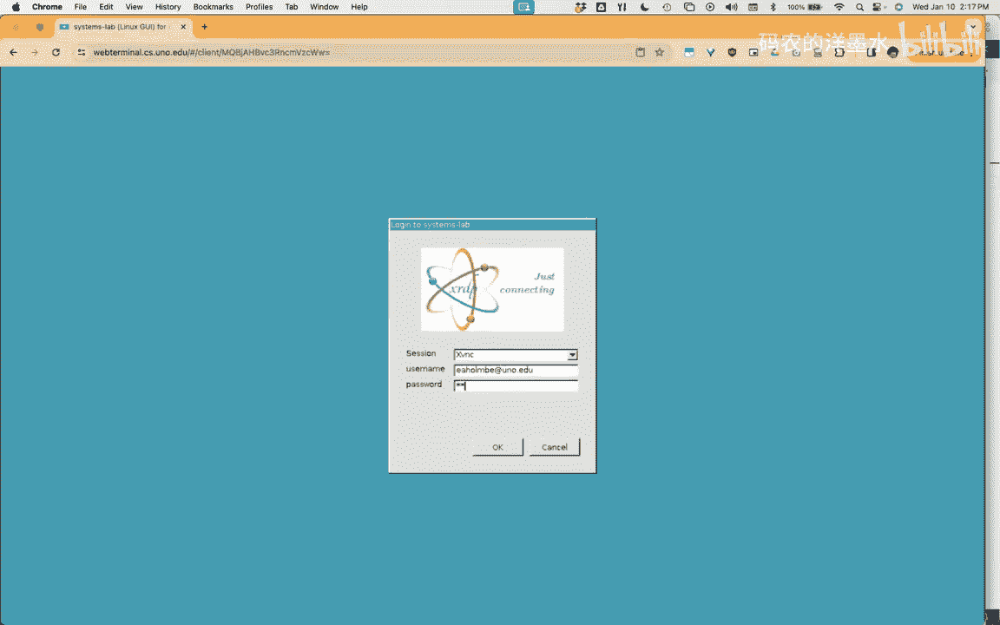
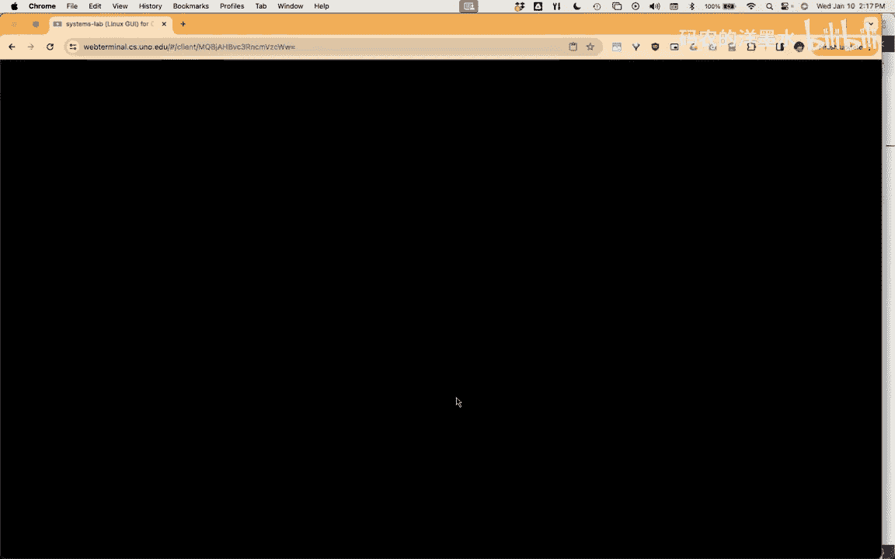
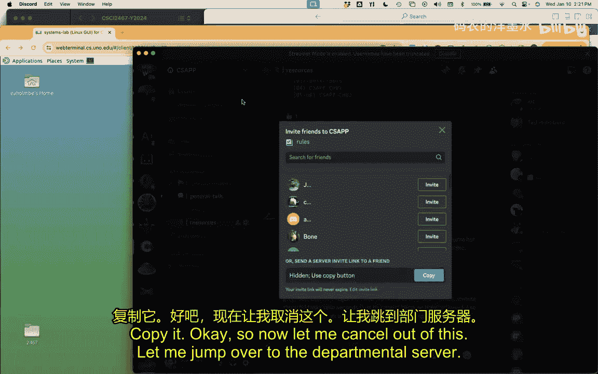
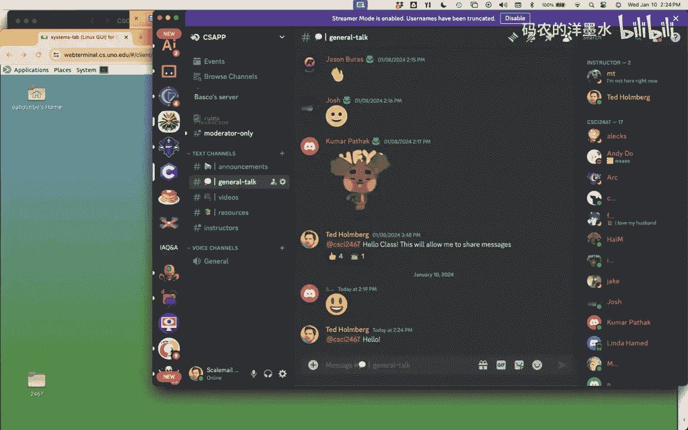
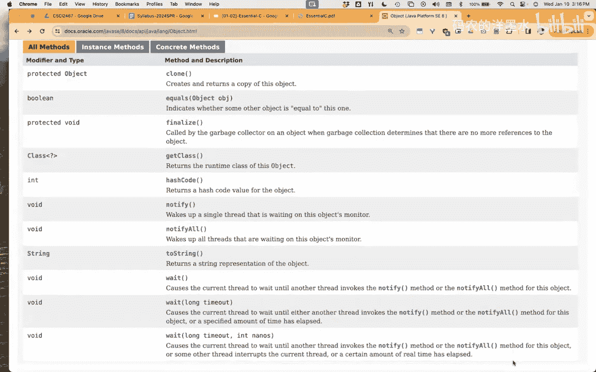

# 001：变量与基础语法 🚀


在本节课中，我们将快速概览C语言的基础知识，包括如何编写一个简单的程序、理解变量声明以及C语言的基本数据类型。我们将通过对比Java来帮助你快速上手。

---

## 概述 📋



C语言是一种强大且广泛使用的编程语言，尤其在系统编程领域。本节课我们将学习C语言的基础语法，包括如何编写“Hello, World!”程序、声明变量以及使用基本数据类型。我们将通过实际的代码示例来加深理解。







---

## 课程内容 📚

### 1. 编写第一个C程序



上一节我们介绍了课程的整体安排，本节中我们来看看如何编写第一个C程序。与Java类似，C程序也需要一个入口点，即`main`函数。



以下是一个简单的“Hello, World!”程序：

```c
#include <stdio.h>

int main() {
    printf("Hello, World!\n");
    return 0;
}
```

**代码解释：**
- `#include <stdio.h>`：这是一个预处理器指令，用于包含标准输入输出库，使我们能够使用`printf`函数。
- `int main()`：这是程序的入口点。`int`表示函数返回一个整数值，通常用于指示程序执行状态（0表示成功，非0表示错误）。
- `printf("Hello, World!\n");`：`printf`函数用于输出文本。`\n`是换行符。
- `return 0;`：表示程序成功执行。

### 2. 编译和运行C程序

在编写完C程序后，我们需要将其编译成可执行文件。本节中我们将学习如何使用GCC编译器。

以下是编译和运行C程序的步骤：

1. **编译程序**：使用GCC编译器将C源代码编译成可执行文件。
   ```bash
   gcc hello.c -o hello
   ```
   - `gcc`：GNU C编译器。
   - `hello.c`：源代码文件。
   - `-o hello`：指定输出文件名为`hello`。

2. **运行程序**：执行生成的可执行文件。
   ```bash
   ./hello
   ```

### 3. 变量与数据类型

在C语言中，变量用于存储数据。本节中我们将学习如何声明变量以及C语言的基本数据类型。

以下是C语言中常见的数据类型及其声明方式：

```c
#include <stdio.h>
#include <stdbool.h>

int main() {
    // 整数类型
    int myInt = 100;
    printf("Integer: %d\n", myInt);

    // 字符类型
    char myChar = 'A';
    printf("Character: %c\n", myChar);

    // 浮点数类型
    float myFloat = 3.14f;
    printf("Float: %f\n", myFloat);

    // 双精度浮点数
    double myDouble = 3.1415926535;
    printf("Double: %lf\n", myDouble);

    // 布尔类型（需要包含stdbool.h）
    bool myBool = true;
    printf("Boolean: %d\n", myBool);

    // 字符串（字符数组）
    char myString[] = "Hello";
    printf("String (array): %s\n", myString);

    // 字符串（字符指针）
    char *myStringPtr = "World";
    printf("String (pointer): %s\n", myStringPtr);

    // 长整数
    long myLong = 100000L;
    printf("Long: %ld\n", myLong);

    // 短整数
    short myShort = 10;
    printf("Short: %hd\n", myShort);

    // 无符号整数
    unsigned int myUnsignedInt = 200;
    printf("Unsigned Int: %u\n", myUnsignedInt);

    // 长长整数
    long long myLongLong = 10000000000LL;
    printf("Long Long: %lld\n", myLongLong);

    return 0;
}
```

**代码解释：**
- **整数类型**：`int`用于存储整数，`%d`是格式化输出整数的占位符。
- **字符类型**：`char`用于存储单个字符，`%c`是格式化输出字符的占位符。
- **浮点数类型**：`float`和`double`用于存储小数，`%f`和`%lf`是格式化输出浮点数的占位符。
- **布尔类型**：C语言中没有原生的布尔类型，但可以通过`stdbool.h`库使用`bool`类型。布尔值实际上是整数（0表示`false`，非0表示`true`）。
- **字符串**：C语言中没有原生的字符串类型，字符串通常通过字符数组或字符指针表示。
- **其他类型**：`long`、`short`、`unsigned int`和`long long`用于存储不同范围和精度的整数。

### 4. 使用Shell环境

在C语言编程中，我们经常使用Shell环境来编译和运行程序。本节中我们将学习一些基本的Shell命令。

以下是常用的Shell命令：

1. **列出目录内容**：
   ```bash
   ls
   ```

2. **编译C程序**：
   ```bash
   gcc program.c -o program
   ```

3. **运行可执行文件**：
   ```bash
   ./program
   ```

4. **查看命令帮助**：
   ```bash
   man command_name
   ```
   或
   ```bash
   command_name --help
   ```

5. **清除终端屏幕**：
   ```bash
   clear
   ```

---

## 总结 🎯

本节课中我们一起学习了C语言的基础语法，包括如何编写和运行一个简单的C程序、声明变量以及使用基本数据类型。我们还介绍了如何使用Shell环境来编译和运行程序。通过对比Java，你可以看到C语言在语法上与Java有许多相似之处，但也存在一些关键差异，例如C语言中没有原生的布尔类型和字符串类型。



在接下来的课程中，我们将深入探讨C语言的更多高级特性，如控制结构、函数和指针。希望本节课的内容能帮助你快速上手C语言编程！