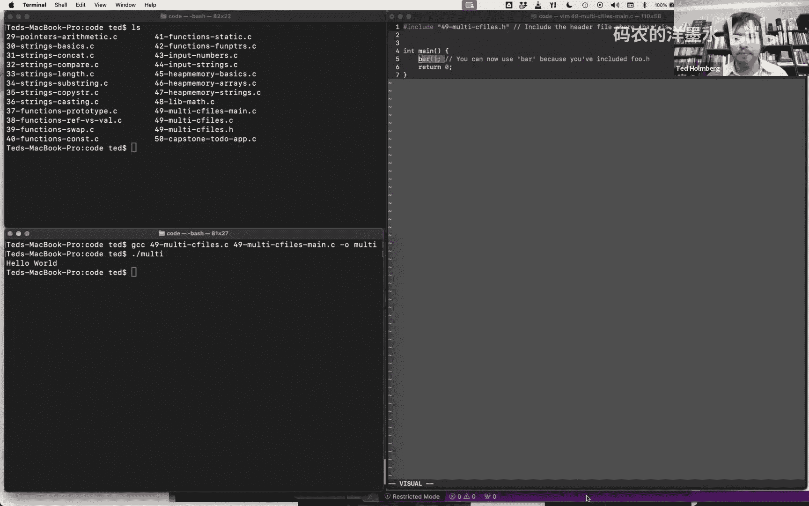

# 004：字符串、函数、输入与动态内存分配


在本节课中，我们将深入学习C语言的核心概念，包括字符串的操作、函数的定义与使用、从用户获取输入以及动态内存分配。我们将通过具体的代码示例来理解这些概念，并学习如何将它们应用到实际编程中。

## 指针与数组的关联

上一节我们介绍了指针的基本概念，本节中我们来看看指针与数组之间的紧密联系。实际上，我们可以使用指针来遍历一组元素，就像使用数组一样。

以下是指针算术的示例代码：

```c
#include <stdio.h>

int main() {
    int arr[5] = {10, 20, 30, 40, 50};
    int *ptr = arr;

    for (int i = 0; i < 5; i++) {
        printf("arr[%d] = %d\n", i, arr[i]);
    }

    for (int i = 0; i < 5; i++) {
        printf("*(ptr + %d) = %d\n", i, *(ptr + i));
    }

    arr[2] = 60;
    *(ptr + 3) = 80;

    for (int i = 0; i < 5; i++) {
        printf("arr[%d] = %d\n", i, arr[i]);
    }

    return 0;
}
```

数组名 `arr` 本质上是一个指向数组首元素的指针。通过指针算术（如 `ptr + i`），我们可以访问数组中的任意元素。方括号 `[]` 操作符和指针解引用 `*` 操作符可以实现相同的功能。

## 字符串基础

字符串在C语言中并非内置类型，它们是以空字符 `\0` 结尾的字符数组。以下是字符串的基本操作：

```c
#include <stdio.h>

int main() {
    char str1[] = "Hello World";
    char *str2 = "Hello World";

    printf("%s\n", str1);
    printf("%s\n", str2);

    str1[0] = 'F';
    str1[1] = 'o';
    str1[2] = 'o';
    str1[3] = '\0';

    str2 = "Ted was here and left this long message";

    printf("%s\n", str1);
    printf("%s\n", str2);

    return 0;
}
```

使用字符数组定义字符串时，可以预留固定空间。使用字符指针定义字符串则更灵活，但存在缓冲区溢出的风险。修改字符串时，字符数组可以通过索引逐个修改，而字符指针可以重新指向新的字符串字面量。

## 字符串库函数

C标准库 `<string.h>` 提供了丰富的字符串处理函数，弥补了语言本身的不足。

以下是常用字符串操作的示例：

*   **字符串连接**：使用 `strcat` 函数。
*   **字符串比较**：使用 `strcmp` 函数。它返回两个字符串的差值，0表示相等。
*   **获取字符串长度**：使用 `strlen` 函数。
*   **查找子字符串**：使用 `strstr` 函数。它返回指向子字符串首次出现位置的指针。
*   **复制字符串**：使用 `strcpy` 函数。

```c
#include <stdio.h>
#include <string.h>

int main() {
    char str1[20] = "Hello";
    char str2[] = " World";
    strcat(str1, str2);
    printf("%s\n", str1);

    if (strcmp(str1, "Hello World") == 0) {
        printf("Strings are equal.\n");
    }

    printf("Length: %zu\n", strlen(str1));

    char *sub = strstr(str1, "World");
    if (sub != NULL) {
        printf("Found substring: %s\n", sub);
    }

    char src[] = "Hello";
    char dest[100];
    strcpy(dest, src);
    printf("%s\n", dest);

    return 0;
}
```

## 类型转换

从用户输入获取的通常是字符串，我们需要将其转换为数值类型。`<stdlib.h>` 库提供了转换函数。

以下是类型转换的示例：

```c
#include <stdio.h>
#include <stdlib.h>

int main() {
    char int_str[] = "123";
    char float_str[] = "123.45";

    int int_val = atoi(int_str);
    double float_val = atof(float_str);

    printf("Integer: %d\n", int_val);
    printf("Float: %f\n", float_val);

    return 0;
}
```

`atoi` 函数将字符串转换为整数，`atof` 函数将字符串转换为浮点数。

## 函数

函数是C语言组织代码的基本单元。我们需要理解函数原型、定义、参数传递（值传递与引用传递）以及函数指针。

以下是函数相关概念的示例：

*   **函数原型与定义**：原型声明函数签名，定义提供具体实现。
*   **值传递与引用传递**：值传递复制参数值，引用传递通过指针直接操作原变量。
*   **常量指针参数**：使用 `const` 关键字保护指针指向的数据不被修改。
*   **静态函数**：使用 `static` 关键字限制函数作用域为当前文件。
*   **函数指针**：可以指向函数的指针，用于实现回调或类似对象的行为。

```c
#include <stdio.h>

void add_by_reference(int *a, int b) {
    *a += b;
}

int add_by_value(int a, int b) {
    return a + b;
}

void print_value(const int *val) {
    printf("Value: %d\n", *val);
}

static void helper() {
    printf("This is a static helper function.\n");
}

typedef struct {
    int numerator;
    int denominator;
    void (*init)(struct Fraction *, int, int);
    void (*print)(const struct Fraction *);
} Fraction;

void init_fraction(Fraction *f, int num, int den) {
    f->numerator = num;
    f->denominator = den;
}

void print_fraction(const Fraction *f) {
    printf("%d/%d\n", f->numerator, f->denominator);
}

int main() {
    int x = 10;
    add_by_reference(&x, 5);
    printf("After reference add: %d\n", x);

    x = add_by_value(10, 5);
    printf("After value add: %d\n", x);

    print_value(&x);

    helper();

    Fraction f1;
    f1.init = init_fraction;
    f1.print = print_fraction;
    f1.init(&f1, 1, 2);
    f1.print(&f1);

    return 0;
}
```

## 用户输入

从标准输入获取数据是交互式程序的基础。对于数字和字符串，有不同的安全输入方法。

以下是获取用户输入的示例：

*   **获取数字**：使用 `scanf` 配合格式说明符（如 `%d`, `%f`）。
*   **获取字符串（危险方式）**：使用 `scanf("%s", str)`，不检查缓冲区边界。
*   **获取字符串（较安全方式）**：使用 `scanf("%9s", str)`，限制读取字符数。
*   **获取字符串（安全方式）**：使用 `fgets(str, sizeof(str), stdin)`，并处理末尾的换行符。

```c
#include <stdio.h>
#include <string.h>

int main() {
    int num;
    float fnum;
    char str[10];

    printf("Enter an integer: ");
    scanf("%d", &num);
    printf("Enter a float: ");
    scanf("%f", &fnum);
    getchar();

    printf("Enter a short string (dangerous): ");
    scanf("%s", str);
    getchar();

    printf("Enter a short string (safer): ");
    scanf("%9s", str);
    getchar();

    printf("Enter a short string (safest): ");
    fgets(str, sizeof(str), stdin);
    str[strcspn(str, "\n")] = '\0';

    printf("You entered: %d, %f, %s\n", num, fnum, str);

    return 0;
}
```

## 动态内存分配

静态内存分配在编译时确定大小，缺乏灵活性。动态内存分配允许程序在运行时请求所需内存，使用后释放，提高了内存利用率和程序灵活性。

以下是动态内存分配的示例：

*   **分配单个整数**：使用 `malloc(sizeof(int))`。
*   **分配数组**：使用 `malloc(n * sizeof(int))`。
*   **分配字符串**：使用 `malloc((length + 1) * sizeof(char))`，为终止符预留空间。
*   **释放内存**：使用 `free(ptr)` 释放分配的内存，并将指针设为 `NULL`。

```c
#include <stdio.h>
#include <stdlib.h>

int main() {
    int *dynamic_int = malloc(sizeof(int));
    if (dynamic_int == NULL) {
        return 1;
    }
    *dynamic_int = 42;
    printf("Dynamic integer: %d\n", *dynamic_int);
    free(dynamic_int);
    dynamic_int = NULL;

    int n;
    printf("Enter number of elements: ");
    scanf("%d", &n);
    int *dynamic_arr = malloc(n * sizeof(int));
    if (dynamic_arr == NULL) {
        return 1;
    }
    for (int i = 0; i < n; i++) {
        dynamic_arr[i] = i * 10;
    }
    for (int i = 0; i < n; i++) {
        printf("%d ", dynamic_arr[i]);
    }
    printf("\n");
    free(dynamic_arr);
    dynamic_arr = NULL;

    return 0;
}
```

## 多文件编程与头文件

为了组织大型项目，我们可以将代码拆分到多个源文件和头文件中。头文件（`.h`）包含函数原型和常量定义，源文件（`.c`）包含具体实现。

以下是多文件编程的示例：

**头文件 `myheader.h`:**
```c
#ifndef MYHEADER_H
#define MYHEADER_H

void say_hello(void);

#endif
```

**源文件 `implementation.c`:**
```c
#include <stdio.h>
#include "myheader.h"

void say_hello(void) {
    printf("Hello from another file!\n");
}
```

**主文件 `main.c`:**
```c
#include "myheader.h"

int main() {
    say_hello();
    return 0;
}
```

编译时需链接所有源文件：
```bash
gcc main.c implementation.c -o myprogram
```

## 数学库

C标准库 `<math.h>` 提供了常用的数学函数，如 `sqrt`, `pow`, `sin`, `cos`, `fabs` 等。使用这些函数通常需要在编译时链接数学库（`-lm`）。

```c
#include <stdio.h>
#include <math.h>

int main() {
    double x = 16.0;
    double y = 3.0;
    printf("sqrt(%f) = %f\n", x, sqrt(x));
    printf("pow(%f, %f) = %f\n", x, y, pow(x, y));
    printf("sin(%f) = %f\n", x, sin(x));
    return 0;
}
```

编译命令示例：
```bash
gcc math_example.c -lm -o math_example
```

## 总结



本节课中我们一起学习了C语言中字符串的处理方式、函数的定义与多种参数传递机制、从用户安全获取输入的方法，以及至关重要的动态内存分配技术。我们还了解了如何利用标准库扩展功能，以及如何通过头文件和多个源文件来组织代码。掌握这些概念是进行C语言系统编程的基础。下一节课，我们将尝试综合运用这些知识构建一个简单的应用程序。