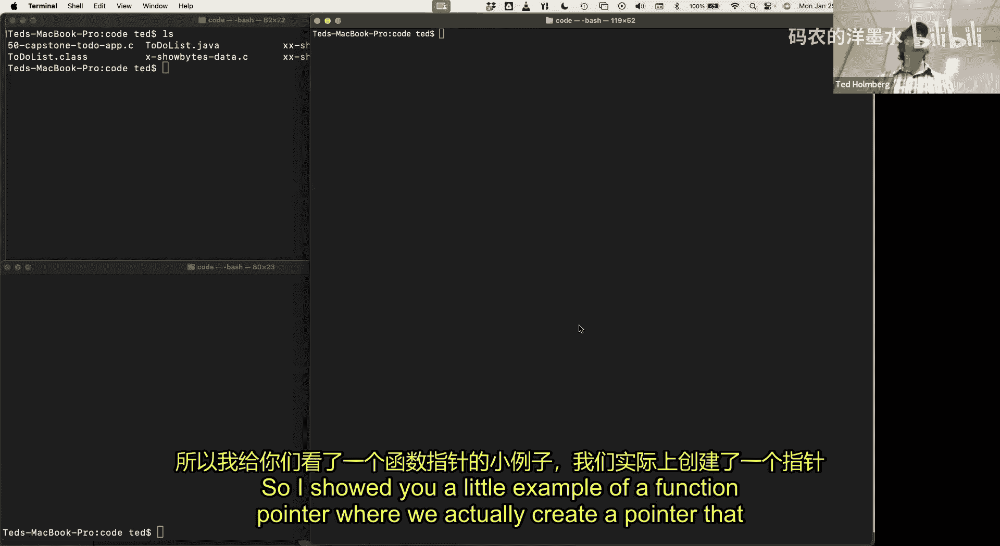
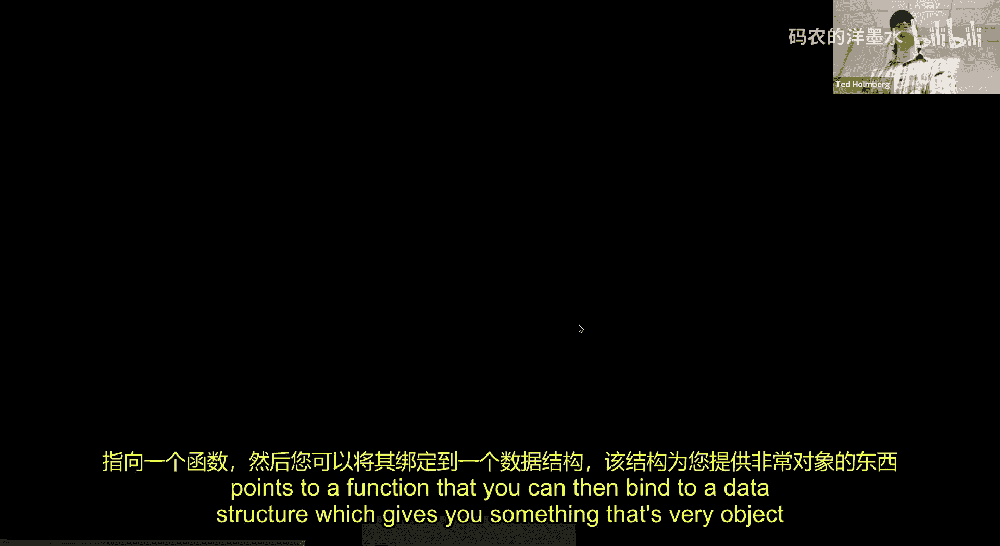
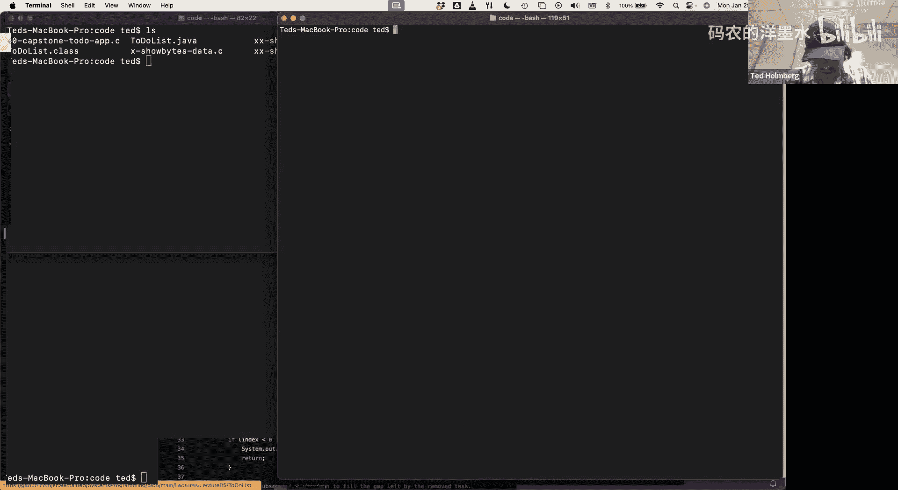

# 005：从Java到C实战转换


## 概述
在本节课中，我们将通过一个具体的实践项目，学习如何将Java语言编写的应用程序转换为C语言版本。我们将回顾之前课程中涉及的核心概念，如内存管理、函数指针等，并应用这些知识来完成一个“待办事项列表”应用的代码转换。

---





上一讲我们以异步在线形式进行，探讨了内存分配等核心概念，并了解了C++如何构建在C语言之上。我们还讨论了如何通过函数指针为数据结构创建方法，这为实现面向对象风格的编程提供了思路。

本节我们将转换学习节奏，进行一次基于团队的实践工作坊。目标是检验大家对C语言知识的掌握程度，并通过动手实践加深理解。

以下是本次工作坊的核心任务描述。

*   我们将分析一个用Java编写的简单“待办事项列表”应用程序。
*   该应用具备添加任务、查看任务、移除任务和退出程序等基本功能。
*   我们的目标是以团队形式，在限定时间内，将这份Java代码转换为功能等效的C语言代码。

现在，让我们先来查看这个Java应用程序的运行效果。

```bash
# 这是一个示意性的命令，表示运行Java程序
java TodoApp
```
程序运行后，会显示一个菜单：1. 添加任务，2. 查看任务，3. 移除任务，4. 退出。用户可以与之交互，例如添加“任务一”、“任务二”，然后查看列表，或移除中间的任务，列表会相应更新。

这个应用在Java中实现起来相对简单直接。接下来，我们看看已经存在的C语言版本。

```bash
# 编译C语言版本的待办事项应用
gcc todo_app.c -o todo_app
# 运行编译后的程序
./todo_app
```
C语言版本的程序运行起来，其外观和功能与Java版本完全一致。这证明了用C语言可以实现相同的逻辑。

对于在线学习的同学，建议通过Discord等工具组建小组进行协作。大家可以从课程GitHub仓库的第五讲目录中获取Java源代码文件。

在转换过程中，你可能会遇到各种挑战。请记住，我们课程中讨论过的所有示例源代码都可以在GitHub仓库中找到。

以下是可供参考的核心C语言概念示例代码。

```c
// 示例：函数指针的用法
int (*operation)(int, int); // 声明一个函数指针
operation = add; // 指向add函数
int result = operation(5, 3); // 通过指针调用函数



// 示例：动态字符串数组（指针的指针）
char **task_list = malloc(sizeof(char*) * capacity);
task_list[0] = malloc(strlen("Task 1") + 1);
strcpy(task_list[0], "Task 1");
```
如果对如何处理指向字符的指针、多维数组或字符串操作有疑问，可以参考这些基础示例。你们可以下载这些源代码文件，编译并运行它们，以此作为构建C语言版本待办事项应用的基石。

---

## 总结
本节课我们一起进行了一次从Java到C的代码转换实战。我们回顾了内存地址、函数指针等关键概念，并尝试在团队协作中应用这些知识来解决实际问题。虽然C和Java语法相近，但考虑到内存管理的差异，完成一个功能完整的转换并非易事。请大家继续以小组形式完成这个项目，利用课程提供的资源作为参考。