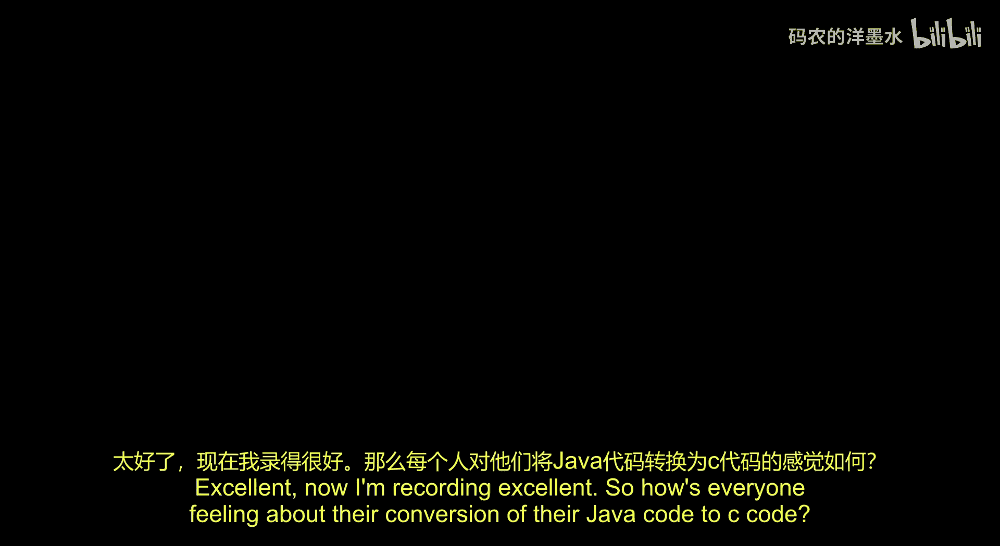
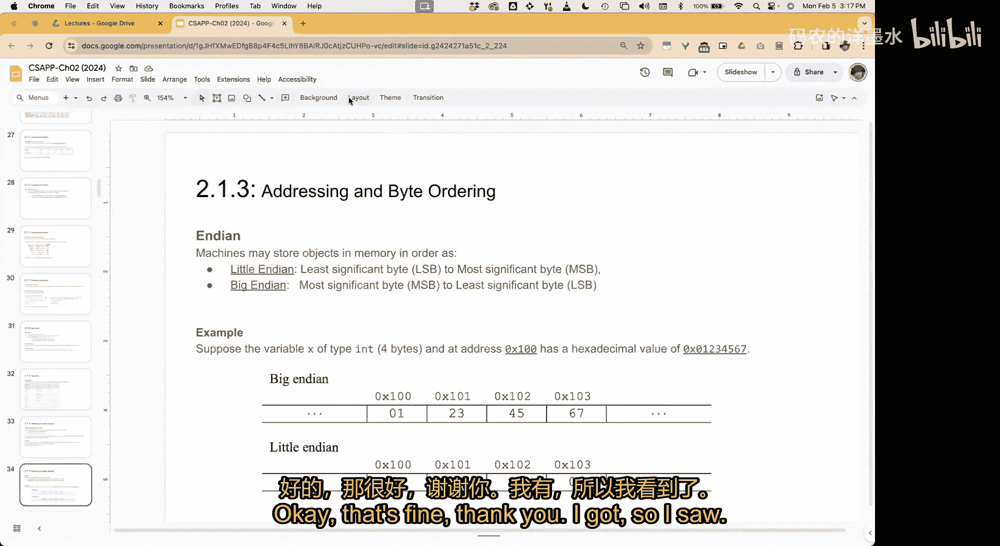

# 007：数据表示与存储



在本节课中，我们将学习计算机系统中数据表示与存储的核心概念。我们将探讨信息如何被编码为二进制，以及不同的编码方式（如整数、浮点数）如何影响程序的运行。理解这些底层原理对于进行系统编程至关重要。

---

## 信息存储基础

上一节我们介绍了计算机系统的基本构成。本节中，我们来看看数据在计算机中最基本的存储形式。

计算机是电子机器，而非机械机器。它们利用电信号进行操作，这使得处理速度极快。数据通过晶体管（一种电子开关）的状态来表示，每个开关有两种状态：开（1）或关（0）。这种二进制状态是计算机存储和处理信息的基础。

### 比特与字节

一个二进制位称为一个**比特**，它是信息的基本单位。八个比特组成一个**字节**，字节是计算机中最小的可寻址内存单元。

选择8比特作为一个字节，最初是为了能够编码所有必要的文本字符（如ASCII标准）。一个字节可以表示256种不同的状态（2^8 = 256）。

### 数据的上下文

相同的二进制序列，根据不同的上下文，可以代表完全不同的含义。例如，二进制序列 `01000011` 可以解释为：
*   整数：67
*   字符：`'C'`
*   图像中某个像素的红色分量值
*   一段声音的特定采样值
*   一条CPU指令

文件扩展名（如 `.txt`, `.jpg`, `.mp3`）为操作系统和应用程序提供了理解文件内二进制数据所需的上下文。

---

## 数值表示与编码

既然所有数据最终都表示为数字，那么理解数值的编码方式就变得尤为重要。我们主要关注三种编码：

1.  **无符号编码**：用于表示非负整数。
2.  **补码编码**：用于表示可正可负的整数。
3.  **浮点数编码**：用于表示实数（包含小数点的数）。

整数是离散值，而浮点数旨在表示连续范围内的值，这涉及到微积分中“无穷小”的概念。

---

## 进制转换

为了便于人类理解和操作二进制数据，我们经常需要在不同进制间转换。以下是常见的三种进制：

*   **二进制**：基数为2，使用数字0和1。
*   **十进制**：基数为10，使用数字0-9。
*   **十六进制**：基数为16，使用数字0-9和字母A-F（或a-f）。

在C语言中，我们可以直接使用不同进制的字面量：
*   十进制：`314156`
*   十六进制：`0x4CB2C` （前缀 `0x` 或 `0X`）
*   二进制：`0b1101` （某些编译器支持，C标准未正式定义）

### 进制转换方法

以下是不同进制间转换的核心方法：

**十六进制与二进制互转**
由于16是2的4次方，转换非常直接。每个十六进制数字对应4个二进制位。
*   例：`0xA3` -> `A`=`1010`, `3`=`0011` -> `10100011`

**十进制转十六进制**
使用“除16取余”法，从下往上读取余数。
```
314156 ÷ 16 = 19634 ... 余 12 (C)
19634  ÷ 16 = 1227  ... 余 2  (2)
1227   ÷ 16 = 76    ... 余 11 (B)
76     ÷ 16 = 4     ... 余 12 (C)
4      ÷ 16 = 0     ... 余 4  (4)
```
结果：`0x4CB2C`

**十六进制转十进制**
使用乘幂求和法。
*   例：`0x7AF` = `7*16^2 + 10*16^1 + 15*16^0` = `7*256 + 10*16 + 15*1` = `1792 + 160 + 15` = `1967`

---

## 字长与字节顺序

### 字长

系统的**字长**决定了其一次性能处理数据的最大位数，也决定了虚拟地址空间的大小。常见的字长有32位和64位。
对于一个 `w` 位的字长，虚拟地址的范围是从 `0` 到 `2^w - 1`。

### 字节顺序

对于多字节数据（如 `int`, `double`），在内存中存储时，字节的排列顺序有两种约定：
*   **小端序**：最低有效字节存储在最低内存地址。
*   **大端序**：最高有效字节存储在最低内存地址。

例如，一个32位整数 `0x01234567` 在内存中的存储方式如下：

| 内存地址 | 小端序存储内容 | 大端序存储内容 |
| :--- | :--- | :--- |
| 0x1000 | `0x67` | `0x01` |
| 0x1001 | `0x45` | `0x23` |
| 0x1002 | `0x23` | `0x45` |
| 0x1003 | `0x01` | `0x67` |

不同的计算机体系结构可能采用不同的字节序，这是在系统间传输数据时需要特别注意的问题。

---



本节课中，我们一起学习了计算机中数据表示的基础。我们了解了信息如何以二进制比特的形式存储，以及字节作为基本寻址单元的角色。我们探讨了上下文如何赋予二进制序列意义，并介绍了数值的几种关键编码方式。此外，我们还回顾了不同进制（二进制、十进制、十六进制）之间的转换方法，并了解了系统字长和字节顺序（大端序/小端序）的概念。这些知识是理解后续整数运算、浮点数表示等更深入话题的基石。