# 008：运算符、向量与集合


在本节课中，我们将学习计算机系统中数据的二进制表示，以及如何使用位运算符和逻辑运算符来操作这些二进制数据。我们将探讨字节序、位向量、集合的概念，并通过代码示例展示如何将这些理论应用于实际。

---

## 字节序与数据表示

上一节我们介绍了数据在计算机中都以二进制形式表示。本节中，我们来看看数据在内存中存储的具体顺序，即字节序。

任何数据，无论是数值、文本、图像还是音频，最终都会被转换为数值表示。因此，我们可以使用处理数值的原始运算符，以逻辑和有趣的方式来操作这些更复杂的数据类型。

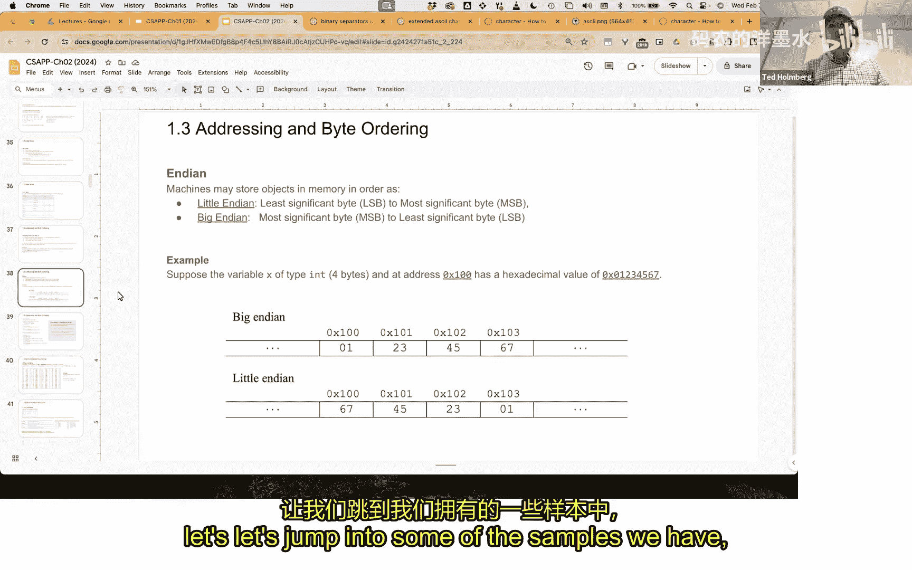

由于所有数据本质上都是数字，理解数字表示是理解系统如何运行的基础。例如，图片可以表示为三个整数值（红、绿、蓝），这依赖于整数编码。声音的振幅则需要能表示正负值的有符号整数编码。

我们之前讨论了字符编码（如ASCII码），它使用一组非负整数来表示字符集中的每个符号。当我们讨论数字编码时，主要关注两个问题：无符号整数和有符号整数的表示。

所有二进制表示都基于数值格式。如果需要更大的编码空间，只需在二进制字符串中添加更多比特位。这就是区分 `short`、`int`、`long` 等数据类型的关键——它们可编码的比特位数不同，从而提供了不同数量的二进制“单词”排列组合。

系统可寻址的最小单位是单个字节。如果要存储一个需要多个字节的单一值（如一个整数），系统必须知道这一点。这就是为什么我们有强类型系统。当你在虚拟地址空间中放入一个整数值时，它会预留一个连续的4字节块来存储该完整二进制字的每个片段。

读取数据时，就引出了字节序的问题：是从最高有效位到最低有效位读取（大端序），还是从最低有效位到最高有效位读取（小端序）。

以下是展示系统字节序的代码示例：

```c
#include <stdio.h>

typedef unsigned char *byte_pointer;

void show_bytes(byte_pointer start, size_t len) {
    size_t i;
    for (i = 0; i < len; i++)
        printf(" %.2x", start[i]);
    printf("\n");
}

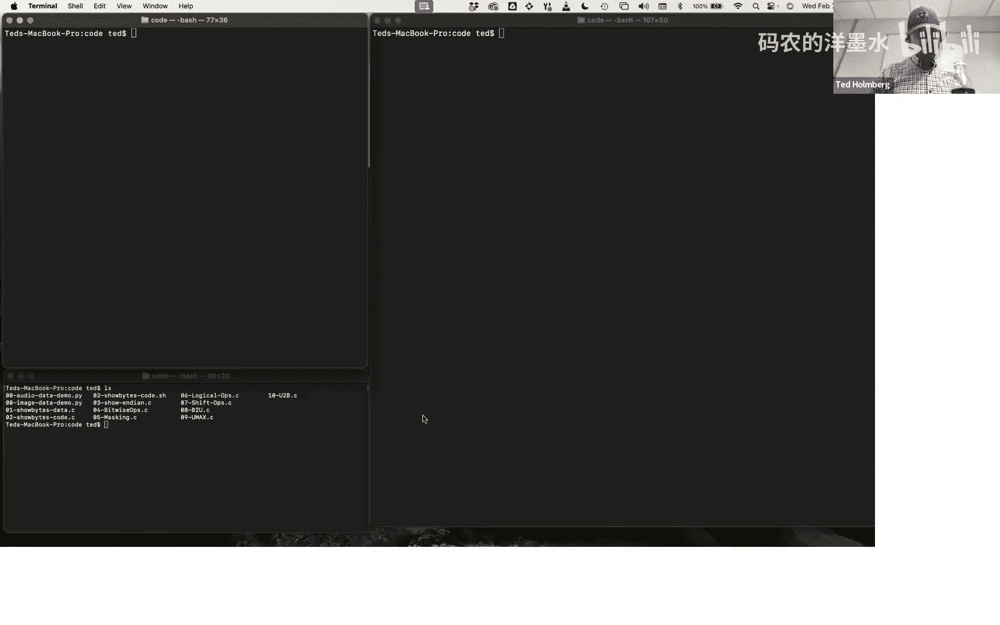

void show_int(int x) {
    show_bytes((byte_pointer) &x, sizeof(int));
}

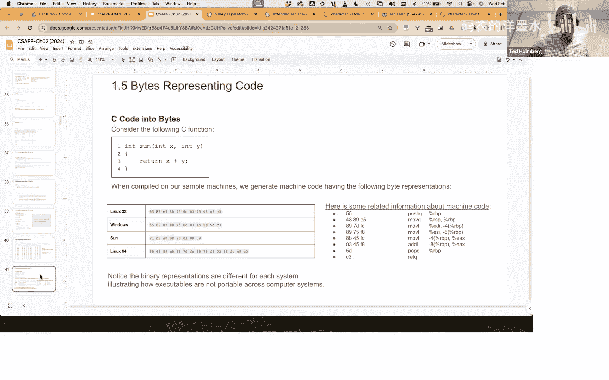

void show_float(float x) {
    show_bytes((byte_pointer) &x, sizeof(float));
}

void show_pointer(void *x) {
    show_bytes((byte_pointer) &x, sizeof(void *));
}

int main() {
    int ival = 12345;
    float fval = (float) ival;
    int *pval = &ival;
    show_int(ival);
    show_float(fval);
    show_pointer(pval);
    return 0;
}
```
运行此代码可以显示整数、浮点数和指针的字节序列，从而判断系统使用的是小端序（如输出 `39 30 00 00`）还是大端序。

---

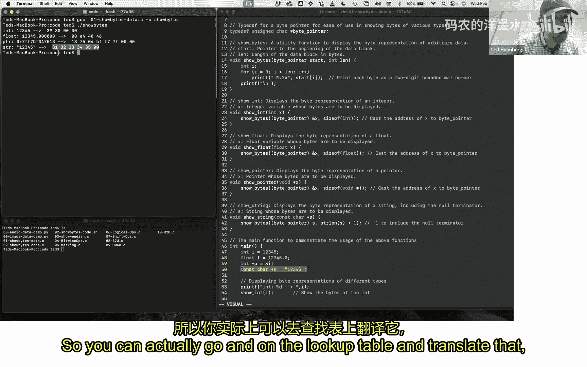

## 不同数据类型的编码

上一节我们看到了数据的字节序。本节中，我们来看看相同数值在不同数据类型（如整数、浮点数、字符串）中是如何被编码成不同二进制序列的。

字符使用单字节表示。字符串可以看作是字符数组，通常以空字符 `\0` 结尾，作为分隔符。

以下代码比较了相同数字 `12345` 在整数、浮点数、指针和字符串中的不同编码：

```c
// ...（show_bytes等函数定义同上）

void show_string(char *x) {
    show_bytes((byte_pointer) x, strlen(x)+1); // +1 包含空字符
}

int main() {
    int ival = 12345;
    float fval = 12345.0;
    int *pval = &ival;
    char *sval = "12345";

    show_int(ival);
    show_float(fval);
    show_pointer(pval);
    show_string(sval);
    return 0;
}
```
字符串 `"12345"` 的输出（如 `31 32 33 34 35 00`）对应的是每个字符的ASCII码十六进制值。这说明了字符代码同时具有文本和数值属性。

---

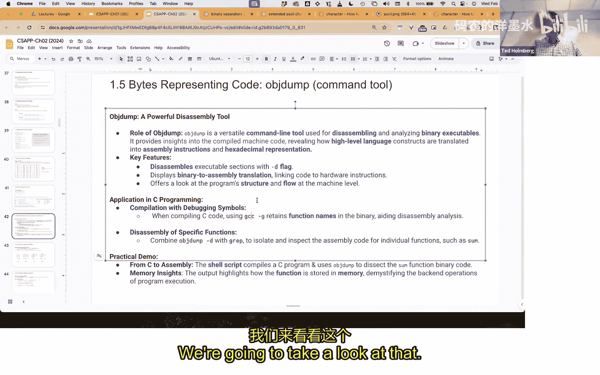

## 代码即数据

我们已了解数据在内存中的表示。本节中，我们来看一个关键概念：代码本身在系统中也是以二进制数据的形式存储的。

当C函数被编译后，其机器码会以十六进制表示形式存入内存。系统知道如何将这些十六进制值转换回汇编指令。像 `objdump` 这样的反汇编工具可以将可执行文件中的十六进制序列转换回汇编语言。

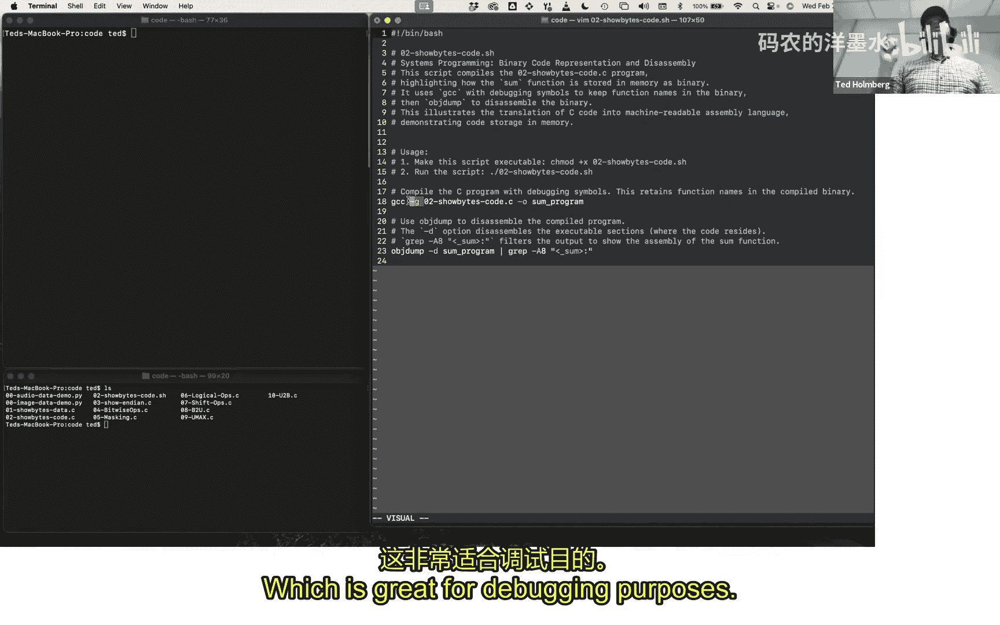

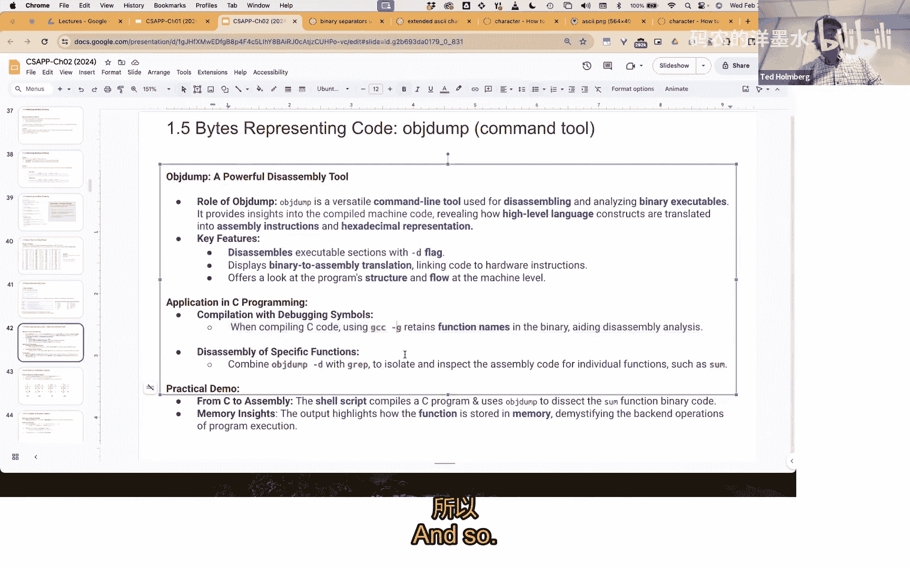

以下是一个简单的C程序及其通过Shell脚本反汇编的示例：

**C源文件 (`sum.c`):**
```c
#include <stdio.h>

int sum(int x, int y) {
    return x + y;
}

int main() {
    printf("Sum: %d\n", sum(1, 2));
    return 0;
}
```
**Shell脚本 (`disassemble.sh`):**
```bash
#!/bin/bash
# 编译C代码，保留调试信息（-g）
gcc -g -o sum_program sum.c
# 反汇编可执行文件，并搜索sum函数
objdump -d sum_program | grep "<_sum>"
```
通过 `chmod +x disassemble.sh` 赋予脚本执行权限，然后运行 `./disassemble.sh`，可以看到 `sum` 函数的汇编指令和对应的十六进制机器码。这证明了代码在系统中与其他数据一样，都是存储在内存中的二进制序列。

---

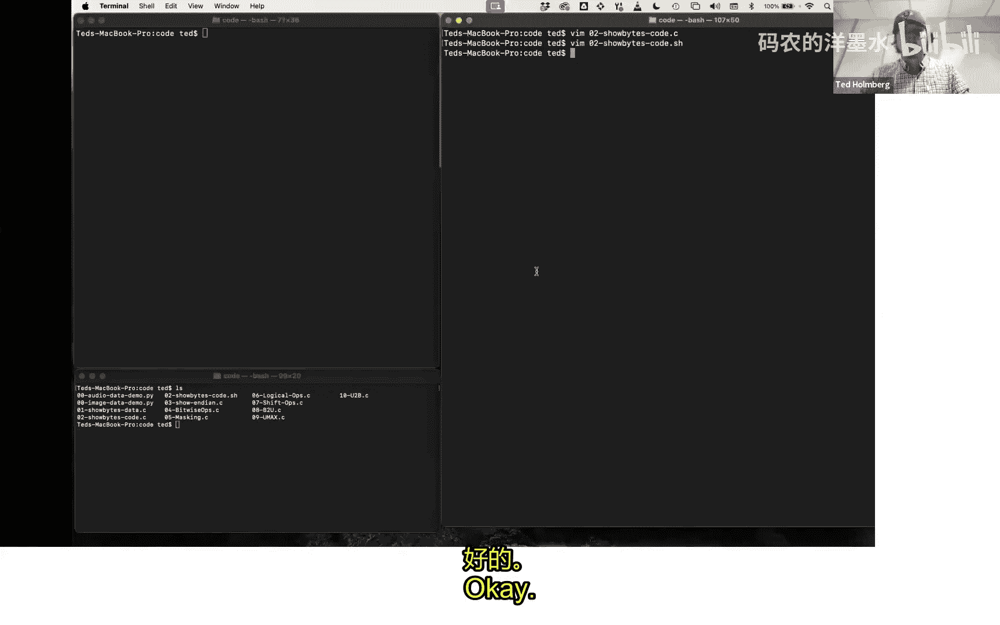

## 位运算符与位向量

我们已经看到数据在底层都是比特序列。本节中，我们来看看用于转换这些比特序列的基本工具：位运算符和逻辑运算符。

位运算符（如 `&`, `|`, `^`, `~`）旨在一次操作一对比特。然而，就像线性代数可以变换整个场一样，位运算符可以应用于整个位向量。前提是两个位向量长度必须相同（可通过零填充实现）。运算符会统一作用于向量中的每一个比特位。

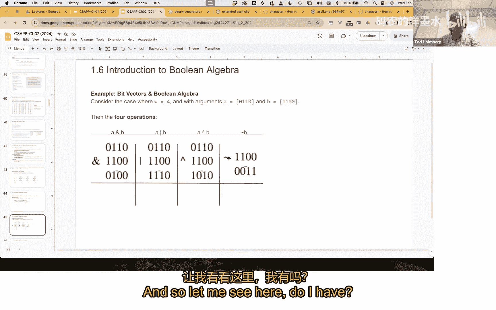

以下是对两个位向量进行各种位运算的示例输出：
```
A:      11111111
B:      00000001
A|B:    11111111
A&B:    00000001
A^B:    11111110
~A:     00000000
```

位向量可以用来表示有限集合。我们可以用两种方式看待位向量：
1.  **向量**：有序集合，顺序重要，元素可重复。例如二进制字符串 `01101001`。
2.  **集合**：无序集合，元素唯一。可以用值为1的比特位的位置索引来表示。例如 `01101001` 可表示为集合 `{0, 3, 5, 6}`。

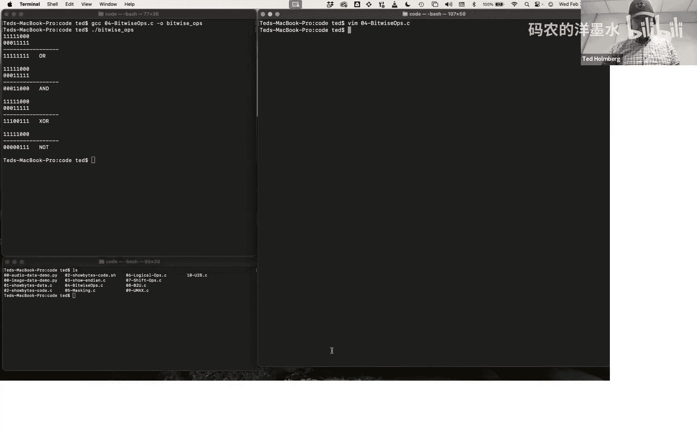

集合论中的操作与位运算符有清晰的对应关系：
*   **并集 (Union)** -> 按位或 `|`
*   **交集 (Intersection)** -> 按位与 `&`
*   **补集 (Complement)** -> 按位非 `~`

这种对应关系非常强大，它允许我们使用更丰富的数学工具（集合论）来理解和操作二进制数据。

---

## 应用于复杂数据：图像与声音

位运算符不仅能操作抽象比特，还能处理具体的复杂数据。本节中，我们来看看如何将图像和声音这类抽象数据映射到底层的数值表示，从而用位运算符进行处理。

例如，一个像素的颜色可以用RGB（红、绿、蓝）三个数值表示。假设每个颜色分量只用1比特表示（0关/1开），我们可以组合出8种颜色：
*   `000`: 黑
*   `001`: 蓝
*   `010`: 绿
*   `011`: 青
*   `100`: 红
*   `101`: 品红
*   `110`: 黄
*   `111`: 白

混合红色(`100`)和绿色(`010`)得到黄色(`110`)，这正是按位或(`|`)操作的结果。这展示了如何用底层比特操作来实现上层的颜色混合。

以下Python代码演示了如何通过直接指定RGB数值来生成图像像素和声音：

**生成彩色像素：**
```python
import numpy as np
from PIL import Image

# 定义像素颜色 (R, G, B)
red_pixel = [255, 0, 0]
green_pixel = [0, 255, 0]
blue_pixel = [0, 0, 255]
white_pixel = [255, 255, 255]

# 创建图像数组并显示
pixel_array = np.array([red_pixel, green_pixel, blue_pixel, white_pixel], dtype=np.uint8)
img = Image.fromarray(pixel_array.reshape(1, 4, 3), 'RGB')
img.show()
```
**生成简单音调：**
```python
import numpy as np
import sounddevice as sd

def generate_tone(frequency, duration, sample_rate=44100):
    t = np.linspace(0, duration, int(sample_rate * duration), endpoint=False)
    wave = 0.5 * np.sin(2 * np.pi * frequency * t)
    return wave

# 定义音符频率 (Hz)
A4 = 440.00
C5 = 523.25
E5 = 659.25

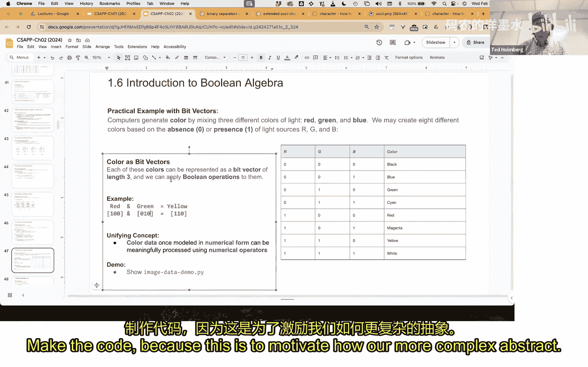

# 生成并播放和弦
duration = 2.0
chord = generate_tone(A4, duration) + generate_tone(C5, duration) + generate_tone(E5, duration)
sd.play(chord, samplerate=44100)
sd.wait()
```
这些例子表明，只要找到数据的数学模型，就可以用数值表示并自动化处理它们。

---

## 掩码操作

位运算符的一个实用技巧是掩码。本节中，我们来看看如何使用掩码从位向量中选择或屏蔽特定的比特位。

掩码是一个比特模式，用于“保留”原数据中与之对应的位（通过与操作`&`），而“屏蔽”或清零其他位。这在需要提取数据的特定部分（如从一个多字节值中取出低字节）时非常有用。

```c
#include <stdio.h>

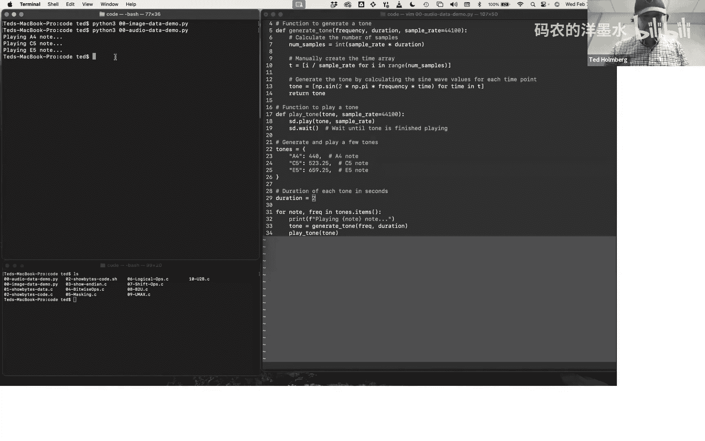

int main() {
    unsigned int x = 0x89ABCDEF; // 一个多字节值
    unsigned int mask = 0xFF;    // 掩码：保留最低字节
    unsigned int masked_value = x & mask;

    printf("Original: 0x%X\n", x);
    printf("Mask:      0x%X\n", mask);
    printf("Result:    0x%X\n", masked_value); // 输出：0xEF
    return 0;
}
```

---

## 逻辑运算符与移位运算符

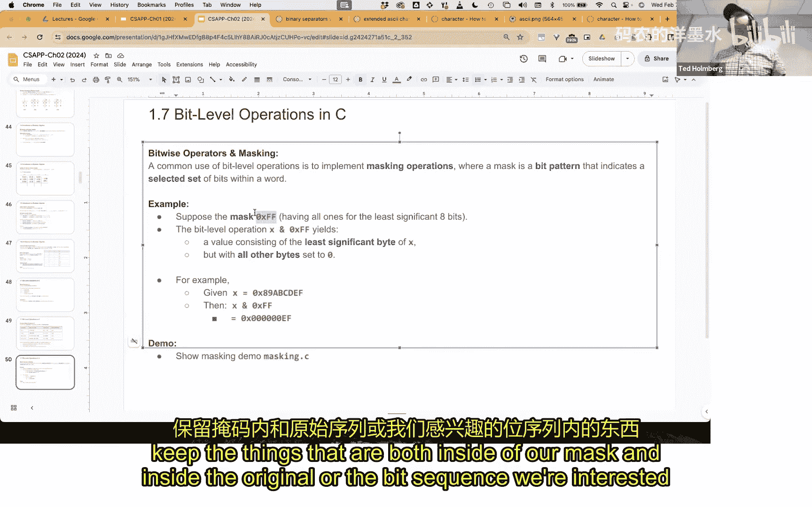

最后，我们区分一下逻辑运算符和移位运算符。逻辑运算符（`&&`, `||`, `!`）将整个表达式求值为布尔值（0或1），不保留位向量的结构，通常用于条件判断。

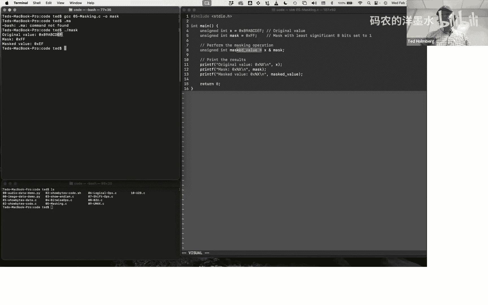

移位运算符（`<<`, `>>`）将比特位向左或向右移动。需要注意的是右移：
*   **逻辑右移**：对无符号整数操作，左侧空位补0。
*   **算术右移**：对有符号整数操作，左侧空位用符号位（最高位）填充，以保持数值的正负性。

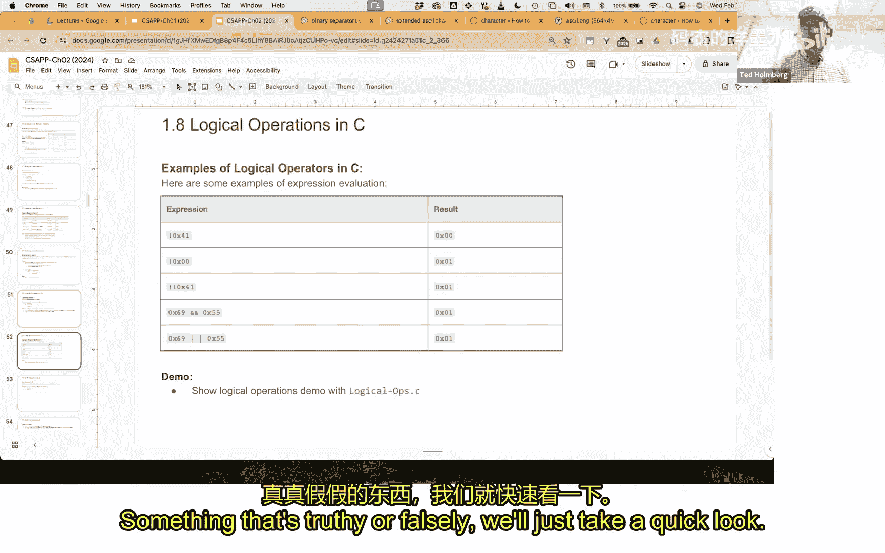

```c
#include <stdio.h>

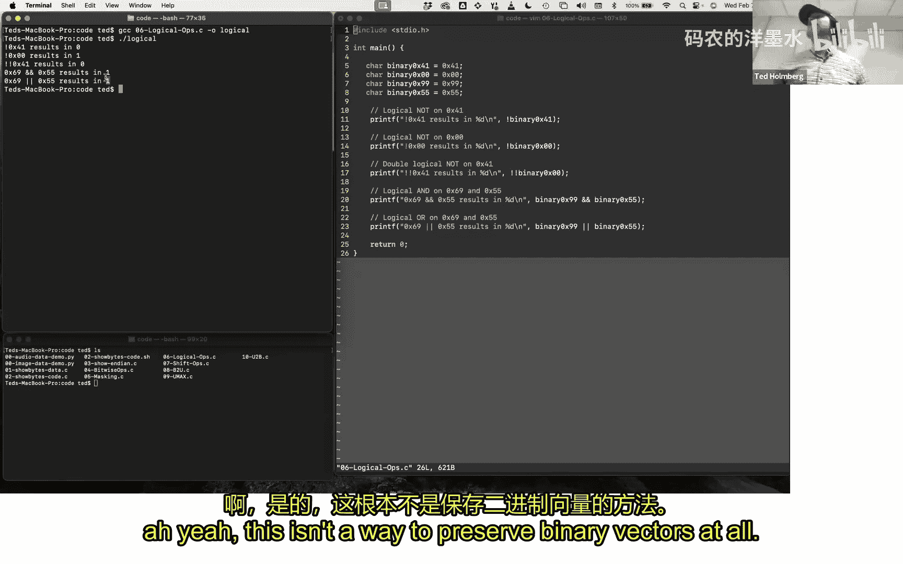

int main() {
    int x_signed = -100;        // 有符号整数
    unsigned int x_unsigned = 100; // 无符号整数

    printf("Signed -100 >> 2 (算术右移): %d\n", x_signed >> 2);
    printf("Unsigned 100 >> 2 (逻辑右移): %u\n", x_unsigned >> 2);

    // 查看二进制表示（简化示意）
    // 算术右移保留符号，逻辑右移补零
    return 0;
}
```

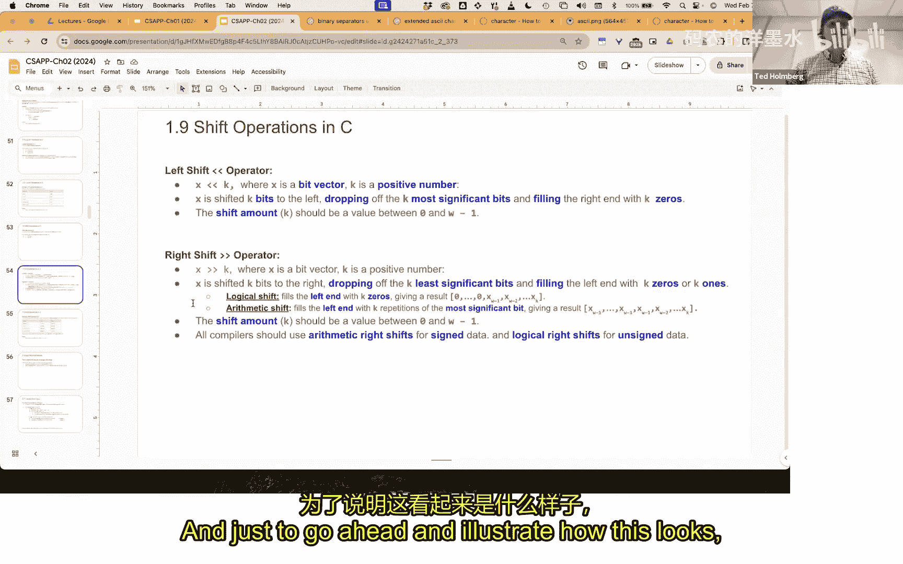

---

## 总结

本节课中我们一起学习了：
1.  **数据的二进制本质**：所有类型的数据最终都表示为二进制数字。
2.  **字节序**：数据在内存中存储的字节顺序（大端序 vs 小端序）。
3.  **代码即数据**：可执行程序本身也是以二进制形式存储在内存中。
4.  **位运算符与位向量**：使用 `&`, `|`, `^`, `~` 操作比特序列，以及位向量与集合的对应关系。
5.  **复杂数据的数值表示**：图像（RGB）、声音（波形）如何映射为数值，从而能用位级操作处理。
6.  **掩码操作**：使用位与运算提取特定位。
7.  **移位运算**：区分逻辑移位和算术移位。

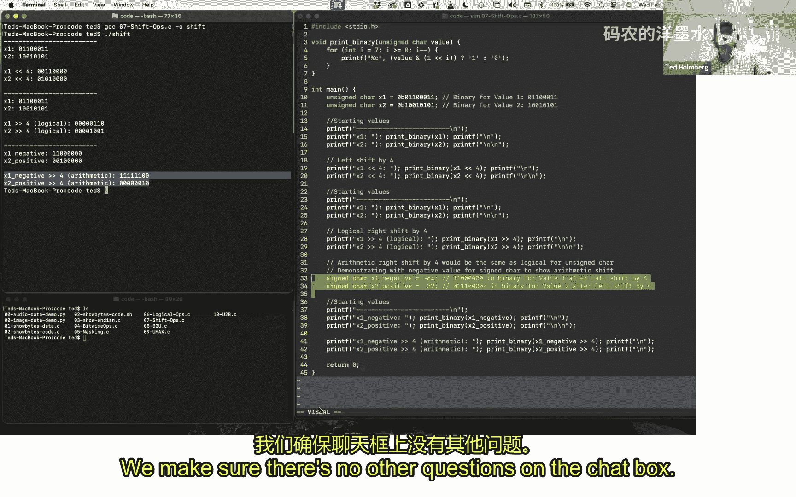

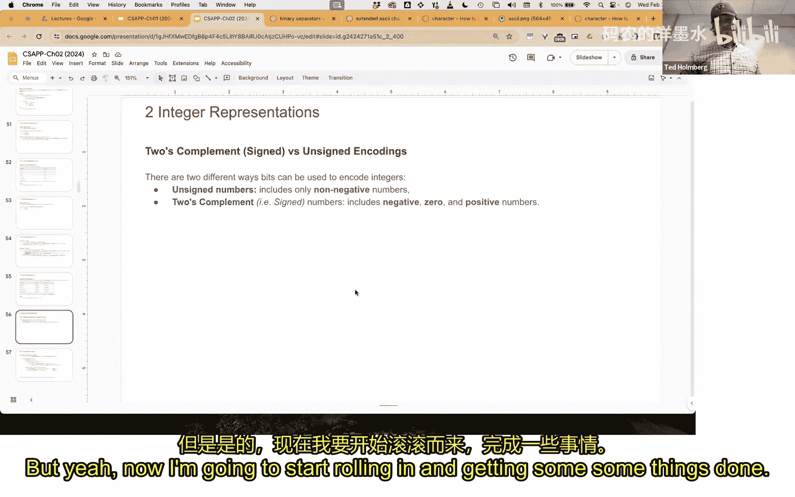

理解这些底层概念是进行系统级编程和高效数据操作的基础。下一讲，我们将深入探讨整数（特别是有符号整数）的具体表示方法。