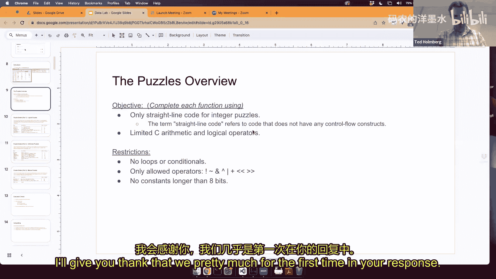

# 011：数据实验教程


## 概述
在本节课中，我们将学习加州理工学院C语言系统编程课程的第11讲内容，即“数据实验”。本实验旨在通过一系列编程谜题，加深对整数位级表示、布尔代数以及位运算的理解。我们将介绍实验的目标、文件结构、三类谜题（逻辑、算术、位操作）以及如何测试和提交代码。

---

## 实验目标与核心概念
上一节我们概述了课程内容，本节中我们来看看数据实验的具体目标。

数据实验的核心是挑战你对过去几周所学概念的理解，特别是**整型数据的位级表示**。实验要求你使用受限的C语言运算符，解决一系列编程谜题。

核心概念包括：
*   **位向量**：一系列比特的表示。
*   **布尔代数**：对位向量执行逻辑运算（与、或、非、异或）。
*   **整数表示**：无符号整数和补码有符号整数的不同表示方式。
*   **位运算**：使用C语言的位运算符（如 `&`, `|`, `~`, `^`, `<<`, `>>`）来操作数据。

实验的目的是让你在实践中熟悉这些概念，而不仅仅是理论学习。

---

## 实验环境与文件准备
了解了实验目标后，我们需要准备实验环境。

你需要使用课程提供的Web终端来访问系统实验室，以完成本实验。请使用你的学校凭证登录。Web终端提供了一个完整的Ubuntu GUI环境，你可以使用shell或内置浏览器（如Chromium或Firefox）来访问Autolab或GitHub以获取实验材料。

所有实验材料都存放在课程GitHub仓库中。你需要下载 `datalab-handout.tar` 文件，并在系统实验室中解压。

解压后，你将看到以下主要文件：
*   `README`：实验说明文档。
*   `bits.c`：你需要编辑和实现所有函数的核心C源文件。
*   `btest`, `dlc`, `driver.pl`：用于测试和检查代码正确性的工具。
*   `Makefile`：用于编译项目的文件。

---

## 实验规则与约束
在开始解题之前，必须清楚了解实验规则。

对于整数谜题，你必须使用**直线代码**。这意味着：
*   不允许使用任何控制流结构（如 `if`, `switch`, `for`, `while`）。
*   只能使用一组受限的原始运算符。

以下是允许的运算符列表：
*   逻辑非：`!`
*   按位与：`&`
*   按位或：`|`
*   按位异或：`^`
*   加法：`+`
*   左移：`<<`
*   右移：`>>`
*   取反：`~`

此外，还有一个重要限制：
*   你使用的**常数**不得超过8位（即一个字节）。这意味着如果你需要构造一个超过8位的位模式，必须通过组合多个8位常数和运算符来实现。

---

## 谜题类型详解
现在，让我们深入了解你需要解决的三类谜题。每个列表前会简要介绍其特点。

### 1. 逻辑谜题
这类谜题主要涉及布尔逻辑操作，用于评估或产生布尔值（真/假，1/0），或者在不改变数值解释的情况下操作位。

以下是逻辑谜题的函数列表：
*   `bitOr(x, y)`：使用仅 `&` 和 `~` 实现 `|` 操作。
*   `bitAnd(x, y)`：使用仅 `|` 和 `~` 实现 `&` 操作。
*   `isNotEqual(x, y)`：如果x不等于y则返回1，否则返回0。
*   `copyLSB(x)`：将结果的所有位设置为x的最低有效位。
*   `specialBits()`：返回特定的位模式 `0xFFCA3F00`。这是需要组合多个8位常数的挑战。
*   `conditional(x, y, z)`：实现条件运算符，若x为真（非零）则返回y，否则返回z。
*   `bitParity(x)`：如果x包含奇数个0，则返回1。

每个问题都有对应的分值和一个**最大操作数限制**。你必须找到一种在操作数限制内实现功能的方法。

### 2. 算术谜题
这类谜题涉及数字的算术属性，如加法、减法、求最大值、取反和判断符号等。这些操作会改变位的数值解释。

以下是算术谜题的函数列表：
*   `minusOne()`：返回数值-1。
*   `tmax()`：返回最大的补码整数。
*   `negate(x)`：返回-x，不能使用 `-` 运算符。
*   `isNegative(x)`：如果x < 0则返回1，否则返回0。
*   `isPositive(x)`：如果x > 0则返回1，否则返回0。
*   `bang(x)`：计算 `!x`，不能使用 `!` 运算符。
*   `addOK(x, y)`：判断 `x+y` 是否会发生溢出。
*   `absVal(x)`：计算x的绝对值。

### 3. 位操作谜题（附加题）
这类谜题主要涉及操作数字内的单个位或位组，例如计算置位位数、交换字节或进行逻辑移位。

以下是位操作谜题的函数列表：
*   `bitSwap(x, n, m)`：交换x的第n个和第m个字节。
*   `bitCount(x)`：返回x中值为1的位的数量。
*   `logicalShift(x, n)`：将x逻辑右移n位。

---

## 测试、评分与提交
实现了所有函数后，你需要测试其正确性并准备提交。

你必须在代码中添加详细的注释，解释你的实现逻辑。评分将基于：
1.  通过所有自动化测试。
2.  仅使用合法的运算符。
3.  满足最大操作数限制。
4.  提供清晰的解释性注释。

以下是用于测试和检查的工具：
*   `btest`：编译并运行 `bits.c` 中的函数，检查其输出是否正确。你可以测试所有函数或指定单个函数。
    ```bash
    make
    ./btest
    ./btest -f bitOr
    ./btest -f bitOr -1 7 -2 5
    ```
*   `dlc`：代码规则检查器。它会静默运行，除非检测到非法运算符、操作数超限或非直线代码。
    ```bash
    ./dlc bits.c
    ```
*   `driver.pl`：一个Perl脚本，可以同时运行 `btest` 和 `dlc`，并给出综合评分报告。
    ```bash
    ./driver.pl
    ```

**提交指南**：你只需要提交最终的 `bits.c` 源文件。登录Autolab，导航到CSCI 2467课程的Data Lab作业，上传该文件即可。Autolab设有积分榜，你可以查看自己与其他同学的排名。

**测试建议**：在开发过程中可以使用 `printf` 调试，但在使用 `btest` 或提交前**务必移除或注释掉所有打印语句**，以免干扰评分脚本。

---

## 总结
本节课中我们一起学习了“数据实验”的完整流程。我们了解了实验的目标是掌握位级表示和位运算，熟悉了实验环境与文件结构，详细分析逻辑、算术和位操作三类谜题的要求，并掌握了使用 `btest`、`dlc` 等工具进行测试和验证的方法，最后明确了代码注释和提交的规范。



现在，你可以开始分组协作，动手解决这些编程谜题了。如果在某个问题上遇到普遍困难，可以在下节课前达成共识，我们将一起探讨该问题的解决思路。