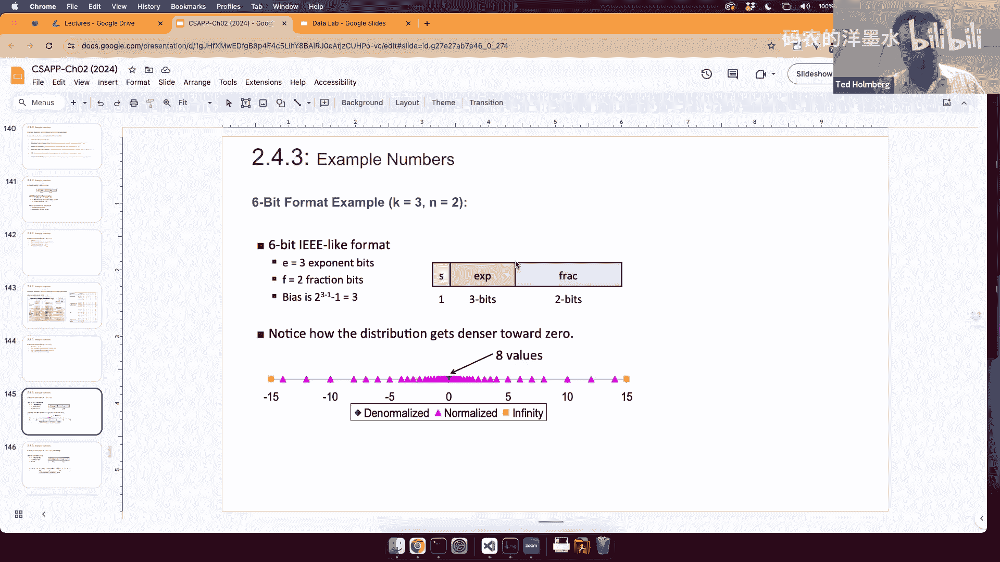

# 012：浮点数（第一部分）📚

在本节课中，我们将要学习计算机中浮点数的表示方法。我们将从整数表示过渡到浮点数，理解其核心概念、二进制表示以及IEEE 754标准。浮点数使我们能够表示非常大或非常小的数值，但同时也是一种近似表示。

---

## 从整数到浮点数 🔄

上一节我们介绍了整数数据集的表示，整数是可计数的值，从一个单位到下一个单位之间有离散的步长。然而，整数无法定义集合中两个值之间的空间量。

浮点数则为我们提供了这种能力，允许我们表示实数之间无限小的值。但需要记住，任何以小数或浮点数形式表示的值，在数学上始终是一种近似。例如，0.999... 无限循环等于1的证明，就说明了将小数映射到整数集时，这种近似是固有的。

---

## 浮点数的二进制表示 💡

为了将浮点数编码为二进制序列，我们使用一种类似于科学计数法的方法。一个浮点数值 **V** 可以定义为：

**V = M × 2ᴱ**

其中：
*   **M** 是**尾数**，它决定了数字的精度和大小。
*   **E** 是**指数**，它通过2的幂次来缩放数字，决定其数量级。

浮点数非常适合表示非常大的数和非常接近零的数，但它始终是对实数运算的近似。

---

## 二进制小数详解 🧮

在二进制中，我们使用**二进制点**（类似于十进制中的小数点）。二进制点左边的位表示整数部分（2⁰, 2¹, 2²...），右边的位表示小数部分（2⁻¹, 2⁻², 2⁻³...）。

以下是一个二进制小数的例子：

`101.11₂`

我们可以将其计算为：
*   左边：`1×2² + 0×2¹ + 1×2⁰ = 4 + 0 + 1 = 5`
*   右边：`1×2⁻¹ + 1×2⁻² = 0.5 + 0.25 = 0.75`
*   总和：`5.75`

移动二进制点会改变数值：
*   左移一位相当于除以2。
*   右移一位相当于乘以2。

---

## 近似与局限性 ⚠️

分数值本质上是近似的，这在十进制和二进制中都是如此。有些数在一种进制中可以精确表示，在另一种进制中却不行。

例如：
*   `1/3` 在十进制中无法精确表示（0.333...）。
*   `1/5` 在十进制中可以精确表示为 `0.2`，但在二进制中却无法精确表示，只能近似。

这就是为什么我们**永远不应该对浮点数进行相等性比较**，因为近似表示可能导致微小的误差。

---

## IEEE 754 浮点标准 🏆

之前的位置表示法在表示极大或极小数时效率低下。IEEE 754标准通过更高效的编码方式解决了这个问题。

该标准将浮点数表示为三个字段的组合：
1.  **符号位 (S)**：决定正负（0为正，1为负）。
2.  **指数域 (Exp)**：编码指数 **E**，使用**偏置**形式表示。
3.  **小数域 (Frac)**：编码尾数 **M** 的小数部分。

单精度（32位）和双精度（64位）的位分配如下：

| 精度 | 符号位 | 指数域 | 小数域 | 总位数 |
| :--- | :---: | :---: | :---: | :---: |
| 单精度 | 1 | 8 | 23 | 32 |
| 双精度 | 1 | 11 | 52 | 64 |

**默认应使用双精度**，因为它提供更高的精度，能减少近似带来的误差。如果可能，应优先使用整数建模，避免使用浮点数。

---

## 数值的三种情况 📊

根据指数域的值，浮点数分为三种情况：

### 1. 规格化值（最常见）
*   **条件**：指数域既不全为0，也不全为1。
*   **指数**：`E = e - Bias`。其中 `e` 是指数域的无符号整数，`Bias` 是偏置值（单精度为127，双精度为1023）。
*   **尾数**：`M = 1 + f`。其中 `f` 是小数域的值（0 ≤ f < 1），隐含一个前导1。

### 2. 非规格化值
*   **条件**：指数域全为0。
*   **指数**：`E = 1 - Bias`（此时指数为固定值，使得数值非常接近0）。
*   **尾数**：`M = f`（没有隐含的前导1，用于表示0和接近0的数）。
*   **作用**：提供**渐进下溢**，使数值在0附近均匀分布。

### 3. 特殊值
*   **条件**：指数域全为1。
*   **表示**：
    *   小数域全为0：表示**无穷大**（`±∞`，由符号位决定）。
    *   小数域非全为0：表示**非数**（`NaN`，Not a Number）。

---

## 可视化理解 🎨

想象一条数轴，浮点数能表示的值不是连续分布的，而是像散点一样分布：
*   在0附近（非规格化区域），点分布得非常密集。
*   随着数值增大（规格化区域），点与点之间的间隔（“空洞”）会越来越大。

这是因为规格化值是通过 `M × 2ᴱ` 来定义的，当指数 `E` 增大时，相同的尾数变化 `f` 会导致最终数值的跳跃变大。引入偏置 `Bias` 正是为了优化指数值的表示范围，使其能同时高效地表示很小和很大的数。

---

## 总结 ✨

本节课中我们一起学习了：
1.  **浮点数的概念**：它是对实数的近似表示，用于处理极大、极小或带有小数的数值。
2.  **二进制小数**：理解了二进制点的概念及如何计算二进制小数的值。
3.  **IEEE 754标准**：掌握了浮点数在计算机中的存储格式，包括符号位、指数域和小数域。
4.  **三种数值类型**：区分了规格化值、非规格化值和特殊值（无穷大、NaN）及其编码方式。
5.  **核心公式**：浮点数值的计算公式 **V = (-1)ˢ × M × 2ᴱ**。
6.  **重要原则**：应优先使用双精度浮点数，并避免对浮点数进行相等比较。

理解浮点数的表示方式和局限性，对于编写正确、稳定的数值计算程序至关重要。