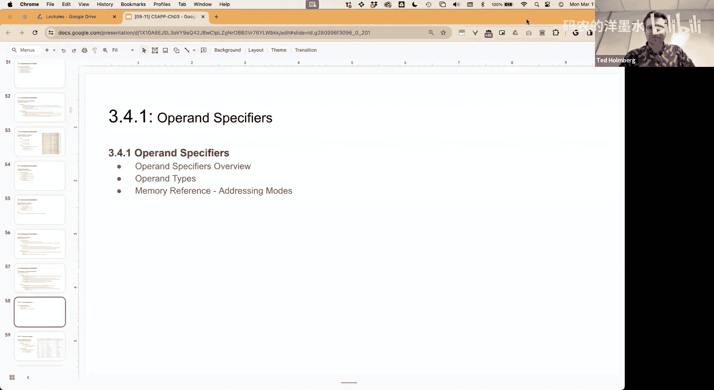

# 015：编码与格式化

## 概述

在本节课中，我们将学习机器代码和汇编语言的基础知识。我们将探讨高级C语言代码如何被编译成机器可执行的二进制指令，理解汇编语言作为中间抽象层的作用，并回顾处理器架构（特别是x86-64）的历史演变如何塑造了今天的编程模型。本节课的核心目标是建立从二进制数据表示到实际机器操作的桥梁。

---

## 从数据表示到机器操作

上一节我们深入探讨了整数和浮点数的二进制表示。本节中，我们来看看这些二进制数据如何在计算机系统中被实际使用和操作。

计算机系统需要能够**操纵数据**、**管理内存**、**处理输入/输出**以及**进行网络通信**。为了实现这些功能，高级语言（如C、Java）编写的代码需要被翻译成机器能够直接理解的指令序列。

这个翻译工作由**编译器**完成。编译器是一个高度专业化的软件，它的一端是编程语言的语法规则，另一端是目标机器的**指令集架构**。它负责将高级代码转换为低级的**机器代码**。

**机器代码**是由编码的字节序列组成的，代表了CPU的低级操作。这些字节序列可以被加载到内存中，由CPU按地址读取和执行。

---

## 高级语言与汇编语言的优势

以下是高级语言相对于直接编写汇编或机器代码的主要优势：

*   **开发效率**：用更少的代码完成更多工作，更容易编写和阅读。
*   **错误检测**：编译器能在编译时发现许多语法和类型错误。
*   **可移植性**：同一份高级代码（尤其是Java这类运行在虚拟机上的语言）可以在不同硬件架构上运行。
*   **编译器优化**：现代编译器能够自动优化代码，使其运行得更快、更高效。

编译器优化可以通过标志位控制。例如，在GCC中：
*   `-Og`：为调试生成代码，优化程度最低，保留函数名等可读信息。
*   `-O1`：进行适度优化。
*   `-O2`：进行更激进的优化。

选择优化级别取决于项目需求，例如调试时需要`-Og`，而发布时需要`-O2`以获得最佳性能。

---

## 学习机器代码的动机

理解机器代码对于成为一名资深的开发者至关重要。其意义在于：

*   **理解编译器优化**：明白代码如何被优化，从而编写出更高效的源代码。
*   **分析运行时行为**：深入理解程序在底层是如何执行的。
*   **识别安全漏洞**：许多安全漏洞（如缓冲区溢出）只有在底层代码层面才能被清晰理解。
*   **高效调试**：当高级调试工具失效时，能够阅读反汇编代码是定位复杂Bug的关键技能。

在实际工作中，我们更多是**阅读编译器生成的汇编代码**，而非手动编写。这种能力在调试、性能分析和逆向工程中非常有用。

---

## 主流机器语言与历史背景

当前主流的指令集是**x86-64**，它广泛应用于个人电脑和数据中心服务器。其历史演变如下：

1.  **1978年 - 8086**：16位处理器，是IBM PC和MS-DOS的基础。
2.  **1985年 - 80386**：升级到32位架构，地址空间翻倍。
3.  **1989年 - 80486**：集成浮点运算单元（FPU）。
4.  **1993年 - Pentium系列**：引入新的指令集。
5.  **2006年 - Core系列**：引入多核、超线程等现代技术。

一个关键特性是**向后兼容**。现代的64位处理器依然可以运行为早期16位或32位架构编写的程序，这也导致了一些历史遗留的设计特征。

同时，**AMD**也是该领域的重要参与者，正是AMD率先提出了**x86-64**（也称AMD64）指令集，后来被Intel采纳。

---

## 编译过程详解

从C源代码到可执行文件的完整编译过程分为多个阶段：

1.  **预处理**
    *   **任务**：处理`#include`、`#define`等预处理指令，进行宏替换。
    *   **输入**：`.c`源文件。
    *   **输出**：经过展开的`.i`文件（仍是C代码）。

2.  **编译**
    *   **任务**：将预处理后的C代码转换为**汇编代码**。进行语法/语义检查，并根据优化级别进行代码优化。
    *   **输入**：`.i`文件。
    *   **输出**：`.s`汇编文件。

3.  **汇编**
    *   **任务**：将人类可读的汇编代码翻译成**机器指令**（二进制代码），并解析符号名。
    *   **输入**：`.s`文件。
    *   **输出**：`.o`目标文件（Object File）。

4.  **链接**
    *   **任务**：将一个或多个目标文件以及所需的库文件合并，解析它们之间的外部引用（如函数调用），生成最终的可执行文件。
    *   **输入**：一个或多个`.o`文件。
    *   **输出**：可执行文件（如`a.out`）。

**目标文件**和**可执行文件**都是机器代码，但关键区别在于：可执行文件中的所有符号和内存地址都已被**解析和固定**，可以被操作系统直接加载执行。

---

## 机器级编程的抽象

机器代码和汇编代码暴露了两个核心的硬件抽象：

1.  **处理器状态**
    *   由**指令集架构**定义。
    *   主要包括：
        *   **程序计数器**：存放下一条要执行的指令的地址。
        *   **整数寄存器文件**：16个命名的存储位置，用于存放整数数据或指针。
        *   **条件码寄存器**：保存最近算术或逻辑操作的状态（如是否为负、是否溢出）。
        *   **向量寄存器**：用于存放多个整数或浮点数（SIMD操作）。

2.  **内存模型**
    *   内存被视为一个巨大的、按字节寻址的数组。
    *   程序内存包含：机器代码、操作系统数据、运行时栈、用户分配的堆内存块等。
    *   操作系统通过**虚拟地址空间**管理内存，为每个进程提供独立的内存视图。

汇编代码是机器指令的文本表示，它暴露了一些在高级语言中隐藏的细节，例如程序计数器（在x86-64中称为`%rip`）。

---

## 数据格式与操作数大小

x86架构的数据类型命名与其历史发展紧密相关：

*   **字节**：8位。
*   **字**：16位（源于最初的16位8086处理器）。
*   **双字**：32位。
*   **四字**：64位。

在汇编指令中，通常通过在指令后添加后缀来指定操作数大小：
*   `movb`：移动一个**字节**。
*   `movw`：移动一个**字**。
*   `movl`：移动一个**双字**。
*   `movq`：移动一个**四字**。

这告诉处理器应该对多少位的数据进行操作。

---

## 寄存器演变与访问

x86-64有16个通用目的寄存器，它们的名称体现了从16位到64位的演变：

*   16位时代：`%ax`, `%bx`, `%cx`, `%dx`...
*   扩展到32位：`%eax`, `%ebx`, `%ecx`, `%edx`...（`e`代表扩展）
*   扩展到64位：`%rax`, `%rbx`, `%rcx`, `%rdx`...（`r`可能代表寄存器）

对于早期寄存器，仍可访问其子部分：
*   `%rax`（64位） -> `%eax`（低32位） -> `%ax`（低16位） -> `%ah`（高8位）& `%al`（低8位）

一个重要规则是：在x86-64上，对32位寄存器（如`%eax`）进行操作会**自动将高32位清零**。这是一个设计约定。

---

## 关键寄存器用途

*   **栈指针**：`%rsp`，指向当前栈帧的顶部，用于管理函数调用时的局部变量和保存寄存器。
*   **其他通用寄存器**：用于存储临时数据、函数参数、返回值等。
*   **特定用途**：某些指令会隐含使用特定寄存器。例如，乘法指令可能使用`%rax`和`%rdx`来存放结果。

寄存器使用约定对于函数调用至关重要：
*   前6个整数参数通过`%rdi`, `%rsi`, `%rdx`, `%rcx`, `%r8`, `%r9`传递。
*   返回值通常存放在`%rax`中。
*   调用函数时，调用者需要保存某些寄存器的值（调用者保存寄存器），而被调用函数需要保存另一些寄存器的值（被调用者保存寄存器）。

---

## 总结

本节课中，我们一起学习了机器代码和汇编语言的基础。我们理解了高级语言代码如何通过编译、汇编、链接等步骤转化为可执行的机器指令。我们回顾了x86-64指令集的历史演变，看到了数据格式、寄存器命名与历史的关联。我们还探讨了处理器状态和内存模型这两个关键的机器级抽象。掌握这些知识，为我们后续深入理解程序在硬件上的实际执行过程、进行底层调试和性能分析奠定了坚实的基础。下一节，我们将更具体地研究操作数和寻址模式。