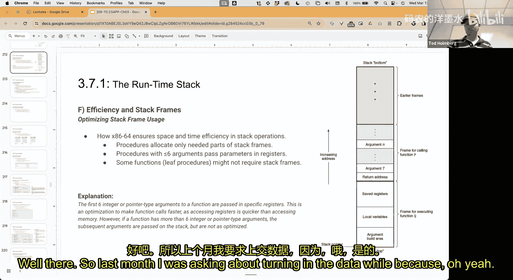

# 016：数据运算符与控制逻辑 🖥️


在本节课中，我们将学习汇编语言中的数据运算符与控制逻辑。我们将探讨如何通过机器码和汇编指令来移动数据、执行算术与逻辑运算，以及如何实现程序的控制流。理解这些底层概念对于掌握计算机系统如何从简单的二进制表示构建出复杂的软件至关重要。

## 数据操作符与操作数类型 🔢

上一节我们介绍了机器码的基本概念，本节中我们来看看指令操作的具体对象——操作数。操作符（如加法、移动）通常需要操作数，你可以将其理解为函数的参数。在机器码层面，我们关心的数据类型主要与数据的存储位置有关。

操作数类型主要有三种：
*   **立即数**：这是一个常量值。在汇编中通常以美元符号 `$` 开头表示。例如：`$0x123`。立即数只能作为源操作数（读取），不能作为目的操作数（写入）。
*   **寄存器**：这是CPU寄存器空间中的位置。在汇编中以百分号 `%` 开头表示。例如：`%rax`。寄存器既可以作为源操作数，也可以作为目的操作数。
*   **内存引用**：这是基于有效内存地址的引用，允许对虚拟内存进行读写。在汇编中通常用括号表示，例如 `(%rax)`。

## 寻址模式 🗺️

既然我们提到了数据在系统中的位置（立即数、寄存器、内存），现在让我们看看系统如何识别和访问这些位置，即寻址模式。

通用寻址模式的格式如下：
`偏移量(基址寄存器, 索引寄存器, 比例因子)`

其计算有效地址的公式为：
**有效地址 = 偏移量 + 基址寄存器值 + (索引寄存器值 * 比例因子)**

以下是各部分的解释：
*   **偏移量**：一个整型常数。
*   **基址寄存器**：内存地址的起始点。
*   **索引寄存器**：从基址开始的偏移量。
*   **比例因子**：必须是1、2、4或8，代表数据类型的字节大小，用于在访问数组等连续数据时跳过相应字节。

这种格式非常灵活，支持我们以各种方式访问系统中的任意位置来提取二进制表示。

## 数据传送指令 📤

理解了如何寻址后，我们来看看汇编中最基本的操作之一：移动数据。`mov` 指令族用于在立即数、寄存器和内存之间传送数据。

`mov` 指令根据操作数大小有不同的变体：
*   `movb`：传送1个字节（8位）。
*   `movw`：传送2个字节（一个字，16位）。
*   `movl`：传送4个字节（双字，32位）。
*   `movq`：传送8个字节（四字，64位）。

指令格式为 `movX 源操作数, 目的操作数`。源操作数可以是立即数、寄存器或内存地址。目的操作数只能是寄存器或内存地址。**一个重要限制是：不能直接在两个内存位置之间传送数据**，必须通过寄存器中转。

以下是几个 `mov` 指令的例子：
```assembly
movl $0x123, %eax       # 立即数 -> 寄存器
movq %rax, %rdx         # 寄存器 -> 寄存器
movb (%rdi, %rcx), %al  # 内存 -> 寄存器
movb $0xFF, (%rax)      # 立即数 -> 内存
movl %eax, -12(%rbp)    # 寄存器 -> 内存（带偏移）
```

对于将较小数据传送到较大空间的情况，有符号扩展和零扩展指令：
*   `movz`：零扩展，用零填充未写入的高位。
*   `movs`：符号扩展，根据源操作数的符号位（正数为0，负数为1）填充高位。
一个特殊的符号扩展指令是 `cltq`，它高效地将 `%eax` 中的32位值符号扩展到 `%rax` 中的64位。

## 栈数据操作 ⬇️⬆️

除了寄存器和内存，程序栈是另一个关键的数据管理区域。栈是一种后进先出（LIFO）的数据结构。在x86-64中，程序栈位于由操作系统分配的特定内存区域，栈顶由 `%rsp`（栈指针）寄存器指示，栈向低地址方向增长。

主要的栈操作指令是 `push` 和 `pop`：
*   `pushq 源操作数`：将源操作数（如寄存器值）压入栈顶。它等价于先减小栈指针 `%rsp`（因为栈向下增长），然后将数据存储到新的栈顶地址。
*   `popq 目的操作数`：从栈顶弹出一个数据到目的操作数（如寄存器）。它等价于先从栈顶地址加载数据，然后增加栈指针 `%rsp`。

我们也可以使用之前介绍的寻址模式来访问栈中任意位置的数据，例如 `8(%rsp)` 可以访问栈顶下方8字节处的值。

## 算术与逻辑运算 ➕➖🔀

现在，让我们看看如何对数据进行计算。算术和逻辑运算指令是构建程序逻辑的基础。

**加载有效地址**指令 `lea` 非常强大。它用于计算地址而不进行内存访问。其格式为 `lea 源内存地址, 目的寄存器`。它实际上执行的是源操作数寻址模式的计算，并将结果（一个地址）存入目的寄存器。编译器常巧妙利用 `lea` 来执行简单的乘加运算，因为它不设置条件码，且速度快。

运算指令分为一元和二元操作：
*   **一元操作**：只有一个操作数，它同时作为源和目的。例如：
    *   `inc`：递增。
    *   `dec`：递减。
    *   `neg`：取负。
    *   `not`：取补。
*   **二元操作**：有两个操作数，格式为 `指令 源操作数, 目的操作数`，结果覆盖目的操作数。例如：
    *   `add`：加法，`addq %rbx, %rax` 相当于 `%rax = %rax + %rbx`。
    *   `sub`：减法。
    *   `imul`：有符号乘法。
    *   `xor`, `and`, `or`：按位异或、与、或。

移位操作也是二元操作，用于移动位模式：
*   `sal` / `shl`：算术左移 / 逻辑左移（两者低位均补0）。
*   `sar`：算术右移（高位复制符号位）。
*   `shr`：逻辑右移（高位补0）。
格式为 `指令 移位位数, 被移位操作数`。

## 控制流：条件码与跳转 🚦

程序不仅仅是顺序执行，更需要根据条件做出决策，这就是控制流。在底层，这是通过**条件码寄存器**和**跳转指令**实现的。

条件码是单个位的寄存器，记录最近一次算术或逻辑运算的属性：
*   **CF**：进位标志。最近操作使最高位产生了进位（无符号溢出）。
*   **ZF**：零标志。最近操作的结果为零。
*   **SF**：符号标志。最近操作的结果为负数。
*   **OF**：溢出标志。最近操作导致有符号溢出。

`cmp` 和 `test` 指令用于设置条件码而不改变操作数：
*   `cmp 操作数b, 操作数a`：类似于计算 `a - b`，并根据结果设置条件码。
*   `test 操作数b, 操作数a`：类似于计算 `a & b`，并根据结果设置条件码。

`set` 指令根据条件码的组合，将一个字节设置为0或1。例如：
*   `sete`：相等时设置（ZF=1）。
*   `setne`：不相等时设置（ZF=0）。
*   `setg`：有符号大于时设置（~(SF^OF) & ~ZF）。
*   `setl`：有符号小于时设置（SF^OF）。

**跳转指令** `jmp` 及其条件变体用于改变指令执行顺序，跳转到代码中由**标签**（如 `.L2:`）标记的位置。
*   `jmp 标签`：无条件跳转。
*   `je 标签`：相等时跳转（ZF=1）。
*   `jne 标签`：不相等时跳转。
*   `jg, jge, jl, jle`：有符号比较后的跳转。
*   `ja, jae, jb, jbe`：无符号比较后的跳转。

跳转也可以是间接的，目标地址来自寄存器或内存：`jmp *%rax` 或 `jmp *(%rax)`。

## 总结 📚

本节课中我们一起学习了汇编语言中数据操作与控制逻辑的核心内容。我们从数据的三种存储位置（立即数、寄存器、内存）和寻址模式开始，深入探讨了如何使用 `mov` 指令在它们之间传送数据。接着，我们了解了程序栈的操作 `push` 和 `pop`。然后，我们学习了各种算术、逻辑和移位运算指令，它们是进行数据计算的基础。最后，我们揭示了程序控制流的底层机制：通过 `cmp`/`test` 指令设置条件码，再根据条件码通过 `set` 指令设置值或通过 `jmp` 系列指令进行条件/无条件跳转。



理解这些从数据移动到条件分支的底层操作，是将高级语言逻辑映射到计算机系统实际执行步骤的关键。这为我们后续分析更复杂的程序行为（例如在 Bomb Lab 中）奠定了坚实的基础。