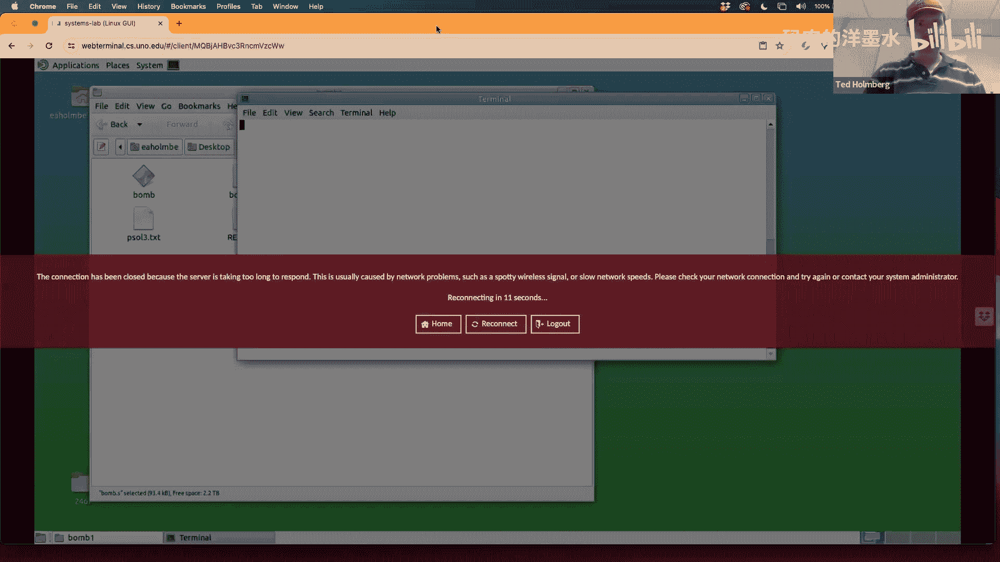
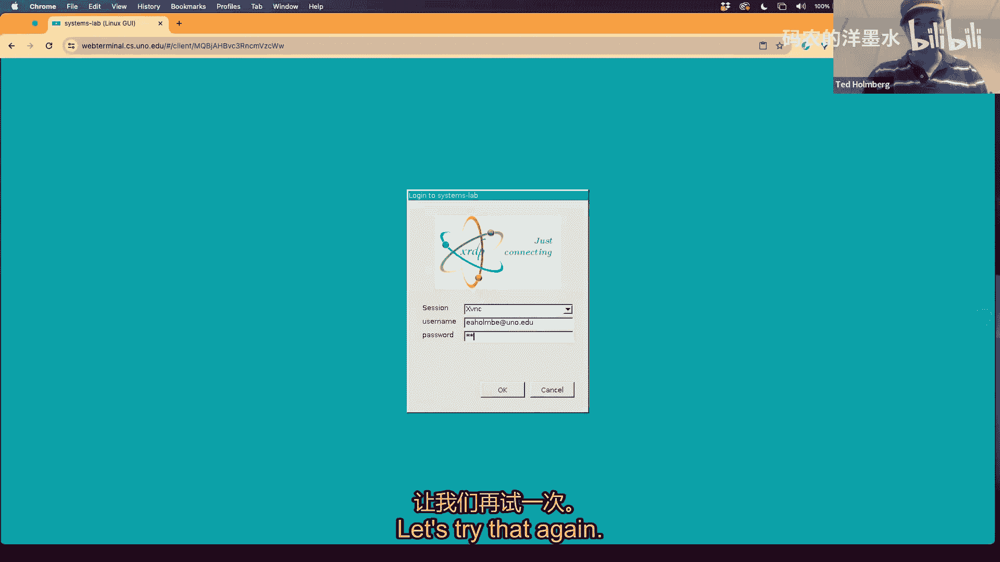
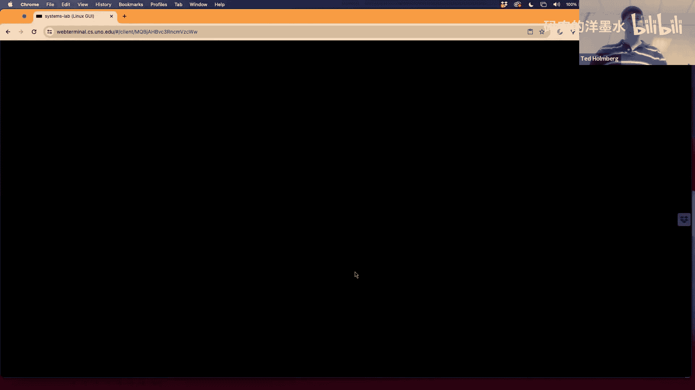
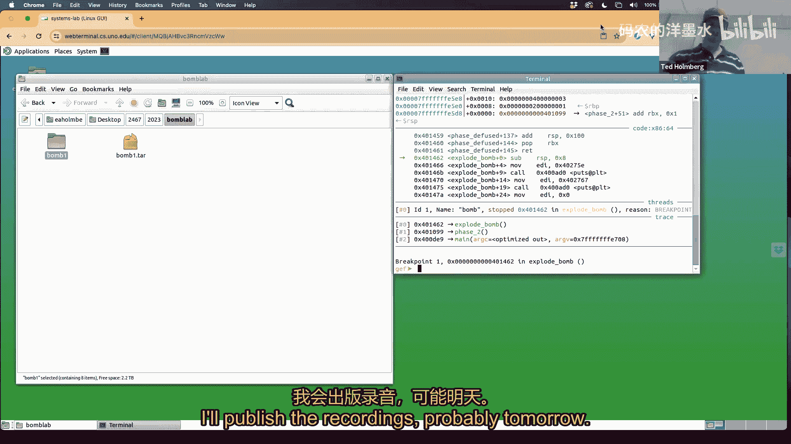

# 018：炸弹实验室第二部分


在本节课中，我们将继续学习炸弹实验室，重点介绍如何利用调试器和反汇编工具来分析和解决炸弹程序的第二阶段。我们将学习两种不同的方法：一种是通过分析反汇编代码来理解程序逻辑，另一种是使用调试器进行动态探索。

---

## 设置安全网

上一节我们介绍了如何使用`strings`命令解决第一阶段。本节中，我们将学习如何使用调试器来更深入地分析程序。

首先，我们启动调试器并加载炸弹程序。

```bash
gdb bomb
```

为了防止炸弹意外爆炸，我们可以在`explode_bomb`函数处设置断点。这样，当程序试图调用该函数时，执行会暂停。

```bash
break explode_bomb
```

如果尝试设置一个不存在的标签作为断点，调试器会提示未定义。

```bash
break elo_bomb
```

设置好断点后，运行程序。如果输入错误的字符串，程序会调用`explode_bomb`，但断点会触发，从而阻止爆炸。但请注意，如果忽略断点并继续执行，炸弹仍会爆炸。

```bash
run
```

---

## 分析第一阶段（调试器方法）

除了设置安全断点，我们还可以在`phase_1`函数处设置断点，以分析其内部逻辑。

```bash
break phase_1
```

运行程序并输入测试字符串。

```bash
run
```

程序会在`phase_1`处暂停。此时，我们可以查看当前的调用栈、寄存器和汇编指令。

使用`nexti`命令可以单步执行下一条指令。当我们执行到`strings_not_equal`函数调用时，可以检查传递给它的参数。

```bash
nexti
nexti
```

在调用`strings_not_equal`之前，参数被加载到了`RSI`寄存器中。我们可以使用`x/s`命令查看该寄存器指向的字符串内容。

```bash
x/s $rsi
```

这将显示程序期望的密码字符串。复制该字符串，在程序提示时输入，即可通过第一阶段。

---

## 解决第二阶段（分析方法）

现在，我们进入第二阶段。我们将首先使用反汇编工具进行静态分析。

使用`objdump`生成炸弹程序的反汇编代码，并输出到文件。

```bash
objdump -d bomb > bomb.s
```

打开`bomb.s`文件，找到`phase_2`函数。以下是其核心逻辑的注释分析。

```assembly
push   %rbp
push   %rbx
sub    $0x28,%rsp
mov    %rsi,%rsi
callq  0x4010c4 <read_six_numbers>
cmp    $0x0,(%rsp)
jns    0x4010af <phase_2+0x2b>
callq  0x4011a1 <explode_bomb>
...
```

函数首先调用`read_six_numbers`，确保输入是六个数字。然后检查第一个数字是否非负。接着，程序进入一个循环，检查数字序列是否满足特定关系。

通过分析汇编代码，我们可以将其逻辑翻译成C代码。

```c
void phase_2(char *input) {
    int numbers[6];
    read_six_numbers(input, numbers);
    if (numbers[0] < 0) {
        explode_bomb();
    }
    for (int i = 0; i < 5; i++) {
        if (numbers[i+1] != numbers[i] + i + 1) {
            explode_bomb();
        }
    }
}
```

根据这个逻辑，如果第一个数字是1，那么序列应为：1, 2, 4, 7, 11, 16。我们可以用这个序列进行测试。







---

## 解决第二阶段（探索方法）

另一种方法是使用调试器动态探索。我们首先在`phase_2`和关键比较指令处设置断点。

```bash
break phase_2
break *0x4010f2
```

运行程序并输入一个测试序列，例如`0 1 2 3 4 5`。当程序在比较指令处暂停时，检查相关寄存器的值。

```bash
info registers eax
x/d $rbp
```

通过观察比较结果，我们可以推断出当前数字应为何值。重复此过程，依次找出所有六个数字，从而解除第二阶段。

---

## 总结



本节课中我们一起学习了两种解决炸弹实验室第二阶段的方法。分析方法通过反汇编和代码翻译来理解程序逻辑，而探索方法则利用调试器动态观察程序状态。掌握这些技能对于进行系统级编程和逆向工程至关重要。