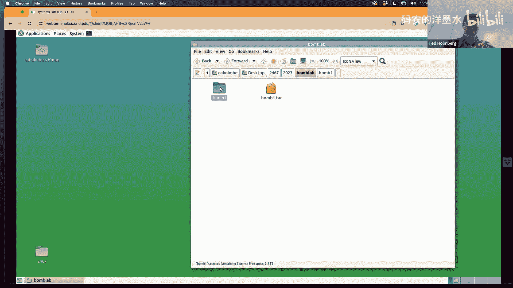
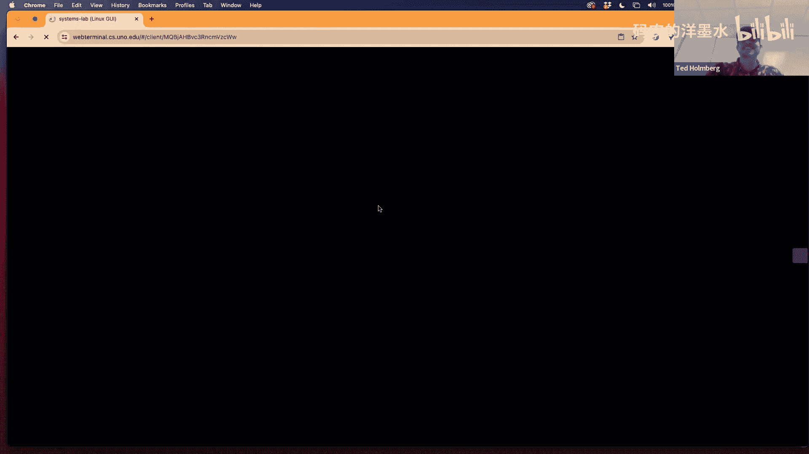
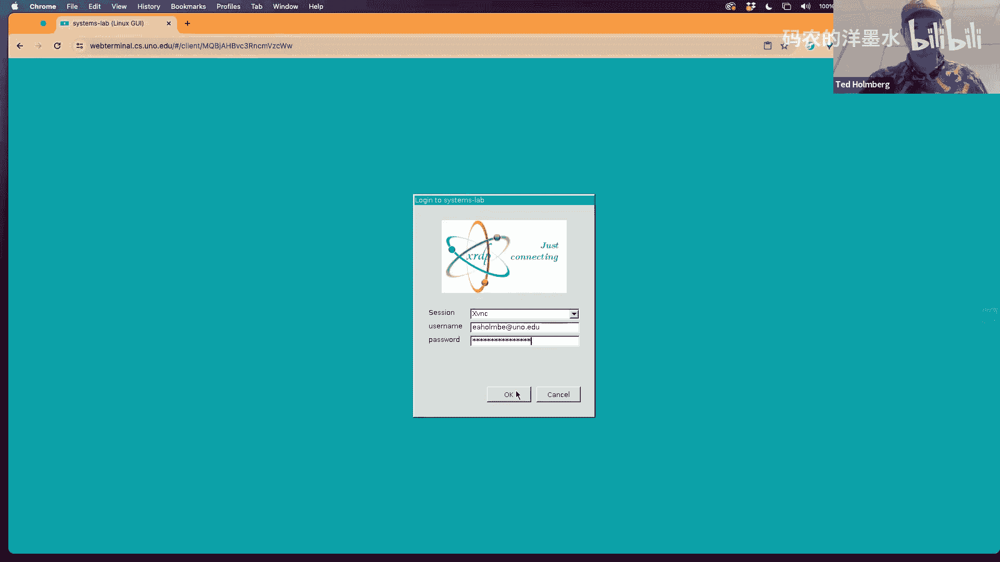
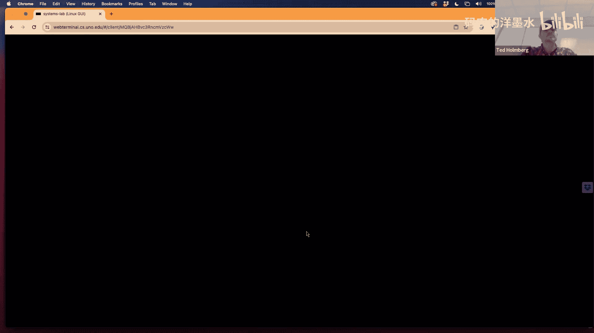
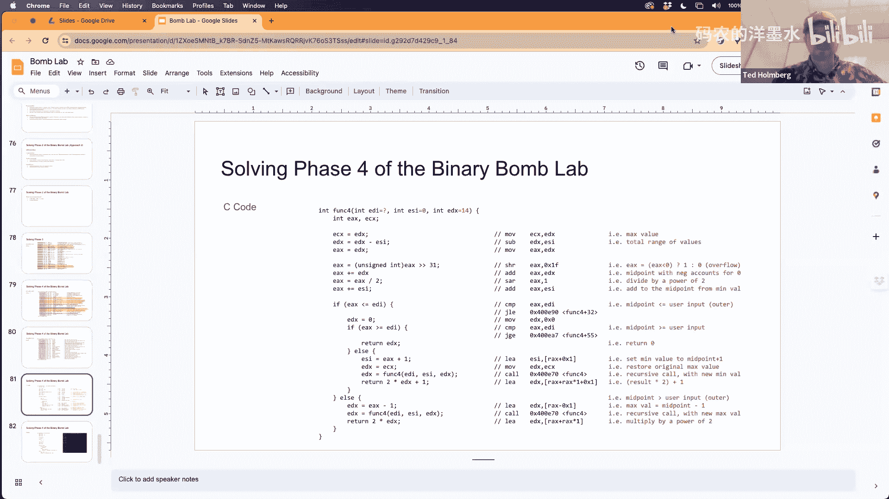

# 019：Bomb Lab Part3 💣


在本节课中，我们将继续拆解Bomb Lab，重点分析第三阶段和第四阶段的炸弹。我们将学习如何使用调试器逐步分析汇编代码，通过检查寄存器和内存状态来推断正确的密码，从而避免炸弹爆炸。课程结束时，你将掌握分析更复杂逻辑（如递归函数）的基本技巧。

---

## 阶段三：输入格式与条件判断 🔍

上一节我们使用`objdump`和调试器解决了第二阶段。本节中，我们来看看第三阶段，它引入了更复杂的输入验证和条件跳转。

首先，在调试器中反汇编`phase_3`函数，查看其结构。

```assembly
(gdb) disas phase_3
```

通过反汇编代码，我们注意到函数开头调用了`scanf`，并且其格式字符串提示我们需要两个整数。

```c
// 从内存地址读取的格式字符串
x/s 0x40278a
"%d %d"
```

因此，第三阶段需要两个整数作为输入。接下来，函数会比较`scanf`的返回值（成功解析的参数数量）与数字1。如果返回值不大于1，程序将跳转到引爆炸弹的代码块。

```assembly
cmp    $0x1,%eax
jg     0x400f6a  ; 如果大于1则跳转，避免爆炸
```

所以，我们必须输入两个整数才能通过第一项检查。

---

## 探索有效输入 🧪

仅仅知道需要两个整数还不够，我们还需要知道具体是哪两个数字。通过设置断点并单步执行，我们可以观察程序是如何比较我们输入的数字的。

我们在关键比较指令处设置断点，然后运行程序并输入测试值（例如`12`和`-5`）。

```bash
(gdb) break *0x400f6a
(gdb) run < sol3.txt
```

单步执行时，程序会将第一个输入的值（位于`rsp+0x14`）与立即数`0x7`（十进制7）进行比较。

```assembly
cmp    0x14(%rsp),%eax
cmp    $0x7,%eax
jl     0x400f83  ; 如果小于7则跳转
```

如果第一个数**不小于7**，程序将引爆炸弹。因此，我们得知第一个数必须小于7。

继续执行，程序会根据第一个数的值，通过一个跳转表计算出一个目标地址并跳转。最终，它会将计算出的一个值与我们的第二个输入进行比较。

```assembly
cmp    %eax,0x10(%rsp)  ; 比较计算值和第二个输入
je     0x400fc9          ; 如果相等则跳转，避免爆炸
```

我们需要让第二个输入与程序根据第一个数计算出的值相等。通过反复测试和观察寄存器`%eax`的值，我们可以找到有效的配对。例如，当第一个输入是`5`时，计算出的值是`-349`，那么有效的输入就是`5 -349`。

**第三阶段的核心逻辑**是：第一个输入是小于7的索引，用于选择计算路径；第二个输入必须与该路径计算出的特定值匹配。

---

## 阶段四：递归函数与二分查找 🔄

成功拆解第三阶段后，我们进入第四阶段。这个阶段引入了递归函数，逻辑更为复杂。

同样，我们先反汇编`phase_4`。

```assembly
(gdb) disas phase_4
```

我们发现它同样需要两个整数输入（通过`scanf`的返回值与2比较得知）。此外，它立即对第一个输入进行了检查：

1.  不能为负数（通过`test %eax, %eax`和`js`指令判断符号位）。
2.  必须小于或等于`0xe`（十进制14）。

```assembly
cmp    $0xe,%eax
jle    0x40102d  ; 如果小于等于14则跳转
```

如果第一个数满足 `0 <= num1 <= 14`，程序会调用一个名为`func4`的函数，参数为`(num1, 0, 14)`。

```c
// 函数调用大致对应
func4(num1, 0, 14);
```

调用`func4`后，其返回值被存放在`%eax`中，并与1进行比较。

```assembly
cmp    $0x1,%eax
je     0x401058  ; 如果等于1则跳转，避免爆炸
```

因此，我们的目标是找到第一个数`num1`，使得`func4(num1, 0, 14)`的返回值等于1。

---









## 分析 func4 函数 🧮

要解决这个问题，必须理解`func4`的行为。我们反汇编它：

```assembly
(gdb) disas func4
```

分析其汇编代码，可以发现它是一个**递归函数**，结构类似于二分查找算法。其C语言伪代码可能如下：

```c
int func4(int edi, int esi, int edx) {
    int ecx = edx;
    ecx = ecx - esi;
    int eax = ecx;
    eax = (unsigned int)eax >> 31; // 逻辑右移
    ecx = ecx + eax;
    eax = ecx;
    eax = eax >> 1; // 算术右移
    eax = eax + esi;

    if (eax <= edi) {
        if (eax >= edi) {
            return 0;
        } else {
            esi = eax + 1;
            return 2 * func4(edi, esi, edx) + 1;
        }
    } else {
        edx = eax - 1;
        return 2 * func4(edi, esi, edx);
    }
}
```

**函数逻辑解析**：
1.  计算中点：`mid = esi + (edx - esi) / 2`（通过移位实现）。
2.  将`mid`与目标值`edi`（即我们的第一个输入）比较。
3.  如果`mid == edi`，返回0。
4.  如果`mid < edi`，在右半部分递归搜索，返回 `2 * func4(...) + 1`。
5.  如果`mid > edi`，在左半部分递归搜索，返回 `2 * func4(...)`。

我们的目标是让最终返回值为1。通过手动模拟或编写一个小程序测试`0`到`14`之间的所有输入，可以找出满足`func4(num, 0, 14) == 1`的`num`值。例如，`7`是其中一个解。

找到`num1`（例如`7`）后，我们还需要第二个数。回顾`phase_4`的汇编，在`func4`调用成功后，它直接将第二个输入与`0`比较，要求相等。

```assembly
cmp    0x10(%rsp),%eax  ; 此时%eax为0？
je     0x401058
```

因此，一个有效的第四阶段密码可能是 `7 0`。

---

## 总结与下节预告 📚

本节课中我们一起学习了Bomb Lab的第三和第四阶段。
*   **第三阶段**要求两个整数输入，第一个作为索引（<7），第二个必须与索引对应的特定计算结果匹配。
*   **第四阶段**同样需要两个整数。第一个输入需在0到14之间，并作为参数传递给一个递归的`func4`函数，该函数的返回值必须为1。第二个输入则必须为0。

我们主要使用了**调试器**来设置断点、单步执行、检查寄存器和内存，从而动态推导出正确的输入。对于包含递归或循环的复杂函数，需要将汇编指令转化为高级逻辑来理解。



下一讲我们将完成Bomb Lab的最后阶段，并开始准备下一个实验——Shell Lab。请确保你已理解本节课中使用的调试技巧和逆向分析方法。