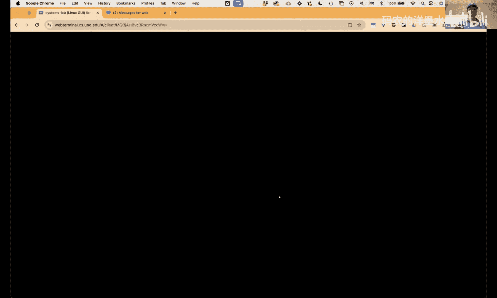
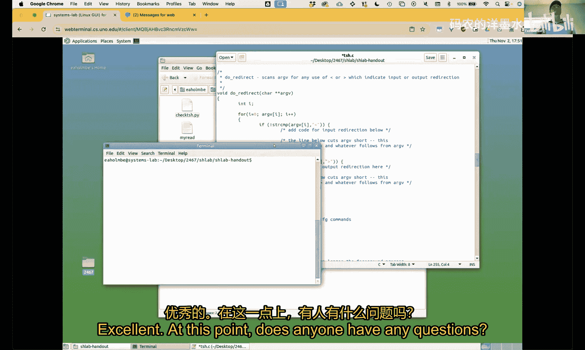

# 021：Shell Lab 第二部分



## 概述
在本节课中，我们将继续构建一个简单的 Shell（Tiny Shell）。我们将从分析第一个测试用例（trace01）的实现开始，然后逐步实现第二个测试用例（trace02），学习如何处理外部命令的执行。我们将深入理解 Shell 如何解析命令、区分内置命令与外部程序，并使用系统调用（如 `fork` 和 `execve`）来创建子进程以运行外部应用程序。

## 回顾与代码分析
上一节我们介绍了 Shell 的基本循环结构（读取、解析、执行）并实现了 `quit` 这个内置命令。本节中，我们来看看如何执行外部命令。

首先，让我们回顾一下当前的代码结构。主函数 `main` 包含一个 `reboot` 循环，核心是 `eval` 函数。在 `eval` 函数中，我们通过 `parseline` 函数解析命令行输入，然后通过 `builtin_command` 函数判断是否为内置命令。

以下是 `eval` 函数中处理命令的核心流程框架：
```c
void eval(char *cmdline) {
    char *argv[MAXARGS]; // 参数数组
    int bg = parseline(cmdline, argv); // 解析命令行，bg指示是否为后台任务
    if (!builtin_command(argv)) { // 如果不是内置命令
        // 需要执行外部程序（这部分将在本节实现）
    }
    return;
}
```
`builtin_command` 函数检查命令是否为 `quit`，如果是则退出程序。对于其他命令，目前它只是返回 0（假），表示需要进一步处理。

## 实现外部命令执行（Trace02）
现在，我们需要实现 `eval` 函数中处理非内置命令的部分。这涉及到创建子进程并在其中运行外部程序。以下是实现步骤：

1.  **创建子进程**：使用 `fork` 系统调用。`fork` 会创建一个当前进程的副本（子进程）。在父进程中，`fork` 返回子进程的PID；在子进程中，`fork` 返回 0。
    *   **公式/概念**：`pid_t pid = fork();`
    *   如果 `pid < 0`，表示 `fork` 失败。
    *   如果 `pid == 0`，当前代码在子进程中执行。
    *   如果 `pid > 0`，当前代码在父进程中执行。

2.  **在子进程中执行程序**：在子进程分支中，使用 `execve` 系统调用加载并运行新的程序。`execve` 会用指定的程序替换当前子进程的内存映像。
    *   **代码**：`execve(argv[0], argv, environ);`
    *   参数 `argv[0]` 是命令名（程序路径），`argv` 是参数数组，`environ` 是环境变量。
    *   如果 `execve` 成功，它不会返回；如果失败，会返回 -1，此时子进程应处理错误（例如打印错误信息并退出）。

3.  **在父进程中等待子进程**：在父进程分支中，如果命令是前台任务（`bg == 0`），则需要使用 `waitpid` 系统调用等待子进程结束，以避免产生僵尸进程（Zombie Process）。如果命令是后台任务（`bg == 1`），则父进程可以不立即等待。
    *   **代码（前台等待）**：`waitpid(pid, &status, 0);`

以下是实现 `eval` 函数中执行外部命令部分的代码示例：
```c
void eval(char *cmdline) {
    char *argv[MAXARGS];
    pid_t pid;
    int bg = parseline(cmdline, argv);
    if (!builtin_command(argv)) {
        if ((pid = fork()) == 0) { // 子进程
            if (execve(argv[0], argv, environ) < 0) {
                printf("%s: Command not found.\n", argv[0]);
                exit(0);
            }
        }
        // 父进程
        if (!bg) { // 前台任务
            int status;
            waitpid(pid, &status, 0);
        } else { // 后台任务
            printf("%d %s", pid, cmdline); // 打印后台任务信息
        }
    }
    return;
}
```

## 测试与验证
实现以上代码后，我们可以测试 trace02。trace02 包含一个简单的命令，如 `/bin/echo`。

以下是测试步骤：
1.  在 Shell Lab 目录下，运行 `make` 重新编译。
2.  运行参考实现进行对比：`make rtest02`。
3.  运行自己的实现进行测试：`make test02`。
4.  使用 `diff` 命令比较两者输出是否一致：`diff -u <(make rtest02) <(make test02)`。如果没有输出，说明完全一致。
5.  运行评分脚本查看得分：`./sdriver.pl -t trace02.txt -s ./tsh -a "-p"`。成功实现后，应该能获得 trace02 的分数。



## 总结
本节课中我们一起学习了 Shell 执行外部命令的核心机制。我们实现了 `eval` 函数的关键部分，使用 `fork` 创建子进程，在子进程中使用 `execve` 加载外部程序，并在父进程中使用 `waitpid` 管理子进程（特别是前台任务）。通过完成 trace02，你的 Tiny Shell 现在已经能够响应并执行像 `/bin/echo` 这样的简单外部命令了。在后续的课程中，我们将处理更复杂的情况，如输入/输出重定向、管道和作业控制。