# 023：Shell Lab 第四部分 🐚


在本节课中，我们将继续深入实现我们的简易Shell，重点学习如何处理信号，特别是`SIGCHLD`和`SIGINT`信号，以管理后台和前台作业的状态。

## 概述

上一节我们实现了基本的作业列表管理和后台作业启动。本节中，我们将重点关注信号处理。我们将实现`SIGCHLD`信号处理器来清理已完成的子进程，并实现`SIGINT`信号处理器来将中断信号（如Ctrl+C）转发给前台作业。这些功能对于构建一个健壮的、能够并发管理多个作业的Shell至关重要。

## 修正 `eval` 函数中的错误

在开始新内容之前，我们需要修正上一节代码中的一个错误。在`eval`函数中，我们错误地将添加作业到作业列表的代码放在了条件分支里。实际上，无论作业是前台还是后台，我们都应该将其添加到作业列表中。

以下是修正后的代码逻辑：
```c
// 在父进程中，首先添加作业到列表
addjob(jobs, pid, (bg ? BG : FG), cmdline);

// 然后根据前台/后台决定等待方式
if (!bg) {
    // 等待前台作业
    waitfg(pid);
} else {
    // 打印后台作业信息
    printf("[%d] (%d) %s", pid2jid(pid), pid, cmdline);
}
```
这个修正确保了所有作业都能被正确追踪。

## 实现 `SIGCHLD` 信号处理器 🧒

`SIGCHLD`信号在子进程终止、停止或恢复时发送给父进程。目前我们的Shell没有处理这个信号，导致作业列表状态更新不及时，甚至出现重复打印等问题。

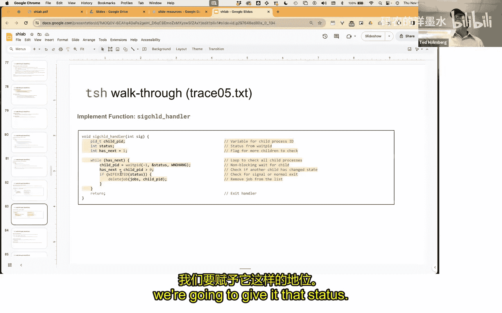

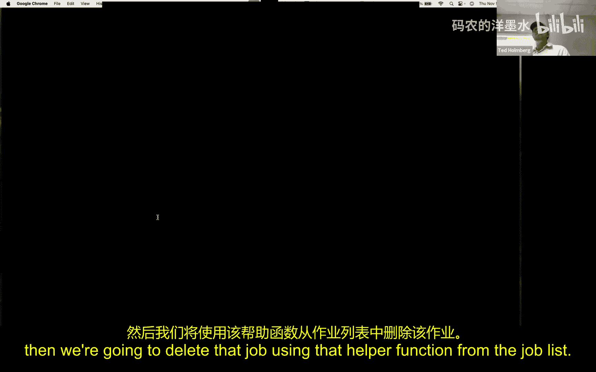

`SIGCHLD`处理器的主要职责是“收割”（reap）已结束的子进程，更新作业列表，并避免僵尸进程。

以下是实现`SIGCHLD`处理器`sigchld_handler`的关键步骤：
1.  使用`waitpid`系统调用来检查子进程的状态变化。
2.  使用`WIFEXITED`宏判断进程是否正常退出。
3.  如果进程正常退出，则使用`deletejob`辅助函数将其从作业列表中删除。

核心实现伪代码如下：
```c
void sigchld_handler(int sig) {
    int status;
    pid_t pid;
    int has_next = 1;

    while (has_next) {
        // WNOHANG 表示非阻塞等待，立即返回
        pid = waitpid(-1, &status, WNOHANG | WUNTRACED);
        if (pid > 0) {
            // 还有更多子进程状态可能改变
            has_next = 1;
        } else {
            has_next = 0;
        }

        if (pid > 0) {
            if (WIFEXITED(status)) {
                // 子进程正常退出，删除作业
                deletejob(jobs, pid);
            }
            // 后续会在这里添加处理信号终止的逻辑
        }
    }
}
```
实现此处理器后，我们成功通过了`trace05.txt`测试，Shell能够正确清理已完成的作业。

## 重构 `waitfg` 函数 ⏳

之前的`waitfg`实现简单地使用`waitpid`阻塞等待，这在与作业列表配合时存在问题。我们需要重构它，使其基于作业列表工作，并能更好地处理并发。

新的`waitfg`函数逻辑如下：
1.  使用`getjobpid`辅助函数根据PID从作业列表中获取对应的作业结构。
2.  如果作业存在且状态为前台（`FG`），则使用`sleep`系统调用进行非阻塞的循环等待。
3.  持续检查，直到该前台作业从作业列表中消失（表示已完成）。

核心实现代码如下：
```c
void waitfg(pid_t pid) {
    struct job_t *job = getjobpid(jobs, pid);
    if (job == NULL) {
        return; // 作业不存在，直接返回
    }
    // 当作业存在且状态为前台时，循环等待
    while (job->pid == pid && job->state == FG) {
        sleep(1); // 休眠1秒，避免忙等待
        job = getjobpid(jobs, pid); // 重新获取作业状态
    }
}
```
重构后，我们的Shell能够正确区分并管理前台和后台作业，通过了`trace06.txt`测试。

## 实现 `SIGINT` 信号处理器 ⚡

`SIGINT`信号通常由用户在终端按下Ctrl+C产生，默认行为是终止前台进程。我们需要在Shell中捕获这个信号，并将其转发给当前的前台作业。

`SIGINT`处理器`sigint_handler`的实现步骤：
1.  使用`fgpid`辅助函数获取当前前台作业的进程ID（PID）。
2.  如果存在前台作业（`pid > 0`），则使用`kill`系统调用向**整个进程组**发送`SIGINT`信号。

这里的关键是向进程组（`-pid`）而非单个进程（`pid`）发送信号，这能确保信号传递给该作业创建的所有子进程。

核心实现代码如下：
```c
void sigint_handler(int sig) {
    pid_t pid = fgpid(jobs); // 获取前台作业PID
    if (pid > 0) {
        // 向整个进程组发送SIGINT信号
        kill(-pid, SIGINT);
    }
}
```
同时，我们需要在`eval`函数中创建子进程后，立即使用`setpgid(0, 0)`将其设置为一个新的进程组。这样，我们才能用`-pid`来指向整个组。
```c
// 在eval函数的子进程代码块中
if (pid == 0) { // 子进程
    setpgid(0, 0); // 设置为新的进程组
    // ... 其他设置（如重定向）
    execve(...);
}
```

## 完善 `SIGCHLD` 处理器以处理信号终止

现在，当`SIGINT`处理器终止前台作业后，`SIGCHLD`处理器会收到通知。我们需要扩展`SIGCHLD`处理器，使其能识别出因子进程被信号终止的情况，并打印相应的信息。

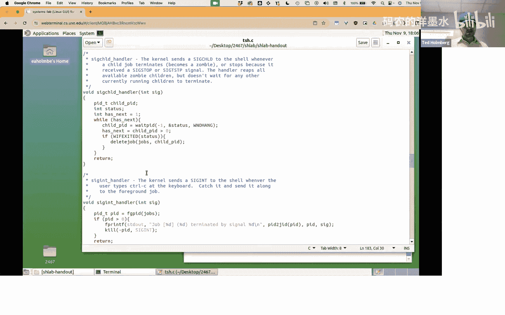

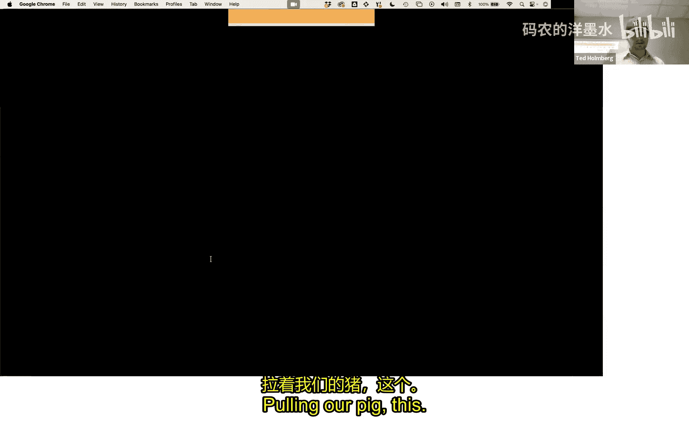

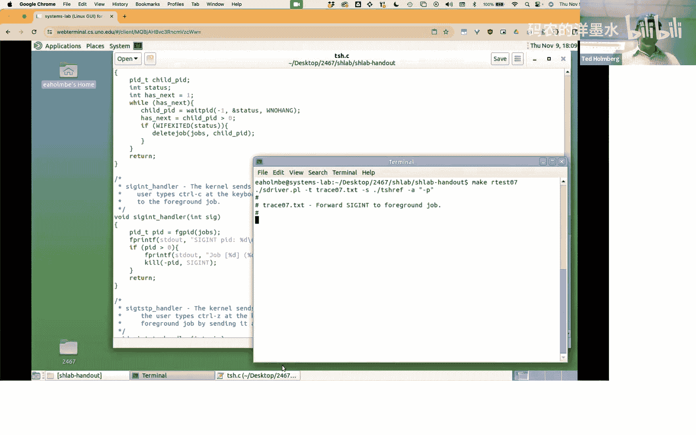


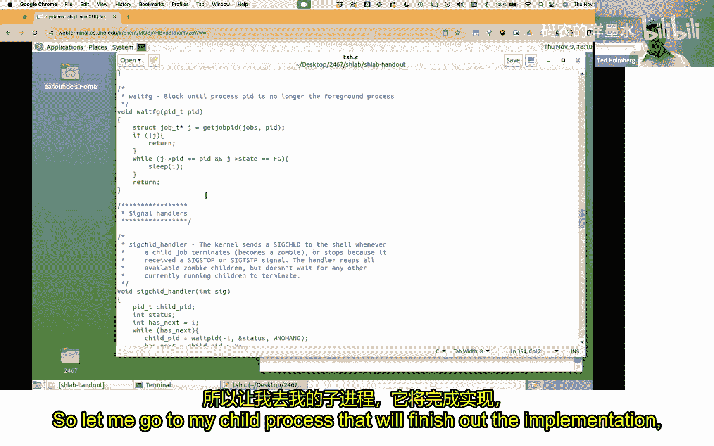

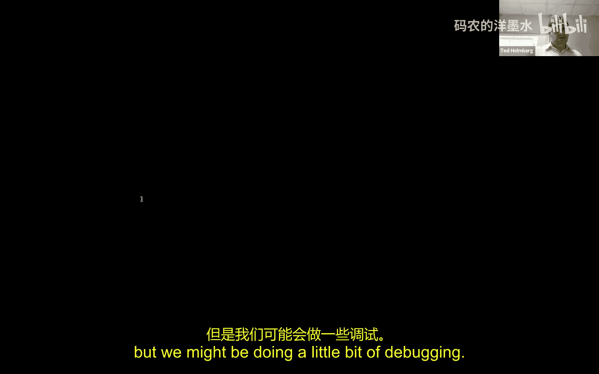

我们需要使用以下两个宏：
*   `WIFSIGNALED(status)`: 判断子进程是否因未捕获的信号而终止。
*   `WTERMSIG(status)`: 获取导致子进程终止的信号编号。

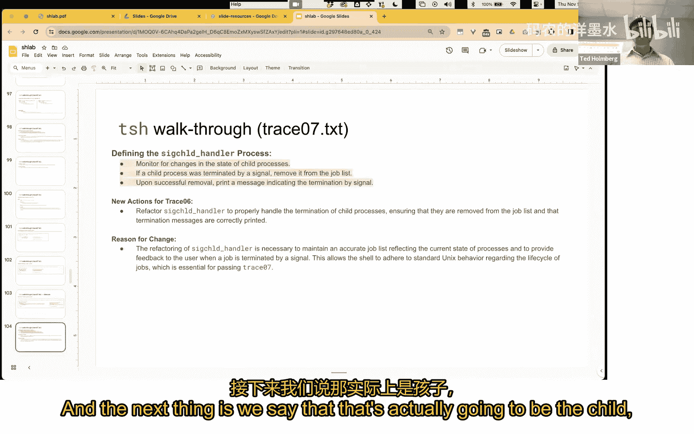

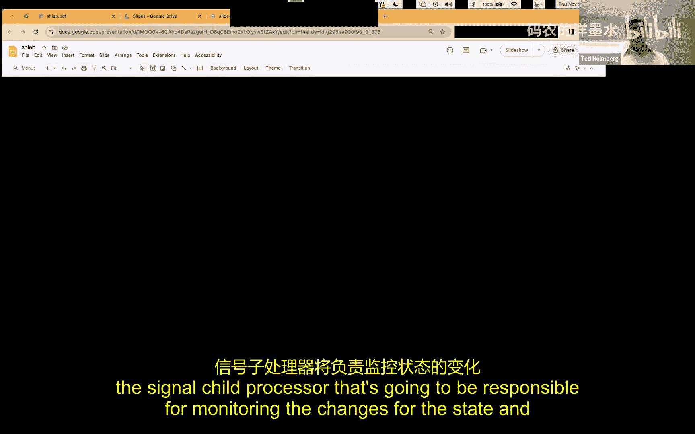

扩展后的`sigchld_handler`部分逻辑如下：
```c
void sigchld_handler(int sig) {
    // ... 前面的循环和pid获取代码不变
    if (pid > 0) {
        if (WIFEXITED(status)) {
            // 正常退出
            deletejob(jobs, pid);
        } else if (WIFSIGNALED(status)) {
            // 因信号终止
            int jid = pid2jid(pid);
            if (deletejob(jobs, pid)) {
                // 删除成功，打印信息
                printf("Job [%d] (%d) terminated by signal %d\n",
                       jid, pid, WTERMSIG(status));
            }
        }
        // 后续可以添加处理停止（SIGTSTP）的逻辑
    }
    // ...
}
```

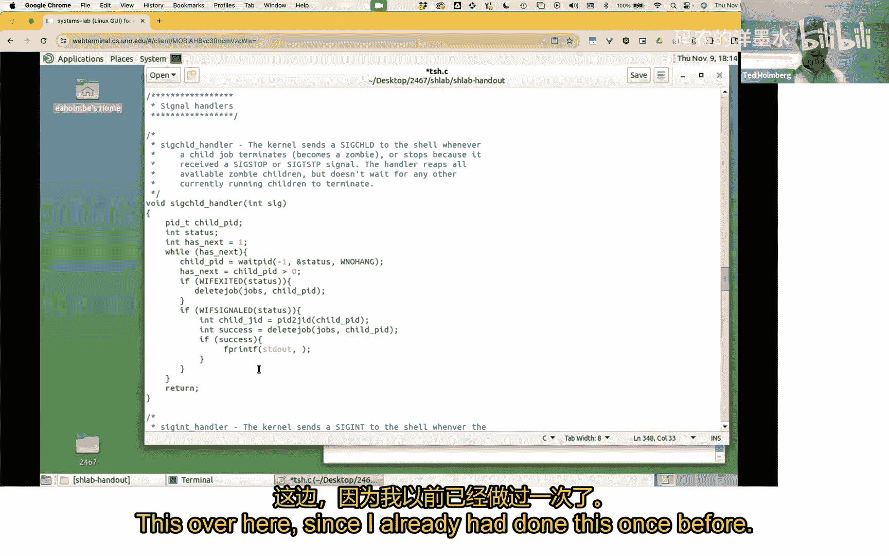


## 总结

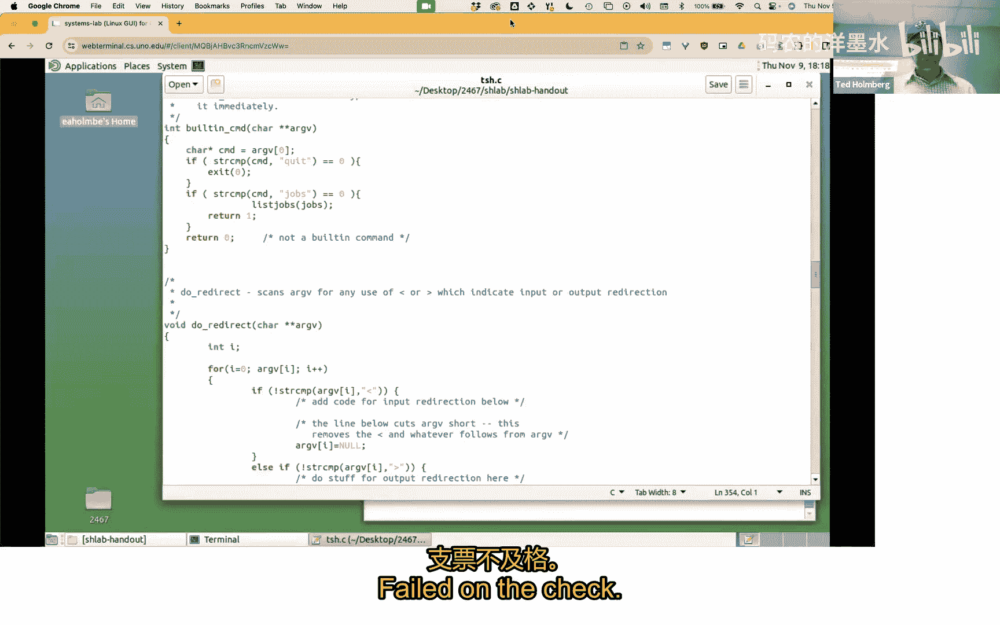

本节课中我们一起学习了Shell信号处理的核心机制。我们修正了作业添加的逻辑，实现了`SIGCHLD`处理器来收割和清理已结束的子进程，重构了`waitfg`以更好地配合作业列表，并实现了`SIGINT`处理器来将中断信号转发给前台作业组。通过这些步骤，我们的Shell现在能够更稳健地管理并发作业，并对用户的中断请求做出正确响应。在接下来的课程中，我们将继续实现更多功能，如作业控制（`SIGTSTP`）和内置命令`fg`/`bg`。