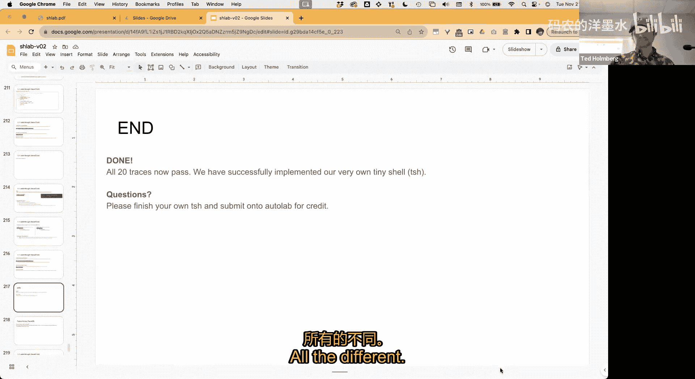

# 026：Shell Lab 第七部分 - 输入/输出重定向 🚀


在本节课中，我们将完成Shell Lab的最后部分，实现输入和输出重定向功能。这是构建一个功能完整shell的关键步骤，允许用户将命令的输出写入文件，或从文件读取输入。

## 概述

上一节我们完成了信号处理和作业控制。本节中，我们将重点实现shell的输入/输出重定向功能。具体来说，我们将修改`eval`函数并完善`do_redirect`辅助函数，以解析并处理命令行中的 `<`（输入重定向）和 `>`（输出重定向）符号。

## 实现重定向逻辑

我们的核心任务是在`eval`函数中，为每个派生的子进程添加重定向逻辑。以下是需要遵循的步骤：

1.  在`fork`子进程之后，调用`do_redirect`函数。
2.  `do_redirect`函数将扫描参数向量，寻找重定向符号。
3.  根据找到的符号（`>` 或 `<`），执行相应的文件操作。

以下是需要在`eval`函数中添加的代码位置：

```c
// 在 fork() 之后，execve() 之前
if (fork() == 0) {
    // 子进程
    // ... 设置进程组等代码 ...

    // 调用重定向处理函数
    do_redirect(argv);

    // 执行命令
    execve(argv[0], argv, environ);
    // ... 错误处理 ...
}
```

## 完善 `do_redirect` 函数

原始的`do_redirect`函数仅移除了重定向符号。现在我们需要为其添加实际的文件操作逻辑。

### 输出重定向 (`>`)

当检测到输出重定向符号 `>` 时，我们需要：
1.  打开（或创建）指定的文件，准备写入。
2.  使用 `dup2` 系统调用，将标准输出重定向到新打开的文件。
3.  关闭不必要的文件描述符。

以下是实现输出重定向的核心代码逻辑：

```c
if (strcmp(argv[i], “>”) == 0) {
    // 设置打开文件的标志：只写、若不存在则创建、若存在则清空
    int flags = O_WRONLY | O_CREAT | O_TRUNC;
    // 设置文件权限：用户可读可写
    mode_t mode = S_IRUSR | S_IWUSR;
    // 打开文件，argv[i+1] 是文件名
    int fd = open(argv[i+1], flags, mode);
    if (fd < 0) {
        // 错误处理
        perror(“open”);
        exit(1);
    }
    // 将标准输出重定向到新打开的文件
    dup2(fd, STDOUT_FILENO);
    // 关闭原始的文件描述符
    close(fd);
    // 清理参数向量中的重定向符号和文件名
    argv[i] = NULL;
    argv[i+1] = NULL;
}
```

**关键系统调用与常量：**
*   `open(path, flags, mode)`: 打开文件，返回文件描述符。
*   `O_WRONLY`, `O_CREAT`, `O_TRUNC`: 控制文件打开方式的标志。
*   `S_IRUSR`, `S_IWUSR`: 设置文件权限（用户读/写）。
*   `dup2(oldfd, newfd)`: 复制文件描述符，用于重定向。
*   `STDOUT_FILENO`: 标准输出的文件描述符（通常为1）。

### 输入重定向 (`<`)

当检测到输入重定向符号 `<` 时，逻辑与输出重定向类似，但方向相反：
1.  以只读方式打开指定的文件。
2.  使用 `dup2` 将标准输入重定向到该文件。

以下是实现输入重定向的核心代码逻辑：

```c
if (strcmp(argv[i], “<”) == 0) {
    // 以只读方式打开文件
    int fd = open(argv[i+1], O_RDONLY);
    if (fd < 0) {
        // 错误处理
        perror(“open”);
        exit(1);
    }
    // 将标准输入重定向到新打开的文件
    dup2(fd, STDIN_FILENO);
    // 关闭原始的文件描述符
    close(fd);
    // 清理参数向量
    argv[i] = NULL;
    argv[i+1] = NULL;
}
```

**关键系统调用与常量：**
*   `O_RDONLY`: 以只读方式打开文件的标志。
*   `STDIN_FILENO`: 标准输入的文件描述符（通常为0）。

## 测试与完成

实现上述逻辑后，Shell Lab的20个跟踪测试应该全部通过。最后三个测试（18， 19， 20）专门验证重定向功能：
*   **Trace 18**: 测试输出重定向 (`>`).
*   **Trace 19**: 测试输入重定向 (`<`).
*   **Trace 20**: 测试同时使用输入和输出重定向。

成功通过这些测试意味着你已经实现了一个具备基本功能的Unix shell。

## 课程总结与最终项目

本节课中我们一起学习了如何为我们的`tsh` shell实现输入/输出重定向功能。我们深入探讨了`open`、`dup2`、`close`等关键系统调用，并理解了文件描述符在重定向中的作用。

至此，Shell Lab的基础部分全部完成。作为本课程的最终项目，你们将有机会以小组形式，在现有`tsh`代码基础上进行扩展和改进。例如，可以添加更多内置命令、改进错误处理、或实现更复杂的特性（如管道`|`）。最终需要通过一个简短的演示来展示你们的成果和对shell工作原理的深入理解。



记住，所有改进必须保证原有的20个跟踪测试依然能够通过。祝你们在最后的项目中取得成功！