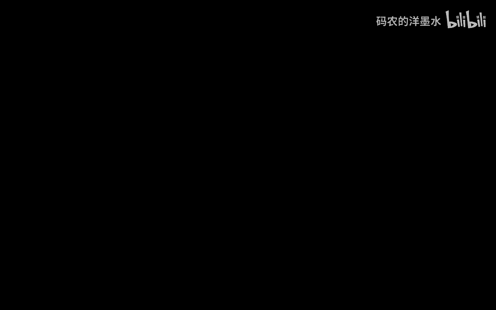
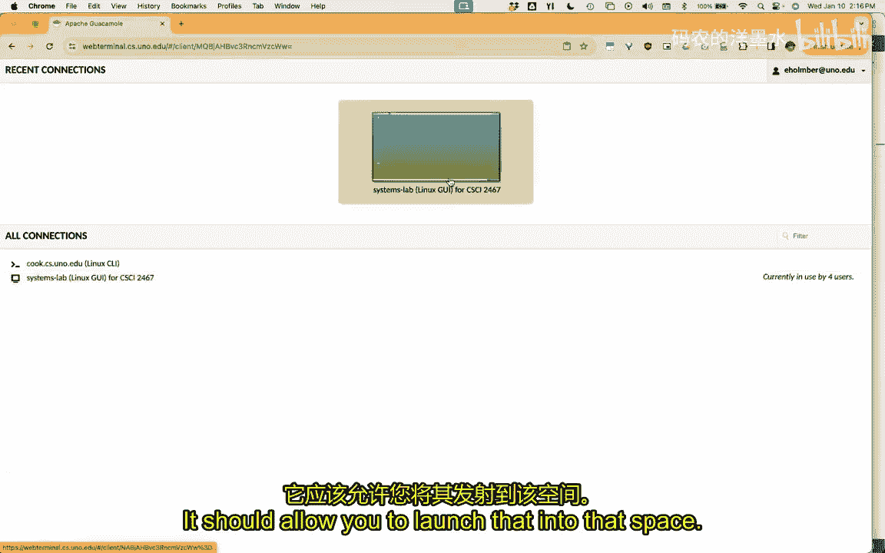
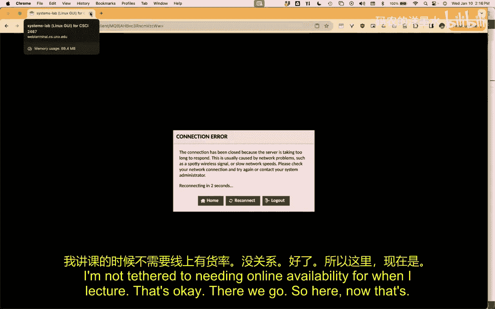
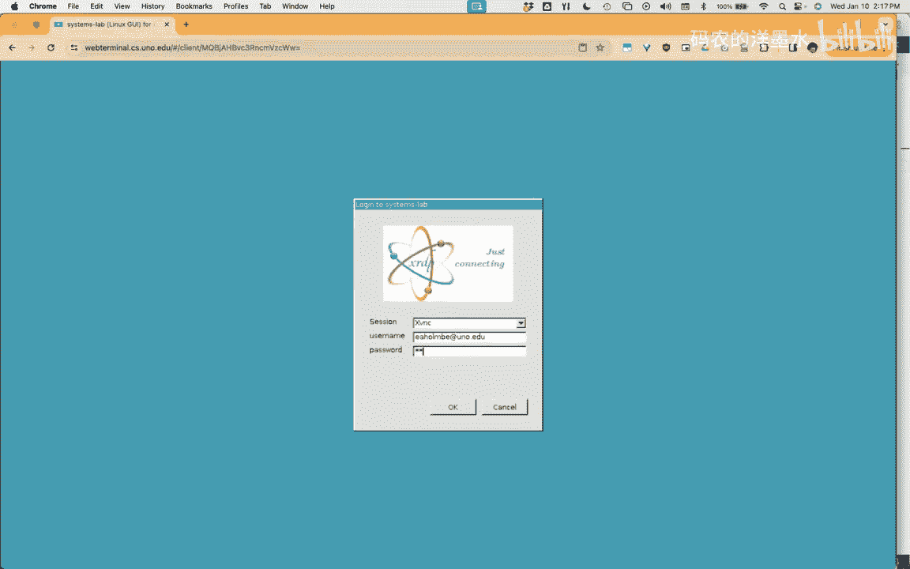
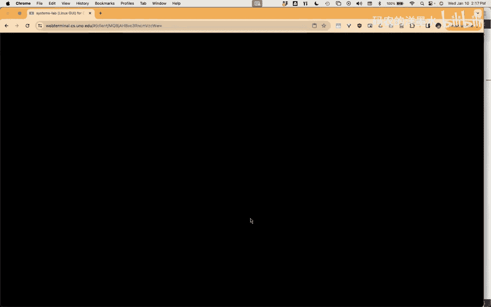
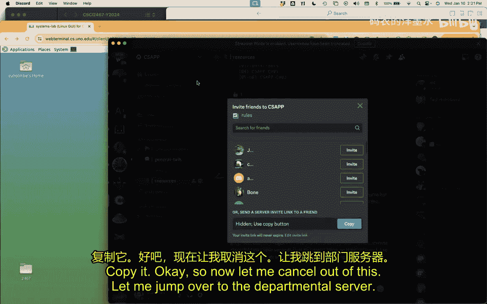
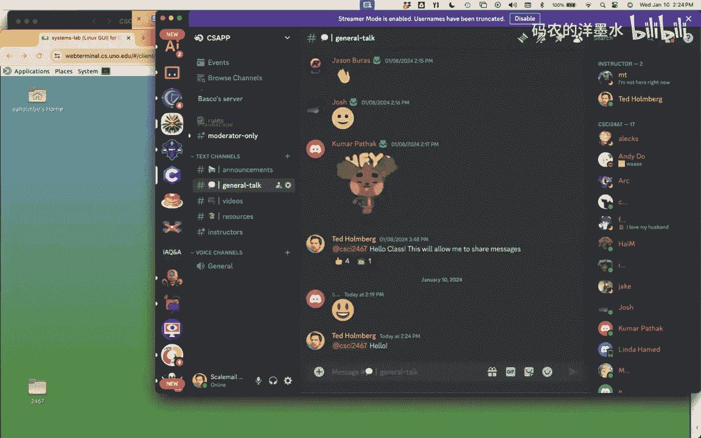
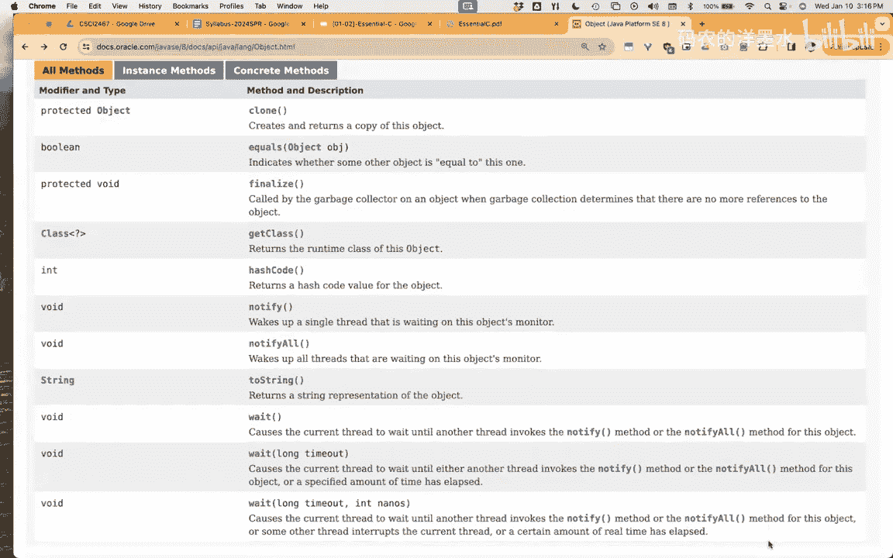

# 【全集】加州理工学院 C语言系统编程 中英字幕 p01 Lecture 1 - 变量 -BV1bUzWBLEiC_p1-

For that excellent， we're now recording。Well welcome to class number two。

 Oh you guys cannot see my screen know what that is， let's say here。See if this fixes that。Okay。

 perfect。As I as I illustrated last class you already have access to the lectures that I did last semester I had provided those so i'm probably going to deviate a little bit from the slide deck because you already have lectures right off the slide deck i'm going to probably try to motivate with more source code examples in today's lecture but the first part of the course is just to kind of do a quick overview of the essential cpdf so when we looked at the。

When we looked at the the syllabus， the syllabus had the required textbook in fact。

 let me open that up so that we can see actually make a。Let me see here， let me go to。Here lectures。

They go to the syllabus。So if I go to the syllabus for the class。

 if I went to the textbook section in the syllabus。Are students， grades， responsibilities？Objectives。

 okay， here the preres course summary。嗯。Here this right here so I had illustrated that we have the textbook which you should be able to get through you're full of access from the university as a digital textbook。

 but in addition to that there's these two recommended text here the essential C do pdf and the unix programming tools so we're going to do a quick。

Run through of the essential sea just to kind of。Get you up to speed on the C programming language and we'll emphasize this by actually running some simple C programs that we can compare contrast to Java which you should all have about two semesters of experience in and also we can compare and contrast well we're not going to contrast too much from assembly yet but Java will be I think our main kind of measure of what we're going to compare against so that said let me jump back to。

The slide deck so I have this slide deck， but i'm going to kind of jump around with it the basic overview of what we have here if we were to look at the essential Cpdf and in fact let me actually bring it to this point let's actually jump to that PDF so let me highlight this。

Here me jump here， open up the tab。Put that in there。And we can see。If this should bring straight to。

A PDF that has X amount of sections you'll see that will walk through all these these different sections so if you haven't had a chance I would recommend everyone to go and not only start reading your chapter one in the textbook but read this read through this PDF you don't have to read it completely like make like skim it skim the table of contents skim the topics and if there's something that you feel like you're already familiar with right skip to the next part so like for instance I mean they have entire paragraphs on comments and the comments and Java and the comments that video very similar but this will at least give you an idea of。

What you can do with C and the syntax in which to do it with and you can kind of use your knowledge and Java to compare and contrast and this is all going to lead us up to the very first lab which is going to be just a basic C programming lab and so I haven't officially posted that yet I want to do a little bit of a crash course in today's lecture and then i'll probably go ahead and publish that we'll probably look at some C code today and we'll look at some more C code tomorrow and then we might actually kind of work through the first lab together at a joint look。

Okay， so yeah， it's a it's a pretty decent size document at about 45 pages， but it's。

It's a lot of the concepts you'll see that's kind of spaced out and organized in a very easy way and we'll run through this in terms of the slide deck so after showing you the PDF the overview as you can see is going to be what are the basic types and operators in C。

 what are the control structures in C， what are the complex data types in C。

 what are the functions and then there's various other interesting bits that's in the document like odds and ends。

 advanced arrays of pointers and the operators and the standard library references。

So I'm not going to kind of。Beat you over the head with。

The slide deck because I've already done that if you want that experience you can go and consume that let's look at some source code instead。

Okay。So the first piece of source code that I want to look at that we can kind of immediately distinguish is going to be a simple hello world program can everyone read that do I need to emlarge that for the class is that better？

Well so that's a good request unfortunately that TV is having technical difficulties。

But if you need I can I can Okay perfect yeah at the same time I'm recording this so if you I'm not only recording but I'm also broadcasting this on zoom so feel free to be able to log into these machines and actually join the zoom channel even if I'm right here so you could see my screen if you're having difficulties。

Where is the Google drive link for the Power that's a great question so let me see here if I if i'm remembering this correctly and let me go here because I don't know which of my various work。

Spaces， my discords in， so it's actually go to activity monitor and kill the process so I can launch it。

So okay， let's kill discord。Okay just go， you're going to die。Bye。

And once this has been successfully terminated i'll relaunch discord and I believe I have it inside a Discord so let's take a quick look at our server again since this is the first time we actually get to see each other face to face very strange first day where the first day of class we had to go remote。

Because of weather， which didn't actually come， I don't think。Okay。It did later that day， though。

 right？is it' not。Okay。Let's see here。Please don't pull me out of my workspace。Its。Okay， go。Okay。

 relaunching discord。Oh。I got an echo， is someone's microphone on that's listening to me by chance？

IHere while we're doing this let make sure there's no comments， there's no comments here， excellent。

Again internet's not so strong here，hu， I have two bars。

Hopefully that's not going to mean any impactful things as we go on。Now while we're doing this。

 if you have a computer， I just want to make sure that everyone can log into the web terminal。

 has everyone tried doing webterminal。cs。uno。edu。So we kind of looked at that。

On the first day of lecture， but if you want to have a chance。

 that's going to be your workspace where you're going to be able to go ahead and。

Write and author all of your code and be able to test code as we and yourla as we go through the semester。

 so just make sure that you can log into you should be able to use your credentials or UNO credentials to be able to do that。

嗯。はい。So while I'm waiting for this， I will。So that should be webterminal。cs。uno。edu。

And it should bring you to。A page similar to this where you should be able to select to do like a systems lab。

And then if you go into there。It should allow you to launch that into that space we kind of explored last class say connecting to Guacamole that's effectively the web service that allows us to have a browser based environment that is your desktop so a remote desktop environment into your own。

If I'm in here I'm getting a connection error that might be because too many things are trying to connect at once。

 but that's okay， I'm going to work locally on my own machine so I'm not。

I'm not tethered to needing online availability for when I lecture that's okay there we go so here now that。

I can。Log into there， let me see， let me log in。

With my UNO credentials。And so then that would then log me in here。

Excellent and then once I'm logged in， this is just like a Uuntu desktop that's preconfigured with all the software that we're going to need for the semester so you don't have to worry about configuring anything yourself as long as you can access this workspace and you can access this workspace either through these computers that are directly in front of you or you could do it from a browser on your laptop or desktop at home or whatnot and all the files are actually just house right in our data center so it doesn't matter what machine you're at whether you work on one of these desktop computers or one of these small clients or whether you work on your laptop or if you pivot back and forth that's fine like your files carry over because remote you're remoteing into our data center from any of these access points effectively。

And of course you can just click here to launch a terminal。

 so this is the shell application this is effectively what we're going to learn how to use and how it operates throughout the course of the semester right so this is what you've probably been using to compile and run your Java code so now we're going to kind of learn how to use it in kind of a a much。

A much more appropriate way， a much more active way than just issuing some keyword and initiating some applications from it。

Okay， so let me close out of this and see。Or instead of close out。Let's do this。😔。

Let's go back to the discord then。 Okay， so going to Discord。We have our Discord server。

Right here and so the question was where can we get the links to the documents and whatnot I would hazard to guess if we go to the resources。

Section here， so there's a resources channel where we've actually started to build up a collection。

 a dialogue of people sharing various resources， but I think if you go to the pinned message and I hope this is pinned if it's not i'll pin it now。

Pin message， okay， I'll pin this message now。There we go Yeah pin that Okay so now if you go into the resources section if you look if you haven't used Discord before you can always see what messages are pinned in a particular channel so if I clicked pinned messages that it'll now show lecture slides and so here will be the link of lecture slides that you have available and I decided to do something very experimental。

I decided to go ahead and not only give read privileges on these lecture slides。

 but you also have authoring privileges so we're going to trust that no one deletes all of the lecture slides and no one else can see it now I actually have lecture these same lecture slides。

Reserve so that if you do delete them that's fine， I can always replace them but the experiment here is you're probably wondering why would I give light access to everyone in the class or everyone who has this link it's so that we can try to collaboratively if you have these if you have access to these slides if you find that they're cluttered if you find that they're not consolidating the material well。

 feel free to edit them feel free to improve what's already there so that as we keep passing from class to class to class we could see how we're collectively transforming the beginning forms of the data that we start with and make it more coherent so that it's crystal clear for everyone so feel free to actually contribute towards the slides if you want。

That's exactly why I did that。It's a bit of an experiment， haven't done that before， but you know。

 I don't think anyone's changed the slides actually last semester。

 but I'm advocating that you can do that that's why I did do that。嗯。Okay。

 does that answer your question？行，继 you。Okay， I think another thing I'll probably do here is。

Let me go here since I'm in here。Let me go to。Server settings， letm me go to overview。😔，啊。Yeah。

 it keeps fine。Sk out of that。 Let me go to。Invite people。

Let me go to edit link let's let's make sure that this never expires there's no limit generate that link copy it Okay。

 so now let me cancel out of this let me jump over to the departmental server。

Which is here i'm going to go into 2467， which is here and i'm just going to drop the invite So for any reason you have not joined the Discord server。

 you can now go to the 2467 systems channel inside the departmental server and access。

The course server there。And again， as you joined， what I'll start to do is give everyone a role。

Of CSciI 2467 and it's very。Colorfully this like orange color so that you can see who your cohorts are。

And let's see what are the other roles the yellow are going to be people who are instructors or had served as instructors previously let's see i'm going to go to actually the announcement section because a lot of in the announcement section kind of details the all the mechanisms of the server so we have a couple different channels right the announcements is if I need to broadcast anything I can publish it here general talk you can just talk about whatever is related to the class。

Videos are going to be published the link will be published here and it'll be updated so I still have to publish。

Monday's lecture， so after this lecture finishes processing。

 I'll go ahead and probably reserve Wednesday evenings or Thursdays to publish the lectures。

And let's see here and then the resources and again feel free to contribute to the resources so you can see I provided the resources I have here。

 but you can also see that you have some students from last semester who had contributed and again we can have this kind of evolutionary process where we create a compendium of shared knowledges。

And when I need to go ahead and alert you of anything， I can always do this as well。

 just so you know， so if I do at CSCI 2467， hello， if you have that role it should send you an alert。

So again， this is going to be the best way for me to go ahead and alert you as I update any course content or have to share any information。

 all so as an email out， but I do prefer to use Discord。

Okay， so let me close out of this。Actually， I'm just going to kill this chord。Okay。So now。

Let's scout。Back to my original plan。嗯。This is very big。Yeah， okay， perfect。Okay。

 so let's take a quick crash course in C。😡，So we should always start or it's typical whenever you start to learn a new programming language to start with hello work right I think that's probably what you did in 1583 with Java and there was a lot of boilerp code that you needed in order to do that there's going to be a little bit of boilerp code the first thing we're going to see is that C code is by default not natively an object oriented language so you have to understand Java is the product of evolutionary steps in programming languages so before so C existed before Java did and so as software gets sufficiently complex this concept of object orientedness solves a lot of the scalability problems this is why OOP design is such a powerful concept and a powerful tool at the same time。

There are。Reasons why your code does not have to be object oriented right like your your code could be procedural it could be made up of a collection of functions so before before you had this metaphor of object orientedness you had your code base as just broken up as a collection of function calls now notice on using the word function calls here right in Java you probably call them methods and in assembly you probably call them procedures am I correct is that your experience so far so let me kind of crystallize some of these terms for the most part。

I'm going to state that a method。Is a behavior？Like a function that's defined inside of a class。

So if you have a function that is inside of the scope of a class， we now call that a method。😡。

So now if we have a function that's in the global namespace， that means it doesn't belong to a class。

 that's when we call it a function。So in higher level languages when we call。

If if we're not starting to encapsulate our code base across classes。

 which is a very object oriented approach， then we're doing procedural code where we're producing a collection of functions so since C existed before objects existed it uses a a procedure first approach so so。

😡，Just like Java， we need to have a main function as the launch point of our application， in fact。

 Java got that from C。😡，Remember that Java is the child language of the C family so it started with C and then from C was C plus plus。

 which is the object oriented version of C it's literally object orientedness bolted onto C so you could do C programming and C++ and you could do objectoriented programming in C++ in fact。

 if you might recall the plus plus is the increment operator so the developers of C++ was kind of making a smaller joke about it being an upgraded version of C。

😡，So if you ever wondered why it was called C++OS and not C+ or whatever or C2， that's what it is。

 it's C C incremented。Add it with object orientedness， Okay， so extending off of that joke。😡。

Or I guess humor， I don't know if it's a joke， but that kind of program programmer humor。

 which is always really bad trust me。Has everyone heard of the language of C sharp？

Okay so that's using the same kind of concept right so if C++ is an increment on C is anyone here familiar with with music notation so yes C sharpp would be the next node up from C so again it's just a deviation of the same kind of programming humor whenever you kind of upgrade you have these upgrades in the C family so if you haven't seen C sharpp I'm assuming has anyone done C sharpp in here。

Yeah， so this is the thing about C sharpp C sharpp is effectively like Microsoft's version of Java。

So the syntax and the concepts that drive C sharpharp are very similar to what you have in Java。

 so if you know how to code in Java， it would take very little effort to look at the minute kind of syntactical differences to start programming in C sharpharp。

And the reason why， for instance， you might want to program in C sharpharp。

 if you're interested in game development， you might use unity， unities codebase。

 usually the code that you're going to write in Unity is going to be C sharps。

 so if you take Game dev1， if you take Game dev two。

 you're going to have to write your game code in CSp。

 which again very similar to job it's almost it's almost exactly the same。

It's just very small small differences and so there's also a lot of and then you have your dotnet framework as well。

 so if you're going to develop inside of any kind of Microsoft ecosystem clearly C sharpp is going to be the language of choice there。

 whereas if you're going to develop on like an oracle ecosystem， then it would be Jonathan。

it's very easy to jump between those two platforms。

 but I mean suffice it to say that entire family starts with sea because that's what the creators of Muix。

😡，Brote。In terms of the programming language and this's why motivates why we're doing learning see for system programming concepts within C has expanded and is still。

 or the C language has expanded and still exists in a very dominant position even to this day。

 like several， several decades since its inception。

And that would be in order C++ then C sharpp and Java would all be part of that。Okay。

 so with that said， that was a lot for me to say to。To get to the hello world。

 which is that we're going to declare a function， so when we declare a function。

 the notation is going to be pretty similar to what we do with Java right we have a return type。

I'm going to start with the code itself and then we'll talk about what's happening above that code。

 so we have a return type， so I believe in Java our return type for the main method is what？😡，Well。

 that's its input， but what does it return back？It's usually what it's public static void right so in Java nothing gets returned back。

In C， we're actually returning back and enterger， the idea is that when we run our main function。

 it will return zero if the application executed successfully。😡。

And it returns a non zeroro value if there is some kind of error。

 and then inside of our main function， we could return whatever that nonzero value is to indicate where the error occurred at that caused us to crash up。

😡，So is a this allows your application to provide meaningful numerical input or output。

 I'm sorry to the end user to let them know whether you had successfully executed or not。😡。

So unlike in Java， we're going to have an int as the return value。

 then we're going to name our function the same way， right， main。

 and so we don't need any parameters inside of our main function。

And then what we can see here is now。Recall that。In Java。

Whenever you go ahead and author any software， there are standard libraries that are automatically imported into there。

 right？😡，WasThat was pretty much covered in either 1583 or 2120 I'm assuming right so so the reason why you have access to say for instance。

 the string。And actually let's look at this for a moment。

 let's let's jump to the API just so we can compare so if I say string Java API everyone has looked at the Java API before i'm assuming。

Okay， so we could see that the package。That string is a part of is the Java Lng package。

 this one right here by default。I want to go to not object。

 does it let me access just the lay package？哎我。Doesn't matter so by default。Anytime you go ahead and。

Compile your Java application it automatically imports all the contents of Java do L for you now over the course of building Java software you would also import external classes that weren't imported for you by the Java compiler such as Java do u right that was one that you had to externally import in order to get the available functions and classes to be able to instantiate and use so just like you have。

😡，Your standard libraries that are part of your Java code base that you can then import to be able to use into your source code for Java。

 we have that same concept in C。😡，And so the way that we would import code。😡，Import。

Some of these external files， functions and classes or functions into our C code would be to use this preprocessor directive。

 so we're going to go ahead and use a hashtag include which lets the C compiler know， hey。

 there's another set of C functions that we're going to have to access and call upon in order for this application to do its job。

😡，So just like you had an import。😡，Keyword and Java。

We will do hashtag include which is a directive to the compiler the C compiler to go to to the standard library whenever we put anything in angled brackets that means it's part of the standard library so that's how it knows what the pathway is to find those。

😡，Source code files。And so if this was authored code。😡，You would use a file path。😡。

Of where that C code would be at effectively or the so actually we see we're doing a dot H。😡。

And we have a dot C。We're going to talk more about this probably next class。

 but I'll kind of give you a preview that dot H is effectively stands for header。😡，A header file and。

Our dot C stands for our C code file， so all of our source code。

 the nitty grittiness of our implementation goes into the file that would be called dotC and so we can see in my text editor here。

😡，With the code that I have opened up is in a dot see file。😡。

Now when it comes time to build large enough source code files。😡。

And we'll talk more about this in terms of how does a compiler turn your source code into an actual application。

 like what does that look like inside of your system？😡。

And it has to do a lot with being able to link we'll see a lot of this。

I want to say this actually going to be in the first lab we're going to look at a lot of that in the first lab。

But suffice it to say the idea of an API， a set of just function calls is effectively what your peterophil is。

 so let's put it this way。😡，Do you remember in Java？

When you were able to declare a function effectively as being abstract。😡，And so when it's abstract。

 you don't have the implementation you've effectively just declared。😡，What the name is。

 what the return type is and what the set of parameters are correct and so that creates。😡。

A interface。On how you can access that function。😡，So if you think of an interface and when I say interface。

 think about what API stands for application programming interface。

 so when we look at documentation like let's go back to the Java。😡，API here when I look at the。

When I look at the actual documentation and let me move this off to the side here。

What it's effectively producing to you as the end user the same thing that an abstract class or abstract function or I'm sorry an abstract method in Java provides to the rest of the Java compiler right so here it's giving you oh。

 what is the return type what is the name and what is the parameters in here and then it gives you a human readable description。

😡，So I don't know if。The dots were connected or not。

 but an API document is very similar conceptually for you， the developer， as it is for the compiler。

😡，For abstract methods。It's an interface to say this is the set of functions that exist。

 this is what these functions legally need as input。

 and these is what these functions will produce as output。😡。

And given that amount of information you don't need to know how it's implemented because it's a black box style of programming right it's encapsulation。

 you're only concerned about what you've been tasked to implement and you're going to trust that any external function call that you didn't author yourself will take in the input it claims to take and then give you the appropriate output right so it's like a contract that based concept that drives how we develop our software。

😡，We are concerned about what goes into our own source code file and then when we import external source code file。

 we look at the interface。😡，For us as humans， it's the API documentation for our system， it is the。😡。

Header information， so when you have a header file。

 the header file simply is a file that that contains all the function names， the parameters。😡。

And what gets returned back， and so that's the difference between a header file and a seat file。

The C file contains all the source code files where the header files are just used to check and verify that the way that we're using the functions inside these external source code。

😡，Fileles is correct。😡，So that when the compiler goes to compile it。

 it's going to trust the header file。😡，In terms of providing the set of parameters and then getting the return state of the values back。

Okay， so let me go back over here okay。So I have right here。Whenever you see。STD。

In the context of computer science， you could think of that as being shorthand for standard。

 usually for standard library。😡，So when I have STD IO。😡。

That's an abbreviated way of saying this is the standard input output。

 So just like Java had system thatt out。😡，That allowed you to have all the class functionality to access the output stream。

😡，And just like Java had system dot in。😡，That kind of encapsulated all of the standard libraries function and method calls for the accessing the input stream that。

😡，That concept that Javava uses was drawn from this。

 the standard input output library that we can import from the standard library from C。😡。

And so we have to import that if we want to call an external function that we did not implement now the external function we did not implement but want to use is going to be the print statement now in particular the in Java there are multiple print statement you had print you had print LN and you have print F my favorite print statement the most powerful and expressive print statement is print F the formatted print statement that is the print statement we will be using throughout the semester。

😡，So。I'm going to import the set of functions from the standard input。Header file。

 which will now give me access to the print F function。😡。

And a print F function we'll see as we look at some where the source code files can have a number of different parameters。

 in fact the print F function uses is used the same way it's used in Java so if you use it in Java which I'm expecting you did right Did everyone use print F in Java perfect then you're already familiar with it。

 then it needs at least one parameter。😡，And again， C supports。

Function overloading that concept function overloading was pioneered by sea and then adopted in all of the。

Languages that inherited from C effectively。So the at least one parameter is going to be the data that you want to go and print in this instance I'm going to create a string literal we define a string literal with double quotations。

 the exact same way we create string literals in Java。😡。

And so here notice I'm going to do hellello world and then I'm going to do my escape character。

 my new line character， I'm sorry， my new line character to go ahead， which is a escape sequence。😡。

You have forward slash and then the end do new the line and that should then print out hello world now here I don't need this let me get rid of that。

For now。This is should be all I need that other import we don't need yet。

 but I'm going to talk about in the next source code example。😡，Okay。

 so here let's go ahead and actually try to compile this does anyone before I try to compile。

 does anyone have any questions？😡，Okay， perfect。So I'm going to go here and so let me start by saying we can use。

😡，Our shell application to access a C compiler to compile our source code file into a executable file。

 so if I do LS here， we could see， yeah I'm already in the directory that includes a lot of my preauthored C files that I'd like to kind of step through today。

😡，And so here。Instead of Java C， which was our compiler application that translated Java source code file into a Java object code which is executable by the JVM。

 we'll use the new C compiler family， New spellll GNU， and so this is a this is initialized to GCC。😡。

So the GCC has a number of different， it's a family of compilers。😡，One of them is for C code。

 another is' also very popular for C++ code。😡，So。In fact。

 I can do here see GCC and again you should be able to access this if you're following along with me on your web terminal which you don't have to like I'm recording this so that you can pay attention to what I'm saying now。

 but if you happen to be logged in and you have your terminal open。

 you should be able to do GCC and then we're going to pass a flag value。

 let me see is a dash dash version。😡，And so whenever you usually。When we go ahead and execute。😡。

A command line application from the shell， we give it whatever the application name is right so GCC is an application that already is installed in my system。

😡，And if I want to check， I can see the version of it。

 so you can always usually provide a flag value， which is usually a dash and a single letter。😡。

So like for instance， I could probably do dash v per version。

Or dash dash and the more kind of expressive full name so I don't have to remember what does V mean what does lowercase O mean what does uppercase O mean so the power of the double dash is the expressiveness so you're like oh I want the version so here this is just reporting metadata on my compiler。

😡，In fact， one of the things you should be aware of if you're going to familiarize yourself with being able to work comfortably at the shell level is how can you access information about the applications？

😡，And the various flag values you can send to the applications to kind of control how the application works inside of this environment。

😡，So there are what are called man pages， so if you type in typically like man short for manual。😡。

GCC。It'll look up to see if there's a man page there， there's no man page there， unfortunately。

Let's see if they oh so let's do another application so another application that's usually preinstalled in all of our shell applications or not preinsalled but accessible by our shell applications is the LS application the LS application is a very simple application that will go ahead and list the contents of a directory but if I did not know that I could type in man short short for manual and then the name of the application and if that application has a set of。

😡，Documentation pages I can now read those documentation pages here。

 so typically it would show for instance here what is the the keyword that launches the application。

 then it gives you a human readable description about what this application does。😡。

It'll give you a quick synopsis and then I can keep going through it shows me all of the different options that use the dash。

 that flag value that are parses and then how you can modify the output of this application based off of those flag values。

😡，And you can see LS has a lot of different。It has a lot of different values that you can pass to it and at any time。

 if you want to exit out of this， you can just hit Q and it returns you back to your prior state inside of your shell application。

 so I think what i'd like to do over the course of the semester is constantly look at how we can like query our shell app。

😡，And utilize the applications that are already built into our shell application so we become more comfortable in this environment and so one way for you to start exploring that is knowing to explore just doing man and then whatever the application is to so you can read about it。

Okay。😡，So with that's it， that was a bit of a detour but one that was definitely worth taking the scenic route towards hellello world。

 let's try to compile our source code with the。GCC compiler。And again， Gcc is short for Ganu。

 I'm going to pronounce the G Ganu。C compilers， Okay， so we're going to do Gcc。

And let me see if I can do dash H and query help so instead of me just showing you。😡。

Let's see what it expects so dash helpp is usually going to bring up your help file or you could be the more expressive dash dash help。

😡，And so here， just like the man pages for LS， sometimes applications will host its own set of documentation that's accessible through a help modifier。

 a help flat。😡，So here this is very similar to the man page we were looking at before where we can scroll up。

Oh Lord， it's a lot of health。Okay， here we go， so here it's going to give us a description。

 this is the C language。Set of compilers。😡，It shows us。How to use it， so right here CLang。

 but for us it's GCC， so GCC is an alias for CLang。Right for sea language。

And that's that's by default when we install the GCC compiler it has the C lane compiler as part of it so it gets invoked when we do GCC and then they have all these different operations all these different flags you can give to it so again if you want to read more about how this application can be useful to you what are all the options you can query in either with a help flag or a man page keep that in mind that's one of the mostvaluable things a software developer has in terms of their toolbox is being able to read about what external code does or external applications do so if at any time you don't know how something works don't just hammer away at the keyboard and frustration start reading the documentation。

😡，20。Okay， so let me clear my terminal here。They're going to type in clear that's going to clear my workspace。

😡，All the history of what's been displayed， Okay， so we're going to do Gcc， Okay， so Gcc。

Is not going to be too different from what you're used to in terms of compiling your Java code。

 the first thing it's going to look for is a C code file， a path to some C code file。😡。

So the one that we want to do now is going to be 00。 hello。

c so this is one of the things that we instantly see is different let me highlight this。

 we can name our source code files anything。😡，Remember that Java was very restrictive on what you could even call your source code files everything in Java had to be defined in a class right and so all of your classes had to be defined in files that shared the class name and that's because that creates for Java the ability to enforce namespaces which helps when you're scaling your source code up because the thing about what makes Java so popular and why Java is still popular is in its scalability if I'm going to write a application that's hundreds of thousands of lines of code。

😡，Millions of lines of code， then you have to be able to be equipped to know when something fails where exactly in the system it it's having issues at and so the only way you can get reliable。

😡，Reporting on issues on on error checking and and for maintenance purposes is by having a granular set of namespaces having a scoping that says i'm responsible for this code that kind of grows larger and larger and larger right so if you think about how does let's map a code base to the way that other。

😡，Enities like large scale entities are self organized let's talk about how how a Java programming source code project might be like a corporate infrastructure。

 so imagine something like Starbucks right so starbucks is compartmentalized in a lot of different layers of management。

😡，You would have and starting from the lowest level you'd have your individual store your store would have the individuals that would be like your class files that are responsible for some task for that particular store and then the store。

😡，has a responsible agent which is a manager and then that manager reports to probably a district manager which is responsible for all the stores in a particular district and that district manager is responsible probably to a regional manager who manages all the various regions and the regional manager is probably responsible to some kind of vice president of operations in a particular subreion right like let's say the United States and that VP is probably responsible for some other。

😡，Executive Suite who over viewss all operations and then that would probably be responsible to deceit you at large and so at any time there's an issue you can address it because of the scoping of where who's responsible where。

😡，So just like the way that these very large scale institutions can be able to operate on global scales。

 you can conceptually think， how can we break our code base？😡，Such that it's executing instructions。

 it's executing a job inside of our system in a way that we can have an concept of responsibility。

 who's the management to know when something has gone wrong and how do you escalate that and alert it so you can identify exactly where it happens so you can fix it。

😡，And so the reason why Java is the way it is is because it enforces name spacing。

 which is like that ability to encapsulate and say， a， this thing is where it's broken at。😡，Okay。

 that's a long way of saying C does not do that I can name whatever I want in C right so I'm going to name this source code file00 hellello because it's convenient and it allows me to order these little simple application files that we're going to look at。

😡，Okay， so。I'm going to do GCC。And then the name of my file。

 which is 00 hello doc now this is all I need， but let me show you what happens if I hit enter if I hit enter it's going to successfully compile and I know it compiled because the default output if I don't tell it。

😡，To explicitly name my executable file something， it will by default， call it a dot out。😡，Now。

 typically we don't want a filer to name our executable file forms。😡。

Right so I'm going to delete this I can invoke this。😡，I actually， let me invoke it。

 but then I'm going to show you how we can do this even better。So。

Get a little bit of lag in my system。I'm not even on a remote system， Okay， so if I do。

A dot out so okay when I go to execute a executable file I would do dot slash this indicates to the show hey I'm about to give to you a executable file from this directory from the local directory that on app it's right now it's called a dot out so if I hit enter it's not going execute that and it's going to be it's going to display now to my console hello world so that works right we have a hello world but let me show you how we can actually name our executable so let me clear this。

Let's delete our A dot out。Oh， hang on。Let me do that another way。Let me Al last。

I see I have that A dot out， let me delete that A dot out， so I'm going to do RM。😡。

For remove A dot out。And we can see that's going to remove it from my terminal again。

 we should become more familiar with being able to access the shell to be able to do basic kind of file management authoring and just text editing and whatnot just general kind of conceptual things like that。

 try， if at all possible to lean into shell applications over the course of this semester。😡，Okay。

 so I'm going to remove that。And so now let me clear and let's do this another way。

 let's do Gcc and then we're going to do00helello。c， and I'm going to do a flag of dash O。

 which is short for output。And now I can give it an output name， such as just Ho。

And now when I hit enter we can see that the application and we could see at least inside my machine the icon to indicate whether something's a file that should be opened by like a text editor and something that's an executable something that kind of looks like this kind of console window this now illustrates I now have an executable file in fact if I look here look at what the K says so all of these are source code files it knows because the extensionion do C。

And then here it sees oh， that's a un executable file so now let me go here dot slash and then I can go oh yeah。

 hello。And I can go ahead and execute my application， so that is our first application in C。O。

Is there any questions？that man I earlier on my the so that is a most wonderful question and so let's talk about that。

So you have what's called a Poss compliant。😡，Shell application this would be like bash this would be like seahell pretty much anything that is Uniixbased which would be like Linux this would be like Uuntu this would be like Mac OS its default command line application runs a po compliant set of of calls so all the directives all of the kinds of inputs that it would require are the same so I could jump onto an uuntu machine which is the one that you have access to web terminal I could jump on my Mac OS I can open up my terminal and we could do the same thing。

😡，Unfortunately， windows。Very early on before they were even windows I mean when it was doOSOS right so before Windows existed Windows is indicative of Windowsed applications right things that are graphic space things that are a driven where you can click on a button and interact with your operating or with your system you can interact with your system through user controls that are graphics so that concept was revolutionary decades ago and that's what drove the OS to be named Windows it's like oh look this is so much better than DoOS because it has windowed applications。

😡，DOS is what Windows is built on top of right that's its legacy so just like C just like Java has a legacy where it inherited paradigms from C++ and before that C Windows inherited its paradigms from DoOSOS and DoOS was its own set of command line directives。

😡，So you might be too young to really appreciate or experience what DoOSOS was。

 but what natively is invoked inside of the command line on Windows is a callback it's backwards compatible to old DoS systems and so they enhance that and there's another terminal that's also built into windows called PowerShell。

 which is also a whole otherher set of。😡，Application names that are different than the Poix compliant like bash environment that we're working in Now Windows has realized it actually lost the console the shell wars so to speak and so it has also now become fully compliant with a Posix shell standard and so you have the ability to do what's called WSL I want to say that's what's called Windows subsystem Linux so if you're on a Windows machine if you want to be able to access the same kinds of if you want to access a bash environment like what I have on my Mac OS or what you have on your Uuntu environment through web terminal look into doing WSL installation and it allowed you to actually get a bash environment natively in Windows without having to use the in my opinion much maligned GitBsh environment I am not a fan of。

G baash at all the reason why I'm not a big fan of Git baash it's an external application made by a third party to serve as your system level application。

 whereas WSL is made by Microsoft and partner with Canonical who does the package management for Ubutu to give a seamless bash environment from the actual OS provider。

 so if you're using GitBash I would recommend you switch to WSL if you want to work in a local environment on your Windows machine。

😡，And then you would have access to the man pages you'd have access to all the other kinds of commands that we have on like every other actual bash environment。

But great question I'm glad that you brought that up because Ed was it has to do with historical reasons。

 but now Windows is finally has parity with Mac OS and Linux based OS systems。

 but I do think have you have to toggle it on and then I think you can even switch when you open up a Windows terminal I think you could type in like Powerhell or bash or whatever and allow you to toggle between the different environments。

Now it's now with that said， I'll be honest with you。

 I haven't touched a Windows operating system in about a decade。😡。

So I couldn't show you really easily how to do that。

 but there's lots of great documentation out there to show you how to do that。Okay， excellent。

 any other questions？Okay， I think we probably have enough time to go through at least one more。

See code script before we might run out of time maybe two we'll see we'll see how quickly we can run through this because again i'm giving a lot of like I a lot of this I think you already know like I could of just showed this to you five minutes and you would have gotten most of this anyway I seem to go on detours sometimes。

😡，But valuable ones， the scenic route is the route worth taking。Okay， let's。

Let's take a look at the next one so01 var。c this is going to be variables。

 how do we declare variables and what are the primitive data types that are available to us in our C language okay so here we're actually going to do two imports because this is an important thing to know Boolean is not a primitive data type in sit。

😡，So in Java， Boolean became a primitive data type。😡，But in C。

 typically whenever you want to have Boolean logic。

 it's actually representative as a numerical value。

Zero represents false in any kind of control structure， so I can actually pass in in fact。

 even here this is just an aase when I import standard bo。

 it's just creating a developer friendly wrapper。😡。

To express the concept of true or false so it's more readable so we don't have to use numbers。

 but under the hood Woolean is simply a numerical value zero representing a false state。

 non zero representing a true state， so one is true， minus one is true， 10，000 is true。

 zero is false。😡，So to illustrate that the standard library does include a wrapper for us so that we can kind of pretend to have a boolean value。

 we can import standard bull。 H。😡，But we could just as legally just use zero and a non zero number for any kind of expression that's boolean or logical oriented。

😡，Okay， so let's take a quick look， we're going to walk through this code here。

 so we're going to declare our main function。😡，And its main function is going to be all of the statements that we can go ahead and encode just like in Java。

 so we're going to notice that the way that variable declarations occur is very similar to Java again。

 Java got this from SiI。😡，So it's going to be by type and then whatever label you want to apply to that variable and then the concept of being able to declare or initialize or assign exactly the same every statement ends in a semicolon exactly the same。

😡，So here， for instance， I'm declaring an integer variable that I'll call my int and I'll assign it a。

😡，Literal value of 100。And then I'll use print F the way you probably know how to use print F。

 I'm going to use the formatted string with a placeholder。

 which is the percent sign and then the type of data I want to insert or replace and then as my second parameter it's going to be a value that gets replaced with the percent D。

😡，So this will allow me to print out this integer okay。

 we also have characters and character literals use the single quotation again just like and C I mean Java Java is just like C。

 but yeah just like you used to Java and here I'll print that by using the percent C。😡，And recall。

 just like in Java， a character is simultaneously both a car literal or a numerical value。😡。

It's what binds or merges the concept of mapping our letters to integer values， key codes。😡。

Here we have our floating point value， which actually the literal value should be A F。

Just like in Java。And then I can print that out as percent f。

 then I can have double which is double the precision。

 so remember floats are 32 bit precision doubles our 64 pit precision。

 which is really important when we talk about how radix point values are just approximations so you want to get as much encoding for those approximate values to try to get them as close as possible as what you expect them to be before you run out of encodable space。

😡，And so here we'll print that with a long float。Percent Llf。We'll use。

The only reason why we can do Boo is because we imported it。😡。

Which allows us to actually map true or false， but notice when we're printing it out。

 it's not percent B， it's percent D because it's actually just a numerical value。😡。

Here we don't have。😡，String。Data types notice even in Java string was an upper case S。

 which meant it wasn't a primitive data type， it was a reference data type。😡。

So very similar reference data type is going to be either arrays or pointers to something stored in memory。

 and so if we want to have more than one character if we want to have a sequence of characters。

 that's effectively a character array。😡，So all job is doing underneath the hood is it's giving you a。

😡，Class that。Organizes your character arrays in a defined name called a string so that you don't have to worry about it。

😡，But both in Java and andC， those arent print， there's no language where it makes sense where that's a primitive data type。

😡，And we can articulate why later。Okay， here。This is another way。

 two different ways of declaring a string， I could either do it as a array。😡，box notation。

And then that's a collection the double quotation is a string literal。

 which is effectively creating an array of characters for us。

 or we can do that as a character pointer， so again， the string literal。

 the double quotation is producing effectively an array construct。

 but we can use a pointer to grab the memory address of where that array starts at。😡。

So pointers you should be familiar with a little bit from assembly I would think。

And we'll go more into this in detail later we have the long data type in case the 32 bit encoding for an integer isn't large enough。

 just like in Java you can go larger with long。😡，We also have shorts。

 you don't usually use shorts very often， but Java hasm， C has them。You have unsigned integers。

 which means there's no concept of negative or positive right that it starts to the minimal value in an unsigned number is zero and then that gives you your entire encoding space if it's 32 bits if it's 64 bits to be all positive value so you can get an even larger number that's usually really good for indexing because you can't have negative index numbers so this allows you to have a huge index space。

😡，And then if you really need big numbers， you have。😡，Double long， you have long long。Excellent。

 so with that said， let's just compile this code， let's make sure it prints out what we'd expect it to print out。

 and then I think we would be pretty good。So let's go here， GCC。嗯。Okay， GCC。

 and then what is this this is 01 dash of vc and dash O for output， and let's just call this var。

Var test。And so let's go ahead and actually run this code then So here we're going to do dot slash。

Var test。And we're going to get all the output that we'd expect to notice that the character code。

 the numerical value we have matches the。So here the value。

 what was a 65 is the same for a that works notice my string pointer print and my character array print right my long long。

 so everything that we'd expect clearly all we did was store。

Literal values into storage based off of variable naming and variable types and then printed them out with print format statements。

 but so far I think you could see this is very similar to how you program and Java we're going to pick up from here next class if there's no questions。

😡，Excellent。Let make sure there's no questions online。打出。一你。

不是。