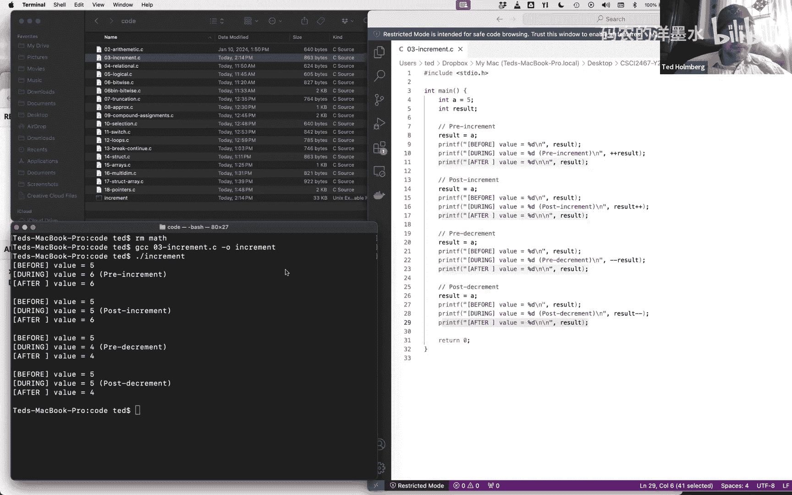
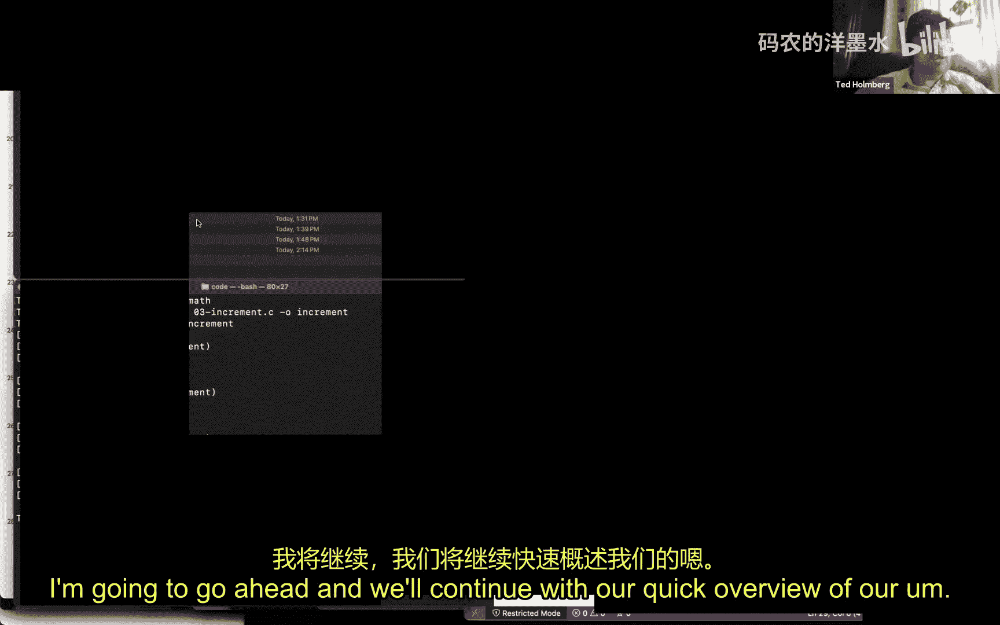
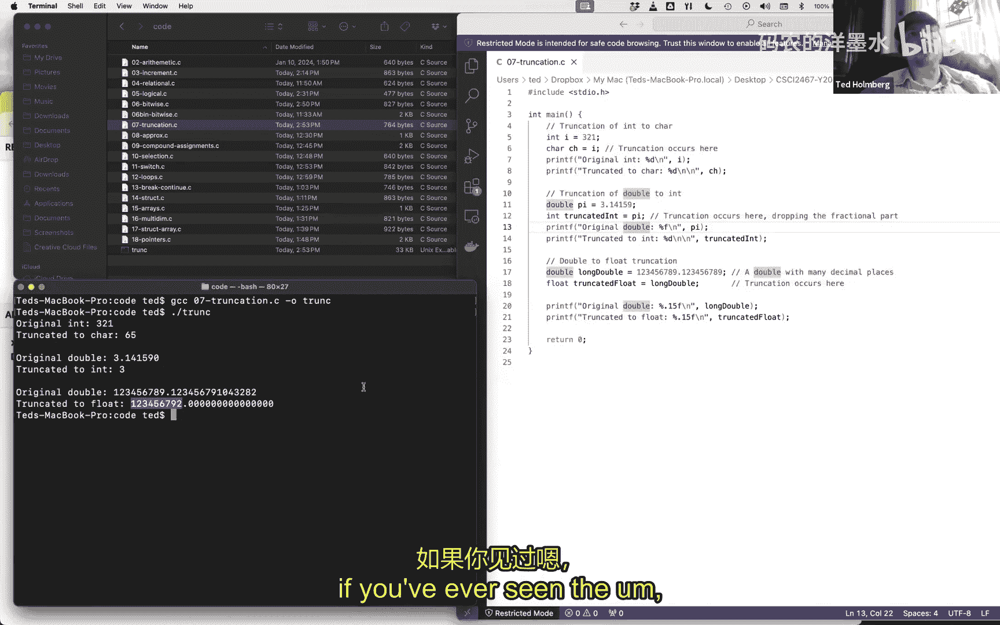
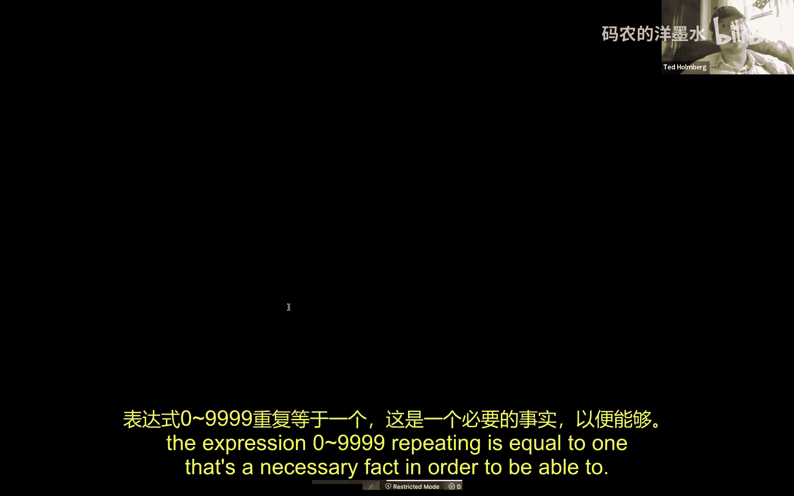
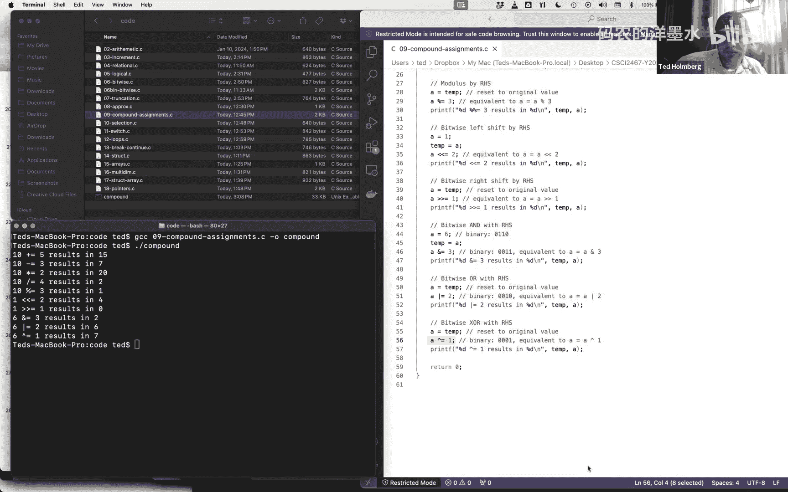

# 【全集】加州理工学院 C语言系统编程 中英字幕 p02 Lecture 2 - 运算符 -BV1bUzWBLEiC_p2-

Excellent， I should not be recording Okay， so in today's lecture we're going to continue where we had previously left off so we had last left off where we had looked at the hello world program and C and we looked at a bunch of variable declarations and and then we printed those out so at this point we're mapping our Java knowledges into learning how to implement C code and so we're going to continue to do that in this lecture as well we'll continue to look at examples that look very much like Java code and then we'll map it into the context of C'll actually be C code itll also just happen to look a lot like Java as well。

So we'll still be into section one right here on the basic types and operators and i'd love if we can also get through control structures in today's lecture as well which I think should be accomplishable we might even be able to get through section three which is on complex data types so again this is just the overview from the pdfs that we're kind of basing these particular lectures off of which is going to be。

The essential see which we had I had given a link to that in the syllabus and also in one of the earlier slides on the lecture notes Okay。

 so let's let's walk through this really quick just to see where we last left off。

So yeah we we talked about the different types， so I think this is about where we got to。

Where we got to。Our floating points， we looked at this。

Comments are the same as see okay so variables and finally we're going to get to after the basic types which what we looked at last lecture we should be getting to the concept of operators so we'll take a look at the operators we'll look at truncation I think i'm going to look at truncation after the operators。

We already talked about how there's no actual bulloleing value perfect。 Okay。

 so I'm going to jump back over to the。The live set of codes we can actually start looking at these so。

There are several different。Primitive operators that are built into C and what we're going to see is that these primitive operators are very similar to the primitive operators that are built into Java so I'm going to open up this source code file02 dash arithmetic。

 C actually let's stretch this out all the way。Okay， let's see here。

Let's close this out so that we have the full space that we have here， So we'll say given our。

C code and again， I'm going to go ahead and include our standard input output header file so that we get access to a print F function inside of our main function。

 which we need to have， but since that's the launch point of our application。

 we'll go ahead and put everything in the scope of our function。

 so everything will just be locally scoped to main。

And so here I'm just going to declare two variables a A and a B and I'll assign those I'll initialize those to 15 and4 and then we'll just do some basic computation so we could see our arithmetic operation our additive property addition is exactly what we'd expect as it was in Java where we can go ahead and resolve a value and when we resolve a value in an expression like this。

 then we could do an assignment statement this might be the first time we did in an assignment I't remember if we did assignments I think we did assignments in the last code too it's always but I think it was all literal values now that we're looking at operation the rules for assignments are the same and C as they are Java that means that the last thing to occur with an assignment operation is for the assignment to occur so we wait for the left hand the right hand expression to resolve into an actual value when that becomes a value we can then。

Store that in memory。Based off of this alias and this aliaase just maps to some memory address and we'll learn much。

 much deeper about how memory addresses are resolved and how these variable names are just identifiers or just labels。

 human readable labels for us to access some reserve space and memory for this particular value。

So we're going to call this sum and the rules are the same once we initialize a variable within a given scope。

 we can't reinitialize it， we can always access it by its name and then we can always reassign the value with a single equal sign。

 a assignment operator。So he we'll just add those two values。

 and then we'll print that up or sum we'll go ahead and subtract those two values。

 We'll initialize a different variable。 we'll call difference， and we'll print out the difference。

 We'll go ahead and use the asterisk for multiplication。

 save that in a different variable called product， and then we'll print out the product。

 We'll go ahead and。Do our division a divided by B， keep in mind， division works。

Differently between various data types。 So for instance， integers don't have fractional numbers。

 that means it's going to truncate the value just like in Java。And so because of that。

 we also have the mods symbol， which is very useful for integer based division。

 which shows us the remainder amount。 So pretty much all the very basic arithmetic operators that you learned about in the intro programming class are exactly the same。

 And actually， let's go ahead and see if we can't compile this and take a look at the results。

 So this is。Zero two， so we will call a Gcc that's going to be our our compiler and we're going to compile our code。

啊。Here we go into object code， so here we go 02 arithmetic。c。

 and we want to give it an output and we'll just call this map， make it easy。Okay。

 so now that we have that let's go ahead and execute that from the application from our shell so dot slash and then we'll go ahead and give the application name we'll run that execute that and we'll see that we get all the output we'd expect to get so our sum are difference our product are quotient our remainder excellent。

And so if there's if for any reason you have questions， just post them into the chat， if not。

 I'll continue to just kind of walk down through these a source code examples we have so we can see how see kind of maps。

Into our onsets related to Java and we'll see that for the most part。

 it's like almost one to one correspondence。Okay， let me do this， I'll also remove my math。Okay。

 and you'll see map now has been deleted so we can remove our files as we go ahead and and test them so that we can keep our workspace clean。

Okay， if we're learning about arithmetic operators。

 let's go ahead and just talk about the increment and decrement operators as well。

So as you might recall from Java and just in case this wasn't really like talked about in detail in Java。

 there's actually two forms of the increment operator so you could put the so recall that the increment operator is the plus plus sign or the decrement operator is the minus minus sign。

 and so that allows you to take a value a numerical value and you can either increase it by one use unit if it's increment or you can decrease it by one unit if it's a decrement。

Now you could actually put the plus plus in front of your variable name or you could put the plus plus after your variable name that's the other thing the increment and post the increment and decreement operators can only be used on something that's sort of memory like a variable。

 you can't use it on a literal value because it's doing a it's not just incrementing but it's overriding the value inside of that variable。

So I just want to make sure everyone has a strong understanding of the behaviors as it distinguishes between a pre increment and a post increment。

So the pre increment。Effectively means that so if it's all on one line， it doesn't matter。

 So if we had， say， for instance， just a equals 5。 and then I did。A plus plus。

 it doesn't matter if I put the plus plus in front or behind it。

 because that's the only operation that's occurring for that statement。 Now， you can somehow。

 you can oftentimes have multiple operations that occur on the same statement。 So for instance。

 in these lines。 say for instance， line 10， I'm doing both a pre increment operation。

 in addition to a print statement or a print operation。

 and both these have to execute on the same line。 And so the pre increment versus post increment simply means I can decide what order the increment going to occur。

 So if I put the plus plus in front the result。 And if my result here was a originally5。

 So if here on line 8， I say， okay。Let's walk through this really quick。

 I'm gonna assign a variable A is five result that's undefined that the first instance at8 I'm going to assign to result the value of a I'm going to print out the result of that of result I'm going to print out result and just say okay before I do anything this is my value of result then I'm going to do a pre increment and print result at the same time。

 and so pre increment should actually do the addition it should increment and then print out so then it should actually print out to v6 and not5 and then after that statement is execute while the increment occurred so it should be6 still So in a post increment we're going to reset the value of result back to a which is5 we're going to print out the value before we do anything which should be5 in a post increment we're going to do everything else on this line so in this instance it's going to be the print operation and then we're going to do the。

Increment so then it's going to print five and then increment it to six so after that instruction is executed and if we print the next statement after online 17 we'll see that result is in six。

And so the rules for decrement is going to be exactly the same but except for incrementing a unit。

 we're going to be decrement in unit， so if we set result back to a and then we print the initial value before we do anything。

 if we do a prederement， it's going to still print out as five and then after that operation after that statement's done or that yeah。

 that statement's done executing entirely， it'll been before。Then we'll reset our result back to5。

 We'll do a print before we try to do the postaccrament。 We're going to do the post sacrament。

 which means we'll print out the value first。 So it'll be 5。 then decrement to 4。

 And then finally we'll go ahead and then print the result after we're done line 28。

 So which should be4。 So let's just make sure that that behaves the way we expect it to。

 Let's go ahead and compile our code。 So thats Gcc 0，3 dash increment do C。 I want to call this。

 let's call it。Increment。Perfectly fine， let's go ahead and。Compile that。

 let's run that increment and let's see what our output is and we'll see before our value is5 during the pre increment。

 right， it goes to six。And then print and then after of course it's still six when we go to do our post increment we reset back to five during the statement that has the post increment。

 it's still five during the print but then after that has resolved it's finally going to be six and then for the decrements we could see it's going to reset to five during the prederement it decrements first and prints out and then we have the value still at four after that and then the post acrment we start with five we reset that value we。

Derement before we print。 I I'm sorry， post decrement。 we print before we decrement。

And then we finally see that we after that statement resolves that the value has been decremented to four excellent。

Okay， so and just I'm just checking to see if there's any comments or after doing just a quick overview of Derement and。

And increment in terms of post and pre decrement I have a couple of questions here。

 one is out of curiosity when you compile and it creates that executable file is that similar to how the Java compile creates a class file so that's a very good question so yes。

Inceptualally what's happening when I go and create so。When I go and call the Java compiler。

 Java is a very interesting language， we think of it as a compile type language。

 much like sees a compile type language， when I call the GCC compiler I'm taking my human readable code。

 which is what we see inside this text editor here， this code editor。

 and then it will compile into it what's called object code and so the object code is then effectively going to be our。

Our machine code that's executable。 So if I。Give that bio type to。The shell。

 the shell can then parse our object code in a way that it then can execute those instructions so the machine knows how to execute that inside of the system inside of the inside of the OS Now how does that relate towards the class files in Java compiler So when we have our source code Java file and we invoke the Java compiler。

 the Java compiler convert it translates that Java code into what's called Bte code and Bcode is compiled to run on the JVM。

 which is sort for the Java virtual machine and so you can think of the JVM as effectively like what your OS。

 what your system is doing with your C code Now one of the things that really distinguished Java and made Java so popular as opposed to see is that all your Java code runs through the JVM。

So the JVM is like this abstracted layer where Java code executes at that is distinguishably different and lives on top of your actual operating system so that makes Java code incredibly portable so the entity that ensures that your JVM works for every system is oracle they're the curators of the language so so long as Oracle has a version of the JVM that works on。

😡，Any kind of system， then your Java code can be transported from one machine to another。

 And this is why and they have JVMs on everything like refrigerators and toasters and calculators and obviously laptops and well clearly like Google had leaned into using Java for Android So Java is immensely powerful because almost every computational device has a form of JVM on it And if you author code in Java。

 it can run through the JVM without you having to be concerned about some of the hardware considerations and this is where we distinguish with C remember C is designed to be a systems language C is designed to be an OS level language it's designed to talk to the hardware and not abstract that away。

 So as a result， we get much more performing code in C because there's not that layer of。

Fraction that's there for the JVM if you think about it。

 Java is both a compile type language and an interpreted language almost kind of simultaneously in a way because you compile it down into。

Your Java code into your bike code， and then that bike code is run through the JVM and then actually executes to the machine。

And so that's your compiles target for JavaA whereas our compiled target here is actually for the underlyinging system。

 so it actually creates an executable file that the system itself without the aid of a JVM requires。

 but conceptually dot class files and these these object files are very similar to each other that's just kind of the nuanced difference Does that answer your question。

And then it looks like I have another question here that's asking just to go over the concept of this very last statement here。

 the return zero。 So whenever I have a。My main function in C and let's distinguish this from our main method in Java so recall that Java is first of all an objectss first language which you're familiar with so all of our all of our behaviors all of our methods have to belong to a class and of course that's what distinguishes a method from a function a function is a effectively a method that's in the global namespace that's not tethered to or belongs toway class so inside of C our kind of primary set of hacking our codes into procedures would be at at the global namespace so we don't have to call a class on this now our main function and C distinguishes a little bit from our main method in Java in the fact that it has a return type so remember your return type in Java is void so it just executes all。

instructionsstructions and that's it Now the idea behind the main function in C is that it can return back a numerical value that after's done executing or if it's not done executing either way it can return or result into a value to let you know if it executed properly or not so if I return back a zero value that's supposed to let the system though hey I'm done executing and I return back with zero errors I ran as per expected now inside my application I can return back from the main function with nonzero values which that would then indicate to whatever the call function was that which would probably be the system right because that's where we're going run our main function form that we ran into some kind of error some kind of issue while executing our code so this was just a way of kind of doing logging and tracking of errors when running our main function to be able to provide personal。

all kind of a boolean value did we run successfully or not zero or some non zero value and if it's a non zero value。

 then you could use those numbers in intelligible way for debugging purposes did that answer your question in terms of what the return zero again was and then finally。

Right had one other question these lectures are saved if we need to rewat them oh yeah of course。

 in fact they've already been posted if you go to the link inside of the Discord server under resources or videos or something like that。

 there's a post to the playlist where you can access these right on the YouTube channel。

And these are all go in the same playlist， in fact。

 I encourage you not only to look at the videos from this lecture where I'm doing more live coding examples。

 but I also encourage you to potentially check out the lectures where I go more slide heavy from last semester and both those should be in their own individual playlist so we should have a playlist for 2024 which is this set of lectures and there' will be a playlist for 2023。

 which is going to be the lectures from last semester。Excellent， any other questions？

On well I'm going to go ahead and we'll continue with our quick overview of our。

Of our C code then try to get ourselves up to a point where we can start seeing some things that are a little bit nuancely different。

 but until then we'll continue to look at things that are kind of similar。

So the next thing I want to look at is if we're talking about operators。We can close out of this。

 Let's go here。 Let me clear this workspace here。 Let me remove my。Increment application。Okay。

 so the next thing I want to take a look at is going to be。

The relational operators so our relational operators I usually subdivide these into two different categories I usually like to think of these as。

Well， relational operators is being less than greater than。

Greater than an equal to less than equal to And then I usually think of equal and not equal as equal operations。

 but we'll just talk about them all in this same source code file to keep it easier and and compacted。

 So just jumping through this I'm going go ahead and initialize two variables A and B。

To respectfully 10 and 20， I I'm going declare a variable called result。

And were going to go ahead and and then we're going to go ahead and assign things into result so here we'll check to see if a is equal to B is 10 equal to 20 then we'll print the result of that that should be clearly。

Our concept of that is going to be false， but notice that the result of what we get back whenever we do any of these relational or equality operations is going to be an integer value because boolean is not actually a primitive a supported primitive data type it doesn't it doesn't exist in normal traditional C we just treat it our numerical values in the form of boolean evaluations。

 so that means this should return back the value of zero。

 which means false at any nonzero term would be true so then let's check not equal while this should result to be true。

And then we'll go ahead and store the result of that。

 then we'll check is a greater than B then the result of a less than B than the result of a greater than or equal to B than the result of a。

Less than or equal to B And for all these instances， we're going to print out the value of a。

 the value of B and the value of results。 So that means each of my print F statements are going to have like these three placeholder values with percent D indicating I'm going to pass in some integer value of A B and result。

 and of course， the D inside of that integer value is representative that is going to print out in a decimal format。

 I can actually choose to do a decimal or ocal if I did O or hexademal if I did X。

 So if you were wondering why is D A value that relates。Specifically to integers。

 it's because of the base evaluation， I can actually express any of my integer values in base 8。

 base 10 or base 16。Okay， so with that said， let's go ahead and let's compile this code。Okay。

 so this is called04。Relational。And so let's call it I'm going to dash out to give it a name and let's just call it relational。

Okay。And so we should get our， you can see right here inside of my。My directory。

 I now have a relational app， so we'll go ahead and execute that dot slash。

Relational and we could see we should get the resolutions we want the only thing that might be slightly different in terms of Java is again where we resolve back these values that are either zero one to represent our bullying evaluations of course。

Any non value could be treated as a true value， but you could see the default value that our application that C gives back whenever a value resolves to be true is typically one。

Okay， perfect。If there's no questions related to this， I'll move on。To the logical。Operation。

 so let's go ahead and close this。 let's clean out of workspace。 I'll clear this out。

 but let's go ahead and remove that。Just make sure we don't get all cluttered up so RM will remove our file。

And let's go ahead and take a look at our。Okay， here we go， so for our logical operations。

 we'll just walk through this with since logical operations are and or or not an exor。

Then they're they're expecting boolean type operations。

 so then we'll go ahead and set the values that we'll go ahead and evaluate upon as either one or zero where one is going to represent our truthy value and zero represent or falsey value then we'll go ahead and declare a。

A variable just to hold our result。Which will also be an integer data type。

 so here we're going to do a logical and so this is going to and one and zero together。

Which should be false。Then we're going to go ahead and do or so notice the operators for ant are exactly as they are in Java。

 the operator for or is exactly as it is in Java will record the result of this or operation between a or B。

 and this should result into a true value。Since at least one is true。

And then here will not not should invert my a。 So if my a was a1， it should become a0。

 I'll not the B。 So if my B was a0 should become a1 when I print this out。 And then finally。

 I'm going to do my。That's not quite right。😔，I'll do my arm。That's。Wai a second。

I don't think that is correct。I'll do my ex work value。Okay， let's see here。

I don't know if I actually have it。I think my XO value is going to be a bit wise Xor value。

Well'll test this out， but I don't think I's see here。Okay， let's take a look at this。

And let's save this。😔，St26。0，5， do。And let's do。😔，Oh， I just did adot out， oh， well。

Yeah perfect so yeah， so this is going to be a logical so they don't they don't have a logical Xora I I'll have to double check that I don't think that there is。

We will clear this。哦。We will clear this。Let's。On that。And let's read。Perfect。Okay。

So we won't so we'll look at XO as it relates to bitwise operations， not to logical operations。

In terms of our logical operations， the ones we really care about at least right now are ands our or's and our knots。

 and so we can see when we go to resolve this that they work exactly as wed expect to。

 just they are doing it integer values and and not inside of true false values like what we see in Java。

Okay， let me go ahead and clear this out。And let me do an RM on my eight dot out。But。Okay。

 let's close this， so pretty much everything is very similar。Okay， now let's go to Biwise operators。

Yeah， this is。Got my。Typing too much really quickly through something in biological logical operators that should belong to my bitwise operators but we can finally see our bitwise operators here so recall that bittwise operators you probably are more familiar with inside of your assembly class and inside of your Java class is that correct like I don't think even though these operators exist in Java I don't think that the intro of programming classes really cover bitwise operators that much because they wait for you to really get to understand binary sequences and binary strings so that you can see the real power of doing bitwise operations I mean it's in the name bitwise operations is done on bits and you don't touch bits until machine until machine language and assembly right but you should be familiar with these operations。

 the bitwise and the bitwise or the bitwise X or the bitwise knots and then you're left shift。

just from assembly does everyone kind of recall that？Excellent。

 so even though so we're going to cover these operators， these operators actually exist in Java。

 you probably don't use them， but you're going to be familiar with the logic from your assembly class。

 And so notice we're going to look at a couple different things here。 So with bitwise operations。

 we want to really think of the way that we're representing and modeling our values here。

 our numbers as being a binary sequence as being effectively as being a collection of bits And so then it makes it easier for understand how these operations are recurring for that reason。

 I'm going to use unsigned integers just to illustrate that I want to treat these as my binary sequences。

 So I'm going to put unsigned in front of here。For my A， my B， and my result。

 I'm going to assign the value of 12。Whi we can think of binary as 1100 and the value of 5。

 which in terms of binary， we can think of0101 and then we'll go ahead and put our results in in whatever whatever the operation is that we're going to go ahead and do So the first thing we're going to do is we're going just print out our initial values so that when we look at the console we can recall what is our value of a and whats our value of B。

 but notice they're not percent D， they're percent X。 so when I print out my integer values。

 I want to express them not as decal base 10 values but as hexademal base 16 values Now the trick is I。

I can't by default do binary strings inside there' there's no like percent B for binary inside of C if we wanted to do binary。

 we would actually have to create a function to parse through our value and translate it into a binary sequence so what we can do though is since everyone should be familiar with parsing hexademal。

 so recall that goes from zero to F then we'll just represent our binary sequences in forms of our hexademal values。

😡，So in blocks of floor values。Okay， so we'll print that out in hex aadeimal。

Then we're going to do the bitwise operation of A between A and B。

 so that's where it lines our bits together， and then it effectively does kind of a logical operator between the lined up sets of bits。

😡，Then we'll do the same with bitwise or so again it's going to align our two sets of bit sequences together and it'll or the individual bits together。

 toggling them into an either zero or one position and then retranslating that into whatever the hexadecimal or decimmal value is however we express it in this instance hexademal value。

 then we'll do the X or， which means that it resolves to be true。

 only if both bits are zero or both bits are one， if they're alternating， then it's a falsey value。

Then we'll do bit wise knots， then we'll shift。The entire binary sequence to the left by one bit。

 and then we're going to shift the binary sequence to the right one bit。Okay， so let's see。No。

 it's not。 this would work fine honestly if I just did the ints。

 it should work fine in this instance because I don't think I'm dipping into the negative but I do want to I want to illustrate that when working with binary sequences in order to be safe you probably want to go ahead and declare that this is unsd so that it knows not to apply the rules that convert a value into if it's leading one value into a negative value or not especially in we're shifting bits around so it might not be it might not be necessary。

 but it's a safety thing one of the things you're gonna to learn about C is it doesn't have the safety nets that Java has that's why C is a very bad reputation Oh let me also for the purposes of the video restate what I just answered in terms of the question that's a question is it absolutely necessary to clarify unsigned or sign int if're。

To perform bitwise operations on the variable and my answer is no you could just do int and you could do all these and they were worked just fine the reason why we want to do unsigned I would state is that if we know we're treating these as binary sequences。

 then we get safety protection for us to ensure that the system is not going to go behind us and translate a value thinking it's assigned value because recall that signed values use leading one values to indicate whether it's a negative value or a positive value so if we want to try to prevent that from occurring and we know in this instance we're going to treat this data in a particular way then we want to be as explicit as possible with a compiler so that the behavior we get back from it is consistent with what we expect it to be。

And so I can't reiterate this enough C is renowned for being a difficult language because it does not provide the safety net that Java does so one reason why Java is such a popular language。

 especially in large scale applications and especially in academia is that there's a lot of safety there it will prevent you from doing things that will lead to bugs or to issues that are hard to debug let me give you an instance of what we can do for instance in that we haven't even seen yet so I'm going to show the display of this and I'm going to show you and you'll see more examples of this as we go through source code of the fact that。

C will just allow us to do whatever we want but it will tell it to do instructions and they'll be super unsafe instructions。

 but it'll do it anyway， but it can cause for erroneous behavior because it technically is ill formed instructions like we're doing operations on things we've never officially initialized or said values to and since like。

😡，TheThe idea like when I'll show you an example， let me run this and then I'll show you how we can break things in weird ways。

Okay， so let's see， let's save this， let's clear my terminal。

 let's let's run this as it were first just to see our behavior and then let's see some some interesting things well at least one interesting thing。

Okay， so then here oh I just I do that without naming it so the default name is a dot out so let me run my a dot out and so here let's see if this is consistent with everything we expected today so here a。

The variable A is assigned the hexademal value of C， right。

 which is the integer value of the decsal value of 12 and B is assigned5。

Our bit wise operations between C and5 would resolve into a bit wise and a four。Which would be one。

0 zero and so yeah we can see how if we do that bit wise operation and then let's see here。

 then if we do see。And bitwise operation with five， we we get D if we do x or we get nine。

If we do the bit wise not， it's going to toggle。All of our bits。So that we get whatever our。

Address of whatever our bit sequence is， so if our bit sequence is a 32 bit number for integers。

 then all the leading values are going to be f's right ones till we get two or three。If we do a。

And so this C is the hexademal value right of  12。 If we do take our C value， that's the variable a。

 So if we take hexademal value for 12 and we shift that over。To the left by one。

 we're going to get 18 and if we shift that over to the right， we should get six。Okay， so and。

Let's see， it might be easier if we take and look at it this way。So instead of that。

 so we could look at in hex and the hex is easier to kind of think about than binary it was。

 but let's look at the actual binary string too， so let me go ahead and。病人呢。😔，Bit wise。

 So let's go ahead and oh， I need O。 So let me go ahead and compile this and let's look at the same thing again。

But in terms of。Looking at it inside of our in terms of binary sequences。

 so if I had my binary sequence of a。Represented here。Right。

Which is my value for 12 MIabB which is my value for five we can see much easier when we're doing our and and our oring and our exoring and when we do our not operations or if we shift to the left or the right so this is doing the exact same thing that we saw with our hexadeimmal code but we can see with our binary sequences。

 it's much easier to parse and if you just want to see how this particular implementation works。

 let's actually compare it really quick。So in this implementation。

 we added a little bit more logic we kind of。Buildu towards this logic a little bit more。

 but you could see we created this function， which is going to be called two binary。

 it's going to take in our integer number。It's going to take in a reference for a string。

 a character array， which represents the string which will be the binary string that will impute and the number of bits we want to encode it as we're going to put at the very end of our string because it's nothing more than an array。

 the null character to illustrate that this is the termination point and then we'll just do a four loop that'll iterate through and then do an operation such that it will resolve to be a1 or zero depending on what the value is as we step through the bits。

And then we will store that into our string， and then once we do that。

 then we're effectively building a binary string by evaluating the number itself。啊。

And so then we're effectively doing all the same operations。

 but we're just calling our function so just just to kind of map how we could if we wanted to get that binary new string。

 it's not as simple as getting the hexsmal string， but in terms of just illustrating the behavior。

 which is what we care more about I think it's more evident on what's occurring now I did say let me show you one of the things that's very dangerous about C what if I declare this result right here。

Suppose I have this result declared and let's say I want to print it right so in Java what would happen if I tried to do that？

So let's let's do this， let's say results。And then it's an integer。 So let me do percent D。

And then new line character。And then let me pass in result。 So here。

 notice in the very first lines of code I have， I'm doing initialization of A and B。

 I'm only declaring。Result。But I'm going to try printing result at yeah。

 it hasn't been assigned to value。 So what's going to happen if I do that？

What would happen in Java if I did that？Yeah it would it would throw yeah we would it would report back to us right but look when I do that and see it compiled just fine so now when I run it what do you think the value i'm going to get for results going to be。

Where do you does you think it's you think undefined？

Unfins usually for pointers though right so undefined or no are usually things to refer to pointing to a memory address。

 which this kind of is， but usually that points to like。

Data structures that are represented as reference types。But insup primitive Danus height。

Right so would it resolve maybe to yeah so those who say random numbers go yeah whenever it is inside that memory address that's what it's going to return so let's take a look at what that happens to be so we do bit wise so it happens to be minus one2 three9 five five47 three6。

Yeah， so if I forget so if I declare this variable and then I forget to assign it somewhere but then use it elsewhere in my code。

 it'll actually have a value and it's it's going to be a non zeroro value it's going to be whatever value that binary sequence is in that memory address when I go and dereference it so see code blindly allows me to map an alias a name that of my choosing like result or A or B to some location and memory and just store things or look up the value there so I can either write。

A value into it or I can look up a value and read from it if I read from it without writing into it that's completely fine and it'll just return to me whatever's there there's something there whatever I just don't know what it is so clearly my code shouldn't depend on something I don't set myself because it's going to be random it's going be it's going to be its it's going to be something that definitely causes errone'ous behavior and it does not get reported notice it's running this as if it were normal operational code and there is so many instances that we're going to see inside of C code where we're allowed to do this and this is one reason that makes C very dangerous。

😡，It that just it literally you do whatever you want to do。

 it takes your statements very literally and if you do them。In error。

 if you do them without realizing some of the implications， like if you miss something。

 it won't necessarily report that to。And these are reasons why languages that came behind sea kind of offered more and more protections to make code bases。

 especially very large code bases much more secure and easier to maintain and debug and to identify when things like that are missing because those can be create errors that are if you're in a large enough code base。

 it's hard to find that that was why that broke。Okay， let's see， let's let's remove some things。

 so let's let's clear our workspace out and move on so let's remove this bitwise。Oh。

 let's remove our。Ben bit wise， and let's remove this A dot out。Okay。Okay。

 so that's all of the primitive operators， for the most part。

 Let's take a look at truncation truncation is something you should be also familiar with inside of。

Inside of Java， so just examining this source code file inside of our main function。

 we're going to declare。So truncation， if you call in Java before I start reading through source code simply means that there are instances where you might have data that is too large to fit into a。

Different data type。And so for instance， integers and characters both hold numerical values。

 but a character is one byte and a integer is four bytes。So one bite only holds。

X amount of values right doesn't hold as it only holds。

Two to the four number of different permutations of binary sequences as opposed to your。

I'm sorry two。It's it's a binary sequence that it's not two to the four it's going to be two to the8 for your for your one byte versus2 to your 32 for your for your integer value So if we try to store a value that's too large it's an integer into a character what it'll do is what she's going to do is it's going to transfer as many bytes as possible over and then whatever it can't it just discards。

So we can see the result of this。 We'll take an integer I of 321， and then we're going to take it。

 and we're going to assign that value， that entervalue into a character value。

 It'll grab as much as it can and then truncates the rest。 We will take another example of this。

 We'll see how we'll take the double value of pi。Wwhichch is 3。

14159 that's you it obviously goes much， much deeper than that。

 but we'll take just something that has a fractional component and then we'll go ahead and save that into an inteerger value。

 we'll see how that truncates the entire fractional component leaving just the integer portion and then finally for truncation just to illustrate this we're going to take long a double value which is a 64 bit precision of of a floating point number and then we'll go ahead and save that into a float value。

 which is a 32 bit representation of a fractional number and then we'll see what the results of that are So let's take a look at this and just see our truncated values and then we can move on。

So let's do Gcc， and so I'll call this 07 dash trunccateated。And then let's call this trunk。

And let's run our trunk here， our trunk code， so here you'd see if we start with the integer of 321。

 it's going to truncate that to be just 65。We're going to if you actually look at the binary。

 we end up losing the most significant bit in that translation if we inside of the binary sequence。

 if we look at the truncation of our double value to our end we lose the fractional numbers and this is pretty interesting right if we take and this is this is also should really impress upon you why you should always use double for your approximate values for things that are fractional floating point values as opposed to floating values if。

We take this value here in our double and we try to represent that using a float。

 you could see the amount of loss we have there。Where the last by the tins digit and the singles digit。

Is not even we've lost all of the precision points and we've even lost some of the some of the in the tens and singles units。

 some of the precision there。So you can see。Which brings us to another interesting thing you should be aware of。

 I know this was probably harped on inside of Java。

 but I want to really harden your understanding maybe you've seen this already inside of assembly but。

Floating point values are fractional values， whether they're float or double or only approximations。

 never use equality operations on your floating point values。

 It's not even a limitation of the machine， clearly the machine。

Is given a limited amount of encodedable bits to represent any given number。

 and so that might seem on the surface like a hardware constraint。

 but it goes beyond being a hardware constraint。😡，Braracctional values， these floating point values。

Mathematically are kind of fuzzy that they kind of have rules where if we want to map them to have a onto relationship with the integer sets there's things we have to say is is is is。

equivalentquient to one another， this is why if you've ever seen the even the expression 0。

9999 repeating is equal to one that's a necessary fact in order to be able to。

Map our integer。Number set onto our floating point number set， otherwise the operators。

 the way that we can manipulate and transform transform numbers simply don't work。

And it's just a consequence of the way that fractional numbers are even like conceptually represented and we're going to see that we're going to see so the question is if we can't actually have tree quality if even the very definition of a floating point number is an approximation that how do you do equality for that and of course you have math classes that go into this you probably define this inside of maybe just probably not discrete but probably definitely calculus one of the things that defined what makes calculus such a meaningful endeavor in terms of quantifying things is the fact that it allows us to work with with infinitessimal units so a lot of times there's a lot of。

I think there's a lot of emphasis on infinities and calculus。

 but where it really gets more interesting is the infinitesalist or something that gets infinitelyly small。

 because that allows us to be able to say， okay， at some point we can create a threshold where we say these are close enough。

 there's enough similarity that they are equivalent to one another。And so let's take a look at that。

 let's close this。I've kind of motivated motivated this in lists look at approximations and how that results from our floating point values so here i'm going to include not just my standard input output header file。

 but also from the standard library the math do header file that we can do some math operations and we'll take a look at which one it is when I get there and I'll explain why。

So inside of our main function here we're going to do a couple of things。

 first of all I'm going to show how we can't trust either floats or doubles right even though double gives us double the precision it's still going to give us some issues so if I take a look at so if I do if I want to do floating point literals the same in Java I would go ahead and use an f lowercase well it could be capital to I use an f after my my literal value。

 my numerical value so here i'm going to assign to a the value of 0。1。

And here I'm going to assign to be the value of 0。8 that's floating point numbers。

 then I'm going to add A and B to sum So what should that be should that should be it seems like that should be 0。

9 right。Like conceptually， that seems true。0。1 plus 0。8 should be 0。9。

 So I'm going to make a literal value of 0。9。 Then I'm going to create a value to an integer value for result。

 which is going to either be true false or they equal or not。

 So let's take a look at how approximate。How approximate these values are when testing for equality so if we actually use the double equal sign。

 which is our equality operation on floats right I'm going to do that here in line 14 so is my sum of a plus B equal equal to C。

That's going to resolve into either zero or one。And I'm going to print the results of this。Right。

 I'm going to say， okay， show me the value of sum， show me the value of C。

 and then tell me what it returns when I look for equality。

 Then what I'm going to do is this is the appropriate way。This is the appropriate way to do this。

 not just in。Programming， but this is actually how you also do this in terms of calculus too。

 in terms of mathematics。 So we'll actually kind of set bounds or limits on what we define something to be within a threshold of counting as being equal。

 So we'll set our limits are our threshold to be 0。0001。

And then what we can do is then we're going to use this math operation because we don't know how it's deciding which one is like more positive or negative than the other。

 but what we want to do is when want find the difference between the sum and our literal value。

 whatever the value we think it is the two values that are close together。

 we find the difference of them， but the positive difference。😡。

So we're going to do our absolute value。And in particular， are like floating absolute value。

And so the difference between that， if it's less than our threshold value。

 then we're going to claim that that is the equivalent of being the same。So presumably。

 this is another way of testing to see if this is true or false。If they're equal or not。

 that's what true or false means。 So are they equal。

 Then we're going to do the same thing with doubles。

 but we're going to vary it up with different values。 So we're going to take the value of 0。1。 Now。

 without the F by default。P floating point values are treated as double values。

 So I'm going to have 0。1 and 0。2。 and then my Z value is going to be 0。3。

 So I'm going to take my sum double and that's going to be 0。1 plus 0。2 which should be 0。

3 right then I'm going to test with my my。Equality operator where I just say， okay。

 is my sum double equal to my Z value is 0。3 equal to 0。1 plus 0。2。😡。

And then I'm going to print out that result。And then I'm going to do the same kind of thresholdholding。

 I'm going to set a limit， I'm going to subtract one from the other and see if it's less than that limit。

And then I will go ahead and print all this out。Okay， so。Before I okay。

 let me clear this out before I run this is there wagers。

 what what do you think is going to happen with the equality operator versus the threshold you think everything's going to be true。

 you think it's going to be true for the floats。And not the doubles。

 you think it's not going to be true for the floats， but it will be true for the doubles。

 what what are your guesses？True for the thresholds。

So is that is that making the assumptions going to be false for the quality operators？

True for the floats。Let's take a look。Okay， so here we go。So when I check is 0。9 equal to 0。9。

 I'm using the default mappings here， clearly there's bits that are way， way。

 way down that have to be offset， but here we could see when I'm testing my sum to my actual value。

 it's returning to zero， that means that's false。It's it's saying that those aren't equal， however。

 if I use the threshold approach for testing against equality。

 which is again is one of the concepts that's actually explained to you in calculus on how do we evaluate infinitesimal values we see that actually returns one if you ever wondered why calculus is meaningful it actually gives concepts as simple as identifying floating point numbers it kind of has explored these concepts on the appropriate way for evaluating this idea of equality for units that are infinitesimally small and can have these my new differences that we say。

 oh we'll just establish a limit to say yeah they're pretty much the same。

And so here we can see the same thing here if we try equality on our doubles。

 it also returns to zero。But if I use the thresholdholding an approach where I set limits and see if it's within a scope。

 then I'm going to go ahead and return back H true value。

And you can see right here in the code I'm not doing anything crazy and this is one of the things that again is it could be a pitfall for you inside of coding so one of these instances if you ever try to try to do equality operations。

 primitive operators equality operations on anything besides integer value。

 anything that's floating point numbers， then you can definitely even when it seems as simple as comparing 0。

1 plus 0。2 to 0。3， you could get behavior that you don't expect。

This is why you avoid equality operators if you're not dealing with integers just something。

To impress upon you， I'm sure you already covered this right inside of Java。

 this is something they should have covered in Java on distinguishing how equal are distinguished between things。

 especially between integers and doubles， but if not， now you can really see it。

You get another exposure in this class。Okay， so the next thing I want to show then is because we still have some Tom。

 let's remove this。Let's clean our workspace， let's remove trunk。It's clear。Okay。

 the next thing I want to show off then is compound assignments we'll see that compound assignments are kind of exactly the same as what we saw in Java so if I go in here and I create two variables undeclared variables。

A and temp。And then again， I'm going to import my standard input output heading file so I get my print F so I can do a。

So compound assignment are just those assignment operators that allow you to do some other primitive operator on the data on the value and then overwrite so a compound operator allows you to read the value。

Of a variable。Produce some operation on it， some primitive operation on it and then overrite the original value with a new value based off of that operation。

 So you've probably seen this as like with the arithmetic operations so you could do like for instance。

 the plus equal the plus the minus equal the star equal the slash equal the percent equal all do does your arithmetic operations right so it'll do a modulus operations on whatever the value was and then modulus it against3 or divide by4 or multiply two or subtract by three or add by5 right so you've seen those probably before。

 you can also do other。😡，Compoent operators though， like for instance。

 you do the bit wise so you can actually do a left shift by two on this on the variable that holds our value of one here。

 or you could do a right shift by one。😡，Or you can do a bit wise and。

 so take whatever the value is and ended by the value of three， or you could do a bit wise or。😡。

Or a bit wise exor So beyond I guess what I'm highlighting here is besides just doing your a typical arithmetic operators。

 you can also do your bit wise operations in the form of a compound assignment And again。

 if I want to see how that looked in practice we can go ahead and。JustQu， just go ahead and。

Compilile this。I'll just call this compound。Let's put an o in there。Okay， now let's run that。

And we can see。It's exactly is what we would expect 10。Plus 5。Overrites the original 10。

 so it now becomes 15，10 minus-3， overwrites the 10 to become 7，10 times 2。

 overwrites the 10 to become 20，10 divided by 4 overwrites the 10 to become 2，10 modulus 3。

 overwrites the 10 to become 1，1 left shift2 overrides the 1 to become 4。

One right shift one overrs the one to become a zero， six bit wise。

And three overrides the six to become two， two， bitwise， or by two。Overrdes the six to become six。嗯。

Six， X or with one overwrdess the six to become seven。So the question then is。

 is there a preference to using compound operators？Or using。

The operations where you put your variable name in the left hand expression and the right hand expression where I'm sorry where you put the variable name in the right hand expression and then overwrite into the left hand expression and so my answer to you is always take the approach that makes your code as readable as possible。

😡，So if it is more， if your code reads easier by being more explicit and saying going along the lines of something like x equals x plus5。

 then do that。😡，As opposed to x plus equal thought。So always， always go with readability。

But there are instances where it does create very readable code to these compound assignment operators。

 but I believe leave that judgment called to you， but one thing you should always endeavor to do as a software engineer。

 especially when working with C， is to make your logic as self-evident as possible。😡。

Because C allows for a lot of nefarious， erroneous behavior to crop up into your code。Okay。

 so my next source code would be， I think I would now delve into control structures and I have four minutes left control structures are relatively easy but for concept orientedness to keep things conceptual I might just kind of break here in terms of the example so that I'm not breaking an entire section at the very last few moments of this lecture and then continue the other section in the next So I think this might be a good breakpoint at least in terms of our code Now with that said。

 is there any is there any other questions I dig get some private messages about making the C code accessible and what I will do about that is I will pack it up all this example code and I will make it available inside of our discord server So if you want access to the C code probably what I'll do is I'll publish it onto Github I'll create a Github repo。

And I'll both publish the addresses inside of the descriptions inside of the YouTube playlist inside of each of the YouTube recordings。

And then I'll also publish the same GitHub repo inside of our Discord so that no matter where you're at。

 whether you're in Discord， or if you're going through the playlist。

 you'll have access to the source code examples。So thank thank you for the person who had asked the question about the availability of the source code so that you all have available the ability to access it and then remember I guess I could have actually access the the runtime environment。

 the actual shell lab environment to be able to do this i'm still inside my local environment eventually i'm going to migrate into our shell lab environment but you should already have a lab environment where you can access your where everyone can access the command line and the GCC compiler。

Preinstalled and so I would advocate once I publish the source code files that everyone go check it out。

 get these files so that you can read through them yourself。

 run them yourself and actually play around with them you could change the values and do whatever you want and I think once we kind of step through a little bit maybe after we go through the next lab the next lecture I'll actually post the first lab so you can start thinking about the lab and I kind of want to go through that lab as well when we get to that point。

😡，Excellent， is there any other questions that anyone has up to this point， I think up to this point。

Everything should still look moderately like Java so everything for the most part is kind of similar except for the differences between Boolean values and integer values how our integer our bulloles are effectively evaluated as integers but other than that I think everything very。

 very similar obviously also the lack of classes we don't have a class keyword inside of seeing and we'll say what the substitute for that is in a future lecture either next lecture of the lecture after。

So。I would recommend， so there's several ways， so I have the question。

 what is the least painful way to run C on Windows So if you want to set up。

A Windows environment because let's think about this。 Mac O already has a。

 I want to say they switch to Z shell， but they have a Possex compliant shell environment by default。

 Uuntu and every like Linux derivative also has a Posex compliant shell。

 If you want to you for shell programming。 I would recommend looking at Windows subsystem Linux。

 What's abbreviated as WSL。 Windows has done a fantastic job of actually working with canonical who does the package manager for Uuntu to actually bring a Possex compliant terminal as a first party。

😊，Application as a first party environment to the Windows operating system， so I would definitely。

recommendd checking out WSL in addition to that， you could always now if you're if you're talking about just C code in general and that systems level code。

 you can always use a IDE and many IDEs will allow you to install compilers and then use the IDE to compile and run your code that way。

😡，Is there any other questions？Excellent well we've run out of time today。

 I will see you all I think next week will be our next meetup I don't think that there's another holiday for next week quite yet。

 so I will see you all on Tuesday then。

