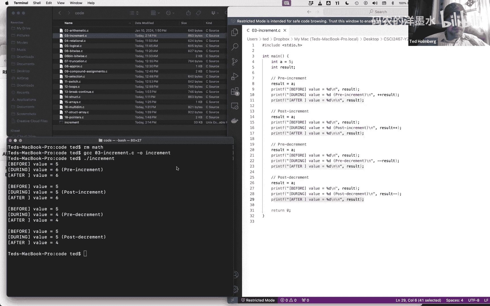
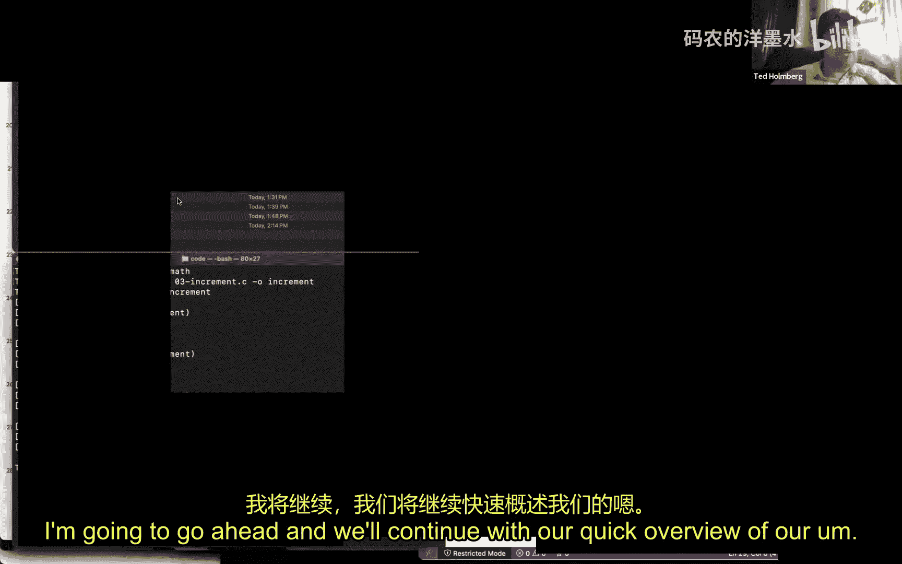
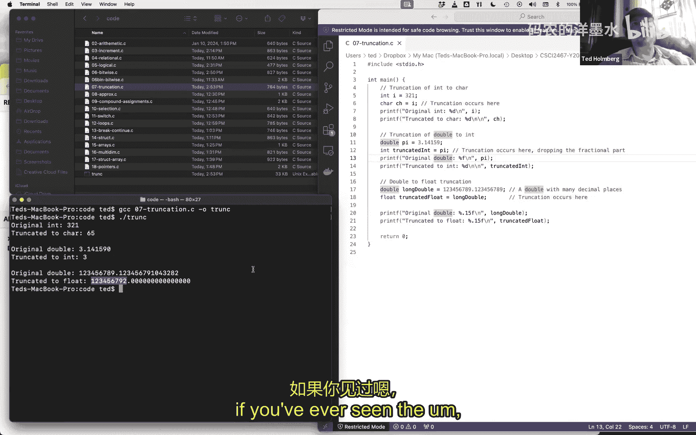
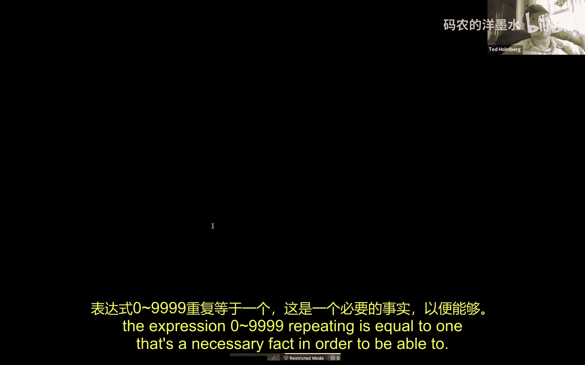
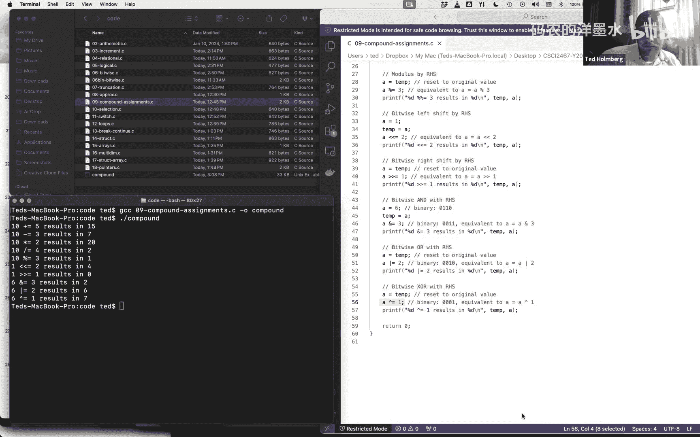

# C语言系统编程：02：运算符与基本概念


在本节课中，我们将继续学习C语言的基础知识，重点介绍运算符、数据类型转换以及一些核心编程概念。我们将通过对比Java语言，帮助你理解C语言中的相似与不同之处。

---

## 概述

上一节我们介绍了C语言的基本类型和变量声明。本节中，我们将深入探讨C语言中的各种运算符，包括算术运算符、关系运算符、逻辑运算符和位运算符。我们还将学习数据类型转换（截断）以及处理浮点数时的注意事项。

---

## 算术运算符

C语言内置了多种基本运算符，它们与Java中的运算符非常相似。以下是一个展示基本算术运算的示例。

```c
#include <stdio.h>

int main() {
    int a = 15;
    int b = 4;

    int sum = a + b;
    printf("Sum: %d\n", sum);

    int difference = a - b;
    printf("Difference: %d\n", difference);

    int product = a * b;
    printf("Product: %d\n", product);

    int quotient = a / b;
    printf("Quotient: %d\n", quotient);

    int remainder = a % b;
    printf("Remainder: %d\n", remainder);

    return 0;
}
```

编译并运行此代码，你将看到预期的算术结果。整数除法会截断小数部分，这与Java的行为一致。

---

## 递增与递减运算符

递增（`++`）和递减（`--`）运算符有两种形式：前置和后置。它们的行为取决于在语句中的位置。

```c
#include <stdio.h>

int main() {
    int a = 5;
    int result;

    // 前置递增
    result = a;
    printf("Before pre-increment: %d\n", result);
    result = ++a; // 先递增，再赋值
    printf("During pre-increment: %d\n", result);
    printf("After pre-increment: %d\n", a);

    // 重置
    a = 5;
    result = a;
    printf("Before post-increment: %d\n", result);
    result = a++; // 先赋值，再递增
    printf("During post-increment: %d\n", result);
    printf("After post-increment: %d\n", a);

    // 递减操作同理
    a = 5;
    result = a;
    printf("Before pre-decrement: %d\n", result);
    result = --a;
    printf("During pre-decrement: %d\n", result);
    printf("After pre-decrement: %d\n", a);

    a = 5;
    result = a;
    printf("Before post-decrement: %d\n", result);
    result = a--;
    printf("During post-decrement: %d\n", result);
    printf("After post-decrement: %d\n", a);

    return 0;
}
```

前置操作先改变变量值，再使用该值；后置操作先使用当前值，再改变变量。

---





## 关系与相等运算符

关系运算符用于比较两个值，返回一个整数结果（0表示假，非0表示真，通常为1）。

```c
#include <stdio.h>

int main() {
    int a = 10;
    int b = 20;
    int result;

    result = (a == b);
    printf("%d == %d: %d\n", a, b, result);

    result = (a != b);
    printf("%d != %d: %d\n", a, b, result);

    result = (a > b);
    printf("%d > %d: %d\n", a, b, result);

    result = (a < b);
    printf("%d < %d: %d\n", a, b, result);

    result = (a >= b);
    printf("%d >= %d: %d\n", a, b, result);

    result = (a <= b);
    printf("%d <= %d: %d\n", a, b, result);

    return 0;
}
```

C语言没有内置的布尔类型，因此用整数代表逻辑值。

---

## 逻辑运算符

逻辑运算符（`&&`, `||`, `!`）用于组合或取反条件表达式，它们同样操作整数并返回整数结果。

```c
#include <stdio.h>

int main() {
    int a = 1; // 代表真
    int b = 0; // 代表假
    int result;

    result = a && b;
    printf("%d && %d = %d\n", a, b, result);

    result = a || b;
    printf("%d || %d = %d\n", a, b, result);

    result = !a;
    printf("!%d = %d\n", a, result);

    result = !b;
    printf("!%d = %d\n", b, result);

    return 0;
}
```

---

## 位运算符

位运算符直接对整数的二进制位进行操作。理解二进制表示对于掌握这些运算符至关重要。

```c
#include <stdio.h>

int main() {
    unsigned int a = 12; // 二进制: 1100
    unsigned int b = 5;  // 二进制: 0101
    unsigned int result;

    printf("a = 0x%x, b = 0x%x\n", a, b);

    result = a & b;
    printf("a & b = 0x%x\n", result);

    result = a | b;
    printf("a | b = 0x%x\n", result);

    result = a ^ b;
    printf("a ^ b = 0x%x\n", result);

    result = ~a;
    printf("~a = 0x%x\n", result);

    result = a << 1;
    printf("a << 1 = 0x%x\n", result);

    result = a >> 1;
    printf("a >> 1 = 0x%x\n", result);

    return 0;
}
```

使用`unsigned`类型可以确保在进行位操作时，数值被当作纯二进制序列处理，避免符号位带来的意外影响。

---

## 数据截断

当将一个较大类型的值赋给一个较小类型的变量时，会发生截断。多余的数据会被丢弃。

```c
#include <stdio.h>

int main() {
    int i = 321;
    char c = i; // 整数截断为字符
    printf("int %d -> char %d\n", i, c);

    double pi = 3.14159;
    int intPi = pi; // 浮点数截断为整数，丢弃小数部分
    printf("double %f -> int %d\n", pi, intPi);

    double precise = 123.4567890123;
    float approx = precise; // 双精度截断为单精度，损失精度
    printf("double %.10f -> float %.10f\n", precise, approx);

    return 0;
}
```

---

## 浮点数近似与相等性比较

浮点数（`float`和`double`）在计算机中是近似值。直接使用相等运算符（`==`）比较它们可能导致错误结果。

```c
#include <stdio.h>
#include <math.h>





int main() {
    float a = 0.1f;
    float b = 0.8f;
    float sum = a + b;
    float c = 0.9f;

    // 错误的比较方式
    int resultWrong = (sum == c);
    printf("sum=%f, c=%f, (sum == c) = %d\n", sum, c, resultWrong);

    // 正确的比较方式：使用阈值
    float threshold = 0.0001f;
    int resultCorrect = fabsf(sum - c) < threshold;
    printf("|sum - c| < %f = %d\n", threshold, resultCorrect);

    // 对double类型同理
    double x = 0.1;
    double y = 0.2;
    double sumDouble = x + y;
    double z = 0.3;

    int resultWrongDouble = (sumDouble == z);
    printf("sumDouble=%f, z=%f, (sumDouble == z) = %d\n", sumDouble, z, resultWrongDouble);

    double thresholdDouble = 0.0000001;
    int resultCorrectDouble = fabs(sumDouble - z) < thresholdDouble;
    printf("|sumDouble - z| < %f = %d\n", thresholdDouble, resultCorrectDouble);

    return 0;
}
```

永远不要直接使用`==`比较浮点数。应该计算两个数的绝对差值，并检查该差值是否小于一个可接受的微小阈值。

---

## 复合赋值运算符

复合赋值运算符将一个运算和赋值合并为一步。

```c
#include <stdio.h>

int main() {
    int a = 10;
    int temp;

    temp = a; a += 5;  printf("a += 5:  %d -> %d\n", temp, a);
    temp = a; a -= 3;  printf("a -= 3:  %d -> %d\n", temp, a);
    temp = a; a *= 2;  printf("a *= 2:  %d -> %d\n", temp, a);
    temp = a; a /= 4;  printf("a /= 4:  %d -> %d\n", temp, a);
    temp = a; a %= 3;  printf("a %%= 3:  %d -> %d\n", temp, a); // 注意%%用于打印%

    a = 1;
    temp = a; a <<= 2; printf("a <<= 2: %d -> %d\n", temp, a);
    temp = a; a >>= 1; printf("a >>= 1: %d -> %d\n", temp, a);

    a = 6;
    temp = a; a &= 3;  printf("a &= 3:  %d -> %d\n", temp, a);
    temp = a; a |= 2;  printf("a |= 2:  %d -> %d\n", temp, a);
    temp = a; a ^= 1;  printf("a ^= 1:  %d -> %d\n", temp, a);

    return 0;
}
```

选择使用复合赋值运算符还是分开写的表达式，应以代码的清晰度和可读性为首要标准。

---

## C语言的安全性问题

与Java不同，C语言缺乏许多安全保护机制。例如，C允许你使用未初始化的变量，这会导致不可预测的行为。

```c
#include <stdio.h>
int main() {
    int uninitializedVariable;
    printf("未初始化变量的值: %d\n", uninitializedVariable); // 输出是随机的
    return 0;
}
```

编译器不会报错，但程序会读取该内存地址中残留的任意值。这使得C语言编程需要格外小心，以确保代码的正确性和稳定性。

---

## 总结



本节课中我们一起学习了C语言的核心运算符和重要概念。我们详细探讨了算术运算符、递增递减运算符、关系与逻辑运算符以及位运算符。我们理解了数据截断的含义，并掌握了安全比较浮点数的方法。最后，我们认识了C语言中复合赋值运算符的用法，并意识到了C语言因缺乏安全机制而需要程序员更加谨慎。这些基础知识是将Java知识迁移到C语言环境的关键一步。在接下来的课程中，我们将学习控制结构。