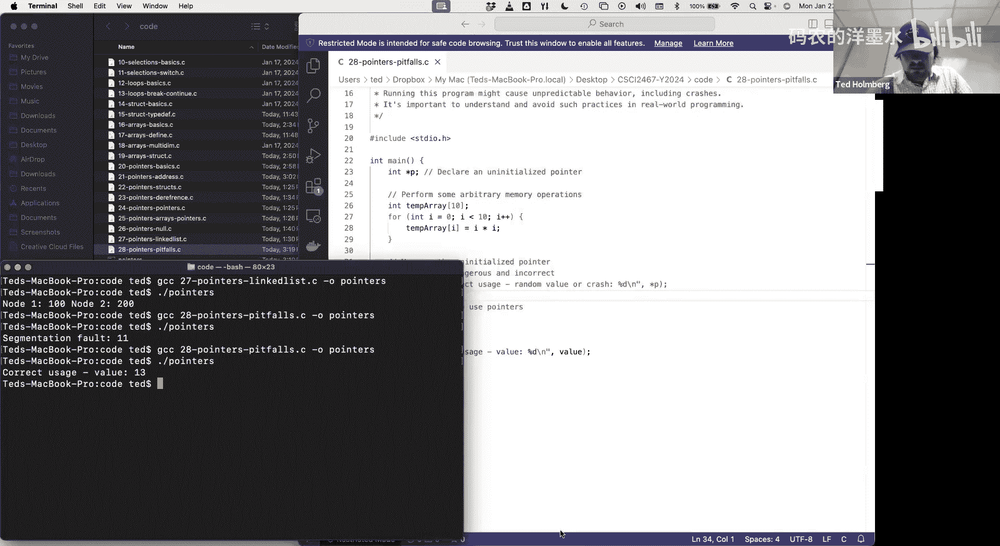

# 【全集】加州理工学院 C语言系统编程 中英字幕 p03 Lecture 3 - 控制结构、复杂类型与指针 -BV1bUzWBLEiC_p3-

Excellent， shouldn't now be recording hopefully I have a strong signal down here am I。

Being heard on the for those of you who are hybrid， can you hear me fine， am I coming through？

At a reasonable bandwidth。Hope so。See okay， so for today's lecture， I want to continue our。

Venture down the see programming language mapping what we know from Java on top of C and this once once we're done like this this tour I'll。

Go ahead and assign the very first lab， which is going to have you do some basic programming NC。

But before we do that， I kind of just want to。Give an overview of everything so today's class we're going to pick up where we last left off so we last left off with operators right and so it makes sense then that we can start talking about control structures。

So。In order to go ahead and。Run multiple connect multiple statements together。

 we use curly braces very similar to Java Java God its metaphor of being able to create a block of code。

😡，Where there is a shared scope in that block。Through curly braces and so when we go to create any control structure or any kind of joining of statements together little little default to curly braces for the same rationale and so I don't know how harden this was articulated that this might backfill some of your knowledges when we talk about things like selection statements repetition statements。

 you can by default use one of those without any curly braces right but it only affects that one statement that immediately proceed that follows it。

 and so the value that a curly brace brings it allows you to take multiple statements and combine them together so that our compiler will execute them as an atomic entity。

So whether you had realized it was a way of compounding statements together or not i'm going to just go ahead and and define that okay。

 so with that said currently braces open close exactly like inja。

 I don't even have code to demo that。😡，Okay， so now let's go to the actual control structures。有。

Let's see here my finder is。Not not looking great， so let's see here if I can go ahead and what am I using this is visual Studio at see here。

Let's clear this。😔，So I attempt to kill。Findder， see if I can get it working or not。

 will that wreck my system？The gamble。Okay， let's see what happens if we force quite it。Okay看。啊，我谢谢啦。

There we go， Okay now。Perfect， and let's change this view to be。Based off of our list view。

Perfect okay so let's take a look at our selection statements so selection statements is the generic term for our single selection。

 our double selection and our multi selection statements you probably know them as if if else or nest it if statements so we'll take a quick gander at the code here I'm going to of course include so I have this preprocessor directive that's going to include my standard input output header so I get access to my print function I'm going to have this main function returns an int we're going to return zero at the very end of our function call if it returns normal。

Okay so now let's take a look at single selection single selection well first let's create a local variable locally scope to our main function。

 which is called it number we'll assign it to 15 this is initialization we've seen this before okay single selection looks exactly like we would expect in job right if。

Is the keyword we use， we use a set of parentheses that we evaluate a booleanbased logic right so something that will effectively be zero or nonzero if it's zero that represents a false value。

 if it's any non-zero value represents a true value and so if this were a nonzero value then we would go ahead and print number is greater than 10。

 then double selection we can partner and else to our if statement so single selection is really a decision point do I execute this block of code or this statement or not？

😡，A double selection is guaranteed to give you one of two outcomes， if it's true。

 ifs the outcome that's He to the if if it's false， it's the outcome that's Heed to the else。

 exactly like in Java and then finally a nested if else。

 which is what we usually refer to as a multi selection statement where。😡，After each else。

 we can append another if to it。😡，All the way until we get to whatever the default else is so here if number is less than 10 we'll print number less than 10 else if number is greater than 10 and number is less than 20 we'll print that else number is greater than 20 and so let's let's go ahead and actually run this code just so we can see that it does exactly what we expect it to do。

So what is this called this is 10 selections， perfect， let's get it an output of just selections。

And we will compile it and we run this and we can see we're going to get the output we'd expect from the single selection。

 the double selection， the multi selection excellent is there any questions related to this。

It's pretty simple。Let's move on。So。As you might be aware with Java in addition to。

A nested multi selection statement， you also have the option of representing multi selection statement using a switch。

Control structure so a switch control structure enumerates so effectively it's based off adjusted equality so whereas the multi nested selection statements have kind of the same syntax as the if and the if elses。

And it allows you to do check for both equality and relational properties like is this greater than or is this less than a switch statement is only good for those instances where you're only checking for equality itself you can't do a relational or thresholding on it but all those instances where it makes sense we can go ahead and use a switch format so say for instance I have this number three here I can create a switch construct that looks exactly the same as it does in Java right。

Where we pass in the value of our switch and then we can define cases and our cases are kind of like labels where we can jump from one to the other so now when i'm talking about labels i'm going to pull away from your Java knowledge but i'm going to lean into your assembly knowledge right you would define your looping structures and your selection structures in assembly using labels and just jump to those sets or blocks of statements and so that's effectively what a switch statement is。

Which is why you need to have a break to break out of it。

 otherwise you keep falling through your various blocks of code， one after the other after the other。

 and so Java inherits all of the behavior of switch from C。😡。

And so if I want to see this exact same implementation of this switch。

Of this switch control structure in the form of a nested multi selection and if else kind of formatting。

 you could see that right here。And effectively they're doing the same thing right I have a default case for switch that could be my L that tethed the very end of my nest F else。

😡，And of course， it's preferable if at all possible to lean into nest at multi selection that's better software engineering practices。

 there's some languages that don't even support switch statements， Python is one of the things。嗯，看。

And of course， if at any time you have a question， just let me know and I'll try to well。

 I'll take a pause and I will explain the concept more so。And of course， I can run this week。

 let's run this just to prove that it works， right？So let's go here， and instead of。10， let's do 11。

And we can see right there using the switch statement， the number is three， using the lesson if else。

 if construct the number is three。Just like we expected to。

Okay let's close out of that let's talk about loops pretty much done with selections so with loops going to look almost exactly the same as Java again Java Genesis language with see so it takes a lot of its syntax from that。

So if I wanted to do a for loop you could see I would do I would initialize all of my loop control variable so keep in mind that a loop has the control variable that dictates when the loop should stop it has an evaluation on the control variable which decides whether it's stop or not and some kind of update to your loop control variable so again the defining feature of a for loop is all of the data that manages the loop itself。

 the loop logic itself goes inside of the fores statement or behind the fores statement inside the parenthses。

😡，So and of course， you terminate a statement with a semicolon， just like in Java。

 right I don't even know if I mentioned that because it's just， it's almost。

 it's like saying our sentences end with periods。It's so matter of fact。

 sometimes it's hard to remember that these are things that aren't necessarily true in other languages。

But it is of course true in in C we also have our wild loop again while loops look exactly like they would in Java and finally we also have our do while loop。

Which looks exactly and behaves exactly the way you'd expect in Java Okay， let's go ahead and just。

Let's go ahead and compile this， make sure it runs， and then we will move on。Yep。

 loop basics and let's call this loops， we need to say output so dash O for out。Let's do this。

 let's remove our selections example， we don't need that anymore， and now's run our loops example。

There we go， we see using for loop， we iterate through。Until we hit five or after five， so one， two。

 three， four， five where I set to one with our while loop。

 we do the same kind of logic in the for loop effectively four loops and while loops are。

Conceptory the same thing right， it's just how we go ahead and place where our loop control variable data goes。

So typically， if you know ahead of time how many things you have to loop through use a for loop right if you don't use a wild loop。

And then the Dubit loop allows us to guarantee at least one execution of the loop body。

 even if the loop control variable would be false， so here on the last example， we had I set to six。

 which is obviously greater than five， but we still print out six。Excellent。

So let us clear our display there。And let us。Move on here。

So the next thing we should look at with loops then is going to be break and continues and the break and continue properties are going to behave exactly as they do inside of Java so typically we use these in loops。

The break will allow us to break out of our repetition construct。

 so in this instance we're going to define some variable I here that way we have access to it after our loop breaks out we're going to create a for loop。

😡，Here that would normally go until we hit the value of 11。

 right because we're going until we equal or less than 10， if I is equal to five。

 we're going to print that we're going to break out and we're going to use a break statement。

And then when we do that we're going to see it's the end of the loop， okay， then for continue。

 recall continue allows the loop to continue going。

 but it'll ignore all of the statements that's underneath the continue。So in this instance。

 I'm going to have a four loop right where I'm going to loop until I hit I equals 11 right so I'll go from one to 10。

If at any time I mod two is equal to zero， so if on any instance that it's even I'm going to go to continuetinu and just skip to the next iteration of the loop on those instances I did not trigger the continue keyword。

 I'm actually going to print that out so this should only print out my odd values。😡。

And just to prove this that this works， let's go here。Let's。compile。Source code 13。

 let's go ahead and run our loops。Application and we can see， yes， in fact。

 we break out on after number five， we stop executing on that loop and on this instance。

 we're going to demonstrate continue allows us to print the odd values。He， done with that。

 done with that。ItWe a terminal。And let's move on。 Okay， perfect， Okay， so we are pretty much done。

With。With our control structures right that's basic control structures where we examine selection and repetition and we talked about how we can create an atomic statement by combining multiple statements using curly braces let's move on to something far more interesting that's going to be our complex data structures so we already talked about our primitive data structures which is like our integer values our short values our long values our floating point values our double values characters and what have you right。

So now let's talk about how can we start creating things that look more like the objects we think about in terms of Java and arrays。

 right， how do we create lists， how do we create structures structured data。

That can have different types of values。Or have the same value one is in array。

 the other is a structurestruct in， so the concept of objects。😡。

And classes in Java where Java really leans into object orientedness。

 well clearly Java inherited that from C plus plus。

 which is an object oriented version of C C doesn't technically have objects C is not object oriented so C has like the prototype of an object the thing that existed before objects were given。

😡，Objects as they named and what's called structures。😡，So let's take a look at that。

Here we go basic source code example here Okay， let's kind of walk through this so if I want to go ahead and create a。

Fraction struck。I would use the keyword struck all lowercase you could see it in my text editor。

 it actually highlights， let me see what I is。😡，Oh。

 one of these TVs doesn't like that's what it is okay。

And then I so I will go ahead and define what I'm going to define first that I'm going to create a structure。

 astruct， then I'm going to give it a name。😡，Such as fraction。And then inside， I'm going to create。

Scoped variables， so here two integers， one that is a numerator and the other is a denominator。😡。

And then I'm going to close that scope。😡，Okay so now let's see how we might use this in a variety of ways i'm going to pray to helper function we're going to look at the main function just a moment but let's just examine this helper function this also kind of gives us a quick preview of what it looks like to define our own functions inside of C again we would have a return type so this is going to return nothing void we're going to give it a name we use the same naming principles we use in Java typically that's what we use so Caml case notation。

Print fraction。Then inside of our parentheses we're going to have to declare the data type。

 so the data type is going to include both thestruct keyword and what particular structure this is the parameter for so that's a fraction and then we give it just some identifier that we can refer to it inside of our function right so that's our parameter list very similar to Javael。

😡，And then this particular instance， what we're going to do is we're going to print both the numerator field and the proper I'm sorry。

 the numerator， the denominator fields of our fraction str。😡。

And we dereence that with a dot operator， just like we would in Java。😡。

So we can access the numerator field and denominator field so that we can print it out okay。

 so now that we know what this helpware function does， let's look at the main function。

The first thing we're going to do is we're going to declare some variables。😡。

Of data typestruct fraction and we can give them labels。

 we can give them a name F1 and F2 and effectively what's happening there is that's a human readable name for us so we can refer to it in our source code and what's happening underneath the system is that it's going to bind our keyword。

 our label， our identifier to some memory address。😡，Where it's going to reserve for that value。

Okay so now like I said， C is dangerous so we've only declared the variant but we haven't assigned any values to it right but we can still dereference it it's just whatever is currently in memory willll get dereferenced super dangerous but I'm going to show you can do it。

😡，So what we're going to do is we're going to go ahead and print the state of the fraction before we set up any of those fields。

Then we're going to go ahead and set those fields， notice I can set those fields by using the name of the fraction。

 F1， F2， in this instance is F1， and then use the dot operator to access its fields like numerator and denominator。

😡，Again， very similar to the way we do our object oriented coding inside of Java right and then we can assign those values as if they're integers。

😡，So then we'll go ahead and assign those values for the numerator and denominator。

 and then we'll send our fraction。To this。Function here。

 which can then access those numerators and denominators to print it。

Then we're going to do the same thing， we're going to take F2， right。

 we're going to show it what it is before we assign any values to it to show how dangerous this is。😡。

Then we're going to look at the assignment operator。😡。

As it is used on structure so you're going to see we can go ahead and copy the fields of denominator and numerator from F1 into F2 and when we do that when we print f2 we should be able to see。

😡，That is going to have now the same denominator and numerator that F1 has excellent so now that we've kind of stepped through the logic here。

 let's go ahead and not Javava。That's there we go Okay， let's go through and actually。

Compililelist and test， so let's call thisstruct。Strucks。Okay， and let's run this。

And here we can see when I first look at my fractions， hey， yeah。

 I can access these like uninitialized values and whatever random values happen to be in memory。

Then we get what we'd expect after we initialize them 22 over seven。

 we look at the random values that were in memory that is given us to us at that memory address before we initialize values for a fraction 2。

 and then we copy the values from F1 to F2 and we see that。报ing。And again。

 if you have any questions about any of these concepts。

 go ahead and ask in the chat or raise your hand and ask me here if you're in person。Okay。

 so now that we kind of see this example of a structure that was the basics。

 let's look at what another preprosor directive so we've looked at one preprocessor directive already。

 which was the hashtag include。嗯。Right here， I guess this isn't a pre processed directive。

 this is actually just going to be a standard keyword type dev。

 but we're going to look at how to use the type dev to go ahead and produce an alias for for ourstruct fraction。

Name so recall on let me go back to 14 here because I think this is the same source code that we're going to be looking at。

 but there's going to be a distinction every time I want to refer to my structure I have to type I have to include two pieces of data first of all that is astruct the second of all what is the name of thestruct so that is true in my parameter list here from my functions and it's true with my variable declarations it's very common therefore in order to reduce the amount of。

😡，Information you need to be able to use thesestructs to type de them。

 type de them means that when you declare yourstruct initially instead of just doingstruct and then whatever the name is。

 you go ahead and you type de in front of it。😡，And then you can go ahead and provide a name that you want to type de it at。

😡，So in this instance。And typically when you type de you use an upper case to illustrate that this is a structure and this is where Java starts to get its rules for object orientedness so this pretty much is kind of how classes are defined inside of our C programming language so here we're going to type de ourstruct fraction and then we're going to name that fraction。

😡，And so now whenever I go and have a parameter instead of having to dostruct fraction and then whatever the structure name is。

 I can just use the word fraction and then some identifier for it。😡。

And then whenever I need to go ahead and create a variable。

 I can just use fraction instead ofstruct fraction。对。

And so now this is about as close as we can get to objects in purerc state。

And so it gives you an idea of all objects are in something like Java C++ are these structures of data that you give some type definition to。

呃，这个刚态跟你来这东。Oh so that's a very good question， do they not have methods well？

So one of the things you're going to learn about in C is we can pass。That's。

So one of the things we're going to learn about C， but not just see。

 but applications in general is that everything in our system is in memory。

So we usually think of data values as being things that are simply in memory。

 but in fact our code that is actually executing is also a memory and in fact。

 the source code that we're executing in terms of even the functions could also be。😡。

Reference in memory so there is a mechanism where you can kind of have behaviors that are tethered to your structures and if you think about it that's what a method is it's like having a reference to a function that's contained inside of a str i'm not sure if we're going to go that deep into using C though if we can pass our functions around in terms of memory but there is there is mechanisms to be able to do that and there's a really good question but in in the complex data structure and by complex we're talking about the primitively complex the ones that are built into the system we're going to think of it more as just structured data and not method。

😡，Because methods， the idea of having a method is what brings us to that next hurdle of what objects have because this is effectively a structure allows you to have a collection of diverse。

😡，Data points like properties like fields， whether they're integers or things that represent booleans remember bulloleans are just integer values and C or whether it's floating point values or whether it's effectively string or character arrays。

 right all of those can be part of your structure， whereas your array。

 all the data types are the same。😡，So effectively， when we talk about complex data types。

 that's what we're really referring to， mixed data types versus uniform data types。😡，And in fact。

 let's see here， what is the an？No let's see what's the next so we talked about type de now。

 so I think that's it for our structures， at least in terms of just this overview buts。Re。Arestruct。

And so let's close this。Let's close this。And now let's move on to our next type of complex data type。

 which is going to be our arrays。你要。Okay， there we go， Okay， so with our array basics。

 you're going to notice a couple things， first of all， it's going to look very similar。

To how we do this in Java surprise surprise right so we do use box notation the same way Java uses boxnotization or should say Java uses the same box notation C does。

So let's take a look at this first let's take a look at this helper function it's a print into array so clearly it is helper function will print the contents of our array does not have a return type right that's void and we have two things in the parameter one thing you should know about arrays and see in the way they distinguish themselves from Java is Java maintains the size of an array is one of the attributes of an array。

 but true arrays are just a contiguous block of memory。It doesn't associate any data with that。

 so it would be up to you as the developer to recall how much elements that array is supposed to be。

 you can't query the array because it doesn't know。😡。

So C is so that's where one thing Java has added on top of to arrays。

 so arrays are aware of their own length inside of Java where they are not ined。😡，So。

In this instance， we're going to pass into parameters， one will be our array。

And I could have actually done this in one of two ways。

 I could have done it by putting the box notation after the identifier。

 or I could have put it here as well。Either of those should one。Okay， now with that said。

 I'm just going to do a simple for loop where I iterate from the zero index to the size。

 and I'll print out each of those values， accessing them。

 using box notation to read that block in memory。😡，Okay so with that said。

 let's take a look at our main function， so the first thing we're going to do here is we're going to create an array we're going to declare an array when we declare an array we need to ensure it has a size because it's reserving that many blocks in memory for us to store values so i'm going to do a int。

Numbers and then inside this box notation， I'm going to go ahead and put 10 to hold 10 elements。

Then I will take a bad index and I'll set that because surprise surprise。

 I'm going to in the source code， illustrate how we can be very dangerous with a array that Java prevents you from being able to do。

 but C doesn't care。Which is why I see so fast， by the way， doesn't do all these checks。

So the checks come at a cost of performance so you can get highly optimized code if you ignore those checks。

 but makes very dangerous， very bad code potentially。😡，Okay so let's take a look at this。

 the first thing we're going to do here is print the initial state of numbers before we set any values then to them to illustrate yeah we've allocated a block of memory that we now have access to but it's already gotten values because those bits are toggled in a particular way right so unless we initialize those values to have some state we're just use the state that's already there。

Okay， then the next thing we're going to do here is we're going to create a for loop to set each value inside of our array notice we can index each array element using box notation the same way you do in Java right and so once you have index into a value and array then you could treat it as if it's a normal variable right you can do assignment operations you can do arithmetic operations you can do whatever。

And then whatever value is inside of that memory address will then get overridden with the assignment operation okay。

 then what we'll do is we'll send the value of the array to our print function to go ahead and print the new set of values out。

To illustrate。That all strings are are character arrays。

 we'll create a character array and then use a string literal right where we use the double quotations to create a set of characters and then we'll go ahead and just print that out here and notice with character arrays the percent S is designed to go ahead and read our character by default and we'll see this when we actually get into strings that every string is terminated with a no character。

 so that's how the system knows how long a string is。So whether we explicitly put that or not。

With the string little， it's embedded for us by the programming。

Okay so we will print that out then what we'll do here is this is we'll initialize an enter array with an array literal so remember just like you had arrayal literals inside of Java we have that in C as well so an array literal effectively uses your curly braces and then you can have some sequence of values and then that sequence of values will then store into this array since you have the sequence of values that are well defined we don't have to declare a size then it just uses the number of elements inside of your curly braces here。

And so then we can go ahead and just send that out to print。And then finally。

 I told you we were going to do something dangerous， so here we're going to access index 15。

 print out， print that out。Because we can。Okay， let's clear this， let's do a GCC。

And let us compile this and see what happens when we run this say dash oh。

And let's just call this arrays。And if I。AndHere we can see。

When we first print out our set of arrays， it's just a random set of values right because we haven't initialized it。

 but if so has values in those memory locations。😡，So we just look those up then we actually set them so this is what we'd expect so important lesson here always initialize your variables before you start using them or especially before you start reading them。

 otherwise you will get erroneous behavior inside of rearrc code that's very difficult to debug。Okay。

 this is our character array， this is how we can go ahead and have stringangles。

So strings are not a built in feature per se to see， right。

 we treat them as just collections of characters。This is with our integer array that this is with our initializer so our like literal array that uses the curly braces and then finally this is happens to be the value that's at index 15 inside of our numbers array we just kind of。

公司。The correlation between arrays and pointers， probably maybe not right now。

 let's begin to pointers。对。Okay， let's see what else do we have here was。16， I want to say， yeah。

 okay， so let's move on to 17。Let's close this， let's clear my terminal。Perfect， okay。

 so the next thing I want to show is our three processor directive of default。So in Java。

 typically one of the safest ways to work with arrays。

 since we have to declare a size of them is not to use a number directly inside of the declaration。

 but to make a constant value that's readable， right？😡。

I'm sure you probably saw that in Java and in Java you would use the keyboard const to make a read only variable。

 well if we want to read only variable and C we use the preprocessor directive of hashtag Dev。

And then we could define some label that actually resolves to be a particular numerical value。

 so here the value of 10 can be defined as array size whenever we have a size in our source code when it goes to compile our code it will replace it with the number 10。

😡，And so this allows us to effectively have a constant value so that if we have to change that。

 we can do it easily without having to change it everywhere on our source code and it's read only it's immutable so we don't have to worry about it consuming any memory or being overridden and change the behavior of our code。

😡，So the way that that would then look here is when I go to declare my variable， I mean my my yeah。

 my array variable instead of using 10， I use array size every and very similar when I go to pass a value or an array to my print in array。

 I can provide it the array size without having to memorize how big it is。😡，Excellent。😊。

And I don't even think I'm going to compile this code， it doesn't even matter。

 it's like the same thing， it's just a good illustration。Okay。

 the next thing we're going to look at is。Going to be our multidmenal loritis so just like in Java where we can have arrays nested into other arrays and the way that this is really if you want to think about it it's more like a list of memory addresses that can be a list of memory addresses themselves so you can have jagged size arrays right。

😡，So the notation is exactly as it would be in Java。

 so let's say we go ahead and we do this preprocessor directive to create a size。label with 10。

 then let's go into our main function， I can declare a board that is 10 by 10。😡。

And so here I kind of want to iterate through the first thing we're going to do is just like in Java if you want to access。

Something that's in a nested array or multidimensional array you have to use。

The number of index values for the amount of nesting you have so if this is a two dimensional array I would need a I index and a J index。

 typically you think of this as being in row column order if this is tabular where you can think of it as outer array inner array order。

😡，So the outer array maintains a memory address to some other array。

 which maintains a memory address to some actual value。😡。

And you always have to resolve to some actual value。Okay。

 so this is just going to set our value right inside of our board。

 so we'll use a double4 loop since this is a two dimensional array。

 we'll index into the I into the J and then assign it some value that's based off of those two indexes。

And so when we go to look up information。Inside of a multiagedimensional array you have to understand that there's actually an efficient way to do this in an inefficient way。

 so by default multidimensional arrays when you're allocated memory does it again in that row column order so if it's if it's row size 10 it's going to put the first row all in a contagiguous block and then the second row would go immediately after the first row。

😡，In memory and then the next row would go immediately after that so if you want to so the point of efficient lookups is to minimize the amount of jumping around you have to do inside of your system in terms of where you where you're dereencing from。

😡，So if it's all sequential， it's very fast and easy to go from one point to the next sequentially。

 it's very inefficient to jump around。😡，So to prove this concept and we're not really going to see the performance hit on this because it's only an array of 10。

 but you can see how it's going to jump around when we look this up。

 we're going to do two different kinds of lookups， we're going to do a four loop that does our I and J and we're going to index using IJ and then we're going to try indexing using J I。

😡，The JI is going to be the inefficient way to look up and memory it or actually have a performance hit related to the amount of time it takes。

Let's take a look at this。It's called this array。And here we go。

We can see here we have our multidal arrays， when we look it up in the order of out array。

 enter array， IJ， you can see we access all the individual values contiguously，0，1，2，3。

 all the way to 99。When we look at it using JI order。

 so going from the inner array and then going to the outer array for each element。

 you can see we're jumping around zero to 10 to 20 to 30 to 40 to 50 to 60 to 70， 8090 then one。11。

 12， 21， 31， 41， 51。So again， this is what we mean。

 this helps illustrate the idea of what it means to be row column versus column row。

 like this is producing columns of values versus rows of values if you're looking at it sequentially。

😡，All row column is much more efficient than column row lookups in C and all C derivative languages。

😡，And the first lab， I think， will actually have you see that with a arrays that are large enough to actually produce performance differences。

😡，Okay， let's see what else do we have here？Oh， the other thing is let's combine the two concepts。

 we can have our structured data， so our data structures and we can have an array of those that's kind of like having an array of instances in Java。

😡，Let me clear this。So the way this is going to look， let's run through the source code。

 the first thing I'm going to do is I'm going to create a I'm going to hashtag define and array size and set it to 1 thousand00。

I'm going to create a type def of fraction and so here I like this。

 this is what I intend to do with the other one I usually use the lowercase I think on the other one axis used uppercase you usually use lowercase when you define your structures。

😡，But when you type de， you use an upper case。😡，So here we're going to type defstruct fraction。😡。

Then we're going to define the properties inside our fields inside of our fraction to a numerator denominator and then I'm going to produce a label。

 a definition for this typestruct which will be fraction which we can then use as our alias throughout the rest of our source code so here I'm going to create my function print fraction that's going to pass in a fraction data structure data structure and then I'll be able to access its properties。

 its fields using the dot operator。Then I'm going to have my main function inside so my main function i'm going to create an array that holds fraction called numbers of size array size。

 so now we're starting to take all those Java concepts and you're really starting to see how it maps to。

😡，And so then this would effectively give me  a000 fraction structures that I have now in memory。

 so I can go into using box notation to access index zero inside of my array。

 I can then access my properties， my fields of numerator and denominator and set those。😡。

And then I can do that at index one， I can do that at index2 and then I can go and send those to auditpre so you can see I have three different instances of fractions in memory inside of my array for these structures and then just prove how dangerous this isnt see right we don't have any of these safety notess that we've learned to appreciate in Java we'll just go and access。

The element at a array size， which is a thousand and just print that out。So okay， let's go here。

 let's do。So let's this is 19。And。does not like that。That's okay。

So one thing to be aware of is that there are instances where C will give you a message。

 an error message。So when you try to use a art。😡，A literal integer such as 1 thousand0 or tight de value。

 it will go ahead and result in this error， but let's see if we can't like break that by just doing plus one here or plus zero even right？

😡，And now， now。Since there's an expression there， let's see if it will let me compile。

 no well let me compile it， so let's do this。And。Bad。Index is equal to array size plus one。Save that。

There it is。And now that works so notice there are some safety nets in there i've intention tried to produce code all the way up to this point to avoid you seeing them to show you how dangerous he is now you got a chance to see when there is a safety net but how easy I can break that safety net。

😡，So I think this worked out really well， so by default， if you try to pass in legal value。

 it's going to look for that， but it doesn't look at it doesn't get to this kind of articulation。😡。

Okay， so now let's run this。And so here you can see， yeah， that's not， that's bad。But legal。2条。

So that's with the rays perfect， let's clear this。And let us remove our arrays application。

 let's clear again。Okay。Make sure there's oh， I have a question here。Oh。

 I'm assuming that the question is more like an expression of horror as to how we can break code in C。

Yes，' the that's the feeling everyone should have a face of horror when using soup。

There's a reason why there's so many languages that have that were built on top of city。Okay。

 let's see here， okay， so。This is going to bring us to the next concept that's pretty important。

 let me open up the source code and it will motivate。😡，What it is we're looking at。And again。

 let me just emphasize if at any time you want deeper explanations about some of these concepts that that might not be covered in the source code examples we're looking at you can always refer to the earlier sets of lectures from last semester where I go through the book content and PowerPoint slides trying to deviate it up since you already have access to that kind of content I think just doing very practical examples is a valuable use of our time here in class three hours we get Okay so with that said。

Let's introduce pointers so recall one of the big things about Java right besides the fact that it was object oriented is that we can pass values around in our source code in one of two ways。

 we can either pass it by value or we can pass it by reference。😡。

So this concept of passing by reference， the reason why Java handles。

Referencing data in the way that it does is it hides a lot of minutia details from us。😡。

So the way that we're passing references around what we mean by reference is it's just a memory address of where a value resides right in memory。

😡，So all of all of memory has an address and we'll talk much more about that in length when we get to that part of this course and so since it's all addressable。

😡，We can access that address， we can request for some space to be granted to our application and within that application to the state to the values in our application。

 and so that will be protected so long as our application is running so we can store values there and we create a variable which is just an identifier for us and our source code。

 which really just maps to that memory address。😡，Okay so if we run to pass by reference we have operators in C to do that to get the memory address of where a one of our variables is stored at and that's how we can pass by reference versus passing by value so we have to do that we have to manage that ourselves so probably also that is hidden from you in Java but you've probably already seen this conceptually in assembly right where you actually have to like jump around and manage memory addresses there as well when you say。

😡，Or at least a concept of that so pointers shouldn't be like so foreign to you so you should have some example to that so let's take a look at the source code so right here。

😡，I'm going to create a。Integer variable a and I'm going to assign to it an integer literal value of five。

 Then I'm going to create a。😡，Data type that is a pointer to an imageteger value。😡。

So pointer is a memory address to a value where an integer is being held at。😡，So here。

 and I'll just call this pointer， now if I want to bind something to my pointer。

 I give it addresses and nonvalue。😡，So I can get the address。Oh。

This variable by using the ampersand operator so what this line is zillion is。

 give me the memory address of where a is stored at。😡。

And so then I'm going to say that to my integer pointer， which points to a memory address。

 not a value， but a memory address。😡，And just to articulate this。

 because that's a lot to say for two behind of code。😡。

We're going to go ahead and print the value of a， which should be the。😡，But it claims to be right。

 whatever the integer value is， we're going to print the memory address of where a is being stored at in memory。

😡，We're going to go ahead and print the value of the pointer。😡，And then finally。

 we'll show how we can dereference。A memory address。

Back into a value where we can grab the value that's held in memory using the asterisk。

 the star operator， so the star operator both allows us to create a variable that holds memory addresses。

 but if we preface it in front of a memory address， it dereds it for us as well。😡。

So Ampers stand allows us to get the address of a value。

 star operator allows us to get the value from a memory address。Okay， with that said。

 let's take a look at this。注视先。20。Output is called this no。Poiners， okay。

do and let's see what this looks like in practice。Okay， so we can see our value of a is5。

 the memory address of where that's being stored at is this hex hexademal sequence right that's our addressable memory space we can see the value of our pointer is the same thing。

Because that's what we're saving into our pointer， the memories rest of that value of a。

 and then you see we can go ahead and de reference。

The value at pointer using the SAR operator and get back our value of five。Excellent。

 does anyone have any questions about this， so this kind of makes sense？

The favorite he was boys or not United。Okay， let's see here。

What we're doing here is a casting operation let's see here， let's see if I can't。😡。

Avoid this by just。Sometimes we have to do some things， let's see here can I。

Perfect so it's that's a casting operation to try to make it as safe as possible where i'm casting it into a pointer value。

 but sometimes I like to abstract some of the like things we do to protect our code for the purposes of showing how dangerous it is so i'm glad you pointed that out that's not something that's necessary right it was like a safety net so i'm actually going to remove that i'm going remove as much safety net stuff as possible so that you could see what the bare bare essentials are that just power see but understand there's a lot of design patterns that you usually start to build on top of is a very。

Light weight framework， which is the language to offer better robustness。😡。

But to answer your question， it's possible that when you start just printinging out the states of memory and if if it's not referencing anything that can create what's called a segment fault。

 it can actually make your application crash so that was there to prevent the crashing of the application。

😡，If that's that value was not set， but it was set， so it wasn't necessary。

 but you got to see it because that's a safety net that we can add to。😡，Where is now removed。

 so no one else ever gets to see that again。Which I think we'll get to too。

 I want to show some pitfalls with C， So that should be at the very tail end of today's lecture。

 Okay， let's keep looking at some pointer stuff。Because that's kind of where I want to leave off today is to get through all the pointer stuff。

So looking at this example。We're going to look at addresses， we already talked about it。

 but but we be very specific here。😡，So。We have our value of  five。We have our pointer。To an integer。

😡，In memory so a memory pointer here again， remember you can use your ampersand operator to get the value to get the address of our variable value and send our pointer to that then we can show our original value here。

😡，Then we could show our value using the pointer。Now。

 the entire point of this because up' until now this looks exactly like the last piece of source code we saw。

 I'm going to show you that we can actually assign values by the memory address。😡。

And not just the variable name right so here normally we can reassign we can mutate the state in memory by using the assignment operator what we this will allow us to access。

😡，That value in memory and overwride。😡，So now the value that will be held inside of here。

 inside the alias value is modified because we changed it using our access with the pointer。😡。

And not the value variable itself。😡，So you can see how nuances can be by having access to memory。

 changing the state in memory， and what propagating effects that has to anything else that also has access to that particular memory address。

😡，And so let's take a look at this。Okay。你叫。And there we can see that this。

 this new value that's written， we're accessing that value of 10 from the value variable。

But we overwrote it using the point。😡，But notice in order to do that。

 we have to use the dereence operator to say， we're treating this as the value to be overridden。

 not the memory address。😡，If I did if I tried to do this without the SAR operator。

 it would try to overrite the memory address which would be bad right that's a big long hexademal value you don't want to just put the number five or 10。

😡，AndThere's lots of bad things you can do。It's going to be fun。Okay。

 let's take a look at some more things related to planers。Okay。

 let's see how pointers relate to structures， right？😡，Okay。

If you think about it structure is a contiguous block of memories to hold different fields of values so actually there's a couple ways that we could potentially dereference things and I think we'll look at that more let's just look at how we can use it with structures in general here I have a structure fraction right that has a numerator and denominator so here i'm going to create a helper function notice in my helper function I don't necessarily。

😡，First of all， look inside of here， whenever I use a star operator。😡。

Alongside the data type that's saying this is expecting a pointer。😡。

And not the actual value to be passed in。So it's a pointer to even though a data structure is a memory location in itself。

 you could have a pointer to that memory structure。😡，So this is expecting a pointer to a fraction。😡。

Not a fraction。So。I can then access elements。From a pointer of astruct using the arrow operator。😡。

So from the memory address。Of a fraction。I will access the numerator and the denominator。Okay。

 so now that we've kind of defined what's going on inside of this function。

 let's look at the main function， so here i'm going to create a actual fraction value notice how i'm actually doing this we're actually going to use a。

Sinceteger both numerator and denominator or integer values。

 I can actually create a literal array value and bind that to my fraction because that's effectively what a fraction is to integer values。

😡，So here this will allow me to set my numerator and denominator so that's what i'm doing here。

 then I'm going to go ahead and use the ampersstand operator to get the memory address。😡。

The address of where that fraction is in memory and I'm going to bind that to my fraction pointer so this now points to my fraction in memory。

 then I'm going to send that pointer yeah F1 so I'm going to send that pointer to my print fraction which is looking for a pointer to a fraction and then I'm going use the arrow operator access its fields so I can print it out and we can see I go and run this exactly what it looks like。

😡，嗯嗯嗯。And there you can see it does exactly what you'd expected to do。Oh， excellent。Okay。

 so some questions。Clearly we have a statement with great freedom comes great responsibility。

 this is true， so it's up to you to make good Cco。嗯。And then we have a question about the pointer。

 if I rewroteite the address on it， it rewrites the address off pointer。

 but the memory structure it was pointing to before it remains， right？So okay。

 let me think about this。If I'm understanding the question correctly。😡。

There's two levels of indirect that are happening when we create our initial structure。

 so the structure itself is not a primitive value right so it's a value that's being stored in memory。

😡，So when I create this fraction here is kind of creating a memory address block that's going to hold my denominator value and my I'm sorry。

 my numerator value and my denominator value in that order。😡，Then when I create。Anyway， this address。

 I'm going to grabg this address。Towards that fraction。

And that's going to be a pointer to that same fraction object effectively or the address of where that fraction object is at now if I use the pointer to change the values。

 it will change the values to my fraction。😡，But one is the memory address。😡，To my fraction。

 the other is the memory address to the two contagiguous blocks of values。

 which is they muator and denomator。😡，And sometimes those might be the same thing。

And if you ever want to check， just print out the memory address of the fraction and your pointer and see if it's the same。

😡，So I'll leave it up to the class to actually investigate that。Okay。

Let's take a look at de referencing。😡，Again， just because there's two different modes of dereferencing we've talked about。

 so let's again look at our structure， we're going to type def it as point。😡。

So now I'm going to create a function that's called that that takes in a point。

And notice this isn't a pointer to a point。😡，Pa a regret coate point。And I can access。

 I can dereence those values with a dot operator when it's the actual point。😡。

Whereas when it's a pointer to the point。I would use my arrow operators。

 so here you can kind of see in our source code。How we talked about this both times and notice here when we're passing our pointer to the point so let's actually step through this here I'm going to create a P1 point using the values of 10 and 20 here I'll get the address of that point and I will save that into a pointer variable to a point then I'm going to dereference that address into the actual point because that's what needs to get passed into my helpware function。

😡，But I can also use my pointer to access my X and y using the arrow operations provided it's a memory address or the dot operator if it is the actual point structure itself。

😡，I'm not even going to bother compiling this right this is this I think is more of a visual thing you can kind of I'll do it。

😡，I mean， the behavior is going to be what you expected today， right？But we will do it anyway。

Here we can see my point。Dereferencing using my star symbol and using my arrow notation and what's not illustrated here is that we're also using the dot notation when we do the print state。

Okay， let's see here。We are on 24 now。These little bite size code examples are easy to get through very quickly hyper focused on a concept at a time。

Okay， so here I want to illustrate just like you can have multidimensional arrays and if you think about an arrays or just ways of dealing with contiguous box of memory。

 we can have pointers。😡，That point to other pointers。

Right so we can have just pointers that point to other addresses。

 that's what that means a memory address to some other memory address that results to some other value eventually so you could think of pointers to pointers as being conceptually similar to multidal rights。

😡，So in terms of the way that we can use them， so let's see what that looks like in practice here I'm going to have an integer value five I'm going to grab the address。

The memory address。And I'm going to put that to a pointer now that pointer itself is a variable which means I can use the Ampersand operator to get its memory address because the memory address is stored in memory。

 which means we can access it and save that to another pointer。

 but we have to say what data type that is it's not an integer。

 it's a pointer type so and it's a pointer type to a particular type of data because when the reason why the type of data is important is each type of data it takes X amount of bits。

 a certain number of bits to go ahead and encode。😡。

So it knows how many bits are stored for that particular value， so for instance。

 if it's an in value its going to be four bytes worth of bits versus a double value。

 which would be eight bytes of bits， so it allows the system to know how starting from this position how many bits of a sequence I need to encode or save to hold a particular value of that data time。

😡，So this is going to be a pointer to a pointer to an end。

And let's just see what that looks like in practice， let's clear this。Let us。嗯。

And we will run that and you could see my value is five， the value by the pointer is five。

 the value value the pointer to the pointer is five。系。

Let's take a look at what it looks like for our pointer our pointers for arrays because there's a lot of synergy between these two and we're going to talk more about this in the upcoming class as well so here let's say I have my a structure here numerator denominator。

Here I'm going to go ahead and use a pointer to my fraction。Here I'm going to create my fraction。😡。

And notice I can have a pointer right into my array at index one by grabbing。😡，The address。

Of F1 here and then send that out to get printed。And we'll look at a deeper example of this next class。

I kind of want to see if I can't get through these last couple of examples。

So their idea of a pointer that doesn't have any memory address is the value of zero。

 so a pointer that's set to zero since it's an in since it's effectively a unsed number that represents a pointer。

😡，Then we have a value that is called no that defaults to zero is equal to zero to represent。😡。

An no point。So here we'll create a pointer， we'll assign it to null and we're going to check equality our pointer to null。

 we're also going to check it to zero and we're going to say it's the same。

So no pointer just means there's no。Point in the memory address is not point to any place the memory address。

 so if you're wondering where that comes from in Java， this is exactly where。😡。

And here we could see oh。Where that is actually 26 that I want to do。

I want to spend a lot more time talking about arasisin pointers in particular。

 so we will skip that other one and let's run this。And we can see yep。

 so our value of the pointer when it's null is zero。

 so if we check using the quality operator with null。

 if we check with the the pointer to zero it's going to be the six。Okay。

 give me a few moments just to go through these last two because I want to talk about something else。

 actually I also have a message to send。About next lecture as well。

 so the last couple things I want to illustrate now that we've introduced what a null pointer is is if you want to create more complex entities that can self reference themselves like a linked list。

 this is a simple example of that I can create a structure。

Noode that has some value payload like an integer value。

 and it can also have a value tostruct an address to astruct to another node。😡。

So in order to reference。Another node you have a memory address in memory that would represent that different node。

 so when we go into our main function， we can go ahead and have our node one and our node two and so suppose that we are going to set。

Our value to data and then the default memory address is just no no pointer anywhere then suppose for the property of next on node one I can then get it the memory address to node two so now node one has a address and address to node two。

😡，Then if I go and print my list， getting it the memory address to Node one。

 and let's jump to this print list is expecting a pointer to a node。😡，So here I will create counts。

 so while my node。😡，Is not no because that's a pointer， I will print the node。😡。

And then grab the data from it， and then I will overwrite N。

Which is the memory address with whatever memory address。😡，iss inside its node its next property。

 which is a node memory address and so that should move us to node two。

 but node twos is going to be null so we should stop let's actually see what it looks like to build a very simple link list using C so you can map this more precisely to your Java knowledge。

😡，And so here we can see when we run this。We would get node one。

 which has a value of 100 and then node  two， which has a value of 200， and then we start。

So the last piece of source code I want to show so that it all gets included in the same video is the pitfalls Clearly there's lots of dangerous things we can do I want to show you what happens if we try to access a memory address that we did not initialize I think that's one of the most dangerous things you can do with pointers and it's definitely worth mentioning when we're introducing the concept of the pointers so here we are going to have some source code where i'm going to create a pointer to an integer。

I'm going to do some sets of values。On arrays， some kind of operation。

 so we're mutating this space of memory then I'm going to try to assign a value to our pointer to dereence to dereference to our pointer right we're dereferencing。

 but we never assign this so this is some random value。😡。

And so what this is probably going to do is it's going to crash our system。

So what this means is whenever you use a pointer， you want to make sure you initialize it。

And let's say， let's run this。Yeah， I get a segmentation fault 11。

 so this is what happens when I try to point in a location and memory that I don't actually have access to that's outside of the bounds that the OS has provisioned for me。

😡，And that's because I've created a pointer variable but never actually assigned it if I want this to work as per expected let comment this code out。

😡，And so when I create that when I create my pointer here。For P。

 I actually should assign it some address to a value that does exist。

 so it actually has a memory address that's within the bounds of our application and then I can do this action of dereferencing it to assign a value and that would be legal。

😡，So let's do this one more time just to prove that this will run。

If we comment that code out and yeah you can see the correct usage value 13 okay that should be a good introduction from everything from our control structures to our pointers now I have to make a big announcement that on Wednesday I actually have jury duty so I won't be able to attend class live so it's my intent to make a prerecorded lecture that I expect everyone to watch during our class time while I'm sitting inside of a room waiting to get a called and I'll pick up our Monday lecture where I left off on the video so I will trust all of you to watch that otherwise we will have a whole in your knowledge。

Yeah。

