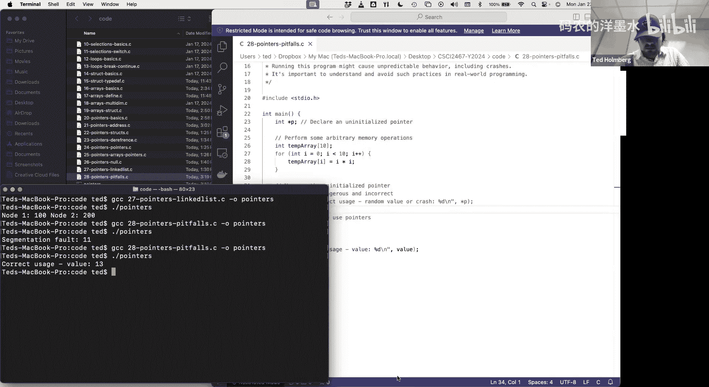

# C语言系统编程：03：控制结构、复杂类型与指针


在本节课中，我们将继续学习C语言，将Java中的知识映射到C语言上。我们将探讨控制结构、复杂数据类型（如结构体和数组）以及指针的概念。完成本次课程后，我们将布置第一个实验，让大家进行一些基础的C语言编程。

## 控制结构

上一节我们介绍了运算符，本节中我们来看看如何组织语句的执行流程，即控制结构。

为了将多个语句组合在一起执行，我们使用花括号，这与Java非常相似。花括号可以创建一个代码块，其中的变量共享作用域。无论是选择语句还是循环语句，默认情况下，如果不使用花括号，则只影响紧随其后的一条语句。花括号的价值在于，它允许你将多个语句组合成一个原子实体，编译器会将其作为一个整体执行。

花括号的打开和关闭方式与Java完全相同。

### 选择语句

选择语句是单选择、双选择和多选择语句的总称，你可能更熟悉它们的名字：`if`、`if-else` 或嵌套的 `if` 语句。

以下是选择语句的示例代码：

```c
#include <stdio.h>

int main() {
    int number = 15;

    // 单选择语句
    if (number > 10) {
        printf("Number is greater than 10\n");
    }

    // 双选择语句
    if (number > 10) {
        printf("Number is greater than 10\n");
    } else {
        printf("Number is not greater than 10\n");
    }

    // 多选择语句（嵌套if-else）
    if (number < 10) {
        printf("Number is less than 10\n");
    } else if (number > 10 && number < 20) {
        printf("Number is between 10 and 20\n");
    } else {
        printf("Number is greater than or equal to 20\n");
    }

    return 0;
}
```

单选择语句是一个决策点，决定是否执行某个代码块或语句。双选择语句保证会得到两种结果之一：如果条件为真，则执行 `if` 后的代码；如果为假，则执行 `else` 后的代码。多选择语句（嵌套 `if-else`）允许在 `else` 后附加另一个 `if`，直到最后的 `else` 作为默认情况。

### Switch语句

除了嵌套的多选择语句，还可以使用 `switch` 控制结构来表示多选择。`switch` 语句基于相等性检查，而嵌套选择语句可以检查相等性和关系属性（如大于或小于）。`switch` 只适用于检查相等性的情况。

`switch` 语句使用标签（`case`）进行跳转，类似于汇编语言中的标签跳转。因此，需要使用 `break` 来跳出 `switch` 块，否则会继续执行后续的代码块。

以下是 `switch` 语句的示例：

```c
#include <stdio.h>

int main() {
    int number = 3;

    switch (number) {
        case 1:
            printf("Number is one\n");
            break;
        case 2:
            printf("Number is two\n");
            break;
        case 3:
            printf("Number is three\n");
            break;
        default:
            printf("Number is not one, two, or three\n");
            break;
    }

    // 等效的嵌套if-else
    if (number == 1) {
        printf("Number is one\n");
    } else if (number == 2) {
        printf("Number is two\n");
    } else if (number == 3) {
        printf("Number is three\n");
    } else {
        printf("Number is not one, two, or three\n");
    }

    return 0;
}
```

通常，如果可能，更推荐使用嵌套的多选择语句，这是更好的软件工程实践。有些语言（如Python）甚至不支持 `switch` 语句。

### 循环语句

循环语句在C语言中看起来几乎与Java完全相同。Java从C语言继承了许多语法。

以下是循环语句的示例：

```c
#include <stdio.h>

int main() {
    // for循环
    for (int i = 1; i <= 5; i++) {
        printf("For loop: %d\n", i);
    }

    // while循环
    int j = 1;
    while (j <= 5) {
        printf("While loop: %d\n", j);
        j++;
    }

    // do-while循环
    int k = 6;
    do {
        printf("Do-while loop: %d\n", k);
        k++;
    } while (k <= 5);

    return 0;
}
```

`for` 循环的特点是所有管理循环逻辑的数据（控制变量的初始化、条件判断和更新）都放在 `for` 语句的括号内。`while` 循环在条件为真时重复执行代码块。`do-while` 循环保证至少执行一次循环体，即使条件初始为假。

通常，如果事先知道需要循环的次数，使用 `for` 循环；如果不知道，使用 `while` 循环。`do-while` 循环适用于需要至少执行一次的情况。

### Break和Continue

`break` 和 `continue` 在循环中的行为与Java完全相同。`break` 用于跳出循环，`continue` 用于跳过当前迭代的剩余语句，直接进入下一次迭代。

以下是 `break` 和 `continue` 的示例：

```c
#include <stdio.h>

int main() {
    // break示例
    int i;
    for (i = 1; i <= 10; i++) {
        if (i == 5) {
            printf("Breaking at %d\n", i);
            break;
        }
    }
    printf("Loop ended at i = %d\n", i);

    // continue示例
    for (int j = 1; j <= 10; j++) {
        if (j % 2 == 0) {
            continue; // 跳过偶数
        }
        printf("Odd number: %d\n", j);
    }

    return 0;
}
```

在第一个循环中，当 `i` 等于5时，使用 `break` 跳出循环。在第二个循环中，当 `j` 是偶数时，使用 `continue` 跳过打印语句，只打印奇数。

## 复杂数据类型

我们已经讨论了原始数据类型（如整数、短整型、长整型、浮点数、双精度浮点数和字符）。现在，让我们看看如何创建更类似于Java中对象和数组的数据结构。

### 结构体

C语言没有对象，但有一种称为结构体（`struct`）的原型，它是对象的前身。结构体允许你创建包含不同类型数据的集合。

以下是结构体的基本示例：

```c
#include <stdio.h>

// 定义一个结构体
struct fraction {
    int numerator;
    int denominator;
};

// 辅助函数：打印分数
void printFraction(struct fraction f) {
    printf("Fraction: %d/%d\n", f.numerator, f.denominator);
}

int main() {
    // 声明结构体变量
    struct fraction f1, f2;

    // 打印未初始化的值（危险！）
    printf("Before initialization:\n");
    printFraction(f1);

    // 设置结构体字段
    f1.numerator = 22;
    f1.denominator = 7;
    printf("After initialization:\n");
    printFraction(f1);

    // 打印未初始化的f2
    printf("Before copying:\n");
    printFraction(f2);

    // 使用赋值运算符复制结构体
    f2 = f1;
    printf("After copying:\n");
    printFraction(f2);

    return 0;
}
```

结构体使用 `struct` 关键字定义，后跟结构体名称和花括号内的字段。你可以像访问对象属性一样，使用点运算符（`.`）访问结构体的字段。C语言中，结构体赋值是字段的逐位复制。

### Typedef

每次引用结构体时都需要写 `struct fraction`，为了简化，可以使用 `typedef` 为结构体创建别名。

以下是使用 `typedef` 的示例：

```c
#include <stdio.h>

// 使用typedef为结构体创建别名
typedef struct {
    int numerator;
    int denominator;
} Fraction;

// 辅助函数：打印分数
void printFraction(Fraction f) {
    printf("Fraction: %d/%d\n", f.numerator, f.denominator);
}

int main() {
    // 使用别名声明变量
    Fraction f1 = {22, 7};
    printFraction(f1);

    return 0;
}
```

`typedef` 允许你使用更简洁的名称（如 `Fraction`）来代替 `struct fraction`。这是C语言中最接近对象的方式。

结构体允许混合不同类型的数据，而数组则要求所有元素类型相同。

### 数组

数组在C语言中与Java类似，但有一个重要区别：C语言中的数组不知道自己的长度，而Java数组知道。因此，在C语言中，你需要自己跟踪数组的大小。

以下是数组的基本示例：

```c
#include <stdio.h>

// 辅助函数：打印整数数组
void printIntArray(int arr[], int size) {
    for (int i = 0; i < size; i++) {
        printf("%d ", arr[i]);
    }
    printf("\n");
}

int main() {
    // 声明数组
    int numbers[10];

    // 打印未初始化的数组（危险！）
    printf("Initial state (uninitialized):\n");
    printIntArray(numbers, 10);

    // 设置数组值
    for (int i = 0; i < 10; i++) {
        numbers[i] = i * 2;
    }
    printf("After initialization:\n");
    printIntArray(numbers, 10);

    // 字符数组（字符串）
    char greeting[] = "Hello, World!";
    printf("String: %s\n", greeting);

    // 使用数组字面量初始化
    int primes[] = {2, 3, 5, 7, 11};
    printf("Primes: ");
    printIntArray(primes, 5);

    // 危险操作：访问越界索引
    printf("Dangerous access (index 15): %d\n", numbers[15]);

    return 0;
}
```

数组使用方括号（`[]`）声明和索引。字符数组可以用字符串字面量初始化，字符串以空字符（`\0`）结尾。数组字面量使用花括号初始化。C语言不检查数组越界，访问无效索引可能导致未定义行为。

### 预处理器指令#define

为了安全地使用数组大小，可以使用预处理器指令 `#define` 定义常量。

以下是使用 `#define` 的示例：

```c
#include <stdio.h>

#define ARRAY_SIZE 10

void printIntArray(int arr[], int size) {
    for (int i = 0; i < size; i++) {
        printf("%d ", arr[i]);
    }
    printf("\n");
}

int main() {
    int numbers[ARRAY_SIZE];

    for (int i = 0; i < ARRAY_SIZE; i++) {
        numbers[i] = i * i;
    }

    printIntArray(numbers, ARRAY_SIZE);

    return 0;
}
```

`#define` 创建一个标签（如 `ARRAY_SIZE`），在编译时替换为对应的数值。这允许你使用常量值，便于修改且不可变。

### 多维数组

与Java类似，C语言支持多维数组。多维数组实际上是数组的数组。

以下是一个二维数组的示例：

```c
#include <stdio.h>

#define SIZE 10

int main() {
    int board[SIZE][SIZE];

    // 初始化二维数组
    for (int i = 0; i < SIZE; i++) {
        for (int j = 0; j < SIZE; j++) {
            board[i][j] = i * SIZE + j;
        }
    }

    // 高效访问（行优先）
    printf("Row-major order (efficient):\n");
    for (int i = 0; i < SIZE; i++) {
        for (int j = 0; j < SIZE; j++) {
            printf("%2d ", board[i][j]);
        }
        printf("\n");
    }

    // 低效访问（列优先）
    printf("\nColumn-major order (inefficient):\n");
    for (int j = 0; j < SIZE; j++) {
        for (int i = 0; i < SIZE; i++) {
            printf("%2d ", board[i][j]);
        }
        printf("\n");
    }

    return 0;
}
```

多维数组在内存中按行优先顺序连续存储。高效访问应遵循行优先顺序，以减少内存跳转。

### 结构体数组

可以创建结构体数组，类似于Java中的对象数组。

以下是结构体数组的示例：

```c
#include <stdio.h>

#define ARRAY_SIZE 1000

typedef struct {
    int numerator;
    int denominator;
} Fraction;

void printFraction(Fraction f) {
    printf("%d/%d ", f.numerator, f.denominator);
}

int main() {
    Fraction numbers[ARRAY_SIZE];

    // 设置前三个元素
    numbers[0].numerator = 1;
    numbers[0].denominator = 2;

    numbers[1].numerator = 3;
    numbers[1].denominator = 4;

    numbers[2].numerator = 5;
    numbers[2].denominator = 6;

    // 打印前三个元素
    for (int i = 0; i < 3; i++) {
        printFraction(numbers[i]);
    }
    printf("\n");

    // 危险操作：访问越界索引
    // printf("Dangerous: ");
    // printFraction(numbers[ARRAY_SIZE]); // 可能导致崩溃

    return 0;
}
```

结构体数组允许你存储多个结构体实例。与普通数组一样，需要小心越界访问。

## 指针

指针是C语言的核心概念之一。它们允许你直接操作内存地址，实现按引用传递。

### 指针基础

指针是存储内存地址的变量。使用 `&` 运算符获取变量的地址，使用 `*` 运算符声明指针或解引用指针。

以下是指针的基本示例：

```c
#include <stdio.h>

int main() {
    int a = 5;
    int *pointer; // 声明指向整数的指针

    pointer = &a; // 将a的地址赋值给指针

    printf("Value of a: %d\n", a);
    printf("Address of a: %p\n", (void*)&a);
    printf("Value of pointer: %p\n", (void*)pointer);
    printf("Dereferenced pointer: %d\n", *pointer);

    return 0;
}
```

指针类型告诉系统该地址存储的数据类型所占用的字节数。解引用指针可以访问或修改该内存地址存储的值。

### 通过指针修改变量

可以通过指针修改变量的值。

以下是通过指针修改变量的示例：

```c
#include <stdio.h>

int main() {
    int value = 5;
    int *ptr = &value;

    printf("Original value: %d\n", value);

    // 通过指针修改值
    *ptr = 10;

    printf("Modified value: %d\n", value);

    return 0;
}
```

通过解引用指针并赋值，可以修改原始变量的值。

### 结构体指针

可以使用指针指向结构体，并通过箭头运算符（`->`）访问结构体字段。

以下是结构体指针的示例：

```c
#include <stdio.h>

typedef struct {
    int numerator;
    int denominator;
} Fraction;

void printFraction(Fraction *f) {
    printf("Fraction: %d/%d\n", f->numerator, f->denominator);
}

int main() {
    Fraction f1 = {22, 7};
    Fraction *ptr = &f1;

    printFraction(ptr);

    return 0;
}
```

当函数参数是指向结构体的指针时，使用箭头运算符访问字段。如果参数是结构体本身，则使用点运算符。

### 指针的指针

指针可以指向其他指针，形成多级间接引用。

以下是指针的指针的示例：

```c
#include <stdio.h>

int main() {
    int value = 5;
    int *ptr = &value;
    int **ptrToPtr = &ptr;

    printf("Value: %d\n", value);
    printf("Value via pointer: %d\n", *ptr);
    printf("Value via pointer to pointer: %d\n", **ptrToPtr);

    return 0;
}
```

多级指针类似于多维数组，允许你通过多个间接层访问数据。

### 空指针

空指针（`NULL`）表示指针不指向任何内存地址。在C语言中，`NULL` 通常定义为0。

以下是空指针的示例：

```c
#include <stdio.h>

int main() {
    int *ptr = NULL;

    if (ptr == NULL) {
        printf("Pointer is NULL\n");
    }

    if (ptr == 0) {
        printf("Pointer is also equal to 0\n");
    }

    return 0;
}
```

空指针用于表示指针未初始化或指向无效地址。

### 链表示例

指针常用于构建动态数据结构，如链表。

以下是一个简单链表的示例：

```c
#include <stdio.h>
#include <stdlib.h>

typedef struct Node {
    int data;
    struct Node *next;
} Node;

void printList(Node *n) {
    while (n != NULL) {
        printf("Node data: %d\n", n->data);
        n = n->next;
    }
}

int main() {
    Node *head = NULL;
    Node *second = NULL;
    Node *third = NULL;

    // 分配内存
    head = (Node*)malloc(sizeof(Node));
    second = (Node*)malloc(sizeof(Node));
    third = (Node*)malloc(sizeof(Node));

    // 赋值并链接节点
    head->data = 100;
    head->next = second;

    second->data = 200;
    second->next = third;

    third->data = 300;
    third->next = NULL;

    // 打印链表
    printList(head);

    // 释放内存
    free(head);
    free(second);
    free(third);

    return 0;
}
```

链表节点包含数据和一个指向下一个节点的指针。通过指针链接节点，可以动态创建和遍历链表。

### 指针的陷阱

指针使用不当可能导致程序崩溃或未定义行为。最常见的陷阱之一是使用未初始化的指针。

以下是指针陷阱的示例：

```c
#include <stdio.h>

int main() {
    int *ptr; // 未初始化的指针

    // 危险操作：解引用未初始化的指针
    // *ptr = 13; // 可能导致段错误

    // 正确做法：先初始化指针
    int value = 13;
    ptr = &value;
    *ptr = 42;

    printf("Value: %d\n", value);

    return 0;
}
```

未初始化的指针指向随机内存地址，解引用它可能导致段错误。始终确保指针指向有效的内存地址。

## 总结



本节课中我们一起学习了C语言的控制结构、复杂数据类型和指针。我们探讨了选择语句、循环语句、结构体、数组以及指针的基本概念和用法。指针是C语言强大但也危险的特征，它提供了直接操作内存的能力，但需要谨慎使用以避免错误。掌握这些概念是进行系统编程的基础。