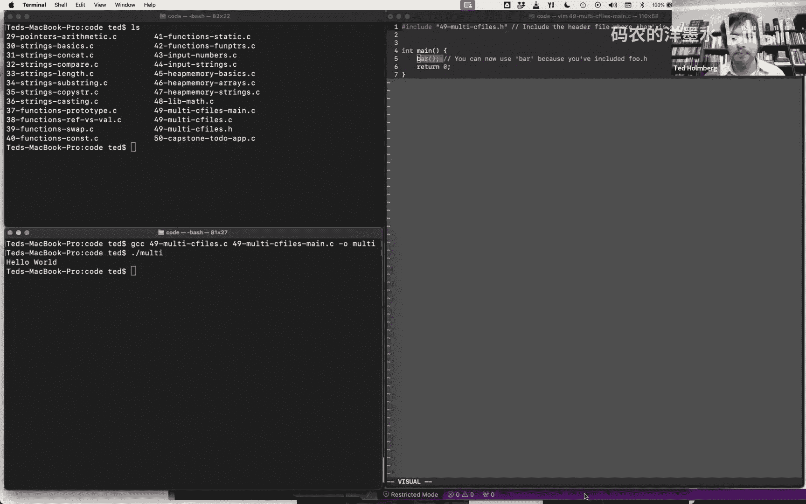

# 【全集】加州理工学院 C语言系统编程 中英字幕 p04 Lecture 4 - 字符串、函数、输入与动态内存分配 -BV1bUzWBLEiC_p4-

Okay， so for today's lecture， Im going to pick up where we last left off on our crash course of C。

And kind of complete out some of the readings you might have in the essential CPpF that you have and kind of provide some tangible real example code so that as you read more death about some of the concepts that drive to C and some of the pitfalls and some of the ways that you can go ahead and implement your code。

 you can actually see how to do that in person or in practice and so I'm going to pivot a little bit I've been using a yes code and I've been using Finder previously to be able to go ahead and open up my files and to be able to view my source code folders but this is a systems programming class so why don't I use my terminal to be able to illustrate that it's fully equipped with all of the applications that I need in order to accomplish my task so for instance for today's lecture。

I'll be using Vim for viewing My source code files。

 I'll be using the LS application to be able to inspect over here all of my files that I want to go through and of course we've already been using the command line to go ahead and use the GCC compiler。

 so I'm going to use three different command utilities or shell utilities to be able to do everything I need to do without having to use really a Windows application。

Okay。So I want to pick up where with this concept of pointers and I want to bind our concept with pointers to that of arrays so that's where I want to pick up on today's lecture and then we'll move on and talk more about some strings functions we'll take a look at how to get input into our C code and then finally we're going to look at how we can have a heap of memory where we can dynamically allocate memory for ourselves and why that's important we look a little bit at the standard libraries and then at the tail end of today's lecture I also want to show how we can separate our files across multiple systems so let's start by looking at this concept of how pointers and arrays are fundamentally very similar we can in fact use a pointer to iterate through a set of elements much like how we might use an array let me open up our source code going to do that using them so Vim is a built in code edit。

Much like nanono or emax and so I have preconfigured my vim to give me a little bit of syntax highlighting so here we're going to go to 29 pointers arithmetic and open this up and here we can see my source code and it's beautifully displayed in all sorts of colors the way you'd expect it to in any kind of code editor。

Okay。So inside of here you can see i'm going to include my standard input output because we're going to print things to our console I have my main function inside my main function really the driver here is to tie the concept of arrays to that of pointers so the first thing i'm going to do is i'm going to create an array literal and i'm going to save that into this array that holds five elements i'm going to store that into this integer array then what i'm going to do is。

R is effectively a pointer to an array。 It's a pointer to a contiguous block of memory in our source code。

 And so we could think of R as being at index 0。 So in fact， when I grab R I can。😡，Also assign it。

As a integer pointer where we're pointing at the very first element so effectively this pointer is serving the same role as what our array is doing for us they are both references to memory to a block of memory effectively and so to prove this point what we're going to do is we're going to iterate through both of them so here I'm going to create a for loop。

And then I'm going to use the box notation for each index values so starting at index zero and so I get to index fours all the way into the length of my array。

 I will index in I will grab the element and then I'm going to display that to the screen where I will show what the index value is and what is the element at that index then to illustrate that we can do the exact same concept inside of utilizing pointers we're going to produce another four loop that looks exactly the same and here we're going to dereference the pointer now if we just dereference the pointer itself that's going to be at index0 so notice I can do what's called pointer arithmetic and so arithmetic with pointers since it's a memory address works slightly different than the way that it works with integer numbers with integers whatever this value is。

Whatever this value is it adds to the other integer value right that's that's how addition works but for pointer arithmetic it's going to act as the indexer term and so it takes into account the byte size of what it's pointing to so for instance since integers or four bytes if we do pointer arithmetic starting at the where the pointer is currently pointing at and we add say for instance well zero then it's going to return back the same memory address if we add one then it's going to advance our pointer by four。

😡，Btes of space because an integer encodes four bytes of it。

 so it's going to advance to the next legal addressable position that's not consumed by this particular data type。

 So in fact， what's happening here is each time we add index index one it's moving our memory address by four bytes and then four bytes again the four bytes again。

 which is where the starting value of the second value element would be in the third element and the fourth element。

 So here we're using the indexer in a similar way。 will offset that。

Address which is the address a index0 and then we're going to use the star operator to dereence that and once I get a have dereference that I'll be able to grab that element and then I can print that out the same that I did before。

Now once I've done that， I want to illustrate that I not only can read from arrays using either pointer arithmetic or pointers as a well as as。

 but I can also white into an array so using box notation。

 you can see here I can just index into element well this would be element three right but index two。

And assign that the value of 60， or I can dereference。😡。

The value at and access the value at the pointer and then use the pointer arithmetic to offset that by 3。

 right so starting at  zero。 this would actually be the fourth element0，1，2，3。

 And then I will go ahead and save or I'll overwrite the value there to 80。

 So now when we go and reprint out our array And so while I'll iterate an index through each array using the box notation。

 we should see one of the values will be 60， the third value in there should be 60 and the fourth value should be 80 after we do these mutations。

 let me use the terminal now to go ahead and。Actually compile our code so we can see this in practice。

 so let's call this pointers。We will run that okay now let's run this and we can see here inside my array notation I am indexing and I can see yep I'm accessing my values  10 through 50 which remember that is from my array literal that I had initialized then I can use the pointer notation to access those same set of elements and then finally you could see that the third element。

 the one at index2 has been overridden to 60 and the fourth element。

 the one at index 3 has been overwrittendden to 80 so I just wanted to go ahead and ensure that everyone had a strong understanding that we could do a one to one mapping with our arrays and our pointers they can do similar behaviors for us and the big difference here is notationally。

Box notation versus this star notation that we use。Okay。

 excellent now to exit out of my source code I'm going to in order for using Vm， I can hit the colon。

 which allows me to put in an instruction to the editor itself， I want to do colon Q。

 which is the instruction to quit out。And then I will hit it。

Enter and then to bring me back to my terminal and we will。Excellent， okay， so。

The next thing I want to cover is I want to go more in depth with strings strings are an interesting thing let me open this up strings are interesting as they're not they're not built into to see their character pointers so。

There's a lot of basic things we want to learn how to do with strings and we have to learn how to use the tools that are available to us so one of the advantages that Java has is it has a lot of built in functionality for you with strings we're going to see if we do have options to access some standard library calls so that we can get more functionality with strings it is such a fundamental concept for computing in general so let's take a look at some of the basics related to strings here I have my let me clear out this other tab here。

Okay， so here I have my main function and instead my main function I'm going to show you two different ways that we can go ahead and create and store a string one of these is going to be using the box notation so as in a character array and so recall when create a character array we should reserve some amount of space that our string can consume in memory and the alternate approach is we create a character pointer and a character pointer。

Can just be assigned this string literal。 And of course。

 you don't define a block size for a pointer but pointers can be really they could be dangerous in the fact that they allow for overflow。

 So in this instance when you're creating this memory address it can just overwrite whatever is going to be in that block So it's preferable to create a block size and reserve that for your strings over just having like an arbitrary size since all of this since it's not actually reserved for for your text and then you can overwrite important values because C allows you to do that very dangerous language as we know Okay so once we have set these string variables。

 we can go ahead and print them and we print them very so much of the way we might do that in Java。

Okay， now if we want to overwrite strings if we're using the array notation。

 I can go ahead and do it very similar to any other imputation inside of a array so I can use an index value so I can access the first character at index zero and change it to the character of F and notice I'm using character notation there it's a single quotes and then index1 it would be O at index and the important thing is when you're done。

 you have to alert the system that the string is terminated using an null termminator character and an nu termminator character is the escape。

Us code and then a zero value。Alternatively， if we're using the pointer。

 we can just go ahead and reassign to a whole another string lital right。

 we're just binding some new value into memory of that memory address。Of course。

 this is dangerous because it could potentially overwrite something that overwrite something behind it because of how much larger it is。

 but you could see how we can at least access this now let's actually run this so I'm going to do GCC and so first we will compile this is our resource code 30 and so let's call this now strings。

Oops， oh oh， here we go。Clear that， okay， let's actually run our strings。And here we can see。

Our string binki our string hello world we have our food and then finally Ted was here and left this long message excellent Okay。

 so that's the basics for strings。 Let me exit out of here and let's look at some more nuanced things related to strings so I'm going to open up。

Concabdnation， which is a very common thing you might want to do。

With two strings well so the plus operator you can't use by default to concatenate。

 we actually have to now include our string。Library or our string header file which will include the string functions that will allow us to do some interesting things with strings and so we're going to start exploring that so here since it's part of the standard library I can just include it using the angle bracket notation inside my main function i'm just going to create a string that is hello。

I'll create another string that is world。And of course， since this is a string literal。

 notice that it is optional to go ahead and define the block size， but then it reserves a block size。

 that is the size of the string literal and not necessarily what the full size of the string is so if your strings designed to be overridden so that it can have more than a set amount of characters then you want to define a block size here since we're going to use concatednation。

 we don't define a block size because it's only going to be used to concatednate onto string block。

So then i'm going to do string cat and so when I do string cat it's going to take the second string and it's going to concatenate it to the first string and so it's going to actually mutate the state of the first string the left parameter So when I print this out it's actually going to print hello world and we can actually see this let's actually go ahead and compile our code and see this in practice So here this is。

31。And let's call this also strings there we go and there we go And so we could see the output is going to be hello world exactly as we would expect now to exit out my vim colon Q。

Os。you， Okay， perfect now let's move on to。The next concept related to strings。

 which is going to be how we can do string comparisons so again。

 if we want to compare strings for equality we can't use the we。Excuse me。

 we can't use the double equal。So what we're going to do is we're going to import the string header file that's going to give us many functions related to strings here I'm going to create two strings to evaluate hellello and world STR1 an STR2 then I'm going to go ahead and call STR CMP short for string compare I'm going to pass it my two strings that I want to compare and it's going to give me either a zero for false or a non zero value for true so I can go ahead and then do a Boolean expression if the result is equal to zero then we can say the strings are equal otherwise we could say it's I'm sorry。

It's going to tell us the amount of difference between these two strings。

 so if the difference between the strings is zero。😡，That means they're the same。

And so here we will print out strings are equal if there is any difference。

 so if it's a non zero value， that means it actually returns like false value and so then we know that these strings are ny。

So yes that's a that that's not one thing you should be mindful of string compares is it's checking the difference between the two strings and that's what it's going to be reporting back as a numerical value so let's actually go ahead and test this so GCC and so here let us do what is this this is up 32。

Perfect dash O， and then it's called the strings。And then what we can do here is just fun strings。

And here we see the strings are not equal， pretty obvious。Okay。

 I'll clear out my terminal there and let's close out of here。Okay。

 so next thing I want to look at with strings going to be my source code 33 file it's going to be the length of the string。

 so often is the time you want to know how long how many characters is a string so again we can lean into this string library。

Set of functions that we have STR lens short for string length we can pass a string into and it's going to return back an enterteger value that represents the length of that string so let's just do a quick test at this G C this is 33。

And let's call this application strings and let's run our strings。Perfect。

 and we could see the length of hello world is。And then it gives us our one value right here。

Excellent。So you can see many of the very common things that we'd want to do with strings。

We have the ability to do through our standard library halls and this is illusium。First of all。

 how to use strings in a very。In a very powerful way。

 but another why the standard library is such an important thing for you to look over for any kinds of tasks that are already kind of well defined and provided for you to make your job as a developer that much easier Okay another very common thing that you might want to do with strings that's given to us in this strings library is going to be the ability to get a substring。

So for instance， here we have our string hello world， we can do the。STR， STR， the string string。

Which will give us the substring。呃。All right here it's going to see if it finds that substr。

 see that substring is contained within our larger string。

 so we're going to provide as the first parameter， the string we want to evaluate and as the second parameter we're going to provide the string we want to see is a member of our our main string so is this a substr of the core string。

 the main string and then so if this returns back a null value then did not find a substr。

And if it returns in on nu value， then it did， and so what it will be returned is it going to be。

Well， let's see here it can。Let's clear this。😔，Let's run our code， JCC。34。

And let's call this again strings。Here。😔，We can see right there that what it's going to return is going to be in fact the substr that it was able to identify and it's important to note that this substring that it's identifying is a character pointed right so it's actually pointing to that location inside the string where it identified。

Okay， let's go ahead and。But on there， let's move on to the next source code example。

So inside this source code example， I am going to see how can we copy a string？

So just kind of walking through this code。You can see that I have。

 I'm going to create a source string。With the string literal hello save it to source I'm going to create a declare a character array。

 both of these are character arrays I'm going to create another character array called destination or dust that has a block size of 100。

Character size of 100， I can call string copy STR CPY， I give it as my first argument， a destination。

Which is the thing I want to copy too。And then as a second argument， the source。

 the thing I'm copying from。And then。What this should do is my destination should now have a copy of what was inside of my source string so if I print that out we should see that this should now say hello let's actually test this out to make sure it works so let's do 35。

Strings dash copy string， let's go to output， what you call our application strings and the here we go and we could see in fact we had copied the string hell up。

Okay， let's go ahead and exit out of here， let quit， call them quit。Okay。

 the next thing I want to do then is let's go and look at our source code our example 36 where we'll look at strings similar。

 but for casting operations often is the case actually when we get input from the user right from the keyboard it's actually just a collection of characters and many times we are going to want to use this collection of characters in a meaningful way such as to translate them or cast them into numerical representations either as integers or floats or whatnot and so here we can see using now notice here we're going to use the standard library Sd lib when we include on here。

 we're going to use that in order to be able to translate between our our set of characters into into our integers or floating point values so that's how we're going to do our casting operations so let's see how we can do this the first thing we're going to do is we're going to create a character array。

That's going to be a string of。Of well， it's a string of numbers， one， two， three， but characters。

And then here we're gonna have a character array that will be a string that kind of represents a floating point value。

 but it's a string， So now the next thing we want to do is we want to translate our string cast our string into an integer value you can do that with A2 I so it's effectively ASI to integer and then we can pass it our integer string and then it's going to return back to us it's going to try to parseide into an integer value and then I could also do a to f that's going to be ASI to float I can pass it that string that has a float value and then it's going to return back to me a double。

Float value。And so here I can then print these up and notice when I print these up I'll be able to actually use the percent D to print an integer value in the percent F to print a floating point value I'm not actually printing the strings the percent S Okay let's actually evaluate this let's actually run this and see what the output looks like so this is going to be 36 dash strings cassing and i'm going to call my application strings that's。

Execute that so that compiles so now let's execute it。And we can see yep。

 my energyteger value is  one23， and my floating point value is 123。45。Okay。

 so let me clear out here。And let me go back over here。

Okay now the next thing I'm going to do is we're going to move on from looking at strings and actually examine a little bit deeper the concept of functions。

So source code example 37 we'll look in particular at some function prototypes。

 so the function prototype is okay。Going to come before our main function so anytime you want to call a function。

You should have the prototype defined before it's invokedctor。Oh and so。A prototype can also be。

It definition as well。I want to articulate this and I don't have to put a prototype here if I were to define the function where the prototype is currently at so this is the prototype the prototype。

😡，Effectively in Java looks like what a like abstract method might look like effectivelyively it has a return type。

 it has the function name and it has the set of parameters and this alerts effectively to see compiler that when it sees this function call that in order for it to be valid and legal it requires this inputs and it will return this output now provided the compiler has this information now we know when we go to compile the main function。

 whether that function is used properly or not so that we can go ahead and compile that so notice a main function。

 we haven't defined this yet， we've simply declared it the definition of it is after our main function。

Where I go ahead and actually give that function a body so inside my main function I'm just going to go ahead and create two variables A and a B I'm going to create and I'm going to set those with the values respectfully at five and 10 I'm going to declare a value for some and then what I'm going to do is I'm going to invoke add which I have the prototype here。

And the definition here underneath our main function。

 so we can see just looking at the definition of our main function。

 it's going to take those two parameters on one and number two。

 it's going to add them together and it's going to return so here I'm going to invokell call that add function I'm going to pass up my two parameters it's going to return back to me a value and then I'm going to print the result of that value that sum。

And so again， the big takeaway here is we can go ahead and。

Declare functions before defining them at the top of our code， then we can actually use them。😡。

Inside of something like the main function and then underneath them we can go underneath and actually create the definitions for them Now as I stated earlier。

 I could create the definitions here and then I would need the prototype but the idea behind the prototypes is we're going to see in this lecture a little bit in a couple of future examples is that we want to actually put all of our prototypes in a separate file called header file which actually has the extension do H which you might notice is what we constantly include and import into our source code files so by convention that's where we typically want to put all of our all of our prototypes and the prototypes。

In a way， that's our API to our other end users， it's what's publicly available from our source code files so other source code files can go ahead and use。

And so we'll take a look at some other examples that kind of motivate how functions use in a moment。

 let's actually test this though we haven't done that yet so let's go to GCC and then this is example 37 and inside of7 37 I'm going to go ahead and let's do this。

Let's call this funk。In terms of our our app name and so let's run our funk and there we can see it runs as we probably expected should。

Okay， now let's move on to example 38。So in example 38。

 I really want to compare the concept of passing by reference versus passing by value since we do have this concept of memory addresses as we talked about earlier and we have accessibility from those using pointers and then also the star operator and also the amperserson operator。

 the address operator let's see how this actually has some consequence how we can make use of this in terms of implement in our functions so here let's take a look at these two function prototypes that we're looking at。

 the first one has a return type of void and that's because we're going to add by reference so we don't have to return something we're going to mutate the state of the value that gets passed to us so notice here the first parameter is going to be a pointer to an integer so we're going give it the address of a variable some integer variable that we already have and then we're going actually pass it a value so this isn't a point of this is a value of some other value。

And then we're going to go ahead and compare and contrast that to this other function。

 the prototype for is here， add by value， notice the two parameters here are both values。

 they're not pointers usually you're actually going to put in numerical values here it' actually going to return back the integer。

Okay， so let's see how we can use these。To produce similar results， but in very different ways。

 I'm going to create a variable inside my main function called original value。

 I'm going to create another value called5， which is what I'm going probably add to my original value here my original value will print out then here I'm going to call my add by reference and this is void So what I'm doing is I'm giving it the address So I'm going to use the ampersand operator to give it the address of my variable of where my variable is a memory original value which where my1 to store at and I'm going to pass the value of other value that's f5 So what we can see。

 let's jump to the source code to see what's going to happen here So coming down here to line 26。

We can say I'm going to use the star operator to dereference the value that's in that memory address and I'm then going to add to it。

 I'm going to use the compounds assignment to add to it and override it with the value of other and so now it's going to mutate the state of 10 to now be 15 inside that same memory address so now anything that had a reference to original value here will now have that changed state。

😡，And now I'm going to actually print original value from the scope of the main function Okay let's look at this again。

 I have my original value I'm going to overwrite it back to 10 so that we can do this again I'm going to print my original value to the display I will then go ahead and then add by value so here I'm actually just passing in the numerical value so this would be 10 and5 and now this is going to return back a value which I can then assign to original value and then go ahead and show original value this way so both these blocks here this one and this one are effectively doing the same thing it's just one is a function that passes by reference and then goes ahead and overwrites the original variable inside of that function the other passes by value and it requires you to do the assignment from what gets returned clearly one can be one and way more dangerous than the other in terms of affecting code in places that you might not expect。

have us actually run this。So this is an example 38 and let's call this funk because we're looking at functions and so let's run our funk app and here we see original value is 10 after our add by reference it's 15 original value is 10 after our modified by value it is 15 just as we've expect。

嗯。Okay。Sorry about that。Little wake up call。Cas you fall asleep。Okay。

 so the next thing I want to look at is going to be example 39。

Which is going to be a basic common use case on why we might want to implement by passing by reference versus passing by value。

being know passing by reference can potentially be dangerous but sometimes it's very necessary so on these very common instances where you need to swap the positions of two things in memory such as like if you're sorting something then we want to do that using the passing by by reference and so here let's just take a look here's an example where I want to do an example also that doesn't use a prototype that does our function definition at the top which means we don't have to include a prototype now I think we have seen this a couple times in our earlier examples too before we introduce functions so let's take a look at this function definition we have our pointer to integer pointers X and Y and so here we will dereference the value at X and hold that actual value in some temporary variable inside of this function then we will take the value from dereferencing y and overwrite that into X then we'll take that value。

Value of。That we are storing a local variable and overwrite the Y value。

So now this allows us to switch the values between two sets of variables or two positions inside of an array if we were using this to sort so suppose here then in my main function I have my variables A and B。

Here I will print out what the values are before I swap them。

 then here I will swap them and since this is looking for memory addresses I'm going to use the Amperssand operator so I give it the address of those variables。

And then I will then print out A and B after swapping and they should in depth in fact be swapped and in fact we will test that so let us go ahead and。

Uilile our code， let's name it something useful， I'm going to stick with funk and let's run our funk code。

There we go and we could see， yeah， before we swap them。

 our values where a is equal to1 and B is equal to2 and after swapping a is equal to 2 and B is equal to one。

So that's one motivation as to why we might want to use。Passing by reference。

 so rent is very common to use。Okay。The next thing I want to discuss is going to be the constant keyload inside of C。

So constant allows us to ensure。That。When we have our source code。

If we're passing the value that it can't be overridden because clearly we can see that's a very dangerous thing that can occur and so if we want to protect against that with still pass by reference。

 we can add here the key word inside of our parameter list constant。

And so this will make a constant integer pointer。And so let's let's let's look at what the expected behavior is going to be here let's look at our function definition。

 so in our function definition here so this was our prototype right so let's go to the definition itself so here we're going to print。

The pointer we're going to dereference the pointer and print the value there and so if I tried then to dereference the pointer and overwrite that value。

 this would actually cause a compile error because this was given to us as a constant so prevents us from being able to overwride it and so here inside of our main function I'm going to create a variable a number 10 I'm going to give it the memory address right'm going to use the ampersand operator to give the address of that that variable。

And then i'm going to send that to that function and this will work and then what we're going to do is we're going to uncomment this out and see how it breaks forward so let's first run it with everything commented out and ensure our code works the way we expected to so。

Let'sDo this is funk。 yeah， some funk。So if let's run that and that runs per normal Okay。

 so now I want to make a change to my source code file if I want to make a change to my source code file inside of them。

 I have to go into insert mode If I want to do insert mode， I will hit I。And so now I allows me。

 you can see I now have a cursor。And actually， if you look at the very bottom line my screen it now shows me what mode i'm in which is in certain mode。

 so now I can go ahead and toggle to the line that I want to modify and then just modify it so I will I will remove those two slashes so now this is not a commented line now when I want to exit。

Insert mode and then get back into like my main mode of them I would hit the escape and now notice in the bottom it no longer says insert and then I would do colon and I don't want to just do Q here because that just quits me I want to actually write this change to the file so I will do W。

Which means write， and then I can follow that with Q so we'll write the change and then quit。

And so now that allows me to come out here， and so let us recompile our code。

And so now when we try to recompile， we see， oh， I can't do that。

Because that's a read only variable and it's not assignable。

And so that's if we want to kind of include guaranteed protections when we use pass by value。

 I mean pass by reference， that's how we can do that。Okay。

 let us actually go back in there and recom that out So the next time when I save this with you。

 it'll be fine。 So again， I'll enter insert mode by hitting I。 I'll add back to these。

slash slash to comment out my code now I will exit out of insert mode using escape I will use colon WQ to write and quit。

Perfect， okay， now let's go to them。Let's go to our example 41。

 which is going to be static functions。So and C a static function has the file scope which means it can only be called from the same source code file so whenever we declare a function as static it's a way for us to implement with encapsulation that's our mechanism and to encapsulate bin which provides a form of information hiding at the file level so any static functions can only be called from this source code file。

 anything that's nonstatic on the other hand can be externally linked to some other source code file which means that we can hashtag include them from another file and we'll look at how to do that later on。

 so files or I'm sorry functions that are designed to be publicly available to that other source code files can access them we would just leave them as non-static files so if you have a helper function or via functions that are just specific to this application to this source code file and you don't want them to be published。

Play available， then you should define those as static。And just to highlight that here。

 let's take a look at the source code file， I have this one prototype， it's just a return type void。

 it's called nonst function here I have a static function declaration and definition where I'm going to just print static function inside static function and then here this is my nonst function definition。

Where it's just going to print inside non static function。And then here inside of my main function。

 we can see all we're going to do inside my main function is I'm going to invoke my non static function。

 I'm going need to invoke my static function， which is going to print this thing say let's take a look at it just so we can see first put our terminal。

Okay， so let's just see that we could do what is that that' 41 and then let's call this funk we're still inside of functions and then there we go a perfect calling non staticatic function inside a non staticatic function calling static function now we're inside a stack function。

But really the big takeaway for those is whether you want that function to be available outside the source code file。

 which is going to indicate whether you should declare it a static or not。Okay。

 let's quit out of that， Okay， let's move on to example 42。

And so example 42 is going to be a really interesting example it's one that I included because you are all Java developers and I had a really interesting question this is about function pointers so someone had asked me aboutstructs when we were talking aboutstructs we can go ahead and we can embed。

Data in there very similar to how an object is and then someone's like but can you go ahead and define find a function and I'm like。

And I answered in a way that alluded yes you can， but it's not the same kind of syntax that you might expect inside a Java so the idea is that everything inside of our system like has a memory address including our own source code and so if you think about what a pointer is a pointer is just it points to some location and memory and so a lot of times the things that we have a memory they're either values or the way that we think of them is as a value or as a set of instructions as like as a function but the function itself is inside of memory so that it can be invoked so we can actually create a structure that has a pointer。

To a function and in fact， if you want to know how C plus plus was built on top of C。

 that's exactly that's one of the concepts that made use of that is that you can go ahead and create things very similar to objects that include fields that have properties and also have methods that have functions that relate to those to that particular structure in and of itself using these function pointers。

😡，So let's see how this actually looks in practice The first thing I'm going to do。

 I'm going to create a type def structure called fraction and here let's define what our fraction is。

It's going to have a numerator it's going to have a denominator and both those are going to hold integer values and then notice these are my function pointer declarations so a function pointer declaration kind of merges two different aesthetics if you think about it it kind of looks like a prototype in one regard but it also looks like a pointer in another regard so if you took the concept of a pointer and merged it with a prototype that's effectively how we declare our function pointers so that what that means is in order to have a function pointer we have to provide what is the return type。

We have to define what is the name of the function。

 and now we preface the function name using a star operator to illustrate that we're going to use the memory address of that named function。

And then here we're going to go ahead and have a parameter list that that function uses。

 And so this is what I mean when I say this is kind of like a prototype of sorts because it gives us the return。

 it gives us the name and it gives us the parameter list However it's not a prototype it's a pointer to a function because we're going to propend it with that star operator and so we'll do the same thing here So this is an init function that we're going to declare a pointer for and then we're also going to declare a pointer for a print function it's going to return back also avoid and it's going to have a fraction that passes into it and the actual function name will be print and since this will be a pointer to this function we will again use a star operator to illustrate that this is a function pointer So now let's actually define two function in memory so that these can be pointed to So here I will have a function in it fraction I will declare this and。

Bing it just like a standard function so return type void， it's going to match my parameter less。

And then it's going to have this name。And again， the name that we're using here。This is a pointer。

The name we're using here does not have to match this name right。

 this is the name that we're giving inside of our structure。

Because I'm going to be able to assign that so here I'll actually create a function in a fractionction and this is something that now is inside of memory right this is now something that's well defined and I can access that using that name just like a variable so recall I invoke a function using a set of parentheses that's how I call it but I can access its memory address by just using its name kind of like how I can do that with an array。

So a function's name is very much kind of like a pointer to where that block of code is in memory Okay so now so so we have this implementation what this implementation is doing is it's going to take a pointer to a fraction it'll take a integer value for numerator and in value for denominator and it will dereence it'll access using the arrow operators。

 the field for numerator and denominator and set those let's take a look at our print fraction function here we're going to take in a fraction and make sure it's constants you can't overwrite it because we just what to have read only privileges on it。

 we're going to use those arrow operators to access the numerator and denominator values and we're going to print that out。

Okay， so now the idea is we want to bind this print fraction and this in it fraction to these function pointers in it and print。

So let's go into our main function and see how we can do that I'm going to create two fraction variables。

 F1 and F2 on F1， it's going to have a property in it。

 which is our function pointer and I can just assign to it in it fraction。

And now notice I'm not invoking that function， I'm just giving it the name which is the memory dress to that block of code and so here I can do the same thing to set onto F1 print that print fraction。

Function to the print function on on on our structure and then I'll do the same thing here。

 I'll go ahead and。Do the same thing for F2。 I will bind those functions to my F2 under init print and and。

F2 in it and F2 print。And now what I'm going to do is on F1 and F2 I'm going to invoke the functions on it I'm going to pass the memory address using the Ampersand operator of that actual of itself so if you want to think about what this is that's kind of what this keyword in Java zooing so this is going to be the memory address of this data structure and I'm going to pass the values of one and2 so we can initialize this fraction and I'm going to do the same thing here on F2 this particular fractionstruct I'm going to pass its memory address to that in it function with three and4 and then I'm going to go ahead and tell F1 to print using its own memory address and F2 to print with its own memory address。

Okay， now that we've kind of explained function pointers a little bit。

 hopefully it's not too confusing， let's go ahead and actually test them out。

And here we can see our fraction one will print out as one half and our fraction two will not print out as three quarters exactly as we should expect it to。

Excellent， okay， let's clear this out。And buts。Quit from there， Okay， I want to move on to my next。

Example， so let's move to example 43。And so this will be our input numbers。

So so far we've looked at how to output things into the console。

 but we haven't really examined deeply how can we get user input from the keyboard and get that into our software。

 and so we should take a look at that。So in order to do this， first of all。

 I'm going to go ahead and grab a I'm going to use standard input output clearly for the input operation。

 but for this particular basic code the sample code what we want to do is numbers I don't think I actually need this here actually so the me i'm going to go into insert mode'm I'm going to do here is I'm going to remove。

This need for string because。The first types of inputs I want to examine are going to be。

Let's right that okay， the first set of examples that I want to show off are going to be how do we get numbers from the end user？

So let's take a look at our main function here， we're going to create a variable to hold an in value。

 we're going to hold create a variable to hold a float value， and I'm just going to create a buffer。

That can hold 100 characters。Now I'm going to create a prompt enter integer。

 so I'm going to print F that。 and so if I want to grab。Data from the input stream。

From the system input stream， I can use scan F that's a built in functions。

 So if you wondered where the term scanner came from from Java again it borrows a lot of its terminology from C。

 So scan F and notice with scan f I'm going to go ahead and。I'll give it a reference。😡。

To my end value。And I can when I when I do that， I can also give it a it's a formatted scan so I can give it a formatted string as well。

 So here is going to be an integer value。 So percent D should allow for me to。

To be able to parse that。Okay， and then here。I will go ahead and prompt the user in a floatat again I'll give the formatting instructions the percent f illustrates floating point value and then here by I'm going give the memory address of my variable to hold my floating point value and again the percent D allows it to parse that character and let it know treat this as an integer and it will then bind that to this space and memory that is at the address of in value same thing same concept but with a floating point value here then after we're done you should always go through called get character and just continue to consume whatever is inside of your input stream that is new line characters because that can really dirty and muck things up so this is just a good way of cleaning out your buffer and then we will go ahead and then print these states。

Okay that's as the say。And let's actually this is 43 and let's actually call this inputs because now we're in a new section and let's run our inputs application and there it is enter an integer。

 let's enter one， two， three， four， five。And in our float， 3。14159。Excellent。

 and you can see integer 123。5 and our float is 3。1415 now excellent， that's exactly what we want。

So let me clear this， okay， so that's one way of that's one way that we can go ahead and access numbers。

 right？From our input stream， let's see how we can get strings。

 strings can be actually a little bit more complicated from numbers for a variety of reasons。

 and that's because of how difficult it is to know how we should parse these strings。Okay。

So we're going to look at three different ways to pars a string。

 we're going to look at what seems to would be would appear on the surface to be the obvious way was actually the dangerous way。

That we want to avoid and we'll look at a safer way that's still the dangerous way and still not a great way。

 but we're going to look at it and then we're going to see the way we should do it in the way the safest way and the way that after we examine this。

 this is how you should always go ahead and get strings from the input stream。Okay。

 so the first thing we're going to do here is yeah we're going grab our standard input output clearly because we're doing input operations then we're also going grab our string library of calls as we're going to do some string modifications here inside my main function I'm going to create a character array that can hold a block size of 10 for my string value I'm going create a prompt to the user to say hey enter a short string and I'm going to let them know this is the dangerous way then I'm going to do what look like what we were doing for our floats and for our integer I'm going to call scanf I'm going to give it hey we're looking for a string so the format of what we're going to parse is going to be percent S and then。

Then their string value。And so again， since we're just doing percent S it's only going to parse that single string。

 so keep in mind that empty spaces， new line characters， tab characters， all are delimiters。

 so it'll cut off using this particular methodology so you won't so if I try to put a space in between the word it'll it'll treat the space as a cutoff point as a demar demarcation。

For our strings for tokenization purposes。Okay， so this is dangerous because it doesn't set a limit specified and so that's dangerous because well we know that the array size is only allocating 10 blocks of memory。

 but if I don't control this to make sure the thing that I'm reading into my string value is reserved the 10 things。

 then I can just go past that and it'll override an 11th to 12th or 13th， 100th。

 a0th and all of a sudden you've lost all those values of memory and now it has new values that you did not want。

So it can cause erroneous behavior， that's what makes this very dangerous。

So this is what we want to avoid， right because this allows for what are called buffer overflows of your memory space。

 which can cause you to destroy anything you have in storage。By accident。

And then we're going to do our clear clearer buffer then we're going to look at the safer way。

 the safer way is we're going to do the same thing slightly safer because when we do our scanNF inside of our format statement。

 we could put a number between the percent and the S and that indicates how many characters it will parse before it stops。

And so this will prevent a buffer overflow， but still not incredibly safe。

Still not the way we want to go about it。There's still ways around this and also with this particular formatting you have to know exactly how many things you're actually going to pull this is going the force nine characters regardless。

 but not just that it doesn't support multiple words either with this particular formatting。So again。

 after we do this like safer way， but still not ideal way。

 we will then go ahead and clear out our input stream of any new line characters and then we're going to do the safest way the safest way is there's actually a function inside of our strings there's actually a function inside of of our standard to library called F gets and F gets allows us to pass in this array right the string value where we want to send this to in terms of the data in our application and then we give it the size of。

So we give it a numerical value， so size of as an operator and say that will check the size of string value in terms of bitete size。

And then we will pass it as a third parameter， the standard input stream。

 and so what it'll effectively do is it'll grab。That amount of bytes from standard input and get it and place it into your string value。

Into our string value array。And then once we have that。

What we'll do is we'll then use that this string。CSPN to remove the new line character that's in there。

So again， this is a function call that's part of our strings library so that we can sanitize our string so it's just the text itself and not the action of hitting the enter that the user had done。

Okay， let's actually test this out so the consequence of all this is you want to kind of use F gis whenever possible for grabbing strings because it's the safest way to grab it from system in。

Now let's。This is 44。Excellent dash O and so here what I'm going to do is let's call the strings。

 no input or still inputs。And let's run our replay。And here it is， enter a short string Ted。

Homeburg was here。Okay， so first of all， we know that's going to cut off。Because I have。

Yep Ted should notice it cut off because of the formatting just percent ask uses that dilemma that's what I was talking about before and this is going to this is a safer way。

But still it's going to do the same issue where it's going to cut off yep。

 just says Ted and then it cuts off after the space it delimits and then Ted。

Brg was here and so here this will grab up until I run out of my buffer space that's the safest way and let me run that one more time but with but with a contiguous where so Ted。

Hmberg was here。And see， tire thing T。Homeburg， which is dangerous。

That cuts us off so that's safer and then finally。睇 homework。Well， yeah。Safes。Excellent。

And it even lets us know when we violate it。When we violated our buffer size， as you saw。Okay。

 let's quit out of that and move on。So the next thing I want to do is go to example 45。

Where we can start moving on。From。From some of these basic concepts and talk about one other kind of fundamental component that makes C so interesting and one thing that Java has tried to improve upon see is the idea of dynamically allocating memory for you so one of the dangerous things about so notice every time we need to reserve space for ourselves。

 we've been doing it statically statically means that we specify ahead of time how many blocks of bytes we need reserveing memory before we start storing values there。

And of course you don't always know what that is until runtime occurs and so sometimes you want to have the ability to dynamically allocate the amount of space you need when you need it and then free that up later on so in Java you might recall the concepts of like garbage collection so when you create variables in Java one thing that JVM does for you is it creates the memory blocks for you and then as you dereference everything it becomes a dangling reference it doesn't exist any long and then it gets reaped it gets reabsorbed。

 it gets collected by the garbage collector and frees it up that memory so you can reuse it somewhere else so this idea of dynamic memory allocation in Java was motivated for us from C but it's something we have to manage manually so we have to dynamically request from the heap of memory however much memory we want when we need。

and then we have to free it up when we're not using it any longer now there's tons of reasons why you should use dynamic memory allocation。

 which is typically referred to as malic short for memory allocation to over staticically allocated memory and that's for a number of reasons flexibility like we said before it also if you're using dynamic memory you're going to avoid those buffer overflows because you're not just writing into like static memory addresses it allows you to have immutable string literals。

 it's a more efficient use of your memory and it just gives you better control over your data over the lifetime of your application。

So with that said， let's see how we can actually just declare an integer value。

 something very simple using Malck using a dynamic memory heap as opposed to putting it in static memory。

So the first thing you're going to see is I'm going to create a integer pointer， first of all。

 I need to first verse is I need to include the standard library。

 which has the malic and free functions in them defined in them。

 so inside my main function then I'm going to create this pointer to an integer。

And this integer pointer。Is going to invoke mal Oh。

 so so I'm going to invoke the Malic function and I'm letting the Malic function know， hey。

The thing I am。The type of data that I'm allocating my dynamic memory for is for integer type。

 so I need a integer pointer and to the size of the memory then that I need to reserve in my dynamic memory is going to be what the size of an integer in bytes is。

😡，So size of is again an operator that lets us know how many bytes a particular data type consumes and so then this then once I do this。

 this will create a memory address so notice I'm assigning this so this creates a memory address inside my memory heap。

That I can then bind as a integer pointer and said values into and so what I said values here is no longer in my static memory address it's in my dynamic memory address that I've now allocated that has a byte size of four so then I'm going to check to see if the pointer is not null if it actually is a reference if it is no I'm going to say oh yeah my memory allocation failed and I'm going to return out I'm going to return a non-zero value to say hey。

 something happened that was bad with my application。😡。

Okay so then I can start saving values inside my dynamic memory for this particular4 byte storage size that I have so I can use my star operator to dereference and access that space for values and I will assign the value of 10。

 then I will dereference the value that is stored in that memory and print that out the value and the allocated memory is10 and then when I'm done the last thing I need to do once I've allocated the memory can never forget this is in called a free function and provide it the pointer to that address so it can be reaped and reallocated back to the memory heap and then it's sometimes good after that to then overwrite that pointer to ensure that it's now set to null and doesn't have that old memory address that's no longer valid any longer。

So let's test this out。And let's call this Ep。Yops。

And let's run our heaps application and so here we can see value in the allocated memory is 10 exactly what we had expected to be。

Okay， so let's look more at heaps at other examples。

 So this was a very basic example where we kind of showed off。

How to use heat memory for just an integer But more commonly you're going to use it to store dynamically sized arrays and dynamically size strings。

 So let's look at how we can use this for arrays。 This is the same text that we had before so let's just skip past that Okay。

 so here we can see I have my i'm going to include my standard input output and my standard library Of course I need standard library to be able to go ahead and。

And be able to use my malic and my free functions in standard input output because we're actually going to use scan F and we're going to use some print statements Okay。

 so the first thing I'm going to do I'm going to declare a integer pointer for an array。

Which is going to be what we want to store in dynamic memory so again this is just a pointer that's going to be a memory address right so when we declare a memory address the memory address is going to map to someplace in our memory heat then I'm going to create a number of elements that we're going query a user for effectively then I'm going to send a prompt to the user hey enter the number of elements here I'm going to call scan F I'm going to use as my formating string percent D because that's what under par from my system input stream and I'm going to bind that towards the address of number of elements so then I get from the user the number of elements then what I'm going to do is I'm going to set up Malck and so since the data type that is going to be held inside of this array is an integer type this is going to re need an integer pointer to be allocate memory allocated for us and the size of this integer this set of memory address so this pointer into memory for。

X amount of memory addresses is going to be the number of elements right so it's effectively going to be the account。

Of our array size multiplied by the byte size that each of those elements are。

 so if say for instance， the number of elements is 10 and say for instance。

 the size of an integer is four， then we have to allocate 40 bytes of space and memory。😡。

For this memory。Address for for our integer pointer， for our yeah。

 for our mall dynamic heap of memory。Okay， so now we have set array and so now this array points to our dynamic he to our our our。

As opposed to our as opposed to be staticically type。

 so this could have been whatever the user puts in。

 which normally they can't do normally when we declare an array using the static typing。

 we have to say ahead of time if it's 10 or 20 or 1 thousand。

 but notice when we run this application， the size of this array can be whatever the user ends up inputing that illustrates the power of this particular availability of having a memory allocation to us。

So then we'll do the safety thing if the arrays pointer is null then we're going to exit out because it didn't work for some reason and then what we're going to do is we're going to make a print statement to show hey。

 this is the number of elements then we're going to create a four loop that indexes through the address of array right so we'll use the address and then we can use the box notation to get that index and then just keep printing all the elements from the user。

Actually， but we're doing here， I'm sorry， I skipped ahead。 I was thinking about printing here。

 What we're doing here is we're scanning we're going to we're going to ask the user to。Type in。

X number of。Of values to impute into the array so if we knew that so I said earlier if the number of elements is10 so starting at index zero we're going to go use box not and then use the address of to give access to the scan f right the ability to parse a integer value and then store that in memory that's been allocated to us from our memory heap and so after this block of code we're going to write values that the user gives to us into memory and then in this block here were then going to print back and read those values from our dynamic memory and then when we're done the application we have to use that memory address and。

Pass it to the free function so it can be reaped and harvested and reallocated and then set that array pointer to null。

Okay， let's take a look at how this looks。In practice。Okay。Heaps。And os。And here we can see。

 enter the number of elements。 I'm going to do5。 Okay， let's do 10。20。3040，50。

 and here we see I enter 10， 20，30，40，50 excellent。

 so that is a very powerful concept related to being able to dynamically and flexibly。

Respond as the application are actually running。So that's a much more memory efficient way of allocchiy space for our arrays and actually let's look at the same thing。

 but as it relates to our strings。So here we can see。

All the same basic concepts this is still the same preamble as before let's take a look at the implementation I'm going to create a character pointer that's going to represent a pointing to my dynamic string I'm going to create a variable to hold the length of the string here I'm going to prompt the user to illustrate how dynamic this is in order to prove how dynamic it is we want to do it while the application is running and not statically define these things so here we're going to use scan F to grab input from the user we're going to parse the input from the system string as the input from the input string as an inger and then we're going to provide the address。

Of our variable here to be able to grab the length of our string。

 okay once we have the lymph the string we can allocate in memory the amount of space we need to store it。

 so here we're going to request for a character pointer from our from memory allocation that's going to be the length plus one so the number of characters plus one for the null terminator that follows and we'll multiply that by the size of the by size of what a character encodes at which is just one byte。

And then so this should return to us a memory address we'll check to make sure that the memory address is not null if it is null then we return out of the application with an error of one just some non zero values so we know hey this does not return correctly then we're going to go ahead and request for the user hey prompt user inner string then we're going to do scanf again we're going to pass it our dynamic string memory address which is already a memory address right so I don't have to use the Ampersand operator on that and again we're going to parse from the user percent S。

Very now。And so here we'll then show how we had grabbed this from the user。

And we're just doing a simple way proof a concept and then finally what we're going to do here is we will free。

That memory address once we done using it， and then we'll set the pointer that originally referenced it to them。

And so here it wass。Make sure our code works。And this is heaps。嗯。

And here we can see enter the maximum left up your string well let's say that my string will be called let's say it is。

6。Now， let's do， let's do just three。Under the journey tab。You enter Ted， excellent。And of course。

 I could have entered any number of values and it would dynamically grow to be however big and I knew that certain to be。

Far that okay so that's some example of how we can use MAc and how we use free to be able to dynamically allocate memory for things that can potentially vary when our application runs so that's how we handle those things in SG so there's just a couple more things I want to show off in today's lecture one common thing that you're familiar with in Java is having a lot of standard libraries that enrich functionality like say for instance with math so you have your basic mathematical operations like plus and minus and division and multiplication。

 but if you wanted to do more complex mathematics the standard library includes things like that and so I've been advocate you all to go and read the actual libraries。

 the actual documentation on the libraries but to give you an example of what you can do we can include say for instance the math functions the math library and that will give us。

bililtty to do the square roots and to be able to take the power where I give the number and the exponent value so we can bring something from number and base。

A log 10 or just a logarithic value I can take pi here。

 which is defined for me when I import this I can take sine or cosine I can take absolute value so pretty much any kind of thing and this is going to be a fractional absolute value it sports floating point number so here you could see many of the mathematical operations that you that you can utilize from the math package of Java they have a math library for you here and see i'm not even going to bother well might as well GCC。

48 oh and let's just call this math and let's run on a maths app。Excellon。

 you could see we can easily run all those calls Okay， the last thing that I want to do。

For today's lecture is show you how we can split our code into multiple files。

 so let me start by showing you this one so we'll look at。

So how can I use so really the motivation is we've been including these header files these hashtag include and then some file name do H so I want to show you how we can do that how we can make our own header files and how you can import header files that you author yourself or that other people author into your applications so let's take a look at first of all the header file。

So oops， this is 49。So here let's do doth。Okay， so here when I define a header file really by convention。

 all we put in there are our function prototypes。 so I'm going to create a function prototype and a function prototype is just the return type。

 the name of the function and the inputs that it requires So here this is going to return nothing it's going to be called bar it doesn't take any inputs pretty simple Okay let's actually define that function。

 So now I'm going to go into typically when I define those functions here I'm going to go into my C file。

 and so if I want to define that function I have to include the header file form。

 So notice the first thing I'm doing here is I'm going to include 49 example 49 multi files H So this is going to include from here my local directory it's going to look at my local directory see if I have a file like that and then it's going to include that。

When I go to compile my code and then i'm also going to include my standard input header so I can get the print so now I'm actually going to define that function。

 so void bar and since this is a non static function I can import it into another application which is what I'm going to do and then here is's just going to print hello well pretty simple function so here i'm just defining it。

But I don't have to have the prototype because the prototype is now included in the header file。😡。

So now what I want to do is I want to actually show you another where my main function is。

 so I can have some other source code file here， and then all I have to do is include the header file。

So hastag include and in this instance it's called 49 multi dashC files H which has the prototype and now because I have that prototype I can have a main function that now invokes it and now I'll grab that implementation that is part of that that got defined inside of the C file now the trick is when I go to compile this I have to compile both of my C file so let's do GCC let's do 49。

嗯。Dot see， and then let's also do my main。喂。Perfect， and let's call this。Multi files， multi。

 I'll just call multi。And then let's run our multi。

And here you could see I can now run this code hellello world just like normal。

 so I just wanted to give you a visual example of how we can start subdividing our code base amongst multiple C files and then how we can include them in one another by defining our prototypes in these header files and then including our header files into our C files and compiling it and during the compilation process that links all this code together for us。

 which we'll talk about later。Okay， we talked about a lot and we got to the very end of。

Our overview on C the next lecture probably what I'll do is I will show a capstone project or maybe I might make a bonus lecture where I'll show a capstone of a to do application that's written in C so you can see all these kind of disjointed pieces come together to actually build a kind of basic application the kind of application that most people do as their their first entry into a language a to do application so I'll challenge you first and foremost see if you can't design your own to do application。

And then next time we come together， what would be great is to see what roadblocks you've gotten yourself into and see if your implementation matches that of my simple implementation so just so you know the implementation I'm going to show off will include just four features one will be able to add a to do item one will be able to read your to do list the other will be to delete a to do item and the fourth and final features to exit the application。

 so see if you can't build a C application after watching all of these lectures and going through all this source code that is simple like that。

And and then what we'll do is we'll actually walk through it in class together and see what hang ups you've had this is a good opportunity to see and challenge how much of this C knowledge you're actually grasping Okay with that said I am done with this lecture I am happy with where we're at I will see you all next class have a great day。

