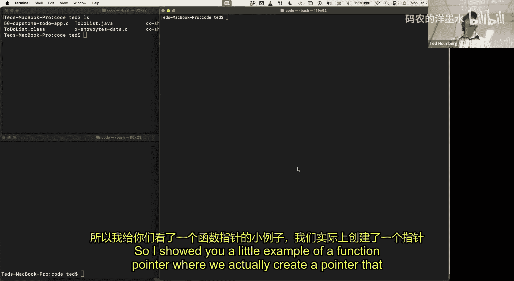
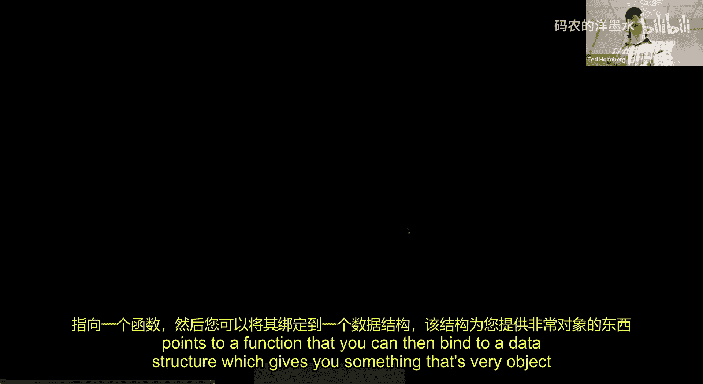
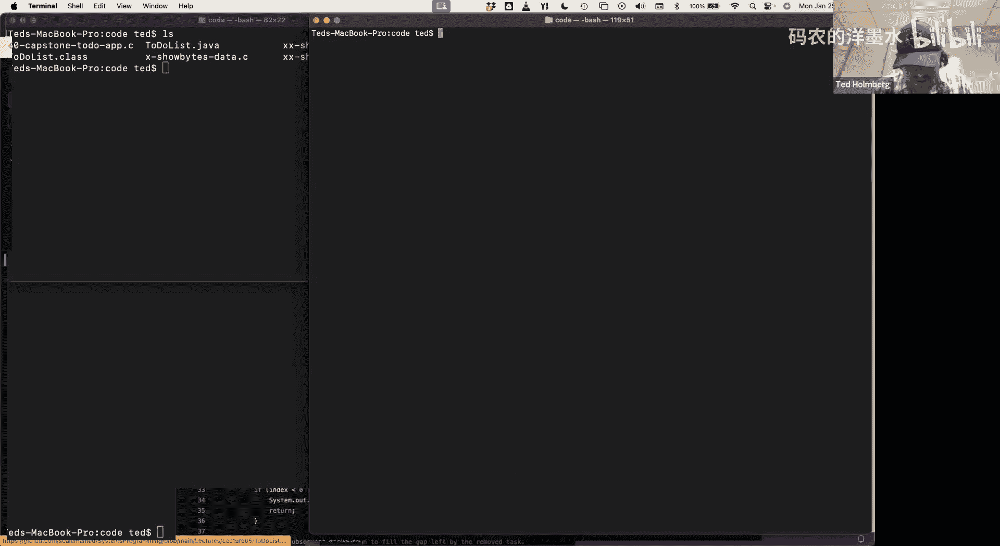

# 【全集】加州理工学院 C语言系统编程 中英字幕 p05 Lecture 5 - 从 Java 到 C -BV1bUzWBLEiC_p5-

Excellent so。Last lecture was asynchronous online， right did everyone watch。

The last lecture that was posted。It's a pretty fundamental lecture we went over a lot of really interesting concepts such as memory he allocation which is how we can not statically define everything and that's actually and I gave you a little bit of a motivation of how C++ was built on top of C so we keep hearing how you have the C family that started with C and that evolved the C++ in the Java was its own thing but inspired by that C++ is actually written in C so we had a really good question a lecturer ago or a couple lectures ago about how could you create methods for your data structures and so the answer there was that well everything inside of our system。

Is in memory and therefore has a memory address including in our code and so just like we can access。

Data structures just like we can access values by referencing its memory。

 we can access function calls by referencing its memory。

 so I showed you a little example of a function pointer where we actually create a pointer that points to a function that you can then bind to a data structure which gives you something that's very object like。

So if you want to know how you like how you walked up from C to Java。

 that's how you did it and I talked with a couple of y'all。

 I think we're going to take a little different pace for today's lecture。

 we're going to take a small break because we've finally got to the point where I've discuss everything I wanted to talk about with C。

😡，And now it gives me an opportunity to see how much of that you've actually been able to absorb and how much you can actually practice so today we're going to have a little bit of a workshop we're going to have a team based workshop let me show you what the goal is going to be。

看。讲。My system being very laggy Give me a moment。 Okay。

 so the first thing I'm going to do here is let's take a look at。

So I have a Java file to do list do Javava So one of the most common appss that you can try to build when you try to learn a new language is a to do app right because it does all the interesting things that will challenge you on。

Building a complete experience that has a task because if you think about the core concepts about a to do application。

 it requires user input。😡，It requires the ability to print something back out to the user to the console。

 it requires the ability to store data in an interesting way， like with a to do list。

 you want to add entries into it and you want to remove entries and you want to view what's currently in there actually let's take a look。

So let me see I have。I have。Let's see， let's start by doing this。Let's examine this app， In fact。

 let's examine。Yeah， we'll examine the Java version of this app。

 so we have a to do list that's written in Java。And so here。

Let's run it we see it's very simple add task view task remove task and exit we can well let's start by selecting to view task and we can see well there's nothing in there right empty to do list so now let's go ahead and。

Select one to add a task。 and so this is。Task one。So now if I go to view。

 I can see now that this is task one perfect， let's go ahead and add another task this is。Task 2。

And let's go ahead and take a look at that this is task two perfect now let's go ahead and add another task。

This is。Pass through。Okay， know， clearly we can see where this is going。

We can view that and this is task3。Bring this down a little so I can see where my。Okay there we go。

 so now let's try to remove a task。So let's do three。And in this instance。

 we'm going to remove the second task， so if I do that， if I go and look at my task again。

 I see now that I have did。And oh i's choose one oh this is task four Okay let's go to view Okay so we could see I have this is task one this is task three this is task four so we can see we could remove the middle task and then populate everything back up let's remove some more task so let's remove task one and now let's view。

And we could see， yep， this is test three and then let's go back， let's remove a task again one。要。

This is task four and then finally a little bit with that one。It' a pretty simple app right。

 something that you should be able to do in Java right with this。

 would you say this is a pretty trivial thing to do in Java。So okay， so let me exhale of this。

Let's clear this Okay， so now。Let's see here， do I have。And let me do this， GCC。

So we also have a seed variant of this， right， the capstone， the capstone。

Source code file for what we've been led up to with all these little tiny micro examples we've been looking at。

😡，So let's go ahead and call this to do。App。And presumably when I go and run this。嗯。

This is under heavy duress。ItTrying to compile a to do app。

And so while we're waiting for my system to catch up with us。

 one thing that I want everyone to do and we'll come back to this in a moment。

Is if you go to our get repository。😡，There's going to be a readly file into lecture five and in fact there's going to be a Java file so you don't even have to build this from scratch i'm going to give you the Java code and I want you all to break into teams of no larger preferably two into groups of two but no larger than three same with online groups on。

😡，Well have to figure out how we can get the online people to easily interact。

 I would probably advocate discord and potentially even doing your own Discord server or whatnot so that you can like live stream with one another。

But what I want you all to do is break into Team using the Java source code file as your basis。

 and then the source code files that we have from lecture that's already in this GitHub。

 seeing if you can't convert this Java code into C code over the course of this hour。

Let's see if this ever。A finally。对。So I should be able to run this and you see when I run my C application。

 it's going to look exactly like the job application。😡，嗯。边条钱我想边啲个。At。系系。Please。等意。用乜系。Of course。

 that's exactly why could not depend on things being even and in fact sometimes people like saucers at three。

야。你我。Oh yeah so I was just told moments ago that for some reason the system down if that's the case try to partner up with someone who has a computer if the remote desktop are not working then partner with someone who has a computer so that you can do this locally。

Because I think I was told just moments ago that we were having a system failure year right before a systems class。

 so how act？

Okay， we are out of time for today's lecture， but I would like for you all to continue to work exchange names Discord names or whatnot people online the line were asking me what the due date for this project is I'm going to have it set to Monday so feel free to continue to work in groups and see if you can't get this code translate it from Java to see you could see as close as these languages are it's not a trivial task。

And so if you get stuck， recall all the source code that we've talked about inside of our lectures is available in the GitthHub as well。

 use that as a reference point。😡，So if you want to see how you can have like a pointer to a pointer to a character or how to do multidimensional arrays or whatever。

 or if you want to look at how to make strokes，There's basic examples you should be able to download the source code files and even compile and execute them so use that as you're building blocks to try to translate this Java code back into C code Anyway everyone have a great day I will see you all on Wednesday。

いでか。No。