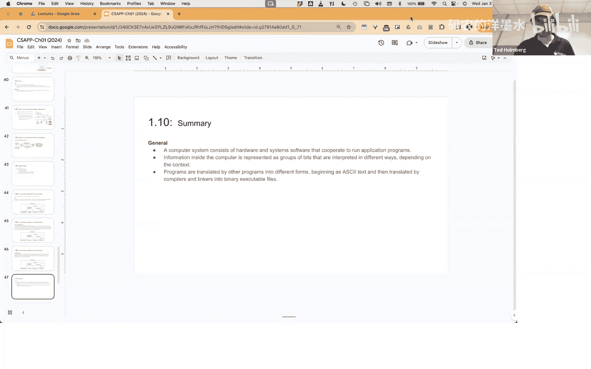

# 【全集】加州理工学院 C语言系统编程 中英字幕 p06 Lecture 6 - .hello程序的生命周期 -BV1bUzWBLEiC_p6-

Excellent， okay， so we're all back。For our lecture for today and then I guess we'll take a pause for the rest of the week and we'll see each other on Monday。

 so I hope you' all all been making progress on the challenge that i've given to you has it been pretty insightful trying to actually see the little micro bits of C that we've gone over for the last several lectures and seeing how well you can actually execute on them to try to translate something that's relatively simple Java。

Toode base into a C code base， it's not trivial， right？没。

No yeah so but I think after working on this application it's really going to give you the chops you need to feel much more confident and see for all the labs that we're going to go ahead and move on moving moving forward and so that said talking about labs we also have the introductory lab that's available through autolab right so if you go to Autolab you should see the documentation for that I think I have the lab resources available through GiHub and so that lab does a great job of kind of walking you through kind of playing around with a little bit of C code but also enforcing upon you and understanding about how we go from our text file which represents our source code to an executable object file that allows us to treat it as an application that actually runs on our system。

So for today's lab， I mean， for today's lecture， I really want to focus in and get a understanding of that kind of。

Trail that journey that goes from authoring a C code file to the point where it can actually execute on our computer system so we'll do a little bit of implementation inside this class but but this one might be a little bit more slide driven simply because of the content we have to cover it's a minimal a little bit more for a more abstract presentation。

 but we'll try to dip into the shell and see what we can do with the shell when it makes sense。

Let me get the presentation slides up on H。what is， oh， I see what's happening here。

 I need to put an HC cable suit my computer for the fastest。Se up an adapter， but I did not do this。

And then when it comes time to go ahead and turn into your lab。

 you should just be able to turn it on auto lab then I think about autoLb is it's an assessment tool so as soon as you turn in your class assignments there it'll at least with the labs。

 not for the challenge that I gave to you， that's something that that'll be assessed。

Personally by me but in terms of the labs the labs will be automatically graded and assessed and and then you'll get your feedback right away and you can resubmit as many times as you want so there's no reason why you can't get full points for the labs if you're vigilant enough to get those points it's not like once you turn in your grade that's what you get that's just what you get for that instance。

And that'll be true for all the labs as we move forward。Okay。

 so let's take a quick tour of computer systems and so this content is actually grabbed from the first chapter of the textbook。

 which you should have a PDF or ebook version of through。The university's access portal。

Okay so let's start by defining what we want to do so in today's lecture we're going to introduce our major concepts for a computer system because that's what this class is really geared to have you understand so at this time you understand how to author Java code and now at this point from C code you know how to compile it you know how to run it but really everything in between is probably still magic to you。

😡，Can you close that door for me？And so one of the motivations behind this class is to kind of。

Unveil that curtain of what happens inside the system。

 which is really going to prepare you for your operating systems class。

 which is going to go one level lower than this class。😡。

So what we're going to do for today's lectures just kind of dip into the life cycle of the hellello world program。

 the simplest program to light right this is usually the program that every。

Beginning developer learns to author。Regardless of the language， in fact as you learn a new language。

 usually this is the first thing you learn to do in that new language。Okay。

 this chapter separated into multiple parts， this is just a quick overview so you know。😡。

I don't know if we've done this before， but we've defined。Cuter systems in particular。

 why don't we actually apply a hardened definition to that in case we haven't done that yet。

So a computer system consists of both hardware and software。

 and they both have to work together in order for our application programs to execute。😡。

So we're going to look at the software perspective in part of this class and then we're going to look at the the hardware perspective and see how those two things come together。

Okay， so the learning objectives。Not just for this chapter。

 but this course entirely is going to be to have a greater understanding of numerical precision。😡。

So you want to be able to understand and prevent numerical errors due to your the。

Due to the way the system goes ahead and represents numbers， it allow you for code optimization。

 so if you know how the underlying system。😡，Works， then you can optimize the implementation of your C code to take advantage of that。

😡，Security and procedure calls are going to be a consideration。😡。

Simply because if you understand how vulnerable software is made you can protect your software it was not vulnerable to things like buffer overflow vulnerabilities and I think we've kind of seen some of those right in some of the slide presentations when we're looking at scanf we saw why we don't want to use scanf for being able to grab text necessarily because it allows you to overwrite your memory with new values。

😡，Linking and debugging， this is going to be part of our compilation tool chain that we're going to look at。

And so we'll know if we have issues in terms of how our code is linking together or if we're having issues with our code executing。

 we're going to learn how to use the debugger， we're going to learn how the linker works so that you' will be more primed and ready to debug code。

We'll do some actual system programming projects one of the labs probably one of the more iffamous labs that you've heard about in this class is that you'll actually create your own unit shell so the shell applications what you used in Java one and Java2 to go ahead and compile and execute your Java applications right that it allows you to launch applications it has a lot of different utility applications in there we're going to look at building a tiny shell over the course in the latter part of this semester and then finally process management so all of our running applications and memory are effectively processes that are managed by the kernel by the AOS we're going to understand what that means。

Okay， so。As I stated earlier， every program， including our Hello application。

 relies on the entire computer system in order to execute so if you want to know。

How software works on a computer we have to know。What part of it is driven by the software ecosystem and what part of it is driven by the hardware ecosystem？

So we want to understand what happens and why when we want our applications inside of our system and so we can think of it and if we go to trace the lifetime。

 at least just from the software perspective， if we abstract away the hardware。

 we can say it happens in six different stages， you have a creation stage， a compilation stage。

 a loading stage， an execution stage， an output stage and the determination stage。

so during the creation period， effectively what you're doing is you're going to have your program。

Create it， written and saved as a source file， usually use a text editor to do this。

 and it stores it as a file on your system。😡，Then you have a compilation phase， so in this phase。

 you have your source file， which can then be compiled into an executable。😡。

Format by a compiler application。😡，Then you have your loading phase。

 the loading phase takes your executable， loads it into memory by the operating system。😡。

During execution， the program launches， executes the instructions by the system CPU。😡。

The output of our hello prints the message to the console through the output stream。

 so our system supports input streams and output streams。😡。

So the results get directed to the output stream and that's where we get our message onto our display and then finally when the application is done you have a termination phase where it will then the program exits out and then all of the allocated memory that was reserved for that application is released and now reavailable to the system at large。

😡，So quick birdd's eye view， that's what happens software perspective when we run our application。

Sure， yeah， no choice okay。So let's kind of step through each of these one by one we start with this application right so here we have。

😡，Our preprosor directive hashtag include standard out the header file。

 which is going to give us access to whatever functions are declared in there。

 we're going to create a main function， which is going to be our launch point of our application inside there we're going to invoke the print F。

 which is what we import it。From the standard input output library。

 and so we'll send to it this string hello world。So it's important to understand when we author this and our text editor。

 the text editor is displaying this as a set of characters that are visible to us。

 we save that in what's called a source file a source file。😡，When we save that。

By the text editor saves it simply as a sequence of bits that encode our instructions that the computer then can translate。

So what we see as taxes。Translated into。Effectively a binary sequence。

 but this isn't necessarily a binary file， we'll call this a text file because the encoding of it uses a ASI encoding。

😡，So from characters to Btes our text characters from our hellOC are encoded using the ASI values they are its it allows us to have our readable code。

 then be converted into a byte sized integer based format so that our system can process on it right our system can't process。

😡，Alpha numeric languages， right so everything has to be converted into binary sequences。Okay。

 so let's let's take and prove this to you right so i'm saying this you can trust me we actually have some system tools to see how the text of source code file is actually mapped to a set of binary sequences or binary characters we're going to actually look at two different。

😡，Command line utilities to actually prove this we're going to look at one that's called Xx D。

 which is a utility that allows us to create a hex dump。

 So Xx D that's effectively xx is for hexal value the D is for dump。

And so to allow us to pass in a file our hellello。c file。

 and so these flags that we're going to send to our command line utility so we can send a flag。

 it's like a property to the application， usually we start that or preface it with a dash or dashG will group the output in single bytes。

Because the encoding for an ASCI character for a car is one bite。😡。

And then we are going to go ahead and display that out and what we're going to see。

 the output B is exactly what you see here on this slide you're going to see the first column is instead of memory addresses。

😡，And the second is going to be the individual ASI encodings in hexademal value for each of the characters that represent our source code file our text file。

😡，All of our source code files maybe we call those source code files they're effectively text files so sore no different than a dot TxT。

 but the extension is used so that when we feed it to a compiler。

 it knows how to parse it and translate that into something that's going to be executable。

Here in this so in the second column is going to be the hexadeimmal。

Representation of our hellello world。😡，Source code file。

 and then here the third column represents the retranslated characters so that we can map one to one what they are。

Now， like I said， ASI typically represents each character to an integer value。

 so the first way that I showed you that we can inspect this is。😡。

To show off the hexademal representation of each of the characters in our text file。

 if we actually want to see the integer value， which lines up。

More closely with the ASCI standard because it uses base 10， we can do that with X O D， so O is ocal。

 so this is allowing us to do an ocal dump but in fact the ocal dump utility allows us to either express it as an ocal set of values。

 a hexensmal set of values or a decimal set of values。😡。

So the flag of dash T allows me to define what type of output I want。

 and then I can then give the output based off of here。

 I'm using D short for or lowercase D short for decal ints。

 and upper K C to correspond with its ASII characters。😡。

And then I give it also the input file by which I want to display what the encoding contents looks like from my underlin system。

Now I can run these， I actually have this setup where I can grab this， this is just a text field。

 I can put this into my system in favor of time because we have a lot to get through I will not do that because I'm showing you the output here so all I would do by actually compiling and showing you this is I think waste a minute or two so I will sh。

😡，You will have to trust that this produces this output。

 but I will share these slides with you and you can test on drone system you make a hello world。

 you can run these command utilities and see this is going to be the exact type of output that I'm going to get and in fact I'm going to now max this up using these integer ASI values。

😡，I can then do a one to one mapping and see， hey， yeah。

 that source code file that I author in my text editor has a direct binary representation using this ASII standard where it can translate the binary back to text or the text back to binary。

😡，So every text file that we have in our system， this is how it saves。😡。

Now I want to make a little distinction here。😡，I want to distinguish the fact of what's normally referred to as a text file versus a binary file and so for those of you who have gone through Java2 you probably used a lot of the libraries for the input stream and output stream and there's probably a lot of system calls that allowed you to treat things based off of text streams and binary streams right was that something that you'all covered inside the Java2 the different formatting that your input and output streams could have whether it was binary data that was coming through the stream or text yeah okay perfect so that metaphor goes deeper than Java set of libraries。

 the standard libraries it goes all the way down to the system level so typically these files that are encoded in ASI directly so that when we understand the context of that file we apply the ASCI translation from the binary one bit sequence back into the。

Characters then we can take any of those files and make them back into characters those are always referred to as text files the moment you have a file though that includes nontext data then these higher files considered a binary file because it has portions that aren't designed to be translated into characters it's not designed to be human readable most files that are on your system are going to be binary files right so like a JpeEG is a binary file you apply the JpeEG context to parse it into some image processing application so you can display it same with PG same with our Java source code files or our C source code files but typically we can we can categorize the files on our system as either those that are binary。

😡，Which are non text or include nont data and those that are text files。

 which includes exclusively text encoded binary sequences。Okay， so。

Now that we've established how our source code file is actually stored into our system。

 let me make a very blanketed statement。😡，All the information in our computer system。

 including the content at the disk file， including the programs that are currently in memory。

 including the data that's currently in memory， and including any data that's transferred over the wire through networks is represented in binary sequences。

😡，That's what we process on everything that we have internal to our system is binary。

It's in a sequence of bits。That means everything from the assistance perspective looks exactly alike。

 it's just a sequence of zeros and ones， the way that we're able to intelligently parse it into meaningful things is because then we also have to apply context to the binary sequences。

😡，So we distinguish our different data objects， such as an integer， a floating point number。

 a character string or instruction， a machine instruction that actually gets executed。😡。

Basedase off of the context we provide because they can all have the same sequence of bites。😡。

It's just when we parse that sequence of byte as an int versus a float。

 they now mean different things， they translate into different things。😡，Okay。

 now let's start walking through now that we've talked about how we've now stored our source code file for hellello world into our system。

 let's move on to the compilation system， so we have authored our text file。😡。

The next phase is we have to compile it into something that's executable。😡。

We use an application for that so first of all we use an application to even create our text file and to author the characters into binary sequences usually we call that a text editor or code editor right so we use one application to create our source code file once we have our source code file we have to use another program that translates our text file into a different form which will be primed for our system to start executing it。

😡，And this is what our compiler is so our Ho program begins as a high level C program because we can read it。

 it could be understood by a human person。That's what we mean by high level languages。

 that's the distinguishable factor between something high level and low level。So to run our Helloo。

c on the system， the C statements have to be translated by other programs into sequences of low level machine language instructions。

😡，And so these instructions are then packaged in the form that's called an executable object file。

 and that's what we can then invoke from our command line and actually execute to get some result from it。

😡，So an example of this is we use the GCC compiler driver which can take our source code file and translate it into an object an executable object file。

 but the compilation process actually includes multiple steps if you've already started on the lab you're going to see that there what those multiple steps were but we'll kind of step to that in today's class too。

So these are going to be the。😡，Four stages of compilation that occurs from our initial C file until we get to the resulting executable file。

 so we have to go through a preprocessor step， we have to go through a compiler step。

 we have to go through an a simpler step and we have to go through a linker step。😡。

And so here inside of this diagram， you'll see the step name。You'll see inside of parentheses。😡，CPP。

 CC1， ASLD， this is the alias。The symbolic link towards the utility application that gets run by Gcc so in order to do all of this at once。

 this is all hidden to us like this is the black box。😡。

That the GCC does to convert our source code into an object executable object file Now each one of these things the system invokes eternally。

😡，And the way it invokes each of these things is with CPP， that goes and does the preprocesing step。

 which we'll talk about in just a moment， which takes your C file and converts it into an I file。😡。

Then your i file listen sent to the CC1 the compiler which turns it into an S file so here we start with a text file which is human readable it's our C code after this step we're still going to have a text file human readable code。

 but it's going to include everything that the preprocessor directives told it to include so it's going to effectively nest everything into the one text file。

😡，Then it's going to go through the compilation step。

 that's where it takes our C code and turns it into assembly code。😡，So at this point。

 if you were to look at this， it's still text file。

 simply is still considered a higher level language in the idea， it's a low high level language。

 but it's still human readable。😡，You can read assembly language。

So but it's the level right above our machine code where we're no longer able to read it。

 where everything is binary sequenced to the instructions that the CPU will then execute upon。😡。

So from the compiler， we'll get a S file， hello。s file。

 which is going to include the assembly instructions。

 we can thencing that to the assemblymbler which translated from assembly into our actual binary machine code because again。

 everything in our system has to eventually resolve to be a binary sequence。

And that's going to be our dot0 file， our object file。

 and so at this point this is a binary file we can no longer read it。😡。

And then this gets sent to the linker which is going to link all the individual object files together like for instance we might have our hellello。

 o file， which is one object file and then we'll have our like print F object file which is in a standard library those two have to merge together to create one complete executable application and once we have that link。

😡，Set of object files we can invoke that from our system。

 actually launch it and go through that life cycle that we talked about earlier。😡。

So here we'll walk through this process as I so that we can actually see on the slide each one of those steps。

 we have our preprocessing phase indicated by CPP， which again in the lab you will get to execute each one of these phases in isolation and be able to inspect the contents of that file that's that's one of the main drivers of the lab。

So that you can see what's happening during the compilation phase。So here we'll take our Hello。

C file， we'll send it through the preprocessor and now what this is going to do is it's going to take all those directives that start with a hashtag。

 say for instance the hashtag include， and it's going to replace that with the necessary C code to actually perform that action。

😡，So it's simply going to go and insert the program text where we told it to。😡。

So this it's a solution that helps us break our code down and then it allows it to merge and see it together for us。

😡，Then the next phase after we get this hello doI file。

 which is all the preprocessor directives being resolved。

 now we can go through the compiler phase because now all of the code is in one file。😡。

During the compiler phase， our text file is then converted into another text file。

 the Hello dot S file， which translates our C code into one to one correspondence to assembly language code so just an example of actually what our hello world would look like once it's assembled would be inside this panel here。

😡，These are the instructions that they would get translated into。Then once we have。

Going through the once we've gone through the compiler phase and we have our assembly code。

 then we go through the assemblysembar code， translate our assembly。😡。

Set of instructions into the corresponding machine language instructions。

 which can actually be fed to the CPU to actually encode the actions that we need for hellello world to resolve。

And so this is going to create what's called a relocatable object program， it uses theexsion。0。

And this is where we now move from having a text based file into a binary file。

Whi encodes our main function， but only our main function。

 and so what we have to do to get this into an actual executable application then is we have to use the linker to merge our main。

0 object file with that print。f object file and once those are merge together now we have an executable object file that it contains and encapsulates everything necessary for the system to run our code。

 our hello world。😡，So what。Just to compile this into ex heat。😡，Okay。

So why do you have to understand how this entire compilation system works because they're well-sved problems right you're never going to build your own compiler many years ago as a computer science student one of the required classes used to be compiler design you used to have to build a compiler that's not something anyone has to do anymore。

 but there's still benefits for knowing how a compiler works it allows you to understand how to optimize your own code better。

😡，You'll understand how to。Debug your code and you'll be able to avoid security holds。😡，Okay。

 so once we've compiled our code， we can go ahead and run our Hello program application to run the executable file。

 at least on a Uni system， we can open up a shell and so that's the application we're going to really focus on over the course of this semester。

😡，So the application program that's used for executable files for launching executable files in a Uni system is we're going to use a bash shell in particular。

 there's different flavors of shell， but they're all shells。

And so the shell you can think of as a command line interpreter that prints a prompt ways for you to type a command line and then performs the command。

It's what's usually called the rebel。诶。Because what it does is it reads。For your data， it's going to。

哦。Execute the whatever the prompt is， it's going to print the result and then the L is loop。So read。

 execute print loop。Rub is usually what these applications are referred to。

And so sometimes you'll have some scripting languages that have their own rubble built into it。

 like for instance， you can launch Python's Reble， which allows you to feed commands directly into Python and execute it。

 JavaScript has a rubble， even Java has a rubble that you can launch and play around with。

Let's see so they load and run the hello pro so the responsibility though is。

You have one application that we rely on to build your text files to begin with there's an that's our text editor you have another application that is your compiler that converts your text file into a binary executable file then there's another application that we're using to actually launch the executable for to actually execute right so we're using in the course of running our hello world three different applications notice we rely heavily on applications to constantly translate。

😡，One part of our program into another phase so that it can actually do something。

So the recognition is that the shell is not dissimilar from the compiler。

 which is not dissimilar from the text editor， they all have a role to play towards having us off their compile and run our applications。

Okay， that's it， I think for the most part with the software component because we talked about what it's up to create a text file。

😡，We talked about how to compile it into a binary file。

 we talked about how we can launch the binary file so that it executes on our system until it finally prints out to the display and then terminates relinquishing that memory so。

Done with the software perspective， let's dip our toes now into the hardware perspective on how we rely on our computer system to run our Ho world application。

So our computer system first of all， let's do a autopsy on it。

 let's decompose it into its constituent parts that we actually care about in terms of understanding how our applications run on a piece of hardware so we can isolate。

😡，And categorize the components we're going to need into four main groups， a set of buses。

 a set of input output devices， a set of main memory， and a set of processors or a processor。😡。

So this here， I've color coded in the red our buses， so they run throughout our system。😡。

They're a collection of electric conduits。And the responsibility of the buses is to carry bites of information back and forth between each component。

Hence the term bus， it's like a bus line， our bikes get on one station right one port。

 they get shuffled over， shuttled over to the next where they're then unloaded。😡。

Busees transfer based off of a fixed size of chunks。A fixed size chunks of bytes known as words。

 so it's very apt if we encode all of our knowledge， all of our concepts as。😡。

Btes and a byte is a chunk of eight bits and we can combine these bytes to make more expressive things these more expressive binary things are called words I'm sure you're already familiar with that from assembly though right the the naming usage of bits bytes and words。

😡，Double words。Perfect。I don't know I'm I'm trying to get feedback looking looking at faces and what Okay。

 so with that said。😡，The value at the system level of what's defined as a word is not universal。

 it can be varied system by system。😡，Some system might might define their word size as being four bytes 32 bits。

 some systems might define their word size as being8 bytes or 64 bits you've ever wondered what the distinction between like Windows 32 versus Windows 64 is that's。

😡，All motivated by the definition of how they've defined their word songs。😡。

That's why some applications might be。Compatible with one system and not another right so our our applications could be constrained to the underlying implementation of the hardware system because it's a hardware consideration it's a hardware thing。

😡，Okay， so here in this graphic， we can see this is our CPU。

Let me go back up here before I highlighted， here's my CPU。Here's my main memory。

Here's my input output devices， so on the bottoms my input output devices on the very right。

 my main memory on the very left is the CPU and kind of like riddled throughout it all is the buses。

😡，Okay， so now that we know what the buses are there for。

 let's talk about what usually attaches to the buses。

 so let's start at the input output component of things that's going to be our devices。😡。

That allows our system to connect to the external world。😡。

So the purpose of each of these is to transfer information back and forth。Between the IO。

Boss and the IO device。And so these can include things like the USB controller。

 which we can then have our mouse attached to， it could have our keyboard attached to。

 it could be our graphics adaptive， that's how what we put our display to it could be our diskcontroller which is our hard drive right all of these things are input output devices。

They might use that data in very different ways。😡，But the underlyinglining data is all just binary sequences。

 so the drivers that then utilize that input to the device will then give it the context it needs so that it can display on a monitor or it could write to a disk file or it could translate mouse inputs into some kind of meaningful input for us or keyboard input。

😡，Okay， let's move on to main memory， so main memory is going to be this component here。😡。

The role of the name memory is as a temporary storage device that holds both the program itself。

And the data it manipulates why the processor is executing that program。

So physical main memory consists of a collection of dynamic random access memory chips。

Logically memory organized as a linear array of bytes each with its own unique address starting at zero so there's an abstraction we'll talk more about what this abstraction model is。

 but we as software developers don't need to know the actual physical address of where we need to store our data in the underlying OS system all is going to abstract that away for us willll effectively just have a big heap of memory that we are giving addressable spaces into and that's where we can go to write and read from。

😡，But effectively， all of that abstraction exists on top of those actually memory modules。😡。

And then finally， we have our processor， the processor， which we'll typically refer to as a CPU。

 is the engine that interprets or executes our instructions stored in main memory。

 the CPU is a word size storage device。Where you have access to registers。And so again。

 you're probably familiar with being able to access your register space。😡，From assembly。

And you also have a program counter that tracks where you're at inside of your application again。

 a concept you should be familiar from assembly a processor repeatedly executes the instructions pointed at the program counter and updates the program counter to point to the next instruction and so a processor appears to operate according to a very simple set of instruction execution model which we call the instruction set on protection that's the set of keyword that you can execute。

😡，that you're giving an assembly， so each one of those things like move add sub inside of assembly has a mapping to your instruction set architecture。

😡，Yeah your instructions execute in sequence and a series of steps。

 the CPU reads the instruction from memory pointed by the program counter。

 then the CPU interprets the bits in the instruction so again it's a binary sequence but each binary representation means to do some different action it's just it's an encoding to send information to some part of the system so the system uses the ISA to translate a set of bytes into an actual action to execute。

😡，We're going to see what this means in just a moment。Or if not this class， next class for sure。CPU。

 then the CPU performs some operation defined by the instruction。😡。

And then it updates the program counter to point to the next instruction。

 so that's kind of like your rebel at the CPU level it。😡，Where it reads， it evaluates。

 it prints and then loops。So the operations again interface with the main memory。

 the register file and the arithmetic logic unit， so if we were to zoom into the CPU more so we can see this is our registry files。

 we have our program counter， we have a memory interface so that we can access things for memory in addition to our register space。

😡，And then we have our arithmetic logic unit that allows us to actually start doing transforms。

 start processing some sets of binary inputs to get result binary outputs。Right。

 now this zoomed in view， did y'all spend any time talking about inside of assembly？

At least kind of remedialy。Okay， so if we were to kind of look at the instruction set architecture just to go ahead and provide an overview。

 we could break it down into a load store， operate and jump。😡。

Actions load will copy a byte or a word from main memory into a register。

Maybe a key word for that might be move。Overriding the previous contents of the register。

 so clearly you need to have an instruction to be able to move data into your registry space store。

 which allows you to copy a byte or a word from the registry space to a location in main memory。

 overriding the previous contents of whatever was inside of that memory space of main memory。😡。

You have operate， this is going to copy the contents of two registers to the ALU to perform some arithmetic operation on two words and store the results in your registry space。

 overriding whatever the previous contents was there in the registry space。😡，And then finally， jump。

 which will extract a word from the instruction itself and copy that word to the program counter overriding the previous value of the program counter。

😡，So typically these are the four actions that a processor can take from our instruction set architecture。

 and from these you can build really complex sets of instructions。Okay。

 so now that we've laid out the atomic components that define our hardware side。😡，Let's walk through。

The life cycle of our Hello world application as it actually executes the hardware perspective as opposed to the software perspective。

So here I have a diagram， a directed diagram so that you could see our starting point to our ending point at least from steps one through four。

 so on step one which we're going to say is right here the She program is waiting for us to type a command right so it's waiting for us to prompt it to do something so it's looking towards this mouse keyboard。

😡，Input output device when we type something in the keyboard and hit enter。

 that's then put into the input stream right that input stream。😡，Connects to this IO boss。

We type the charactersacters。helo at the keyboard， the shell program reads each into a register and stores it in memory。

 so we go， we type that in， we go into our input output， we go into our memory interface here。😡。

And it source in memory， and then the shell then loads the executable hello file by executing a sequence of instructions that copies the code。

And data in the hello object file from the disk to our main memory。

 so when we get this in here it goes to our register file。

 which then goes to our main memory to load this this up。😡。

So that's the first thing that happens after that。Once we have everything in the main memory here。

 the data travels directly from the disk。😡，Our executable here goes then from the diskcontroller。

 it seeks that file and then brings it into our main member。😡。

So we're going from here where we type in hello and hell hello is stored in memory and the result of that is the system underlining system goes。

 seeks that object file， that executable object file。😡。

Recalls it from memory from the hard drive space and then loads it into our main memory。

As all of our applications have to be in main memory in order to execute。

 we don't execute anything directly， our hard drive is just there for storage。😡。

It's just part of our input output devices it has to be translated and for us to operate through the processor remember our processor has access to either memory or registers。

😡，Okay， so once we have our object file loaded into the main memory。

 the processor begins executing the machine language instructions in the Hello program's main routine。

😡，These instructions copy the bytes from memory to the register file from the register file to the display device。

 so again you go from here。😡，To here， which would be our graphics display。

 and it would actually show our hello world。And again。

 these bites are constantly being shuttled around between these components for the buses。Okay。

Let's talk a little bit about caches and why they map。😡。

So the system spends a lot of time moving information from one place to an album。

 the entire point of those last couple of slides was to emphasize that for something just as simple as a hello world。

 you saw how much transfers had to occur between input output devices。

 main memory and the processor itself， the CPU。So in order to reduce latency。

We have a variety of caches so in our hellello world program the machine instructions and the hellello program originally stored on disk when the program is loaded they are copied to our main memory as the processor runs the program instructions are copied from the main memory to the processor。

And then finally， the hellello world new line character that was originally on the disk is copied to the main memory and then sent to our display device。

😡，Which is then。Put onto our console onto our display on our monitor。

So there are definitely speed size trade offs for our storage so the disk drive on a system is typically a thousand times larger than your main memory right so you can store a lot more on there。

 but at the same time it takes your processor 10 million times longer to read a binary word。😡。

From your desktop from memory， which is why we want to load everything onto memory。😡。

The latency is ridiculous。A register file storess only a few hundred bytes of information as opposed to the billions of bytes of main memory。

 however the processor can read data from the register a0 times faster than it can from memory。

So to deal with the processor memory gap。😡，Systems include a smaller faster storage device called cash memories that serve as temporary staging areas for information that the processor is likely to need in the near future。

 so we have this so and we start from faster and migrate to lower so there's different levels hence the term L there's different levels of cash memory you have L1 cache which is right on the CPU it sandwich right between our memory interface and a register space we have L2 memory which is also on the cache bus。

That can connect to the memory interface。So the idea behind caching is that a system can get the effect of both a very large memory pool and a very fast one by exploiting what's called locality。

😡，The tendency for programs to access data and code in localized regions。

And if you want to get an idea of how memory hierarchy works。

 you can think of it kind of as a appearance。Where the higher you are on the pyramid。

 the quicker it is to access those binary words， but as you go down to the base。

 you get larger volumes of binary words that you can go ahead and store。

And here each segment shows you at what level usually that cache memory is available。

 whether it's at the CPU register level or whether it's retrieved from the memory or whether it holds cache lines retrieved from the memory。

Or whether it's included in main memory or whether it's secondary to the local disk itself。

So you have a variety of levers here， but really the big takeaway that you just have to know is that the larger lower and cheaper storage is drill down here and that we can kind of rely on some of these higher level caching to be able to store data for us in the interim of processing these applications。

Okay， let's talk about the role of the operating system。So we've talked about hardware now。

 the hardware considerations about how our Hello world application runs。

 we talked about the software considerations， but at one point we kind of just abstracted our software applications just say。

 yeah， we sent it to the OS and it does some software works。Let's talk about that OS abstraction。😡。

So the operating system is all programs。That。Actually run on our computer system。

 they're serviced by the operating system， the operating system is the layer of application that exists underneath us。

😡，The operating system is a layer of software that interposed between the application level。

 which is what we'll now call that and the hardware level。

So all attempts by an application program to manipulate the hardware have to go through the operating system。

😡，Which you'll learn much more in OS。So of killers。

 the purpose of our OS has two primary there's two primary goals it provides values it provides。

 the verse it protects the hardware from any misuse and runway applications right it kind of controls access to the hardware so some third partyy application。

 some external application can't burn your hardware out。😡，Or make it crash。And second of all。

 it provides applications with a very simple and uniform mechanism for controlling various complex low levelvel hardware devices we're going to see there are system level calls available to us in C or in any kind of API that allows us to give instructions directly to the OS and the OS does that for us because it's not our responsibility as an application to do that our applications depend on the OS having access to the hardware and the kernel and the way that everything is loaded in memory and accessible to us。

So that our code can do its shot。😡，So the OS achieves these goals via a couple different abstractions we have a concept of what's called processes。

 a concept of what's called virtual memory and a concept that's called files processes are an abstraction that includes the processor。

 the main memory and our IO device。So effectively， every application that's running in our system can be thought of conceptually as a process。

😡，You have virtual memory， these are this abstraction includes just the main memory and the disk IO devices。

 this abstraction allows us to think of our memory as just being a big pool of addressable stuff。😡。

Without having to worry about what actual Ram chip we're accessing or what input output device we're accessing right the OS worries about managing and pulling all the memory together giving it an address space that we can use in our application and then it worries about actually。

😡，Accessing the hardware to fill it out。😡，So we call that virtual memory。

 all the addresses we use are virtual addresses， not actual addresses。

 the actual addresses is the thing that OS is concerned about。😡，And then finally。

 the concept of files files themselves are an abstraction for anything that's an IO device。

 so like for instance， if we're reading a binary sequence that's saved on our local disk or on a flash drive or through a network。

 these all conceptually are files we do file processing through input and output streams。😡。

So our abstract thing of calling anything something that's either going to come in as input or output is that file that kind of file metaphor。

😡，Okay， and this is just a quick rundown， so as we already said a process is the operating systems abstraction for a running program。

Now the thing that you should understand about processes is multiple processes can run concurrently。

 in fact it happens all the time our OS is running not just our application but multiple other applications simultaneouslyous and it's managing those applications as processes simultaneouslyous。

So multiple processes can run concurrently on the same system and each process appears to have exclusive use of the hardware。

 so by concurrently we mean that the instructions of one process are interleaved with the instructions of another。

Because they're actually executing through the same CPU so how does this work。

 how can you have one CPU when multiple processes concurrent？

Well it's through a process that's called context switching so the operating system keeps track of the state information that the process needs in order for it to run the state is the context。

 which includes information like what are the current values the the PC right our our our our。

Our point counter the the register files and the contents of main memory。

 so if you think about it anything that's running at any given time。

The processor has to have those states set。😡，So it saves that。

 you understand that and you can keep running multiple applications if you're just resetting the states of those three things。

😡，At any point in time a processor can only execute the code from a single process when the goes transfers control from the current process to a new one。

 it performs a context which by saving the context of the current process and then passing control to a new process。

 we're going to see this in practice when we build our own shell。

So this is just kind of laying the groundwork so that you understand what we're going to do when we get to that future lab。

So to visualize this， why don't we separate two？😡，Processes that have to run。Concurrently。

Or how we contact switch so that we're running one。

 we switch to the other and when we switch back and fast enough that。You wouldn't。

You wouldn't recognize right when it's doing the context switching so in our columns we have our shell process and we have our hellello process the shell process is the application that we use to launch the shell I mean our hello world。

😡，And our hello process is the C code source file that we had made earlier。

So here we use the shell process to launch our application code。

 which is going to cause a contact context switch to make in fact。

As an analog you kind of think about this in the way that functions work right one function invokes another function。

 which pauses that function， you run the code from the other function。

 then you return back to the prior function， returning all the state from a stack where all the data was saved onto if you understand how function。

 how that function stack works。😡，Then you could think of context switching in a similar way。

 so we have our shell process， which we'll then use to context switch to our OS code。

W which will launch our Ho process。And then when it's done。

 executing we'll do a context switch back to the shell process。

And again we have our step by steps here， the shell process is running alone waiting for input on the command line when we ask it to run the hellello program。

 the shell carries out our request by invoking a special function known as a system call that passes control to the operating system。

 the operating system saves the shell's context creates a new hellello process and its context so we have one process which is their shell process and now another process which is our hellello process and then passes control to the hellello process so it now gets the baton to be able to run using the process after Hello terminates the operating system restores the context of the shell process and passes control back to it。

And so the transition from one process to another is managed by the operating system kernel。

It's and the kernel is just a collection of code and data structures that the system uses to manage all these processes that's what the operating system does it one of its big responsibilities that we're concerned about is process management。

And then you also have this concept of threads， so modern computer systems a process can actually consist of multiple execution units called threads each running in the context of the process and sharing the same code and global data。

 a thread is typically referred to when you have the ability to run across multiple processes so you can have a process that's multithreaded which means that you can actually deliver your code base across different cores on your on your on your hardware so this slides just to emphasize the difference or distinction between a process and a thread。

Okay a little bit more on virtual memory， this is a good kind of visualization that maps how we can think of memory on our system so this is the abstraction the OS provides to us notice the addressable space that we have that would be assigned to our applications in the form of like pointers addresses would be right here。

 but effectively what's happening here is the virtual memory abstraction provides a process blah。

 blah， blah here we can see the advantages it gives us this uniform view of memory。

Wwhichch is our virtual address space， the topmost region is reserved for everything in the operating system and as we drill down lower it gets to the point where it gets reserved for our applications and when our applications are run it gives us some of this addressable memory space after it terminates it allocates that and then can give it to another application this is why inside of our C code when we create a variable sometimes we might already have value of it which was allocated from some other thing that it was freed up from。

And so typically the regions you have are your program code and data Reg。You have your heap。

 which is your runtime heap。You have your shared libraries， your stack。

 and then your kernel virtual address， so you can see each of those are mapped here。Here， here。

 here and here。And then finally， the last abstraction we talked about is going to be the file abstraction。

 so a file is a sequence of bytes。That's it right this is a sequence of bytes every input output device includes disk keyboards displays and even networks and all input and output in our system is performed by reading writing to files using a small set of system calls known as IO calls。

And so the reason why this motivation this abstraction is valuable to us is it provides us a simple way of dealing with all input and all output uniform so that we don't have to think of using keyboard data or mouse data or monitor data or memory data in different ways。

That's the power of abstraction right it allows us to take a lot of different graangular things and treat them as a whole uniform approach。

And I guess the last thing that's worth just mentioning if we're doing this。

 since we've gone this far down the rabbit hole is I want to articulate that network data is treated really no differently than any other data source or sync。

On our system， so the same way that we would connect to our bus to access our hard drive or like an external whether it's an internal hard drive or an external hard drive connected through a USB port or data from the keyboard or mouse right what we could just have right on our IO bus。

 a network adapter and the way that data flows in and flows out of that is exactly the same。

So networked applications are really no different。In terms of the way we can manage input and output than any other kind of input output device。

So you can kind of think of the way that our system can communicate with other systems using networks as being something along the use of another application then。

 where you have an application that's designed to connect with another system， it creates a pipeline。

 where it can import the data， translate into something that's then locally available to us。

 feeds it into the system the way we'd expect， then whatever output it needs to send back。

 it would then send to the network adapter。Wwhichch the application that supports the network adapter will encapsulate that data so that it's primed and ready to be delivered over the water。

Which you learn more about in networking。And again， this is just a。

Emphasis on the use of why abstract models is one of the most。

Important concepts in computer science as a whole， it's something that we not only focus on here at the O level to go ahead and create these abstractions of files。

 virtual memory and processes and even virtual machines but you do this probably in object orientness to us。

 the idea of abstraction that allows you to adhere to these same practices to build code bases that are represented as a collection of classes as objects that can then use composition inheritance and then from these modules and these packages you can create APIs so that other developers can import or you yourself as a developer can import it to your own codeb。

So that you can only be concerned about the things you need to solve so abstraction， abstraction。

 abstraction， computer science is learning how to use abstractions at every level of it。

We' already talked about the processor abstraction the OS abstraction and that's it that's pretty much chapter one does anyone have any questions about pretty much what it takes for our Hello world program to run effectively through a software of our computer system and the hardware perspective of the computer system do you see how a computer system can now be defined as both a combination of software and hardware the underlining system that allows us to do everything that we do to build applications because this is really the stage by which we're going to explore deeper for the remainder of the semester and in fact this first lab will have you exploring the four stages that the GCC compiler goes to to translate your tech source code file into a binary executable object file。

Excellent， well， let'm going to make sure there's no questions on here， on chat。Perfect， well。

 I will see you all next week on Monday， I hope to see all of you be able to have your to do application in seek。

😡。

