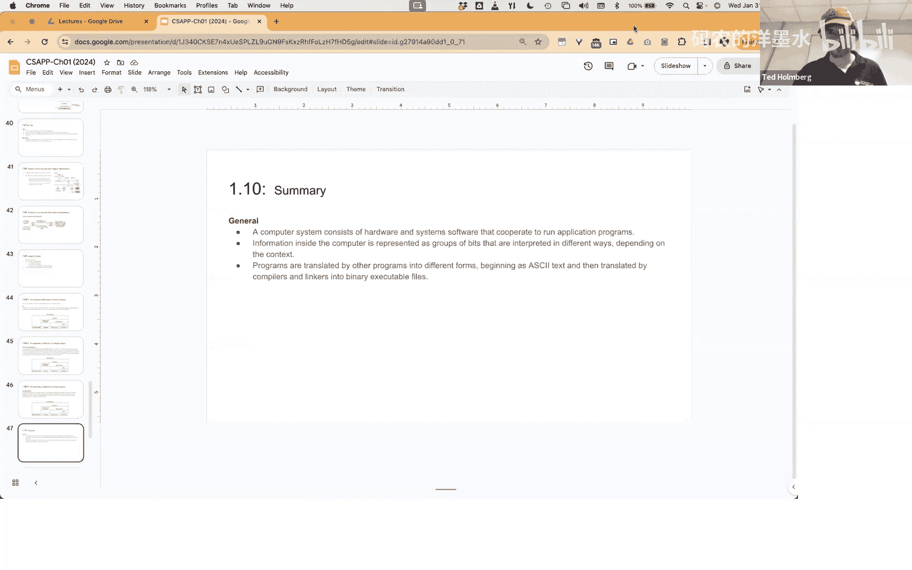

# C语言系统编程：第6讲：.hello程序的生命周期 🖥️


在本节课中，我们将学习一个简单的“Hello World”程序从编写到在计算机上运行并退出的完整生命周期。我们将从软件和硬件两个视角，深入理解计算机系统是如何协同工作来执行程序的。

## 概述

我们将追踪一个C语言“Hello World”程序的生命周期。这个过程可以分为六个阶段：创建、编译、加载、执行、输出和终止。理解这个过程是理解计算机系统如何工作的基础。

## 软件视角：程序的生命周期

从纯软件的角度看，一个程序的生命周期可以抽象为六个阶段。

### 1. 创建阶段

在这个阶段，我们使用文本编辑器编写程序代码，并将其保存为一个源文件（例如 `hello.c`）。这个文件以文本形式存储在我们的系统中。

### 2. 编译阶段

接下来，我们需要将人类可读的源代码转换成计算机可以执行的格式。这是由编译器完成的。对于C语言，我们通常使用 `gcc` 编译器。

编译过程本身包含四个步骤：
*   **预处理**：处理源代码中以 `#` 开头的指令（如 `#include`），将引用的头文件内容插入到源代码中，生成一个 `.i` 文件。
*   **编译**：将预处理后的C代码翻译成汇编语言代码，生成一个 `.s` 文件。
*   **汇编**：将汇编代码翻译成机器语言指令（二进制代码），生成一个 `.o` 目标文件。
*   **链接**：将程序的目标文件与所需的标准库（如包含 `printf` 函数的库）合并，生成最终的可执行文件（例如 `a.out` 或 `hello`）。

### 3. 加载阶段

当我们通过命令行（例如在shell中输入 `./hello`）运行程序时，操作系统会将可执行文件从磁盘加载到主内存中，为执行做好准备。

### 4. 执行阶段

中央处理器（CPU）开始执行加载到内存中的机器语言指令。CPU从程序计数器指示的位置读取指令，解释并执行它，然后更新程序计数器指向下一条指令，如此循环。

### 5. 输出阶段

程序通过调用 `printf` 这样的函数，将字符串“Hello World”发送到系统的输出流，最终显示在用户的屏幕上。

### 6. 终止阶段

程序执行完毕后，操作系统会回收分配给该程序的所有内存资源，使其可供系统其他部分使用。

## 深入编译系统

上一节我们概述了程序的生命周期，本节中我们来看看编译阶段的具体细节。理解编译系统有助于我们优化代码、调试和避免安全漏洞。

`gcc` 驱动程序在后台调用了四个独立的程序来完成编译工作：

1.  **预处理器 (cpp)**：`hello.c` -> `hello.i`
2.  **编译器 (cc1)**：`hello.i` -> `hello.s`
3.  **汇编器 (as)**：`hello.s` -> `hello.o`
4.  **链接器 (ld)**：`hello.o` + `printf.o` -> `hello` (可执行文件)

## 系统信息表示

在深入硬件之前，我们需要理解一个核心概念：计算机系统中的所有信息——包括磁盘文件、内存中的程序和网络传输的数据——都是用**二进制位序列**表示的。

不同的数据对象（如整数、浮点数、字符串或机器指令）之所以有意义，是因为我们为这些位序列提供了**上下文**。例如，同样的位序列，作为整数解释和作为浮点数解释会得到完全不同的值。

文本文件是二进制序列的一种特例，它使用 **ASCII** 编码标准，将每个字符映射为一个字节大小的整数值。我们可以使用 `xxd` 或 `od` 命令行工具来查看文件的二进制/十六进制表示。

```bash
# 以十六进制和ASCII字符形式查看 hello.c
xxd -g 1 hello.c

# 以十进制整数和ASCII字符形式查看 hello.c
od -t dC hello.c
```

## 硬件视角：程序如何运行

现在我们已经了解了软件层面的流程，本节我们将看看硬件是如何支持这个流程的。计算机硬件可以简化为四个主要组件，它们通过总线连接。

### 1. 总线

总线是贯穿整个系统的电子管道，负责在各个部件之间传递固定大小的字节块，这个块被称为**字**。字的大小是系统的一个基本参数，例如32位系统或64位系统。

### 2. 输入/输出设备

I/O设备是系统与外部世界的连接通道，例如键盘、鼠标、显示器、磁盘驱动器、网络适配器等。每个设备都通过控制器或适配器与I/O总线相连。

### 3. 主存储器

主存储器是一个临时存储设备，在处理器执行程序时，用来存放程序和程序处理的数据。逻辑上，内存可以被看作一个线性的字节数组，每个字节都有唯一的地址。

### 4. 处理器

处理器（CPU）是解释并执行存储在主存中指令的引擎。它的核心部件包括：
*   **程序计数器**：指向下一条要执行的指令。
*   **寄存器文件**：小型、高速的存储设备。
*   **算术/逻辑单元**：执行算术和逻辑运算。

CPU不断重复执行一个简单的指令周期：**取指 -> 译码 -> 执行 -> 更新程序计数器**。指令集架构定义了CPU可以执行的基本操作，如加载、存储、运算和跳转。

## “Hello”程序在硬件上的运行轨迹

结合以上硬件知识，让我们跟踪 `hello` 程序的执行过程：

1.  **输入指令**：我们在shell中键入 `./hello` 并回车。Shell程序通过键盘I/O设备读取字符，并将其存入内存。
2.  **加载程序**：Shell通过执行一系列指令，指示操作系统将 `hello` 可执行文件从磁盘加载到主存。
3.  **执行指令**：处理器开始执行 `hello` 程序主函数中的机器指令。这些指令将“Hello World”字符串从内存复制到寄存器文件。
4.  **输出结果**：处理器再将数据从寄存器文件复制到显示设备（图形适配器），最终字符串显示在屏幕上。

## 重要概念：缓存、进程与抽象

在程序执行过程中，数据在不同存储层次间频繁移动。为了弥补处理器和主存之间的速度差距，系统采用了**高速缓存存储器**。缓存利用了程序的**局部性**原理，将处理器近期可能会用到的信息存放在更小、更快的存储设备中。

操作系统是管理硬件和应用程序的软件层。它通过几个关键抽象来简化我们的编程：

*   **进程**：是对一个正在运行的程序的抽象。操作系统通过**上下文切换**来实现多个进程的并发执行。
*   **虚拟内存**：为每个进程提供一个统一的、私有的地址空间视图，让每个进程都感觉自己独占了主存。
*   **文件**：是对所有I/O设备的抽象，将一切输入输出都视为对字节序列的读写。网络通信也可以被视为一种特殊的文件I/O。

## 总结



本节课中，我们一起学习了“Hello World”程序完整的生命周期。我们从软件角度分析了它的六个阶段：创建、编译、加载、执行、输出和终止。接着，我们从硬件角度剖析了计算机系统的核心组件——总线、I/O设备、主存和处理器，并跟踪了程序指令和数据在这些组件间的流动。最后，我们介绍了操作系统提供的关键抽象：进程、虚拟内存和文件，这些抽象是构建复杂、安全、高效应用程序的基石。理解这些底层机制，将为我们后续学习系统编程、优化代码和调试程序打下坚实的基础。