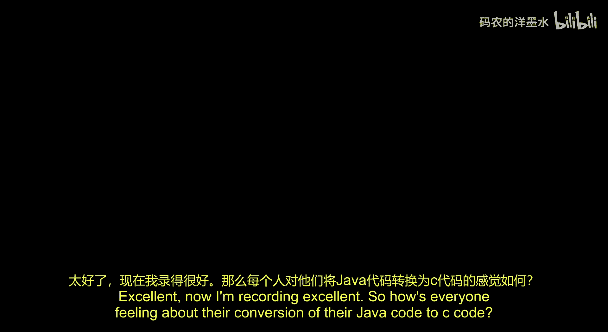
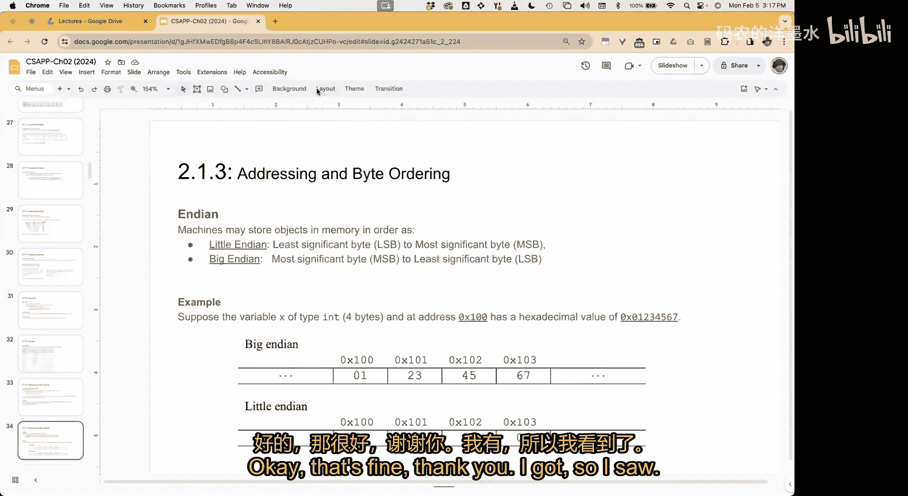

# 【全集】加州理工学院 C语言系统编程 中英字幕 p07 Lecture 7 - 数据 -BV1bUzWBLEiC_p7-

Excellent， now I'm recording， excellent， so how's everyone feeling about their conversion of their Java code to C code。

Everyone feels pretty good about that at this point。Was that a u， you know？

Was that a challenging endeavor？Did you learn a lot about C having to take Java and turning it to C？

So we had talked a little bit about how we're going to go ahead and submit that I usually do assignments。

 homework assignments for those of you who had taken me before or if not maybe heard word usually I do homework assignments and I'll use test as a check ins so at some point。

I'd like to check in with each of the groups and just see what you've been able to execute and just get a feel from you about what your approach was and how you were able to solve that problem and if not what obstacles you ran along alongside the way so I had mentioned Monday was going to be the time that it was going to。

Talk about how we were going deliver this kind of student challenge and that's going be is going to be in congruence with the way that I typically do the examinations so I'd want to go ahead and touch base with you we could set up like a chat through through zoom and one person can designate themselves as like the controller where I'll let you go ahead and share your screen。

 execute your app show it off and then collectively you as a group unless your solo in which case you were your own group can kind of explain to me how you went about solving the problem and that way that just gives me the ability to check in with each of all of you to make sure that everyone's on the same page and we' kind of progressing where we'd expect to be at each time and also again one of the big things that if you went to the meetup last Thursday where the chair was there where the undergraduate coordinator and the graduate coordinator was there but one of the big things that we're always striving to do inside the curriculum。

Is to have you develop the ability to not just develop software but talk about developing software it's just as critical that you know how to discuss your processes of problem solving and talk about what you did as it is to actually do those things especially if you intend to go into industry and workside a team of people and so these kinds of abilities for us kind of check in allow you to think deeply about what your problem solving task was。

 what obstacles you ran into and what your solutions were and be able to talk about them in English right in a way that you can express them in a way that's meaningful to me without just like pointing at at code segments does that make sense everyone。

Now there are some of you I know who had reached out to me on Discord I got super busy over the weekend when we're busy than I thought so I'm gonna start checking in on those Discord messages and following up with everybody over the course of after today's lecture and for the Riner this week so if you were having issues either with the first lab which I don't think is soon until next Monday right is that what I made is it due today I'll push that back then to be next Monday although you probably don't want to wait till next Monday because that's like what Lundy Gr so no one wants to work on Lundy Gr it'll be due then but you should do it before then。

Yes。So that's the nice thing about setting the delay time on that that'll give me the chance to check in with the students who had reached out for help and it gives me this week to go ahead and help those students out to make sure everyone's on pace。

Excellent， okay so。Any questions besides that， are we good？Excellently。

 I can't wait to start seeing what some of y'all had start to put together in terms of your todo application and hearing some of the challenges you've encountered along the way。

 I want to spend today's lecture moving to the next chapter so as you might recall last week we went through effectively so so far up to this point let's talk about where we're at because we're like a month into our semester so far so far we've covered all the critical concepts inside EF。

The the essential C right and so we went through 49 micro examples of C code that brought us all the way to the point where you then were given a challenge of converting some basic Java application into a C application right and using those little micro code examples。

 you should be able to modly fit them into a way that you can create something that's actually pretty impressive as in terms of your own first C application。

So after that we then took a tour of what a computer system is because recall this is a systems class。

 so we had to go through all of the definitional concepts of what defines a computer system both as a software and as a hardware framework and then how we can go ahead and inspect the nexus of that。

 the emergence of those two things into our computer system and so that really is what tied us into that very first lab or I guess our zero lab。

 our Live zero R introductory lab which actually covers a lot of concepts。

 it covers concepts related to programming and C and it covers concepts as it relates to how your source code file is。

Converted， translated transformed into an application and what in fact the GCC compiler is is not just the singular thing but is doing a lot of different staged processing of a document into an intermediary document into another intermediary document into another intermediary document until finally it is a executable object right and so at this point after you get through the first lab we can start talking about what you're going to need for the next lab lab1 which is typically referred to as data lab and so lab one is really goes into these concepts that if we're following the book is going to be chapter two representing a manipulating information now I've started to try to beautify these slides because I made these slides in their entirety last semester the first time I taught this didn't quite finish beautifying these slides so some of these might be。

Little ugly and I do like to try to go into real life practical examples along the way can you please close that door for me as well thank you so today kind of I just want to spend our time introducing the concepts in chapter two so in chapter two now that we've had a overview tour of a computer system let's start talking about going in detail about how we represent and manipulate information in a computer system。

You need to have a strong understanding of this if everything else is going to make sense in terms of how we can do systems programming。

😡，Okay so quick abstract some overview over what we're going to cover over the course of not just this lecture。

 but all lectures that kind of contain towards this particular concept this chapter we're going to look and inspect in Li in computer arithmetic so we're going to see how we can handle both unsoled and to complements numbers now i'm going to try to check in with all of you here is this something that you've already covered and as this concept。

Okay so so that that's what i'm banking on and so there's a lot of slides that are there i'll try to be as brief over boast depending on how much you've covered in an assembly because I don't want to rehash too much if you already know it but if you don't know it I want to kind of go into a little bit of detail Okay what about value range did you go over the range of values based off the word size in a because that's going to be something we do cover inside this chapter as well。

So that's going to。So like for instance， here， we'll talk more about it when we be going to here。

 but on our systems and I might have already referred to this in a previous lecture。

 even in this class， there's a concept where you might have a 32 bit system versus a 64 bit system。

 having an understanding of what that maps to the system itself is kind of a meaningful thing you should understand because it has real practical implementation on how we can store how we save and how we represent data inside of our system。

Cassing effects so we're going to talk about the impact of converting between signed and unsigned numbers so i'm sure y'all you covered the concept of signed and unsigned numbers did you do any of these by hand or was this something that you'd expect inside of the debugger did you use a debugger and assembly。

😡，Oh excellent soall y'all have some debugger like experience as well that's very good that's going to be very good when we get to Bo lab。

Okay， the arithmetic properties， so the mathematical characteristics of arithmetic operations。

I'm sure y'all covered with shifts and again we'll talk about it。

 but I'm going to get a feel from your faces how quickly I can go through some of this content。

Bit level operations， of course we're going to use C for demonstrating booleing and algebra。

 but usually a big concept of how we manipulate and store data is all about its boolean representation。

 its binary representation， binary representation allows us to use Boolean algebra on it。

And then floating point representation using the IAE floating point form and how that actually goes ahead and is able to save your data and how precise is that data well we're going to take a look at all of that。

So again， the motivation behind this since the entire chapter so that by the time we're done chapter two。

 you should fundamentally foundationally know how all information。All data。

 regardless of what it's type2 is stored inside of a computer system in a binary format。

And so if you know that。And then more particularly when we start drilling down into some of the data types that we're going to be more concerned about in terms of see programming。

 it's going to be a deep examination into how numbers are represented and how we can use the set of numbers and do arithmetic operations to get results well there's some things that。

Could lead to pitfalls if we were unaware of how our。Numbers， how our integers。

 how our floating points are are actually represented where we might expect a certain behavior and we get a some different behavior so for instance。

 if we assess if one number is less than another。Should we opt for saying x is less than y or should we say x minus y is less than zero or these equivalent maybe logically they are right it might not see a reason to pick one versus the other but by the time we're done these representations you might see one might get better。

😡，More predictable results than the other in certain circumstances and we're going to motivate this we'll actually see instances where one of these will break and the other will not。

Okay， let's think about some other potential pitfalls that we can have just due to the underlyinglin representation of information in our system。

 given the asymmetric range of two's complement representation。

 y might minus y less than minus x introduce errorss？

Create exceptional behavior that we might not expect。Again。

 we're going to see instances in code where we can actually break this。And then finally。

 in comparing floating point values， what consideration must be made to ensure that you get both accuracy and reliability？

Versus say for instance integer so what do I mean by this suppose you want to do an equality check that's where you're checking for the if one floating point is the same as the other right might this be problematic and if it is problematic if you can't necessarily guarantee that you can do an quality check against two floating point numbers how do you resolve that what is how do you check for equality that。

So when does it make sense to check for equality on numerical values and if there is no assurance what is the next best way for checking equality we're going to discuss all these concepts kind of organically as we go into the mathematical operations the that we can perform on our data but before we get there let's not jump too far let's just kind of break down the entire lineup of what this chapter covers。

😡，So today i'm just going to delve into information storage we're going to kind of slowly ease into it and then next lecture will then dive into integer representations and integer arithmetic and depending on how comfortable you're with that will depend on how quickly we go through that and then finally we'll have a lecture where we spend showing how we do floating point representation and then that'll pretty much be our chapter two by the time we get through that I think you should have everything you know to be able to do the first data lab so what i'll probably do soon is unlock the first data lab so that for those of you who are now done with lab zero you have something else that you can tackle onto。

And again， I also have my lectures from last semester available， so if you want to jump ahead。

 youre afforded that opportunity right you can actually fast forward in time and see what the course content is before we actually get there。

And the nice thing about recorded lecturees is that you can do it by two x speed。

So I think that's that's。Certainly the way to consume content。

Okay so let's start with a little preface before we get into the content that's actually provided by the book I'm slowly adding my own content and my own set of slides to try to motivate what the book provides and don't get me wrong I think the book is wonderfully written I think it's very approachable I think it's one of these and I think I stated this on the very first day of class I think it's a student focused textbook which means that you can parson read through it without necessarily me having to explain the content it's brought down to a level where it sets up all the premises in a way that you should already be able to understand and then come with the concluding motivating ideas from what's given to you and then the labs only kind of go in and fortify those knowledges by getting you some really good challenges but that said I think every now and then there's some holes that I want to patch in so these are。

Some of these concepts that I just want to make sure that everyone's on the ground floor so when we first start looking at systems a computer systems before we're well acquainted before we're trained in it there's an illusion that we see with computers this illusion is that they create these digital replicas of our world that has sounds and pictures and graphics and numbers and text right they look like these really magic boxes but the truth is that at the heart computers are just built from a simple on off switches millions of。

So that's all a computer is。😡，So if that's what it is。

 then the real magic that we see is being able to convert our real world data， the sounds。

 the pictures， the numbers， whatever。😡，Into a binary format into binary data that the switches can then model that they can represent right so this is this is what。

😡，The motivating， the true motivating factor of what we're going to cover in this chapter is。😡。

How do we take this， no matter what it is， whether it's a P&G， a JPEG， a dot wave， a dotmp3。

 a dotmp4， right， and then translate it into something that can store our system。

So you have all these different data types that all end up having binary。😡，Translation of。

So the first thing that we。Should really。State then， is that computers are electronic machines。😡。

What does that's an electronics approach computers use electricity seems obvious。

 but we're going to go there。They're not mechanical， that's the important part， you think mechanical。

 you think gears， you think of physical right mechanical operations。😡。

We don't use mechanical operations on computers in order to capture our data processing and our storage What's the advantage of using electricity speed right there's the reason why computers are so fast they operate at the speed of。

Well， electricity， which is damn near the speed of light。

Electricity is plentiful and moves fast through wires， it's reliable。

 so our electrical parts are more reliable than mechanical parts since they require no moving parts。

Right， okay so。Let's talk about the electronics explanation underlining so if we're saving things in a binary state。

 why is that because we have this switch functionality electricity can flow through switches if the switch is closed。

 the electricity flows， if the switch is open， the electricity does not flow so there's two states and we can actually evaluate that state with a within our electronic system。

So with binary coding。😡，What we do is we process data in the computer and we need a way to represent the data in the switches。

 so we use a binary coding format for that because there's one of two states。

You can almost think of that as a finite aid safe machine that remodel okay。

 so to highlight that first slide， which seems very obvious， let me say something that's nuanced。😡。

Probably obvious， but it does introduce confusion the way that。😡。

Computers are usually communicated to the general masses， computers are not mechanical machines。😡。

That's why they are electronic machines right so let's talk about the difference between mechanical versus electronic switches。

So the comm concept when probably and let me let me know if you've ever experienced this。

 this is what I experienced when the explanation was first given to me the idea that a computer safe state like something like operating a physical light switch like this is on and this is on this is on this is off right has anyone kind of illustrated that concept it's like yeah look we the binary state I switch the light position of one position and now I'm in on state I switch it in the off position and now it's an offstate and I can see the position and say oh I can now say the lights on or off and that gives me an encodeding and yeah conceptually that does that is what's working but it creates a miscon that there's something mechanical happening in the system where you're turning things on and off right that's not what's happening nothing mechanical is happening in this system right you're not flipping。

On and off actual switches you're using what's called a transistor which is an electronic switch that allows you to use electrical signals to turn on and off and that's why we can do it so fast if we're mechanically switching computers wouldn't operate like they do they'd be far too slow they'd produce a lot more heat。

😡，Theyd be much larger， the reason why they're so small， they're so cheap。

 they're so quick is that electricity is super plentiful， we can just put as much power into it。

 it's super fast and we can make it microcroscopic。😡。

So this idea of switches is a good one to motivate that as a binary system。

 but I think it's important to understand that when we talk about switches。

 they're actual real physical switches， but in the form of transistors。😡。

Wwhich are which uses electricity to be able to set and unset them。

 and then we can evaluate based off of how much resistance or how much voltage in the line。

 whether it's an offer on state。So we can check the state of each of the switches。

 which is what we need because checking the state of the switches allows us to know what is the representation of a given switch。

And so just to give you a basic idea of how a transistor might operate in the nonmechanical way I have this gift here so the two gifts are to motivate notice what it means to have mechanical movement dictate whether your switches in an on or off state would be like this Franken slang switch on this like fifth grade science experiment right where it's in one position it's on another position you close that circuit and allows that light to come on we can do the same thing notice here。

We're in off position and once we apply this charge here on the gate we get the flow and that creates an all and that's effectively what's happening so if you just wanted it to elucidate how。

The hardware is modeling the switches， that's how it works。Okay， so now we talked about。

How hardware switching actually works inside the computer systems， how we use electronics and not。

Mechanical。Influences to be able to do our switching and what the affordance of that is let's talk about switch states so again the important thing here is that the switch states at the end of the day resolve to two distinct states and on and and off and so the beautiful thing about that is mathematics is already defined for us a binary number system a number system that has two countable units a zero and a1 right and so we can then map our binary counting system onto the two states that a physical switch can have。

Or an electronic switch。Still a physical thing， but it works electronic。

So we'll map our digit of zero， our off state to be zero and our on state to be one。

 and so whenever we say we have a bit a binary digit。😡，Represents our basic unit of data。

 one of two states that can be recorded and so that would represent a single switches state and so clearly in modern computers we have millions。

 if not billions of switches so that we have millions， if not billions of bits that are available。😡。

For encoding。Or storage or processing， all the stuff。Or similar。Okay。

 so let's talk about bits and building a binary language stem。😡。

So we can think of our bits then as effectively a binary character。

 when I say character similar to a character we have in our alphabet。

 so when we go to represent information in the form of English words。

 we have a set of alphabet that we use to construct our words from。😡。

And so our base units in English would be the letters from A to Z。

And then we can combine those in a variety of ways to create words that have specific meaning。

In relation to one another， so for instance， the word cat and the word dog are a combination of those letters。

😡，But they represent based off of context a particular thing。

So the same way we can be very expressive。😡，Using a closed set of alphabet in order to start mapping into more complex concepts。

 we do the same thing by building a binary line。😡，We can create a single bit as a character to start creating bit sequence that we will refer to as a binary word one or more bit can form a sequence of bits that can then be encoded based off of some context to represent something in and of inside of a closed set。

So inside of that set of bit sequences， each one has a unique meeting， kind of like a dictionary。😡。

So in this instance， we're just showing what size binary every words we can form。

 the zero and one are both one bit words， you can only map two different meanings to a single bit。

We have a four bit word。And then finally， we have an eight bit word。

 the eight bit words kind of special because bites themselves。

Are going to be the smallest addressable。😡，Memory unit let's explain why that might be the case。

 so a bikete can be defined as eight electronic switches。😡。

Each representing a bit so let's look at like a visualization if this represents our on off switches right inside of our transistor。

 we can easily encode the on off states into our our actual number system of zeros and ones。

That seems pretty self evident now。The traditionally a byte was the amount of bits， so 256。😡。

Two to the power of eight。Needed to represent a single text character so if you wondered why is byte。

😡，8ight bits the smallest unit of addressable space that was the motivation what is getting a binary sequence so if we start talking binary sequence you have one of two permutations at for just one bit right so two to the power of one is two right two to the power of two that's two bits is how many different permutations that's four right not enough to map all of the characters that we need to represent in a computer system what's two to the power of three。

😡，That's going to be eight， right， still not enough， what's two to the power of four。Not enough。

 what's two to the power of five？And what's two to the power of six？And two to the power of seven。

Yeah， so even when 28 is enough， if we need to represent all the upper case letters。

 all the lowercase letters， if you think of all the special symbols like the apostrophees。

 the quotations the single quotations， question marks， exclamation marks。

 null characters right like the bare minimal that we needed it way back when when when the hard work was first being designed because they're trying to limit it was very expensive to create memory so the question was what's the smallest amount of memory that we can use to encode。

A character， all the characters we need access to。😡，And so it was too to part of it。

So and because standards never die， that is still the smallest addressable space。

That we use in today's computer。Now that doesn't define the word size because byte is just the smallest addressable space。

 it's not the largest amount of space that we can process all。

 so it just means that every register so that so every time we save an entry the motivating idea is can we save it as a character。

 there's a reason why the characters of one byte is that is the very reason why bytes were selected to be that thing to begin with。

😡，So it's more or less the characters motivated。Eight bits and not eight bits motivated。

Just having that character data type。Just a little rationalization for you and that all aligned with the ASCI standard。

Okay， let's talk a little bit about memory dressing so we talked about this led to the bite becoming the smallest addressable memory unit in。

Many， many like you might have some like outlier computer systems， but almost all computer systems。

 we now define all of our data measurements in terms of biass。😡。

Right to the point where in practical applications in computing all data sizes and source capacities are measured in bytes and multiple of their four so like kilobytes。

 megabytes， gigabytes has some universal measure for measuring how large the data is that's to be processed on。

And again， the key concept here is a single byte can encode a variety of different data types。

 right because that's just the sequence， so the sequence has to be meaningful depending on what we want to translate it as。

So this binary sequence can be translated say for instance， maybe into an integer。

 if it's translated into an integer it might be the number 67， if it's translated into a character。

 it might be the letter C， if it's translated into the sound。

 it would be whatever the 67 the decibel inside of the sound dictionary would be。

 whatever that might be if it's in an image it could indicate the 67 the shade of a particular color of a pixel。

 whatever that might be。Or can even encode instruction that we're trying to go ahead and request for a processor to execute on。

So that same binary sequence given a particular context and again in systems you've probably already experienced this because this is why a lot of files have an extension attached to it it gives the system context as to how to read that binary data or that text data depending on what that extension is from that file so like for instance Txt。

d。pppt rightwavwmp3 right these are all just certain file types and you。😡。

Without maybe being formally instructing it it can look at the extension and know the context of what that file is used for。

 you look at an MP3 and you're like oh I can hear music from that you look at a dot wave also a music file right MP4 video file right？

😡，AVI video file， right， PNng image file， JPEG image file， TxT text file。Dot。

Adot Java would be a text file， but dot class would be a binary file。

So just like you can look at an extension and understand the context by which what application you would use to open that so you。

😡，You do data processing in a way if you have an MP4 you might use something like VLC player right to open it up you wouldn't use a sound editor to open it up if you have an MP3 you might use a music player application if you have a TXC file you can use that on VLC like or a video player you'd use a text editor so naturally the same way that the context of the file lets you know what application to open it in well that's also how the underlying system knows。

😡，How to parse that file。So every one of these applications will read in that those the binary data there in a different way and parse it in a way that's meaningful to that application so it can reproduce the entire thing it was designed for say the underlyinglining data though is nothing but binary stuff。

And you can open up that binary stuff with anything。

 but if you want it to open up in a meaningful way。

 you have to understand the context it is authored。😡，But the big point is。

How expressive using binary sequences are so we know we live in a day and age where we know we can have all these files on our computer system that we can use all these variety of applications to open up these various files。

 but the big takeaway is we've been able to design a system that can save all these different kinds of formats。

😡，In the same underlyinglin fundamental kind of type。

And then they create their own kind of binary language on how to parse it into its own meaningful set of words to then express it in the way that it being executes inside of our computer system。

So our bytes represent our building blocks， they're super adaptable。

 and they can take as many different forms as we want it encodeco about。

And just some examples of this。We have the ability to map our decsal number system onto a binary system。

We're able to map our alphanumeric characters or glyphs to a bit pattern bit sequences that then map into a binary sequence。

And so again， the motivating idea about using eight bits is that then we can start grabbing things from a keyboard。

Sending that to the processor and storing that directly。

So we can start capturing interactions with the end user。

One of the powerful things about representing characters in bytes。

And then we can take sequence of inputs and encoding one at a time back to back。

All with their each expression。Or bit patterns so again this is how we're building a different set of binary words so once C is mapped to a particular binary sequence that sequence inside the context of characters can't be used for anything else right so that represents the binary word for C in the context of a car。

😡，And so very similar to then defining uppercase A and lower uppercase B and lowercase A。

 lowercase B， all the ones that would be say， for instance。

 to find in here based off the ASI standard。Which has then been expanded to the UTF8 standard。

 which has then been expanded into the UTF 16 standard。

And what about colors so the way that images are typically saved inside of a computer system is based off of pixels pixels is short for a picture element。

And so typically， every pixel can have。One of three values， a red value。

 a green value and a blue value， the way that our displays work is you can combine those three primary colors。

 so in light theory our primary colors are red， green and blue right in contrast to pigment theory。

 paint theory which is red， yellow and blue so given the way that light works we can combine those three primary colors just like in paint theory where you can you can take any primary color in in paint theory and get any combination you combine them to get any color from that it's the same thing with light theory and color。

So by representing a set of values for our red， our red and our our red our green and our blue。

 we can then in a。Two dimensional tabular format because we have two dimensional displays。

 we can then express a effectively a two dimensional array of reds。

 greens and blues express any kind of picture about it so that allows us to translate pictures into numbers and then numbers into binary values。

 right？Our red value is mapped between 0 to 255。A byte our green value was a map between zero and 2 55 and our blue value is mapped between0 and 55。

 but hey， you combine that many， that's how you get 16 million different colors。

Which is more than what the human eye can actually discriminate against。And then sound， again。

 something that seems ethereal， like the idea of graphics like images and sounds seem like ethereal things that you can't map to numbers。

 numbers make sense， characters like characters make sense because we expressed it。

 but we just talked about how we can map the concept of an image to a set of numbers。

 we can do the same thing with sound based off of its frequency。😡，So keep in mind。

 the way that sound populates， the way that sound actually manifests itself， it's the movement。

 it's the waves of air around us。😡，And so based off of the amplitude。😡，Of the waves。

 we can actually encode it。 We have mathematical functions that。Are useful。Well， they're useful in。

Defining the way that electricity flows， but guess what it's also useful in defining the way that audio flows that sound waves flow and so we can reproduce a wave based off of a set of numerical values and then we can store those as I said of decibels or inside of effectively a application that's designed to have a dictionary that that can play a bit of unit just like you have a pixel element I don't know what the sound elements are called actually does anyone know what like the base unit of sound in a computer application is called just like's in a imaging application it's a pixel if it's if it's an undefined piece of data it's just a bit like a binary digit is there a definition。

hurt I think actually might be right it might be the number of hertz is the base unit and then you ascribe to amount some hertz value and then as you're increasing and decreasing it's going to go ahead and create a different tone and then you sequence that together and guess what all of a sudden you have what something that sounds like a salt。

And where it sounds like someone talking， it might even sound like it's you talking。

It's very impressive the way we've been able to map everything around us into the format and represent it as nothing but numerical data。

 which then can be。😡，Archiived and saved or and processed as binary do。And again。

 we've talked about this a little bit before， but you know， this is like a topic to revisit this。

 we can go ahead and also represent our program data in the form of bites as well。So for instance。

 suppose that we had this program here， well， each one of these key words that the system would use would have some memory address。

Or it would have some representation and binary that when it's parsed in the system。

 it has a meaning。So even the application logic itself has a binary representation inside of our computer system。

Okay， so those were the slides I had pieced together to add on towards the ones that are in chapter two。

 so that's going to motivate us then to start covering the concepts that we first speak with where bits plus context represents binary representation。

We already mentioned how computer store process information into valued signals and that we use a two based2 numerical system。

 we talked about why context matters because we have we can have identical binary sequences based off the context they're supposed to be utilized in whether it's supposed to be music or imagery or computer code or data values is going to determine how we translate that binary sequence and so the power the reason why we get a high adaptability we see is that if we combine context。

 being able to contextualize anything， however we want with binary sequences。

 we can then represent any an element of any finite set。

And then the world really opens up to us on what we can install。So for the purposes， though。

 of what we really care about inside of our system。At least。

In order to do most of the processing work that the SO has to do。

 the types of data that we're going to be most interested in representing is going to be numerical data。

especially if all other data types。That we end up encoding our system as a numerical animal。

We mentioned how images can then be broken into a vector if you've ever heard of a vector。

 it's just it's a group of values of ordered values。

So like for instance the first vectors you probably are worth that you probably worked with are coordinate spaces like an x and Y space you always read the first values is x and a second value is y and a Cartesian coordinate system right effectively what you were working with is a vector a set of vectors which represent your X axis in your Y axis why do I bring that up well I'm referring back to when we're talking about how do we encode our images it's a vector of a red value a green value and a blue value。

 how do we encode our music is's going to be a set of of Hertz value。Or decibel value。Okay。

 but so if everything then。Has a miracle representation。

Then it's important for us to really understand how is numerical values represented and processed on our computer system？

😡，So that's what we're going to talk about there's a couple of different encodings right we have our unsigned encoding and so this is based on a traditional binary notation。

 so in an unsigned encoding the keyword of unsigned it means that you don't have a plus or minus sign ascribed to the number that means you start the number set at zero and you only go positive。

There's no sense of a negative value in an unsigned encoding now。Clearly。

We want to represent the ability to have negative numbers。

 and so we've developed a way to use a different encoding on our binary sequences to do that。

 and that's going to be the twos complement encoding where we can use a set of rules that allows us to represent whether the leading value of our binary number is negative or positive。

😡，And so we represent these in two different ways， and it's important to know what representation you have at any given time。

And then finally， the other type of value， so the first two that we talked about in particular are integer values。

 those are discrete values。😡，And so let's talk about non discrete values yeah let's talk about。

Why the concept of calculus has very practical applicable。啊。

Concepts that we want to be aware of so in integer data sets discrete data sets it's scoped well so that you have one unit of say one and then two then three than four than five right and so you have some potentially unbounded set but since we're limited to a number of bits right we do have bounds on what our men in max values are we'll talk more about that when we talk representations but the idea is that there's nothing in between there're not infinitesimally。

Small between each other right so there's a discrete step level that you get as you progress in a numerical energy set。

😡，In floating point representation， there is this idea of infinitesimal precision where you can actually take a fractional value。

Basedase off of a radix point， so you have your radix point usually in a base 10 system you'll call that radix point your decimal point。

 so you have your decal point。And then you could say 1。

5 and that's expressive that allows you to say， oh， that's one。

 but also like half of a unit as well if we're thinking of it as unit steps。Or you can say 1。25。

 or you can say 1。0003。So this idea of。A floating point number really borrows from and some of the concepts that you have covered or will cover in calculus because what you're really striving to capture with floating point numbers is the idea that you can have an infinitesimal difference between two things represented by whatever that fractional value is。

And you can get infinitesimally small right so it can start at it could start at half right I believe then if we have that it's a quarter you have that that's an eighth and we have that it's a 16th you have that it's a 30 secondnd you have that it's a 64th and it keeps getting smaller and smaller and smaller and that should be unbounded right you should be able to infinitely take a halfway point in a system that represents a continuous system and not a discrete system。

And and be able to distinguish until you define some rule of convergence where you get so small。

 it doesn't matter anymore， they're effectively the same thing。😡，So have you ever wondered？

Why is calculus valuable there you go， every time you use a floating point number。

 you're using theories that are put forth by calculus。

And it had anything then that you start modeling that uses fractional numbers and not integer numbers you can do some powerful calculus with to go ahead and ascertain the result。

I is the way we even represent those numbers is really based on being able to define infinitesimals。

So we'll talk more about that when we get into our floating point encoder。

And then of course we have this concept of overflows and so we will actually try to look at some example code of what it means to overflow so you all do that in assembly by chance like actually see your numbers overflow at least cover on。

Okay so that's our preface Okay so now let's actually go into this concept of information storage Now I'm going to try to go through the slides。

 I pulled this directly from the textbook last semester。

 let's see how much of this duplicates on what I had had set up for earlier in the slide deck so we already talked about how computers block our addressable space in eight bits So this is just redundant content here。

 we already talk about how we interpret our binary digits so say for instance。

 our program say for instance our C compiler maintains the type information that's that context we were talking about a lot of times it's also why an extension is applied to your files for the virtual block So when we're running our code it understands the context of which it should be and especially as an application goes ahead and extracts from our virtual block of memory where the underlying machine level program has no regard of that right so our system。

The thing that provides context， the processor itself sees everything as just binary sequences。

So it's our system that gives meaning to the data that exists inside the system inside the hardware itself。

Okay so just some quick basic things this will probably be a review for most of you let's talk a little bit about the different ways we can represent our binary sequences so we can represent them either。

Starting with the smallest addressable unit which is a byte eight bits we can either express it as a binary notation decimal notation or has a decal notation it's kind of important to understand or just look at what the beginning and ending values are so you can kind of map it mentally from one sequence to another so clearly in a binary notation your counting values the number of base values you have is zero and one so if you're trying to encode eight of them it will take eight of those units。

For one byte now if we want to express that in decimal notation， again。

 we could take the number of bytes and the number of states of those bites so you take the number of states perutation the number of state changes you have。

 which is two。And you could take it to the power of the number in your sequence and that lets you know what the decal notation is。

 So if I have two possible outcomes a0 and a1 and using combinatorics。

I take to the power of the number of possible bits I have， which would be eight， I get then 256。😡。

So I can see I can map between zero to 255。😡，Integer values to one button。

Which is why when we're talking about the way that we can encode our images。

 this map between0 to 255，0 to 255 and 0 to 555 for RGMB respectfully。

Ca it's encoding each pixel with three bytes， one by dedicated for red， one bite dedicated to blue。

 one by dedicated for green， and then if you have say for instance， a image that's 100 by 200 pixels。

 then you can calculate very quickly how many bytes that's going to be。Okay， and then finally。

 hexademal notation is what we commonly use because it allows us to compress the size of a byte to just be two characters。

 hexademal obviously refers to base 16， which means that we have 16 symbols。

 countable symbols before we repeat。So on。So just to highlight this in a binary sequence。

 the number of symbols we have is two at's 01 and then when we want to get three。

 we have to then have another it requires more than one character to create the the number three right in a decal system we have 10 countable symbols and when we get to number9。

 we need to add it another we got to we got to proceed with a second digit in order to be able to have that 10th value right01。

2，3456789 then 10， which is10 represents the next unit we roll over and we reset okay so using that pattern clearly hexademal we'll have zero through9 the same we would have with decal within it introduces a B D E F we just borrow from our alphamerlyphs to represent the other countable units。

And then once we get to F， which is our 16th digit， remember we start counting at zero。

In actual accounting systems， then we have to roll over and then we would proceed with another body。

So here we have a simple table that has our binary values。

 that has our decimal values and has our hexademal values。

 the encoding you're seeing here is to get us from zero to f。

And then it's analog in the decimal value and it's analog in the binary dial。Okay， let's see。

I it looks like we have the comment it looks like someone had Google searched what a unit a unit inside of the sound data format is and it might be called a sample。

Interesting。I don't work enough with sound data， but it makes me want to play around with it so。

Just just create like a hello world。In a musical audio full， maybe not musical。

 but in an audio approach。Okay， let's see here， so let's talk about。

In terms of our hexasmalal notation now。In C。We can have numeric constants that by default are represented in a base 10 system。

 but we can express。Nummeric values as base two or base 16 again binary sequences or hexademal sequences and what we would have to do is we would prefix the binary sequence with a set of symbols so if say for instance we preface our numeric value with zero x and then x can either be uppercase or lowercase。

 then we can then encode at hexadecimal value。So we can go ahead and store our numerical values in this form here。

Which then now supports F and A and B and C and D and E。

 all as encodedable numbers and not necessarily as letters。

Now did y'all do a lot of time converting between the bases inside perfect？Now， yeah。

 because clearly one of the things that。Makes a lot of sense is being able to quickly convert between hexadecimal values and binary values and decimmal values the reason why these conversions are so important is that recall the actual state that our data is processed in and that it's actually stored in is in binary。

Sequences so it's because it's actually manipulating the underlying switches inside the transistor itself。

 so everything has to have a binary representation now binary representations are huge like it takes up a lot of actual just space so it's better to encode a binary representation using hexademal because each byte only takes two characters super efficient but unfortunately we don't math very well in base 16 right we've learned a math really well in base 10 so then we want to translate our base 16 values into a deal value so that we can actually logically think about it because unfortunately we just haven't built the capability。

Of processing on base 16 numbers the same way with the same power mentally as we do with the basease 10 system。

Sometimes it's easier for us to even take the hexademal expression though translate it into a binary expression。

 be able to do some kind of boolean algebra operation on it and translate it back think about what happens if you're looking to like X or something or if you're and something it's kind of harder to do that when it's in decimmal notation it's kind of harder to do that when it's in hexademal notation it's easier to do that when it's in binary notation because you can just you can just look at the bit group top to bottom and say oh this one goes to zero this one goes to one this one goes to one this goes to zero and so again this is why it's valuable for us to be able to do these transforms and practice almost you never have to do this right is again this is all theory driven I can't tell you the last time short of doing some kind of cybersecurity challenge had to transform my data by hand between a hexasmal to binary to。

Deimal notation， but it's something that's valuable for you to know because it gives you a better understanding how these underlying systems work and these systems are automated really well。

 but you should kind of know how they're mechanically put together。😡，Okay。

 so in terms of so I'll just kind of go through this relatively quickly to map between binary to hexademal that's super simple right like I'm sure that you'all have had a lot of training on that because you start with your binary sequence and so here a single hexademal value can encode up to a four bit work。

Right so it takes two hexasmal characters to create an eight bit sequence and then you can just count starting up right so you started0000 that's hexademal value of0 and you just kind of do your binary sequence up all the way until you get to like the number9 and then when you get to 10 that's your a value and。

And what have you？Yeah， there's your full encoding there， it's binary today。

So it's easy to convert between hexademals and binary and binary back to hexadeademal， right。

 because you can take each character and then reexpress it back and translate it back。

So not going to spend too much time with that really。

 I think the most difficult is translating between decimal to hexadeadeal is that is that the one。

That you'd say is the most so going from binary to hex is pretty easy， right？

Would everyone agree with that？Going from hexademal to binary is pretty easy， wouldn't you say？Okay。

 let's think about this going from binary to decimal is pretty easy。嗯。Well。

we'll talk about that so decimal we'll talk about with both hextoadecimal and binaryno so if we want to convert a decimmal number to hexadadeimmal。

 the best way to do this is you're going to divide by 16 and then you're given a quotient and a remainder。

😡，Right。And so effectively， what you have to do is like long division。

To reconvert from your base 10 to your base 16。Let's take a look at that。

Here you'll use your hexsal digit representing the least significant digit and so we'll generate the remaining hexsal digits by repeating this process so suppose we had this decimal value of 314156。

Well， we're going to divide that by 16 because it's a quotient of 19634 right。

 so and then we'll have a remainder of 12。So we capture the remainder because that part is the interesting part to us at this point the other part is divisible right is divisible we can keep dividing from it so here we're going to go ahead and capture that as our C and now that's our least significant bit that remainder is the least significant bit in our sequence so we're building it from least significant to most significant。

😡，Right。Now what we can do is we'll take that 19634 right and while that's divisible by 16 that'll produce 1227 with a remainder of two so now we use that too that'll be our next least significant bit after our C。

So then we'll take this， the remainder of this， and then we'll go ahead and divide that by 16。

And so that's going to give us a value of 76 as our quotient and then a remainder of 11。

Which we can then encode as B。And that'll be our nextly significant bit in the sequence that we're trying to translate。

Then we'll take 76， we'll divide that by 16， that'll be four with the remainder of 12。So then again。

 we can encode that into a C， then we take that four， we divide that by 16 that zero。

Our quotient is zero with a remainder of four， so that's going to be our most significant thing。

 so then if I go then to sequence these hexademal values in order。😡，The top most one。

 the first one we derived is the one that starts at the rightmost side， the least significant one。

 and so the most significant one is going to be the one that's on the leftmost side。

 so then we would express that as0 x to represent this is a hexadecimal value。

 that's how we illustrate what base for operating in and then 4 C B2C。

So do you kind of remember this process or is this a process that you step through at all？Excellent。

Yeah， it's a little bit more difficult to go with the basetime stuff。

And then if we wanted to go from decimal to hexadeimmal， the way we can do that， so suppose。

 for instance。We start with our hexademal value of zero x and then the actual hexademal digs are 7 AF。

Then what we can simply do is take each of those values and multiply them by 16 to the power of two and add those together。

So whereas translating from decimal to hexademal was a process of division。

 this is a process of multiplication effectively so here you would take your most significant。

That digit， which would be the seven and multiply it by the number of units it is。

 so we have a zeroth play 16 to the power of zero。Which resolves to be。One， right。

 because anything to the power of zero is one。Then we have。This， the unit A。

 which is going to be 16 to the power of one。And then here we're going to have 16 to the power of two。

So this is a hexademal sequence， so just like we can encode like what is the combatorial space？

In a binary sequence by doing the possible number of outcomes to the power of the number of elements in the string or the place of that element in the string inside of our binary sequence。

😡，Then we can resolve to convert into our decimal the same way。

So this is the zeroth place in the sequence， this is one the first place in the sequence。

 this is the second place in the sequence。So this is the number of outcomes you have for hexademal value。

 and then this is the actual value it has。And then so we would then map these values so notice I'm expressing everything so that you can translate it easily。

So this is a mixed sequence， first of all， it's mixed between decimal values。😡。

And hexsimmal values right I did that so that you can parse it。

 but when we actually start doing any mathematical operations。

 it's super critical that they're all on the same base。😡。

So the next thing I'm going to do is I'm going to translate the hexadecimal values in this next step so that they're actually in decimal value。

 then I'm going to resolve my exp exponential powers so that we can see it translates to 256。

 16 and one finally I'm going to actually do the multiplicative property and then finally I will just sum those together and that's how we can translate something that's hexadecimal into decimal。

And then every system has a word size， so I mentioned words before in the context that any binary sequence has a length。

😡，But the word size。When we say， so when I say word length。

 you can have an arbitrary sequence of bits， but a system has a well definedfined word size that it supports。

 think 32 bit OS system versus a 64 bit OS system， so it's going to be the max number of bits that can be process at like one within in the way that the virtual address encodes its its space。

😡，So that's the maximal， the work size represents the maximal amount of like addressable space inside of our memory system。

😡，So every system has a word size and our virtual addresses are ending using the systems word size。

 so for machine with say for instance， a w bit word size。

 then we can compute the number of virtual addresses to be arranged starting at zero and going to two to the power of w minus one。

Because recall the actual addressable space is all also binary。Encoded it。

And it's all based off of a unique binary sequencing to be able to address。

Each thing that can go into network。Every memory address can only be up to a certain length and size and so whether it's 32 bit or 84 bit is defined on thisboard size that the system supports。

And so in C， which is going to be the language we're really going to be interested in because that's the one that we're learning to build that's used to build our system right we're doing our system development and see the types of data that we have available are going to be a variety of different bytes right so one of the interesting things here is notice。

That。Different systems can define。Different sizes for our data types。So we're not guaranteed。

 say for instance that an int is four bytes， there are some systems where that's simply not true。

 which could cause havoc for code that's designed for a 32 bit system versus say maybe a 160 B system。

And so one of the things is that if we have our data types。

 one of the things you should notice about these data types is that they can consist of multiple bytes right so the by a byte is a single addressable space。

 but we can start clustering。Groups of bytes to represent a singular value right so if one byte is eight bits。

 but it only represents being able to encode 256 things。

 then we can start creating longer bit sequences， but then to store them we need more bytes。😡。

So then the question is in our system， if we have a block of contiguous memory that represents one binary sequence。

 let's say a four byte sequence， that's what an intesger is， or let's say an eight byte sequence。

 that's like what a double is， what is the order in which you read that sequence of bits。

 or those sequence of bytes？😡，Or the sequence of bits inside the sequence of bytes because there're two different things right。

 the bit sequence in its entirety represents an encoding of a value within those are blockednt off in byte size chunks。

😡，So did y'all cover this concept of endN？Little NdN versus big NdN。And so the idea is that。

It depending on。Whether you're。Starting from your least significant bit versus your most significant bit when parsing and so this is a consideration that can change from system to system。

 some systems will use little endN where other systems will use big end just if you want to know where the concept of endan came from。

 it's from a children's story gullivers travels where there's a war between two factions in a kingdom on what side they're supposed to eat their egg from。

 the little end or the big eggs。And they they went to war over what end was the appropriate end to eat so if I did the humor in being able to map what order should we read our data in the computer science you know how they love dry humor decided to call this concept big ending and little ending so there's a little bit of like literature influence inside this form as we're unaware。

😡，Excellent， I think we are done today， we will pick up with chapter two next class。

Oh we have a question， what is your question？Hi I had emailed you and I don't know if we're allowed to ask about something other than just the lecture today if you want to ask me something other than the lecture go ahead and do so through Discord actually I'm going to try to catch up on all the Discords after today's lecture。

And that way it imputed into the recording。Okay， that's fine， thank you。

