# 【全集】加州理工学院 C语言系统编程 中英字幕 p08 Lecture 8 - 运算符、向量与集合 -BV1bUzWBLEiC_p8-

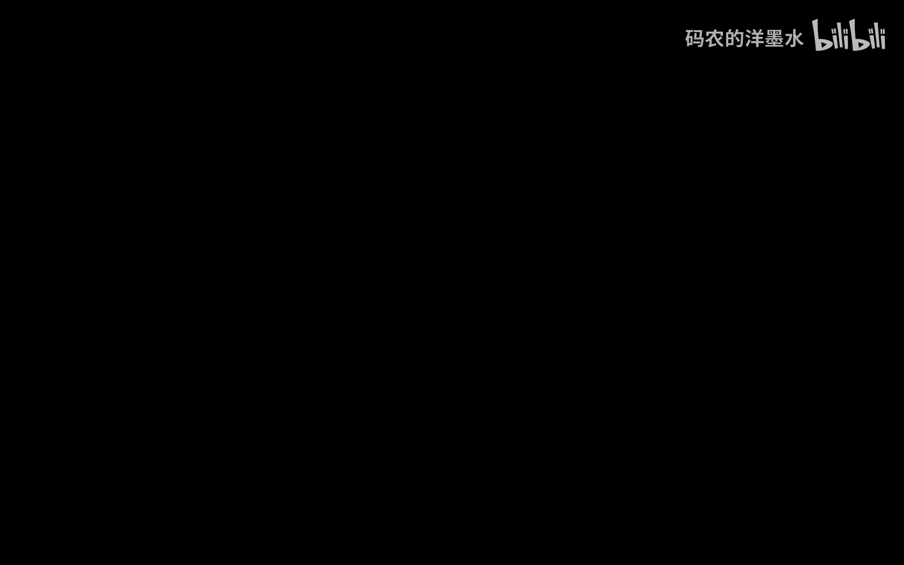

Excellent so we're going to pick up right where we last left off from last lecture so a couple days ago we left off talking about endingN right the order in which so it's not so much I guess a quick review over what we talked about last time that motivated us to this slide where we're talking about addressing and by ordering we pretty much stated that pretty much that any data that we represented our computer system whether that is numerical data or whether that is textbased data or whether that's visual data or whether that is audio data fundamentally gets transformed into a numerical representation。

And for that reason， everything， once we have that numerical representation。

 can then be encoded in a binary system。😡，So the powerful thing about having a numerical representation for any type of data means that well first of all we can use all the primitive operators we've learned that transform numerical values and we can apply those in logical and interesting ways on the whatever the more complex data type that's now being represented in the form of numerical data。

 and so we're going to kind of examine this more in this lecture， but really if everything。

Is fundamentally numbers， the most important representation we should start with to really understand how everything runs at a systems level is number representation。

Because recall how we said and we're going to look at this a little bit more in this class actually have a small little demo that we can kind of provide。

 we've already stated that we can represent our pictures and have a slide for this as three integer values one that represents a red a green and a blue。

 so fundamentally we depend on integer encoding for that representation。

And if we were talking about sound， sound used when you look at the amplitude of a sound。

 it might require both negative and positive values to determine whether you're going to increase or decrease across the waveform。

And so in that instance， we need to worry about。😡，Sign to values。😡。

And we're reant on the representation of both negative and positive values to be able to encode that so we're going to pivot so we started to talk about our binary representation as it is used for characters encode code and we're we're going actually look at some samples of that but I think the rest of this chapter is really going to dedicate itself into making sure everyone has a strong understanding of how numbers are encoded because at the end of the day whether and with text we use car codes right so we're just using a character encoding for that just the base set of non-negative accountable integers to represent each theliph in whatever your character set is。

So， and of course。There's going to be two different concerns when it comes time to。

Talk about number enr but let's pick up where we last left off I think that was kind of that was kind of where we were at last last class where we talked about all the different fundamental ways we can store things in binary。

 but I think the big takeaway and I don't know if I really landed with this punch was that all those representations are based off of。

😡，New miracle formatting。Expressing them as numbers。And then of course， if we need larger。😡，嗯。

In codedable spaces we can just add more bits to our binary string and so that's what's going to allow us to start creating different data types and so that's really going to be the distinction between like your shorts and your ints and your longs it's the number of bits that you can encode into which is going to give you a different amount of permutations for your binary words your dictionary or binary words that you can then map of value to。

😡，Of course， when that happens， recall that what we stated was that the smallest addressable size you have is a single byte。

 so if you're using multiple。😡，Byte to go ahead and store a singular value。

 then your system has to know that。😡，And this is why we have strongly typed systems。

 when you go to put， say， for instance， an integer value into your virtual address space。

 it's going to reserve a contiguous block of four by sizeized locations so that it can store each segment of that full binary word so the binary word clearly has to be partitioned into clusters of one byte sequences。

😡，Okay， and of course， when we go to read that back。

 that's what brought us to our discussion with ending in this right whether we're going to read the binary strings from the most significant bit to the least significant bit or from the least significant bit to the most significant bit was that a good summary of what we talked about last class。

 excellent。😡，And of course， actually， at this point。

 let's jump into some of the samples we have too I like to interspers slides with code samples because I think it makes things a little bit more interesting instead of just seeing something passive for a full hour and 15 minutes。

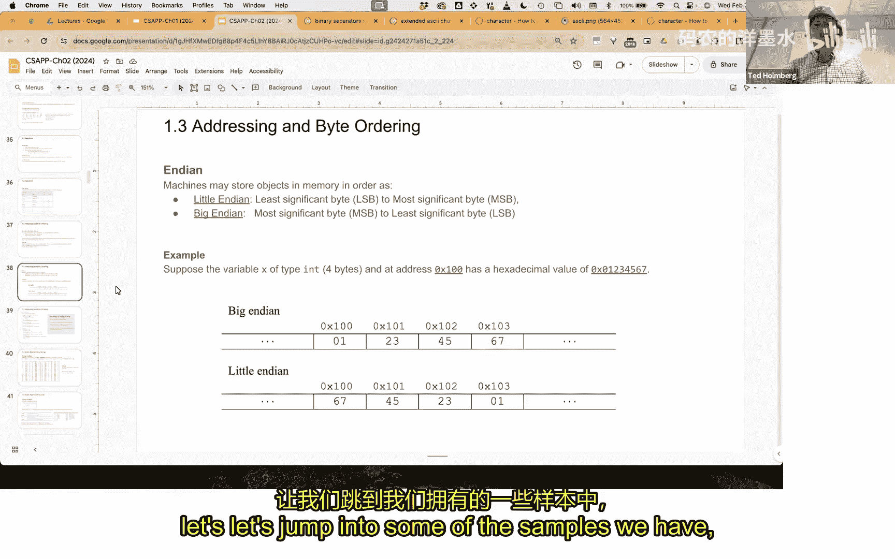

Okay， let me see what I have here。And I might。I might get to this actually I'm going to start with this one so i'm going to I do have examples that we can see how we can actually produce visuals using the numerical representation and sound but'm going to wait for a couple slides So right now since we're talking about the ending in this let me go ahead and represent that So we have here that's going to be my show here we go so it's going to be this so Gcc let me compile here so first let me do them let's take a look at this code。

Okay， and let us compile here。So GCC。看见。And then we will call this。And。Yeah。Perfect compile it Okay。

 so quick look at this code。And。I'm going to have to I'm going to switch this out， sorry。

This is going to have to come over here。You can't quite see this。

 but my my display slowly starting to go out， so I need to switch。

So this is more important for me to read these characters Okay。

 just a quick preview on what we're doing here。Okay。So we're going to go ahead and。Declare a type de。

For our bike pointer。And of course， the purpose of doing that is so that we can then use it as a data type when we define things like our parameters inside of our function。

 so we're going to create a function here， which is going to be called show bytes it's going to take that byte pointer that character pointer because each character is one byte so if we want to try to show the sequence of bytes。

 we're going to create a helper function that allows us to pass a sequence of data。

And chunk it a bitete at a time so we can inspect what is there and this and so if we go in order。

 we're going to be able to see what ordering does our system use some systems use a big endN some use a small endM and so we're going to see what system I'm using MacOS uses when we go to run this code。

😡，Okay， so we're going to pass in our by pointer and a length of how many。嗯。Bytes we want to read。

 we're going to go ahead and create a variable that's outside the scope of the for loop。

 we're going to set it to zero， our index zero effectively。

 we're going to go until we get to the left， the end of where we want to stop reading from memory。😡。

And then we will increment a bitete at a time here we will then use box notation and use the byte pointer as if it were an array to index at the zero the first initial space in memory and then advance a a bitete at a time to grab the next and then the next and then the next value and then we're going to print that out recall that percent X allows us to display a hexademal value and here we can go ahead and enforce two characters。

😡，As a part of our representation。Okay， then we're going to have these helper functions where we're going to show the where we can if we want to show an integer。

 the encoding of an integer， well then what we're going to do there is we will give the address of that integer in memory and notice then we're also going get to cast it because by default。

 the system remembers that this integer points to。😡，A。

Four block data structure right integers or four bytes。

 but what we can do is we can cast it to then do a look up on it a byte at a time right so this casting operation is when we send this address will allow us to chunk that into one byte segments and then for the length I'm just going to do the size of this is a belt in system call where we can pass it in a data type as a data type it'll give us the size and bytes of that that way if we don't have to memorize it。

😡，Okay， if we want to show a float we're going to create a helper function inside this helper function。

 we'll pass in a float value， we'll do the same thing。

 we're going grab the memory address of that value that I got passed in and we're going to cast it so that we can read it at a per character level a per byte level instead of trying to grab at a full floats are four bytes as well。

 so the four four bytes and then we'll do size of float。

And then we're actually going to also do a pointer， so we're going to do show pointer。

 we're going to pass it a void and then here we're going to go ahead and define our pointer type。

 so void star。And then we will again cast that into a bike pointer or character type and give it the address and then do the size of。

And then all we're going to do is we're we're going to invoke this in our main functions so in our main function。

 we will set up an integer value， we will set up a floating point value。

 we will get the address of say for instance， our integer value。

And buying that to our pointer value and then we're just going to print this out。

 we're going to show the byte ordering of ints， we're going to show the by ordering of Val and we're going to show the by ordering of our pointer Okay。

 does this make sense。Just going through the source code。

 so now let's see let's actually play around with this。

So here we're going to show the byte ordering of our int。😡，And it's going to be 39， 30，0，0，00。

For our floating point。😡，You see， it's going to be 00 E4， so clearly this is in hexademal values。

 right？And then finally， for our pointer， we can see that's going to be 1845， 53， B，8， F 7，7。

 F then 0，0，0，0， Okay， so just based on what you're looking here。Is this system？

What is the ordering that it's grabbing it from is it big enddan or little endan？😡。

Where little endan is where it grabs from the least significant bit and then travels from right to left and big endan grabs from the most significant bit and then goes from the left to right。

Yeah， very good。What was the clue what was the clue that used to try to predict that yeah so that that's that's a really good one because it's a pointer address so now it's really evident but you'll see the way that it gets displayed。

For our our ability to read it， this is。And the way we would typically parse it here right S F F S B85。

3，45，18 now if we're grabbing it from memory of chunk at a time notice we're going to grab。😡，The8。

Right and display that the value at the least significant bit and then the 45 here， then the 53。Here。

And then the B8 and the F7 and the SF and then there' zero and the zero。

 the zeros are what haven't been filled， So once you see that yeah that's the that's the sequencing that my system uses。

And then all of a sudden， these make sense too， these are the leading zeros。

On my integer value and then。And then here this encoding is a little bit more difficult because we're actually using that full space for our floatingating point value。

Excellent， so did this kind of help being able to it's one thing to to hear about it。

 but I think it's a good thing to actually see it so that you can actually see how our data is typically populated into our memory and how how incredibly dangerous it could be if you accidentally overwride into it。

😡，I mean， that's dangerous for sure anyway， but。You can see how it gets chunked into the segments and then we're reliant on each front of those biteside cells in order to store。

 but then maintain it and ordering where the system we don't have to we don't aren't really concerned about whether it's little in or big andan because the system does that for us。

 but it's something you should be aware of。😡，Because you can have consequences if you migrate code from one platform to the other and you don't account for that。

A good compiler does that， right， but who knows？Okay， let me。回 out of that。Where， let's move on。

Question。So I have a question， what does the void star mean in this instance。

 the void star is a way for me to pass in a pointer type to define a pointer type。😡。

Usually you have a pointer to a data type， like a pointer to an int or pointer to a car。

 this is just a pointer to a pointer， right， which doesn't resolve to any data type。😡。

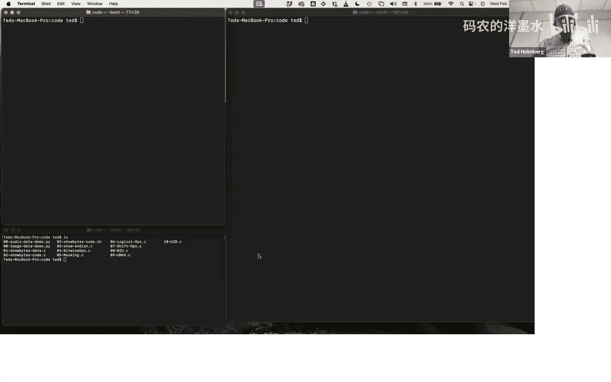

Okay， and we just went ahead and went through this code。Of course， now we've already stated this。😡。

And I actually have some live code so we can take a look at this， but yeah。All of our characters。

Are represented。Using。A set of single bites。And whenever we have a string。

 we could think of it as an array of characters as you should all be aware now after working on the S application。

 and then the the string is typically always。😡，Append it with a null character so that the system knows that's the delimiter。

 that's where it can go ahead and stop reading。😡。

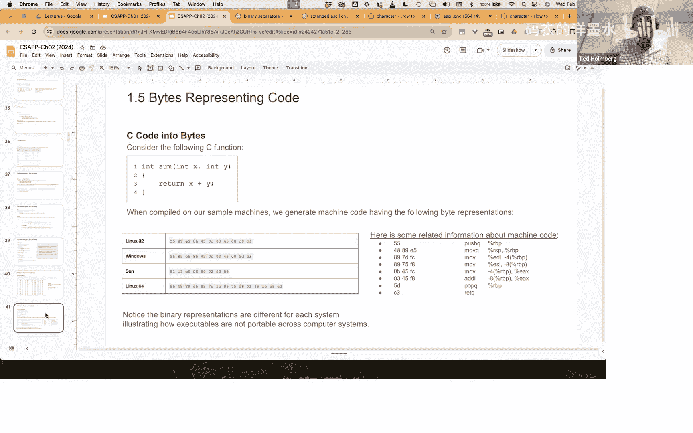

So let's see here I have not just the characters， but we have an example we can take ahead and look at so let me open that up I think I want to call that zero1。

And let me make sure I can compile this， what is this， this is my show guidance。It's。Jo one。

 there we go。Okay， show bites。So let's take a look before， I guess let me run it。

So that you can see the output while I talk about it。

And then we'll talk about what's happening in this code。Okay。

So what we're going to do here is not dissimilar to what we just did in the prior code example。

 but here actually just want to show you the encoding between various data types just to show you how our data types are encoded in binary we're talking about with characters just a moment ago。

 but I'm going to extend this concept beyond just text characters to also illustrate how our integers and floating points floating point values are also and our pointers as well so here we're going to use the same function we saw before the show bytes function we're going to create these same helper functions for show and show float show pointer but now we're going to add a show string as well。

Because here the idea is I'm going to create。Each one of these values here。A integer value of 12345。

 a floating point value of 12345。0， not a very interesting floating point value。

 but still having to use the the encoding setup。The formatting scheme we will create a pointer that grabs the address to our integer and we'll go ahead and use that and then finally we're going to create a character pointer so that we can go ahead and save string that will be one。

 two， three， four， five so notice effectively we're using the same characters that's on purpose。

Right。One， two， three， four， five。As a character，1，2，3，4，5 as an integer and 1，2，3，34。

5 as a floating point value。 Now look at how they're encoded differently in our binary sequence when we go and display this right so my integer value is going to map as。

And as we block it out， we know that this is。That is in the least significant bit to most significant bit chunking when we display that but you could see the hexasmal value at a time。

 so the byte sequences of our int versus our floating points versus our pointer value and then finally our string value now the thing about the string value this is the one interesting addition to this particular example。

It's that each of those is the ASII code because characters are one by sizes so you could actually go and on the lookup table and translate that let's see 31。

 32， 33， 34 do I have the entire table here。

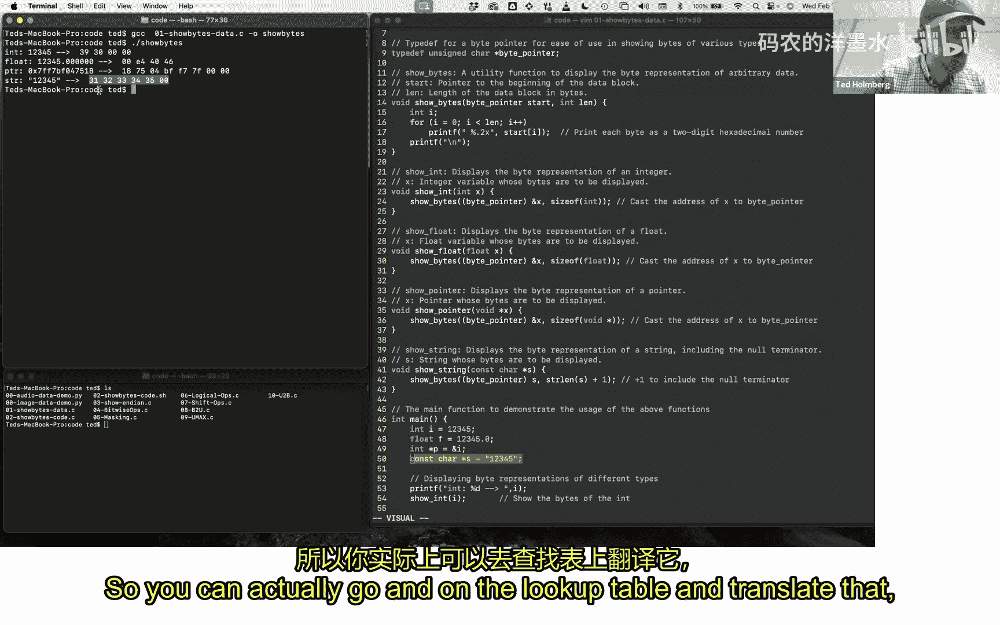

Yeah。So 34。34， 43。10。I don't have the numbers Oh yeah I do here they are so here we go so 31 32 333435 so that's our one two34 five6 so notice we can just easily use this encoding table look at what the binary hexasammal value is and say oh yeah that's our character。

And that's why character codes are both text and numerical values simultaneouslyers。

The system treats it as a number， we treat it as like a letter。Okay， let's do the same thing。

 but motivate this with code as well， we've kind of seen this in practice。

 but we're actually going to actually get our system to actually show this off。

So when we declare this function， say for instance。

 this function called sum that takes them two parameters and x and O y and then returns to sum of those two values when we compile that。

What gets put into memory is going to be a hexasmal representation of that code。😡。

And so the system knows how to retranslate each of those hexadecimal values into assembly instructions。

 then once you have the assembly instructions， you can go ahead and parse that if you wanted to into higher level language。

😡，So that's what a lot of reverse engineering is all about。

 you take the hexasmal sequences from a disassembler like Itda Pro。

It can translate it into a set of assembly instructions and then once you know how assembly instructions work。

 you can start thinking of the patterns that get generated with that and mapping into a high level language and actually reverse engineering is one of the classes you can take if you're interested in going the cyber track。

And so in this instance， and this is this is actually one of the more important things about this particular slide is that look at our Linux 32 versus our Windows versus our sun versus our Linux 64 system and notice the hexademal representation is different for each one of that that what that means is that once your code is executable。

 it's no longer portable。If you try to feed that heademal sequence for a Linux 64。

 even into a Linux 32 system， it won't be able to run it the same way。

That's what we mean by code portability by them。Now， if I actually want to translate。

This hexademal set of values back into。😡，The assembly instructions， it would look like this。

 but let me ask you， how do you think I was able to get these？😡。

The mapping between the assembly instructions and the hexetmal representation。Well。

 one cool thing that the system' is designed for again。

 our shell is designed as an application that allows us to execute a number of other applications。

 so that's a big driver of what the shell environment is。😡。

There's a lot of powerful tools that are really catered towards let's call people who use Shells Power users。

So for those of you who are adept at using shells， there's a very。

 there's a set of built in tools and commands that allow you to evaluate。

Applications executable applications since the shell is designed to run applications。

 clearly it should also serve as a testing tool and a debugging tool that allows you to assess what is wrong with an application that you're trying to execute one such command tool that's worth knowing about is called object do。

😡，And so object dump is a disassembly tool。It allows us to disassemble binary executables that allows us to then to get powerful insights about something that started as a high level language。

 went through the compilation process to be converted into hexademal representation we can then。😡。

Disassemble it from the hexademal back into the assembly language instructions。

 that's as granular as it can get without getting a more powerful application to try to guess what the assembly instructions then map into a higher level language。

😡，And so what we want to do when we go and do our disasse。

 we'll actually play around with this in just a moment。

 we're going to pass it the D flag that allows us to disassemble and so we're going to display a binary to assemblymb translation then。

So when we do this， there's another thing with this particular example， I kind of want to motivate。😡。

So far， we've seen we can use the shell environment to execute our own。😡。

C code applications right so we go through we compile our C source code into executable object code and then we can tell thech let he run that。

😡，Well， the shell can run almost any kind of applications that have been compiled， say for instance。

 it could be also Python or JavaScript or Java we've seen that before。

 so we could use a myriad of languages， but believe it or not the commands we use in the shell itself can go into a file and be executed。

😡，So we can even execute what are called shell scripts。

Whi is simply a file that has the same key words you would use to to be interactive with the shell。

 and then what happens is，😡，The one thing in common with all of the files that allows us to launch and execute on our computer system is a permission so when we talked about files earlier files have certain permissions there are an abstraction that allows us to encapsulate a sequence of bytes and then parse it in some。

😡，Some way based off of the context， whether it's the context of C code or text file context or a P&G context。

😡，So the privileges that a system enforces on a file is read， write， and execute。😡。

Readed allows the system to access those sequence of bytes and actually bring them into memory so that you can actually read them。

😡，But you can't write them， you can't mutate them， right privileges allows you to access that sequence of bytes so that you can actually change the state。

 you can mutate it。😡，Execute allows you to be able to read that system of invites and actually use it as a launch point for a set of instructions that then tell the processor to do something with it。

😡，So every file has those， that means every file can potentially be an application file。😡。

So we maybe think of those as different things， but at the system level， it's all the same。😡。

And so this allows us to actually create a text file like a shell script and then use a command that changes the file type by default。

 it's not executable， but we can do change mode from the shell to change the permission level on a file。

 so instead of just having to read and write， we can make it executable。😡。

We're going to take a look at that that's going to be the next practical demo we're going to take a look at。

😡。

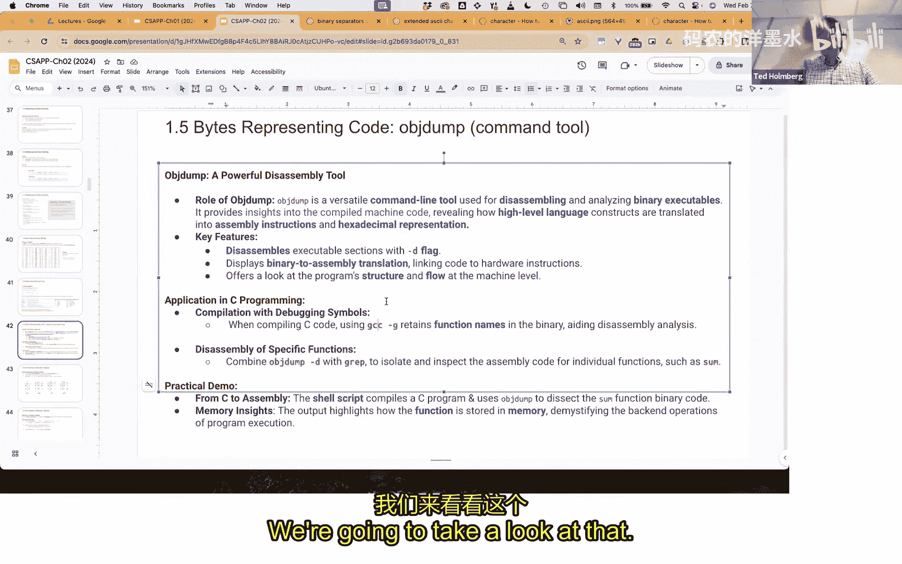

And so this is really just to highlight and demystify high code is like it's the same as all the other data that exists inside of our memory。

 inside of our system。😡，Okay， let's clear this。 let's squ out of this。Okay， let's stay here。

So I want to so let's take a look at the source code， so this is going to be a thing02。

ButWe're going to show the bytes for code。And yeah， we just want to bend for that。Okay。

 so let's start。By taking a look at the source code that we're going to look in a disassembled state it's pretty simple right we're going to have a preprocessor directive that's going to go ahead and include our standard input output function so that we can use print we're going to create this function。

😡，Called sum returns back in integer takes in two integers and X and a Y and it just returns the addition of them of the right super simple to write and see but we're really going to strive to get that disassembled codes by we did something very short and simple we're going to create a simple main function this main function is just going to do a print statement and inside of the print statement it' also going to invoke sum on one and two and then display that whatever results from that function call and then we're going to return zero if our our application runs as we'd expect and in fact we can test this out actually let us。

😡，Sttu GCC， what is this called zero2？嗯。嗯嗯。Do I want， no， I'm not going to compile it here yet。

 going going we're going to do that actually using the shell script。Okay。

 so no questions here because this is super simple， so now let's look at the shell script。

Now notice for She script the。😡，File extension we use is dotsh。

So on a shell script typically we do a hashtag， we use the hashtag ab， we do it a bang operation。

 say hey， this is designed to run in a bash environment。

 so this is our executable environment for our shell script which is the shell。

And notice if we wanted to add comments into our shell script。

 we just use hashtags right so it's going to ignore anything that is has a hashtag so that I can go ahead and give as much insight。

😡，To a human reader where it then gets ignored by the system itself when it goes to execute this。😡。

Here I'm going to go ahead and invoke the GCC compiler。I'm going to use the dash G。😡。

Wwhich is great for debugging purposes I think I mentioned this here what what this does is during the compilation process。

 if we want or no we want to hateer to a debugger passing the dash G flag during the compilation we'll preserve the function names by default。

😡。

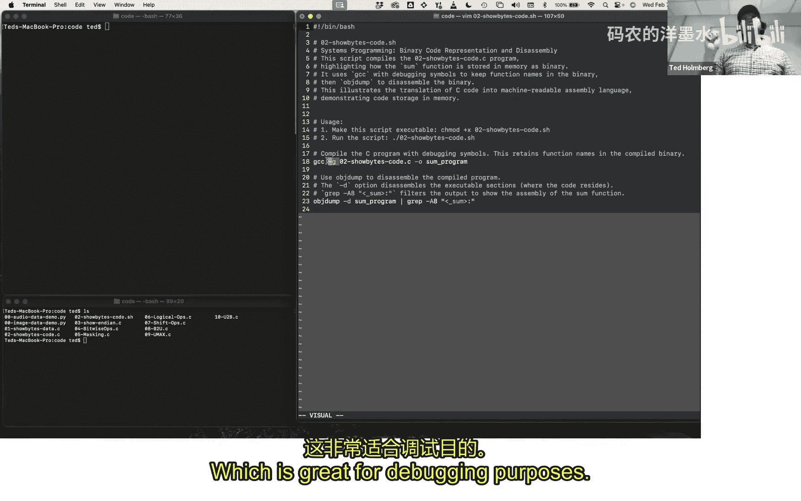

If you don't do that， it just it doesn't care about the function names when it translates it so it's just going to create random garbage to it。

 but since we want to be able to access to some function without having to inspect every line of code that gets。

😡，Asmbled right we want to be able to use a search term。

 we can pass that and it makes the disassembled code and the assembled code much easier for us to debuult。

😡，So that's why I'm going to do the dash G there。😡，And so。

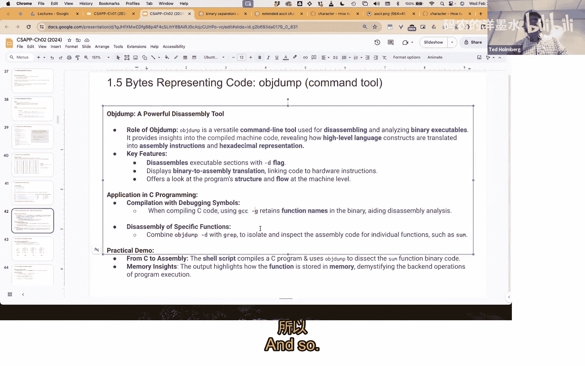

Then what we're going to do here is again one of the beautiful things about the shell and actually this is going to be a big highlight when we start talking about what we're going to do for the midterm is that there's a lot of built in application that make processing data whether it's being output from an application or if you're trying to pipe it into an application it makes it very easy and powerful so one of these is clearly the object dump we're doing the dashD recall because that will allow us to go ahead and do our disassembly on our object code from our executable then what we're going to do is we're going to pass it the application so here the output our application was called some program so when I'm I run this it'll compile this for me and then create an executable called some program then I'm going to dump that binary executable disassemble it so I show the hexademal valve。

What memory addresses it's in the hexademal representation of those memory addresses。

 and then finally the assembly instructions that map to those hexademal valuess。😡。

And then since I don't want to manually search through all that code。

 I'm going to then go ahead and feed that in to an application called GrP。😡。

And GrP is effectively like it allows me to search my system for keywords。😡。

So I will use GP to go ahead and search looking for the sum function。

 so when we have our disassembled code is going to put the function names when we use the dash G flag。

 it's going to encapsulate them in angle bracket and preface it with an underscore。😡。

Just so you know， so that's what we're going to search for。Okay。

 is there any questions about this so these I could just type in。

 but I want to show you that I can type it ahead of time。

 I can create a shell and then if I actually want this shell to be executable right I do this right here change mode and then boss X means。

😡，Provide executable privileges。 And then I would also give the file name to do that。

 So if I do that， let's actually do that now， I'm just going to。So let's do change mode。

Did I get that right please I have a bar right there， I can't see what I typed。We'll help us right。

Okay， we do that no， yep， that's。I felt like， okay， there we go。Perfect。

You can actually see my mom about。A quarter of my monitor is just nothing but black bar。

my display is slowly going out on it。Okay， so let's actually so。If this isn't executable。

 we've seen the protocol for executing an application that's inside of our local directory it' usually dot slash and then whatever the executable name is right so here let me go ahead and try to do that and notice it's actually executing just like any other executable application or executable file。

😡，And so here on the output we can see， oh， this is the memory address for that sum function。

 so we can see exactly where in our system that has now been put into。

And then we can read each of the hexademal values that represent a part of the instruction set for that full application。

😡，And what memory address that resides in and notice there's different blockings of this so this 55 represents pushing things onto the stack。

 probably because we need to clear out the registers and everything to start doing the some call。😡。

And then we're going to move some values。For our destination pointer and our source pointer。

 and then finally we're going to do this edition here。And then pop everything off and then return。

So we'll talk more about the assembly， remind everything， but the point of this。😡。

It wasn't to start reading assembly， it was to illustrate that our code is just data。😡。

Inside of our system。And it's stored in memory， just like all the other data inside of our system。二。

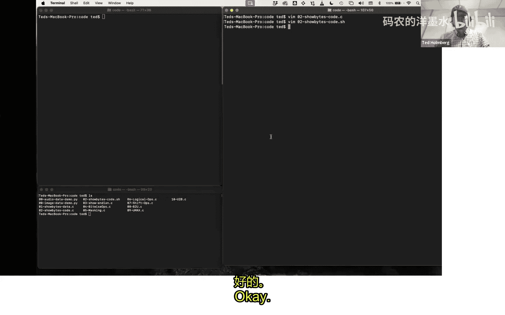

Okay so we've already covered a lot of what C allows us to do。

 but let me just so I don't want to spend too much time iterating over these slides because you've already seen this before when we did our crash force in C but I'm going to bring back these concepts because it's important us for us to understand now that we see that everything inside of our system is represent it in the form of binary sequences then the way that we constantly transform the data the complex data is with the operations that allows us to affect the binary sequences。

 the bit vectors so what are the primitive operators that allows us to effectively transform the bits themselves well that's going to be our bitwise and logical operators and they have different behaviors and we already talked about these different behaviors right so clearly when we define a bitwise operator it's intended purpose。

😡，Is to go ahead and only operate on two a pair of bits at a time。😡，However。

 just like we have very expressive sets of rules for linear algebra that allow us to do entire transforms of fields of value。

 our bitwise operators can be applied not two single bits。

 but entire in fact entire bit vectors and the way that it works on a bit vector so again let's go to the idea of a binary operator so it requires two different opera well。

😡，In order for a bit vector。😡，Bolean algebra to work， our vectors have to be the same size。😡。

And if they're not the same size， you have to make them the same size。

 usually by zero filling one of them。😡，And then you can go element by element inside the vector and then do the operation。

 but that operation has been done uniformly across all the bits in the entire bit vector and of course this is just your mathematical definition of what it means to be a bit vector so but I mean clearly this is an easy way of interpreting mathematics which is just stating here this is our value。

😡，For our A and our value for our B。And again， for all of our bit wise operators。

 we can do it on bit vectors as well。And so let me see here， do I have。

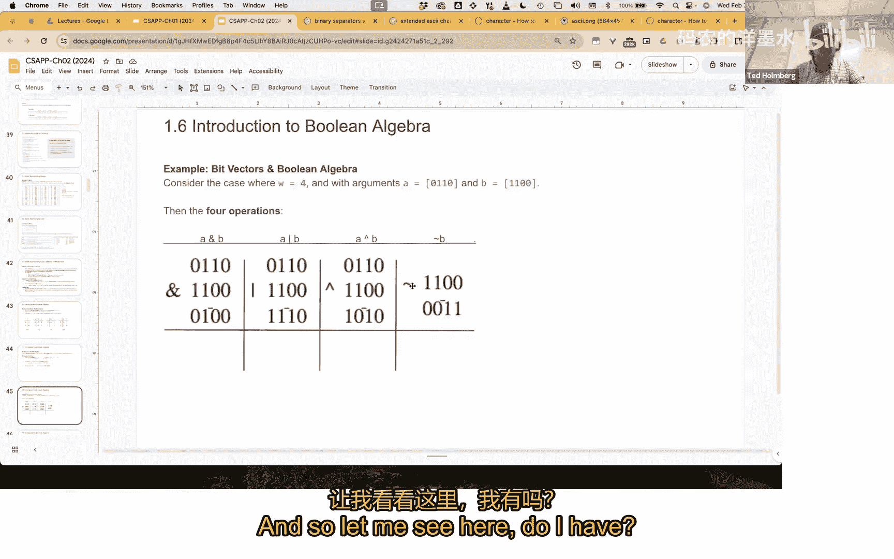

Yeah， let's do this。So for let's clear this， let's take a look at our。

So we can just see really quickly。Some basic code where we will have the ability to print a binary string。

And then what we're going to do is we're going to， we're also going to create a print function that creates a pretty print。

So it's going to print our bitwise operation so we're going to have our first binary string our second binary string the results and then as a character string whatever the operation type was so here let's take a look and say we have these two different binary sequences and that does not look right I think this one is like that and I think this one is probably like that。

No， I'm not in edit mode。Anyway， so we're going to start with our two binary strings I don't want to get an edit mode in case I。

Change by accident while i'm playing around with my mouse so just just say here this isn't quite accurate but we're going to see what it looks like when we go ahead and compile our code so the first thing we're going to do is we're going to do the bitwise operators on the entire bit vector show the results let's just do it。

😡，So let's see this is 04， I believe， let's call this it wise。Ops。

And so let's run our bitwise opt so here if we start for instance。

 with this sequence yeah that looks more correct right the FF here and we have R one okay。

 so if we do an or operation notice it's doing the entire bit at a time。It's position。

 so like the least significant bit gets bored with this one， this one gets ordered with this one。

 it's the same with my ans， it's the same with exOs and finally it's the same with a knot。

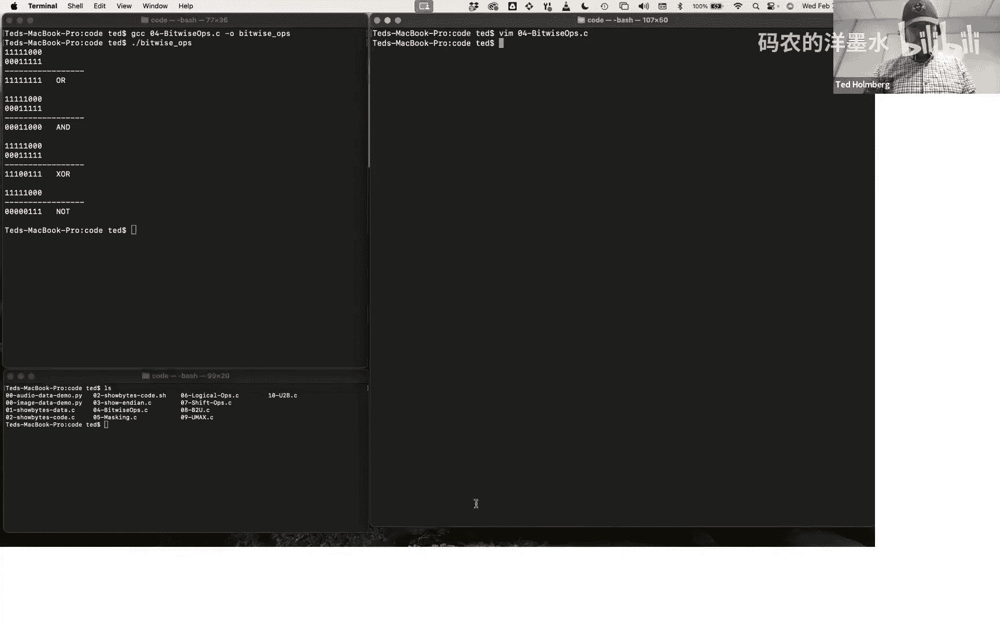

Okay。Okay， so let's talk more about bid vectors then so now that。

So one of the powerful concepts behind our bitwise operators is that they can be applied to an entire vector at once。

 regardless of the size of it， so long as the pair of bit vectors match。

That's powerful because now we could do a transform on entire sequences as opposed to having to iterate through each bit at a time to do those transforms。

And of course， it's the bit vectors that allows us to represent finite sets of things。😡。

And so once we start talking about sets there's an alternate way that we can represent a bid factor so one way of representing the bid vector is what I just showed right I show you。

😡，With all the zero and one values now that creates a very large binary strings。

 so typically we compress that by retranslating them into hexadeimmal values right because I can group bits into clusters of four and represented with one character instead of four but even then that's still kind of arduous and large there's a way to also alternatively。

😡，Moel。A binary string as a set of values as opposed to a vector of values。

 do you know the difference between a vector and a set？😡，That's kind of a nuanced concept。

 but it's one that's worth understanding and probably it's one that you talk about in data structures or do you talk about in 2120？

At least mathematically， what's the difference between like a vector and a set？能。

So most of the time when you hear vector， I mean， these are all good insights and what that's showing me is that the term vector。

 when you hear it comes from you hear it in physics。Right and so yeah。

 we use vectors to represent things like directionality with a certain amount of magnitude or you can use a vector to represent a set of multiple coordinates to create like a 3D access both those are use cases of vectors actually let me even abstract this term even more so for you anything that is an ordered collection is a vector。

😡，So ordering does matter， that means the thing at the zero position in our terms versus the first position versus the second。

 those values， you can't just jostle around。😡，So it means you and so when ordering matters。

 that means you can have repeated elements so I can have multiple zeros and ones inside of a vector so that makes sense for coordinate systems right that makes sense for directionalities with magnitude。

 but in fact any list then has a vector like properties。😡，In fact， in C。

 what you would normally call a list in like Java or a Python is usually called a vector。😡。

In math that's what we call that as well so anything that is just now we can have multidimensional vector and that's what our matrix sees。

😡，Okay， so a vector， but the important properties of a vector is that。It's ordered。

 think like an array， right so that you can start indexing into values and。😡。

It can have repeated values， so that allows us to represent these all as one group notice i'm using angle brackets to say this is my big vector。

😡，Okay， but I can also just as equally represent a bit vector instead as a set。

 let me distinguish what a set is a set is a collection as well， but ordering does not matter。😡。

And every element has to be unique。😡，So sets， so for instance。

 the set of keys in a dictionary is a set。😡，Because all the keys in a dictionary。😡，Again。

 if you went through data structures have to be unique， they can't be duplicated。

 but the ordering doesn't matter right it's not like the indexing inside of a vector or an array。😡。

Okay， so does everyone kind of understand the distinction now mathematically between the set a set and a vector？

So we saw how we can represent our binary sequence as a vector。

 so we can also do the same thing with a set now we have to retranslate it a bit right because sets。

Have to have unique elements that means you can't repeat the value zero or one more than once。😡。

So what you do instead to represent a bit vector as a set would be to count the position in your vector when you have a one。

😡，And this could actually allow you to start compressing。😡。

Your binary string in a significant way and it's interesting there's some interesting things that can be had once we redefine or we translate a new way of modeling our binary sequences。

😡，So in this example， I have my bid vector as 01101001。

 or I can say it could be represented as set A where at the zero position I have a one at position three I have a one and position five I have a one and at position six I have a one。

😡，I can then go ahead and then represent vector B。😡，Which is just that ordered sequence。

 an equally viable way represented as set notation as instead would be to say at index zero。

 I have a one at index2， I have a one at index4， I have a one and at index six， I have a one。😡，Now。

 why do this， We already had one ballot representation for defining our binary sequences。 Well。

 when you could start merging。😡，Different elements of mathematics when you have different operations that you can do between say for instance。

 vectors and sets， it becomes very strong when you can find a way to reformat it to see how closely one set of operations。

😡，Can map on to another。And in fact， this representation has an analog for all of our bitwise operators。

 so if you're familiar at all with set theory， have you' all covered set theory in discrete mathematics。

😡，And all very basic。Ideas with set theory have to do with the union between sets。😡。

The intersection between sets and the complement between sets。

And it just so happens that in set theory conceptually。

 those map cleanly to the bitwise operator of or， so to take the union between two sets is to take all of the elements from one set and all the elements of the other set merge merge them into a bigger set。

 well， that's what the bitwise or does for us。😡，The intersection is to only take inside of two sets。

 those that are shared elements。😡，Well， that's the same behavior that the and operator does。

And then finally， the compliment。Which takes the inverse of whatever's left out of this set。

So that's kind of like our not operator。So then we can see very easily that if this were my bit vector。

😡，And I was to do the bit wise and between that vector A and B， I can also do the intersection。

 and even though they're represented in two different ways， one as a bit vector， the other as a set。

 they still。😡，transranslate into the same results， which is powerful because now set theory has more expressive means of transforming our binary data。

 we can use those tools and then convert it back into a binary string or a bit vector and then use those tools。

😡，You can never have so you don't need to know all the maths to be a profession developer。

 but what can make you like that next level up is the more mastery you get with Mas。

 the more ways you can model a particular type of data and it just gives you more tools to be able to manage and handle it and once you get a good analog between two different data formats you then just give yourself a lot more availability from being able to use the tools from one set of maths versus the other。

😡，Okay， let's go back and start talking about how we do use things like bit vectors。😡。

Or sets or whatever， right these more complex data types to represent more complex。😡。

ADa or just more complex concepts inside of our system。 So we had stated earlier that。

The more abstract things like images， sound and text have a numerical representation。

 we kind of alluded to this talking about how colors can have one of three different values red green and blue and in fact there's a hardware component to this because each pixel inside of either a smartphone or a monitor or whatever it is a television right is effectively put into a joint twodimenional array where at each cell there is a red element。

 a green element and a blue element， you put them all on you get a white。😡。

Value and if you turn them all off， you get black。😡。

So we can actually create a three bits color definition。

 now we said earlier usually you have a bite per color。

 but actually we can represent minimally valued each color as a single by。😡，A single bit。

Normally they're a bite， but imagine a scenario where it's just a bit。

 it's either we have the red LED on or off。😡，We can still create a number of colors just with that amount of information。

 say for instance， when they' were all turned off we would have black if we had them all turned on。

 we would get white if you turn just the red value on and again we can create a table where we can then map each of these states and these states actually map into the way we express color in reality。

😡，So this maps to our black， this would map to our blue， this maps to our green。

 this maps to a combination of our green and blue， which we call can。This maps to just our red。

 this maps to a combination of red and blue， which is going to be magenta and then finally when we combine red and green and light there we get yellow。

So we get one， two， three， four， five six， seven， eight different colors we're using just three bits of。

Of data to be able to go ahead and encode a value between red， green， and blue。Now。😡。

To illustrate that we can now rely on the binary operators。

 the bitwise operators to start processing things like color。

 because that was the idea we have these really complex abstract qualities that we're defining numerical representations on。

 and we want to transform the underlyinglining binary sequences using our bitwise operators。

 logical operators right our left shifts， our right shifts。😡。

How does that map once we've actually defined？😡，Value a definition to this binary sequence well let's see if we have red。

 which is 100。😡，And if we have in an RGB setup， and if I have green， which is 010。

 then the result of actually mixing those two colors produces yellow right。

 and notice the bitwise and operator does produce the yellow。😡。

So we can actually use these really rudimentary。Binary operations of transform transforming bit strings and it matches to the actual color that should produce from those combinations。

😡，Ah let's actually see a demo， not going to do a demo in sleep or anything visual or music。

 we're going to go up a language level， we're going to use Python。😡。

Make the code because this is to motivate how our more complex abstract。😡。

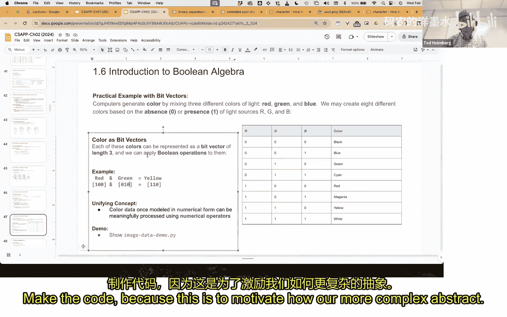

Data like images and a visual and audio can actually be mapped to。😡。

To our underlying numerical data values and once there's numerical data values。

 then it's an easy step to translate into binary strings and process it that way。Okay。

 so let's see here， what do we have， Is this a zero zero。

What are my options let's see the image data Okay， so here let's take a look at python so python is。

It's a wonderful scripting language， it's very easy to use， does not have。😡。

To be compiled right so it runs on an interpreter through your shell so just like you have compilers and the ability to execute object files from your shell。

 you can also run source code files， script files through an interpreter as well or wants your interpreter from from there as well。

From the shell， shells are very powerful， you should definitely learn to get the most out of your shell。

Okay so what am I doing here so i'm going to import a library that allows me to do images i'm going to go ahead and then also import a library that allows me to use nuI which is a numerical module that allows me to do things with vectors and matrices here i'm going to create some data each one of these is going to represent a pixel so i'm illustrating I can actually draw a pixel at a time giving these numerical formats that we talked about so this is a red pixel right？

😡，And so here we're actually going to use the Bte representation that's the common representation you actually have for RGB。

 not a single bit。😡，So here we're going to do set our color value all the way to the max that you can get with one byte which is 255 and we're going to set our G and B values to zero here this is going to make a green pixel。

😡，Here we're going to make a blue pixel and then here we're going to make a white pixel。😡。

So I'm going to take this array and I' turn it in I'm going to take this list and I'm going to use NP array just to turn into an array because that's what the module that's going to produce our image is looking for。

 an array of RGB numerical values then I'm just going to pass I'm going to call this function outside this module image it has a helper function called from array where it pass it an array。

😡，And I tell it the formatting rules because believe it or not。

 there's more than one way to format your colors into numerical values， RGB is just one of them。

 HSL is another popular one。😡，So we're going to then get an image back and then we're actually just going to show that image。

😡，So let's let's go ahead and run this so if I want to run this I use Python 3 and then what's this called zero0 dash image。

There we go， let's run this。It's going to launch and then there it is。 Okay， yeah， this is perfect。

 right， That's exactly what I wanted。 Can everyone see it。Okay， so I was drawn individual pixels。😡。

But fortunately I can zoom in， let's okay， oh yeah， there we go。

So just think every time you're displaying something onto your monitor。

 that's exactly how it's doing it right pixel of the time or on your phone or whatnot。Okay， actually。

 let's do this as well since we're here。Let's take a look at。

Let's take a look at our audio as well so here i'm going to also grab thumbumb i'm going to grab sound device which is a module that you can go ahead easily important to Python we're going to create this helper function that's going to generate a tone so in order to generate a tone the numerical values that we can define or map onto music is frequency duration and sample rate so I think someone had looked that up last time。

😡，And so here we're going to get the number of samples we need based off of the sample rate and the duration we wanted for。

 so the multiplic property and those two things tells us how long we're going to go ahead and play our sound for。

😡，And then what we're going to do here is then we use a little bit of a trig because music follows a wave like pattern so we can use a sine wave。

Pass in our value using both pi and the frequency and that's going to be able to generate the particular node so suppose I have these tones I want an a4 a C5 and an E5 right so there's a numerical representation for each of those that falls into this waveform function。

😡，So and suppose the duration we want to play this for is two seconds。

 then I can just go through and iterate each of these notes pass it into that help function and actually have it play those sounds let's actually run this just a week and this is just a proof of concept this is obviously not something that we'll ever do inside of this class but I want you to really understand that everything is just numbers in our system。

😡，You find a mathematical model that allows you to represent something and then you can automate it。

Perfect。😊。

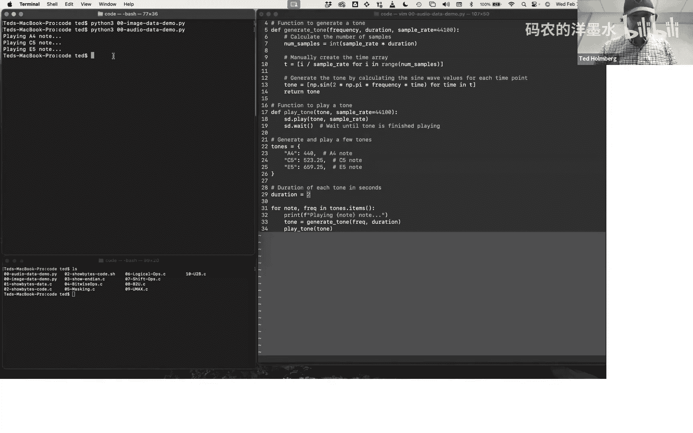

Okay， let's go back。A little diversion， but one that I think is a kind of fun one just to see how we can get music。

 how we can get visuals into our system where all we're playing around with at this level is map。

Okay， so we talked about the bit wise vector operations。

 which I already showed you right we already saw this， didn't I？So we'll skip past this now。

I've discussed this before what is this here this is yeah so if we were to do this by hand if you want to evaluate the results of your bitwise operations typically we have our binary and hexademals but when you do your operation it behooves you to actually express it as a binary sequence and then once you get your result retranslate it back into hexademal this is if you were double checking your systems usually you'd want to use debugggging tools to do that right but if you wanted to do this yourself you definitely want to map between base 16 and base 20。

😡，It's much more difficult to do the bitwise operations when they're already clustered in groups of four。

 because then you have to memorize the inflection between them。Okay， so okay。

 so there's also a concept called masking does y'all get into masking at all inside of assembly。

So the idea behind masking operations is where you can create a bit of pattern that indicates。😡。

A means of selecting some set of bits from the entire bit vector and allowing you to mask or hide others。

😡，So hence the term mask so this allows you so so sometimes you would do this in assembly when you like XO a register with itself to make sure it was zeroed out。

😡，So you have these operations you can do just to make sure everything's nice and clean so sometimes when you're changing data sizes。

 let's say from one byte to two bytes or four bytes。

 you want to grab the part that is meaningful and then mask out the rest。

And so that's exactly what we're going to do suppose here that we have the mask of zero x FF so that's a one bitete mask right and we're going to set that to all one。

😡，Now imagine if you had a larger binary sequence， a larger bit vector than just the byte。

 if we did the bitwise and and zero filled so that if the bit length we're the same。

 then we mask everything that's not part of the mask here。

 we're going to zero out anything that's not part of the mask because the and operator is going to only keep the things that are both inside of our mask and inside the original or the bit sequence we're interested in。

😡。

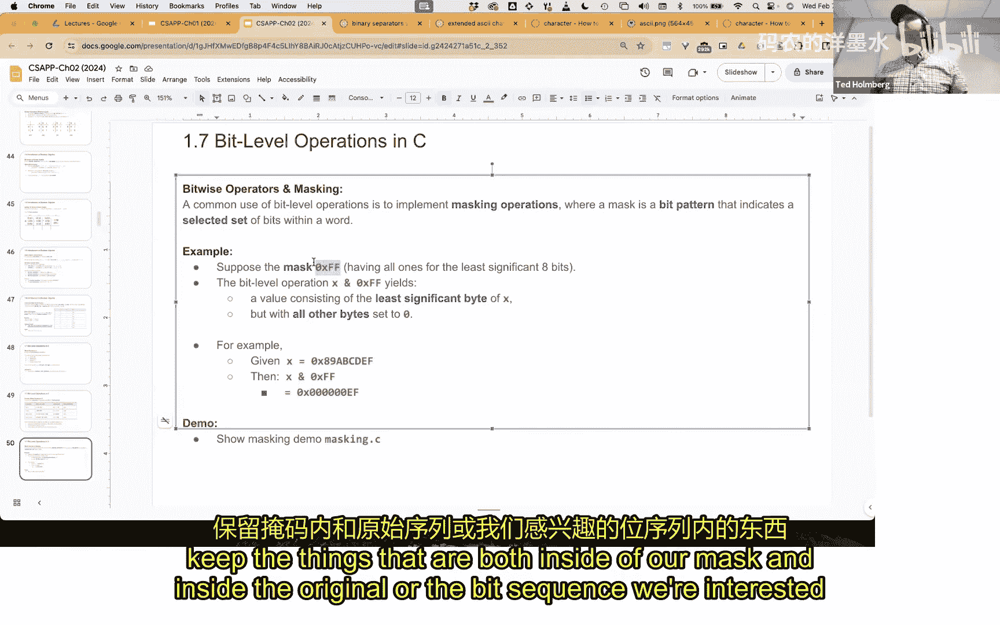

Does that make sense here， let's actually just take a look at it。Is this what zero6， no， A operators？

What is this masking 05？So here I'm going to create a much larger。😡，Binary sequence that I'll call X。

 I'm going to create a one byte mask。😡，Where it's all set to ones。

 but it doesn't have to be contagiguous blocks like can I can mask every other value if I wanted to whatever the bit pattern is that I choose。

Here I can just do a bitwise and operator again， the entire point of showing you this is a practical application of how we use the Bitwise operators to actually do things。

😡，And that's going to give us our mask value and then we're going to show the original value。

 the mass value and the mask itself， so let's go ahead and compile this， what is the 05。

This is output and what's called this mask。Okay， and let's run our mass code。There we go。

 so original value right this is their masking value。

 so all we're left with here are these right E EF。Has everything else got masked out？

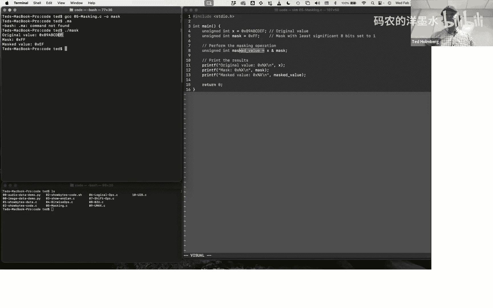

Okay， I want to highlight we've talked about this I'm going to fly through this very quickly on logical operators are when we have the double。

😡，Or the double and right the chaang the knot sign they produce different results on binary sequences than the bitwise operator so be very careful when you're using your logical operation versus your bitwise operation remember that what's going to happen a result when we do these logical operations is it only returns a 001 so it can take your entire expression and then convert it into something that's just  zero1。

😡，Something that's truthy or falsey， we'll just take a quick look。

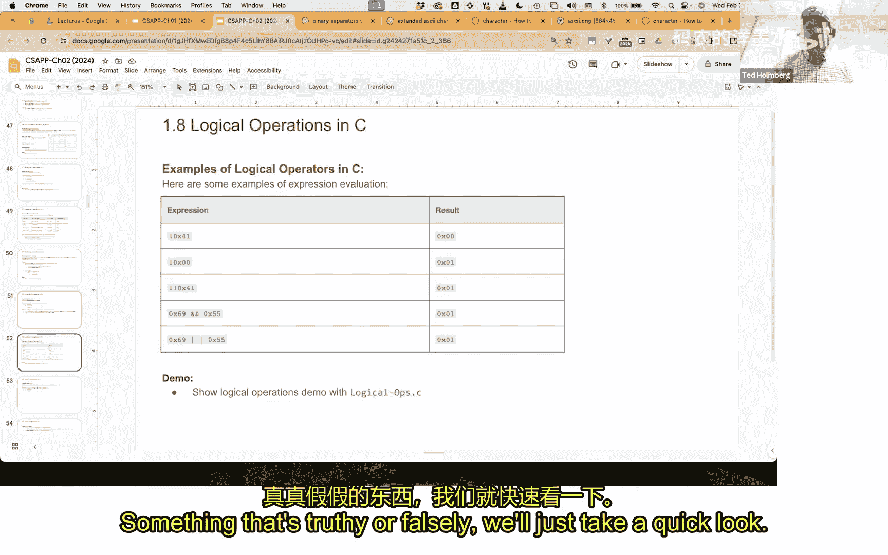

Just so that we can。Since I havet。Right here 06 so this is some really easy code I just have some binary sequences i'm going to go ahead and sbang them double sb them i'm going to go ahead and logical and them logical or them。

Let's do GCC， what is this R 06？And let's call this。A logical。And here。

We can see yeah the results of all our of these operations predictable right but at the same time yeah this isn't a way to preserve binary vectors at all you can use them but probably not for bid vector transformations right you can use them to just see if there's a bit a single bit a one right or not。

😡。

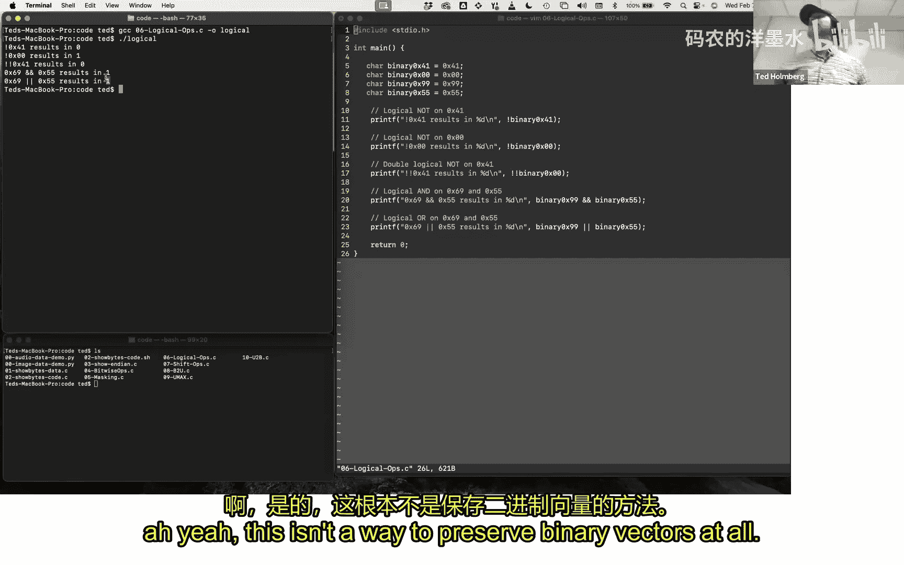

Okay， and then finally， we already talked about shift left and right， do I want to end here？Yeah。

 so I'm really close to ending， I think on this part of the chapter so the last bitwise operators that are worth mentioning besides the bitwise operations besides the logical operations are going be our shift operations where we can shift our bits either left or right and we've already seen example codes of this the thing I really want to highlight I think I saved this before but I want to say it again is that when we shift right there's a distinction between a logical shift in an arithmetic shift logical shifts are done with unsigned integers so when you shift it just zero fills。

Whereas arithmetic shifts you work on signed integers， remember our signed representation。

 we're going to talk much more about this。😡，Next lecture is we encode negative values preceded with a one versus a zero your most significant bit is your sign bit so you want to preserve that when you're left right shifting so an arithmetic shift we'll do that with sign data and just to go ahead and illustrate how this looks let's is through the shift ops and then will be done for today。

😡。

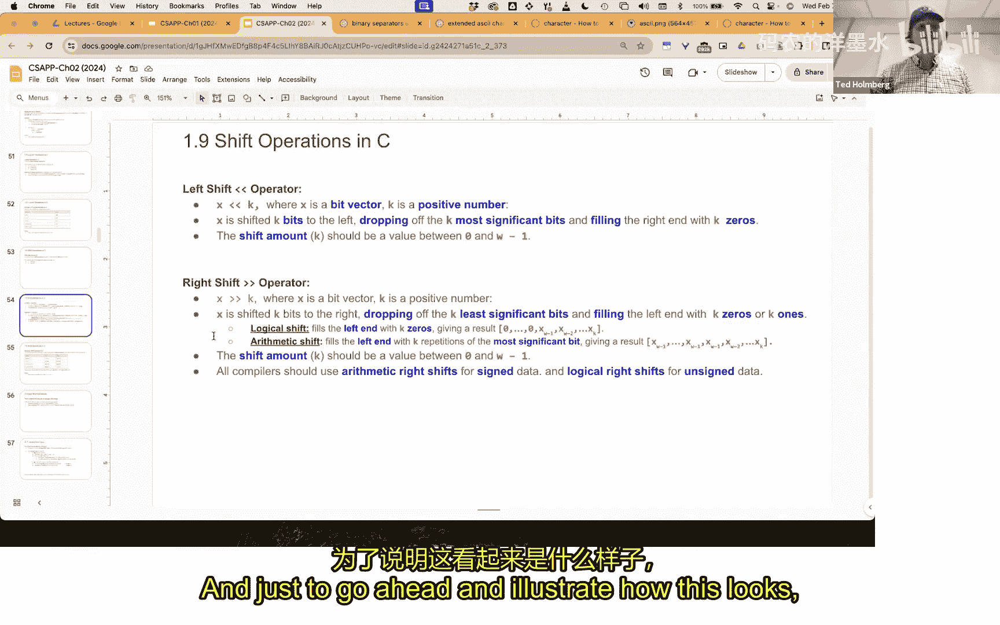

We do them 07 shift ops。Pretty simple i'm just printing the binary i'm just here it's just a lot of print statements so what i'm doing here is i'm just going to print the binary of what x and1 this is my binary strings here is I'm going to shift to the left by four on both my x1 and my x2 and i'm going to print that results i'm going to go ahead and then print the starting value again and then i'm going to right shift with a logical shift but then I want to go ahead and do a athmetic shift to show you what the differences are。

And so I think this will be easy to see。Once we compile。And let's call this shift。And let's run this。

Okay and here yeah I start with these binary sequences again this is it just represents another operator that allows us to operate on entire sequence of bits。

 so bit vectors here you could see we've shifted。To the least significant bit to the left by four places and so we lose the data that was at the most significant bits that got shifted out and we zerofi so this is a loss remember these operators are always lossy you're losing bits in the process by shifting your lower significant bits to the more significant places and then here we're doing the same thing this is our logical shifts where it's just gonna zero fill again we're losing all of the least significant bits and we're pushing them towards the right and this is a representation of the arithmetic shift where preserves our sign so notice as it pushes those values by four places it maintains whether the leading value was a one or zero to illustrate that it was a negative or positive value excellent okay I think we're out of time we make sure there's no other questions on the chat box there isn't excellent I think we got to a good place to。

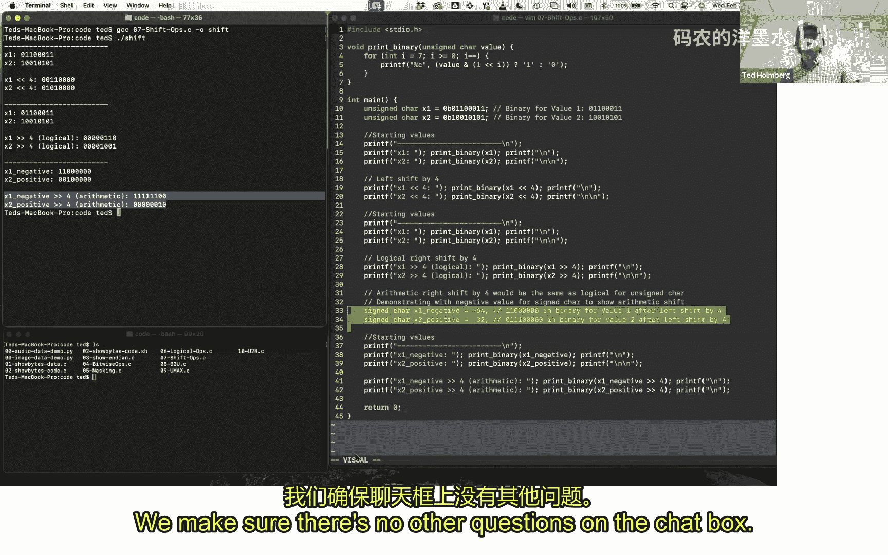

We'll pick up and talk about actual integer representations with next lecture。😡。

No I hadn't had a chance this last two days was very busy i'm going to definitely catch up on now that it's Wednesday I can start catching up on anything i'm going to get the lectures posted onto the playlist and I'm going to start checking in with all students I think the only thing I was able to manage to do is make sure that I changed the deadline for the lab。

😡，But yeah， now I'm going to start rolling in and getting some things done。

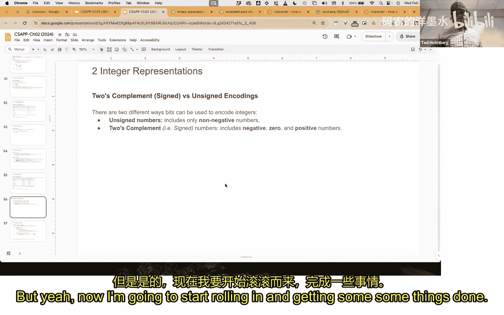

Get car out。