# 【全集】加州理工学院 C语言系统编程 中英字幕 p09 Lecture 9 - 整数编码 -BV1bUzWBLEiC_p9-

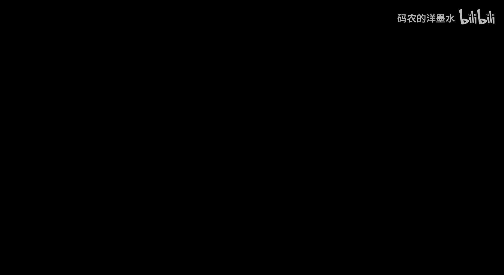

Okay。Finally back after our Marty Gr break I'm sorry that I kind of got sick over the Marty Gr break so I didn't have as much fun as maybe you all did so I kind of spent most of my time in bed recovery so it wasn't told today where I'm like okay let me see where we last left off I forgot that I hadn't published the videos for lectures7 and eight。

After we had our our last last set of lectures before our before break had started。

 So those are now published on。 So if you go to the playlist。

 you'll see that lecture 7 and lecture 8 is available on the playlist and you should also see that the Github repo is also updated The read me should reflect the contents of all the lectures we've had up until this point So all the source code files that we've covered inside of our class from lectures one through8 would be available to you let's see other things I need to go ahead and mention the lab one that I said that was going make live is indeed live So you now have access to the data lab I tentatively have that。

Dated as March 1s deadline， but i'm flexible with that since we're still kind of covering the concepts related to data lab now just like the intro lab。

All the lab work and in just in addition to the to do app as well everything I encourage you to do in group projects。

 so if you've already found a group that works for you that's well you could work on the data lab in the same group or if you found a if you didn't find a group that worked well for you you can go find a new group right so you can mix and mask whatever you want。

This week， I will provide details for what the midterm exam will be I'll give you。😡。

Cues to that right now， I'll formalize it and give you the actual rubric。

 but I'll kind of announce what it is so you can start thinking about it。

So what the midterm exam is going to be is effectively going to be a groupbased project。

 a group based presentation where from a collection of different shell applications。

 you select one of them and you do a deep dive where just like I go ahead and do presentations over the course of the lectures to show you how C code works you're going to show a popular shell application。

 something like SSH， something like GrP so that this way all of you will get some topical exposure to popular shell applications and at least each group will get a very deep experience。

Having to present on it。So what I'll do is I'll actually present a collection and of course once one's been selected no one else can select that so that we have a good diverse pool and if there's one that's not on the list I you know just check with me to make sure it's okay。

 but it's possible to do a presentation on a shell application that I might not provide if you're interested in as such so that that just gives you an idea of where we're going to go with the midterm and kind of like the value we have to the to the class as a whole。

Because one thing， one of my motivations behind this class is I want you to be familiar with C coding。

 I want you to be more familiar with being able to use the shell as an environment to be able to not just understand how our processes run。

 how our applications run， but how you can use it as an environment in itself。

 because there's applications you can run from the shell that allows you to do everything that you can do in a windowed application。

😡，includingncluding authoring your text files， compiling your text files and executing your executable files and of course。

 the advantage of that the reason why it behooves you as a collective set of students who are majoring in computer science to have that kind of expertise to have that kind of knowledge。

😡，At the shell level is because you're not always guaranteed a windowed application for you to be able to either read files。

 access files， edit files or run files think on in particular in terms where you have to SSH where you have to remote into what's called a headless server a headless server means it does not display to a monitor so the only way you can communicate with it is through networking to some using some other computer system that you're interfacing through a command line interface it doesn't create windowed applications and so if you're going to be a proficient developer it's important you develop that skill set where you don't necessarily need to have a monitor you don't necessarily need to have a windowed application to be able to access the file system be able to edit and read files and be able to execute applications and so one way we can all get proficient at that is if we could kind of all touch。

😡，Some of the technologies that are available at this shell and we can kind of cross share those experiences amongst each other also I think it's a lot more fun doing peer to peer instruction things as opposed to me constantly come up here and showing you things because I think that gets boring I know when i'm on the flip side of that as a student I get really bored just listening to an instructor kind of drone on every lecture again and again so I also want to open up like what we had probably pretty soon we'll also have some more like。

In person group sessions like we did with the when we were doing the to do list and so that brings me to the kind of last update。

Over the course of maybe this week and next week i want to start catching up on just making sure that I have the opportunity to evaluate everybody's grades I will say though i'm on a really strict deadline right now so I don't have a whole lot of time so if I can't do it this week i'm going have a lot more time next week I have a tight march 1s deadline I have to meet and then after then。

For trying to get my dissertation in after that， my availability should open up tremendously。Okay。

 let's say I think I have some some chats here。Should I make an appointment to go over the to do app with you yes so when it comes time to try to make appointments let me try to find out where my availability is going to be and we're going to schedule everything through the Discord application that is the de facto communication venue that I want to try to go ahead and。

啊。Excellent。Okay so I guess before we start on today's lecture so I know it's coming back not last week。

 but the week before then we had talked about how we can represent all of our data in the form of binary sequences and how effectively everything then once we take whatever it is whether it is textbased data whether it's imagebased data。

 whether it's soundbased data we all find a numerical representation to encode that and then once we have a numerical representation we can go ahead and then encode it in a binary sequence and so that's how we store information inside of computer system and so if you think about that it's pretty radical it's pretty impressive on。

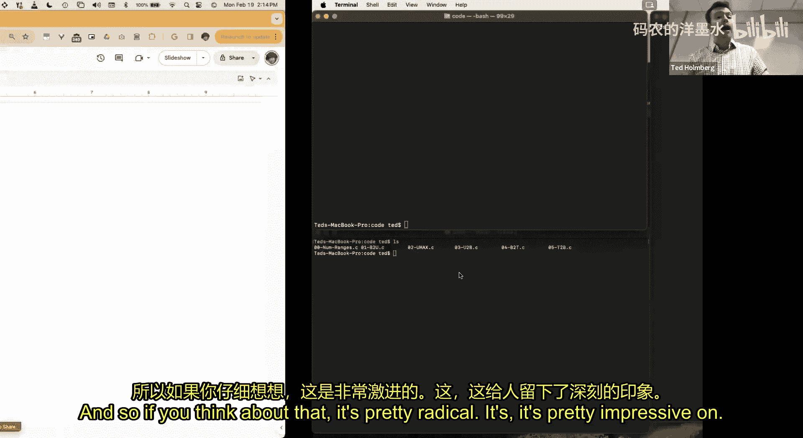

How much information， how many concepts we can map into the world of math。

Right and so I can't stress this enough just like。We have a very powerful capability as humans to take a set of glyphs like characters and build a language around that。

 map a unique set of characters to then match into a concept of something and do concept formations。

 you could do the exact same thing with the glyphs in mathematics and then build concepts around that。

😡，And so when people say math and language are。Symsymmetrical where there's a relationship where you can express things mathematically the same way you can express things linguistically。

That's very true I think the biggest efficiency we have in a lot of our math classes is you're not taught to do。

Concept formation using。Quantfiable values like you are taught to do in a lot of the more natural language classes in English classes。

 for instance composition classes， literature classes where you go through you read you learn to parse you belong to kind of separate the concepts of what is inside that string of texts and create a model inside of your mind and then you can reexpress the model that you have in your mind in terms of verbs and nouns and adverbs right and so one thing that I think really。

Yes。The biggest kind of affordance to you as a computer science student is that you're kind of forced into learning how to use。

Numbers how to use effectively the math， the backbone of math for concept formation for learning how to start modeling the world around you in the form of numerical representations and so initially this is really confusing and this can be very frustrating right and so I know in 1583 slowly motivate the concept of an object。

 but it's incredible the amount of context we can encapsulate with an object when when you break it down the fundamental data types that are available to you in the higher level languages like numbers or text or boolean values right at the end of the day are just encoded as numerical value。

It's just whether it is treated as a numerical value or as a set of enumerated values。

 as usually a text is used for like labels so that it can be categorized or whether your numerical value represents something that's either true or false in the case of boolean value。

So we left off， I think， our last lecture after motivating the idea that all data。😡。

Inside of our computer systems， which is incredibly diverse and every day is getting more and more impressive at the end of the day is numerical。

 So the thing we want to focus on and in true everyone has a strong understanding of is how do we represent our。

Numbers inside of the system， how do we map。nuummerical concepts to our binary sequences and of course there's one of two ways we could do that right so when we were looking at binary sequences earlier when you learn how to count in binary you're using effectively we're talking about the unsigned numbers。

😡，Which would include only the non negative numbers and of course。

 there's an alternative mechanism by which we can go ahead and。

Encode our binary sequences to represent numbers， which is a two complement now am I correct in in assuming that in assembly covered these two different numerical encodings。

Excellent， so I can kind of fly through this for the most part。

 but I'll slow down at places just to go ahead and get a pulse on。收的。Okay。

 so obviously we have our two different integer representations and of course the consequence of this is that they're going to have different ranges that makes sense right because the thing that limits us in terms of our binary sequences is as we know。

 there's a finite number of addressable spaces inside of a computer system。

And so we get to decide when we define data type， we could have multiple data types that all represent let's say integral data so when I say integral data you can think of that as discrete countable values that's like0。

1，23，4 or it could be minus three minus2 minus1，0，1。

 two three4 right what it doesn't include is anything with a fractional component that's a whole different encoding scheme that we'll look at later probably an x cost。

😡，Okay， with that said。We can have。The same。Set of values。

 but we want to define them across different。😡，Number of by encodecodrs so of course the smallest is car car is one by we already talked about that。

 but effectively it's an integer types it's an interval type then we actually have our short which is usually two bytes we have our longs。

 which is we have our ants which is usually four bytes and the lungs which is usually eight bytes。😡。

So but the things they represent are the same， it's just the number of different encodings you have are it's going to be more so。

😡，So we know that when we start looking at the sizes inside of C that I mean when we start looking at our integral types。

 our integer values and our non-fional values， one of the things we want to pay attention to is the actual size and that's the binary size the other thing we want to consider is what is the number set that's included in that so when we talk about integral data types。

 we have the integral data types which is all the integer values right negative and positive but a subsetet of that and probably the type that you first start learning to count when you're a child is going to be the whole set which is going to be your which is going to be the non-neg values starting at zero and then counting it up。

😡，It usually， I don't remember what grade did they finally teach you that negative values is a thing is that is that？

Third grade。S second grade， I don't remember it's been a long time。But when you first start counting。

 usually you start at the zero out， right？And then you go one， two， three， four， five。

 which makes a lot of sense。Okay， so with that said。

 let's take a quick look at the different representations of integers then so we。😡。

If you allow for sign values， then you're clearly going to。😡，Let me rephrase this。

 you have a set number of combinations of permutations this is a better word of a binary string。

 so let's say that the size of your binary string is a single byte that means you have eight characters。

 eight bits that you can use to encode each unique unique value right？😡，And so clearly。

If you decide to go unsigned， that means all positive or non negative values because you can also have zero and zero is neither negative or positive So if you go with non negative values。

 you can start at zero and then。😡，Encode the maximum that number of values that you would have which would be 256 it would be two to the power of8 right so when you first learn how to count a binary that's actually the encoding scheme you learn right an unsigned encoding scheme scheme where all zeros is zero and then zero all zeros except for the least significant bit is one is one and so forth right now if you want。

To include signed values， clearly you're going to cut your range in half you want your zero to be at the center point and approximately half of your values are going to be negative and the other half we going to be positive so clearly with our minimum value we're going to have like if it was 256 with unsigned it's going to be minus 128 for signed and then 127 on the positive side because again we have to include zero as one of our nonne numbers so half of our domain would go towards negative numbers。

 the other would be nonne numbers which would be0 in the positive values。😡，Okay。

 let's take a look at the。Some sample code at this really quick。 so we can either look at a table。

 I always like to look at the output from a。

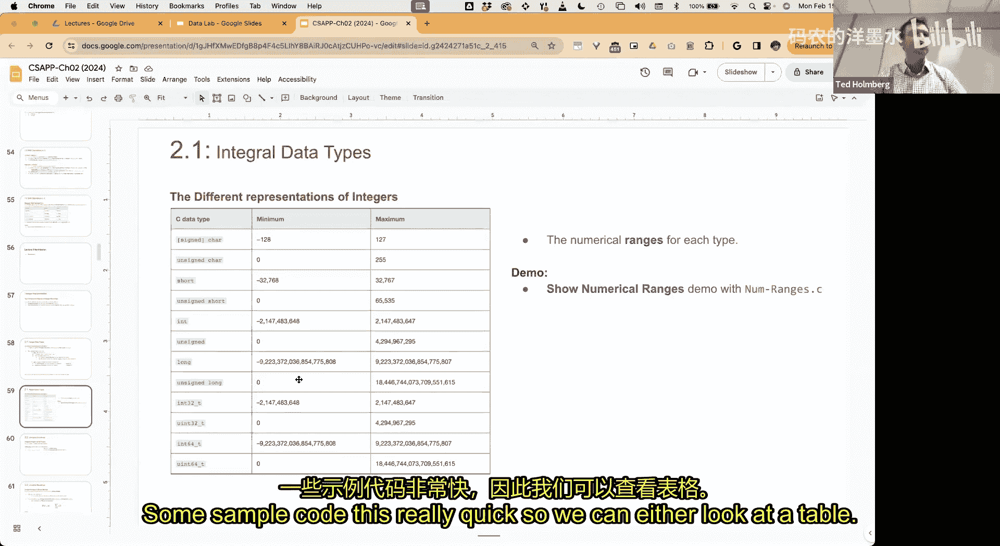

From code， because I just think that's the better way。Let's take a look at this。

 What do we have here， It's 0，0。Here we go so let's take a look at our numb ranges so just looking at the simple code all i'm doing here is I'm going to import my standard input an output header。

 I'm going to include this limit H， which gives me access。To my。Limits of my integer values。

 So now because of that， I can get a notice， I'm accessing some predefined values here that I didn't define in the code I imported。

 So， for instance， this is my signed character minimal value， my signed character。

Yeah this is my men so this is my spine character men。

 the reason why I'm doing it twice is that inside of my print statement I want to show you the decimal representation。

 but then I want to match it to the hexadeimmal representation as well。

So that you can see the encoding for the men。And the max for each of the various sized integral data types。

😡，That's going to be character in both types of sets， the signed and unsigned set， the shorts。

 the ints， the longs and the double longs， the long longs。😡，And of course。

We don't have to memorize what these are because we're going to import the limits and just call those constant values Okay。

 so let's go over here and see exactly。They are that okay， so this's a GCC thats compile this code。

And let's give it an output name of ranges。Okay。So when we look at this。

We can see okay for our assigned characters meant and max again very obvious minus 128 to 127 and again by doing this we can then see how they're actually encoded and so if you're familiar with twos complement which we're going to go through more today usually your most significant bit is used as your signed bit。

Which allows us to effectively half the space。So if it starts with a one。

 then it's going to translate into a into a negative value if it starts with a zero and notice here。

 it's going be the value of。Here kind of front load at these it would have be nice to i'll have to modify this code so it it fits based off of the by size as well。

 so it only prints out the first。Two or yeah， the first two hexademal values which represents your' encoding for character。

 but here you can see seven and f the leading most significant value then is going to be a set a zero on a seven。

So here this is one way， this is actually showing the exact same values we have inside of that table but this gives you some source code so you can actually always inspect this yourself。

 or you can always actually instead up having to memorize that table。

 no you can just import a library and access whatever the maximum in value inside of any data type at any given time。

And of course， if there's any questions， just go ahead and drop that in the chat or if you're in class。

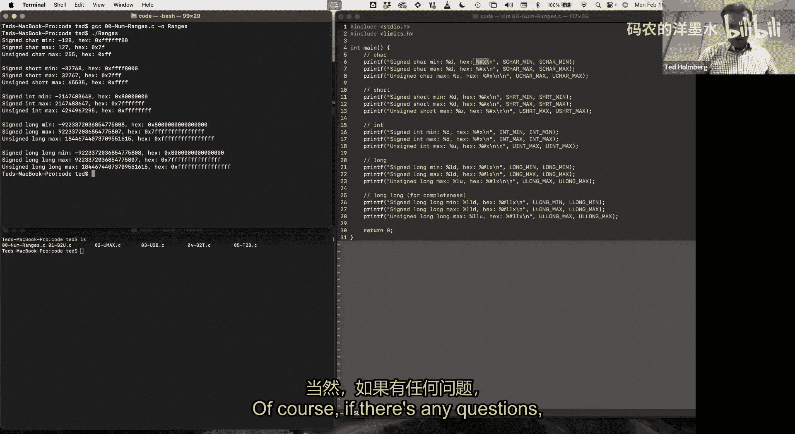

Okay， so。Let's talk about the unsigned encoding， so we already talked about how we can express our binary sequences in the form of bid vectors it's a very popular way of encoding our binary strings。

😡，So there's one of two notations we can use to denote a vector inside of mathematics。

 you can either express a entire vector collectively by a label and identifier， let's say X。

 and then you can put an arrow on top of it。😡，To say this is a vector space。

Or you can show the individual elements contained inside of the vector here we'll use a box notation where we are going to represent our binary sequence where the most significant bit will be the first one。

The one at the far left I should say， and moving towards the right will be our least significant bit here you can see the position identifier for each of the individual bits in this representation。

Okay， so then if I wanted to create a function。😡，That allows me to take a binary string a vector。

 so my vector。😡，Again， using the notation of x with an arrow can also be thought of as a binary string。

 a sequence of10 zeros， so suppose I wanted to create a function called B to U。😡。

That operates off of some W。😡，The idea behind this function is it will translate my binary string into an unsigned value。

😡，So the mathematical expression。That we use in order to translate our integer value into a binary strain in which that we can then store into our computer system which would be this is everyone familiar with this kind of mathematical limitationation。

😡，So the basic idea here is BTU is essentially like a function name。

 it's short for binary to unsigned， the subW illustrates that there's a dependency on knowing what the with。

Of our binary string is， so W is going to be the width of the vector。😡。

The thing that's actually getting passed in here is the binary string so x is our binary string。

 so the way we can implement that is using sigma summation。

 which means that we it's effectively like a for loop in computer science so here we take this term and we sumit to itself。

😡，Starting where I is equal to zero until we meet the width of our binary string minus one。😡。

So that tells us the initial indexing position and then it tells us what the terminating condition is for our for。

 this is the original who loops in math right before we started to map them into programming languages。

Okay， then what we're essentially doing here is we're taking。

The index value to the subi means that inside of our vector， we have a number of elements。

 we're going to access at a per element basis。😡，Starting at index zero all the way until with minus one。

 right because our countable values go from zero to over many ditches you have。😡。

So this is either going to be a zero or one right because it's binary so and then we're going to multiply that so clearly it's it's a zero we're multiplying it with whatever this is。

 but then that just zeros out so it doesn't matter so this only really matters on many instances where inside of our binary sequence it's a one。

😡，So if it is a one， then this is actually going to matter or。😡，Inside of my binary sequence。

 then I'll multiply that to two to the power of I and because the idea behind that is that recall in a binary sequence each digit you move to the left to the most significant bit is a multiplier of two it's an exponential value so two to the zero is the least significant bit2 to the one with the two that's going to be the next significant bit two to the two to the three2 to the four is allowing me to go ahead and move across the binary sequence a digit at a time。

😡，Does that make sense？你看没。UNo， that's that's。Effectively saying we're going to define as it's not an equivalency of if that makes sense。

😡，But for all intensive purposes， we can think of this as we will define our function as this sigma summation。

they should be these are based off of the slides I had I have been updating them slightly though。

 so what i'll do is''ll i'll save them actually as PDFs and i'll actually start posting them into the Github reportpo。

So what I'll start doing is I'll start I'll create a new folder in the GiHub repo that now also has your labs and has all the sample code i'm trying to aggregate out all of the resources in one space so there's a one shop stop for everyone and the GiHub repo is actually linked inside the comments inside of the description of every video so at any time if you can't find and you should also be linked in the Discord as well you should be able to find it lots of different places。

Okay， actually let's take a look at what this actually looks like so now that you see the mathematical notation for this。

 let's examine what this looks like in the form of actual executable code。

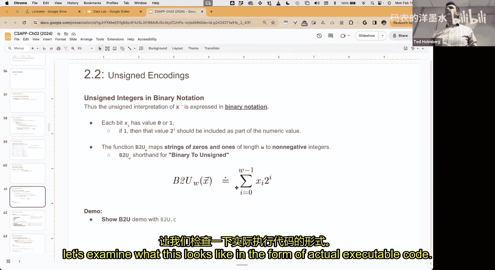

So I'll wait out of this。Okay， so let's go to here。Okay。So， and let's clear out of this。

And let me compile it and then we'll walk through the code so this is going to be 01。

And then I don't know， and then that's called asB to you that's。Binary string to unsigned excellent。

 Okay， quick， so I'm going to start with the main function。

And then that that's going to motivate on how we're going to call the actual function we care about。

 which is going to be this B to you， which is the exact same implementation wise of what we just saw in the mathematical formatting so inside of our main function here we're going to create a binary string right so a character pointer。

That's going to have eight。Bits。Thattter either zeros or ones， and we'll do another too。

 just so we can compare。Then notice i'm going to get the actual value so the idea is we want to translate from a binary sequence into an unsigned inteature value。

 so we're going to use that logic so notice there's going to be two parameters we're going to pass in to B to you which is the same parameters that we saw in the mathematical notation it was our vector so our vector is just a sequence of values it's like a list。

Ordered list and we also need to give it the width。Of our vector， that's that W。 Okay， so given that。

 let's take a look at our Bt of notice， we're actually using unsigned for everything。

To harden our requirements。Because that's the entire point This is a binary string to unsigned value。

 so we're going to return an unsigned integer。 we're going to require a。Character string。

 which is going to represent our binary sequence， we're going to pass into the length of our binary sequence。

We're going to start our integer value at zero。😡，Now we're going to do the sigma summation which is effectively a for loop。

 we're going to start our for loop at zero， so I is zero just like the mathematical notation had and we're going to go until we hit the length this is an equivalent way of saying of being inclusive where we say length minus one。

Which is what the mathematical notation does， this is more common way your science。

 but you get the same idea， right？

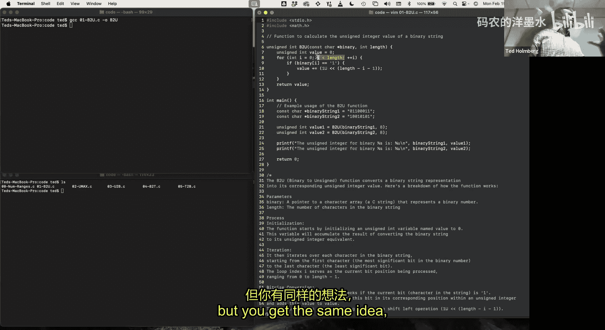

So one way to at least separate the sigma notation is sig notation is inclusive of both the top and the bottom。

 not exclusive。

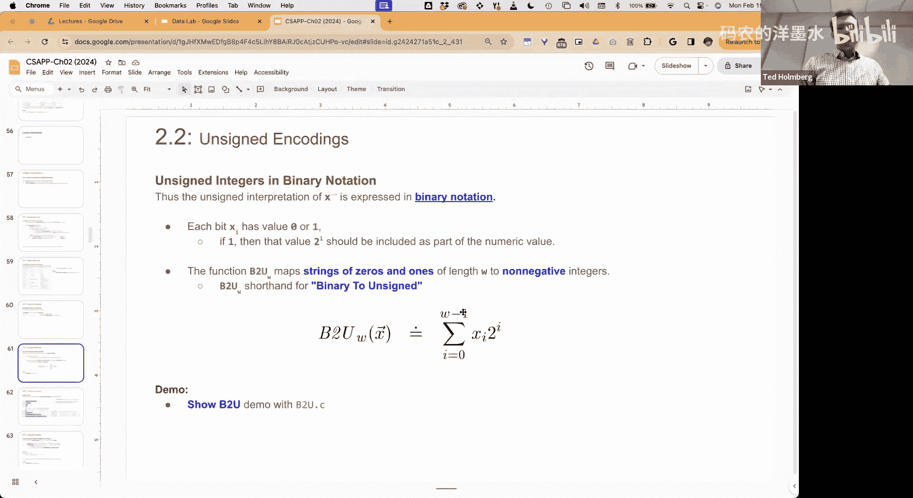

Okay， so we'll go for the length and then we will increment for each iteration。

 which is actually the same thing that's happening with Sigma fumation if I didn't say that already。

Lots of similarities between Sigma sumation of order loops。Okay， so then once we're in there。

 we're going to go ahead and only I mean we don't。We're going to take a shortcut。

We're going check to see if it's a one， but we don't have to do that。

 we can do the same thing that's happening in the mathematical notation where we just do it with every value and zero it out by using a multiplicate of property right but we won't bother doing that I might refactor to do that but in this instance we'll only perform the action when it's one。

😡。

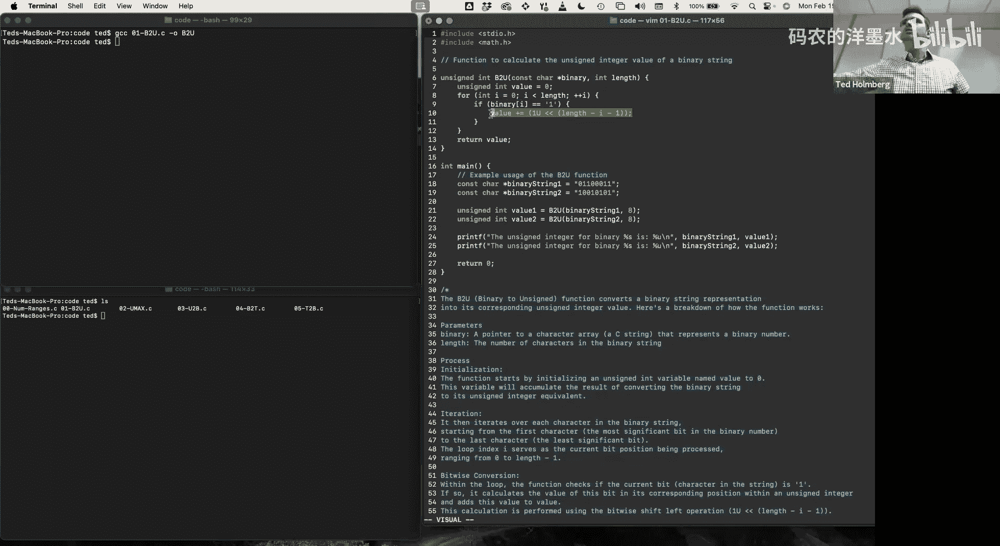

See， in this instance， here， we're performing it for every value。

 but it filters the zero values out because you're multiplying by zero。

 which produces a value of zero， which means you're adding zero for that term， which isn't。😡。

Producing any change is not making a change say to your summation。Right。Everyone's。

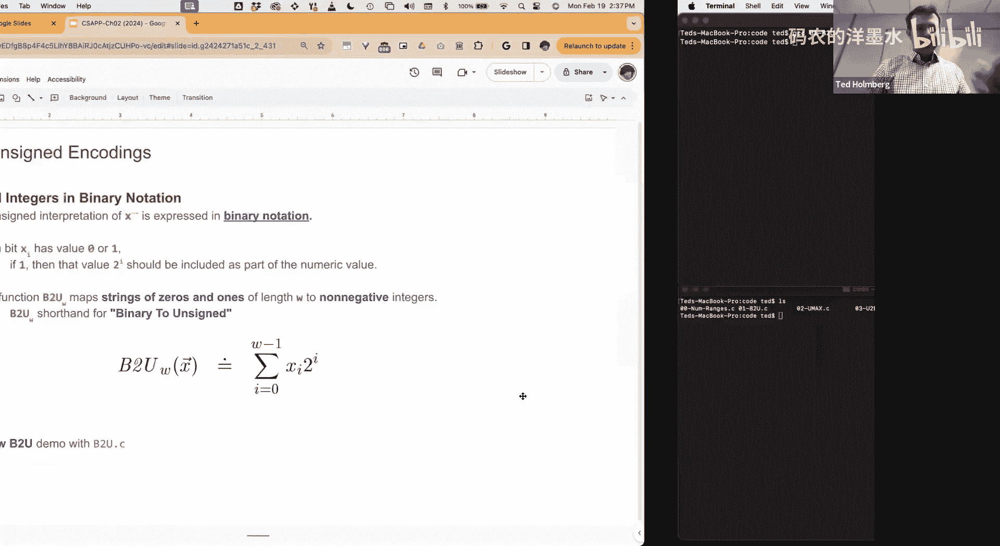

Okay， so then on those instances we have one， that's when we're actually changing the sum so here we will take our value。

 it starts at zero and we will add to it。😡，And so this is one of the beautiful things about these binary operations we learned last class or the class before。

 this is a way of producing a power of two。On a binary sequence using this shift， so when you shift。

A binary sequence by。By x number of units， it's like shifting it from two to the power of zero to two to the power of one to two to the power of two the power of three。

So here we want to shift a one value and so if I put u uppercase U after a one。

 that is a literal integral unsigned value。😡，So one on its own is a signed integer value。

 one U is a way of ensuring that that gets cast as an unsigned integer。😡。

The only reason why I'm doing that is to harden our requirements inside of this code。

 so I want to illustrate to you that just like you could say for instance add an F to a fractional number so that it's treated as a floating point number but the default value is double。

 we can enforce unsignness onto one of our literal integer values to the unsigned。

 we do this just to ensure that the shift is done as a logical shift and not as as as a sine based shift。

😡，Which we shouldn't have an issue since we're shifting this direction anyway。

 but you always want to be careful soon。And we're going to shift a number of values based off of what the exponential placement is inside of our binary sequence。

😡，So again， we started zero， one， two， so you're thinking that what we're shifting by here。

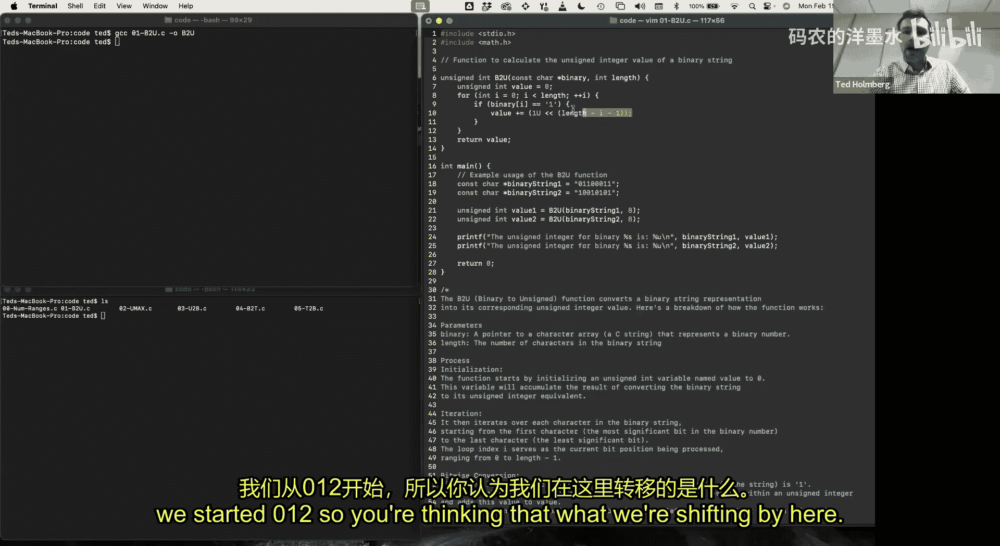

Is effectively this value here。It's two to the power of all。Which in our case is going to be zero，1。

 two， three， four， five， six， seven up to seven。

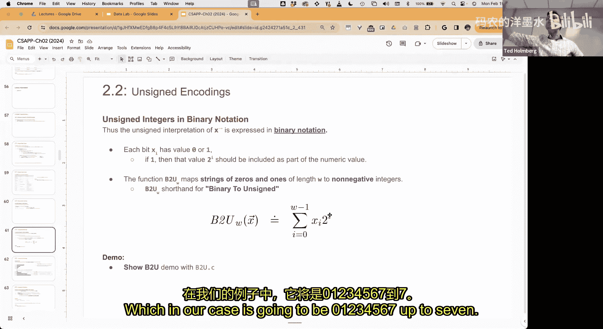

Okay， once I do that。I will have。Add it to my value。

 the twos place every time a1 is in my sequence at that position。

 so then I'll take my final sum and I'll return that。😡。

So I want to ask to seeing the source code here。😡。

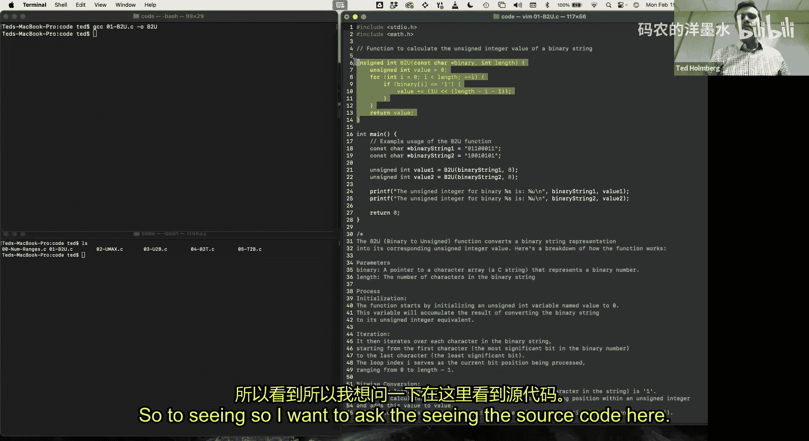

Make this easier to understand。😡，Okay， perfect， it takes a lot of time to show up。

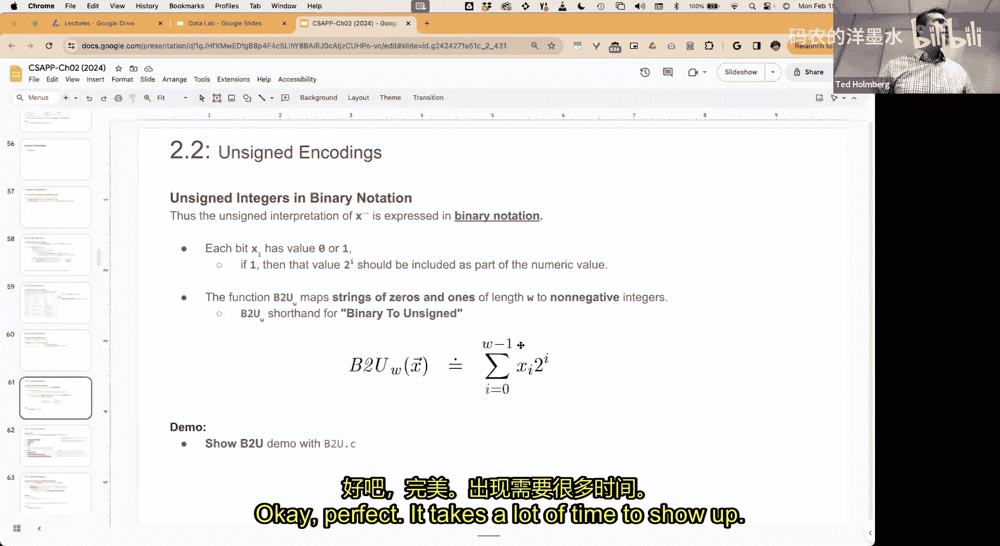

And so then let's go ahead and test this out， so I have two binary strings。😡。

Let's pass these two binary strings into this function that we've implemented based off the mathematical definition to see exactly how that goes and maps out。

😡，So here we go。And so here we can see my unsigned integer value。

Of this binary string will then result in being able to encode the value of 9n。

 or my binary string here results in me being able to encode the unsigned value of 14n。😡，And again。

 this is using the same principles that you might have learned to use。Counting in binary。

 these are the default。😡，Counting rules。😡，Using unsigned values here you can see how we can actually create a C program that maps our binary strings directly into interature representations unsigned inter representations in fact。

 this is how our underlying system does。

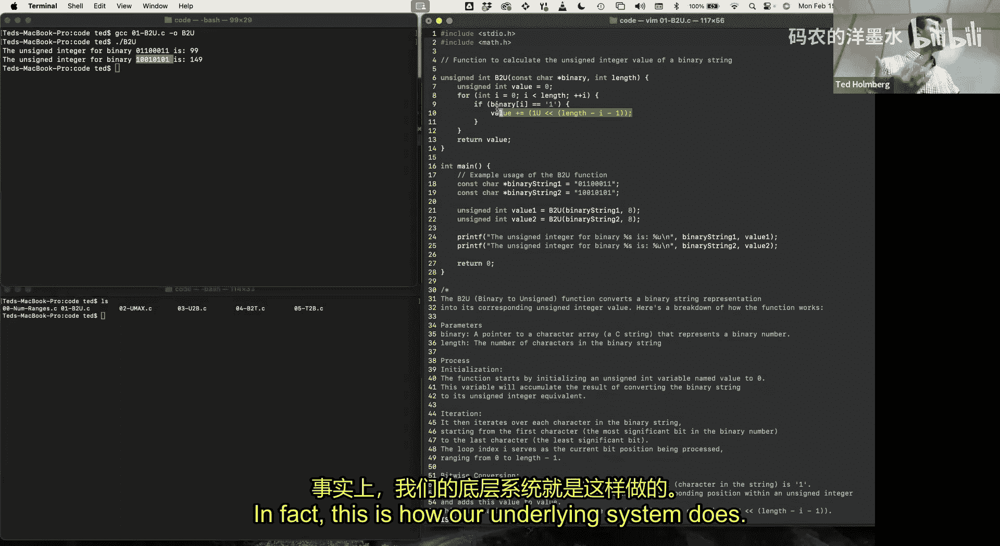

Okay， so。Now， if I were to use the representation of the book。

 this is how the book tries to explain the same kind of concept。So I think it's nice to have。

A mathematical approach it's nice to have a programmers approach because we've all learned how to program so there's a value and scene the math mapped to a to to code but also we have a visual approach which I know for those visual learners out there this might even be able to add on to the code that we've looked at and to the math that we've looked at so just to harden this one way we can think of。

Each of the positional values inside of our binary sequence inside of our bit vectors is having a certain amount of magnitude towards the full sum that represents the integer value。

😡，So again， we have that idea of most significant value versus least significant value。

 the least significant value is going to contribute less to the integer representation than the most significant value and the amount of value it provides is based off of two to the power of whatever index value it is inside of our bid vector。

So we can actually visually create these blocks。That represent how much of a value each of these can go ahead and be a part of so imagine here for any value we can represent in a binary sequence。

 we created a block that represents one of the construction points。

 one of the building blocks of all of our integer values that we have。😡。

Then this would represent our two to the power of zero， that's just one， right to。

Anything to the power of zero is one。Two to the power of one is obviously two and then you can double that and that's going to be four you can double that and it's going to be eight and obviously one of the beautiful things about taking to the power of two is you're constantly doubling it in socks。

😡，Then what we could do is we can create this number line that represents the actual integer sets of values here we're using a decal representation and you can see how we can map a binary sequence that says what block it includes so again if I have0001 and if I just include that one size block I can then map it to this value of one here let's say I want to make five then that's going to require a block size of four and a block size of one you combine those together that will produce five so visually I can take this and this and so in order to access those block sizes。

😡，I integrated into my binary sequence， so do you see how does this visualization hop at all and so this is actually the one that's given in the book to try to motivate this concept。

😡，And again， if I wanted to build 11， you could see I could use this block size of eight。

 this block size of two， this block size of one， and again what we do is we're showing how we can pass that binary sequence into this function。

 along with this width size， we can then show the actual summation between each of the independent values。

 what it results at and how we then convert it into its representation is energyteger- based representation。

So。Suffice it to say the least value in an unsigned value is zero。

 which is represented as all zeros in our binary string。Not the true with two's complement。

 which we're going to get to and our greatest value is when you have all one。And in fact。

The way that we can always find based off of some arbitrary length of a binary string。

 what the max endable value is you can take。😡，Two to the power of whatever the width of that string is。

 so say for instance， this is one， two， three， four。😡。

We could say two to the power four is what that 16 subtract one by it and that is going to be because we 0000 one encodings for the zero value so if we subtract one that's going to be the largest integer value that we can represent what that stroke so if you ever want to know what your max value of an unsigned is that's an easy way of doing and again if we once to test that we have the U max do C which is going to define this function this functions is based off a BTU where we just pass all ones into our binary stroke。

😡。

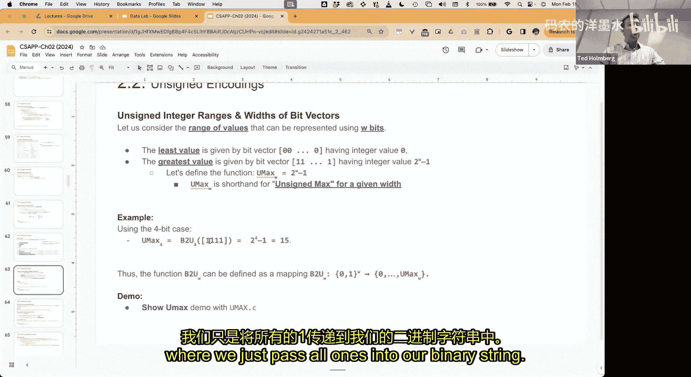

And so I don't know if we you， let's go ahead and end here。Just take a look at it。So。Pretty simple。

 what we see here is we're going to create UX， which instead of taking the binary string just takes a width。

Because we're looking for what the max encodedable value is。

 and then we're just doing the same thing we've already seen we're going to shift。

We're going to a one we're going to shift a one a number of times equal to the width value and subtract one from it。

So if it was four right， it's going to be shift the one， four places， it's going to be in binary。

 a 16 subtract one that's going to be 15。But the nice thing about this is it could be any arbitrary value。

 it's very easy and quick to be able to find the max encodeable value and we can test this out。

Now let me clear this。嗯直 to your喂。Let's take a look at the output。Yeah， what is this max， UX？And。

And you can see right here， yep， the U max， the unsigned max value for four bits would be 15 which。

Is' it just an integer value， actually is a。hel。Yeah it is， but if we didn't subtract by one。

 the other interesting concept of this is it would also represent if it' just be true to the power of the width that's the number of encodedable values you have so it lets you know what your dictionary size is how many things you can encode uniquely with that number of bits。

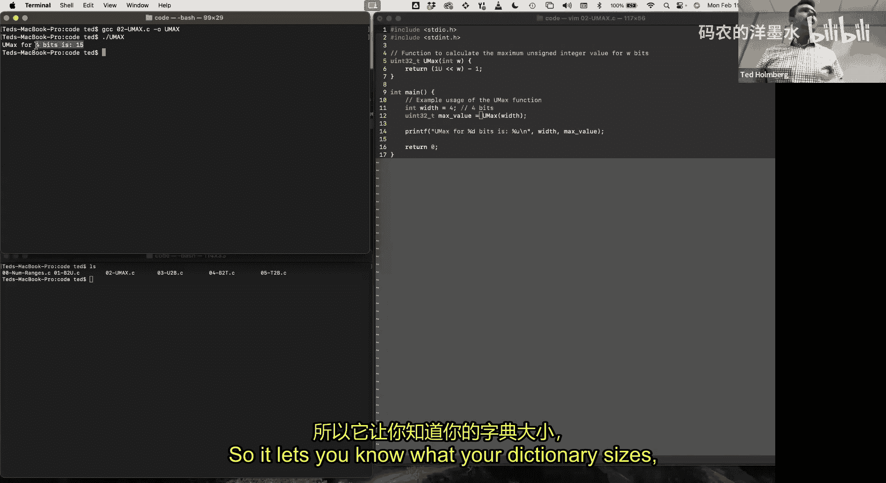

H。And of course。If this function is going to be useful for us to encode our binary strings into energy representation。

 it has to be a byject Does anyone remember what a biject is in mathematics？😡。

So a byjaion is a special type of function， so we know that in a function。

You have the ability to map a value。X to value y。 So it's usually inside of this representation where y can equal。

F of x where F is a function that we pass x to， it results into a unique value for y a biject means that there's also an inverse function given that x。

Equals the inverse function on y， that means there's a one to one mapping。😡。

That's super important that our B to U function also has a corresponding U toB function it would be otherwise we have like a lossiness inside of our conversion。

 you don't want to be able to take a methodology of taking the binary string and represent it as an integer but then not having the integer be able to resolve back into the original binary string。

😡，So any one of these。😡，Definitions that we have that allows us to take binary strings and map them to values have to have an inverse function that allows us to take the value and remap it back into a binary sequence。

 and they have to be the same。😡，And so that means we'd have a U toB。

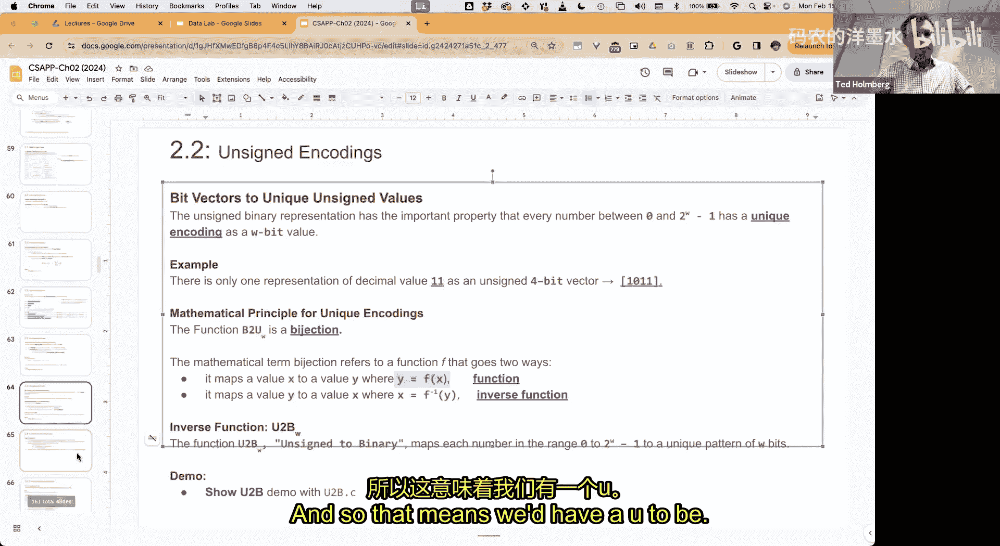

Let's take a look at what it would look like。Okay， let's just take a look at the main function really quick。

 I suppose that I have myself an unsigned integer value。Of 99。

 suppose that I have a width of eight for my binary string。Let's go ahead and create a。

Binary string array so a character array that we can translate our integer value in and then put the binary sequence into and so when we go ahead and declare that space notice。

😡，For the purposes of strings， we're going to do whatever the width is plus one because we need to terminate our string within all character and C。

 right？😡，Then we're going to call our function U to B U to B will take the integer value。

It will take the width of the binary string we want to go ahead and encode into because recall in C。

 we can have integer data that's in the form of cars in the form of shorts or longs or ins or long longs right so in this instance we could pass the width as8 or 16 or 32 or 64。

And then finally， the actual character pointer or the character array in which we'll then build our binary vector。

 our bit vector for our binary strength。So here， again， this is going to be effectively a for loop。

s effectivelyffectively the inverse of our u to our B to you function。

 so notice since it's kind of like an inverse we're going to actually start from reverse side right we're going to start by building。

We're going to do concdnation， so we're going to start at the width where we take whatever the width minus one is。

And then we're going to go until we hit zero， so we're going to start at the most significant bit and then build to the least significant bit。

And then here we're going to use this bitwise operator where we'll take the value and this is going to produce a mask for us remember that concept of masking we talked about we're going to use the bitwise operators so we mask all values except for the one space that we want to evaluate at this given time。

And then we're either going to put a zero or one inside that part of our binary strip。

And we're indexing into our binary string and then when this is done the very last position we're going to add a null character to say okay。

 this is now treated as text data as a character string inside of say and so if I go ahead and。

Run this actually then they clear my outputs， we don't have old output there。

And what is this this is you。是 did。Then we can just run this。And we can see based off that。

 we can easily take our byjective function， our inverse function where we take the value of 99。

 and then we can represent it as the binary string。嗯。

For our unsigned integer representation so again， this is just a way of motivating what the system is actually doing for us to translate between binary to integer values unsigned integer values。

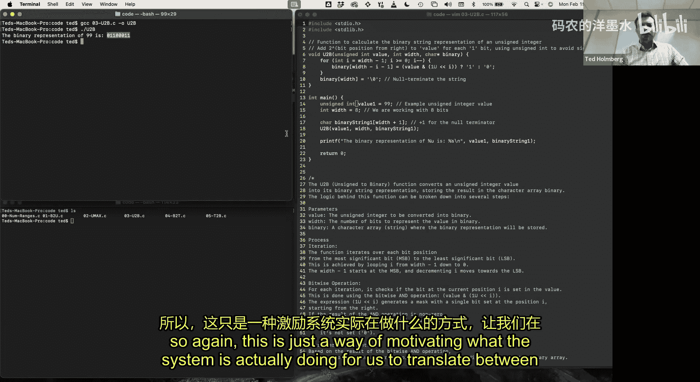

Okay。Let's now look at two complements， the alternative encoding scheme that gives us the ability to actually encode negative values so here。

This allows us。A very powerful concept of having a negative number such as negative five。

 where we didn't have that with the unsigned encoding scheme。But as we've already mentioned。

 it's going to have the number of positive values that we now have access to so that we can provide an encoding for those negative values。

😡，So for to's complement， it can be defined mathematically where the most significant bit of our word。

 our binary word is the sign bit。Which is why it has the numbers too the sign bit produces half the number of values you have if you were to build a tree of all of your encodable sequences so if you're the root of your tree is either zero1 half of those can go towards the positive encodings the other half can go towards the negative encods the non- negative and negative the more accurate term for that so let's take a look at our vector so we said our vector is this x with anarrow over it and this is each of the individual bits inside of our bit vector then if we pass our bit vector into this function D to T for some with w。

Then the mathematical notation that we can then use for this is it would be minus x。At W minus1。

Times2 to the。W -1。 so this is our going to be our。Our most significant bit。

And then we're going to add to that。The summation。So we have our most significant bit。

 and then we have the summation that looks very similar towards our unsigned set of values。

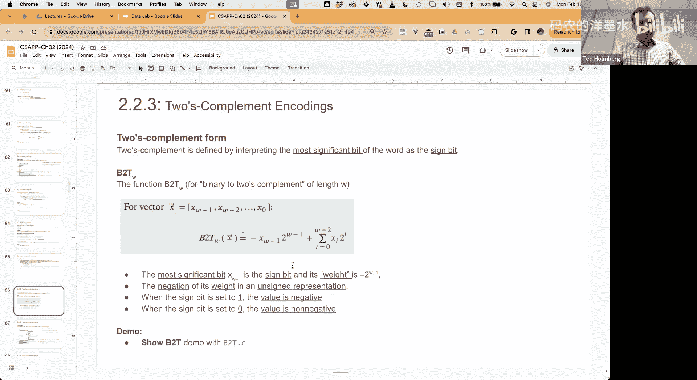

So again， if we want to see what would that actually look like in terms of code， let's take a look。

And so here we can see let's start with the main function。

 so suppose that we have these binary strings， one that has a most significant bit at zero。

 one that has a most significant bit at is one， if we pass these into our B to T where our。

First parameter is the binary string and our second parameter is the width of this string we want to map into that we want to read from。

 then we can take a look at our actual function， so here this is the length this is the binary string。

 this is the name we start our value at zero。Then we can see we produce this four loop。

 which is our sigma summation inside our sigma summation。

 we're going to start at index zero and go for the length of our binary string incremented along the way if inside of our binary sequence we have a one。

We're going to do something very similar here， but notice。😡，According to the。There we go。

 so if our value is a one。We're going to go ahead and do a subtraction from it。

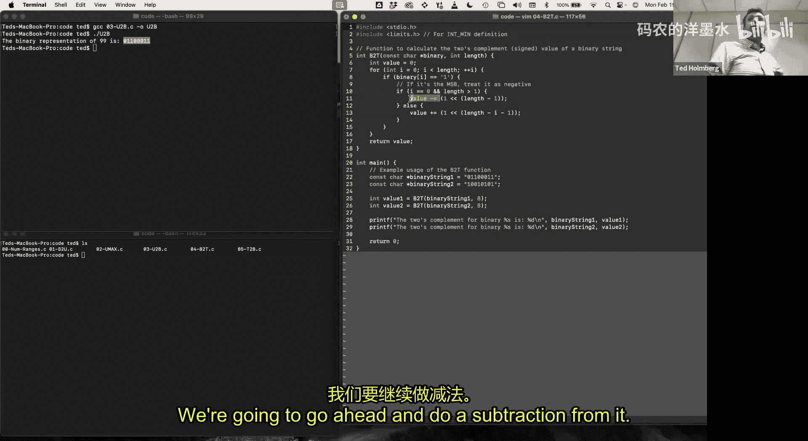

Which is what we saw here。

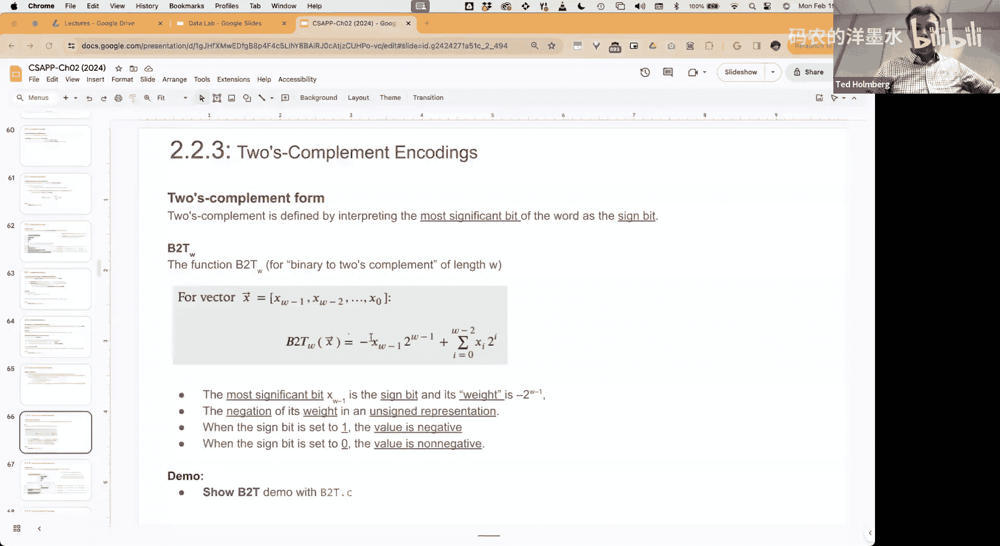

喂。Otherwise， we're going to do a summation of it。And the dis sumation or subtraction is all based off of。

This is actually doing a logical check。On to see if the value of i is zero and the length is greater than one。

And again， if we go ahead and actually test this out。And what was this was ET。嗯。We could say that。

We have a positive value of 99 when our leading value is0。

 whereas we have a negative value minus 107 when our leading value is1。So again。

 I think it's one thing to， did you all do something similar in assembly where you not only looked at the。

 did you look at the mathematics of this or what was the process that these concepts were shown in assembly class。

 was the mathematic notation shown？Was just the concept with the process shown of how to read this？

Did you get a chance to see like these operations， how the operators are used to translate between your binary sequences and your numbers？

Was it more like you just did it by hand？Yeah that's that's what I kind of recall too going that's why I think it's always valuable also look the foundational math and also look at the how the code。

 remember our systems are run in C， the reason why I'm actually showing UC code is this could be the same way that our underlyinglin system also implements some of these concepts。

Now。The actual assembly language can do all this stuff too。

 right by just shifting the bits across so you could see how at the assembly level。

 this would also work。There's this one to one matching between the left shifts and the right shifts once we start talking about modifying binary strings。

 this is a one to one matching on what the hardware can do with the addressable space of sequencing so of bits。

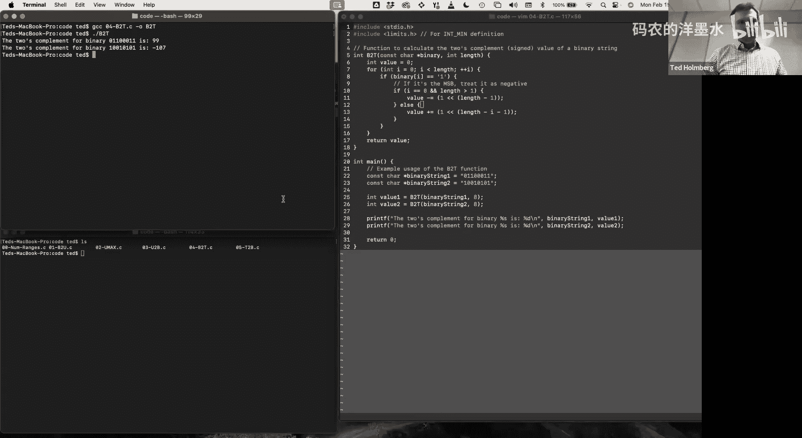

And again。We can we looked at code， we looked at math to represent this tos complement。

 So let's also take a look at the visual representation again。

 this is taken straight from the book where we have blue blocks that represent。

Positive contributions to a。Someum and grade blocks that represent a negative influence towards the sum because once we start talking about signed values。

 we can go in one of two directions， not just one。😡。

And so if your most significant bit is going to be。

Represented as an negative value that means that gray block is going to compete against all the blue blocks in that same grouping so suppose that you had a width four binary string then that's  one111 but the most significant one would be in gray and that's the value of eight the next one。

😡，Would be four， the next one would be two and the next one would be one right so if it's all ones。😡。

Then your gray block。Is going to be the eight， but minus eight。Plus。Four plus two plus one。

So minus8 plus seven is minus one， right？In fact， we can see that's exactly what we get here。

 so this is just the visualization that was used inside of the prior section to。

Enhance it to show how we can get the encodedable space to now deal with negative and positive numbers using this different sequence and it's not one to one。

 remember there's an offset of one because what we're really talking about is negative versus non negative。

So if your negative most negative value is going to be minus 28。

 that means your most positive value will always be positive 127 so you can't just remove the sign bit right you might recall when you're doing the translation with this you take the you take the inversion of the number and add it by one right or subtract it by one。

Okay， so when the most significant bit is zero yeah， we already know this。

 so when the most significant bit is zero， effectively the bit patterns are identical between our B our two's complement and our unsigned value。

So the translation is the same， so the only time that you retranslate into a new value is if the most significant is one。

Does that make sense so the encoding is the same for all positive values the only time that we create a different value between our unsigned numbers and our s numbers is if the leading value is a negative value is a one。

😡，Then that's when it matters whether we're using the twos complement encoding scheme or we're using the unsigned integer or unsigned binary string encoding scheme。

So let's take a look at。At least。Let's see， what is this， least value， greatest value， yes。

This is just defining the actual team men。So this is just showing this is kind of the。

We're seeing here that before recall that on unsigned values。

 your greatest value was2 to the power of w minus1。To find the greatest positive value。

 your exponential value is actually going to be a minus one inside of here right and that makes sense。

Because for positive values， you have to admit the most significant bits。

When looking at two's complement。Because if it is a one， then it's a negative value。

 of course the most negative value would be。Pretty much similar to how we would compute the max value in unsigned。

 but we put a minus sign in front of it。And instead of being， again， W， it's minus1 W。😡。

As the exponent and then minus one units， it's w minus one。It's half the encodedable space again。

Very obvious， though。So let's move on。And of course the motivation behind all this is taking bit vector to represent our unique signed values。

 which we've spent a lot of time talking about， but in order for this to work。

 it has to be a jective function so clearly if you have a mechanism that allows you to take a binary sequence and map it to a signed integer value you have to be able to do the reverse can you take that integer value and map it back into a binary sequence right this is what allows us to start with one translate sort in the machine a on the machine and retranslate it back into the value we think it is。

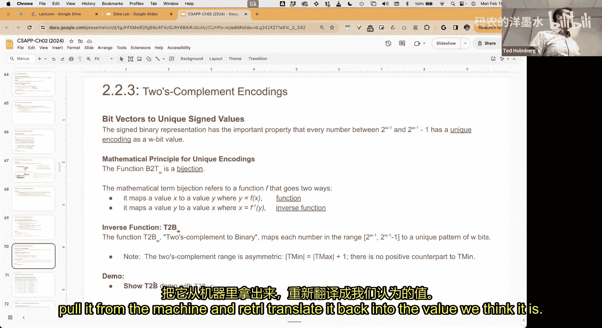

And so to highlight that we can in fact do this， to prove。

 I mean clearly we all know this is possible because we see it all the time。

 but if we actually want to actually want to see the implementation of this。

 let's take a look at this。And so okay oh and by the way。

 let me do this as well this might help as well if I i'm going to load to python here so you can kind of see this in real time。

 so inside python we can do these some of these。So let's see here so suppose I wanted to do four here see so you can see if you want to play around with this one of the issues with running code in C is that we have to compile and and then we have to print it out to the console one nice thing about a rebel like with Python with interpret language is we can just run instruction at a time and kind of play around with it as if we're in a playground so here you can see this is if I wanted to see how many encodecodable values of a binary string do I have by taking one and shifting it by four places you'd see at 16 so when we were looking before at what the max is it would be。

It would be the same as this and then minus one for the。Shouldd be like that， right？So again。

 this is just a way that this is the same in code。😡。

Arithmettically is what we would do inside of sea， but you second my responses immediately。Okay。

 so just looking at this， you could see we would pass in our value。

 we would pass in the width of our binary string our binary our binary array which is going to be character array and then we're going to check to see if the value is greater than zero then we're going to want to set at。

One into our。Into our index zero and then what we can do is we can then works with the positive magnitude value Otherwise we're going to set that to zero。

 then after that we're going to do our four loops So this first part here that we're looking at is effectively the same that we saw in the mathematical limitationation every mathematical limitationation when we do to complement we're actually。

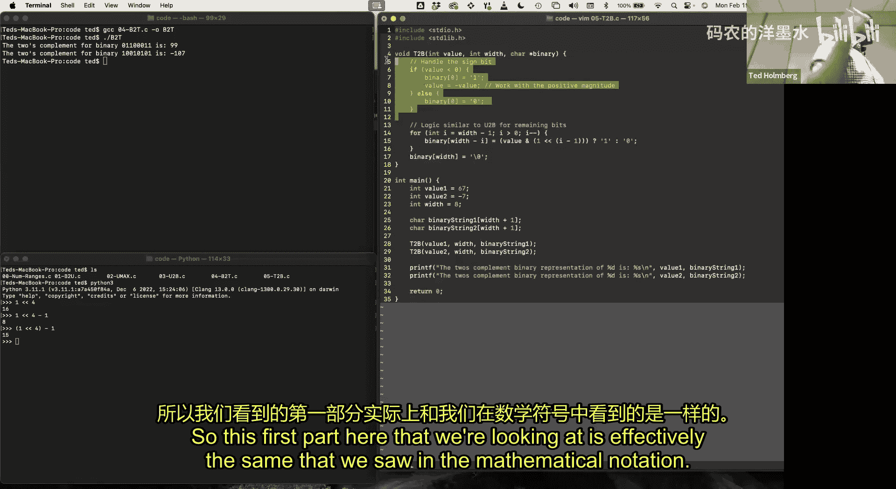

We're dealing with the most significant bit and we're adding a multiplicative property。

 and then we add the positive sum on top of that。嗯。

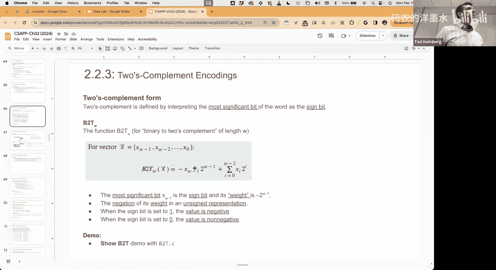

So when what that looks like in code is going to be whether we're starting with the negative value or whether we're starting with the value that's a value that's effectively at。

Going to be a positive value value of zero effectively。Okay。

Now let's say here and so here we have some sample。67 minus seven， let's just go ahead and run this。

GCC， what is it 05？And this is effectively just our byject， our inverse function。So here's T to B。

And let's run this the2B。And so here we can see if I have the value of 67 it's going to let's take a look at some of these concepts well in two's complement the leading value should be zero right because that's our sign bit it is this right here is 64 right because everything is in powers of two this is the value of two this is one I sum these together yeah I can actually visually。

Count that and see that that's going to be 67。And then here this as it's minus7， we can see， okay。

 this is the minus one。Here so that's and then this is going to be my value of seven。

 this is my sign bit。And then I can read that this is going to be minus7111， right？

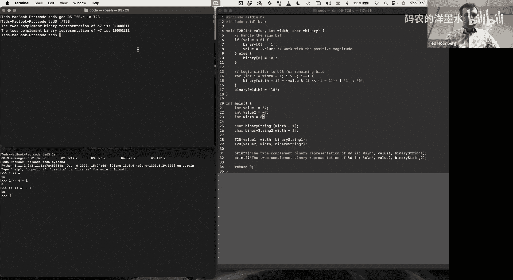

That's all this。And again， if I then wanted to compare my hexademal values between my unsigned and signeded。

 so the idea between this is I want to show you that with the same encoding the same binary sequence depending on whether you're using a unsigned encoding versus a choose complement encoding。

 you can actually resolve to different values that's important right because if you do some arithmetic operations in unsigned and then you retranslate it into a signed value that might give you a different number。

This is why context matters。And of course， there's the ability for us to be able to convert between signed and unsigned。

Through casting operations， so C allows us to cast signed and unsigned。

And so what this should do is it should well。So。我。It's an interesting case right so if you cast what do you think you're task here？

😡，Between signed and unsigned and C this is an important after effect you should consider because one of the powerful things about C is that we can change the context of a binary sequence that's what casting means right so if something was originally authored as an unsigned sequence it means one thing but it can mean something entirely different in twos complement as the same sequence So when we cast we're talking about keeping the binary string the same but parsing the value。

Using a different encoding scheme so keep in mind casting can be a dangerous operation you think you might have one value and actually cast it into something else that's the behavior of state you should know that that's one reason why we're going into such detail on the two integral data type encodings that we have access to so say for instance I have this integer value now by default we don't have to say integers are signed or unsigned the default value is signedd right if we want to be unsigned we have to use unsolved。

So suppose that I have this value minus one， two， three， four，5。😡。

And then I want to cast that so casting in C looks a lot like casting in Java right where I take the data type。

 I put it between parentheses and I apply that to the data and whether that's telling the RC compiler to do is take whatever is inside this space。

 this addressable space， pull the binary sequence and reincorpret it using this context。

So it's not going to necessarily take the value and convert like it into so it's not going to take like minus 18 and turn into a positive 18 that'll just translate whatever that binary error sequence is into a unsold value so let's see what happens here so we're going to take this V and then we're going to save it into U short for unsed short V and then we're going print these two out。

😡，And so you're going to see my output is going to be different because it's going to use the choosing coding。

In the first instance that it's going to use the unsigned encoding in the second instance。

So suppose I wanted to go ahead and cast from unsigned to sign。

 let's see how that might work so suppose I go with the unsigned U and here I'm going to use the max value。

😡，So this is on unsigned but all of my values are sets of one for that particular sequence and so this is a。

😡，And so here， suppose now on my unsigned and I probably feel like I should have an int in there。

 like data is hyp。Okay， so now suppose then I'm going to then。Cas into just int。

So now that translates an unsigned endt into a signed endt。😡。

And so I'm going to save that into T use for twos complement U。😡。

The encoding scheme and we're going to print that out and the actual output you're going to see is going to go from this massively high positive number to a minus one。

So casian is possible， but notice it's probably something you never want to do。But it can happen。

If you accidentally do math with different data types。

 because what casting isn't always explicitly done， right？Sometimes casting is implicitly done。

So keep that in mind。If say， for instance， you had unsigned values and if for any reason you subtract them in a way that can produce a negative value。

Sometimes C does something weird。So just just pay attention to these。

 these are the little pitfalls that can happen with you and see that are worth knowing about。😡。

And it's the translation of our bit sequences and how we're constantly giving them context。

 but how context can be very different in the way that we encode the space。Anyway， you could see。

We can define what our ranges are are the mathematical principles for defining our conversion between twos complements unsigned。

 but to do it in a way that's actually meaningful。😡，Where the limits don't necessarily break down。

And so well。嗯。Maybe not meaningful， but we can see the onto relationship。

 we could see how we could translate one set of sequences in both ways。

And let me show you that so again one of these instances shows you our B to U our binary string to unsed versus our B to T so you can see these are the two mechanisms back to back where we can go ahead and do our encodecodable space so with two to complement we have these gray blocks inside of our that's like gray right and with the unsign we have these really dark gray blocks so you can see we can kind of stack these to see what the offsets are for the same bit sequences so actually if I was to line these up this is how our number range could map one on top of the other。

I don't want to spend too much time with the conversion between this because I think you can see for the most part。

 all we're doing is translating values， unsigned values。

 the value here is that you can translate once unsigned value into the twos complement value without having to convert between the binary sequence。

 sometimes that's valuable， sometimes that's not。😡。

I just want to illustrate that this is also a set of functions that we can do and we'll actually pick up from here next lecture。

😡，嗯。那。嗯好明白。

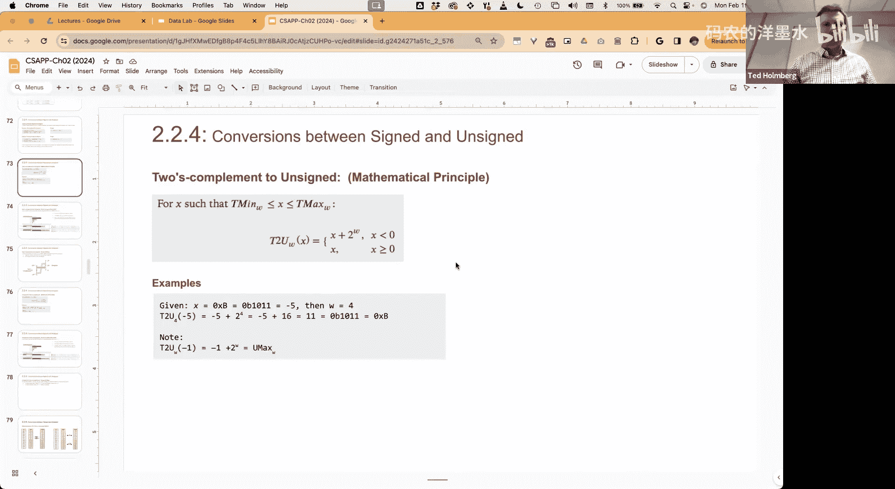